# 跟随系统 FollowSystem

<cite>
**本文引用的文件**   
- [FollowSystem.cs](file://SmartNPC/smapi-mod/Movement/FollowSystem.cs)
- [PathPlanner.cs](file://SmartNPC/smapi-mod/Movement/PathPlanner.cs)
- [NpcAnimationController.cs](file://SmartNPC/smapi-mod/Movement/NpcAnimationController.cs)
- [NpcInventory.cs](file://SmartNPC/smapi-mod/Data/NpcInventory.cs)
- [NpcActionHandlerBase.cs](file://SmartNPC/smapi-mod/Behavior/NpcActionHandlerBase.cs)
- [WorldActionHandlers.cs](file://SmartNPC/smapi-mod/Behavior/WorldActionHandlers.cs)
- [SocialActionHandlers.cs](file://SmartNPC/smapi-mod/Behavior/SocialActionHandlers.cs)
</cite>

## 目录
1. [引言](#引言)
2. [项目结构与角色定位](#项目结构与角色定位)
3. [核心组件总览](#核心组件总览)
4. [架构与数据流](#架构与数据流)
5. [NPC 行为状态机详解](#npc-行为状态机详解)
6. [工作任务实现分析](#工作任务实现分析)
7. [路径规划与寻路机制](#路径规划与寻路机制)
8. [动画与可见性控制](#动画与可见性控制)
9. [玩家传送同步](#玩家传送同步)
10. [任务优先级与冲突解决](#任务优先级与冲突解决)
11. [扩展新行为模式指南](#扩展新行为模式指南)
12. [性能与健壮性](#性能与健壮性)
13. [故障排查](#故障排查)
14. [结论](#结论)

## 引言
FollowSystem 是 SmartNPC SMAPI 模组中驱动 NPC 行为的移动与状态中枢。它把“跟随、召唤、带领、漫游”等通用移动行为，与“清理碎片、采集资源、种植、浇水、收割、施肥、拆毁资源、存取物品”等工作任务统一在一个每帧泵送的 Tick 循环中执行。所有对游戏对象（NPC、地图、库存、气泡文本）的修改都在游戏线程完成；WebSocket 或 MCP 调用只负责设置目标模式和参数。

该文档重点解释：
- NpcBehaviorMode 状态机及其转换逻辑。
- Summoning、Following、Leading、Wander 的移动语义。
- ClearDebris、ForageCollect、PlantSeeds、WaterCrops、HarvestCrops 等任务的发现、排序、执行和退出条件。
- NpcBehaviorState 如何承载每个 NPC 的目标位置、队列、进度和库存。
- OnPlayerWarped 如何保证跟随和带领模式下的跨地图同步。
- 如何新增一种 NPC 行为模式并接入动画、气泡和序列化。

## 项目结构与角色定位
FollowSystem 不是单一类，而是一个 partial 类，配合多个子系统协作：

| 模块 | 职责 | 关键文件 |
|---|---|---|
| 行为状态机 | 定义模式、维护 NpcBehaviorState、每帧泵送切换 | FollowSystem.cs |
| 路径规划器 | 对多目标进行近优曼哈顿排序 | PathPlanner.cs |
| 动画控制器 | XiaMi 自定义动画播放、行走帧、阻塞判断 | NpcAnimationController.cs |
| NPC 背包 | 持久化物品槽、堆叠、取出、快照 | NpcInventory.cs |
| 动作基类 | WebSocket 请求处理、气泡显示、串行队列调度 | NpcActionHandlerBase.cs |
| 世界动作处理器 | 清理碎片、浇水、收割等农活入口 | WorldActionHandlers.cs |
| 社交动作处理器 | 表情、害羞后退、闲逛、庆祝等社交行为 | SocialActionHandlers.cs |

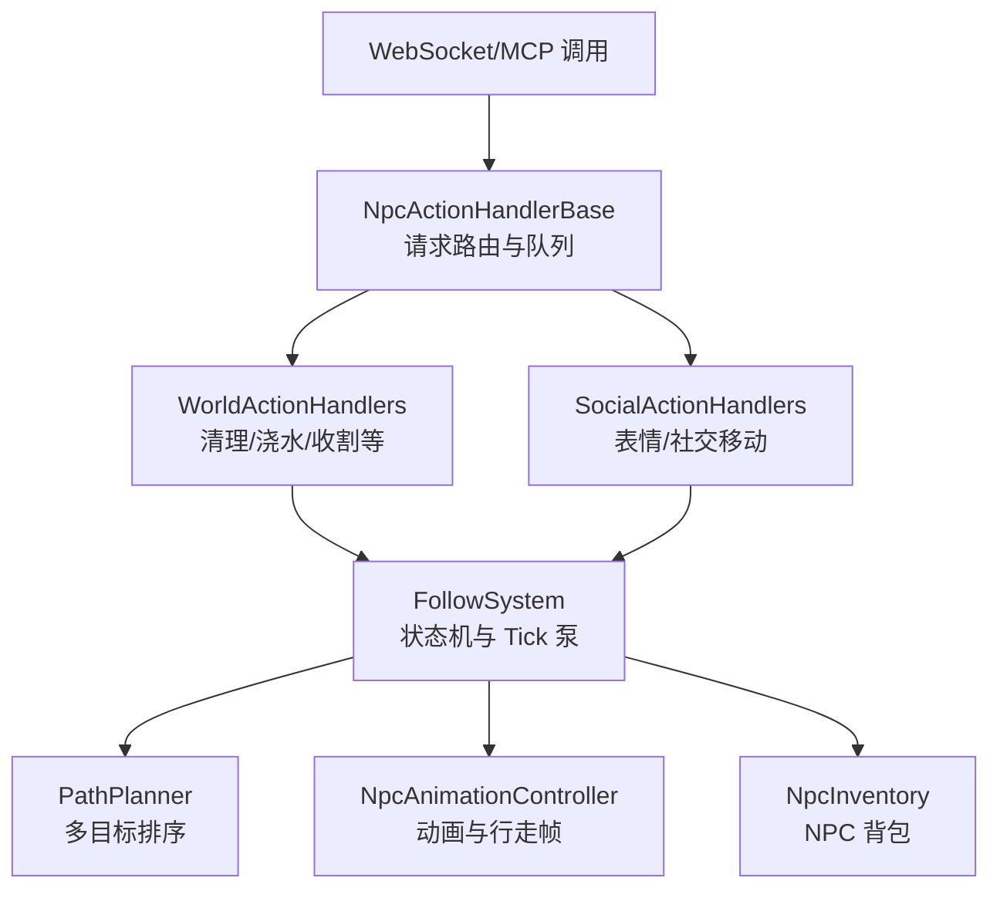

**图表来源**
- [FollowSystem.cs:1-30](file://SmartNPC/smapi-mod/Movement/FollowSystem.cs#L1-L30)
- [NpcActionHandlerBase.cs:1-30](file://SmartNPC/smapi-mod/Behavior/NpcActionHandlerBase.cs#L1-L30)
- [WorldActionHandlers.cs:1-30](file://SmartNPC/smapi-mod/Behavior/WorldActionHandlers.cs#L1-L30)
- [SocialActionHandlers.cs:1-20](file://SmartNPC/smapi-mod/Behavior/SocialActionHandlers.cs#L1-L20)
- [PathPlanner.cs:1-25](file://SmartNPC/smapi-mod/Movement/PathPlanner.cs#L1-L25)
- [NpcAnimationController.cs:1-20](file://SmartNPC/smapi-mod/Movement/NpcAnimationController.cs#L1-L20)
- [NpcInventory.cs:1-20](file://SmartNPC/smapi-mod/Data/NpcInventory.cs#L1-L20)

**章节来源**
- [FollowSystem.cs:1-30](file://SmartNPC/smapi-mod/Movement/FollowSystem.cs#L1-L30)
- [NpcActionHandlerBase.cs:1-30](file://SmartNPC/smapi-mod/Behavior/NpcActionHandlerBase.cs#L1-L30)

## 核心组件总览

### NpcBehaviorMode：行为模式枚举
NpcBehaviorMode 是状态机的全部模式集合，包括：
- 移动模式：Idle、Summoning、Following、Leading、Wander。
- 农场工作：ClearDebris、ForageCollect、DepositItems、ShipItems、TillSoil、PlantSeeds、WaterCrops、HarvestCrops、Fertilize、FillGaps。
- 交互工作：WithdrawItems、BreakResource、PetAnimal。
- 辅助模式：Animating、SocialMovement。

这种设计让“移动”和“工作”共用同一套 PumpOnGameTick 调度，避免为每种农活单独建一个独立循环。

**章节来源**
- [FollowSystem.cs:20-50](file://SmartNPC/smapi-mod/Movement/FollowSystem.cs#L20-L50)

### NpcBehaviorState：单 NPC 状态容器
NpcBehaviorState 持有当前模式及所有工作所需的临时数据，例如：
- Leading：LeadTarget、LeadMap。
- Wander：WanderTarget、WanderRadius、中心约束、矩形区域约束。
- ClearDebris：DebrisQueue、DebrisInventory、DebrisTarget、DebrisPathed。
- ForageCollect：ForageQueue、ForageTarget、ForageInventory、ForagePathed。
- PlantSeeds：PlantSeedQueue、PlantSeedTarget、PlantSeedInventory、PlantSeedID、PlantSeededCount。
- WaterCrops：WaterCropQueue、WaterCropTarget、WaterCropCount。
- HarvestCrops：HarvestQueue、HarvestTarget、HarvestInventory、HarvestedCount。
- DepositItems / WithdrawItems / ShipItems：箱子坐标、地图、物品过滤、已处理数量。
- BreakResource：ResourceTarget 队列、库存、计数。
- Fertilize / FillGaps：目标队列、目标点、计数。
- PetAnimal：宠物名称、是否已寻路。
- 公共字段：LastPathTick、ActionBubble、ActionStartedAt、PathFailCount、SummonPathed、SocialTargets、SocialDeadline、SocialPathed。

这种结构把“目标在哪里、已经做了什么、还剩多少、是否需要重新寻路”集中管理，便于 PumpOnGameTick 在每帧做最小增量更新。

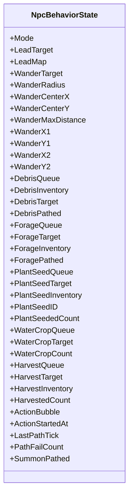

**图表来源**
- [FollowSystem.cs:50-200](file://SmartNPC/smapi-mod/Movement/FollowSystem.cs#L50-L200)
- [FollowSystem.cs:201-256](file://SmartNPC/smapi-mod/Movement/FollowSystem.cs#L201-L256)

**章节来源**
- [FollowSystem.cs:50-200](file://SmartNPC/smapi-mod/Movement/FollowSystem.cs#L50-L200)

### NpcInventory：NPC 背包
NpcInventory 以 NPC 名称为键，保存 ItemSlot 列表。ItemSlot 包含物品 ID、数量和品质。支持：
- Add：按 itemId 和 quality 堆叠。
- Take：按 itemId 取走最多 count 个。
- GetItems：返回只读快照。
- HasItems：快速判断是否有物品。
- Snapshot / Restore：用于 SMAPI 持久化。

这使 NPC 的工作任务可以像玩家背包一样存取种子、肥料、收获物、清理出的石头和木头。

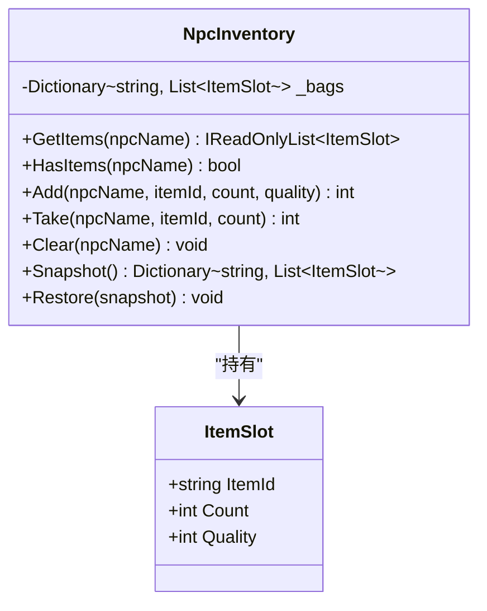

**图表来源**
- [NpcInventory.cs:1-116](file://SmartNPC/smapi-mod/Data/NpcInventory.cs#L1-L116)

**章节来源**
- [NpcInventory.cs:1-116](file://SmartNPC/smapi-mod/Data/NpcInventory.cs#L1-L116)

## 架构与数据流

### 请求到执行的典型流程
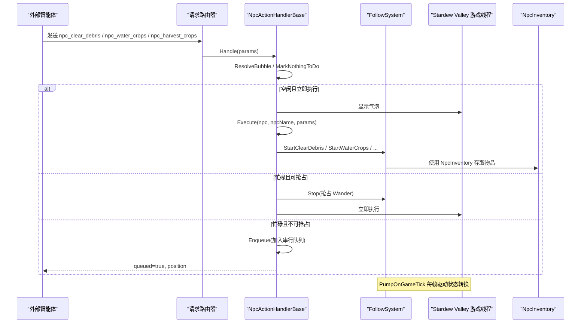

**图表来源**
- [NpcActionHandlerBase.cs:120-250](file://SmartNPC/smapi-mod/Behavior/NpcActionHandlerBase.cs#L120-L250)
- [NpcActionHandlerBase.cs:250-478](file://SmartNPC/smapi-mod/Behavior/NpcActionHandlerBase.cs#L250-L478)
- [WorldActionHandlers.cs:201-350](file://SmartNPC/smapi-mod/Behavior/WorldActionHandlers.cs#L201-L350)
- [FollowSystem.cs:1023-1260](file://SmartNPC/smapi-mod/Movement/FollowSystem.cs#L1023-L1260)

**章节来源**
- [NpcActionHandlerBase.cs:120-478](file://SmartNPC/smapi-mod/Behavior/NpcActionHandlerBase.cs#L120-L478)
- [WorldActionHandlers.cs:201-350](file://SmartNPC/smapi-mod/Behavior/WorldActionHandlers.cs#L201-L350)

## NPC 行为状态机详解

### 状态图
```mermaid
stateDiagram-v2
    [*] --> Idle
    Idle --> Summoning : "Summon"
    Idle --> Following : "StartFollow"
    Idle --> Leading : "LeadTo"
    Idle --> Wander : "StartWander"
    Idle --> ClearDebris : "StartClearDebris"
    Idle --> ForageCollect : "StartForageCollect"
    Idle --> DepositItems : "StartDepositItems"
    Idle --> ShipItems : "StartShipItems"
    Idle --> TillSoil : "StartTillSoil"
    Idle --> PlantSeeds : "StartPlantSeeds"
    Idle --> WaterCrops : "StartWaterCrops"
    Idle --> HarvestCrops : "StartHarvestCrops"
    Idle --> WithdrawItems : "StartWithdrawItems"
    Idle --> BreakResource : "StartBreakResource"
    Idle --> Fertilize : "StartFertilize"
    Idle --> FillGaps : "StartFillGaps"
    Idle --> PetAnimal : "StartPetAnimal"
    Idle --> SocialMovement : "StartSocialMovement"
    Idle --> Animating : "Blocking animation"

    Summoning --> Idle : "到达玩家附近"
    Following --> Following : "距离超阈值后重新寻路"
    Leading --> Idle : "最终目标到达"
    Wander --> Wander : "到达后选择下一个随机目标"
    ClearDebris --> ClearDebris : "处理下一个碎片"
    ForageCollect --> ForageCollect : "采集下一个资源"
    DepositItems --> DepositItems : "继续存入下一个物品"
    ShipItems --> ShipItems : "继续装箱下一个物品"
    TillSoil --> TillSoil : "继续锄地"
    PlantSeeds --> PlantSeeds : "继续播种"
    WaterCrops --> WaterCrops : "继续浇水"
    HarvestCrops --> HarvestCrops : "继续收割"
    WithdrawItems --> WithdrawItems : "继续取出物品"
    BreakResource --> BreakResource : "继续破坏资源"
    Fertilize --> Fertilize : "继续施肥"
    FillGaps --> FillGaps : "继续填坑"
    PetAnimal --> Idle : "抚摸结束"
    SocialMovement --> Idle : "社交移动结束"
    Animating --> Idle : "动画结束"
```

**图表来源**
- [FollowSystem.cs:20-50](file://SmartNPC/smapi-mod/Movement/FollowSystem.cs#L20-L50)
- [FollowSystem.cs:1023-1260](file://SmartNPC/smapi-mod/Movement/FollowSystem.cs#L1023-L1260)

### Idle
Idle 是默认安全状态。PumpOnGameTick 会恢复 NPC 速度、清除持续气泡，并拦截游戏注入的 PathFindController，防止游戏内置 AI 干扰 Agent 控制。

**章节来源**
- [FollowSystem.cs:1023-1120](file://SmartNPC/smapi-mod/Movement/FollowSystem.cs#L1023-L1120)

### Summoning：传送到玩家附近
Summoning 的逻辑分为两步：
1. 如果 NPC 与玩家不在同一地图，则传送到玩家当前位置的“身后相邻格”。
2. 在同一地图时，向玩家“正前方相邻格”发起寻路。
3. 当 NPC 与玩家距离小于等于 1.5 格且没有活跃路径时，面向玩家并切换到 Idle。

关键点：
- 跨地图使用 Game1.warpCharacter。
- 同地图使用 TryStartPath。
- SummonPathed 标记是否已经发出最后一段同地图寻路。
- 失败时记录日志并回到 Idle。

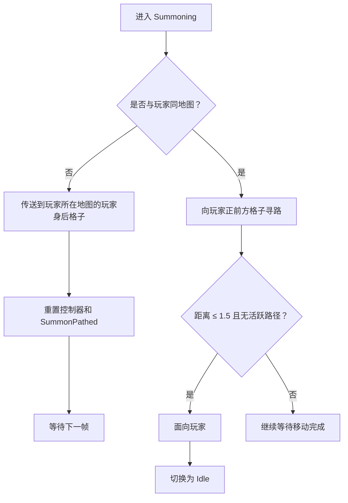

**图表来源**
- [FollowSystem.cs:1156-1260](file://SmartNPC/smapi-mod/Movement/FollowSystem.cs#L1156-L1260)

**章节来源**
- [FollowSystem.cs:1156-1260](file://SmartNPC/smapi-mod/Movement/FollowSystem.cs#L1156-L1260)

### Following：距离检测与重新寻路
Following 的核心是“保持在玩家周围一定半径内”。默认半径为 3 格。每约 30 帧评估一次是否需要重新寻路。

流程要点：
- 如果 NPC 与玩家不同地图，尝试传送到玩家身后格。
- 如果没有达到重规划间隔，直接返回。
- 计算 NPC 与玩家的欧几里得距离。
- 距离小于等于 FollowRadiusTiles 时不发起新路径。
- 否则向玩家身后格发起寻路，并更新时间戳 LastPathTick。

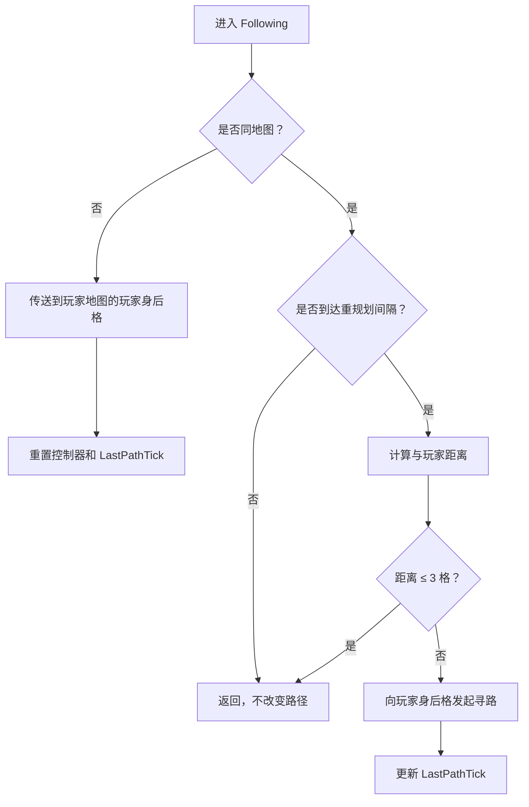

**图表来源**
- [FollowSystem.cs:1156-1260](file://SmartNPC/smapi-mod/Movement/FollowSystem.cs#L1156-L1260)

**章节来源**
- [FollowSystem.cs:1156-1260](file://SmartNPC/smapi-mod/Movement/FollowSystem.cs#L1156-L1260)

### Leading：分段路径规划
Leading 模式将长距离目标拆成最大 5 格的片段。每次只规划一段，完成后入队下一段，直到最终目标到达。

设计动机：
- 避免一次性规划整条长路径被中途打断后完全失效。
- 允许每段结束后重新评估目标是否仍有效。
- 与 Following 的重规划节奏一致，保持行为一致性。

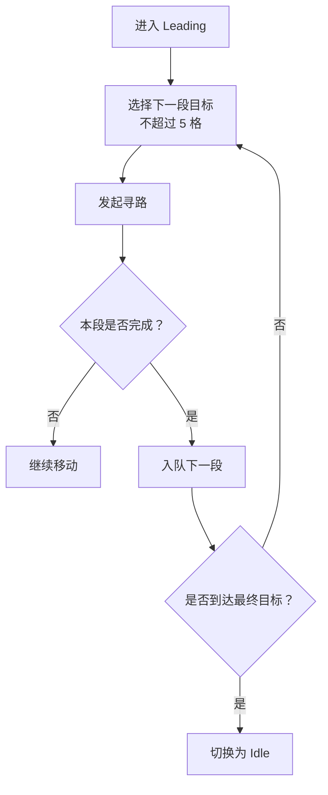

**图表来源**
- [FollowSystem.cs:1260-1360](file://SmartNPC/smapi-mod/Movement/FollowSystem.cs#L1260-L1360)

**章节来源**
- [FollowSystem.cs:1260-1360](file://SmartNPC/smapi-mod/Movement/FollowSystem.cs#L1260-L1360)

### Wander：连续漫游
Wander 是“填充型”行为：选择一个可达随机格子，走到那里后继续选下一个，直到 StopFollow 或更高优先级任务抢占。

支持约束：
- 半径半径 WanderRadius。
- 中心+最大距离 tether。
- x1,y1,x2,y2 矩形区域。
- 内部最多尝试 40 次选取合法格子。

**章节来源**
- [FollowSystem.cs:330-450](file://SmartNPC/smapi-mod/Movement/FollowSystem.cs#L330-L450)
- [WorldActionHandlers.cs:20-120](file://SmartNPC/smapi-mod/Behavior/WorldActionHandlers.cs#L20-L120)

## 工作任务实现分析

### 清理碎片 ClearDebris
ClearDebris 的任务入口是 ClearDebrisHandler.Execute。它首先根据用户提供的 bbox 或 NPC 周围 radius 扫描可清理对象，然后尝试收缩到农田范围，再统计 Object、TerrainFeature、ResourceClump 三类碎片。

关键行为：
- 如果在扫描范围内找到 HoeDirt，则构建农田边界框，并向外扩展 extend 格，限制后续清理范围。
- 识别杂草、树枝、垃圾、石头、树桩、小树苗、草地、空心原木等。
- 按距离排序后裁剪到 effectiveCap（默认硬上限 15）。
- 使用 PathPlanner.PlanBy 生成近优访问顺序。
- 通过 FollowSystem.StartClearDebris 启动状态机。

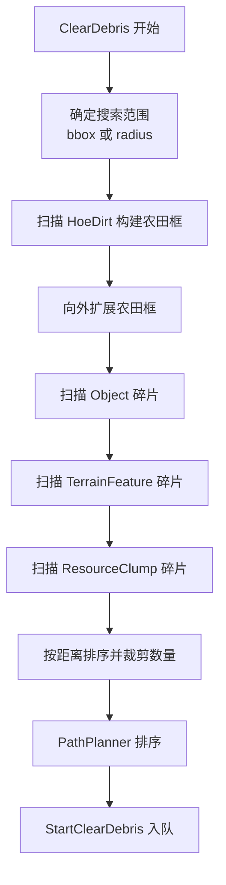

**图表来源**
- [WorldActionHandlers.cs:201-350](file://SmartNPC/smapi-mod/Behavior/WorldActionHandlers.cs#L201-L350)
- [PathPlanner.cs:40-120](file://SmartNPC/smapi-mod/Movement/PathPlanner.cs#L40-L120)
- [FollowSystem.cs:450-520](file://SmartNPC/smapi-mod/Movement/FollowSystem.cs#L450-L520)

**章节来源**
- [WorldActionHandlers.cs:201-350](file://SmartNPC/smapi-mod/Behavior/WorldActionHandlers.cs#L201-L350)
- [FollowSystem.cs:450-520](file://SmartNPC/smapi-mod/Movement/FollowSystem.cs#L450-L520)

### 采集资源 ForageCollect
ForageCollect 接收一组 (Tile, ItemId, ItemName)，由 NPC 依次移动到目标格子并拾取，同时将结果写入 NpcInventory。

特点：
- 使用队列逐个消费目标。
- ForageTarget 保存当前目标。
- ForageInventory 保存采集结果。
- ForagePathed 标记是否已发起寻路。

**章节来源**
- [FollowSystem.cs:520-560](file://SmartNPC/smapi-mod/Movement/FollowSystem.cs#L520-L560)

### 种植作物 PlantSeeds
PlantSeeds 遍历空 HoeDirt 格子，从 NPC 背包中取出种子并播种。

关键字段：
- PlantSeedQueue：待播种格子队列。
- PlantSeedTarget：当前目标。
- PlantSeedInventory：背包。
- PlantSeedID：要播种的物品 ID。
- PlantSeededCount：已播种数量。
- PlantSeedPathed：是否已寻路。

**章节来源**
- [FollowSystem.cs:120-170](file://SmartNPC/smapi-mod/Movement/FollowSystem.cs#L120-L170)

### 浇水 WaterCrops
WaterCropsHandler 扫描地形中的 HoeDirt，要求：
- 有作物。
- 作物未死亡。
- 未处于 watered 状态。
- 在 bbox 或 radius 范围内。

它会按距离排序并限制最大数量，然后交给 FollowSystem.StartWaterCrops。

**章节来源**
- [WorldActionHandlers.cs:543-750](file://SmartNPC/smapi-mod/Behavior/WorldActionHandlers.cs#L543-L750)
- [FollowSystem.cs:120-160](file://SmartNPC/smapi-mod/Movement/FollowSystem.cs#L120-L160)

### 收割 HarvestCrops
HarvestCropsHandler 扫描成熟作物，把收获物写入 NpcInventory，并通过 FollowSystem 驱动 NPC 逐个格子收割。

**章节来源**
- [WorldActionHandlers.cs:750-900](file://SmartNPC/smapi-mod/Behavior/WorldActionHandlers.cs#L750-L900)
- [FollowSystem.cs:140-170](file://SmartNPC/smapi-mod/Movement/FollowSystem.cs#L140-L170)

### 其他工作任务概览
- DepositItems：走向箱子，按物品 ID 过滤后存入背包。
- ShipItems：走向农场出货箱，由原版夜间出货流程结算。
- TillSoil：锄地，支持前置清理碎片和砍树。
- WithdrawItems：从箱子取出物品到背包。
- BreakResource：砍树、挖石头、收集掉落物。
- Fertilize：对空 HoeDirt 施肥。
- FillGaps：填补非 HoeDirt 的空地块。
- PetAnimal：接近当前玩家宠物并抚摸。

这些任务都遵循相同模板：
1. 扫描目标。
2. 可选 TSP 排序。
3. 调用 FollowSystem.StartXxx 进入对应 NpcBehaviorMode。
4. PumpOnGameTick 每帧推进队列。
5. 完成后回到 Idle。

**章节来源**
- [FollowSystem.cs:120-200](file://SmartNPC/smapi-mod/Movement/FollowSystem.cs#L120-L200)
- [WorldActionHandlers.cs:201-900](file://SmartNPC/smapi-mod/Behavior/WorldActionHandlers.cs#L201-L900)

## 路径规划与寻路机制

### PathPlanner：近优曼哈顿排序
PathPlanner 不是真正的 A* 寻路器，而是多目标访问顺序优化器。它假设实际寻路由 StardewValley.Pathfinding.PathFindController 完成，而本模块负责决定“先去哪、再去哪”。

算法步骤：
1. Nearest-Neighbor 初始游程：从起点贪心选择最近目标，O(n²)。
2. 2-opt 局部优化：反转任意子段，若连接代价更低则接受，最多 8 轮。
3. 距离度量是曼哈顿距离，忽略障碍物，但相对顺序稳定。

时间复杂度：
- n 很小（通常 10-100），整体远低于 1ms。
- 空间复杂度 O(n)。

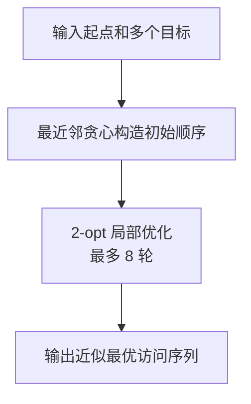

**图表来源**
- [PathPlanner.cs:1-120](file://SmartNPC/smapi-mod/Movement/PathPlanner.cs#L1-L120)

**章节来源**
- [PathPlanner.cs:1-120](file://SmartNPC/smapi-mod/Movement/PathPlanner.cs#L1-L120)

### FollowSystem 的 TryStartPath 与重规划间隔
FollowSystem 使用 ReplanIntervalTicks=30 控制 Following/Leading 的重规划频率，避免每帧重复构造寻路。同时使用 LastPathTick 作为每状态的冷却计时器。

此外还有 MaxPathFailures 和 PathFailCount，用于跳过不可达目标，防止无限重试。

**章节来源**
- [FollowSystem.cs:260-320](file://SmartNPC/smapi-mod/Movement/FollowSystem.cs#L260-L320)
- [FollowSystem.cs:201-256](file://SmartNPC/smapi-mod/Movement/FollowSystem.cs#L201-L256)

## 动画与可见性控制

### NpcAnimationController
NpcAnimationController 专门处理名为 XiaMi 的 NPC 的自定义精灵表播放。它维护：
- _playing：正在播放的动画字典。
- _walkClocks：行走帧时钟。
- Blocking/Ambient 区分阻塞动画和非阻塞环境动画。

行为特性：
- Play：暂停原生控制器，停止 Sprite 动画，设置方向，记录原始 ignoreMovementAnimation 和 flip。
- Cancel：恢复原始状态，清行走帧。
- Update：每帧推进动画；如果 NPC 对象变化、地图变化或控制器被替换，则取消动画。
- SetWalkFrame：根据 FacingDirection 选择 XiaMiData 中的起始帧。

这对 FollowSystem 非常重要：
- 阻塞动画期间，FollowSystem.GetMode 返回 Animating，阻止状态切换。
- 非阻塞动画被视为 Ambient，不影响普通移动。
- 玩家传送、重启、移动时会清理异常动画状态。

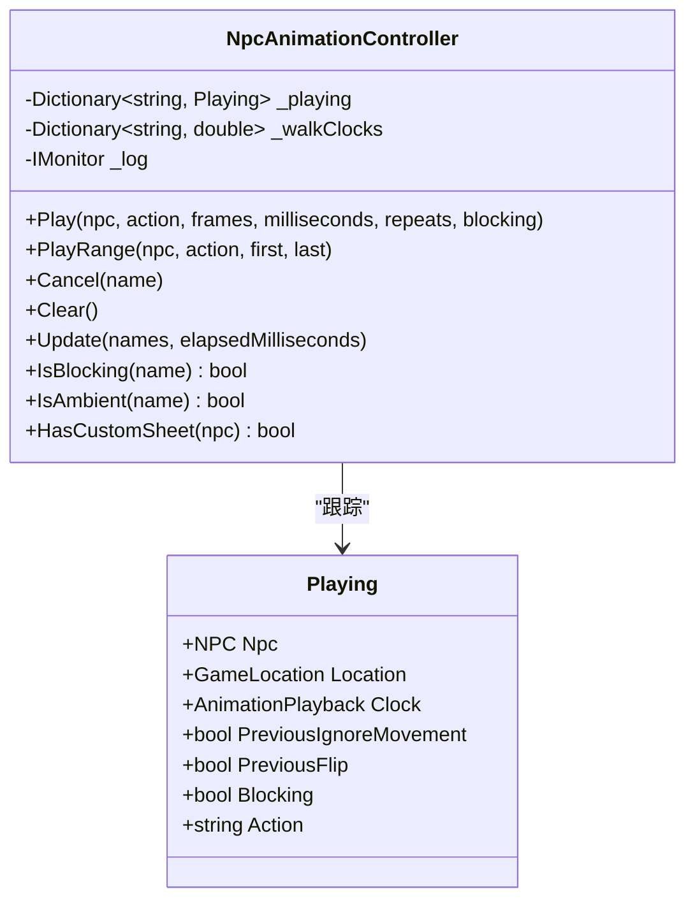

**图表来源**
- [NpcAnimationController.cs:1-109](file://SmartNPC/smapi-mod/Movement/NpcAnimationController.cs#L1-L109)

**章节来源**
- [NpcAnimationController.cs:1-109](file://SmartNPC/smapi-mod/Movement/NpcAnimationController.cs#L1-L109)

### 持续气泡
NpcActionHandlerBase 在 RefuseWhileBusy 动作开始时调用 FollowSystem.SetActionBubble，记录气泡基础文本和起始 tick。PumpOnGameTick 每 60 帧刷新一次，追加“已过秒数”，让玩家看到类似“[清理] 12s”的提示。

**章节来源**
- [NpcActionHandlerBase.cs:160-220](file://SmartNPC/smapi-mod/Behavior/NpcActionHandlerBase.cs#L160-L220)
- [FollowSystem.cs:996-1060](file://SmartNPC/smapi-mod/Movement/FollowSystem.cs#L996-L1060)

## 玩家传送同步

### OnPlayerWarped
当玩家传送到新地图时，FollowSystem.OnPlayerWarped 检查所有处于 Following 或 Leading 模式的 NPC：
- 如果 NPC 尚未在新地图，则调用 Game1.warpCharacter 传送到玩家 Tile。
- 清除旧控制器。
- 重置 LastPathTick，强制下一帧立即重新寻路。
- 捕获异常并记录日志，避免单次同步失败影响整个状态机。

这与 Summoning 的跨地图传送互补：
- Summoning：主动把 NPC 带到玩家附近。
- Following/Leading：被动跟随玩家传送，保持位置关系。

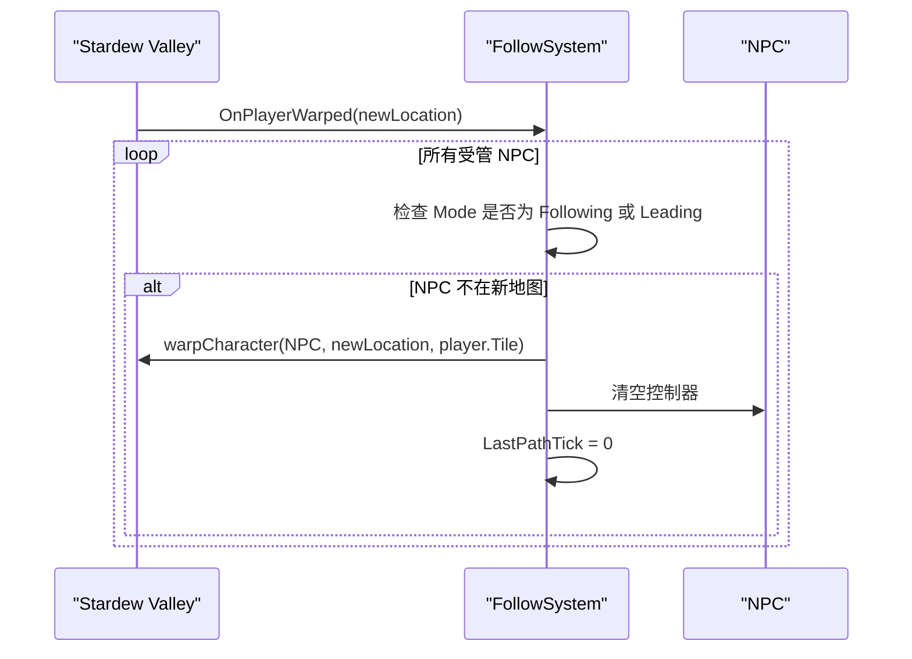

**图表来源**
- [FollowSystem.cs:1156-1220](file://SmartNPC/smapi-mod/Movement/FollowSystem.cs#L1156-L1220)

**章节来源**
- [FollowSystem.cs:1156-1220](file://SmartNPC/smapi-mod/Movement/FollowSystem.cs#L1156-L1220)

## 任务优先级与冲突解决

### 三种执行类别
NpcActionHandlerBase 明确定义了三种行为：

| 类型 | RefuseWhileBusy | IsPreemptable | 行为 |
|---|---:|---:|---|
| 简单动作 | false | 不适用 | 立即执行，不入队列。例如聊天、表情、气泡。 |
| 可抢占模式 | true | true | 当前只有 Wander。会被更高优先级任务抢占。 |
| 串行独占 | true | false | 清理、浇水、收割、搬运等长任务。必须排队完成。 |

### 队列模型
NpcActionQueue 维护 per-NPC FIFO：
- Enqueue：加入队列，返回位置编号。
- DrainReadyTasks：每帧检查 FollowSystem 是否 Idle，如果是则取出一个任务执行。
- IsPreemptableMode：目前只有 Wander 可被抢占。
- Clear：超时或强制空闲时清空队列。

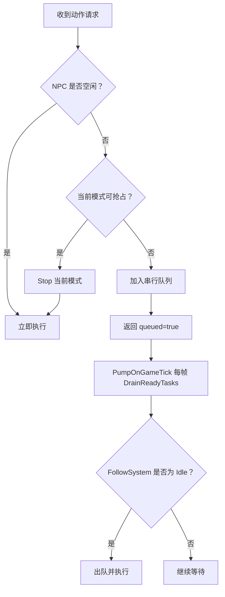

**图表来源**
- [NpcActionHandlerBase.cs:250-478](file://SmartNPC/smapi-mod/Behavior/NpcActionHandlerBase.cs#L250-L478)

**章节来源**
- [NpcActionHandlerBase.cs:250-478](file://SmartNPC/smapi-mod/Behavior/NpcActionHandlerBase.cs#L250-L478)

## 扩展新行为模式指南

### 第一步：添加 NpcBehaviorMode
在 NpcBehaviorMode 枚举中添加新模式，例如 NewTask。

### 第二步：扩展 NpcBehaviorState
为新任务添加所需字段，例如：
- 目标队列或单个目标。
- 相关库存引用。
- 是否已寻路。
- 已处理计数。
- 可选进度或元数据。

### 第三步：实现 StartXxx 方法
在 FollowSystem 中添加公开方法，例如 StartNewTask(string npcName, ...)，初始化 NpcBehaviorState.Mode 和 LastPathTick。

### 第四步：实现 TickNewTask
在 PumpOnGameTick 的 switch 分支中加入 NewTask，并在其中：
- 获取 NPC。
- 处理目标。
- 调用 TryStartPath。
- 更新计数和队列。
- 完成后切换回 Idle。

### 第五步：接入动作处理器
在 WorldActionHandlers 或 SocialActionHandlers 中创建继承 NpcActionHandlerBase 的处理器：
- 覆盖 ActionName。
- 根据需要覆盖 RefuseWhileBusy。
- 解析参数。
- 扫描目标。
- 调用 FollowSystem.StartNewTask。
- 使用 BBoxOverlay 标注工作区域。
- 必要时使用 NpcInventory 存取物品。

### 第六步：集成动画
如果需要自定义动画：
- 在 NpcAnimationController.Play 中注册帧序列。
- 在 FollowSystem 中使用 Animations.IsBlocking 判断是否应延迟状态切换。
- 在动画结束时让状态回到 Idle 或下一任务。

### 第七步：测试气泡与队列
- 确保 RefuseWhileBusy=true 的动作会显示持久气泡。
- 确认队列能正确排队、抢占和释放。
- 验证 OnPlayerWarped 不会让新任务模式出现位置错乱。

**章节来源**
- [FollowSystem.cs:20-50](file://SmartNPC/smapi-mod/Movement/FollowSystem.cs#L20-L50)
- [FollowSystem.cs:980-1260](file://SmartNPC/smapi-mod/Movement/FollowSystem.cs#L980-L1260)
- [NpcActionHandlerBase.cs:1-120](file://SmartNPC/smapi-mod/Behavior/NpcActionHandlerBase.cs#L1-L120)
- [WorldActionHandlers.cs:20-120](file://SmartNPC/smapi-mod/Behavior/WorldActionHandlers.cs#L20-L120)
- [NpcAnimationController.cs:1-109](file://SmartNPC/smapi-mod/Movement/NpcAnimationController.cs#L1-L109)

## 性能与健壮性

### 性能特征
- PathPlanner 使用 O(n²) 最近邻加 2-opt，适用于小规模目标集。
- ReplanIntervalTicks=30 降低 Following/Leading 的频繁寻路。
- PumpOnGameTick 每帧只处理轻量状态检查和路径发起，不做重型 I/O。
- NpcInventory 使用字典+列表，读写在小规模背包下非常轻。
- 气泡刷新限频到每 60 帧一次，避免频繁 UI 更新。

### 健壮性机制
- ForceIdle：超过 MaxActionTicks 或 ClearDebrisMaxTicks 时强制回到 Idle，清空队列和单目标状态。
- MaxPathFailures：连续寻路失败后跳过目标，防止死循环。
- Exception catch：每个状态处理都被 try/catch 包裹，出错时取消动画并回到 Idle。
- IdleGuard：自动清理游戏注入的控制器，防止与 Agent 控制冲突。
- Animation safety：动画控制器在 NPC 或地图变化时主动取消，避免遗留帧。

**章节来源**
- [FollowSystem.cs:260-320](file://SmartNPC/smapi-mod/Movement/FollowSystem.cs#L260-L320)
- [FollowSystem.cs:1023-1260](file://SmartNPC/smapi-mod/Movement/FollowSystem.cs#L1023-L1260)
- [NpcAnimationController.cs:60-109](file://SmartNPC/smapi-mod/Movement/NpcAnimationController.cs#L60-L109)

## 故障排查

| 现象 | 可能原因 | 建议检查 |
|---|---|---|
| NPC 一直不动 | 处于 Idle 且被 IdleGuard 清理了控制器 | 检查 FollowSystem 是否意外切回 Idle |
| NPC 跟随玩家时卡住 | 玩家传送事件未触发或 OnPlayerWarped 失败 | 查看日志中的 warp-chase 错误 |
| 清理碎片不走直线 | 目标过多或未使用 PathPlanner | 确认 StartClearDebris 前是否调用过 PlanBy |
| 浇水无效 | 作物已死亡或已浇水 | 检查 HoeDirt.crop.dead 和 state.watered |
| 任务卡住很久 | 超过 MaxActionTicks 或 ClearDebrisMaxTicks | 检查 ForceIdle 日志 |
| 动画不消失 | 地图重载或 NPC 移动导致控制器变化 | 检查 NpcAnimationController.Update 的 Cancel 逻辑 |
| 任务排队不执行 | FollowSystem 未回到 Idle | 检查当前 NpcBehaviorMode 是否为 Idle |

**章节来源**
- [NpcActionHandlerBase.cs:200-478](file://SmartNPC/smapi-mod/Behavior/NpcActionHandlerBase.cs#L200-L478)
- [FollowSystem.cs:1023-1260](file://SmartNPC/smapi-mod/Movement/FollowSystem.cs#L1023-L1260)
- [NpcAnimationController.cs:60-109](file://SmartNPC/smapi-mod/Movement/NpcAnimationController.cs#L60-L109)

## 结论
FollowSystem 通过一个统一的 NpcBehaviorMode 状态机和 PumpOnGameTick 循环，把 NPC 的通用移动与工作行为整合在一起。Summoning、Following、Leading、Wander 提供稳定的移动语义；ClearDebris、ForageCollect、PlantSeeds、WaterCrops、HarvestCrops 等任务通过扫描、排序、队列化和逐帧推进实现自动化农场操作；NpcBehaviorState 把所有状态集中在单点；NpcInventory 提供持久化背包；NpcAnimationController 保证动画与移动互不污染；NpcActionHandlerBase 和 NpcActionQueue 提供清晰的任务优先级、抢占和串行执行模型。

对于开发者来说，扩展新行为的关键在于：
1. 明确该行为属于移动模式还是工作任务。
2. 在 NpcBehaviorState 中声明必要状态。
3. 在 FollowSystem 中实现 Start 和 Tick。
4. 在处理器中实现参数解析和目标发现。
5. 用 PathPlanner 优化多目标访问顺序。
6. 用 NpcInventory 管理物品。
7. 用 NpcAnimationController 控制可见动画。
8. 用 NpcActionQueue 正确处理排队和抢占。