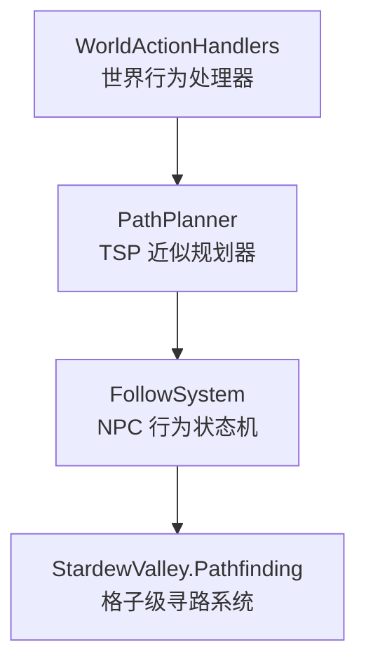
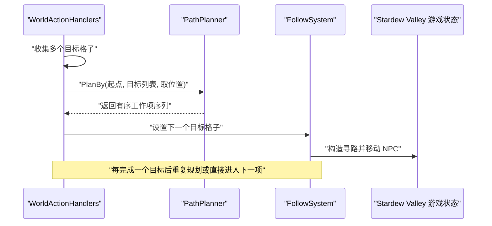
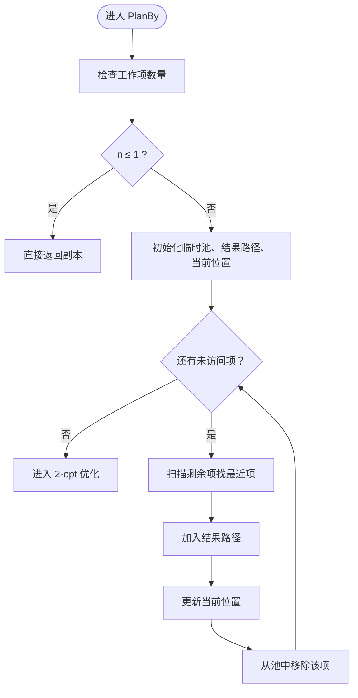
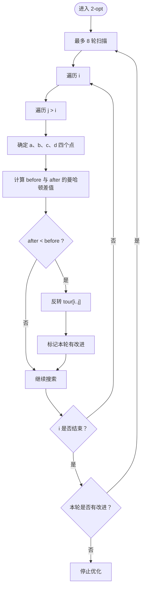
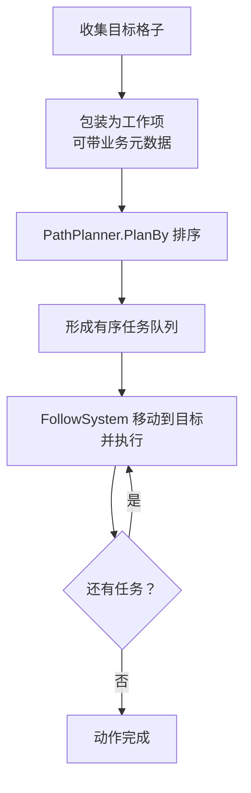

# 路径规划 PathPlanner

<cite>
**本文引用的文件**   
- [PathPlanner.cs](file://SmartNPC/smapi-mod/Movement/PathPlanner.cs)
- [WorldActionHandlers.cs](file://SmartNPC/smapi-mod/Behavior/WorldActionHandlers.cs)
- [FollowSystem.cs](file://SmartNPC/smapi-mod/Movement/FollowSystem.cs)
</cite>

## 目录
1. [引言](#引言)
2. [项目结构定位](#项目结构定位)
3. [核心组件总览](#核心组件总览)
4. [架构与调用关系](#架构与调用关系)
5. [详细算法分析](#详细算法分析)
6. [泛型工作项排序设计](#泛型工作项排序设计)
7. [实际应用场景](#实际应用场景)
8. [性能分析与复杂度](#性能分析与复杂度)
9. [与其他路径规划算法对比](#与其他路径规划算法对比)
10. [扩展自定义距离度量](#扩展自定义距离度量)
11. [故障排查与注意事项](#故障排查与注意事项)
12. [结论](#结论)

## 引言
PathPlanner 是 SmartNPC 模组中用于 NPC 行为动作的“类旅行商问题”路径规划器。它不直接求解完整的最优 TSP，而是在游戏实时帧内快速生成一条近似更优的多目标访问顺序：先用最近邻贪心法构造初始路径，再用 2-opt 局部优化反转子段，从而减少整体曼哈顿移动成本。该实现以网格坐标 `Point` 为基本单位，面向农场清理、翻地、播种、浇水、收割、采集、破坏资源等长耗时工具任务，把多个目标格子的访问顺序从“盲目就近选择”优化成“区域连贯、折返更少”的顺序。

## 项目结构定位
PathPlanner 位于模组 Movement 层，属于桥接命名空间下的静态规划器；它的上游主要是 Behavior 层的动作处理器，下游则是 FollowSystem 和底层路径寻路系统。

**图示来源**
- [PathPlanner.cs:1-120](file://SmartNPC/smapi-mod/Movement/PathPlanner.cs#L1-L120)
- [WorldActionHandlers.cs:300-310](file://SmartNPC/smapi-mod/Behavior/WorldActionHandlers.cs#L300-L310)
- [FollowSystem.cs:1-60](file://SmartNPC/smapi-mod/Movement/FollowSystem.cs#L1-L60)

**章节来源**
- [PathPlanner.cs:1-120](file://SmartNPC/smapi-mod/Movement/PathPlanner.cs#L1-L120)
- [WorldActionHandlers.cs:300-310](file://SmartNPC/smapi-mod/Behavior/WorldActionHandlers.cs#L300-L310)

## 核心组件总览
PathPlanner 是一个内部静态类，对外暴露两个关键成员：

| 成员 | 类型 | 职责 | 输入 | 输出 |
|---|---|---|---|---|
| `Manhattan` | 静态方法 | 计算两点之间的曼哈顿距离 | 两个 `Point` | `int` 距离 |
| `Plan` | 静态方法 | 对一组目标格子按曼哈顿距离排序 | 起点 `Point`、目标点集合 | 新 `List<Point>` |
| `PlanBy<T>` | 泛型静态方法 | 对任意工作项按位置字段排序 | 起点、工作项列表、位置提取函数 | 新 `List<T>` |

该类没有实例字段，也不持有全局状态；每次调用都是纯函数式的一次性规划过程，适合在游戏主循环或动作调度中反复调用。

**章节来源**
- [PathPlanner.cs:24-42](file://SmartNPC/smapi-mod/Movement/PathPlanner.cs#L24-L42)

## 架构与调用关系
PathPlanner 在 SmartNPC 中的主要调用者是 `WorldActionHandlers`。不同农场作业会先收集目标格子集合，再调用 `PlanBy` 得到有序访问队列，最后交给 FollowSystem 驱动 NPC 逐个到达并执行动作。

**图示来源**
- [WorldActionHandlers.cs:300-310](file://SmartNPC/smapi-mod/Behavior/WorldActionHandlers.cs#L300-L310)
- [WorldActionHandlers.cs:480-500](file://SmartNPC/smapi-mod/Behavior/WorldActionHandlers.cs#L480-L500)
- [WorldActionHandlers.cs:590-600](file://SmartNPC/smapi-mod/Behavior/WorldActionHandlers.cs#L590-L600)
- [WorldActionHandlers.cs:850-865](file://SmartNPC/smapi-mod/Behavior/WorldActionHandlers.cs#L850-L865)
- [WorldActionHandlers.cs:1080-1090](file://SmartNPC/smapi-mod/Behavior/WorldActionHandlers.cs#L1080-L1090)
- [WorldActionHandlers.cs:1260-1275](file://SmartNPC/smapi-mod/Behavior/WorldActionHandlers.cs#L1260-L1275)
- [WorldActionHandlers.cs:2140-2150](file://SmartNPC/smapi-mod/Behavior/WorldActionHandlers.cs#L2140-L2150)
- [WorldActionHandlers.cs:2290-2300](file://SmartNPC/smapi-mod/Behavior/WorldActionHandlers.cs#L2290-L2300)
- [WorldActionHandlers.cs:2415-2425](file://SmartNPC/smapi-mod/Behavior/WorldActionHandlers.cs#L2415-L2425)

**章节来源**
- [WorldActionHandlers.cs:300-310](file://SmartNPC/smapi-mod/Behavior/WorldActionHandlers.cs#L300-L310)
- [WorldActionHandlers.cs:480-500](file://SmartNPC/smapi-mod/Behavior/WorldActionHandlers.cs#L480-L500)
- [WorldActionHandlers.cs:590-600](file://SmartNPC/smapi-mod/Behavior/WorldActionHandlers.cs#L590-L600)
- [WorldActionHandlers.cs:850-865](file://SmartNPC/smapi-mod/Behavior/WorldActionHandlers.cs#L850-L865)
- [WorldActionHandlers.cs:1080-1090](file://SmartNPC/smapi-mod/Behavior/WorldActionHandlers.cs#L1080-L1090)
- [WorldActionHandlers.cs:1260-1275](file://SmartNPC/smapi-mod/Behavior/WorldActionHandlers.cs#L1260-L1275)
- [WorldActionHandlers.cs:2140-2150](file://SmartNPC/smapi-mod/Behavior/WorldActionHandlers.cs#L2140-L2150)
- [WorldActionHandlers.cs:2290-2300](file://SmartNPC/smapi-mod/Behavior/WorldActionHandlers.cs#L2290-L2300)
- [WorldActionHandlers.cs:2415-2425](file://SmartNPC/smapi-mod/Behavior/WorldActionHandlers.cs#L2415-L2425)

## 详细算法分析

### 曼哈顿距离
`Manhattan(a, b)` 返回两点横纵坐标差的绝对值之和。它对应于四向网格上的最小步数下界，不考虑障碍物、门、水域、地形差异等真实路径代价。

| 特性 | 说明 |
|---|---|
| 时间复杂度 | O(1) |
| 空间复杂度 | O(1) |
| 优势 | 计算极快，适合频繁比较 |
| 局限 | 不是真实路径长度，尤其存在障碍时可能严重低估 |
| 适用场景 | 相对顺序稳定、同区域多点访问的启发式排序 |

**章节来源**
- [PathPlanner.cs:33-36](file://SmartNPC/smapi-mod/Movement/PathPlanner.cs#L33-L36)

### 最近邻贪心构建初始路径
`Plan` 直接委托给 `PlanBy`；`PlanBy` 的第一步是最近邻贪心：

1. 复制原始工作项到临时池。
2. 从 NPC 当前位置开始。
3. 在剩余未访问项中找出曼哈顿距离最小的项。
4. 将其加入结果路径。
5. 更新当前位置为该工作项的位置。
6. 重复直到所有项被访问。

这个步骤的时间复杂度是 O(n²)，因为每选一项都要扫描剩余项。优点是简单、稳定、适合小规模目标集；缺点是第一个选择会影响后续方向，可能造成整体折返。

**图示来源**
- [PathPlanner.cs:52-74](file://SmartNPC/smapi-mod/Movement/PathPlanner.cs#L52-L74)

**章节来源**
- [PathPlanner.cs:40-74](file://SmartNPC/smapi-mod/Movement/PathPlanner.cs#L40-L74)

### 2-opt 局部优化
第二步使用 2-opt 改进路径。对于开放路径（从起点出发、访问每个目标一次、不需要回到起点），2-opt 尝试反转区间 `[i, j]`，只重新连接两端边界边：

- 原路径相关边：`a → b` 和可选的 `c → d`。
- 反转后相关边：`a → c` 和可选的 `b → d`。
- 如果反转后的总曼哈顿距离更小，则执行反转。

其中：
- `a` 是 `i` 的前驱；若 `i == 0`，则前驱是 NPC 起点。
- `b` 是 `tour[i]`。
- `c` 是 `tour[j]`。
- `d` 是 `tour[j+1]`；若 `j` 是最后一个元素，则不存在这条边。

算法还设置了最大迭代次数 `maxPasses = 8`：每轮扫描所有 `(i, j)` 对，如果某轮没有任何改进就提前终止。

**图示来源**
- [PathPlanner.cs:76-118](file://SmartNPC/smapi-mod/Movement/PathPlanner.cs#L76-L118)

#### 数学原理与性能要点
- **为什么只检查边界边：** 反转区间 `[i, j]` 只会改变与区间端点相连的两条边；区间内部的边只是方向反转，但曼哈顿距离是无向的，因此内部边总代价不变。
- **增量成本计算：** 不需要重算整条路径的总长度，只需比较替换前后的两段或三段边，显著降低常数开销。
- **最大迭代次数：** 固定上限保证规划器不会无限循环，即使遇到退化距离分布也能按时返回。
- **早期退出：** 单轮扫描如果没有任何交换能降低成本，说明当前路径已经局部最优，直接结束。
- **时间复杂度：** 每轮 O(n²)，最多 8 轮，因此整体约 O(8·n²)，仍可视为 O(n²)。

**章节来源**
- [PathPlanner.cs:76-118](file://SmartNPC/smapi-mod/Movement/PathPlanner.cs#L76-L118)

## 泛型工作项排序设计
`PlanBy<T>(start, items, getPoint)` 是更通用的接口。它允许调用方传入任意工作项类型，只要提供 `getPoint` 函数把工作项映射到 `Point`。

这种设计的优势包括：

| 方面 | 说明 |
|---|---|
| 类型安全 | 调用方可以保留作物 ID、掉落预览、物品数量等业务信息 |
| 复用性强 | 同一规划逻辑可用于清理碎片、翻地、浇水、收割、采集、破坏资源等 |
| 解耦清晰 | 规划器只关心“位置”，不关心工作项的业务含义 |
| 测试友好 | 可用简单对象构造单元测试数据 |

在 `WorldActionHandlers` 中，常见用法是把 `Point` 本身作为工作项，通过 `p => p` 传递；也可以把包含业务元数据的对象传给 `PlanBy`，让规划器只按其中坐标排序。

**章节来源**
- [PathPlanner.cs:43-74](file://SmartNPC/smapi-mod/Movement/PathPlanner.cs#L43-L74)
- [WorldActionHandlers.cs:300-310](file://SmartNPC/smapi-mod/Behavior/WorldActionHandlers.cs#L300-L310)

## 实际应用场景
PathPlanner 主要用于农场作业的“多目标访问顺序优化”。典型流程是：

1. 根据包围盒或半径筛选出需要处理的目标格子。
2. 把目标格子包装成工作项，可能附带物品 ID、目标类型等元数据。
3. 用 `PlanBy` 从 NPC 当前位置排序这些工作项。
4. 将排序后的队列交给 FollowSystem，逐步移动到每个目标并执行操作。
5. 完成后继续处理下一个目标，或在动态变化场景中重新规划。

具体调用位置包括清理杂物、翻地、播种、浇水、收割、采集、破坏资源、施肥、填充空地等动作。

**图示来源**
- [WorldActionHandlers.cs:300-310](file://SmartNPC/smapi-mod/Behavior/WorldActionHandlers.cs#L300-L310)
- [WorldActionHandlers.cs:480-500](file://SmartNPC/smapi-mod/Behavior/WorldActionHandlers.cs#L480-L500)
- [WorldActionHandlers.cs:590-600](file://SmartNPC/smapi-mod/Behavior/WorldActionHandlers.cs#L590-L600)
- [WorldActionHandlers.cs:850-865](file://SmartNPC/smapi-mod/Behavior/WorldActionHandlers.cs#L850-L865)
- [WorldActionHandlers.cs:1080-1090](file://SmartNPC/smapi-mod/Behavior/WorldActionHandlers.cs#L1080-L1090)
- [WorldActionHandlers.cs:1260-1275](file://SmartNPC/smapi-mod/Behavior/WorldActionHandlers.cs#L1260-L1275)
- [WorldActionHandlers.cs:2140-2150](file://SmartNPC/smapi-mod/Behavior/WorldActionHandlers.cs#L2140-L2150)
- [WorldActionHandlers.cs:2290-2300](file://SmartNPC/smapi-mod/Behavior/WorldActionHandlers.cs#L2290-L2300)
- [WorldActionHandlers.cs:2415-2425](file://SmartNPC/smapi-mod/Behavior/WorldActionHandlers.cs#L2415-L2425)

**章节来源**
- [WorldActionHandlers.cs:300-310](file://SmartNPC/smapi-mod/Behavior/WorldActionHandlers.cs#L300-L310)
- [WorldActionHandlers.cs:480-500](file://SmartNPC/smapi-mod/Behavior/WorldActionHandlers.cs#L480-L500)
- [WorldActionHandlers.cs:590-600](file://SmartNPC/smapi-mod/Behavior/WorldActionHandlers.cs#L590-L600)
- [WorldActionHandlers.cs:850-865](file://SmartNPC/smapi-mod/Behavior/WorldActionHandlers.cs#L850-L865)
- [WorldActionHandlers.cs:1080-1090](file://SmartNPC/smapi-mod/Behavior/WorldActionHandlers.cs#L1080-L1090)
- [WorldActionHandlers.cs:1260-1275](file://SmartNPC/smapi-mod/Behavior/WorldActionHandlers.cs#L1260-L1275)
- [WorldActionHandlers.cs:2140-2150](file://SmartNPC/smapi-mod/Behavior/WorldActionHandlers.cs#L2140-L2150)
- [WorldActionHandlers.cs:2290-2300](file://SmartNPC/smapi-mod/Behavior/WorldActionHandlers.cs#L2290-L2300)
- [WorldActionHandlers.cs:2415-2425](file://SmartNPC/smapi-mod/Behavior/WorldActionHandlers.cs#L2415-L2425)

## 性能分析与复杂度
官方注释指出，包围盒模式下目标数大约不超过 100 个，规划器运行时间在毫秒以内且不阻塞游戏线程。下面给出理论分析和实践解读。

### 复杂度表
| 阶段 | 时间复杂度 | 空间复杂度 | 说明 |
|---|---|---|---|
| 最近邻贪心 | O(n²) | O(n) | 每次扫描剩余项找最近点 |
| 单次 2-opt 扫描 | O(n²) | O(1) | 枚举所有 `(i, j)` 对 |
| 全部 2-opt | O(k·n²) | O(1) | k 为实际迭代轮数，上限 8 |
| 总规划 | O(n²) | O(n) | n 通常很小 |

### 实践表现
- 当 n 很小时，O(n²) 几乎等价于常数时间；例如 n=10 时只有约 100 次距离比较。
- 2-opt 的最大迭代次数限制使最坏情况可控。
- 增量成本计算避免全路径求和，进一步降低常数因子。
- 游戏实际目标集通常集中在小区域，曼哈顿距离排序能较快收敛。
- 如果未来出现超大目标集，应优先考虑缩小候选集、分块规划或使用缓存。

**章节来源**
- [PathPlanner.cs:1-22](file://SmartNPC/smapi-mod/Movement/PathPlanner.cs#L1-L22)
- [PathPlanner.cs:52-118](file://SmartNPC/smapi-mod/Movement/PathPlanner.cs#L52-L118)

## 与其他路径规划算法对比
| 算法 | 适用场景 | 优点 | 缺点 | 与 PathPlanner 的关系 |
|---|---|---|---|---|
| 最近邻贪心 | 快速初解 | 实现简单、速度快 | 容易陷入局部劣序 | PathPlanner 第一步 |
| 2-opt | 路径局部优化 | 成本低、效果明显 | 只保证局部最优 | PathPlanner 第二步 |
| 插入启发式 | TSP 初解 | 对某些分布效果好 | 实现稍复杂 | 可替代最近邻阶段 |
| 模拟退火 / 遗传算法 | 大规模 TSP | 可跳出局部最优 | 成本高、不稳定 | 不适合实时游戏帧 |
| A* / Dijkstra | 单源最短路径 | 考虑障碍和权重 | 不解决多目标访问顺序 | FollowSystem 负责逐点寻路 |
| 分层路径规划 | 大地图导航 | 可扩展性强 | 工程复杂 | 与 PathPlanner 互补 |

PathPlanner 的定位是“顺序规划器”，不负责避开障碍物；真正避障由 Stardew Valley 的路径查找系统和 FollowSystem 完成。因此它更像上层调度器，而不是底层寻路器。

[本节为概念性对比，不直接分析具体代码行]

## 扩展自定义距离度量
当前实现固定使用曼哈顿距离。如果需要支持更复杂的距离语义，可以考虑以下扩展方式：

1. **增加重载：** 新增接受距离函数的版本，如 `PlanBy<T>(start, items, getPoint, distance)`。
2. **保持默认行为：** 让 `Plan` 和 `PlanBy` 继续使用 `Manhattan`，向后兼容。
3. **支持加权距离：** 比如对某些格子赋予更高代价，反映门、楼梯、危险区域。
4. **预计算距离矩阵：** 当 n 较大且距离计算昂贵时，可缓存点对距离。
5. **区分开放路径与闭合路径：** 当前是开放路径；若需要回到起点，可在 2-opt 中加入首尾边代价。
6. **加入约束：** 例如优先处理紧急任务、限制单次规划耗时、按区域分块。

注意：自定义距离必须满足对称性和非负性假设，否则 2-opt 的“反转区间内部边代价不变”这一性质可能不再成立。

[本节为通用扩展建议，不直接分析具体代码行]

## 故障排查与注意事项

| 问题 | 可能原因 | 排查建议 |
|---|---|---|
| NPC 移动看起来绕远路 | 曼哈顿距离低估了真实路径，或障碍物较多 | 检查目标是否跨墙、跨水、跨门；必要时缩小目标范围 |
| 规划很慢 | 目标数量过大 | 限制包围盒大小，或分批处理目标 |
| 路径没有改善 | 2-opt 已达到局部最优，或距离分布导致无法改进 | 增加调试日志记录改进轮数和交换次数 |
| 泛型工作项顺序异常 | `getPoint` 返回错误坐标 | 检查工作项坐标映射逻辑 |
| 首个目标总是偏斜 | 最近邻贪心依赖第一个选择 | 可结合业务优先级或区域中心启发式 |
| 多次规划结果波动 | 游戏状态变化导致目标集合变化 | 确认是否在合理时机重新规划 |

此外，FollowSystem 中也实现了自己的 `ManhattanDistance` 辅助方法，用于判断 NPC 是否接近引导目标；这与 PathPlanner 的曼哈顿距离概念一致，但用途不同：前者用于行为终止条件，后者用于多目标排序。

**章节来源**
- [PathPlanner.cs:1-22](file://SmartNPC/smapi-mod/Movement/PathPlanner.cs#L1-L22)
- [FollowSystem.cs:1270-1285](file://SmartNPC/smapi-mod/Movement/FollowSystem.cs#L1270-L1285)
- [FollowSystem.cs:3055-3065](file://SmartNPC/smapi-mod/Movement/FollowSystem.cs#L3055-L3065)

## 结论
PathPlanner 是一个轻量、高效、面向游戏实时行为的类 TSP 路径规划器。它用曼哈顿距离做最近邻贪心构建初始路径，再用 2-opt 进行有限轮数的局部反转优化，在 Farming 类型的多目标任务中显著减少无谓折返。其核心优势是简单、可预测、易于集成；局限在于不处理障碍物、不提供全局最优解、对超大目标集扩展性有限。

在实际系统中，它承担的是“访问顺序优化”的职责，而真正的格子级寻路和障碍规避由 FollowSystem 和 Stardew Valley 路径系统负责。对于大多数农场作业场景，这一分工既保证了性能，也保持了代码职责清晰。

[本节为总结性内容，不直接分析具体代码行]