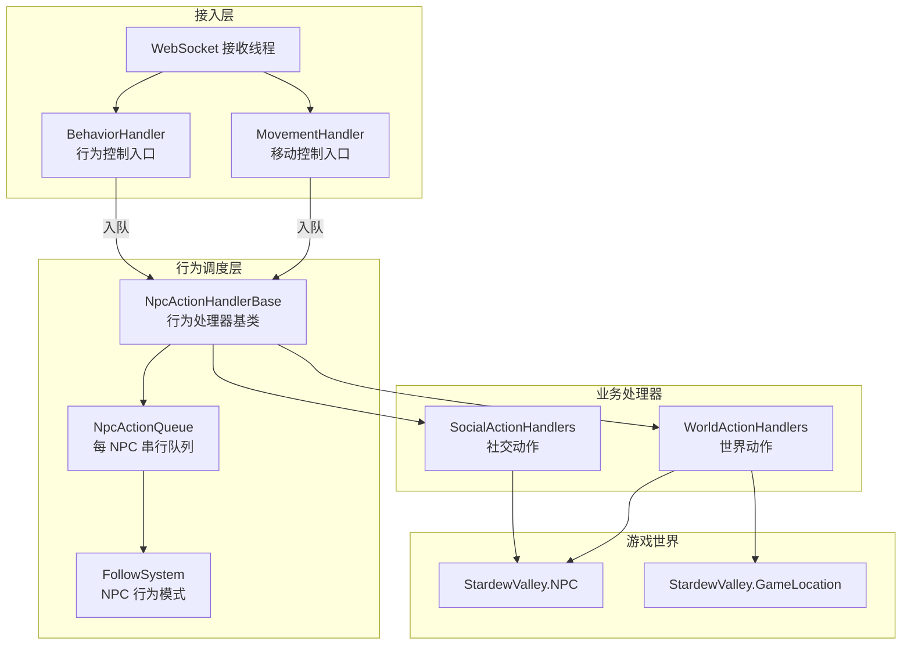
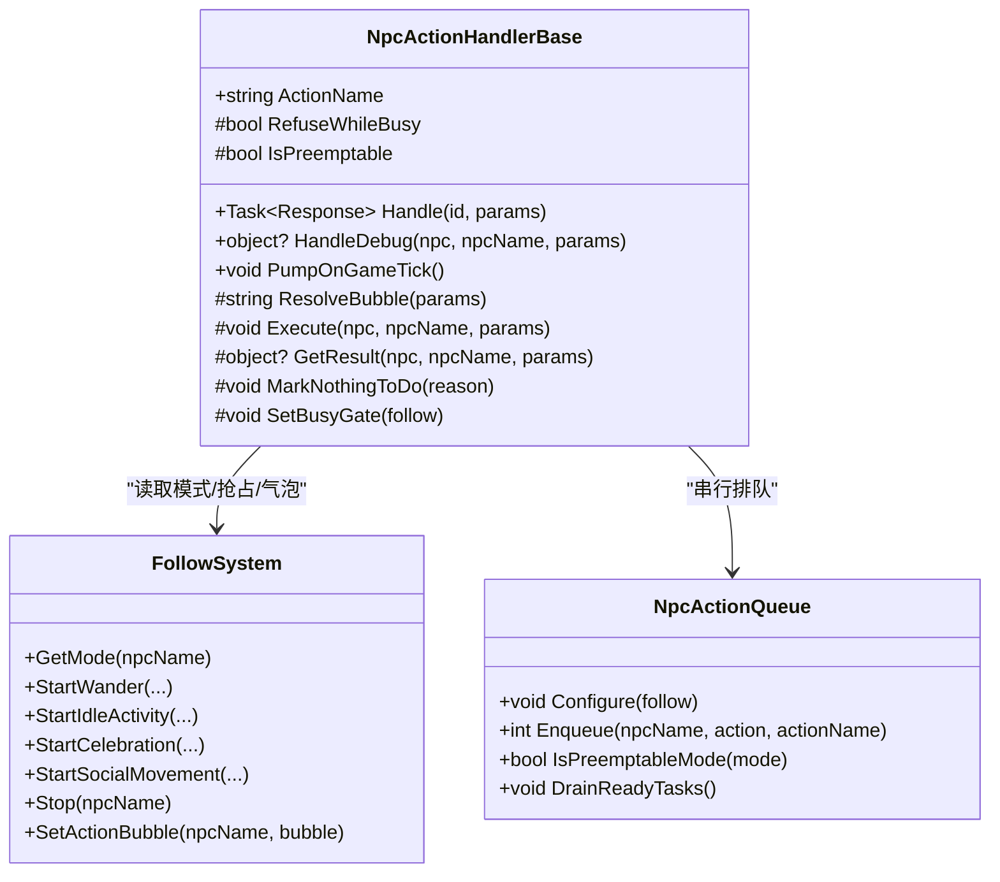
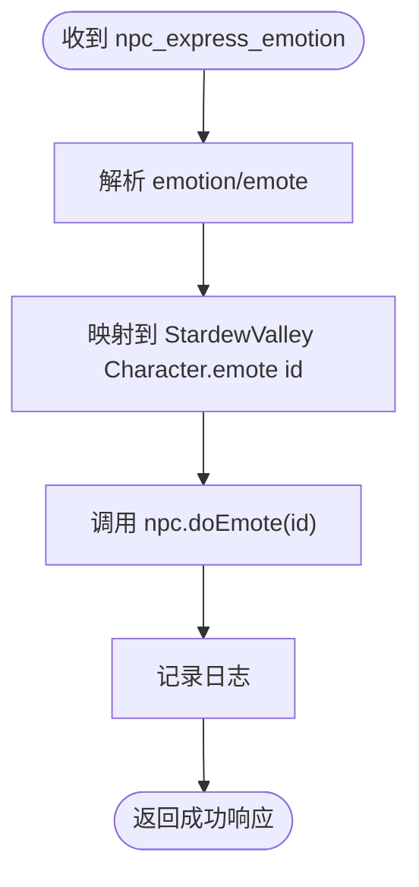
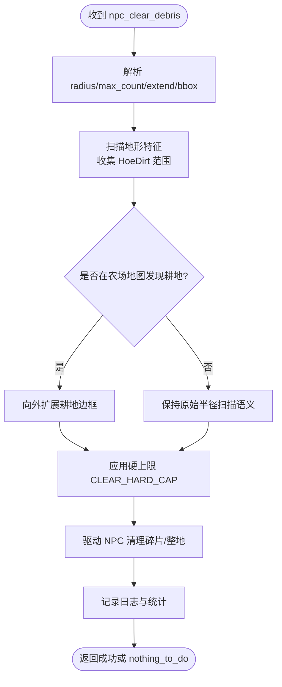
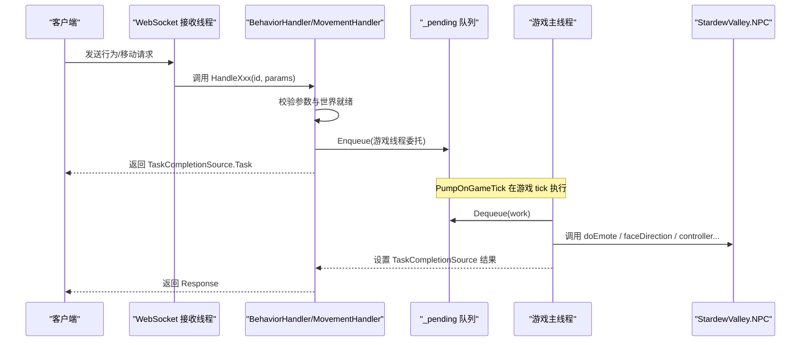
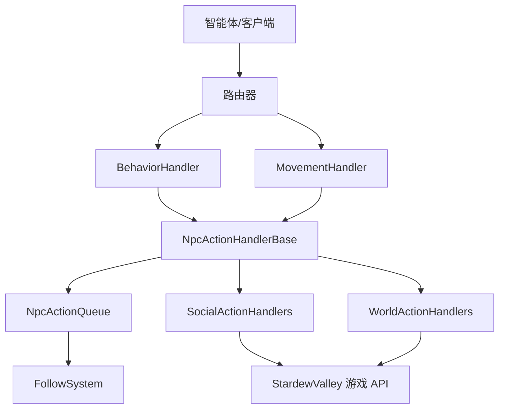
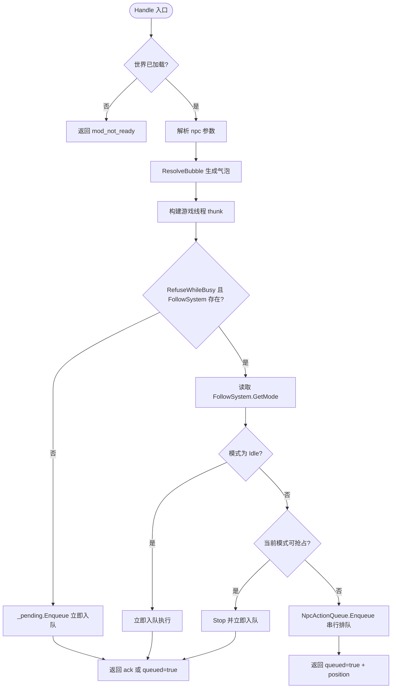
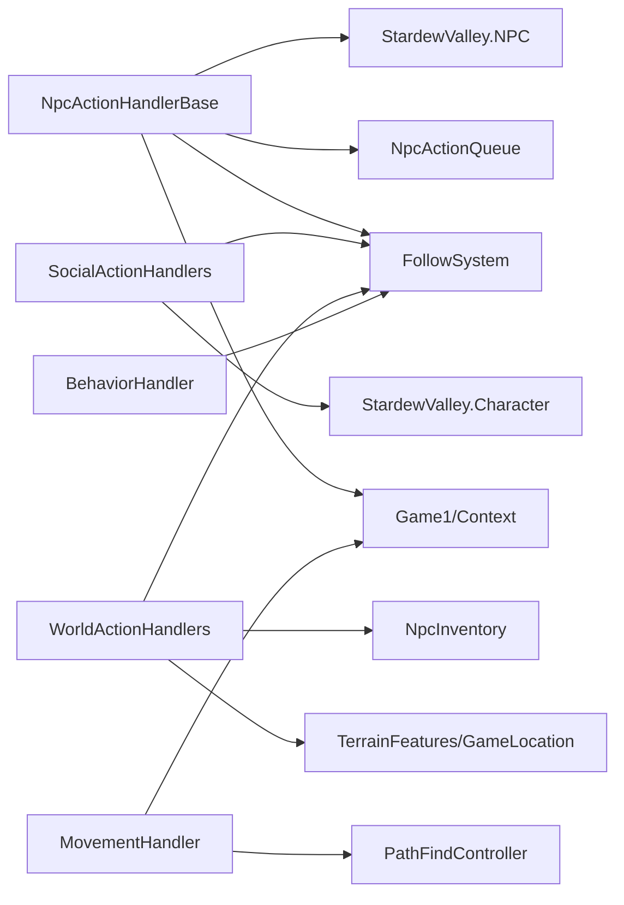

# NPC 行为系统

<cite>
**本文引用的文件**   
- [NpcActionHandlerBase.cs](file://SmartNPC/smapi-mod/Behavior/NpcActionHandlerBase.cs)
- [SocialActionHandlers.cs](file://SmartNPC/smapi-mod/Behavior/SocialActionHandlers.cs)
- [WorldActionHandlers.cs](file://SmartNPC/smapi-mod/Behavior/WorldActionHandlers.cs)
- [BehaviorHandler.cs](file://SmartNPC/smapi-mod/Movement/BehaviorHandler.cs)
- [MovementHandler.cs](file://SmartNPC/smapi-mod/Movement/MovementHandler.cs)
</cite>

## 目录
1. [简介](#简介)
2. [项目结构](#项目结构)
3. [核心组件](#核心组件)
4. [架构总览](#架构总览)
5. [详细组件分析](#详细组件分析)
6. [依赖关系分析](#依赖关系分析)
7. [性能与资源管理](#性能与资源管理)
8. [扩展指南](#扩展指南)
9. [故障排查](#故障排查)
10. [结论](#结论)

## 简介
本文件系统化梳理 SmartNPC 模组中 NPC 行为系统的实现，重点围绕以下目标：
- 解释行为处理器基类 NpcActionHandlerBase 的抽象接口、生命周期、状态同步和队列调度。
- 说明社交动作 SocialActionHandlers 的实现，包括表情、问候、送礼等行为的调用方式。
- 说明世界动作 WorldActionHandlers 的封装，包括农作、采集、建造等游戏内操作。
- 提供扩展方法：新增动作类型、自定义行为逻辑、处理动作冲突与优先级。
- 给出注册行为处理器、处理异步操作、管理优先级的实践示例与最佳实践。

该系统基于 SMAPI + Stardew Valley API 构建，采用“WebSocket 接收线程 → 任务队列 → 游戏主线程执行”的模型，确保所有对 Game1、NPC、地图状态的修改都在正确的线程上执行。

## 项目结构
本次文档聚焦以下 C# 源文件及其职责：
- Behavior/NpcActionHandlerBase.cs：行为处理器基类、参数解析、气泡显示、结果构造、串行队列调度。
- Behavior/SocialActionHandlers.cs：社交动作处理器（表情、羞涩后退、文本气泡、闲逛活动、跳舞、惊讶反应、踱步）。
- Behavior/WorldActionHandlers.cs：世界动作处理器（闲逛、清理碎片等农作/采集/建造相关动作）。
- Movement/BehaviorHandler.cs：行为控制 WebSocket 入口（表情、查询当前行为模式），负责将请求入队到游戏线程。
- Movement/MovementHandler.cs：移动控制 WebSocket 入口（移动到目标、面向方向、获取位置），同样通过队列跨线程执行。

图表来源
- [BehaviorHandler.cs:1-159](file://SmartNPC/smapi-mod/Movement/BehaviorHandler.cs#L1-L159)
- [MovementHandler.cs:1-200](file://SmartNPC/smapi-mod/Movement/MovementHandler.cs#L1-L200)
- [NpcActionHandlerBase.cs:1-400](file://SmartNPC/smapi-mod/Behavior/NpcActionHandlerBase.cs#L1-L400)

章节来源
- [NpcActionHandlerBase.cs:1-478](file://SmartNPC/smapi-mod/Behavior/NpcActionHandlerBase.cs#L1-L478)
- [SocialActionHandlers.cs:1-151](file://SmartNPC/smapi-mod/Behavior/SocialActionHandlers.cs#L1-L151)
- [WorldActionHandlers.cs:1-2429](file://SmartNPC/smapi-mod/Behavior/WorldActionHandlers.cs#L1-L2429)
- [BehaviorHandler.cs:1-159](file://SmartNPC/smapi-mod/Movement/BehaviorHandler.cs#L1-L159)
- [MovementHandler.cs:1-324](file://SmartNPC/smapi-mod/Movement/MovementHandler.cs#L1-L324)

## 核心组件
本节从设计意图、关键属性和调度策略角度总结核心组件。

### NpcActionHandlerBase：行为处理器基类
- 抽象接口定义：
  - ActionName：暴露给路由器的动作名称，如 npc_wander、npc_express_emotion。
  - Execute：在 ShowBubble 后于游戏主线程执行的真实行为逻辑。
  - GetResult：可选返回自定义响应数据。
  - ResolveBubble：生成 NPC 头顶气泡文本。
  - MarkNothingToDo：标记“没有可执行目标”，让上层返回 nothing_to_do 以便智能体重新规划。
- 生命周期管理：
  - Handle：解析参数、查找 NPC、计算气泡、创建 TaskCompletionSource、构建游戏线程 thunk。
  - HandleDebug：调试命令同步入口，跳过 WebSocket 响应流程，直接展示气泡并执行。
  - PumpOnGameTick：按 tick 消费内部 _pending 队列，保证所有游戏状态变更在主线程执行。
- 状态同步机制：
  - RefuseWhileBusy：是否需要跟随 FollowSystem 的“同一时间一个长模式”。
  - IsPreemptable：是否允许被更高优先级动作抢占（例如 wander 可被 harvest 抢占）。
  - SetBusyGate：将 FollowSystem 注入，用于读取模式和强制停止抢占模式。
  - NpcActionQueue：每 NPC 的 FIFO 串行队列，保证同 NPC 的独占动作顺序执行。
- 错误处理：
  - 找不到 NPC、参数无效、异常均返回结构化 Response.Failure。
  - 日志记录气泡、地图一致性、执行耗时和排队等待时长。

图表来源
- [NpcActionHandlerBase.cs:1-478](file://SmartNPC/smapi-mod/Behavior/NpcActionHandlerBase.cs#L1-L478)

章节来源
- [NpcActionHandlerBase.cs:1-478](file://SmartNPC/smapi-mod/Behavior/NpcActionHandlerBase.cs#L1-L478)

### SocialActionHandlers：社交动作处理
该类包含多个继承自 NpcActionHandlerBase 的具体处理器，主要覆盖：
- ExpressEmotionHandler：根据 emotion/emote 字段映射到 StardewValley.Character 的数值 emote id，调用 doEmote。
- ShyRetreatHandler：通过 FollowSystem.StartSocialMovement 启动羞涩后退动画。
- ShowTextBubbleHandler：直接将 text 作为气泡内容，不执行其他逻辑。
- IdleActivityHandler：启动空闲活动，支持 once/loop 模式。
- DanceHappyHandler / ReactSurpriseHandler：通过 FollowSystem.StartCelebration 触发庆祝或惊讶动画。
- PaceAnxiouslyHandler：以固定 duration_ticks 启动踱步。

这些动作通常较短且多为表现性，但部分需要 RefuseWhileBusy=true，由 FollowSystem 统一管理 NPC 的单一长模式。

图表来源
- [SocialActionHandlers.cs:1-151](file://SmartNPC/smapi-mod/Behavior/SocialActionHandlers.cs#L1-L151)

章节来源
- [SocialActionHandlers.cs:1-151](file://SmartNPC/smapi-mod/Behavior/SocialActionHandlers.cs#L1-L151)

### WorldActionHandlers：世界动作处理
该类实现更复杂的游戏内操作，典型场景包括：
- WanderHandler：连续闲逛，支持半径、中心点、最大距离、矩形区域约束；可被更高优先级动作抢占。
- ClearDebrisHandler：清理碎片/整理农田，支持 bbox 或半径扫描，限制单次最多清理数量，避免长时间占用 NPC。
- 其他世界动作：农作、采集、建造、破坏、存取银行等行为，都遵循基类的序列化、气泡、队列、异常处理和 nothing_to_do 语义。

WorldActionHandlers 与 FollowSystem 深度协作，将“寻路、到达、选择下一个目标、循环”交给 FollowSystem，而处理器负责参数解析、范围过滤、边界检查和日志。

图表来源
- [WorldActionHandlers.cs:1-2429](file://SmartNPC/smapi-mod/Behavior/WorldActionHandlers.cs#L1-L2429)

章节来源
- [WorldActionHandlers.cs:1-2429](file://SmartNPC/smapi-mod/Behavior/WorldActionHandlers.cs#L1-L2429)

### MovementHandler 与 BehaviorHandler：动作入口与线程桥接
- BehaviorHandler：
  - HandleEmote：将字符串 emote kind 映射为数字 id，入队到游戏线程执行。
  - HandleGetBehavior：查询 FollowSystem.GetMode，返回 NPC 当前行为模式。
  - PumpOnGameTick：消费 _pending 队列，捕获异常并记录日志。
- MovementHandler：
  - HandleMoveTo：同图寻路使用 PathFindController；跨图直接 warp。
  - HandleFaceDirection：设置 NPC 朝向。
  - HandleGetPosition：读取 NPC 位置信息。

两者共同特点是：外部 WebSocket 线程只做参数校验和入队，真正修改 Game1/NPC/地图的操作全部在 PumpOnGameTick 中执行。

图表来源
- [BehaviorHandler.cs:1-159](file://SmartNPC/smapi-mod/Movement/BehaviorHandler.cs#L1-L159)
- [MovementHandler.cs:1-324](file://SmartNPC/smapi-mod/Movement/MovementHandler.cs#L1-L324)

章节来源
- [BehaviorHandler.cs:1-159](file://SmartNPC/smapi-mod/Movement/BehaviorHandler.cs#L1-L159)
- [MovementHandler.cs:1-324](file://SmartNPC/smapi-mod/Movement/MovementHandler.cs#L1-L324)

## 架构总览
NPC 行为系统采用分层设计：
- 接入层：WebSocket 消息进入 BehaviorHandler 与 MovementHandler，完成参数校验和线程桥接。
- 调度层：NpcActionHandlerBase 统一处理参数、NPC 查找、气泡显示、结果构造；NpcActionQueue 管理每 NPC 的串行队列；FollowSystem 管理 NPC 当前模式。
- 业务层：SocialActionHandlers 和 WorldActionHandlers 实现具体行为逻辑。
- 世界层：StardewValley.NPC、GameLocation、PathFindController 等 API 被安全调用。

图表来源
- [NpcActionHandlerBase.cs:1-478](file://SmartNPC/smapi-mod/Behavior/NpcActionHandlerBase.cs#L1-L478)
- [BehaviorHandler.cs:1-159](file://SmartNPC/smapi-mod/Movement/BehaviorHandler.cs#L1-L159)
- [MovementHandler.cs:1-324](file://SmartNPC/smapi-mod/Movement/MovementHandler.cs#L1-L324)

## 详细组件分析

### NpcActionHandlerBase 的行为调度与生命周期
该基类定义了三种执行类别：
1. Trivial：RefuseWhileBusy=false，立即入队并在下一 tick 执行，不改变 FollowSystem 模式。例如聊天、表情、检查对象、闲置活动。
2. Preemptable：RefuseWhileBusy=true 且 IsPreemptable=true。当前仅 npc_wander 使用；启动时像串行动作，但高优先级队列任务可抢占它。
3. Serial/Exclusive：RefuseWhileBusy=true 且 IsPreemptable=false。长时工作必须完整执行；若 NPC 正忙，新任务追加到 per-NPC 队列，智能体收到 queued=true 的确认。

关键设计要点：
- Handle 先解析 npc 参数，再计算气泡，再构建 runOnGameThread thunk。
- 如果 RefuseWhileBusy=false 或 FollowSystem 未注入，直接入队 _pending。
- 如果 NPC 处于 Idle，直接运行。
- 如果当前模式可抢占，则 Stop 并立即运行。
- 否则入队 NpcActionQueue，返回 queued=true 的结构化响应。
- HandleDebug 提供调试命令入口，跳过 WebSocket 流程，直接执行。
- PumpOnGameTick 消费 _pending，保证所有游戏状态变更在主线程。

图表来源
- [NpcActionHandlerBase.cs:1-478](file://SmartNPC/smapi-mod/Behavior/NpcActionHandlerBase.cs#L1-L478)

章节来源
- [NpcActionHandlerBase.cs:1-478](file://SmartNPC/smapi-mod/Behavior/NpcActionHandlerBase.cs#L1-L478)

### SocialActionHandlers 的动作语义
社交动作主要影响 NPC 的情绪表达、短暂动画和对话气泡，通常不需要复杂的世界状态修改。其共性：
- 多数动作短小，可直接通过 FollowSystem 或 StardewValley.Character 的 API 完成。
- 部分动作需要 RefuseWhileBusy=true，以避免与农作、采集等长动作冲突。
- 表情动作将字符串 emotion/emote 映射到数值 id，便于复用 StardewValley 原生表情。

典型动作分类：
- 纯表现型：express_emotion、show_text_bubble。
- 社交动画型：shy_retreat、dance_happy、react_surprise、pace_anxiously。
- 空闲行为型：idle_activity，支持 once/loop。

章节来源
- [SocialActionHandlers.cs:1-151](file://SmartNPC/smapi-mod/Behavior/SocialActionHandlers.cs#L1-L151)

### WorldActionHandlers 的游戏内操作
世界动作更接近“工具调用”，涉及地图、地形、物品、路径和 NPC 行为模式。其设计原则：
- 参数解析严格，防止过大范围导致 NPC 长时间乱跑。
- 对农场地图与非农场地图区分处理，避免在森林或矿洞误扫全图。
- 对清理、采集、农作等操作设置硬上限，防止单次动作阻塞过久。
- 使用 FollowSystem 控制 NPC 的移动和循环，而不是在处理器内手写寻路循环。
- 当扫描不到目标时，使用 MarkNothingToDo 让智能体在同一回合重新规划。

典型动作分类：
- 移动与探索：wander。
- 农场维护：clear_debris、harvest、water、till、plant、fertilize。
- 采集与建造：forage、break、build、deposit、withdraw、deliver。
- 社交交互：approach_and_speak。

章节来源
- [WorldActionHandlers.cs:1-2429](file://SmartNPC/smapi-mod/Behavior/WorldActionHandlers.cs#L1-L2429)

### MovementHandler 与 BehaviorHandler 的线程桥接
这两个处理器是 WebSocket 与游戏主线程之间的桥梁：
- 所有修改 Game1、NPC、地图的调用都通过 ConcurrentQueue<Action> 入队。
- PumpOnGameTick 在游戏 tick 中依次执行委托，捕获异常并记录日志。
- BehaviorHandler 还负责将 MCP 风格的 emote 字符串映射到 StardewValley.Character 的数字常量。
- MovementHandler 在同图情况下使用 PathFindController，跨图时使用 Game1.warpCharacter。

章节来源
- [BehaviorHandler.cs:1-159](file://SmartNPC/smapi-mod/Movement/BehaviorHandler.cs#L1-L159)
- [MovementHandler.cs:1-324](file://SmartNPC/smapi-mod/Movement/MovementHandler.cs#L1-L324)

## 依赖关系分析
- NpcActionHandlerBase 依赖：
  - IMonitor：日志。
  - FollowSystem：行为模式、抢占、气泡持久化。
  - NpcActionQueue：每 NPC 串行队列。
  - StardewValley.NPC、Game1、Context：游戏世界访问。
- SocialActionHandlers 依赖：
  - FollowSystem：社交动画、闲逛活动、庆祝动画。
  - StardewValley.Character：表情 ID。
- WorldActionHandlers 依赖：
  - FollowSystem：寻路、循环、移动控制。
  - StardewValley.TerrainFeatures、GameLocation：地形与地图。
  - NpcInventory：部分动作可能涉及库存（例如清理后丢弃、放置）。
- MovementHandler 与 BehaviorHandler 依赖：
  - ConcurrentQueue<Action>：线程桥接。
  - PathFindController：同图寻路。
  - Game1：地图切换、角色传送。

图表来源
- [NpcActionHandlerBase.cs:1-478](file://SmartNPC/smapi-mod/Behavior/NpcActionHandlerBase.cs#L1-L478)
- [SocialActionHandlers.cs:1-151](file://SmartNPC/smapi-mod/Behavior/SocialActionHandlers.cs#L1-L151)
- [WorldActionHandlers.cs:1-2429](file://SmartNPC/smapi-mod/Behavior/WorldActionHandlers.cs#L1-L2429)
- [BehaviorHandler.cs:1-159](file://SmartNPC/smapi-mod/Movement/BehaviorHandler.cs#L1-L159)
- [MovementHandler.cs:1-324](file://SmartNPC/smapi-mod/Movement/MovementHandler.cs#L1-L324)

## 性能与资源管理
- 线程安全：
  - 所有游戏状态修改都通过 _pending 队列转移到游戏主线程，避免并发访问 StardewValley 对象。
  - NpcActionQueue 使用字典加锁保护 per-NPC 队列，减少竞争。
- 执行优先级：
  - Trivial 动作绕过串行队列，避免被长动作阻塞。
  - Preemptable 动作允许被更高优先级动作中断，适合填充行为如 wander。
  - Exclusive 动作串行执行，保证农作、采集、建造等操作的完整性。
- 资源上限：
  - 清理、采集、农作等动作设置硬上限，防止单次动作卡住 NPC 数秒甚至数十秒。
  - 气泡文本截断，避免过长 UI 输出。
- 可观测性：
  - 记录 queueWait 和 exec 耗时，帮助定位卡顿动作。
  - 记录 NPC 与玩家是否同图，避免不可见动作造成误解。

建议优化方向：
- 对高频短动作（如表情）继续走 trivial 路径，减少队列开销。
- 对长动作拆分步骤，配合 FollowSystem 的 Idle 检测，避免单帧过重。
- 对大范围扫描增加缓存或预过滤，减少地形遍历成本。
- 对 nothing_to_do 场景提供更明确的提示，减少智能体重复无效尝试。

[本节为通用指导，不直接分析具体代码行]

## 扩展指南

### 新增动作类型的步骤
1. 新建处理器类，继承 NpcActionHandlerBase。
2. 重写 ActionName，指定 WebSocket 动作名。
3. 根据需要重写：
   - ResolveBubble：生成气泡文本。
   - Execute：实现游戏逻辑。
   - GetResult：返回自定义响应数据。
   - RefuseWhileBusy：是否需要串行执行。
   - IsPreemptable：是否可被更高优先级动作抢占。
4. 如果需要 FollowSystem，构造函数中注入并通过 SetBusyGate 设置。
5. 在路由器或注册表中注册 ActionNamePublic，使外部可通过 WebSocket 调用。

示例思路（以新增“赠送礼物”动作为例）：
- ActionName：npc_give_gift。
- RefuseWhileBusy：true，因为送礼涉及库存、好感度、对话等状态。
- Execute：解析 params.gift、params.target_npc，检查库存、扣除物品、更新关系，必要时调用 FollowSystem 的社交动作。
- GetResult：返回 success、gift_name、target、effect 等信息。
- 气泡：显示“赠送礼物给 [目标]”。

章节来源
- [NpcActionHandlerBase.cs:1-478](file://SmartNPC/smapi-mod/Behavior/NpcActionHandlerBase.cs#L1-L478)
- [SocialActionHandlers.cs:1-151](file://SmartNPC/smapi-mod/Behavior/SocialActionHandlers.cs#L1-L151)

### 实现自定义行为逻辑
- 简单表现型逻辑：直接在 Execute 中调用 StardewValley.Character 或 FollowSystem 的短方法。
- 复杂世界操作：
  - 先扫描目标区域，确定可行目标集合。
  - 如果无目标，调用 MarkNothingToDo 并提供原因。
  - 对每个目标分步执行，避免一次执行过多逻辑。
  - 使用 FollowSystem 控制移动、到达、循环。
- 异步操作：
  - 不要在 WebSocket 线程中等待 I/O 或长时间计算。
  - 将异步阶段拆分为多个 short-lived 步骤，逐步推进 FollowSystem 模式。
  - 通过 PumpOnGameTick 驱动下一步，避免阻塞游戏帧。

章节来源
- [NpcActionHandlerBase.cs:1-478](file://SmartNPC/smapi-mod/Behavior/NpcActionHandlerBase.cs#L1-L478)
- [WorldActionHandlers.cs:1-2429](file://SmartNPC/smapi-mod/Behavior/WorldActionHandlers.cs#L1-L2429)

### 处理动作冲突与优先级
- 使用 RefuseWhileBusy 控制是否参与串行队列。
- 使用 IsPreemptable 控制是否可被更高优先级动作抢占。
- 对于重要业务动作（harvest、water、build），应设为 exclusive。
- 对于填充行为（wander、idle_activity），可设为 preemptable。
- 通过 NpcActionQueue 的 per-NPC FIFO 保证同 NPC 动作顺序执行。
- 通过 FollowSystem.Stop 抢占低优先级模式，然后立即运行高优先级动作。

章节来源
- [NpcActionHandlerBase.cs:1-478](file://SmartNPC/smapi-mod/Behavior/NpcActionHandlerBase.cs#L1-L478)

### 注册新的行为处理器
- 暴露 ActionNamePublic 供路由器注册。
- 常见注册方式：_router.Register(ActionNamePublic, handler.Handle)。
- 若处理器需要 FollowSystem，需在构造函数中传入并通过 SetBusyGate 注入。
- 若处理器需要 NpcInventory，应在构造函数中注入，并在 Execute 中使用。

章节来源
- [NpcActionHandlerBase.cs:1-478](file://SmartNPC/smapi-mod/Behavior/NpcActionHandlerBase.cs#L1-L478)
- [SocialActionHandlers.cs:1-151](file://SmartNPC/smapi-mod/Behavior/SocialActionHandlers.cs#L1-L151)

### 处理异步操作与管理行为优先级
- 异步操作不应阻塞 WebSocket 线程，也不应阻塞游戏主线程。
- 推荐模式：
  - WebSocket 线程：参数校验、入队。
  - 游戏线程：执行一步逻辑、更新 FollowSystem 模式、返回阶段性结果。
  - PumpOnGameTick：继续执行下一步，直到完成。
- 优先级管理：
  - 短动作走 trivial 路径。
  - 长动作走 serial 路径。
  - 填充动作可 preemptable。
  - 高优先级动作抢占低优先级模式后直接运行。

章节来源
- [BehaviorHandler.cs:1-159](file://SmartNPC/smapi-mod/Movement/BehaviorHandler.cs#L1-L159)
- [MovementHandler.cs:1-324](file://SmartNPC/smapi-mod/Movement/MovementHandler.cs#L1-L324)
- [NpcActionHandlerBase.cs:1-478](file://SmartNPC/smapi-mod/Behavior/NpcActionHandlerBase.cs#L1-L478)

## 故障排查
常见问题与定位方式：
- “mod_not_ready”：Context.IsWorldReady 为 false，表示尚未加载存档。检查模组加载顺序和游戏状态。
- “invalid_params”：JSON 参数缺失或类型错误。检查 npc、radius、emotion、direction 等必填字段。
- “npc_not_found”：Game1.getCharacterFromName 返回 null。检查 NPC 名称拼写、大小写、是否在当前世界。
- “map_not_found”：MovementHandler 中 Map 参数无效。检查地图名称或唯一标识。
- “pathfind_error”：PathFindController 初始化失败。检查目标点是否可达、地图是否正确。
- “handler_error”：Execute 或游戏 API 调用抛出异常。查看日志中的 ActionName 和异常信息。
- “nothing_to_do”：Execute 调用了 MarkNothingToDo。智能体应重新规划，例如扩大搜索范围或更换动作。

调试建议：
- 使用 HandleDebug 直接调用处理器，观察气泡和日志。
- 关注 timing 日志中的 queueWait 和 exec 耗时。
- 检查 FollowSystem.GetMode，确认 NPC 当前行为模式是否符合预期。
- 对 WorldActionHandlers 的大范围扫描，先缩小 radius 或启用 bbox，验证目标集合。

章节来源
- [NpcActionHandlerBase.cs:1-478](file://SmartNPC/smapi-mod/Behavior/NpcActionHandlerBase.cs#L1-L478)
- [BehaviorHandler.cs:1-159](file://SmartNPC/smapi-mod/Movement/BehaviorHandler.cs#L1-L159)
- [MovementHandler.cs:1-324](file://SmartNPC/smapi-mod/Movement/MovementHandler.cs#L1-L324)

## 结论
SmartNPC 的 NPC 行为系统以 NpcActionHandlerBase 为核心，结合 SocialActionHandlers 与 WorldActionHandlers，形成了清晰的“接入层 → 调度层 → 业务层 → 游戏世界层”架构。通过 FollowSystem 的行为模式、NpcActionQueue 的串行队列、以及 BehaviorHandler/MovementHandler 的线程桥接，系统在多线程环境下保持了稳定性、可扩展性和可观测性。

在实际使用中，开发者应：
- 明确动作的生命周期和执行类别。
- 合理设置 RefuseWhileBusy 与 IsPreemptable。
- 对长动作进行步骤拆分和资源上限控制。
- 充分利用 nothing_to_do 语义，让智能体在同一回合重新规划。
- 通过日志和计时信息定位性能瓶颈与行为异常。

这样可以在保持游戏稳定性的同时，实现丰富、可控、可演进的 NPC 行为系统。