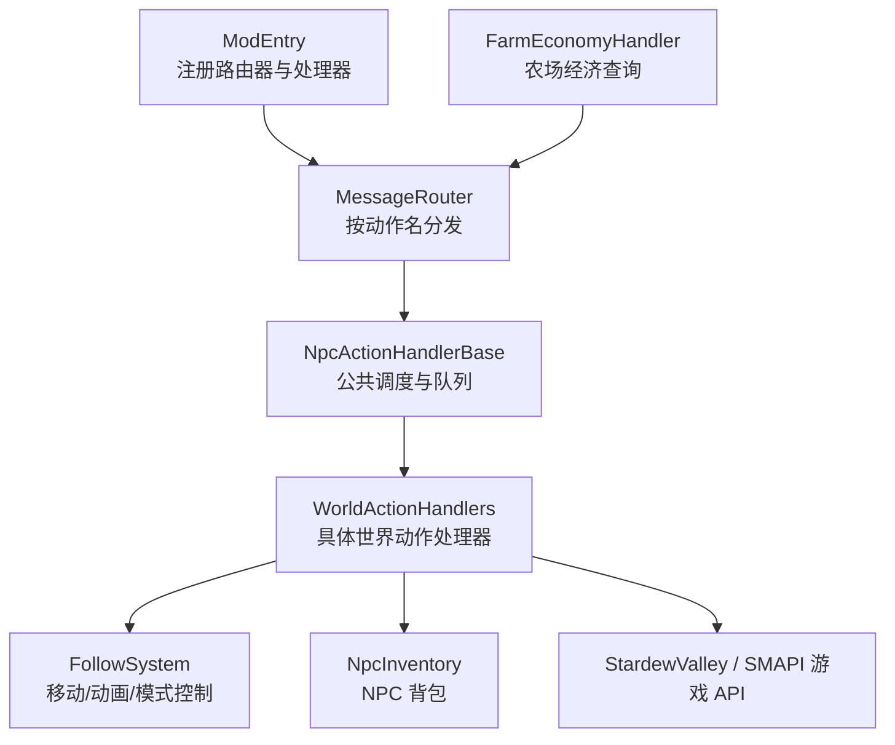
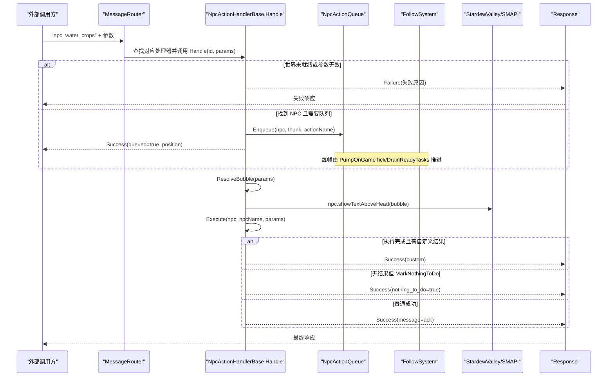
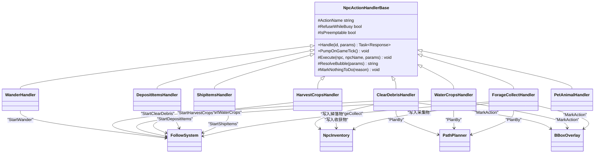
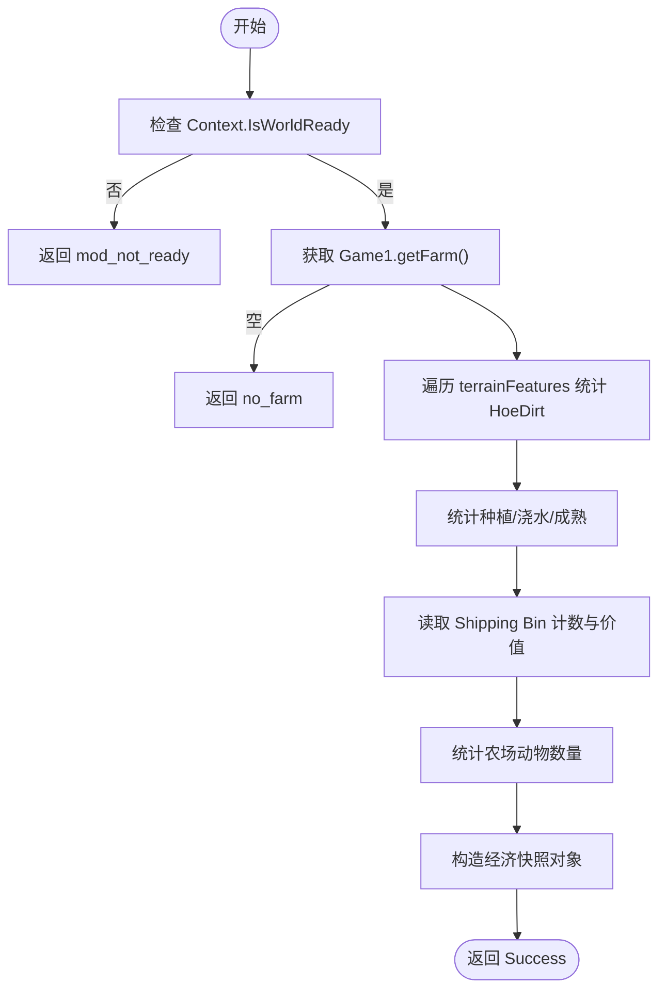

# 世界动作处理器

<cite>
**本文引用的文件**   
- [WorldActionHandlers.cs](file://SmartNPC/smapi-mod/Behavior/WorldActionHandlers.cs)
- [NpcActionHandlerBase.cs](file://SmartNPC/smapi-mod/Behavior/NpcActionHandlerBase.cs)
- [FarmEconomyHandler.cs](file://SmartNPC/smapi-mod/Query/FarmEconomyHandler.cs)
- [ModEntry.cs](file://SmartNPC/smapi-mod/ModEntry.cs)
</cite>

## 目录
1. [引言](#引言)
2. [项目结构](#项目结构)
3. [核心组件](#核心组件)
4. [架构总览](#架构总览)
5. [详细组件分析](#详细组件分析)
6. [依赖关系分析](#依赖关系分析)
7. [性能与长耗时处理](#性能与长耗时处理)
8. [农场经济与资源管理](#农场经济与资源管理)
9. [故障排查指南](#故障排查指南)
10. [结论](#结论)

## 引言
本文件面向“世界动作处理器”，聚焦 SMAPI 模组中负责驱动非玩家角色执行游戏内世界操作的实现。内容覆盖：
- 农作活动：浇水、收割、翻土、施肥、播种。
- 采集行为：清理杂物、采集可拾取物、破坏资源。
- 建造与放置：放置物品、填充缺口。
- 仓库与物流：存入箱子、发货、从箱子取出、转移物品。
- 社交辅助：宠物互动等与世界观相关的动作。

文档重点解释每个世界动作的执行流程，包括参数解析、前置条件检查、目标选择、路径规划、状态更新、库存消费、结果反馈；并说明如何借助 NpcActionHandlerBase 的并发模型实现长耗时操作、进度跟踪和中断恢复。最后给出新增世界动作的实现范式、SMAPI 交互要点以及原子性与一致性的保障方式。

## 项目结构
本项目将“行为动作”按职责分层：
- ModEntry：组装 SMAPI 事件、注册 WebSocket、路由器与各处理器。
- NpcActionHandlerBase：统一封装请求路由、气泡提示、队列调度、错误与无结果上报。
- WorldActionHandlers：具体世界动作处理类，每个动作一个 Handler。
- FarmEconomyHandler：只读农场经济快照（作物、箱子、动物、金钱等）。

图示来源
- [ModEntry.cs:1-200](file://SmartNPC/smapi-mod/ModEntry.cs#L1-L200)
- [NpcActionHandlerBase.cs:1-200](file://SmartNPC/smapi-mod/Behavior/NpcActionHandlerBase.cs#L1-L200)
- [WorldActionHandlers.cs:1-200](file://SmartNPC/smapi-mod/Behavior/WorldActionHandlers.cs#L1-L200)
- [FarmEconomyHandler.cs:1-88](file://SmartNPC/smapi-mod/Query/FarmEconomyHandler.cs#L1-L88)

章节来源
- [ModEntry.cs:1-200](file://SmartNPC/smapi-mod/ModEntry.cs#L1-L200)

## 核心组件
- NpcActionHandlerBase
  - 提供统一的 Handle 入口、气泡显示、Execute 钩子、GetResult 扩展点、MarkNothingToDo 无结果标记。
  - 维护每实例的 _pending 队列与 per-NPC 串行队列（NpcActionQueue），支持立即执行、抢占式取消、排队等待。
  - 三种执行类别：
    - 简单动作：RefuseWhileBusy=false，不进入队列，直接下一帧执行。
    - 可抢占动作：如 wander，新任务到来时可取消旧模式。
    - 独占动作：如 harvest/water/till 等，同一 NPC 只能串行执行。
- WorldActionHandlers
  - 每个世界动作对应一个内部 sealed 类，继承 NpcActionHandlerBase。
  - 通过 ActionName、ResolveBubble、Execute 暴露动作能力。
  - 使用 FollowSystem 启动移动与子任务，使用 NpcInventory 读写背包，使用 PathPlanner 做路径规划。
- FarmEconomyHandler
  - 读取农场地形特征（HoeDirt）、箱子和动物数量，汇总经济指标。
- ModEntry
  - 初始化各子系统，注册所有 WS 动作到 MessageRouter。
  - 注册所有 WorldActionHandlers 实例，并把 FollowSystem 广播与 UI、调试面板联动。

章节来源
- [NpcActionHandlerBase.cs:1-200](file://SmartNPC/smapi-mod/Behavior/NpcActionHandlerBase.cs#L1-L200)
- [NpcActionHandlerBase.cs:201-478](file://SmartNPC/smapi-mod/Behavior/NpcActionHandlerBase.cs#L201-L478)
- [WorldActionHandlers.cs:1-200](file://SmartNPC/smapi-mod/Behavior/WorldActionHandlers.cs#L1-L200)
- [FarmEconomyHandler.cs:1-88](file://SmartNPC/smapi-mod/Query/FarmEconomyHandler.cs#L1-L88)
- [ModEntry.cs:1-200](file://SmartNPC/smapi-mod/ModEntry.cs#L1-L200)

## 架构总览
下图展示一次世界动作从外部调用到游戏世界修改的整体流程。

图示来源
- [NpcActionHandlerBase.cs:1-200](file://SmartNPC/smapi-mod/Behavior/NpcActionHandlerBase.cs#L1-L200)
- [NpcActionHandlerBase.cs:201-478](file://SmartNPC/smapi-mod/Behavior/NpcActionHandlerBase.cs#L201-L478)
- [WorldActionHandlers.cs:1-200](file://SmartNPC/smapi-mod/Behavior/WorldActionHandlers.cs#L1-L200)

## 详细组件分析

### 通用基类：NpcActionHandlerBase
该基类是“世界动作处理器”的基础设施，核心职责如下：
- 参数校验与上下文检查：确保 Context.IsWorldReady、存在有效的 npc 名称。
- 气泡显示：ResolveBubble 生成头部气泡文本，并在需要时持久化给 FollowSystem 刷新。
- 线程模型：Handle 构建 game-thread thunk，在 RefuseWhileBusy=false 时直接入队立即执行；否则根据 FollowSystem 当前模式决定抢占、排队或立即运行。
- 无结果语义：子类可在 Execute 中调用 MarkNothingToDo(reason)，基类将其转换为 nothing_to_do=true 的结构化 ack，促使上层智能体在同一回合重新规划。
- 队列调度：
  - 每实例 _pending 用于“下一帧立即执行”的微队列。
  - NpcActionQueue 维护 per-NPC FIFO，保证同一 NPC 的独占动作串行执行。
  - DrainReadyTasks 每帧检查 Idle 模式并派发一个待办项，避免堆积。

关键设计点
- IsPreemptable：目前仅 wander 是可抢占模式，其他独占动作不可被更高优先级任务打断。
- 异常安全：Execute 包裹 try/catch，失败回传 handler_error。
- 计时日志：当执行耗时超过阈值或队列等待时间较长时输出 timing 日志，便于定位卡顿。

章节来源
- [NpcActionHandlerBase.cs:1-200](file://SmartNPC/smapi-mod/Behavior/NpcActionHandlerBase.cs#L1-L200)
- [NpcActionHandlerBase.cs:201-478](file://SmartNPC/smapi-mod/Behavior/NpcActionHandlerBase.cs#L201-L478)

### 移动与漫游：WanderHandler
作用：让指定 NPC 在半径或矩形区域内随机漫步。

执行流程
- 解析 radius、center_x/y、max_distance、x1/y1/x2/y2。
- 若未指定中心，则以 NPC 当前位置为中心。
- 调用 FollowSystem.StartWander 开始连续漫游。
- 记录日志，供调试与监控。

并发特性
- RefuseWhileBusy=true，IsPreemptable=true：高优先级任务可抢占漫游。

章节来源
- [WorldActionHandlers.cs:1-200](file://SmartNPC/smapi-mod/Behavior/WorldActionHandlers.cs#L1-L200)

### 清理杂物：ClearDebrisHandler
作用：清理杂草、树枝、石头、树桩、小树苗、草丛、空心原木等，并将掉落物放入 NPC 背包。

执行流程
- 解析 radius、max_count、extend、可选 bbox。
- 计算搜索范围：
  - 若提供 bbox，则严格按区域扫描。
  - 否则以 NPC 为中心半径扫描。
- 若检测到农田（HoeDirt），则把清理范围收缩到农田包围盒，并可选择向外 extend 扩大边界，使 NPC 清理田边。
- 扫描 location.Objects、location.terrainFeatures、location.resourceClumps，收集可清理目标。
- 对目标按距离排序，限制 effectiveCap（默认硬上限约 15 个）。
- 使用 PathPlanner.PlanBy 规划近优路径。
- 调用 FollowSystem.StartClearDebris 执行清理，并通过 BBoxOverlay 可视化工作区。
- 若无目标，返回 nothing_to_do。

复杂度与优化
- 双阶段扫描：先找农田再缩小范围，避免在大地图半径模式下误扫到无关区域。
- 目标数硬上限，防止单次动作卡住整个游戏帧。

章节来源
- [WorldActionHandlers.cs:1-543](file://SmartNPC/smapi-mod/Behavior/WorldActionHandlers.cs#L1-L543)

### 浇水：WaterCropsHandler
作用：遍历未浇水的有作物土壤，依次浇水。

执行流程
- 解析 radius、max_count、可选 bbox。
- 扫描 HoeDirt，筛选：
  - 有作物且未死亡。
  - 未处于已浇水状态。
- 若提供 bbox，按区域过滤；否则按半径过滤。
- 按距离排序，必要时截断到 maxCount。
- 若无目标，返回 nothing_to_do。
- 使用 PathPlanner.PlanBy 规划访问顺序。
- 调用 FollowSystem.StartWaterCrops 执行浇水。
- 通过 BBoxOverlay 标注动作区域。

一致性要点
- 浇水判断直接读取 HoeDirt.state.Value，而非依赖 needsWatering 的复杂语义，保证观察层与执行层一致。

章节来源
- [WorldActionHandlers.cs:201-543](file://SmartNPC/smapi-mod/Behavior/WorldActionHandlers.cs#L201-L543)

### 收割：HarvestCropsHandler
作用：收割成熟的作物，并将收获物放入 NPC 背包。

执行流程
- 解析 radius、max_count、可选 bbox。
- 扫描 HoeDirt 与 Crop，判断是否可收割。
- 使用 IsCropHarvestable 作为唯一判定源，确保与 SDV 原生收割逻辑一致。
- 对目标排序、限流、规划路径。
- 调用 FollowSystem 执行收割。
- 若无目标，返回 nothing_to_do。

成熟度判定 IsCropHarvestable
- 统一判断标准：
  - 未死亡。
  - 到达最终生长阶段。
  - 单收作物：未到完全成熟标志前也可收割。
  - 多收作物：仅在 dayOfCurrentPhase<=0 时收割。

章节来源
- [WorldActionHandlers.cs:543-959](file://SmartNPC/smapi-mod/Behavior/WorldActionHandlers.cs#L543-L959)

### 存放物品：DepositItemsHandler
作用：将 NPC 背包中的物品存入箱子，支持自动寻找或指定坐标。

执行流程
- 解析 auto_find、chest_x/y、map、item_ids。
- 从 NpcInventory 获取物品列表，可按 item_ids 过滤。
- 为空则直接返回（不会触发 nothing_to_do，因为这是“无待存物品”的静默退出）。
- 调用 FollowSystem.StartDepositItems 执行寻箱、存取。
- 无法开始（找不到箱子）时记录警告日志。

章节来源
- [WorldActionHandlers.cs:959-1200](file://SmartNPC/smapi-mod/Behavior/WorldActionHandlers.cs#L959-L1200)

### 发货：ShipItemsHandler
作用：将 NPC 背包中的物品放入农场出货箱。

执行流程
- 解析 item_ids，过滤背包物品。
- 为空则静默返回。
- 调用 FollowSystem.StartShipItems 执行发货。
- 无法开始时记录警告日志。

章节来源
- [WorldActionHandlers.cs:959-1200](file://SmartNPC/smapi-mod/Behavior/WorldActionHandlers.cs#L959-L1200)

### 采集：ForageCollectHandler
作用：收集地图上刷新的可拾取物，并按路径规划依次采集。

执行流程
- 解析 radius、max_count、extend、bbox。
- 扫描 location.Objects，筛选 IsSpawnedObject。
- 按距离排序并限制数量。
- 若无目标，返回 nothing_to_do。
- 使用 PathPlanner.PlanBy 规划路径。
- 调用 FollowSystem.StartForageCollect 执行采集。
- 用 BBoxOverlay 标注动作范围。

章节来源
- [WorldActionHandlers.cs:959-1200](file://SmartNPC/smapi-mod/Behavior/WorldActionHandlers.cs#L959-L1200)

### 宠物互动：PetAnimalHandler
作用：走向玩家宠物并进行抚摸。

执行流程
- 通过 Game1.player.getPet() 获取宠物。
- 若没有宠物、宠物无位置、或 NPC 与宠物不在同一地图，则返回 nothing_to_do。
- 调用 FollowSystem.StartPetAnimal 执行移动与互动。

章节来源
- [WorldActionHandlers.cs:959-1200](file://SmartNPC/smapi-mod/Behavior/WorldActionHandlers.cs#L959-L1200)

### 播种、翻土、施肥、破坏资源、放置物品、填充缺口、取物、转移物品
这些动作同样遵循相同模式：
- 继承 NpcActionHandlerBase。
- 定义 ActionName。
- 可选地设置 RefuseWhileBusy 与 IsPreemptable。
- 实现 ResolveBubble 与 Execute。
- 在 Execute 中：
  - 解析参数。
  - 进行前置条件检查。
  - 选择目标集。
  - 使用 PathPlanner.PlanBy 做路径规划。
  - 调用 FollowSystem 启动相应子任务。
  - 通过 NpcInventory 消费或增加物品。
  - 必要时调用 MarkNothingToDo 表示“无需处理”。
  - 使用 BBoxOverlay 标注动作区域。

章节来源
- [WorldActionHandlers.cs:1-2429](file://SmartNPC/smapi-mod/Behavior/WorldActionHandlers.cs#L1-L2429)

## 依赖关系分析
- ModEntry 负责组合：
  - 创建 MessageRouter、WebSocketServer、ChatHandler、PerceptionSystem、MovementHandler、FollowSystem、BehaviorHandler、NpcInventory、UI 组件。
  - 注册 WS 动作，包括 farm_get_economy、各类 npc_* 动作。
  - 注册所有 WorldActionHandlers 实例，并通过 NpcActionQueue.Configure 注入 FollowSystem。
- WorldActionHandlers 依赖：
  - FollowSystem：控制 NPC 移动、模式切换、子任务（浇水、收割、清理等）。
  - NpcInventory：读写 NPC 背包。
  - PathPlanner：TSP 近似路径规划。
  - BBoxOverlay：调试可视化。
  - StardewValley / SMAPI：读取/修改游戏世界。
- FarmEconomyHandler 依赖：
  - Game1、Context、farm.terrainFeatures、shipping bin、animals。

图示来源
- [WorldActionHandlers.cs:1-2429](file://SmartNPC/smapi-mod/Behavior/WorldActionHandlers.cs#L1-L2429)
- [NpcActionHandlerBase.cs:1-478](file://SmartNPC/smapi-mod/Behavior/NpcActionHandlerBase.cs#L1-L478)

章节来源
- [ModEntry.cs:1-200](file://SmartNPC/smapi-mod/ModEntry.cs#L1-L200)
- [WorldActionHandlers.cs:1-2429](file://SmartNPC/smapi-mod/Behavior/WorldActionHandlers.cs#L1-L2429)

## 性能与长耗时处理
- 分帧执行
  - Handle 将动作包装为 game-thread thunk，避免阻塞 WS 调用线程。
  - 简单动作直接入队下一帧执行；独占动作走 NpcActionQueue。
- 队列与抢占
  - 同一 NPC 的独占动作串行执行，避免状态竞争。
  - 漫游可被更高优先级任务抢占，保证重要工作优先。
- 目标限制
  - 清理杂物默认硬上限约 15 个目标。
  - 浇水、采集等动作支持 max_count 限制。
- 路径优化
  - 使用 PathPlanner.PlanBy 做近优路径，减少来回折返。
- 进度可视化
  - FollowSystem 每约 1 秒刷新持久气泡。
  - BBoxOverlay 标注动作范围，方便调试。
- 超时与中断恢复
  - 若 FollowSystem 强制空闲（例如超时取消），NpcActionQueue.Clear 会清空该 NPC 队列，避免死锁。
  - 子任务由 FollowSystem 内部按帧推进，失败时可通过日志与 nothing_to_do 回调上层重试。

章节来源
- [NpcActionHandlerBase.cs:201-478](file://SmartNPC/smapi-mod/Behavior/NpcActionHandlerBase.cs#L201-L478)
- [WorldActionHandlers.cs:1-543](file://SmartNPC/smapi-mod/Behavior/WorldActionHandlers.cs#L1-L543)

## 农场经济与资源管理
FarmEconomyHandler 提供只读的经济快照，用于评估自动化农场的产出与健康度：
- 统计 HoeDirt：
  - tilledTiles：已翻耕方块数。
  - wateredTiles：已浇水方块数。
  - cropsPlanted：有作物的方块数。
  - cropsReady：可收割作物数（依据 final phase 且当前阶段天数耗尽）。
- 统计出货箱：
  - shipping_bin_count：出货箱物品堆叠总数。
  - shipping_bin_value：出货箱物品总售价。
- 统计动物数量。
- 汇总玩家金钱与累计收益。

该处理器不修改世界状态，适合周期性查询与决策评估。

图示来源
- [FarmEconomyHandler.cs:1-88](file://SmartNPC/smapi-mod/Query/FarmEconomyHandler.cs#L1-L88)

章节来源
- [FarmEconomyHandler.cs:1-88](file://SmartNPC/smapi-mod/Query/FarmEconomyHandler.cs#L1-L88)

## 故障排查指南
常见问题与定位方法：
- “mod_not_ready”或“no save loaded”
  - 检查 Context.IsWorldReady 是否为真。
  - 确认 SMAPI 已加载存档。
- “npc is required”或“npc_not_found”
  - 检查传入 npc 名称是否正确。
  - 确认 NPC 名称与游戏内一致。
- “handler_error”
  - 查看 IMonitor 日志，关注 Execute 抛出的异常。
- 动作长时间排队
  - 检查 FollowSystem 当前模式是否为 Idle。
  - 查看 NpcActionQueue.Snapshot 中队列长度。
- 动作“什么都不做”
  - 关注 nothing_to_do=true 的响应，检查 MarkNothingToDo 的原因。
  - 可能是半径/矩形区域无目标、作物未成熟、背包为空等。
- 清理杂物效率低
  - 确认是否使用了 farmland 检测与 extend。
  - 检查有效目标数是否超过硬上限。
- 浇水/收割不一致
  - 确认使用的是权威状态字段（state.Value、phaseDays、dayOfCurrentPhase）。
  - 核对 IsCropHarvestable 的判断条件。

章节来源
- [NpcActionHandlerBase.cs:1-478](file://SmartNPC/smapi-mod/Behavior/NpcActionHandlerBase.cs#L1-L478)
- [WorldActionHandlers.cs:1-2429](file://SmartNPC/smapi-mod/Behavior/WorldActionHandlers.cs#L1-L2429)
- [FarmEconomyHandler.cs:1-88](file://SmartNPC/smapi-mod/Query/FarmEconomyHandler.cs#L1-L88)

## 结论
世界动作处理器通过 NpcActionHandlerBase 提供了统一、可预测且可扩展的动作执行框架。WorldActionHandlers 中的各类动作遵循相同的生命周期：参数解析、前置检查、目标筛选、路径规划、FollowSystem 驱动、库存与世界状态更新、结果反馈。该设计在保证 SMAPI 游戏线程安全的同时，实现了长耗时任务的异步化、可抢占、可排队与可观测性。配合 FarmEconomyHandler 的只读经济快照，可以为自动化农场提供稳定的状态感知与决策输入。

新增世界动作的最佳实践：
- 新建继承 NpcActionHandlerBase 的类，定义 ActionName。
- 根据需要设置 RefuseWhileBusy 与 IsPreemptable。
- 在 Execute 中严格校验前置条件，必要时调用 MarkNothingToDo。
- 使用 PathPlanner.PlanBy 规划路径，使用 FollowSystem 启动子任务。
- 通过 NpcInventory 消费/增加物品，确保库存一致性。
- 如需可视化，使用 BBoxOverlay.MarkAction 标注动作区域。
- 在 ModEntry 中注册新处理器，并确保其参与 NpcActionQueue 调度。
- 通过 IMonitor 输出结构化日志，便于追踪执行时间与队列等待情况。