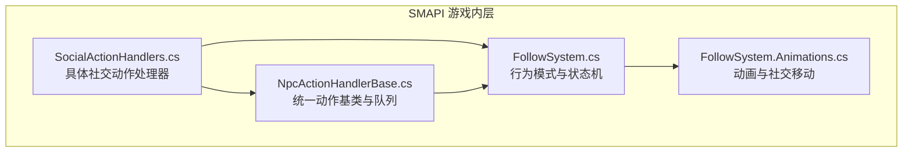
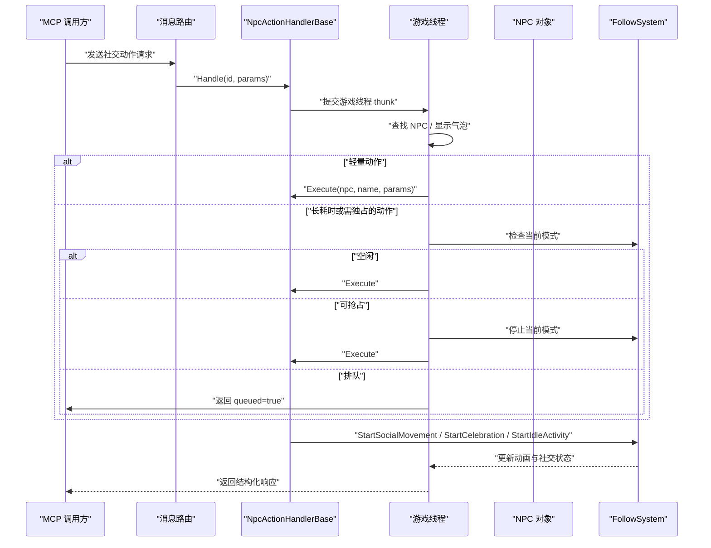
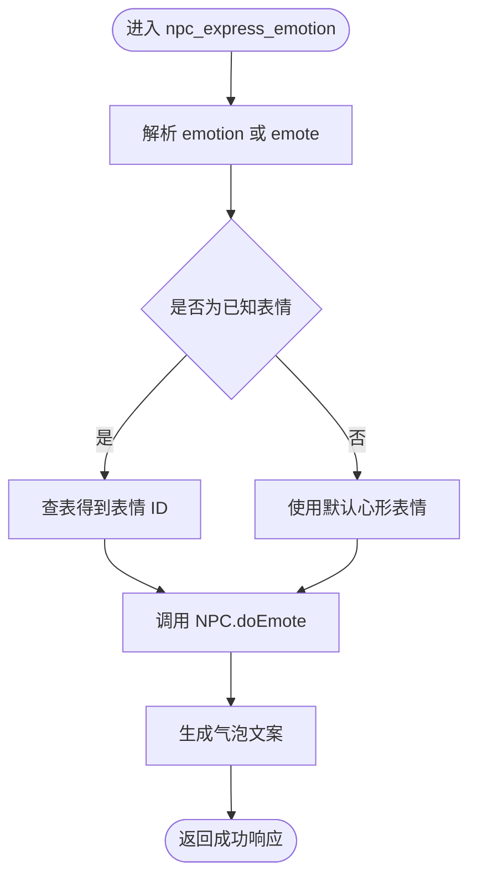
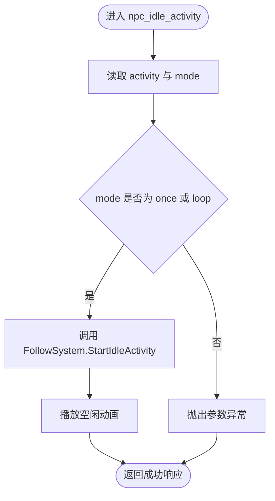
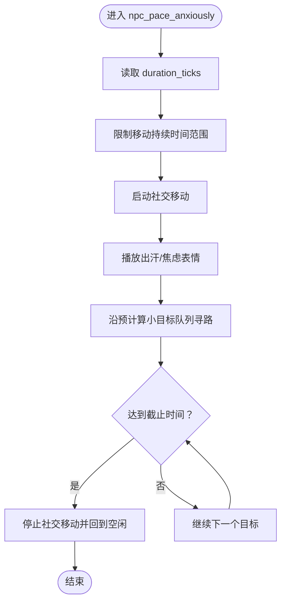
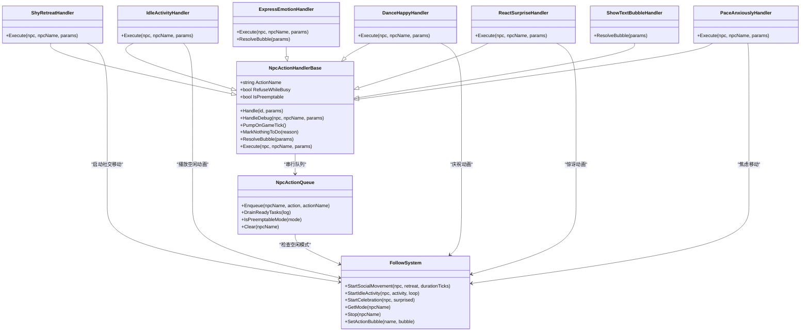

# 社交动作处理器

<cite>
**本文引用的文件**   
- [SocialActionHandlers.cs](file://SmartNPC/smapi-mod/Behavior/SocialActionHandlers.cs)
- [NpcActionHandlerBase.cs](file://SmartNPC/smapi-mod/Behavior/NpcActionHandlerBase.cs)
- [FollowSystem.cs](file://SmartNPC/smapi-mod/Movement/FollowSystem.cs)
- [FollowSystem.Animations.cs](file://SmartNPC/smapi-mod/Movement/FollowSystem.Animations.cs)
</cite>

## 目录
1. [简介](#简介)
2. [项目结构](#项目结构)
3. [核心组件](#核心组件)
4. [架构总览](#架构总览)
5. [详细组件分析](#详细组件分析)
6. [依赖关系分析](#依赖关系分析)
7. [性能与并发特性](#性能与并发特性)
8. [MCP 工具使用示例](#mcp-工具使用示例)
9. [故障排查指南](#故障排查指南)
10. [结论](#结论)

## 简介
本文件聚焦于 SmartNPC 模组中“社交动作处理器”的设计与实现，重点解释 SocialActionHandlers.cs 中的表情动作、害羞后退、文本气泡、空闲活动、开心跳舞、惊讶反应和焦虑踱步等社交行为。文档同时说明：
- 参数解析与验证方式
- 执行逻辑如何调用游戏对象（如 NPC）
- 动画播放与头顶气泡反馈机制
- 与 FollowSystem 的协作模式、状态机及队列调度
- 优先级管理与冲突解决策略
- 错误恢复与用户体验优化
- MCP 侧如何通过工具发起社交行为，以及边界情况的处理建议

需要特别说明的是：当前仓库中未出现独立的“问候行为（greet）”或“送礼功能（gift）”的具体处理器实现；因此本节只基于已实现的社交动作进行分析，并在 MCP 使用示例中给出如何扩展同类工具的指导。

## 项目结构
社交动作相关代码主要分布在两个层次：
- SMAPI 游戏内层：C# 实现，负责解析 WebSocket 请求、显示气泡、驱动 NPC 动画、协调行为状态机。
- 行为协调层：FollowSystem 维护每个受控 NPC 的行为模式，并提供社交移动、庆祝、空闲活动等能力。
- 动作基座层：NpcActionHandlerBase 提供统一的请求入口、气泡展示、任务排队、结果封装与调试钩子。

**图表来源**
- [SocialActionHandlers.cs:1-151](file://SmartNPC/smapi-mod/Behavior/SocialActionHandlers.cs#L1-L151)
- [NpcActionHandlerBase.cs:1-200](file://SmartNPC/smapi-mod/Behavior/NpcActionHandlerBase.cs#L1-L200)
- [FollowSystem.cs:1-200](file://SmartNPC/smapi-mod/Movement/FollowSystem.cs#L1-L200)
- [FollowSystem.Animations.cs:1-120](file://SmartNPC/smapi-mod/Movement/FollowSystem.Animations.cs#L1-L120)

**章节来源**
- [SocialActionHandlers.cs:1-151](file://SmartNPC/smapi-mod/Behavior/SocialActionHandlers.cs#L1-L151)
- [NpcActionHandlerBase.cs:1-200](file://SmartNPC/smapi-mod/Behavior/NpcActionHandlerBase.cs#L1-L200)
- [FollowSystem.cs:1-200](file://SmartNPC/smapi-mod/Movement/FollowSystem.cs#L1-L200)
- [FollowSystem.Animations.cs:1-120](file://SmartNPC/smapi-mod/Movement/FollowSystem.Animations.cs#L1-L120)

## 核心组件
### NpcActionHandlerBase：统一动作基类
该基类是所有 NPC 动作的统一入口，负责：
- 解析请求参数中的 npc 名称
- 在游戏线程上执行动作
- 显示 NPC 头顶气泡
- 将长耗时动作加入每 NPC 串行队列
- 返回结构化响应，包括成功、排队、无目标、失败等语义
- 暴露 HandleDebug 供控制台调试直接触发

关键设计点：
- RefuseWhileBusy：决定是否拒绝繁忙状态下的新动作；默认 false，表示“轻量动作立即执行”。
- IsPreemptable：是否允许被更高优先级动作抢占；目前只有 wander 可抢占。
- MarkNothingToDo：让 Execute 在找不到目标时主动报告“无需执行”，引导上层重新规划。
- ResolveBubble：生成头顶气泡文案，支持 reason、text 字段，并做长度截断。
- Handle：封装异步 TaskCompletionSource，保证 WS 调用方收到明确结果。

**章节来源**
- [NpcActionHandlerBase.cs:1-200](file://SmartNPC/smapi-mod/Behavior/NpcActionHandlerBase.cs#L1-L200)
- [NpcActionHandlerBase.cs:201-478](file://SmartNPC/smapi-mod/Behavior/NpcActionHandlerBase.cs#L201-L478)

### FollowSystem：NPC 行为模式与社交状态机
FollowSystem 是 NPC 行为的中央协调器，维护每个 NPC 的当前模式，例如 Idle、Following、Leading、Wander、Animating、SocialMovement 等。社交动作主要通过它提供的接口完成：
- StartSocialMovement：用于害羞后退或焦虑踱步，会暂停普通寻路、清空控制器、构造社交目标队列，并设置截止时间。
- StartIdleActivity：为 XiaMi 角色播放空闲动画，支持 farm、rest、look_around、hold_pumpkin、hold_crop、hold_flower、hold_chicken。
- StartCelebration：播放开心或惊讶庆祝动画，同时跳跃并触发原生表情。
- PumpAnimations：每帧更新自定义动画，避免被 vanilla 行走覆盖。
- ResetAnimations：重置所有动画、社交目标与模式，并清理对应队列。

**章节来源**
- [FollowSystem.cs:1-200](file://SmartNPC/smapi-mod/Movement/FollowSystem.cs#L1-L200)
- [FollowSystem.Animations.cs:1-120](file://SmartNPC/smapi-mod/Movement/FollowSystem.Animations.cs#L1-L120)

### SocialActionHandlers：具体社交动作
该类集中定义多个具体社交动作处理器，继承自 NpcActionHandlerBase，并各自重写 ActionName、ResolveBubble、Execute 等方法。

| 处理器 | 动作名 | 行为说明 | 参数 | 动画/反馈 |
|---|---|---|---|---|
| ExpressEmotionHandler | npc_express_emotion | 表达表情，默认心形 | emotion 或 emote | 调用 NPC 原生表情 |
| ShyRetreatHandler | npc_shy_retreat | 害羞后退 | 无必需参数 | 启动社交后退移动，时长固定 |
| ShowTextBubbleHandler | npc_show_text_bubble | 只显示气泡，不执行游戏逻辑 | text | 气泡即动作本身 |
| IdleActivityHandler | npc_idle_activity | 空闲活动动画 | activity、mode | 通过 FollowSystem 播放循环或单次动画 |
| DanceHappyHandler | npc_dance_happy | 开心跳舞庆祝 | 无必需参数 | 庆祝动画 + 心跳表情 |
| ReactSurpriseHandler | npc_react_surprise | 惊讶反应 | 无必需参数 | 惊讶动画 + 问号表情 |
| PaceAnxiouslyHandler | npc_pace_anxiously | 焦虑踱步 | duration_ticks | 原地来回移动并出汗表情 |

**章节来源**
- [SocialActionHandlers.cs:1-151](file://SmartNPC/smapi-mod/Behavior/SocialActionHandlers.cs#L1-L151)

## 架构总览
社交动作从外部 MCP 工具进入后，通常由路由层转发到对应的 NpcActionHandlerBase.Handle；基类随后在游戏线程上查找 NPC、显示气泡、执行具体动作，并根据 RefuseWhileBusy 决定立即执行还是入队。若动作依赖 FollowSystem，则通过 SetBusyGate 注入 FollowSystem 引用，从而共享同一套状态机与队列。

**图表来源**
- [NpcActionHandlerBase.cs:120-478](file://SmartNPC/smapi-mod/Behavior/NpcActionHandlerBase.cs#L120-L478)
- [FollowSystem.Animations.cs:20-120](file://SmartNPC/smapi-mod/Movement/FollowSystem.Animations.cs#L20-L120)

## 详细组件分析

### 表情动作：ExpressEmotionHandler
#### 参数解析
- 优先读取 emotion 字段
- 若不存在，再读取 emote 字段
- 两者都必须是非空字符串才被视为有效参数

#### 表情映射
内部维护一个大小写不敏感的字典，将常见表情名映射到原生表情 ID：
- heart/happy → 20
- exclamation/surprised → 24
- question → 24
- anger/angry → 12
- sweat/sad → 28
- cry → 4
- note → 8
- sleep → 32
- star → 36
- neutral → 0

如果解析失败，默认使用心形表情。

#### 执行逻辑
- 根据解析结果选择表情 ID
- 调用 NPC.doEmote
- 输出调试日志，包含 NPC 名称、原始表情名和最终表情 ID

#### 气泡反馈
ResolveBubble 会把解析到的表情包装成 `[emotion]` 形式；若无法解析，则回退到通用 `[emote]`。

**图表来源**
- [SocialActionHandlers.cs:14-78](file://SmartNPC/smapi-mod/Behavior/SocialActionHandlers.cs#L14-L78)

**章节来源**
- [SocialActionHandlers.cs:14-78](file://SmartNPC/smapi-mod/Behavior/SocialActionHandlers.cs#L14-L78)

### 害羞后退：ShyRetreatHandler
- 动作名：npc_shy_retreat
- 必须忙碌时才拒绝：RefuseWhileBusy = true
- 通过 FollowSystem.StartSocialMovement 启动后退社交移动
- 固定时长 240 个游戏刻

其效果是 NPC 向远离玩家方向移动，并配合害羞相关的社交移动逻辑。

**章节来源**
- [SocialActionHandlers.cs:80-90](file://SmartNPC/smapi-mod/Behavior/SocialActionHandlers.cs#L80-L90)
- [FollowSystem.Animations.cs:88-120](file://SmartNPC/smapi-mod/Movement/FollowSystem.Animations.cs#L88-L120)

### 文本气泡：ShowTextBubbleHandler
- 动作名：npc_show_text_bubble
- 不执行任何游戏副作用，气泡本身就是动作
- 如果 text 存在且非空，直接使用；否则使用默认占位气泡

这适合用于“仅提示、不改变世界状态”的社交反馈。

**章节来源**
- [SocialActionHandlers.cs:92-112](file://SmartNPC/smapi-mod/Behavior/SocialActionHandlers.cs#L92-L112)
- [NpcActionHandlerBase.cs:100-140](file://SmartNPC/smapi-mod/Behavior/NpcActionHandlerBase.cs#L100-L140)

### 空闲活动：IdleActivityHandler
- 动作名：npc_idle_activity
- 参数：
  - activity：空闲活动类型，默认为 rest
  - mode：once 或 loop，其他值抛出异常
- 通过 FollowSystem.StartIdleActivity 播放自定义动画

支持的活动类型包括：
- farm：锄地风格动画
- rest：站立与困倦表情组合
- look_around：环顾四周
- hold_pumpkin、hold_crop、hold_flower、hold_chicken：手持物品或动物

**图表来源**
- [SocialActionHandlers.cs:114-130](file://SmartNPC/smapi-mod/Behavior/SocialActionHandlers.cs#L114-L130)
- [FollowSystem.Animations.cs:30-52](file://SmartNPC/smapi-mod/Movement/FollowSystem.Animations.cs#L30-L52)

**章节来源**
- [SocialActionHandlers.cs:114-130](file://SmartNPC/smapi-mod/Behavior/SocialActionHandlers.cs#L114-L130)
- [FollowSystem.Animations.cs:30-52](file://SmartNPC/smapi-mod/Movement/FollowSystem.Animations.cs#L30-L52)

### 开心跳舞：DanceHappyHandler
- 动作名：npc_dance_happy
- 调用 FollowSystem.StartCelebration，surprised = false
- 同时触发开心庆祝动画与心形表情

**章节来源**
- [SocialActionHandlers.cs:132-139](file://SmartNPC/smapi-mod/Behavior/SocialActionHandlers.cs#L132-L139)
- [FollowSystem.Animations.cs:54-66](file://SmartNPC/smapi-mod/Movement/FollowSystem.Animations.cs#L54-L66)

### 惊讶反应：ReactSurpriseHandler
- 动作名：npc_react_surprise
- 调用 FollowSystem.StartCelebration，surprised = true
- 同时触发惊讶动画与问号表情

**章节来源**
- [SocialActionHandlers.cs:141-148](file://SmartNPC/smapi-mod/Behavior/SocialActionHandlers.cs#L141-L148)
- [FollowSystem.Animations.cs:54-66](file://SmartNPC/smapi-mod/Movement/FollowSystem.Animations.cs#L54-L66)

### 焦虑踱步：PaceAnxiouslyHandler
- 动作名：npc_pace_anxiously
- 可选参数 duration_ticks，默认 200
- 调用 FollowSystem.StartSocialMovement，retreat = false
- NPC 在原地图附近来回移动，并伴随焦虑表情

**图表来源**
- [SocialActionHandlers.cs:150-151](file://SmartNPC/smapi-mod/Behavior/SocialActionHandlers.cs#L150-L151)
- [FollowSystem.Animations.cs:68-120](file://SmartNPC/smapi-mod/Movement/FollowSystem.Animations.cs#L68-L120)

**章节来源**
- [SocialActionHandlers.cs:150-151](file://SmartNPC/smapi-mod/Behavior/SocialActionHandlers.cs#L150-L151)
- [FollowSystem.Animations.cs:68-120](file://SmartNPC/smapi-mod/Movement/FollowSystem.Animations.cs#L68-L120)

## 依赖关系分析
社交动作处理器之间存在明确的依赖分层：
- SocialActionHandlers 依赖 NpcActionHandlerBase 获得统一请求处理、气泡与队列能力。
- 长耗时或需要状态锁定的动作依赖 FollowSystem 的状态机与动画系统。
- NpcActionQueue 提供按 NPC 命名的串行队列，确保 harvest、water、plant 等长期工作不会互相打断。
- FollowSystem 是全局协调者，持有每个 NPC 的行为状态、动画播放、社交移动目标与截止时间。

**图表来源**
- [SocialActionHandlers.cs:14-151](file://SmartNPC/smapi-mod/Behavior/SocialActionHandlers.cs#L14-L151)
- [NpcActionHandlerBase.cs:1-478](file://SmartNPC/smapi-mod/Behavior/NpcActionHandlerBase.cs#L1-L478)
- [FollowSystem.cs:1-200](file://SmartNPC/smapi-mod/Movement/FollowSystem.cs#L1-L200)
- [FollowSystem.Animations.cs:1-120](file://SmartNPC/smapi-mod/Movement/FollowSystem.Animations.cs#L1-L120)

**章节来源**
- [SocialActionHandlers.cs:14-151](file://SmartNPC/smapi-mod/Behavior/SocialActionHandlers.cs#L14-L151)
- [NpcActionHandlerBase.cs:1-478](file://SmartNPC/smapi-mod/Behavior/NpcActionHandlerBase.cs#L1-L478)
- [FollowSystem.cs:1-200](file://SmartNPC/smapi-mod/Movement/FollowSystem.cs#L1-L200)
- [FollowSystem.Animations.cs:1-120](file://SmartNPC/smapi-mod/Movement/FollowSystem.Animations.cs#L1-L120)

## 性能与并发特性
### 三类动作执行模型
1. 轻量动作：RefuseWhileBusy = false，不进入队列，下一游戏刻立即执行。
2. 可抢占模式：RefuseWhileBusy = true，IsPreemptable = true，目前主要用于 wander；高优先级任务可中断它。
3. 串行独占模式：RefuseWhileBusy = true，IsPreemptable = false，长耗时任务必须串行执行，新任务入队等待。

### 队列与抢占
- 当 NPC 当前模式为 Idle，动作立即执行。
- 当当前模式为可抢占模式，新任务直接中断旧任务并立即执行。
- 否则，新任务进入 per-NPC FIFO 队列，随后可在 FollowSystem 回到 Idle 时由 DrainReadyTasks 派发。

### 气泡与计时
- 气泡在 Handle 的游戏线程 thunk 中显示。
- 长耗时动作可通过 FollowSystem.SetActionBubble 保持持久气泡，后续由 FollowSystem 刷新带 elapsed seconds 的文案。
- 若动作执行超过 500ms，或排队等待超过 100ms，会输出 timing 日志，便于诊断卡顿。

### 无目标优化
- 子类可通过 MarkNothingToDo 告诉基类本次动作没有可执行目标。
- 基类会返回 nothing_to_do = true 的结构化响应，引导 MCP 上层在同一回合重新规划，而不是误判任务已完成。

**章节来源**
- [NpcActionHandlerBase.cs:120-478](file://SmartNPC/smapi-mod/Behavior/NpcActionHandlerBase.cs#L120-L478)

## MCP 工具使用示例
以下示例描述 MCP 调用方应如何组织请求。实际字段名以 SocialActionHandlers 和 NpcActionHandlerBase 为准。

### 表情动作
- 工具名：npc_express_emotion
- 必要字段：npc
- 可选字段：
  - emotion：表情名称，如 heart、happy、sad、angry、surprised、exclamation、question、note、sleep、star、neutral
  - emote：同 emotion，作为兼容字段
- 典型场景：NPC 对玩家表达开心、惊讶、悲伤或中立情绪。

示例请求结构：
- npc：目标 NPC 名称
- emotion：heart
预期响应：
- ok = true
- action = npc_express_emotion
- message 中包含确认信息

### 害羞后退
- 工具名：npc_shy_retreat
- 必要字段：npc
- 特点：会占用 NPC 一段时间，可能入队等待。
- 典型场景：NPC 因紧张或害羞暂时离开。

### 文本气泡
- 工具名：npc_show_text_bubble
- 必要字段：npc
- 可选字段：
  - text：直接作为气泡内容
- 典型场景：给 NPC 添加一句提示性对话，但不改变游戏世界状态。

### 空闲活动
- 工具名：npc_idle_activity
- 必要字段：npc
- 可选字段：
  - activity：farm、rest、look_around、hold_pumpkin、hold_crop、hold_flower、hold_chicken
  - mode：once 或 loop
- 典型场景：让 NPC 原地锄地、休息、环顾四周或手持物品。

### 开心跳舞
- 工具名：npc_dance_happy
- 必要字段：npc
- 典型场景：庆祝事件、完成任务后的喜悦表现。

### 惊讶反应
- 工具名：npc_react_surprise
- 必要字段：npc
- 典型场景：突然看到意外事件时的惊讶表现。

### 焦虑踱步
- 工具名：npc_pace_anxiously
- 必要字段：npc
- 可选字段：
  - duration_ticks：移动持续时间，默认 200
- 典型场景：等待、焦急、犹豫不决。

### 关于问候与送礼
当前代码库中没有 greet 或 gift 的专用处理器。若要新增：
- 问候：可参考 ShowTextBubbleHandler，先显示问候气泡，再通过对话系统或关系系统增加好感。
- 送礼：可参考 IdleActivityHandler，先校验库存和目标 NPC 偏好，再执行赠送逻辑，最后更新关系值和反馈消息。

**章节来源**
- [SocialActionHandlers.cs:14-151](file://SmartNPC/smapi-mod/Behavior/SocialActionHandlers.cs#L14-L151)
- [NpcActionHandlerBase.cs:100-140](file://SmartNPC/smapi-mod/Behavior/NpcActionHandlerBase.cs#L100-L140)

## 故障排查指南

### NPC 不存在
- 现象：响应失败，错误码 invalid_params 或 npc_not_found。
- 原因：请求未提供 npc，或 Game1.getCharacterFromName 找不到目标。
- 处理：
  - 确认 npc 名称正确
  - 确认游戏存档已加载
  - 在调试命令中使用 HandleDebug 进行即时测试

### 动作被排队
- 现象：响应中 queued = true，position > 0。
- 原因：当前 NPC 正在执行另一个独占动作。
- 处理：
  - 上层 agent 应记录 position 并在后续轮次重试
  - 若需要立即执行，可考虑替换为可抢占动作，但需谨慎评估语义

### 动作无目标
- 现象：响应中 nothing_to_do = true。
- 原因：Execute 调用了 MarkNothingToDo，表示在当前区域找不到可执行目标。
- 处理：
  - 扩大搜索范围
  - 更换工具，例如先 inspect 再 harvest/forage/till/plant
  - 切换到工作流工具执行复合任务

### 动画或社交移动异常
- 现象：NPC 动画卡住、社交移动不结束、模式停留在 Animating 或 SocialMovement。
- 原因：
  - 非 XiaMi 角色使用了仅限 XiaMi 的自定义动画
  - 社交移动截止时间或目标队列异常
- 处理：
  - 确认 NPC 是否具有自定义动画资源
  - 使用 FollowSystem.ResetAnimations 重置状态
  - 检查 duration_ticks 是否在合理范围内

### 气泡不显示或文案过长
- 现象：NPC 头顶没有气泡，或气泡文案被截断。
- 原因：
  - showBubble 函数返回 false
  - 气泡文案超过 40 字符后被截断
- 处理：
  - 检查配置中是否禁用气泡
  - 缩短 reason 或 text 字段
  - 使用更简洁的动作名作为前缀

**章节来源**
- [NpcActionHandlerBase.cs:120-478](file://SmartNPC/smapi-mod/Behavior/NpcActionHandlerBase.cs#L120-L478)
- [FollowSystem.Animations.cs:1-120](file://SmartNPC/smapi-mod/Movement/FollowSystem.Animations.cs#L1-L120)

## 结论
SocialActionHandlers.cs 实现了 SmartNPC 模组中一组面向玩家的 NPC 社交行为。它们通过统一的 NpcActionHandlerBase 提供参数解析、气泡反馈、错误处理和队列调度，并通过 FollowSystem 协调 NPC 动画与行为模式。现有实现覆盖了表情、害羞后退、文本气泡、空闲活动、开心跳舞、惊讶反应和焦虑踱步等社交动作。

对于 MCP 调用方而言，最重要的是：
- 始终提供有效的 npc 名称
- 理解哪些动作会占用 NPC，可能被排队
- 利用 nothing_to_do 响应调整上层决策
- 区分气泡反馈与真实游戏状态变更
- 在需要时扩展新的社交动作，如问候与送礼，复用现有基类和 FollowSystem 能力

由于当前仓库未包含具体的问候与送礼处理器，建议在新增时遵循现有模式：定义动作名、解析并校验参数、通过 FollowSystem 或游戏 API 执行副作用、更新关系值或对话状态，并返回结构化响应以便 MCP 上层继续规划。