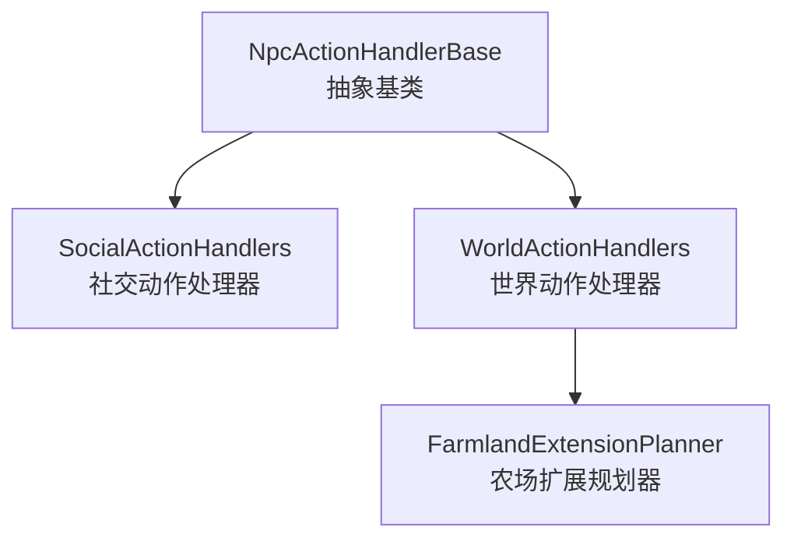
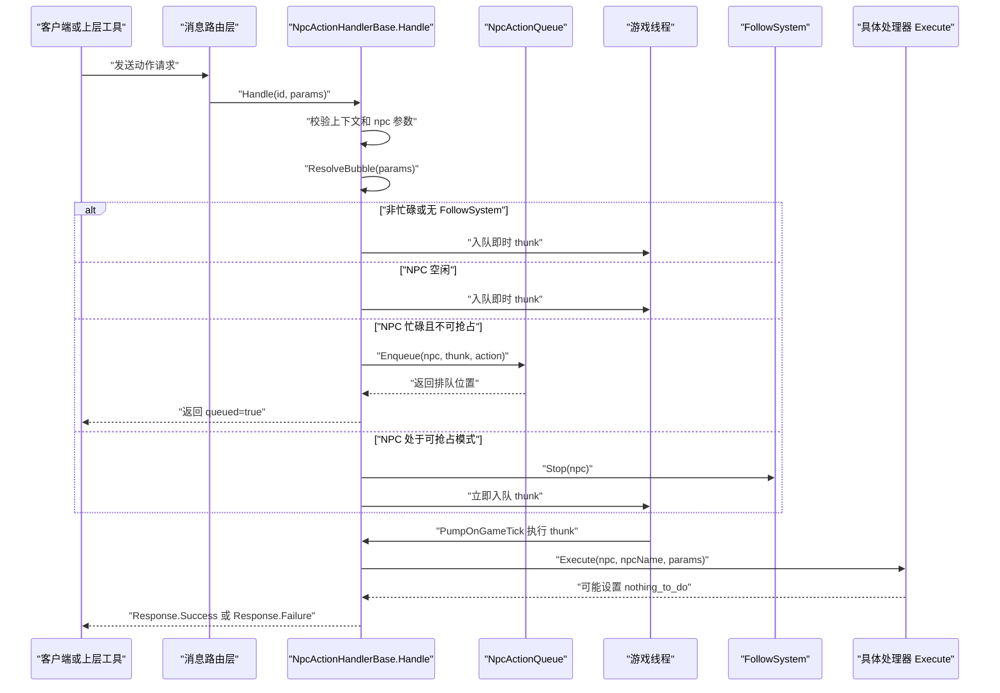
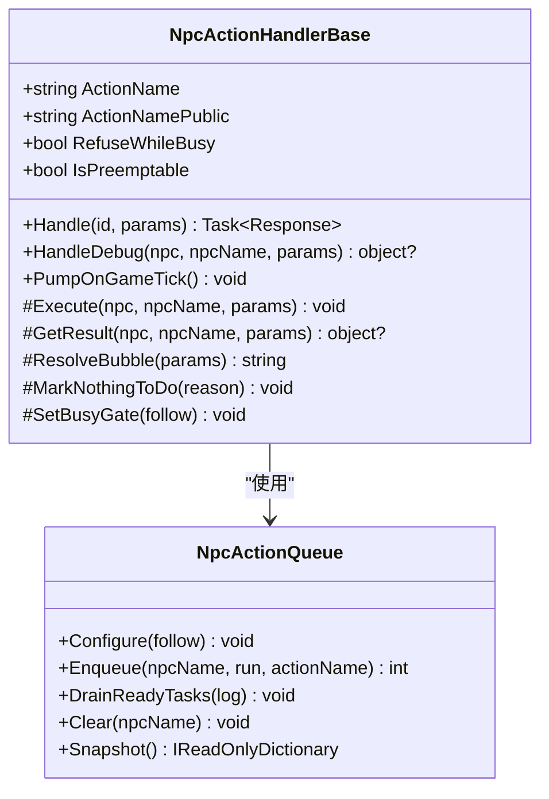
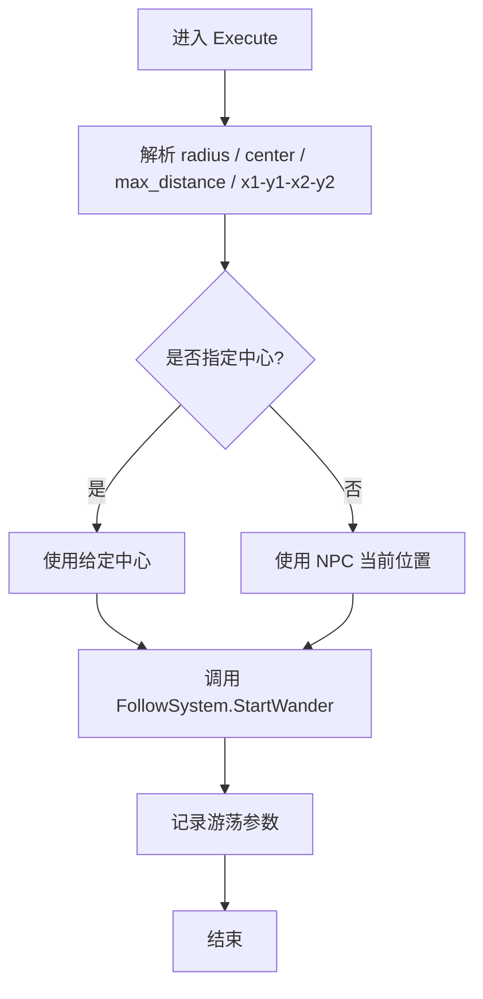
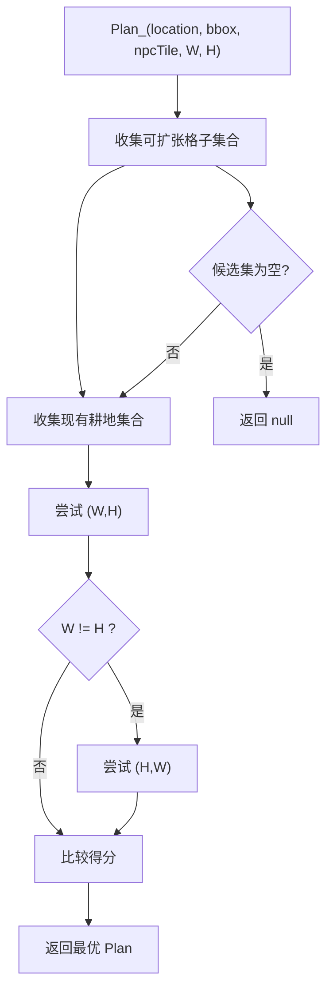
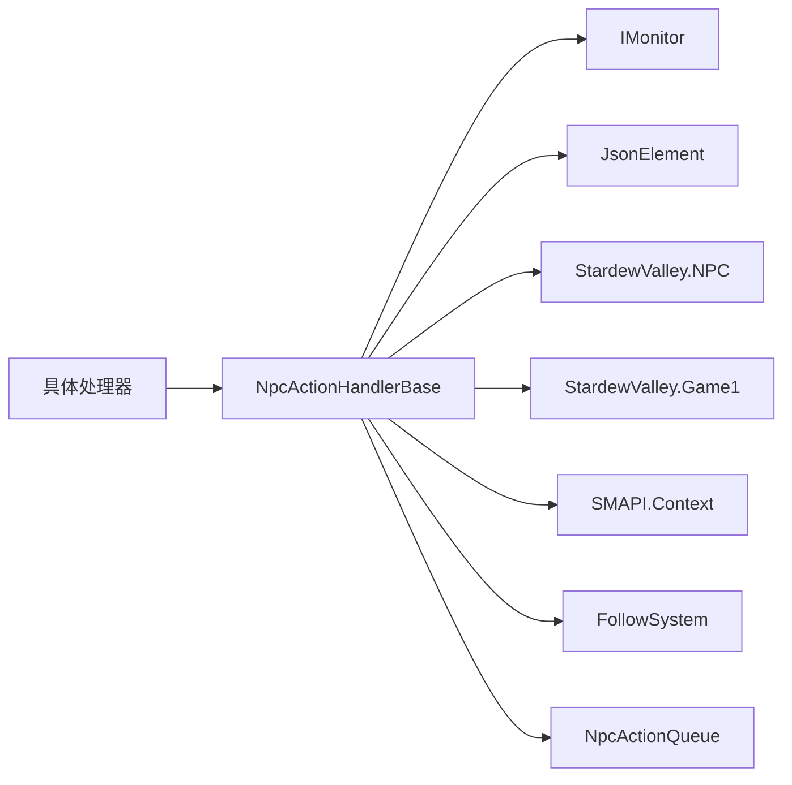
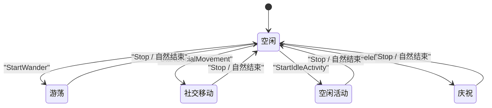

# 行为处理器基类

<cite>
**本文引用的文件**   
- [NpcActionHandlerBase.cs](file://SmartNPC/smapi-mod/Behavior/NpcActionHandlerBase.cs)
- [SocialActionHandlers.cs](file://SmartNPC/smapi-mod/Behavior/SocialActionHandlers.cs)
- [WorldActionHandlers.cs](file://SmartNPC/smapi-mod/Behavior/WorldActionHandlers.cs)
- [FarmlandExtensionPlanner.cs](file://SmartNPC/smapi-mod/Behavior/FarmlandExtensionPlanner.cs)
</cite>

## 目录
1. [引言](#引言)
2. [项目结构](#项目结构)
3. [核心组件](#核心组件)
4. [架构总览](#架构总览)
5. [详细组件分析](#详细组件分析)
6. [依赖关系分析](#依赖关系分析)
7. [性能与并发特性](#性能与并发特性)
8. [异步、取消与超时处理](#异步取消与超时处理)
9. [错误处理策略](#错误处理策略)
10. [继承与实现最佳实践](#继承与实现最佳实践)
11. [自定义行为处理器完整流程示例](#自定义行为处理器完整流程示例)
12. [故障排查指南](#故障排查指南)
13. [结论](#结论)

## 引言
本文件围绕 NPC 行为处理器基类 `NpcActionHandlerBase` 进行深度文档化，重点解释其抽象设计、公共接口、生命周期方法、状态管理、队列调度、异步执行模型以及错误处理。同时结合社交行为处理器、世界行为处理器和农场扩展规划器，说明如何在 SMAPI 游戏线程中安全地驱动 NPC 行为，并给出可复用的继承与实现规范。

需要特别说明的是：当前代码库中的基类使用同步的 `Execute` 回调而非 `ExecuteAsync`；所有长耗时工作通过 FollowSystem 的模式切换和每帧泵出机制完成，而不是让处理器直接返回未完成的 `Task`。因此本文对“异步操作”的解释以“任务式回调 + 模式 + 队列”为核心，而不假设每个处理器都持有独立的任务句柄。

## 项目结构
与 NPC 行为处理器相关的核心源码位于 SMAPI Mod 的 `Behavior` 目录：

- `NpcActionHandlerBase.cs`：定义抽象基类、请求入口、气泡显示、无目标标记、队列分发和每帧泵出。
- `SocialActionHandlers.cs`：社交类动作处理器，如表情、害羞撤退、空闲活动、跳舞、惊讶反应、踱步等。
- `WorldActionHandlers.cs`：世界类动作处理器，如游荡、清理障碍、锄地等，包含复杂区域扫描逻辑。
- `FarmlandExtensionPlanner.cs`：农场扩展矩形规划器，为锄地等动作提供几何候选方案。

**图示来源**
- [NpcActionHandlerBase.cs:1-478](file://SmartNPC/smapi-mod/Behavior/NpcActionHandlerBase.cs#L1-L478)
- [SocialActionHandlers.cs:1-151](file://SmartNPC/smapi-mod/Behavior/SocialActionHandlers.cs#L1-L151)
- [WorldActionHandlers.cs:1-200](file://SmartNPC/smapi-mod/Behavior/WorldActionHandlers.cs#L1-L200)
- [FarmlandExtensionPlanner.cs:1-200](file://SmartNPC/smapi-mod/Behavior/FarmlandExtensionPlanner.cs#L1-L200)

**章节来源**
- [NpcActionHandlerBase.cs:1-120](file://SmartNPC/smapi-mod/Behavior/NpcActionHandlerBase.cs#L1-L120)
- [SocialActionHandlers.cs:1-60](file://SmartNPC/smapi-mod/Behavior/SocialActionHandlers.cs#L1-L60)
- [WorldActionHandlers.cs:1-40](file://SmartNPC/smapi-mod/Behavior/WorldActionHandlers.cs#L1-L40)
- [FarmlandExtensionPlanner.cs:1-60](file://SmartNPC/smapi-mod/Behavior/FarmlandExtensionPlanner.cs#L1-L60)

## 核心组件
`NpcActionHandlerBase` 是一个内部抽象类，负责把外部 WebSocket 请求转化为游戏线程上的 NPC 行为执行单元。它封装了以下关键职责：

| 类别 | 成员或概念 | 作用 |
|---|---|---|
| 抽象接口 | `ActionName` | 声明行为名称，例如 `npc_wander`、`npc_express_emotion`。 |
| 公共注册接口 | `ActionNamePublic` | 供路由系统按字符串名注册处理器。 |
| 生命周期入口 | `Handle` | 解析参数、校验 NPC、构建游戏线程 thunk、决定立即执行或入队。 |
| 调试入口 | `HandleDebug` | 同步执行，用于控制台调试命令。 |
| 子类扩展点 | `Execute` | 实际游戏逻辑；默认空实现。 |
| 结果扩展点 | `GetResult` | 返回自定义响应对象；默认返回 null 使用默认成功包。 |
| 描述与气泡 | `ResolveBubble` | 生成 NPC 头顶气泡文本；默认从 action name 和参数推导。 |
| 无目标语义 | `MarkNothingToDo` | 标记本次扫描没有可执行目标，使返回体携带 `nothing_to_do`。 |
| 调度开关 | `RefuseWhileBusy` | 是否拒绝忙时执行；默认为 false。 |
| 抢占开关 | `IsPreemptable` | 是否允许被更高优先级任务抢占当前模式；默认 false。 |
| 模式门控 | `SetBusyGate` | 将 `FollowSystem` 注入处理器，用于启动长运行模式和抢占判断。 |
| 队列泵出 | `PumpOnGameTick` | 每帧泵出本处理器自己的即时待办项。 |
| 全局队列 | `NpcActionQueue` | 按 NPC 维度串行排队、抢占判断、每帧排空、诊断快照。 |

这些设计使具体处理器只需关注“做什么”，而不用重复处理参数校验、NPC 查找、气泡展示、错误包装、排队和日志。

**章节来源**
- [NpcActionHandlerBase.cs:12-120](file://SmartNPC/smapi-mod/Behavior/NpcActionHandlerBase.cs#L12-L120)
- [NpcActionHandlerBase.cs:120-220](file://SmartNPC/smapi-mod/Behavior/NpcActionHandlerBase.cs#L120-L220)
- [NpcActionHandlerBase.cs:220-360](file://SmartNPC/smapi-mod/Behavior/NpcActionHandlerBase.cs#L220-L360)
- [NpcActionHandlerBase.cs:360-478](file://SmartNPC/smapi-mod/Behavior/NpcActionHandlerBase.cs#L360-L478)

## 架构总览
从调用方到游戏线程的执行路径如下：

**图示来源**
- [NpcActionHandlerBase.cs:120-360](file://SmartNPC/smapi-mod/Behavior/NpcActionHandlerBase.cs#L120-L360)
- [NpcActionHandlerBase.cs:360-478](file://SmartNPC/smapi-mod/Behavior/NpcActionHandlerBase.cs#L360-L478)

## 详细组件分析

### NpcActionHandlerBase：抽象基类
该基类采用“模板方法 + 回调”的设计。公共入口是 `Handle`，它在非游戏线程上解析参数，然后构造一个 `Action` thunk，交给游戏线程执行。子类只重写 `Execute`、`ResolveBubble`、`GetResult` 等扩展点。

关键设计要点包括：

- **请求校验**：要求保存已加载，否则返回 `mod_not_ready`；要求 `params.npc` 存在且非空白，否则返回 `invalid_params`。
- **NPC 解析失败**：如果根据名字找不到 NPC，返回 `npc_not_found`。
- **气泡显示**：默认从 action name 截取短名，并优先取 `reason` 或 `text` 参数作为附加文本；超长文本会被截断。
- **持久气泡**：当 `RefuseWhileBusy` 为 true 且设置了 `FollowSystem` 时，会将气泡交给 FollowSystem 维护，随长时间行为刷新。
- **无目标语义**：通过 `MarkNothingToDo(reason)` 告诉上层“本次扫描没有找到可执行目标”，返回体包含 `nothing_to_do=true` 和人类可读提示，便于智能体在同一回合重新规划。
- **执行顺序**：
  - 非忙碌动作：直接入队 `_pending`，由 `PumpOnGameTick` 每帧取出执行。
  - 忙碌且 NPC 空闲：直接入队执行。
  - 忙碌且当前模式可抢占：先停止当前模式，再立即执行新任务。
  - 忙碌且当前模式不可抢占：加入 `NpcActionQueue`，返回 `queued=true`，等待当前独占动作结束。
- **调试入口**：`HandleDebug` 同步执行，适合控制台调试命令。

**图示来源**
- [NpcActionHandlerBase.cs:12-120](file://SmartNPC/smapi-mod/Behavior/NpcActionHandlerBase.cs#L12-L120)
- [NpcActionHandlerBase.cs:120-360](file://SmartNPC/smapi-mod/Behavior/NpcActionHandlerBase.cs#L120-L360)
- [NpcActionHandlerBase.cs:360-478](file://SmartNPC/smapi-mod/Behavior/NpcActionHandlerBase.cs#L360-L478)

**章节来源**
- [NpcActionHandlerBase.cs:12-220](file://SmartNPC/smapi-mod/Behavior/NpcActionHandlerBase.cs#L12-L220)
- [NpcActionHandlerBase.cs:220-360](file://SmartNPC/smapi-mod/Behavior/NpcActionHandlerBase.cs#L220-L360)
- [NpcActionHandlerBase.cs:360-478](file://SmartNPC/smapi-mod/Behavior/NpcActionHandlerBase.cs#L360-L478)

### SocialActionHandlers：社交行为处理器
社交动作通常较短、视觉反馈明确，但部分动作需要跟随系统进入社交或移动模式：

| 处理器 | 行为 | 是否忙碌 | 说明 |
|---|---|---:|---|
| `ExpressEmotionHandler` | 播放表情动画 | 否 | 默认气泡来自 emotion/emote 参数。 |
| `ShyRetreatHandler` | 害羞后退 | 是 | 调用 FollowSystem 开始社交移动。 |
| `ShowTextBubbleHandler` | 仅显示气泡 | 否 | Execute 为空，气泡即动作本身。 |
| `IdleActivityHandler` | 空闲活动 | 是 | 支持 once 或 loop 模式。 |
| `DanceHappyHandler` | 快乐舞蹈 | 是 | 调用庆祝动画。 |
| `ReactSurpriseHandler` | 惊讶反应 | 是 | 惊讶庆祝动画。 |
| `PaceAnxiouslyHandler` | 焦虑踱步 | 是 | 可配置持续帧数。 |

这些处理器展示了三种典型继承方式：

1. 纯气泡型：只重写 `ResolveBubble`，不改变游戏状态。
2. 简单动作型：重写 `Execute`，直接调用游戏 API。
3. 模式型：构造函数接收 `FollowSystem`，调用 `SetBusyGate`，并在 `Execute` 中启动长运行模式。

```mermaid
classDiagram
    class ExpressEmotionHandler {
        +ActionName
        +ResolveBubble(params) string
        +Execute(npc, npcName, params) void
    }
    class ShyRetreatHandler {
        +ActionName
        +RefuseWhileBusy
        +Execute(npc, npcName, params) void
    }
    class ShowTextBubbleHandler {
        +ActionName
        +ResolveBubble(params) string
    }
    class IdleActivityHandler {
        +ActionName
        +RefuseWhileBusy
        +Execute(npc, npcName, params) void
    }
    class DanceHappyHandler {
        +ActionName
        +RefuseWhileBusy
        +Execute(npc, npcName, params) void
    }
    class ReactSurpriseHandler {
        +ActionName
        +RefuseWhileBusy
        +Execute(npc, npcName, params) void
    }
    class PaceAnxiouslyHandler {
        +ActionName
        +RefuseWhileBusy
        +Execute(npc, npcName, params) void
    }

    ExpressEmotionHandler --|> NpcActionHandlerBase
    ShyRetreatHandler --|> NpcActionHandlerBase
    ShowTextBubbleHandler --|> NpcActionHandlerBase
    IdleActivityHandler --|> NpcActionHandlerBase
    DanceHappyHandler --|> NpcActionHandlerBase
    ReactSurpriseHandler --|> NpcActionHandlerBase
    PaceAnxiouslyHandler --|> NpcActionHandlerBase
```

**图示来源**
- [SocialActionHandlers.cs:1-151](file://SmartNPC/smapi-mod/Behavior/SocialActionHandlers.cs#L1-L151)

**章节来源**
- [SocialActionHandlers.cs:1-151](file://SmartNPC/smapi-mod/Behavior/SocialActionHandlers.cs#L1-L151)

### WorldActionHandlers：世界行为处理器
世界行为更复杂，常涉及地图扫描、区域约束和 FollowSystem 模式控制。以游荡和清理障碍为例：

- `WanderHandler`：
  - 设置 `RefuseWhileBusy = true` 和 `IsPreemptable = true`。
  - 解析半径、中心、最大距离和矩形区域约束。
  - 调用 `FollowSystem.StartWander` 启动连续游荡。
- `ClearDebrisHandler`：
  - 设置 `RefuseWhileBusy = true`。
  - 支持用户指定矩形或半径范围。
  - 在农场地图上优先检测已耕地范围，并可选向外扩展，避免清理远离农作物的杂草。
  - 限制单次最多清理数量，防止长耗时阻塞游戏帧。

**图示来源**
- [WorldActionHandlers.cs:1-120](file://SmartNPC/smapi-mod/Behavior/WorldActionHandlers.cs#L1-L120)

**章节来源**
- [WorldActionHandlers.cs:1-200](file://SmartNPC/smapi-mod/Behavior/WorldActionHandlers.cs#L1-L200)

### FarmlandExtensionPlanner：农场扩展规划器
该规划器不是处理器，而是被世界动作处理器使用的纯算法组件。它根据当前地图地形特征，寻找一个规则的矩形农田扩展区域，使其尽可能贴近已有耕地。

核心流程：

1. 扫描输入矩形内的可扩张格子。
2. 收集现有耕地坐标。
3. 尝试 `(W,H)` 和 `(H,W)` 两种方向。
4. 滑动窗口检查矩形内所有格子是否都可扩张。
5. 分类需要清理的杂物和需要砍伐的成熟树木。
6. 计算邻接长度和得分，选择最优矩形。
7. 若全图无现有耕地，则退化为离 NPC 最近的候选矩形。

**图示来源**
- [FarmlandExtensionPlanner.cs:1-200](file://SmartNPC/smapi-mod/Behavior/FarmlandExtensionPlanner.cs#L1-L200)

**章节来源**
- [FarmlandExtensionPlanner.cs:1-200](file://SmartNPC/smapi-mod/Behavior/FarmlandExtensionPlanner.cs#L1-L200)

## 依赖关系分析
`NpcActionHandlerBase` 依赖 SMAPI 和游戏运行时类型，并通过 FollowSystem 协调 NPC 行为模式。

**图示来源**
- [NpcActionHandlerBase.cs:12-120](file://SmartNPC/smapi-mod/Behavior/NpcActionHandlerBase.cs#L12-L120)
- [SocialActionHandlers.cs:1-151](file://SmartNPC/smapi-mod/Behavior/SocialActionHandlers.cs#L1-L151)
- [WorldActionHandlers.cs:1-200](file://SmartNPC/smapi-mod/Behavior/WorldActionHandlers.cs#L1-L200)

**章节来源**
- [NpcActionHandlerBase.cs:12-120](file://SmartNPC/smapi-mod/Behavior/NpcActionHandlerBase.cs#L12-L120)

## 性能与并发特性
基类的注释明确描述了三类执行模型：

| 类别 | 条件 | 行为 | 适用场景 |
|---|---|---|---|
| 平凡动作 | `RefuseWhileBusy=false` | 立即入队，不改变 FollowSystem 模式 | 聊天、表情、查看物体、空闲活动等 |
| 可抢占模式 | `RefuseWhileBusy=true` 且 `IsPreemptable=true` | 启动时串行，但高优先级任务可抢占当前模式 | 游荡 |
| 串行独占 | `RefuseWhileBusy=true` 且 `IsPreemptable=false` | 必须完成才能执行下一个独占动作；否则会排队 | 收获、浇水、清理、翻地、采集、种植、施肥、破坏、存入、取出、靠近对话等 |

并发关键点：

- `_pending` 是处理器实例级的并发队列，由 `PumpOnGameTick` 在游戏帧中串行取出。
- `NpcActionQueue` 是静态全局队列，按 NPC 名字串行排队，保证同一 NPC 不会同时执行多个独占动作。
- 队列排空只在游戏帧中进行，避免跨线程竞争主游戏状态。
- 可抢占模式仅针对当前 FollowSystem 模式，而不是任意处理器；目前只有游荡是可抢占模式。
- 队列头任务每帧最多排出一个，避免连续任务绕过游戏状态更新间隔。

**章节来源**
- [NpcActionHandlerBase.cs:12-40](file://SmartNPC/smapi-mod/Behavior/NpcActionHandlerBase.cs#L12-L40)
- [NpcActionHandlerBase.cs:220-360](file://SmartNPC/smapi-mod/Behavior/NpcActionHandlerBase.cs#L220-L360)
- [NpcActionHandlerBase.cs:360-478](file://SmartNPC/smapi-mod/Behavior/NpcActionHandlerBase.cs#L360-L478)

## 异步、取消与超时处理
需要严格区分两个概念：**返回值 Task** 和 **长耗时行为**。

- `Handle` 返回 `Task<Response>`，用于向调用方传递结构化响应，但它不代表整个行为的生命周期。
- 真正的长耗时行为由 FollowSystem 的状态机驱动，而不是由处理器继续 `await` 某个外部异步操作。
- 当前基类没有暴露 `ExecuteAsync` 或基于 `CancellationToken` 的异步执行契约；`Execute` 是同步回调。
- “异步操作”的正确理解是：处理器把工作委托给 FollowSystem，由 FollowSystem 在后续帧推进；处理器本身只做一次性启动。
- “任务取消”体现在可抢占模式下：更高优先级任务会调用 `FollowSystem.Stop` 停止当前模式，然后立即执行新任务。
- “超时处理”体现在队列清理：FollowSystem 强制空闲时会清空对应 NPC 的队列，避免被取消的任务继续执行。
- “资源清理”应放在 FollowSystem 的生命周期回调中，而不是处理器 `Execute` 末尾；因为 `Execute` 只表示动作启动，不一定代表行为结束。

**图示来源**
- [WorldActionHandlers.cs:1-120](file://SmartNPC/smapi-mod/Behavior/WorldActionHandlers.cs#L1-L120)
- [SocialActionHandlers.cs:60-151](file://SmartNPC/smapi-mod/Behavior/SocialActionHandlers.cs#L60-L151)

**章节来源**
- [NpcActionHandlerBase.cs:120-360](file://SmartNPC/smapi-mod/Behavior/NpcActionHandlerBase.cs#L120-L360)
- [NpcActionHandlerBase.cs:360-478](file://SmartNPC/smapi-mod/Behavior/NpcActionHandlerBase.cs#L360-L478)

## 错误处理策略
基类在多个层次捕获和处理错误：

| 阶段 | 错误类型 | 处理方式 |
|---|---|---|
| 上下文校验 | 模组未就绪 | 返回 `mod_not_ready` |
| 参数校验 | 缺少或无效 `npc` | 返回 `invalid_params` |
| NPC 查找 | NPC 不存在 | 返回 `npc_not_found` |
| 子处理器异常 | `Execute` 抛出异常 | 记录错误日志，返回 `handler_error` |
| 队列排空异常 | 队列任务抛出异常 | 记录警告日志，继续处理其他任务 |
| 无目标 | 扫描后无可执行目标 | 返回 `nothing_to_do=true`，附带原因 |

重要规则：

- 不要在 `Execute` 中吞掉业务异常；基类会把未处理异常包装成 `handler_error`，这有助于上层知道行为确实失败了。
- 对于“逻辑上没有失败，只是没有可执行目标”的情况，应使用 `MarkNothingToDo(reason)`，而不是抛异常。
- 调试命令走 `HandleDebug`，不走 WebSocket 响应通道，因此不要假设 `HandleDebug` 一定返回 Response。

**章节来源**
- [NpcActionHandlerBase.cs:120-360](file://SmartNPC/smapi-mod/Behavior/NpcActionHandlerBase.cs#L120-L360)
- [NpcActionHandlerBase.cs:360-478](file://SmartNPC/smapi-mod/Behavior/NpcActionHandlerBase.cs#L360-L478)

## 继承与实现最佳实践
### 何时使用平凡动作
如果动作只是短暂交互，例如说一句话、播放表情、显示气泡、检查物品，应：

- 保持 `RefuseWhileBusy=false`。
- 重写 `ResolveBubble` 提供清晰气泡。
- 在 `Execute` 中直接调用游戏 API。
- 不需要注入 `FollowSystem`。

### 何时使用模式动作
如果动作会改变 NPC 的行为模式，例如游荡、社交移动、空闲活动、庆祝，应：

- 设置 `RefuseWhileBusy=true`。
- 构造函数接收 `FollowSystem`。
- 在构造函数中调用 `SetBusyGate`。
- 在 `Execute` 中调用 FollowSystem 的启动方法。
- 不在 `Execute` 里做循环；让 FollowSystem 管理帧级推进。

### 何时使用可抢占动作
只有当你确定当前模式可以被更高优先级任务打断时才设置 `IsPreemptable=true`。当前只有游荡是可抢占模式。

### 何时使用无目标语义
当动作需要根据参数扫描区域，但区域内没有可执行目标时，应调用 `MarkNothingToDo(reason)`，例如：

- 指定范围内没有可清理的障碍物。
- 指定范围内没有可种植的作物槽。
- 指定区域内没有可采集资源。

### 如何设计响应数据
- 默认成功响应已经包含 `ok`、`npc`、`action` 和 `message`。
- 如果需要返回额外信息，重写 `GetResult`，返回自定义对象。
- 不要混用 `GetResult` 和 `MarkNothingToDo`；前者覆盖默认响应，后者触发特殊 `nothing_to_do` 分支。

**章节来源**
- [SocialActionHandlers.cs:1-151](file://SmartNPC/smapi-mod/Behavior/SocialActionHandlers.cs#L1-L151)
- [WorldActionHandlers.cs:1-200](file://SmartNPC/smapi-mod/Behavior/WorldActionHandlers.cs#L1-L200)
- [NpcActionHandlerBase.cs:120-220](file://SmartNPC/smapi-mod/Behavior/NpcActionHandlerBase.cs#L120-L220)

## 自定义行为处理器完整流程示例
下面用一个虚构的“灌溉小块农田”动作演示从继承到实现的完整流程。注意：这里不复制源代码，只给出结构指引和对应文件位置。

### 第一步：创建处理器类
新建一个处理器类，继承自 `NpcActionHandlerBase`：

- 文件建议放在 `Behavior` 目录，例如 `IrrigateSmallFieldHandler.cs`。
- 类应为 `internal sealed`。
- 命名空间使用 `SmartNPC.Bridge`。

参考现有处理器组织方式：

- [SocialActionHandlers.cs:1-151](file://SmartNPC/smapi-mod/Behavior/SocialActionHandlers.cs#L1-L151)
- [WorldActionHandlers.cs:1-200](file://SmartNPC/smapi-mod/Behavior/WorldActionHandlers.cs#L1-L200)

### 第二步：声明动作名称
重写 `ActionName`，例如 `npc_irrigate_small_field`。

参考：

- [SocialActionHandlers.cs:10-30](file://SmartNPC/smapi-mod/Behavior/SocialActionHandlers.cs#L10-L30)
- [WorldActionHandlers.cs:10-30](file://SmartNPC/smapi-mod/Behavior/WorldActionHandlers.cs#L10-L30)

### 第三步：决定是否忙碌
- 如果只是播放动画或说话：不重写 `RefuseWhileBusy`。
- 如果需要 FollowSystem 驱动长行为：设置 `RefuseWhileBusy = true`。

参考：

- [SocialActionHandlers.cs:60-120](file://SmartNPC/smapi-mod/Behavior/SocialActionHandlers.cs#L60-L120)
- [WorldActionHandlers.cs:10-40](file://SmartNPC/smapi-mod/Behavior/WorldActionHandlers.cs#L10-L40)

### 第四步：构造时注入依赖
如果需要 FollowSystem，构造函数签名应包含 `IMonitor log`、`Func<bool> showBubble` 和 `FollowSystem follow`，并调用基类构造函数和 `SetBusyGate`。

参考：

- [SocialActionHandlers.cs:60-120](file://SmartNPC/smapi-mod/Behavior/SocialActionHandlers.cs#L60-L120)
- [WorldActionHandlers.cs:10-40](file://SmartNPC/smapi-mod/Behavior/WorldActionHandlers.cs#L10-L40)

### 第五步：实现气泡文本
重写 `ResolveBubble`，从参数中提取人类可读信息，例如半径、目标位置、目标数量。

参考：

- [NpcActionHandlerBase.cs:80-120](file://SmartNPC/smapi-mod/Behavior/NpcActionHandlerBase.cs#L80-L120)
- [SocialActionHandlers.cs:30-60](file://SmartNPC/smapi-mod/Behavior/SocialActionHandlers.cs#L30-L60)
- [WorldActionHandlers.cs:20-60](file://SmartNPC/smapi-mod/Behavior/WorldActionHandlers.cs#L20-L60)

### 第六步：实现 Execute
在 `Execute` 中解析参数、校验参数、调用游戏 API 或 FollowSystem。

推荐做法：

- 参数解析使用 `JsonElement.TryGetProperty`。
- 对非法值抛出异常或提前返回，让基类统一包装错误。
- 如果扫描后没有可灌溉目标，调用 `MarkNothingToDo("...")`。
- 如果需要 FollowSystem，调用其启动方法，而不是在 `Execute` 中写 while 循环。

参考：

- [SocialActionHandlers.cs:60-151](file://SmartNPC/smapi-mod/Behavior/SocialActionHandlers.cs#L60-L151)
- [WorldActionHandlers.cs:60-200](file://SmartNPC/smapi-mod/Behavior/WorldActionHandlers.cs#L60-L200)

### 第七步：返回自定义结果（可选）
如果需要返回灌溉统计、影响格子数、剩余水量等，重写 `GetResult`。

参考：

- [NpcActionHandlerBase.cs:40-80](file://SmartNPC/smapi-mod/Behavior/NpcActionHandlerBase.cs#L40-L80)

### 第八步：注册处理器
在路由初始化时，将处理器实例注册到消息路由器，键为 `ActionNamePublic`。

参考注册风格：

- [NpcActionHandlerBase.cs:100-120](file://SmartNPC/smapi-mod/Behavior/NpcActionHandlerBase.cs#L100-L120)

### 第九步：测试与调试
- 使用 `HandleDebug` 验证气泡和执行效果。
- 使用 SMAPI 控制台或调试命令确认 NPC 是否存在。
- 观察日志中 `queued`、`preempting`、`timing` 等关键词。

参考：

- [NpcActionHandlerBase.cs:300-360](file://SmartNPC/smapi-mod/Behavior/NpcActionHandlerBase.cs#L300-L360)

**章节来源**
- [SocialActionHandlers.cs:1-151](file://SmartNPC/smapi-mod/Behavior/SocialActionHandlers.cs#L1-L151)
- [WorldActionHandlers.cs:1-200](file://SmartNPC/smapi-mod/Behavior/WorldActionHandlers.cs#L1-L200)
- [NpcActionHandlerBase.cs:40-120](file://SmartNPC/smapi-mod/Behavior/NpcActionHandlerBase.cs#L40-L120)
- [NpcActionHandlerBase.cs:300-360](file://SmartNPC/smapi-mod/Behavior/NpcActionHandlerBase.cs#L300-L360)

## 故障排查指南
常见问题及定位方式：

| 现象 | 可能原因 | 排查建议 |
|---|---|---|
| 返回 `mod_not_ready` | 没有加载存档 | 确认模组已在有存档的游戏会话中加载。 |
| 返回 `invalid_params` | 缺少 `npc` 参数 | 检查上游工具传入的参数结构。 |
| 返回 `npc_not_found` | NPC 名字不匹配 | 检查 NPC 注册名、大小写、本地化差异。 |
| 行为一直 `queued=true` | NPC 正在执行独占动作 | 查看 FollowSystem 当前模式，等待队列自动排空。 |
| 游荡被中断 | 更高优先级任务抢占 | 确认是否有 harvest、water 等独占动作插入。 |
| 气泡不显示 | `showBubble` 函数返回 false | 检查注入的显示控制函数。 |
| 没有可执行目标但仍返回成功 | 未调用 `MarkNothingToDo` | 在扫描结果为空时调用该方法。 |
| 行为卡顿 | 在 `Execute` 中做了过多计算 | 把计算移到 FollowSystem 或其他帧级逻辑中。 |
| 队列任务崩溃 | 子类 `Execute` 抛未处理异常 | 检查日志中的 `handler_error` 和 `queued ... threw`。 |

**章节来源**
- [NpcActionHandlerBase.cs:120-360](file://SmartNPC/smapi-mod/Behavior/NpcActionHandlerBase.cs#L120-L360)
- [NpcActionHandlerBase.cs:360-478](file://SmartNPC/smapi-mod/Behavior/NpcActionHandlerBase.cs#L360-L478)

## 结论
`NpcActionHandlerBase` 的核心价值在于把“请求解析、NPC 查找、气泡显示、错误包装、排队调度、帧泵出”等横切逻辑收敛到一个基类中，让具体行为处理器专注于真实的游戏逻辑。它采用同步回调 `Execute` 而非 `ExecuteAsync`，并通过 FollowSystem 的模式系统和 `NpcActionQueue` 的每帧调度实现异步行为和并发控制。

开发自定义行为处理器时，最关键的决策是：

1. 是否需要 FollowSystem？
2. 是否应该拒绝忙碌状态？
3. 是否允许被更高优先级任务抢占？
4. 是否可能在扫描后没有可执行目标？
5. 是否需要返回自定义结果？

遵循这些边界，就能在不破坏 SMAPI 线程模型的前提下，安全扩展 SmartNPC 的行为体系。