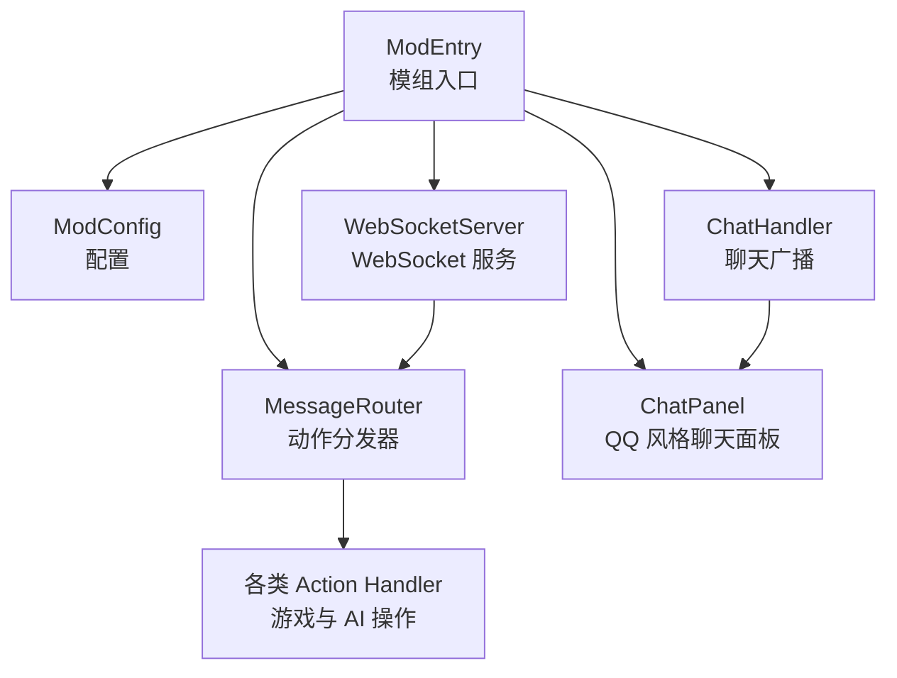
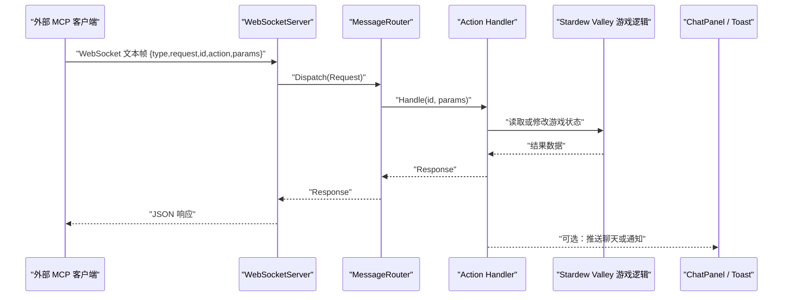
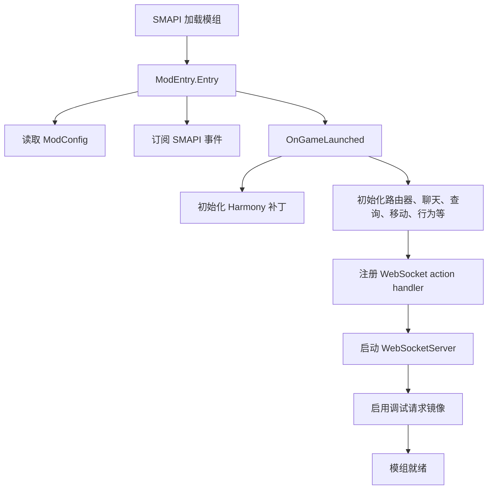
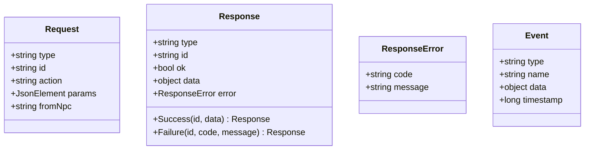
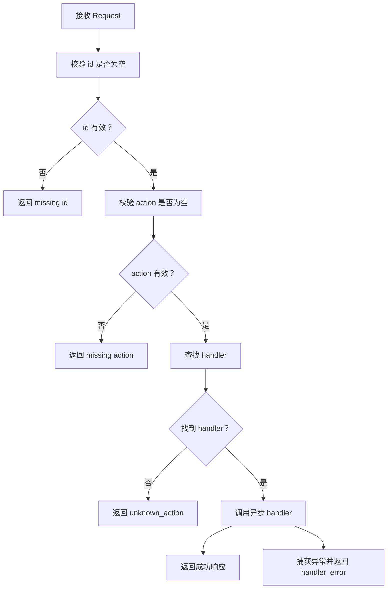
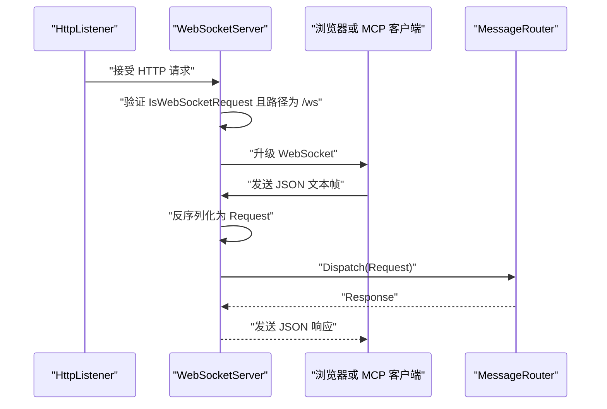
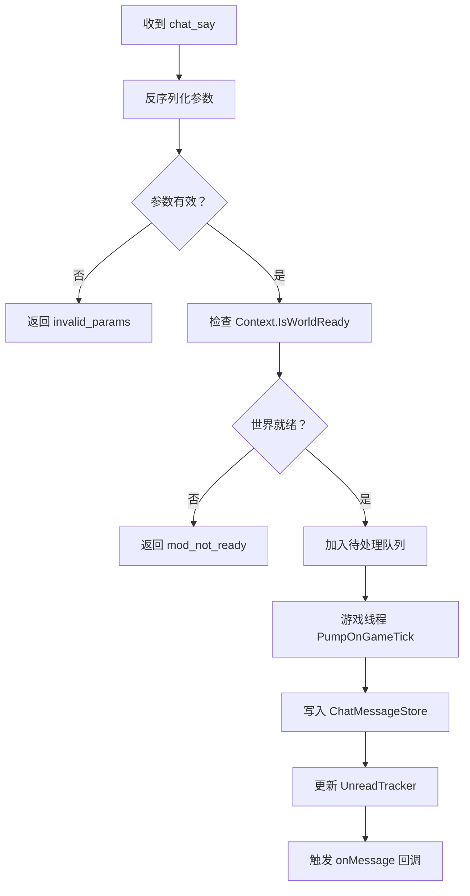
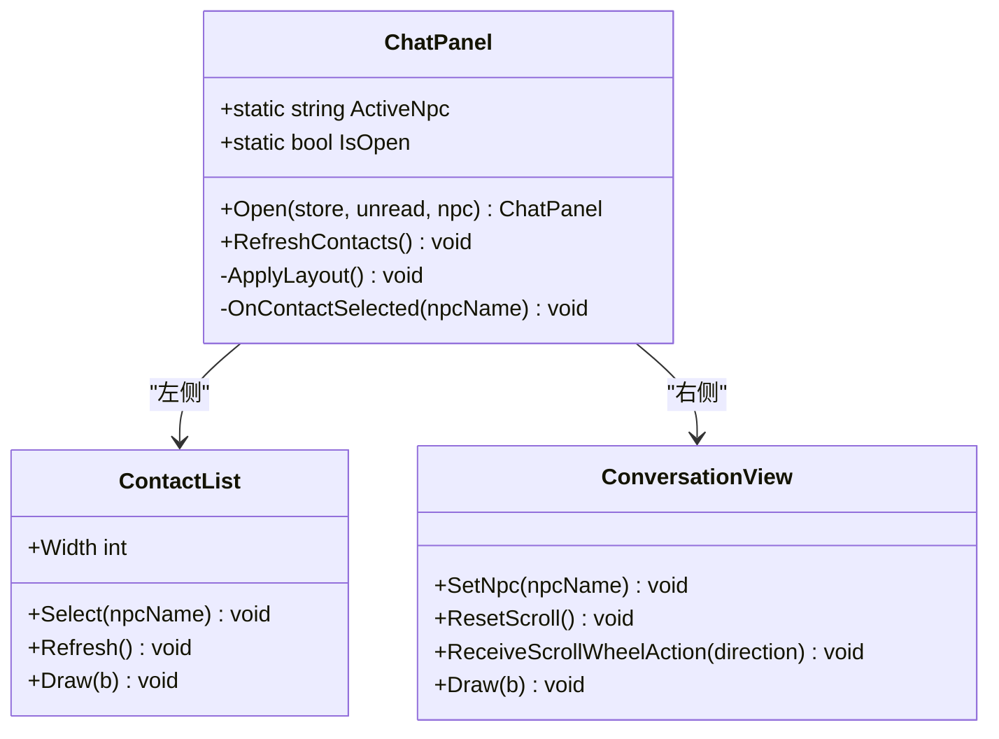
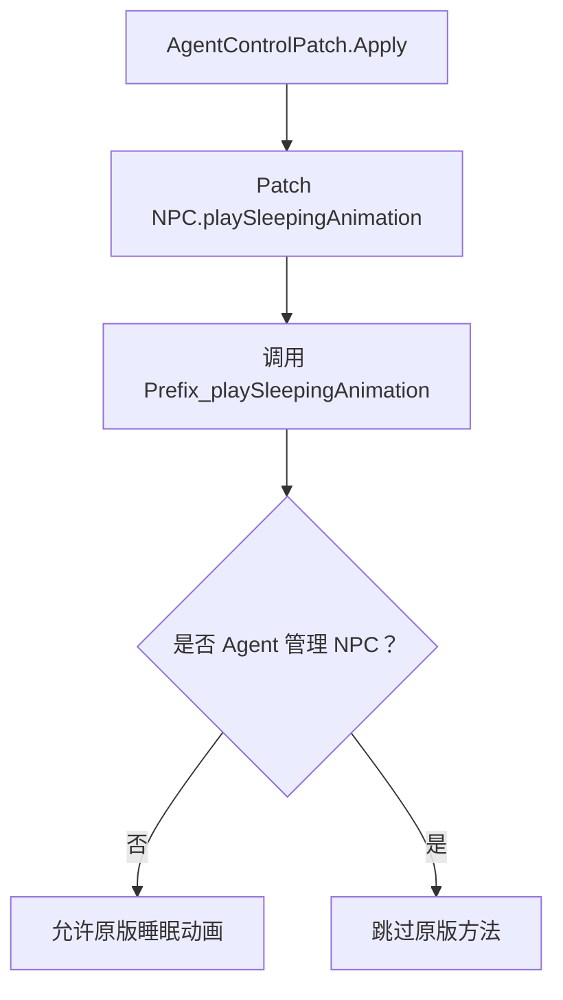
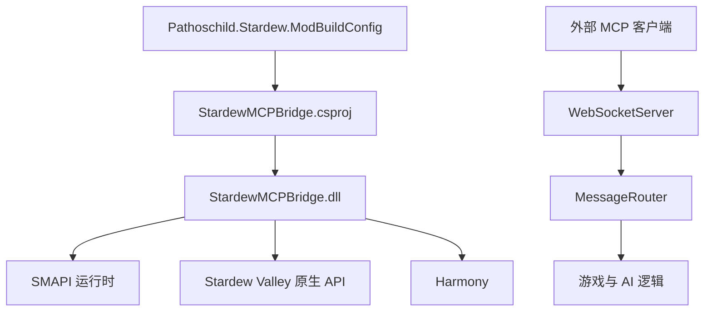

# SMAPI 模组开发

<cite>
**本文引用的文件**   
- [StardewMCPBridge.csproj](file://SmartNPC/smapi-mod/StardewMCPBridge.csproj)
- [manifest.json](file://SmartNPC/smapi-mod/manifest.json)
- [ModEntry.cs](file://SmartNPC/smapi-mod/ModEntry.cs)
- [ModConfig.cs](file://SmartNPC/smapi-mod/ModConfig.cs)
- [MessageRouter.cs](file://SmartNPC/smapi-mod/Bridge/MessageRouter.cs)
- [Protocol.cs](file://SmartNPC/smapi-mod/Bridge/Protocol.cs)
- [WebSocketServer.cs](file://SmartNPC/smapi-mod/Bridge/WebSocketServer.cs)
- [ChatHandler.cs](file://SmartNPC/smapi-mod/Chat/ChatHandler.cs)
- [ChatPanel.cs](file://SmartNPC/smapi-mod/UI/ChatPanel.cs)
- [ContactList.cs](file://SmartNPC/smapi-mod/UI/ContactList.cs)
- [ConversationView.cs](file://SmartNPC/smapi-mod/UI/ConversationView.cs)
- [AgentControlPatch.cs](file://SmartNPC/smapi-mod/Patches/AgentControlPatch.cs)
</cite>

## 目录
1. [引言](#引言)
2. [项目结构](#项目结构)
3. [核心组件](#核心组件)
4. [架构总览](#架构总览)
5. [详细组件分析](#详细组件分析)
6. [依赖关系分析](#依赖关系分析)
7. [性能与调试建议](#性能与调试建议)
8. [故障排查指南](#故障排查指南)
9. [结论](#结论)

## 引言
本文面向基于 SMAPI 的 Stardew Valley 模组开发者，围绕 SmartNPC 中的 StardewMCPBridge 模组，系统说明其整体架构、生命周期管理、配置系统、事件注册机制，以及 WebSocket 通信层、聊天系统和 QQ 风格用户界面。文档还解释如何使用 Harmony Patches 修改原生游戏逻辑，并给出扩展 WebSocket action handler、扩展 UI 组件和处理游戏事件的实操路径。

该模组的构建与部署由 `Pathoschild.Stardew.ModBuildConfig` 驱动：它自动发现 Stardew Valley 安装路径、引用 SMAPI 和 XNA 程序集，并在启用自动部署时将产物复制到 Mods 目录。这使开发者无需手动维护 SDK、SMAPI 或 XNA 引用，把重点放在模组业务逻辑上。

**章节来源**
- [StardewMCPBridge.csproj:1-56](file://SmartNPC/smapi-mod/StardewMCPBridge.csproj#L1-L56)
- [README.md:1-47](file://SmartNPC/smapi-mod/README.md#L1-L47)

## 项目结构
SmartNPC 仓库包含多个子系统，但本 SMAPI 模组的核心代码位于 `smapi-mod` 目录中。其组织方式按职责划分：

- **Bridge**：WebSocket 服务端、协议定义、请求路由。
- **Chat**：聊天广播处理与待处理队列。
- **UI**：QQ 风格的聊天面板、联系人列表、对话视图。
- **Patches**：Harmony 补丁，接管原生 NPC 行为。
- **Behavior/Movement/NPC/Query/Data**：AI 行为、移动、NPC 数据、查询处理器等扩展能力。
- **ModEntry / ModConfig / manifest.json**：模组入口、配置和清单。

**图表来源**
- [ModEntry.cs:1-200](file://SmartNPC/smapi-mod/ModEntry.cs#L1-L200)
- [WebSocketServer.cs:1-200](file://SmartNPC/smapi-mod/Bridge/WebSocketServer.cs#L1-L200)
- [MessageRouter.cs:1-53](file://SmartNPC/smapi-mod/Bridge/MessageRouter.cs#L1-L53)
- [ChatHandler.cs:1-96](file://SmartNPC/smapi-mod/Chat/ChatHandler.cs#L1-L96)
- [ChatPanel.cs:1-178](file://SmartNPC/smapi-mod/UI/ChatPanel.cs#L1-L178)

**章节来源**
- [StardewMCPBridge.csproj:1-56](file://SmartNPC/smapi-mod/StardewMCPBridge.csproj#L1-L56)
- [manifest.json:1-10](file://SmartNPC/smapi-mod/manifest.json#L1-L10)
- [ModEntry.cs:1-200](file://SmartNPC/smapi-mod/ModEntry.cs#L1-L200)

## 核心组件
- **ModEntry**：模组装配中心，负责加载配置、初始化 WebSocket 服务器、注册所有 action handler、订阅 SMAPI 游戏事件、启动 UI 和调试命令。
- **ModConfig**：玩家可编辑的配置类，默认生成 `config.json`；控制监听地址、端口、调试开关、无人值守模式等。
- **MessageRouter**：action 名称到异步处理器的映射表，提供统一校验、异常捕获和耗时统计。
- **Protocol**：WebSocket 帧的数据契约，包括请求、响应、错误和事件对象。
- **WebSocketServer**：基于 `HttpListener` 的最小 WebSocket 实现，支持单连接、请求解析、分发、调试镜像。
- **ChatHandler**：处理 `chat_say` 工作播报，入队后在游戏线程消费，更新消息存储、未读计数和通知。
- **UI 组件**：`ChatPanel` 是顶层菜单，`ContactList` 显示 NPC 联系人，`ConversationView` 显示只读聊天记录。

这些组件共同构成“外部 MCP → WebSocket → 路由 → 游戏逻辑 → 聊天 UI”的闭环。

**章节来源**
- [ModEntry.cs:1-200](file://SmartNPC/smapi-mod/ModEntry.cs#L1-L200)
- [ModConfig.cs:1-144](file://SmartNPC/smapi-mod/ModConfig.cs#L1-L144)
- [MessageRouter.cs:1-53](file://SmartNPC/smapi-mod/Bridge/MessageRouter.cs#L1-L53)
- [Protocol.cs:1-67](file://SmartNPC/smapi-mod/Bridge/Protocol.cs#L1-L67)
- [WebSocketServer.cs:1-200](file://SmartNPC/smapi-mod/Bridge/WebSocketServer.cs#L1-L200)
- [ChatHandler.cs:1-96](file://SmartNPC/smapi-mod/Chat/ChatHandler.cs#L1-L96)
- [ChatPanel.cs:1-178](file://SmartNPC/smapi-mod/UI/ChatPanel.cs#L1-L178)
- [ContactList.cs:1-200](file://SmartNPC/smapi-mod/UI/ContactList.cs#L1-L200)
- [ConversationView.cs:1-175](file://SmartNPC/smapi-mod/UI/ConversationView.cs#L1-L175)

## 架构总览
SMAPI 模组在 Stardew Valley 运行时内运行，通过 WebSocket 暴露给外部 MCP 客户端。请求进入服务器后被路由到具体 handler，handler 调用游戏状态或 AI 系统，结果以 JSON 响应返回；同时，服务器可向当前连接推送事件。UI 层则用于可视化工作播报和调试信息。

**图表来源**
- [WebSocketServer.cs:1-200](file://SmartNPC/smapi-mod/Bridge/WebSocketServer.cs#L1-L200)
- [MessageRouter.cs:1-53](file://SmartNPC/smapi-mod/Bridge/MessageRouter.cs#L1-L53)
- [Protocol.cs:1-67](file://SmartNPC/smapi-mod/Bridge/Protocol.cs#L1-L67)
- [ChatHandler.cs:1-96](file://SmartNPC/smapi-mod/Chat/ChatHandler.cs#L1-L96)
- [ChatPanel.cs:1-178](file://SmartNPC/smapi-mod/UI/ChatPanel.cs#L1-L178)

## 详细组件分析

### 模组生命周期与事件注册
`ModEntry` 是 SMAPI 模组的生命周期入口。它在 `Entry` 方法中完成以下关键任务：

1. 从 `IModHelper` 读取 `ModConfig`。
2. 初始化 NPC 资源、通知弹窗、无人值守控制器。
3. 订阅 SMAPI 的 `GameLoop`、`Display`、`Input`、`Player` 等事件。
4. 在 `OnGameLaunched` 中创建 Harmony、路由器、聊天处理器、查询处理器、感知系统、移动系统、跟随系统、行为系统等。
5. 注册所有 WebSocket action handler，例如 `chat_say`、`game_get_time`、`farm_get_economy`、`npc_move_to`、`npc_emote` 等。
6. 启动 WebSocket 服务器，并设置调试镜像回调。
7. 将聊天处理器输出接入消息存储、未读追踪器和通知系统。
8. 注册控制台调试命令和 NPC 库存 HUD。

这种设计将“装配”集中在入口，而具体业务分散在各模块，降低耦合度。

**图表来源**
- [ModEntry.cs:1-200](file://SmartNPC/smapi-mod/ModEntry.cs#L1-L200)

**章节来源**
- [ModEntry.cs:1-200](file://SmartNPC/smapi-mod/ModEntry.cs#L1-L200)

### 配置系统
`ModConfig` 使用 C# 属性描述配置字段，并由 SMAPI 自动生成 `config.json`。关键字段包括：

| 配置项 | 类型 | 默认值 | 作用 |
|---|---:|---:|---|
| `Host` | 字符串 | `127.0.0.1` | WebSocket 监听接口 |
| `Port` | 整数 | `18745` | WebSocket 监听端口 |
| `ListenPrefix` | 派生属性 | `http://{Host}:{Port}/` | HttpListener 前缀 |
| `DebugLogIncomingRequests` | 布尔 | `false` | 是否将入站请求镜像到聊天面板 |
| `DebugShowBubble` | 布尔 | `true` | 是否显示 NPC 行为气泡 |
| `DebugShowBBoxOverlay` | 布尔 | `false` | 是否绘制调试边界框 |
| `UnattendedMode` | 布尔 | `false` | 无人值守实验模式总开关 |
| `AutoSleepHour` | 整数 | `23` | 自动结束游戏时间的小时 |
| `AutoSleepMinute` | 整数 | `50` | 自动结束游戏时间的分钟 |
| `AutoLoadSave` | 布尔 | `false` | 标题画面自动加载存档 |
| `AutoSleepWaitForDayReview` | 布尔 | `true` | 等待日终复盘完成再结束 |
| `McpStatusUrl` | 字符串 | `http://127.0.0.1:3001/status` | MCP 状态端点 |
| `AutoSleepReviewPollSeconds` | 整数 | `2` | 轮询间隔秒数 |
| `AutoSleepReviewDeadlineHour` | 整数 | `25` | 截止小时 |
| `AutoSleepReviewDeadlineMinute` | 整数 | `50` | 截止分钟 |

`ListenPrefix()` 为 WebSocket 服务器提供绑定前缀；调试开关可在运行时热重载后生效，因为相关检查通常以函数形式延迟求值。

**章节来源**
- [ModConfig.cs:1-144](file://SmartNPC/smapi-mod/ModConfig.cs#L1-L144)

### WebSocket 通信层

#### 协议定义
协议采用 JSON 文本帧，核心类型如下：

| 类型 | 字段 | 说明 |
|---|---|---|
| `Request` | `type` | 固定为 `"request"` |
| `Request` | `id` | 请求标识，必填 |
| `Request` | `action` | 动作名称，必填 |
| `Request` | `params` | 动作参数，类型为任意 JSON |
| `Request` | `from_npc` | 发起 MCP 会话对应的 NPC 名，可用于调试镜像 |
| `Response` | `type` | 固定为 `"response"` |
| `Response` | `id` | 对应请求 id |
| `Response` | `ok` | 成功标志 |
| `Response` | `data` | 成功时的数据 |
| `Response` | `error` | 失败时的错误对象 |
| `Event` | `type` | 固定为 `"event"` |
| `Event` | `name` | 事件名称 |
| `Event` | `data` | 事件数据 |
| `Event` | `timestamp` | 时间戳 |

**图表来源**
- [Protocol.cs:1-67](file://SmartNPC/smapi-mod/Bridge/Protocol.cs#L1-L67)

**章节来源**
- [Protocol.cs:1-67](file://SmartNPC/smapi-mod/Bridge/Protocol.cs#L1-L67)

#### 请求路由
`MessageRouter` 维护一个从 action 名称到异步处理函数的字典。每次 `Dispatch` 会执行：

1. 校验 `id` 是否为空。
2. 校验 `action` 是否为空。
3. 查找 handler；若不存在，返回 `unknown_action` 错误。
4. 调用 handler，记录耗时日志。
5. 捕获异常，返回 `handler_error`。

这保证了外部请求不会直接抛出未处理异常到 WebSocket 层。

**图表来源**
- [MessageRouter.cs:1-53](file://SmartNPC/smapi-mod/Bridge/MessageRouter.cs#L1-L53)

**章节来源**
- [MessageRouter.cs:1-53](file://SmartNPC/smapi-mod/Bridge/MessageRouter.cs#L1-L53)

#### WebSocket 服务器
`WebSocketServer` 基于 .NET 内置的 `HttpListener` 实现最小 WebSocket 功能：

- 监听 `/ws` 路径。
- 只保留最新连接，重复连接会关闭旧连接。
- 接收文本帧并反序列化为 `Request`。
- 调用 `MessageRouter.Dispatch` 得到 `Response`。
- 支持调试镜像：将入站请求排队，在游戏线程泵出到聊天面板。
- 提供 `BroadcastEvent` 供内部系统推送事件。

**图表来源**
- [WebSocketServer.cs:1-200](file://SmartNPC/smapi-mod/Bridge/WebSocketServer.cs#L1-L200)

**章节来源**
- [WebSocketServer.cs:1-200](file://SmartNPC/smapi-mod/Bridge/WebSocketServer.cs#L1-L200)

### 聊天系统

#### ChatHandler
`ChatHandler` 专门处理 `chat_say` 动作，这是 Agent 的工作播报通道。它不直接渲染 UI，而是：

1. 反序列化参数，校验 `speaker` 和 `text`。
2. 判断游戏世界是否已就绪。
3. 将聊天参数加入并发队列。
4. 在游戏线程的 `PumpOnGameTick` 中消费队列。
5. 根据当前选中的 NPC 决定是否增加未读数。
6. 触发消息通知回调，供 Toast 或聊天面板刷新。

**图表来源**
- [ChatHandler.cs:1-96](file://SmartNPC/smapi-mod/Chat/ChatHandler.cs#L1-L96)

**章节来源**
- [ChatHandler.cs:1-96](file://SmartNPC/smapi-mod/Chat/ChatHandler.cs#L1-L96)

#### ChatInputCapture
当前仓库中未发现 `ChatInputCapture.cs`。项目文件中注释提到需要 0Harmony 用于输入捕获补丁，但该补丁文件在当前快照中缺失。因此，关于“聊天输入捕获”的实现不能基于现有源码展开；如需扩展输入拦截，应优先确认补丁文件是否存在，再参考 Harmony 用法。

### 用户界面

#### ChatPanel：QQ 风格聊天面板
`ChatPanel` 继承自 `IClickableMenu`，作为顶层菜单托管左侧联系人列表和右侧对话视图。主要特点：

- 固定尺寸 900×560，居中显示。
- 背景半透明遮罩。
- 左侧宽度由 `ContactList.Width` 决定。
- 滚动事件按鼠标横坐标路由到不同区域。
- 只读模式：仅 Esc 和 Tab 关闭面板。
- 公开静态属性 `ActiveNpc` 和 `IsOpen`，便于其他模块判断状态。
- 打开时标记活动 NPC，选中联系人时标记已读。

**图表来源**
- [ChatPanel.cs:1-178](file://SmartNPC/smapi-mod/UI/ChatPanel.cs#L1-L178)
- [ContactList.cs:1-200](file://SmartNPC/smapi-mod/UI/ContactList.cs#L1-L200)
- [ConversationView.cs:1-175](file://SmartNPC/smapi-mod/UI/ConversationView.cs#L1-L175)

**章节来源**
- [ChatPanel.cs:1-178](file://SmartNPC/smapi-mod/UI/ChatPanel.cs#L1-L178)

#### ContactList：联系人列表
联系人列表按最近消息时间排序，显示头像、在线状态、最后消息预览和未读徽章。点击行选择 NPC，并向 `ConversationView` 切换目标。

#### ConversationView：对话视图
对话视图是只读聊天记录区域，按消息方向绘制气泡，左对齐显示非玩家消息，右对齐保留历史玩家消息。支持滚轮滚动和重置滚动位置。

**章节来源**
- [ContactList.cs:1-200](file://SmartNPC/smapi-mod/UI/ContactList.cs#L1-L200)
- [ConversationView.cs:1-175](file://SmartNPC/smapi-mod/UI/ConversationView.cs#L1-L175)

### Harmony Patches：修改原生游戏逻辑
Harmony 用于在不修改原游戏源码的情况下注入逻辑。本模组目前实现了 `AgentControlPatch`，作用是阻止被 Agent 管理的 NPC 播放睡眠动画。

核心流程：

1. 在 `ModEntry.OnGameLaunched` 中创建 `Harmony` 实例。
2. 调用 `AgentControlPatch.Apply` 注册补丁。
3. 使用 `prefix` 在原始方法执行前拦截。
4. 如果 NPC 属于 Agent 管理，则跳过原版逻辑。

**图表来源**
- [AgentControlPatch.cs:1-44](file://SmartNPC/smapi-mod/Patches/AgentControlPatch.cs#L1-L44)
- [ModEntry.cs:80-120](file://SmartNPC/smapi-mod/ModEntry.cs#L80-L120)

**章节来源**
- [AgentControlPatch.cs:1-44](file://SmartNPC/smapi-mod/Patches/AgentControlPatch.cs#L1-L44)
- [ModEntry.cs:80-120](file://SmartNPC/smapi-mod/ModEntry.cs#L80-L120)

## 依赖关系分析
SMAPI 模组依赖以下层次：

- **SMAPI 运行时**：提供 `Mod`、`IModHelper`、`IMonitor`、事件系统。
- **Stardew Valley 原生 API**：提供 `Game1`、`NPC`、`Context`、XNA 图形接口。
- **Harmony**：用于方法拦截。
- **Pathoschild.Stardew.ModBuildConfig**：用于构建、引用和部署。
- **外部 MCP 客户端**：通过 WebSocket 与模组通信。

**图表来源**
- [StardewMCPBridge.csproj:1-56](file://SmartNPC/smapi-mod/StardewMCPBridge.csproj#L1-L56)
- [WebSocketServer.cs:1-200](file://SmartNPC/smapi-mod/Bridge/WebSocketServer.cs#L1-L200)
- [MessageRouter.cs:1-53](file://SmartNPC/smapi-mod/Bridge/MessageRouter.cs#L1-L53)

**章节来源**
- [StardewMCPBridge.csproj:1-56](file://SmartNPC/smapi-mod/StardewMCPBridge.csproj#L1-L56)
- [manifest.json:1-10](file://SmartNPC/smapi-mod/manifest.json#L1-L10)

## 性能与调试建议

### 性能特性
- **单连接模型**：WebSocket 服务器只保留最新连接，避免多连接状态同步复杂度。
- **异步处理**：路由层使用异步 handler，减少阻塞。
- **线程隔离**：聊天消息通过队列在游戏线程消费，避免直接访问游戏状态导致竞争。
- **调试开销可控**：调试请求镜像仅在启用时入队，且泵出逻辑对空队列无副作用。
- **UI 渲染优化**：联系人列表使用裁剪矩形限制绘制区域，减少无关绘制。

### 调试技巧
- 启用 `DebugLogIncomingRequests`，观察 MCP 调用的 action、id 和参数。
- 启用 `DebugShowBubble`，观察 NPC 行为触发。
- 启用 `DebugShowBBoxOverlay`，观察工具决策的边界框。
- 使用 SMAPI 控制台调试命令（由 `DebugCommands.Register` 注册）。
- 通过 `ChatPanel` 查看实时工作播报和调试请求镜像。
- 关注 `MessageRouter` 的 `[timing]` 日志，定位慢 handler。

### 优化建议
- 避免在 handler 中直接修改 `Game1` 全局状态；必要时排队到游戏线程。
- 对长耗时操作进行超时保护，防止 WebSocket 连接长时间挂起。
- 控制聊天消息长度和频率，避免 UI 重绘过多。
- 谨慎开启调试功能，生产环境默认关闭以减少日志和渲染开销。
- 对批量 NPC 操作使用队列或批处理，避免每帧频繁状态变更。

[本节为通用指导，不直接分析具体源码片段]

## 故障排查指南

### WebSocket 无法连接
- 检查 `ModConfig.Host` 和 `Port` 是否与 MCP 客户端一致。
- 确认防火墙未阻止 18745 端口。
- 检查日志中是否出现 “listening on ... ws”。
- 确认请求路径为 `/ws`。

**章节来源**
- [ModConfig.cs:1-144](file://SmartNPC/smapi-mod/ModConfig.cs#L1-L144)
- [WebSocketServer.cs:1-200](file://SmartNPC/smapi-mod/Bridge/WebSocketServer.cs#L1-L200)

### 动作未知或参数无效
- 检查 action 名称是否正确注册。
- 检查 `Request.action` 和 `Request.id` 是否为空。
- 检查 handler 的参数反序列化是否成功。
- 查看 `MessageRouter` 返回的错误码：`unknown_action`、`invalid_request`、`invalid_params`、`handler_error`。

**章节来源**
- [MessageRouter.cs:1-53](file://SmartNPC/smapi-mod/Bridge/MessageRouter.cs#L1-L53)
- [Protocol.cs:1-67](file://SmartNPC/smapi-mod/Bridge/Protocol.cs#L1-L67)

### 聊天消息不显示
- 确认 `ChatHandler.SetMessageStore` 和 `SetUnreadTracker` 已调用。
- 确认 `ChatHandler.PumpOnGameTick` 在游戏 tick 中被消费。
- 检查 `ChatPanel.IsOpen` 与 `ActiveNpc` 是否匹配。
- 确认 `NotificationToast` 和 `ChatMessageStore` 正常更新。

**章节来源**
- [ChatHandler.cs:1-96](file://SmartNPC/smapi-mod/Chat/ChatHandler.cs#L1-L96)
- [ChatPanel.cs:1-178](file://SmartNPC/smapi-mod/UI/ChatPanel.cs#L1-L178)

### Harmony 补丁未生效
- 确认 `AgentControlPatch.Apply` 已在 `OnGameLaunched` 中调用。
- 确认被 patch 的目标方法签名未发生变化。
- 检查 SMAPI 日志中是否有补丁注册信息。
- 确认 NPC 确实属于 Agent 管理集合。

**章节来源**
- [AgentControlPatch.cs:1-44](file://SmartNPC/smapi-mod/Patches/AgentControlPatch.cs#L1-L44)
- [ModEntry.cs:80-120](file://SmartNPC/smapi-mod/ModEntry.cs#L80-L120)

## 结论
SmartNPC 的 StardewMCPBridge 模组提供了一个清晰的 SMAPI 开发范例：它以 `ModEntry` 为中心装配子系统，使用 `Pathoschild.Stardew.ModBuildConfig` 简化构建部署，通过 WebSocket 暴露结构化协议，借助 `MessageRouter` 统一管理 action 分发，并通过 Harmony 安全地修改原生游戏逻辑。聊天系统与 QQ 风格 UI 让开发者能够直观观察 Agent 的工作播报和调试信息。对于新功能的扩展，推荐遵循现有模式：新增 action handler、保持线程安全、复用消息存储和未读追踪、在 UI 中提供可视化反馈。

[本节为总结性内容，不直接分析具体源码片段]