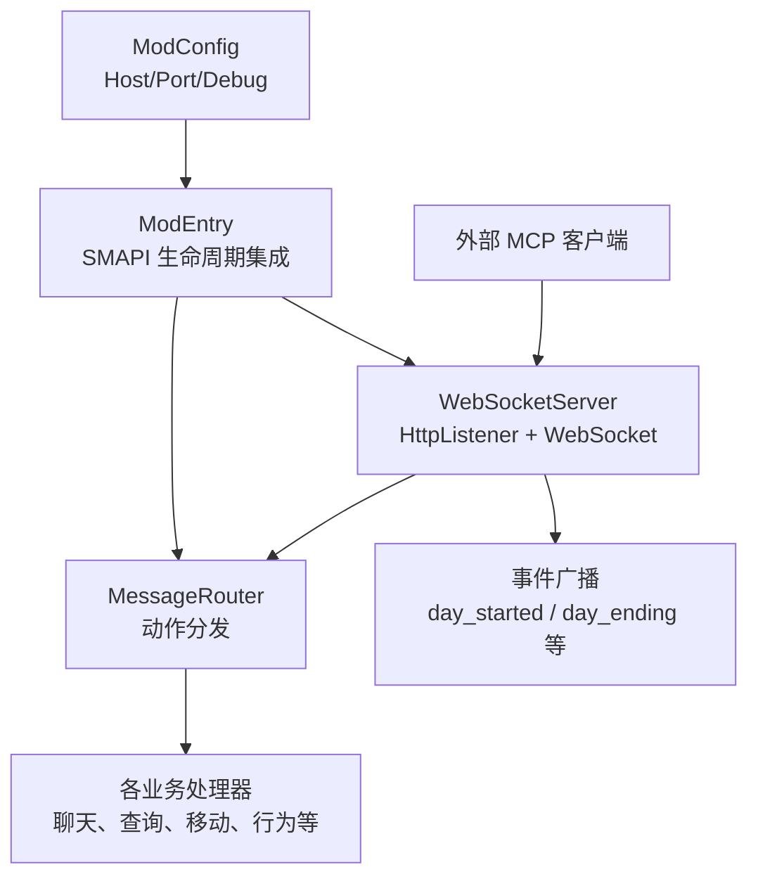
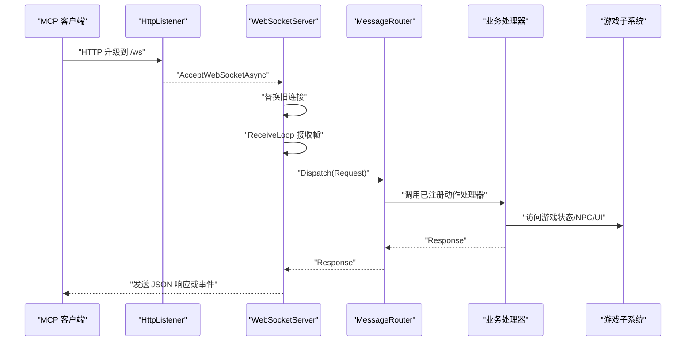
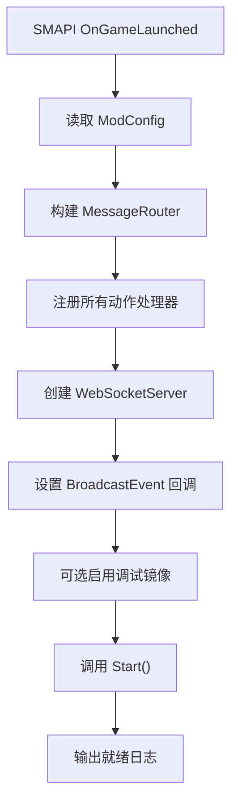
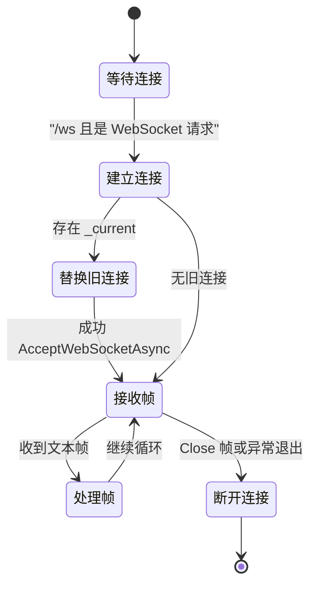
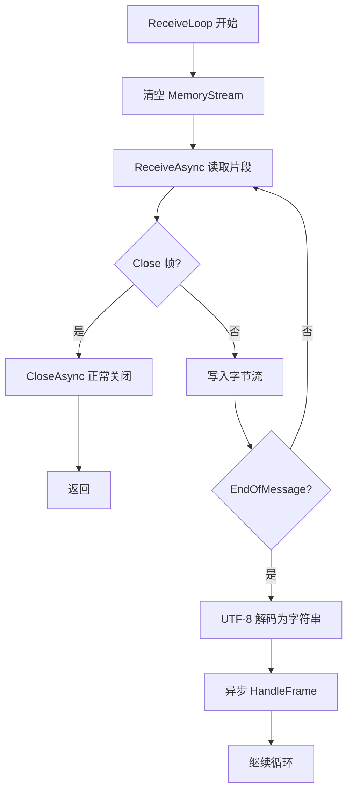
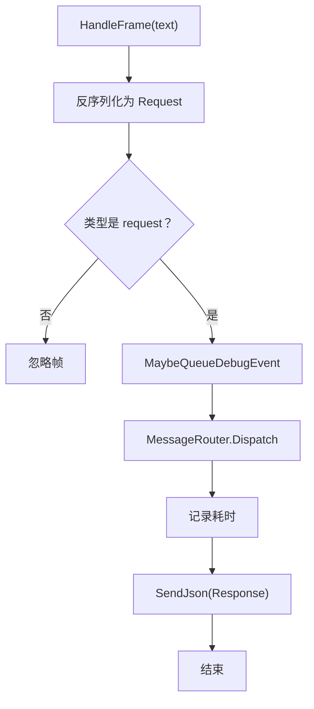
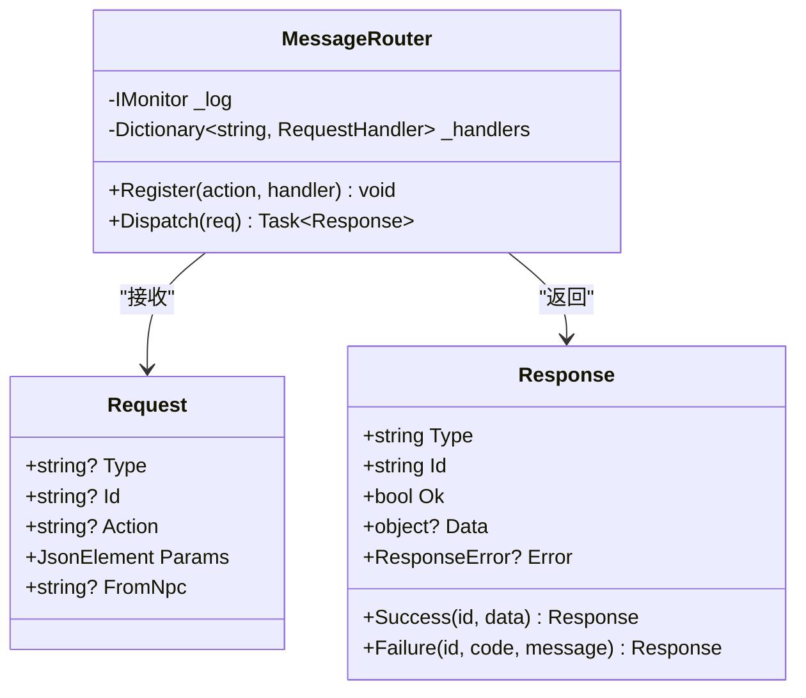
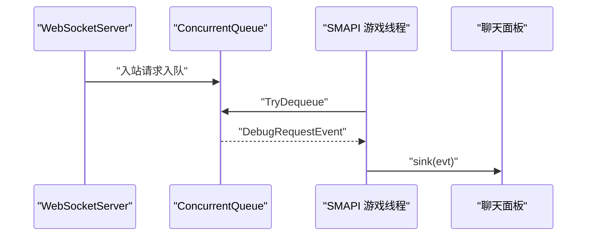

# WebSocket 服务端实现

<cite>
**本文引用的文件**   
- [WebSocketServer.cs](file://SmartNPC/smapi-mod/Bridge/WebSocketServer.cs)
- [MessageRouter.cs](file://SmartNPC/smapi-mod/Bridge/MessageRouter.cs)
- [Protocol.cs](file://SmartNPC/smapi-mod/Bridge/Protocol.cs)
- [ModEntry.cs](file://SmartNPC/smapi-mod/ModEntry.cs)
- [ModConfig.cs](file://SmartNPC/smapi-mod/ModConfig.cs)
</cite>

## 目录
1. [简介](#简介)
2. [项目结构定位](#项目结构定位)
3. [核心组件总览](#核心组件总览)
4. [架构总览](#架构总览)
5. [服务器初始化与生命周期](#服务器初始化与生命周期)
6. [连接建立、单客户端策略与销毁](#连接建立单客户端策略与销毁)
7. [消息接收与处理流程](#消息接收与处理流程)
8. [路由与处理器调度](#路由与处理器调度)
9. [连接池、并发模型与状态跟踪](#连接池并发模型与状态跟踪)
10. [心跳、保活与断线行为](#心跳保活与断线行为)
11. [调试、监控与性能指标](#调试监控与性能指标)
12. [错误处理与资源清理](#错误处理与资源清理)
13. [安全注意事项](#安全注意事项)
14. [故障排查指南](#故障排查指南)
15. [结论](#结论)

## 简介
本文围绕 Stardew Valley SMAPI 扩展中的 MCP 桥接 WebSocket 服务端展开，重点解析 `WebSocketServer.cs` 的实现。该服务运行在游戏进程内部，通过 `System.Net.HttpListener` 暴露 WebSocket 端点，把来自外部 MCP 客户端的 JSON 请求转发给游戏内各子系统，再把响应或事件推送回客户端。文档覆盖服务器启动、端口配置、连接生命周期、消息处理、调试与监控、异常处理和安全性等主题。

## 项目结构定位
WebSocket 服务端位于 SMAPI Mod 的桥接层中：

- 协议数据对象定义在 `Bridge/Protocol.cs`。
- 请求分发逻辑在 `Bridge/MessageRouter.cs`。
- WebSocket 网络层在 `Bridge/WebSocketServer.cs`。
- 服务器注册、配置读取和 SMAPI 事件集成在 `ModEntry.cs`。
- 监听地址、端口和调试开关在 `ModConfig.cs`。

**图表来源**
- [WebSocketServer.cs:1-324](file://SmartNPC/smapi-mod/Bridge/WebSocketServer.cs#L1-L324)
- [MessageRouter.cs:1-53](file://SmartNPC/smapi-mod/Bridge/MessageRouter.cs#L1-L53)
- [Protocol.cs:1-67](file://SmartNPC/smapi-mod/Bridge/Protocol.cs#L1-L67)
- [ModEntry.cs:1-200](file://SmartNPC/smapi-mod/ModEntry.cs#L1-L200)
- [ModConfig.cs:1-144](file://SmartNPC/smapi-mod/ModConfig.cs#L1-L144)

**章节来源**
- [WebSocketServer.cs:1-60](file://SmartNPC/smapi-mod/Bridge/WebSocketServer.cs#L1-L60)
- [MessageRouter.cs:1-53](file://SmartNPC/smapi-mod/Bridge/MessageRouter.cs#L1-L53)
- [Protocol.cs:1-67](file://SmartNPC/smapi-mod/Bridge/Protocol.cs#L1-L67)
- [ModEntry.cs:1-200](file://SmartNPC/smapi-mod/ModEntry.cs#L1-L200)
- [ModConfig.cs:1-144](file://SmartNPC/smapi-mod/ModConfig.cs#L1-L144)

## 核心组件总览
| 组件 | 职责 | 关键行为 |
|---|---|---|
| `WebSocketServer` | 监听 HTTP Listener，接受 `/ws` 升级，管理当前 WebSocket 连接，接收帧并调用路由，发送响应和事件 | 单连接替换、自动 ping/pong、异步接收、JSON 序列化、调试镜像、连接计数 |
| `MessageRouter` | 维护动作名称到处理器的映射，校验请求字段，执行处理器并记录耗时 | 缺少 id/action 返回失败，未知动作返回失败，捕获处理器异常 |
| `Protocol` | 定义请求、响应、响应错误、事件以及 JSON 序列化选项 | `Request`、`Response`、`Event`、`JsonOpts.Web` |
| `ModEntry` | SMAPI 入口，组装依赖，注册所有动作处理器，创建并启动 WebSocket 服务，绑定 UI 与调试能力 | 读取配置、注入广播回调、启用调试镜像、挂载 SMAPI 事件 |
| `ModConfig` | 提供 Host、Port、调试开关等运行时配置 | `ListenPrefix()` 生成 HttpListener 前缀 |

**章节来源**
- [WebSocketServer.cs:1-120](file://SmartNPC/smapi-mod/Bridge/WebSocketServer.cs#L1-L120)
- [MessageRouter.cs:1-53](file://SmartNPC/smapi-mod/Bridge/MessageRouter.cs#L1-L53)
- [Protocol.cs:1-67](file://SmartNPC/smapi-mod/Bridge/Protocol.cs#L1-L67)
- [ModEntry.cs:1-200](file://SmartNPC/smapi-mod/ModEntry.cs#L1-L200)
- [ModConfig.cs:1-144](file://SmartNPC/smapi-mod/ModConfig.cs#L1-L144)

## 架构总览
系统采用“网络接入层 + 路由层 + 业务处理器 + UI/持久化”的分层结构：

- 网络接入层负责 WebSocket 握手、帧接收、基础错误处理。
- 路由层负责参数校验、动作查找、异常封装。
- 业务处理器负责调用 SMAPI、游戏状态、NPC 行为、UI 更新。
- ModEntry 作为装配中心，把 WebSocket、路由器、处理器、UI、调试功能组合起来。

**图表来源**
- [WebSocketServer.cs:60-180](file://SmartNPC/smapi-mod/Bridge/WebSocketServer.cs#L60-L180)
- [MessageRouter.cs:15-53](file://SmartNPC/smapi-mod/Bridge/MessageRouter.cs#L15-L53)
- [ModEntry.cs:100-200](file://SmartNPC/smapi-mod/ModEntry.cs#L100-L200)

## 服务器初始化与生命周期
### 启动过程
`ModEntry` 在游戏启动后构造 `MessageRouter`，注册全部动作处理器，然后读取 `ModConfig.ListenPrefix()`，创建并启动 `WebSocketServer`。启动日志会输出监听地址。

关键步骤：
1. 从 `helper.ReadConfig<ModConfig>()` 加载配置。
2. 初始化聊天、查询、感知、移动、行为等子系统。
3. 将各子系统处理器注册到 `MessageRouter`。
4. 根据 `ModConfig.Host` 和 `ModConfig.Port` 生成监听前缀。
5. 创建 `WebSocketServer(prefix, router, monitor)`。
6. 设置 NPC 行为广播回调为 WebSocket 事件广播。
7. 可选启用调试镜像。
8. 调用 `Start()`。

**图表来源**
- [ModEntry.cs:100-200](file://SmartNPC/smapi-mod/ModEntry.cs#L100-L200)
- [ModConfig.cs:1-40](file://SmartNPC/smapi-mod/ModConfig.cs#L1-L40)
- [WebSocketServer.cs:100-140](file://SmartNPC/smapi-mod/Bridge/WebSocketServer.cs#L100-L140)

**章节来源**
- [ModEntry.cs:100-200](file://SmartNPC/smapi-mod/ModEntry.cs#L100-L200)
- [ModConfig.cs:1-40](file://SmartNPC/smapi-mod/ModConfig.cs#L1-L40)
- [WebSocketServer.cs:100-140](file://SmartNPC/smapi-mod/Bridge/WebSocketServer.cs#L100-L140)

### 端口与监听地址配置
`ModConfig` 默认监听 `127.0.0.1:18745`，并通过 `ListenPrefix()` 生成 `http://{Host}:{Port}/`。该前缀被 `HttpListener.Prefixes.Add()` 使用。

- `Host`：默认环回地址，注释明确警告不要对不可信网络开放 `0.0.0.0`。
- `Port`：默认 `18745`，需与 `smartnpc-mcp` 客户端 URL 一致。
- `ListenPrefix()`：构造 HttpListener 所需的 HTTP 前缀。

**章节来源**
- [ModConfig.cs:1-40](file://SmartNPC/smapi-mod/ModConfig.cs#L1-L40)

### 停止与释放
`Dispose()` 按顺序取消令牌、停止 Listener、关闭 Listener、释放当前 WebSocket。每个操作都包裹在 try-catch 中，避免释放阶段抛出异常影响主流程。

**章节来源**
- [WebSocketServer.cs:140-160](file://SmartNPC/smapi-mod/Bridge/WebSocketServer.cs#L140-L160)

## 连接建立、单客户端策略与销毁
### 连接建立
`AcceptLoop` 循环调用 `GetContextAsync()`。当请求不是 WebSocket 请求或路径不是 `/ws` 时，直接返回 400 并关闭响应。合法请求交给 `HandleClient`。

`HandleClient` 调用 `AcceptWebSocketAsync`，成功后用 `Interlocked.Exchange` 替换 `_current`：
- 如果已有旧连接，则尝试以 `PolicyViolation` 和原因字符串 `replaced` 关闭旧连接，并释放其 WebSocket。
- 新连接进入 `ReceiveLoop`。
- finally 块确保断开日志、清除 `_current`、释放 WebSocket。

**图表来源**
- [WebSocketServer.cs:120-200](file://SmartNPC/smapi-mod/Bridge/WebSocketServer.cs#L120-L200)

**章节来源**
- [WebSocketServer.cs:120-200](file://SmartNPC/smapi-mod/Bridge/WebSocketServer.cs#L120-L200)

### 单客户端设计
代码注释明确说明：本实现适合单连接场景；如果有第二个客户端连接，会关闭上一个连接。`ConnectedClientCount` 只可能返回 0 或 1。这意味着它不是一个多连接连接池，而是一个“最新连接优先”的单连接管理器。

**章节来源**
- [WebSocketServer.cs:1-20](file://SmartNPC/smapi-mod/Bridge/WebSocketServer.cs#L1-L20)
- [WebSocketServer.cs:260-270](file://SmartNPC/smapi-mod/Bridge/WebSocketServer.cs#L260-L270)

## 消息接收与处理流程
### 帧接收
`ReceiveLoop` 使用固定大小缓冲区累积一个完整消息。它会：
- 不断 `ReceiveAsync`。
- 遇到 Close 帧则正常关闭并返回。
- 非 Close 帧写入 MemoryStream。
- 直到 `EndOfMessage` 为真，再按 UTF-8 解码成字符串。
- 将字符串交给 `HandleFrame`，并异步执行。

**图表来源**
- [WebSocketServer.cs:160-200](file://SmartNPC/smapi-mod/Bridge/WebSocketServer.cs#L160-L200)

### 帧处理
`HandleFrame` 主要做三件事：
1. 使用 `JsonSerializer.Deserialize<Request>` 反序列化为 `Protocol.Request`。
2. 若反序列化失败，记录警告日志并丢弃帧。
3. 若 `Type` 不是 `request`，忽略。
4. 可选将入站请求加入调试队列。
5. 调用 `MessageRouter.Dispatch(req)`。
6. 记录整体耗时。
7. 将 `Response` 序列化并通过 WebSocket 发送。

**图表来源**
- [WebSocketServer.cs:200-240](file://SmartNPC/smapi-mod/Bridge/WebSocketServer.cs#L200-L240)
- [MessageRouter.cs:25-53](file://SmartNPC/smapi-mod/Bridge/MessageRouter.cs#L25-L53)

**章节来源**
- [WebSocketServer.cs:160-240](file://SmartNPC/smapi-mod/Bridge/WebSocketServer.cs#L160-L240)

## 路由与处理器调度
`MessageRouter` 维护一个动作名到委托的字典。`Dispatch` 的行为如下：
- 缺少 `id`：返回失败响应，错误码为空字符串。
- 缺少 `action`：返回失败响应，错误码为 `invalid_request`。
- 找不到处理器：返回失败响应，错误码为 `unknown_action`。
- 成功调用处理器：记录起止时间并输出耗时日志。
- 处理器抛出异常：捕获异常，记录警告日志，返回失败响应，错误码为 `handler_error`。

**图表来源**
- [MessageRouter.cs:1-53](file://SmartNPC/smapi-mod/Bridge/MessageRouter.cs#L1-L53)
- [Protocol.cs:1-67](file://SmartNPC/smapi-mod/Bridge/Protocol.cs#L1-L67)

**章节来源**
- [MessageRouter.cs:1-53](file://SmartNPC/smapi-mod/Bridge/MessageRouter.cs#L1-L53)
- [Protocol.cs:1-67](file://SmartNPC/smapi-mod/Bridge/Protocol.cs#L1-L67)

## 连接池、并发模型与状态跟踪
### 连接池
该项目没有真正的连接池。`WebSocketServer._current` 是单个 `WebSocket?` 字段，表示“当前最新连接”。每次新连接都会替换旧连接，因此活跃连接数最多为 1。

| 概念 | 实际实现 |
|---|---|
| 连接池 | 不存在 |
| 最大并发连接 | 1 |
| 新连接行为 | 关闭并释放旧连接 |
| 活跃连接计数 | 0 或 1 |

**章节来源**
- [WebSocketServer.cs:1-20](file://SmartNPC/smapi-mod/Bridge/WebSocketServer.cs#L1-L20)
- [WebSocketServer.cs:120-200](file://SmartNPC/smapi-mod/Bridge/WebSocketServer.cs#L120-L200)
- [WebSocketServer.cs:260-270](file://SmartNPC/smapi-mod/Bridge/WebSocketServer.cs#L260-L270)

### 并发模型
- 接受循环在独立任务中运行。
- 每个客户端处理在单独任务中运行。
- 每帧处理也通过 `Task.Run` 异步派发。
- 写锁 `_sendLock` 是 `SemaphoreSlim(1, 1)`，用于串行化对当前 WebSocket 的发送，避免并发写冲突。
- 调试事件通过 `ConcurrentQueue` 跨线程传递，由 SMAPI 的 `OnUpdateTicked` 在游戏线程中消费。

这种模型适合低吞吐、人类对话速率的场景，但不适合高并发批量消息。

**章节来源**
- [WebSocketServer.cs:100-240](file://SmartNPC/smapi-mod/Bridge/WebSocketServer.cs#L100-L240)
- [WebSocketServer.cs:240-324](file://SmartNPC/smapi-mod/Bridge/WebSocketServer.cs#L240-L324)
- [ModEntry.cs:201-230](file://SmartNPC/smapi-mod/ModEntry.cs#L201-L230)

### 状态跟踪
- `_current`：当前 WebSocket 引用。
- `ConnectedClientCount`：检查 `_current.State == Open` 后返回 1，否则 0。
- 连接建立和断开均记录日志。
- 调试模式可记录每个入站请求的 action、id、参数摘要和目标 NPC。

**章节来源**
- [WebSocketServer.cs:260-324](file://SmartNPC/smapi-mod/Bridge/WebSocketServer.cs#L260-L324)

## 心跳、保活与断线行为
### 心跳
代码注释指出服务器会“每 30 秒自动 ping”，并将浏览器兼容的 ping/pong 交给框架处理。源码中未看到显式定时 ping 发送逻辑，说明实际心跳行为依赖于底层 WebSocket 框架或宿主环境。

### 保活
服务端没有实现应用层心跳检测。连接保活主要依赖：
- WebSocket 协议层的 ping/pong。
- 客户端重连机制（由外部 MCP 客户端负责）。
- 服务端在连接断开时释放资源。

### 断线处理
- `ReceiveLoop` 中捕获异常后直接返回，触发 finally 清理。
- Close 帧会正常关闭连接。
- finally 块中记录断开日志、清除 `_current`、释放 WebSocket。

注意：如果 `ReceiveAsync` 抛出的异常无法区分“网络中断”和“其他 IO 异常”，目前统一走快速退出路径。对于需要更精细恢复的场景，建议区分异常类型并决定是否重试。

**章节来源**
- [WebSocketServer.cs:1-20](file://SmartNPC/smapi-mod/Bridge/WebSocketServer.cs#L1-L20)
- [WebSocketServer.cs:160-200](file://SmartNPC/smapi-mod/Bridge/WebSocketServer.cs#L160-L200)

## 调试、监控与性能指标
### 调试镜像
`EnableRequestDebug(enabled, sink)` 允许把每个入站请求镜像到 SMAPI 控制台或游戏内聊天面板。关键设计：
- `enabled` 是函数指针，每次请求时轮询，支持热重载配置。
- `sink` 由 `ModEntry` 注入，运行在游戏线程。
- WebSocket 线程只构造 `DebugRequestEvent` 并加入 `ConcurrentQueue`。
- `PumpOnGameTick` 由 `ModEntry.OnUpdateTicked` 定期调用，从队列取出事件并交给 UI。

**图表来源**
- [WebSocketServer.cs:40-100](file://SmartNPC/smapi-mod/Bridge/WebSocketServer.cs#L40-L100)
- [WebSocketServer.cs:240-324](file://SmartNPC/smapi-mod/Bridge/WebSocketServer.cs#L240-L324)
- [ModEntry.cs:201-230](file://SmartNPC/smapi-mod/ModEntry.cs#L201-L230)

**章节来源**
- [WebSocketServer.cs:40-100](file://SmartNPC/smapi-mod/Bridge/WebSocketServer.cs#L40-L100)
- [WebSocketServer.cs:240-324](file://SmartNPC/smapi-mod/Bridge/WebSocketServer.cs#L240-L324)
- [ModEntry.cs:201-230](file://SmartNPC/smapi-mod/ModEntry.cs#L201-L230)

### 连接监控
- `ConnectedClientCount`：活跃连接数，0 或 1。
- 日志中包含连接建立、断开、发送失败、无效帧、路由耗时等信息。
- 可通过 SMAPI 控制台命令查看连接状态（由 `DebugCommands` 注册，但具体命令实现不在本文分析范围内）。

### 性能指标
- 路由层记录每个动作处理的毫秒耗时。
- WebSocket 层也记录整体 `ws` 请求耗时。
- 日志级别包括 Info、Warn、Debug、Trace，可用于生产观察和开发诊断。

需要注意：
- 目前没有独立的性能计数器或 Prometheus/Grafana 指标导出。
- 内存方面，`MemoryStream` 在每个帧处理中重建，长时间高频消息可能增加 GC 压力。
- 调试队列是无界的，虽然注释说明吞吐率低，但如果恶意或异常客户端持续发送大量调试信息，仍可能造成队列增长。

**章节来源**
- [WebSocketServer.cs:200-324](file://SmartNPC/smapi-mod/Bridge/WebSocketServer.cs#L200-L324)
- [MessageRouter.cs:25-53](file://SmartNPC/smapi-mod/Bridge/MessageRouter.cs#L25-L53)

## 错误处理与资源清理
### 网络层错误
- `AcceptLoop` 捕获 `ObjectDisposedException` 和 `HttpListenerException` 后返回，避免循环崩溃。
- `AcceptWebSocketAsync` 捕获异常并记录警告日志。
- `ReceiveAsync` 捕获异常后直接返回，交由 finally 清理。
- `SendJson` 捕获发送异常并记录 Debug 日志。

### 协议层错误
- 反序列化失败：记录警告日志，不继续处理。
- `Type` 不是 `request`：忽略。
- 缺少 `id` 或 `action`：由 `MessageRouter` 返回结构化错误。
- 未知 `action`：返回 `unknown_action`。
- 处理器异常：返回 `handler_error`，包含异常消息。

### 资源清理
- `Dispose()` 取消 Token、停止 Listener、关闭 Listener、释放 WebSocket。
- 客户端处理 finally 块释放 WebSocket。
- 旧连接被替换时显式 `CloseAsync` 和 `Dispose`。
- 所有释放操作都 try-catch，避免副作用。

**章节来源**
- [WebSocketServer.cs:120-200](file://SmartNPC/smapi-mod/Bridge/WebSocketServer.cs#L120-L200)
- [WebSocketServer.cs:200-324](file://SmartNPC/smapi-mod/Bridge/WebSocketServer.cs#L200-L324)
- [MessageRouter.cs:25-53](file://SmartNPC/smapi-mod/Bridge/MessageRouter.cs#L25-L53)

## 安全注意事项
1. **无认证机制**：协议注释明确指出当前 WebSocket 协议没有鉴权。任何能访问监听地址的客户端都可以调用所有已注册动作。
2. **监听地址风险**：`ModConfig` 默认使用 `127.0.0.1`，注释明确警告不要对 `0.0.0.0` 暴露于不可信网络。
3. **权限边界**：部分动作可以读取游戏状态、控制 NPC 移动、修改物品栏或触发行为，应视为高权限接口。
4. **输入验证**：目前只对顶层 `id`、`action`、`type` 做基础校验，业务参数校验依赖各处理器。
5. **拒绝服务风险**：
   - 无连接数量限制。
   - 单连接设计降低了多连接攻击面，但仍需防范单连接慢速攻击或超大消息。
   - 调试队列无界，调试开启时应限制消息频率或大小。
6. **日志泄露**：调试镜像会记录参数 JSON，可能包含敏感信息，生产环境应谨慎开启。

**章节来源**
- [ModConfig.cs:1-40](file://SmartNPC/smapi-mod/ModConfig.cs#L1-L40)
- [Protocol.cs:1-67](file://SmartNPC/smapi-mod/Bridge/Protocol.cs#L1-L67)
- [WebSocketServer.cs:1-20](file://SmartNPC/smapi-mod/Bridge/WebSocketServer.cs#L1-L20)
- [WebSocketServer.cs:240-324](file://SmartNPC/smapi-mod/Bridge/WebSocketServer.cs#L240-L324)

## 故障排查指南
### 客户端无法连接
- 检查 `ModConfig.Host` 和 `Port` 是否与 MCP 客户端一致。
- 确认 SMAPI 已加载并输出了 WebSocket 监听日志。
- 确认防火墙未阻止本机或局域网端口。
- 如果使用 `0.0.0.0`，确认确实需要对外暴露并接受安全风险。

**相关线索**
- [ModConfig.cs:1-40](file://SmartNPC/smapi-mod/ModConfig.cs#L1-L40)
- [WebSocketServer.cs:100-140](file://SmartNPC/smapi-mod/Bridge/WebSocketServer.cs#L100-L140)

### 连接频繁被替换
- 这是预期行为：第二个客户端会替换第一个客户端。
- 检查是否有多个 MCP 实例同时连接。
- 如需多连接，需要重写 `WebSocketServer` 的连接管理逻辑，引入连接集合、会话标识和并发安全策略。

**相关线索**
- [WebSocketServer.cs:1-20](file://SmartNPC/smapi-mod/Bridge/WebSocketServer.cs#L1-L20)
- [WebSocketServer.cs:120-200](file://SmartNPC/smapi-mod/Bridge/WebSocketServer.cs#L120-L200)

### 消息无响应
- 检查日志中是否出现 `invalid ws frame`。
- 检查 `MessageRouter` 是否注册了对应 `action`。
- 检查处理器是否抛出异常并被记录为 `handler_error`。
- 检查 `ConnectedClientCount` 是否为 0，可能连接已断开。

**相关线索**
- [WebSocketServer.cs:200-240](file://SmartNPC/smapi-mod/Bridge/WebSocketServer.cs#L200-L240)
- [MessageRouter.cs:25-53](file://SmartNPC/smapi-mod/Bridge/MessageRouter.cs#L25-L53)
- [WebSocketServer.cs:260-270](file://SmartNPC/smapi-mod/Bridge/WebSocketServer.cs#L260-L270)

### 调试镜像不显示
- 确认 `DebugLogIncomingRequests` 为 true。
- 确认 `EnableRequestDebug` 已调用。
- 确认 `PumpOnGameTick` 被 SMAPI `OnUpdateTicked` 调用。
- 检查 sink 是否抛出异常，异常会被记录为 Warn。

**相关线索**
- [WebSocketServer.cs:40-100](file://SmartNPC/smapi-mod/Bridge/WebSocketServer.cs#L40-L100)
- [WebSocketServer.cs:240-324](file://SmartNPC/smapi-mod/Bridge/WebSocketServer.cs#L240-L324)
- [ModEntry.cs:201-230](file://SmartNPC/smapi-mod/ModEntry.cs#L201-L230)

### 内存增长或卡顿
- 高频消息下 `MemoryStream` 和 JSON 序列化可能带来 GC 压力。
- 调试队列无界，调试开启时应限制频率。
- 考虑增加消息大小上限、批量发送、连接超时和背压机制。

**相关线索**
- [WebSocketServer.cs:160-200](file://SmartNPC/smapi-mod/Bridge/WebSocketServer.cs#L160-L200)
- [WebSocketServer.cs:240-324](file://SmartNPC/smapi-mod/Bridge/WebSocketServer.cs#L240-L324)

## 结论
该 WebSocket 服务端是一个面向 SMAPI 游戏的轻量桥接实现。它以单连接为中心，通过 `HttpListener` 暴露 `/ws`，把 MCP 客户端的 JSON 请求路由到游戏内各子系统，并支持事件广播和调试镜像。其优点是实现简洁、与 SMAPI 生命周期集成良好、日志清晰；缺点是没有连接池、没有应用层心跳检测、没有认证鉴权、没有连接超时和背压控制。

在生产环境中，建议：
- 严格限制监听地址，默认保留环回。
- 添加认证和授权。
- 增加连接数限制、消息大小限制和请求速率限制。
- 实现连接超时、空闲检测和断线重连策略。
- 引入结构化指标采集，例如活跃连接数、每秒消息数、延迟分位、错误率。
- 对调试镜像增加开关粒度和采样策略，避免日志爆炸。