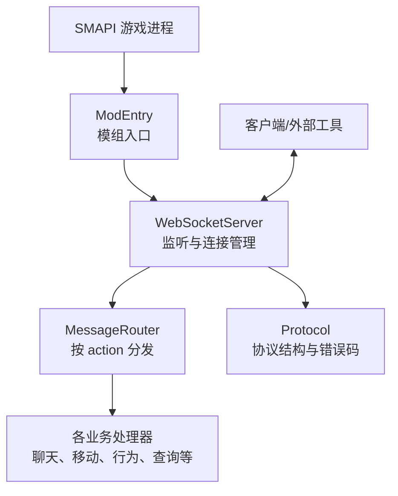
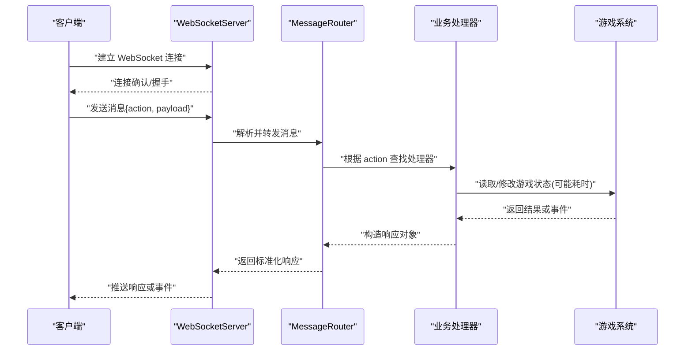
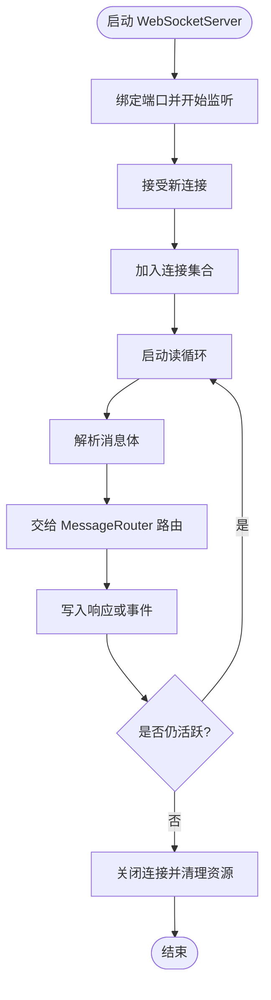
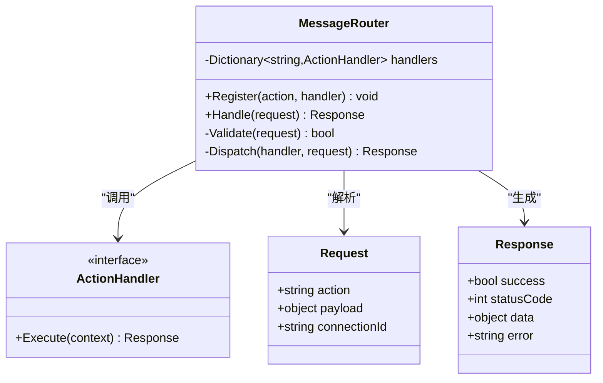
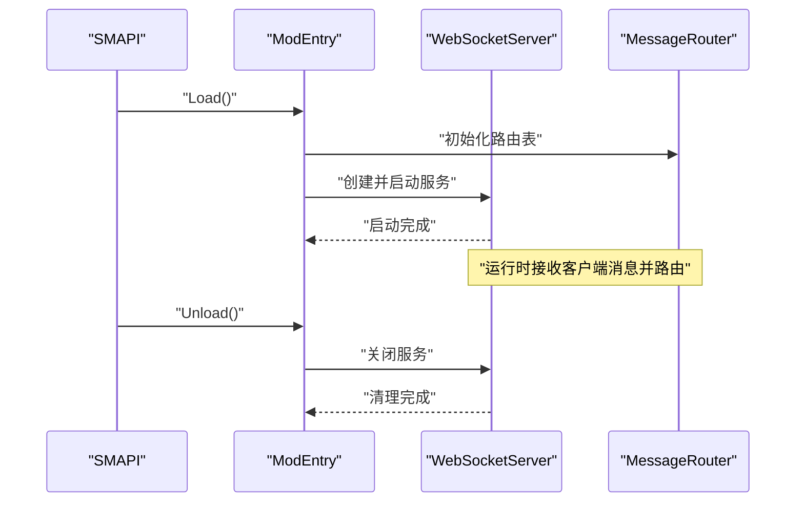
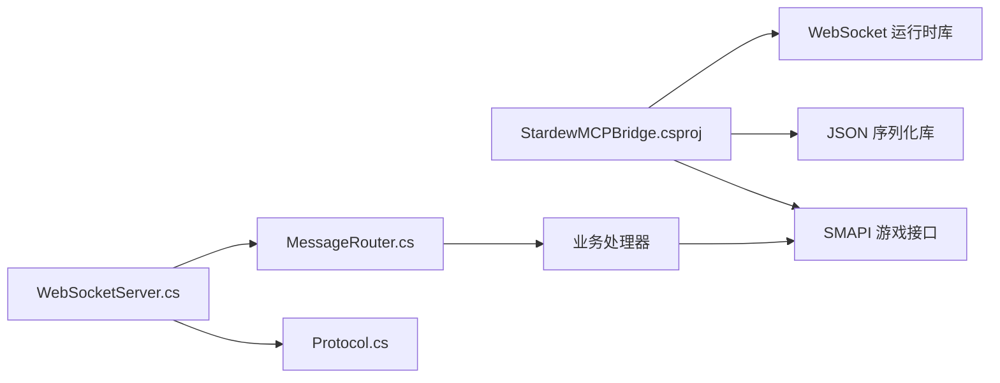

# WebSocket 通信层

<cite>
**本文引用的文件**   
- [WebSocketServer.cs](file://SmartNPC/smapi-mod/Bridge/WebSocketServer.cs)
- [MessageRouter.cs](file://SmartNPC/smapi-mod/Bridge/MessageRouter.cs)
- [Protocol.cs](file://SmartNPC/smapi-mod/Bridge/Protocol.cs)
- [ModEntry.cs](file://SmartNPC/smapi-mod/ModEntry.cs)
- [StardewMCPBridge.csproj](file://SmartNPC/smapi-mod/StardewMCPBridge.csproj)
</cite>

## 目录
1. [简介](#简介)
2. [项目结构](#项目结构)
3. [核心组件](#核心组件)
4. [架构总览](#架构总览)
5. [详细组件分析](#详细组件分析)
6. [依赖关系分析](#依赖关系分析)
7. [性能与可靠性](#性能与可靠性)
8. [故障排查指南](#故障排查指南)
9. [结论](#结论)

## 简介
本文件聚焦于 SmartNPC 的 WebSocket 通信层，目标是帮助开发者理解并扩展服务端与客户端之间的实时消息通道。文档围绕以下三个核心文件展开：
- WebSocketServer.cs：SMAPI 内嵌的 WebSocket 服务，负责监听端口、建立连接、接收消息、管理会话生命周期。
- MessageRouter.cs：基于 action name 的消息路由中心，将请求分发到具体业务处理器。
- Protocol.cs：定义协议消息结构、字段语义和错误码规范，是前后端契约的基础。

同时说明如何注册新的 WebSocket action handler，包括接口约定、参数解析、响应格式以及异常处理策略，并提供实际接入示例思路。

## 项目结构
WebSocket 通信相关代码位于 SMAPI Mod 项目中，主要路径如下：
- Bridge/WebSocketServer.cs：WebSocket 服务器实现
- Bridge/MessageRouter.cs：消息路由与处理器分发
- Bridge/Protocol.cs：协议数据模型与常量
- ModEntry.cs：SMAPI 模组入口，负责启动 WebSocket 服务、初始化路由表
- StardewMCPBridge.csproj：C# 项目配置，声明对 WebSocket 库等第三方依赖

**图表来源**
- [WebSocketServer.cs](file://SmartNPC/smapi-mod/Bridge/WebSocketServer.cs)
- [MessageRouter.cs](file://SmartNPC/smapi-mod/Bridge/MessageRouter.cs)
- [Protocol.cs](file://SmartNPC/smapi-mod/Bridge/Protocol.cs)
- [ModEntry.cs](file://SmartNPC/smapi-mod/ModEntry.cs)

**章节来源**
- [WebSocketServer.cs](file://SmartNPC/smapi-mod/Bridge/WebSocketServer.cs)
- [MessageRouter.cs](file://SmartNPC/smapi-mod/Bridge/MessageRouter.cs)
- [Protocol.cs](file://SmartNPC/smapi-mod/Bridge/Protocol.cs)
- [ModEntry.cs](file://SmartNPC/smapi-mod/ModEntry.cs)
- [StardewMCPBridge.csproj](file://SmartNPC/smapi-mod/StardewMCPBridge.csproj)

## 核心组件
- WebSocketServer：封装 WebSocket 生命周期，维护已连接会话集合，处理心跳、超时、断线清理。
- MessageRouter：维护 action 名称到处理器委托或类的映射，提供统一解析、校验、执行、响应的流水线。
- Protocol：集中定义消息头、负载、状态码、错误码、事件类型等结构化数据。
- ModEntry：在 SMAPI 启动时创建 WebSocketServer，注入路由表，暴露端口，并在模组卸载时优雅关闭。

这些组件共同构成“传输层 + 路由层 + 协议层”的分层设计，便于后续扩展新动作、新协议字段与新业务处理器。

**章节来源**
- [WebSocketServer.cs](file://SmartNPC/smapi-mod/Bridge/WebSocketServer.cs)
- [MessageRouter.cs](file://SmartNPC/smapi-mod/Bridge/MessageRouter.cs)
- [Protocol.cs](file://SmartNPC/smapi-mod/Bridge/Protocol.cs)
- [ModEntry.cs](file://SmartNPC/smapi-mod/ModEntry.cs)

## 架构总览
下图展示从客户端到业务处理器的完整调用链，包含连接建立、握手、消息路由、异步执行与结果回推。

**图表来源**
- [WebSocketServer.cs](file://SmartNPC/smapi-mod/Bridge/WebSocketServer.cs)
- [MessageRouter.cs](file://SmartNPC/smapi-mod/Bridge/MessageRouter.cs)
- [Protocol.cs](file://SmartNPC/smapi-mod/Bridge/Protocol.cs)

## 详细组件分析

### WebSocketServer：服务端连接与消息收发
职责要点：
- 启动监听：在指定端口上开启 WebSocket 服务，避免与 SMAPI 主线程阻塞。
- 连接管理：维护已连接客户端集合，支持按连接标识进行广播、定向推送。
- 消息循环：独立任务或线程池处理每个连接的读循环，防止单个慢连接拖垮整体。
- 心跳与保活：通过 ping/pong 或应用层心跳检测空闲连接，及时释放资源。
- 错误恢复：捕获网络异常、序列化异常，记录日志并安全关闭连接。
- 优雅关闭：在模组卸载或游戏退出时，通知所有连接断开，等待写入完成后再释放。

关键流程建议：
- 使用并发安全的集合保存连接上下文，例如字典或带锁的集合。
- 为每个连接分配唯一 ID，便于调试与限流。
- 限制单连接消息速率、队列长度，避免内存泄漏。
- 所有写操作应可取消，避免在连接已关闭时继续写入。

**图表来源**
- [WebSocketServer.cs](file://SmartNPC/smapi-mod/Bridge/WebSocketServer.cs)

**章节来源**
- [WebSocketServer.cs](file://SmartNPC/smapi-mod/Bridge/WebSocketServer.cs)

### MessageRouter：基于 action 的消息路由机制
职责要点：
- 注册表：维护 action name 到处理器（委托或类实例）的映射。
- 解析器：从 Protocol 中定义的请求结构提取 action、参数、上下文信息。
- 校验器：检查必填字段、枚举值范围、权限与速率限制。
- 调度器：同步或异步执行处理器，支持超时控制。
- 响应器：将处理器返回值包装成统一的 Protocol 响应结构。

典型路由过程：
1. 从 WebSocketServer 收到原始消息。
2. 反序列化为 Protocol 的请求对象。
3. 以 action 作为键查找处理器。
4. 若未找到，返回“不支持的 action”错误。
5. 执行处理器，捕获异常并转为错误响应。
6. 将成功结果或错误结果回写至客户端。

**图表来源**
- [MessageRouter.cs](file://SmartNPC/smapi-mod/Bridge/MessageRouter.cs)
- [Protocol.cs](file://SmartNPC/smapi-mod/Bridge/Protocol.cs)

**章节来源**
- [MessageRouter.cs](file://SmartNPC/smapi-mod/Bridge/MessageRouter.cs)
- [Protocol.cs](file://SmartNPC/smapi-mod/Bridge/Protocol.cs)

### Protocol：协议定义与数据结构
职责要点：
- 消息头：包含 action、requestId、timestamp、connectionId 等元数据。
- 消息体：根据 action 动态变化的 payload 结构。
- 响应格式：success、statusCode、data、error 等字段统一描述结果。
- 错误码规范：区分网络错误、参数错误、权限错误、业务错误、未知错误。
- 事件结构：用于服务端主动推送，如 NPC 状态变化、聊天消息、工作流完成。

建议的错误码分层：
- 1xx：连接与传输层问题
- 2xx：参数校验失败
- 3xx：权限与身份问题
- 4xx：业务逻辑错误
- 5xx：服务器内部错误

**章节来源**
- [Protocol.cs](file://SmartNPC/smapi-mod/Bridge/Protocol.cs)

### ModEntry：SMAPI 集成与生命周期
职责要点：
- 在模组加载时初始化 WebSocketServer 和 MessageRouter。
- 从配置文件读取监听端口、最大连接数、超时时间等参数。
- 注册内置 action 处理器，如聊天、移动、行为、查询等。
- 在模组卸载时停止服务、释放连接、清理定时器。

**图表来源**
- [ModEntry.cs](file://SmartNPC/smapi-mod/ModEntry.cs)
- [WebSocketServer.cs](file://SmartNPC/smapi-mod/Bridge/WebSocketServer.cs)
- [MessageRouter.cs](file://SmartNPC/smapi-mod/Bridge/MessageRouter.cs)

**章节来源**
- [ModEntry.cs](file://SmartNPC/smapi-mod/ModEntry.cs)
- [StardewMCPBridge.csproj](file://SmartNPC/smapi-mod/StardewMCPBridge.csproj)

## 依赖关系分析
WebSocket 通信层依赖 SMAPI 环境、WebSocket 运行时库、JSON 序列化库以及游戏内部 API。

**图表来源**
- [StardewMCPBridge.csproj](file://SmartNPC/smapi-mod/StardewMCPBridge.csproj)
- [WebSocketServer.cs](file://SmartNPC/smapi-mod/Bridge/WebSocketServer.cs)
- [MessageRouter.cs](file://SmartNPC/smapi-mod/Bridge/MessageRouter.cs)
- [Protocol.cs](file://SmartNPC/smapi-mod/Bridge/Protocol.cs)

**章节来源**
- [StardewMCPBridge.csproj](file://SmartNPC/smapi-mod/StardewMCPBridge.csproj)
- [WebSocketServer.cs](file://SmartNPC/smapi-mod/Bridge/WebSocketServer.cs)
- [MessageRouter.cs](file://SmartNPC/smapi-mod/Bridge/MessageRouter.cs)
- [Protocol.cs](file://SmartNPC/smapi-mod/Bridge/Protocol.cs)

## 性能与可靠性

### 连接与消息处理最佳实践
- 连接池与会话隔离：为每个连接维护独立上下文，避免共享可变状态。
- 背压与队列：对写操作设置缓冲上限，超限时丢弃或降级非关键消息。
- 心跳与超时：定期 ping/pong，长时间无活动连接自动断开。
- 限流与防抖：按连接或用户维度限制每秒消息数，避免突发流量。
- 异步优先：长耗时操作使用异步任务，避免阻塞消息循环。
- 幂等性：对关键操作支持 requestId，服务端可去重重复请求。

### 网络异常处理与重连机制
- 服务端侧：
  - 捕获 SocketException、IOException，记录连接异常。
  - 对频繁失败的连接降低重试频率，防止雪崩。
  - 在关闭前 flush 输出缓冲区，确保最后一条消息送达。
- 客户端侧：
  - 实现指数退避重连，避免风暴式重试。
  - 断线后缓存必要消息，重连后回放或上报。
  - 对不可恢复错误直接报错，不无限重试。

### 性能监控指标
- 连接数：当前连接、峰值连接、连接建立/关闭速率。
- 吞吐：每秒消息数、平均延迟、P95/P99 延迟。
- 错误率：按 action、错误码统计失败比例。
- 资源：CPU、内存、GC 压力、队列长度。
- 建议：
  - 使用结构化日志，附带 connectionId、action、latency。
  - 暴露轻量健康检查端点，便于容器编排探测。
  - 对热点 action 增加缓存或批量处理。

[本节为通用指导，不直接分析具体文件]

## 故障排查指南

常见问题与定位步骤：
- 无法连接：
  - 检查端口是否被占用、防火墙规则、SMAPI 日志中的启动错误。
  - 确认 WebSocketServer 是否成功初始化并监听。
- 连接立即断开：
  - 查看心跳间隔、超时阈值、客户端是否正确回复心跳。
  - 检查是否存在未捕获异常导致连接提前关闭。
- 消息路由失败：
  - 确认 action 名称是否与路由表一致。
  - 检查 Protocol 字段命名、大小写、必填项是否满足。
- 业务处理器异常：
  - 查看 MessageRouter 的异常捕获逻辑，确认错误码是否合理。
  - 对长耗时操作添加超时与取消令牌，避免阻塞。
- 内存增长：
  - 检查连接集合是否未清理、消息队列是否无限增长。
  - 对大 payload 启用压缩或分片传输。

建议日志关键字：
- WebSocket 连接建立/关闭
- 路由解析失败
- 处理器执行异常
- 心跳超时
- 连接关闭原因

**章节来源**
- [WebSocketServer.cs](file://SmartNPC/smapi-mod/Bridge/WebSocketServer.cs)
- [MessageRouter.cs](file://SmartNPC/smapi-mod/Bridge/MessageRouter.cs)
- [Protocol.cs](file://SmartNPC/smapi-mod/Bridge/Protocol.cs)

## 结论
SmartNPC 的 WebSocket 通信层通过 WebSocketServer、MessageRouter 与 Protocol 实现了清晰的分层架构：传输层负责连接与消息收发，路由层负责按 action 分发，协议层定义前后端契约。这种设计便于扩展新的 action handler、增强错误码体系、完善监控与可靠性机制。在实际使用中，建议结合心跳、限流、异步处理与结构化日志，构建稳定高效的实时通信通道。

[本节为总结性内容，不直接分析具体文件]