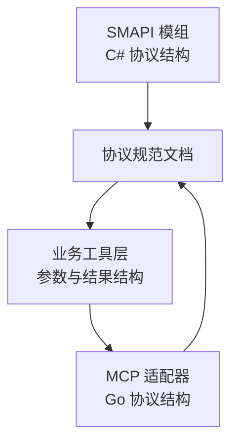
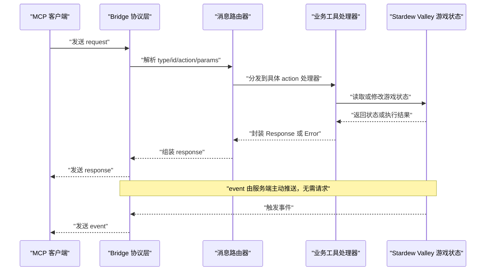
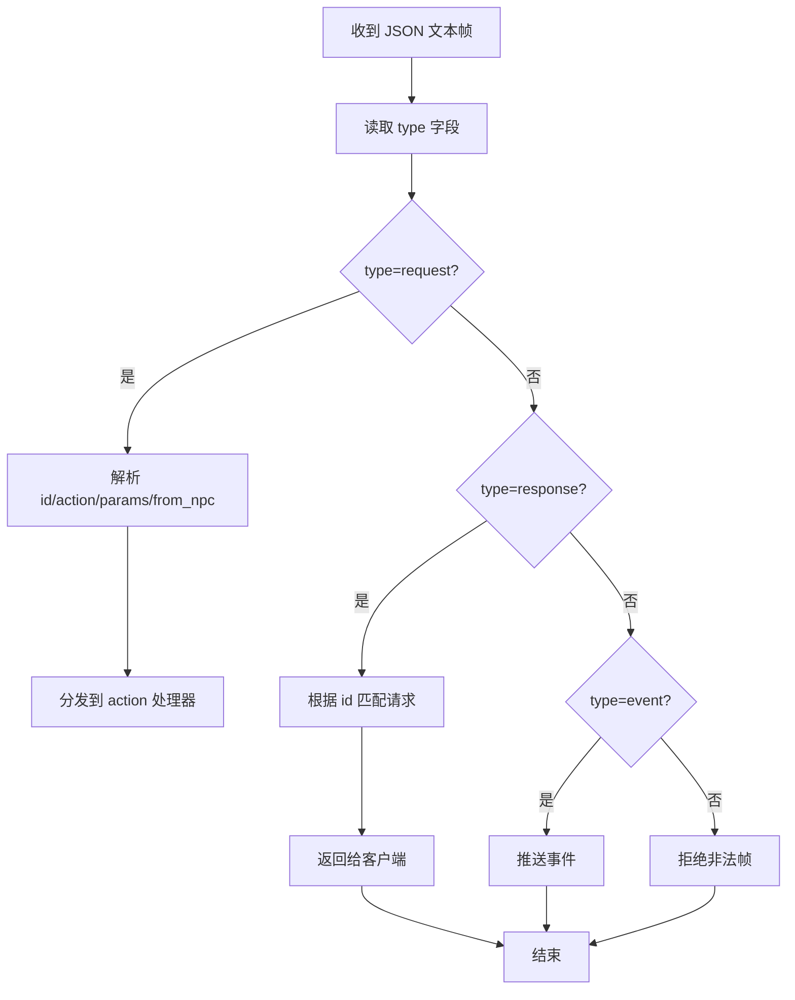
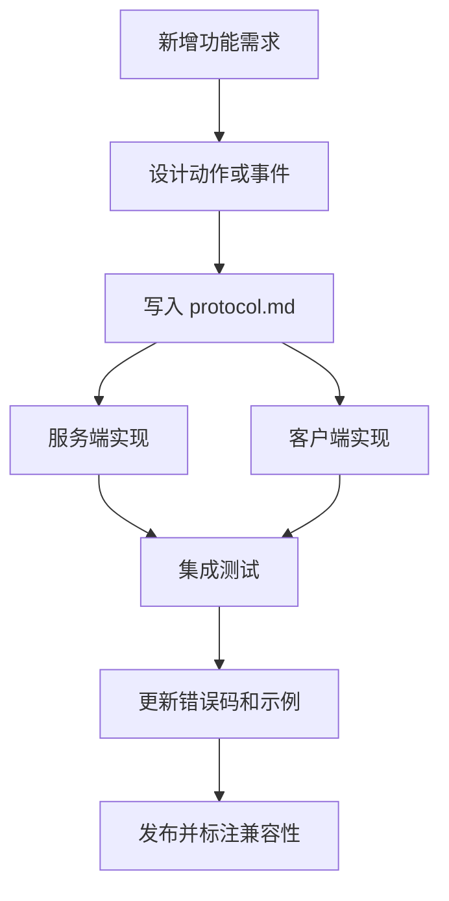

# 协议定义与规范

<cite>
**本文引用的文件**   
- [Protocol.cs](file://SmartNPC/SmartNPC/smapi-mod/Bridge/Protocol.cs)
- [protocol.go](file://SmartNPC/smartnpc-mcp/adapters/stardew/bridge/protocol.go)
- [protocol.md](file://SmartNPC/docs/protocol.md)
- [farm_economy.go](file://SmartNPC/smartnpc-mcp/adapters/stardew/tools/farm_economy.go)
- [npc_world_action.go](file://SmartNPC/smartnpc-mcp/adapters/stardew/tools/npc_world_action.go)
- [events.md](file://SmartNPC/docs/events.md)
</cite>

## 目录

1. [简介](#简介)
2. [项目结构与定位](#项目结构与定位)
3. [核心消息模型](#核心消息模型)
4. [协议架构总览](#协议架构总览)
5. [消息类型详解](#消息类型详解)
6. [错误码体系](#错误码体系)
7. [序列化、反序列化与版本兼容](#序列化反序列化与版本兼容)
8. [身份认证、权限控制与完整性校验](#身份认证权限控制与完整性校验)
9. [协议扩展机制](#协议扩展机制)
10. [测试方法与兼容性检查](#测试方法与兼容性检查)
11. [性能与可靠性特征](#性能与可靠性特征)
12. [故障排查指南](#故障排查指南)
13. [结论](#结论)

## 简介

本协议文档说明 SmartNPC 中 SMAPI 模组与 `smartnpc-mcp` 客户端之间的桥接通信规范。当前实现以 **WebSocket** 为传输层，使用 **JSON 文本帧**，UTF-8 编码；SMAPI 模组作为服务器端，`smartnpc-mcp` 作为客户端。

协议按信封字段 `type` 区分三类消息：

| type | 方向 | 用途 |
|---|---:|---|
| `request` | 客户端 → 服务器 | RPC 调用，期望一条匹配的 `response` |
| `response` | 服务器 → 客户端 | 对应 `request` 的回复，通过 `id` 关联 |
| `event` | 服务器 → 客户端 | 服务端主动推送，无需客户端应答 |

在实验构建（experiment build）下，协议已收缩为“单 Agent 农场管家”场景：移除了玩家聊天面板、群聊、点击对话、跟随玩家等面向玩家的交互能力，新增了农场经济查询、NPC 出货等面向自动化经营的能力。

**章节来源**
- [protocol.md:1-60](file://SmartNPC/docs/protocol.md#L1-L60)

## 项目结构与定位

协议相关代码分布在两个侧：

- **C# SMAPI 模组侧**：`SmartNPC/smapi-mod/Bridge/Protocol.cs` 定义 C# 端的请求、响应和事件结构体。
- **Go MCP 适配器侧**：`smartnpc-mcp/adapters/stardew/bridge/protocol.go` 定义与 C# 结构镜像对应的 Go DTO。
- **协议规范文档**：`docs/protocol.md` 是双方共享的行为契约，描述信封、动作、参数、返回值和错误码。
- **工具侧数据结构**：部分 action 的参数和结果由具体工具文件定义，例如 `farm_economy.go` 和 `npc_world_action.go`。

**图表来源**
- [Protocol.cs:1-200](file://SmartNPC/SmartNPC/smapi-mod/Bridge/Protocol.cs#L1-L200)
- [protocol.go:1-172](file://SmartNPC/smartnpc-mcp/adapters/stardew/bridge/protocol.go#L1-L172)
- [protocol.md:1-60](file://SmartNPC/docs/protocol.md#L1-L60)

**章节来源**
- [protocol.go:1-10](file://SmartNPC/smartnpc-mcp/adapters/stardew/bridge/protocol.go#L1-L10)
- [protocol.md:1-20](file://SmartNPC/docs/protocol.md#L1-L20)

## 核心消息模型

### 基础信封

所有 WebSocket 消息都是 JSON 对象，并通过顶层 `type` 字段区分消息类别。

| 字段 | 类型 | 必填 | 说明 |
|---|---|---:|---|
| `type` | string | 是 | 枚举值：`request`、`response`、`event` |
| `id` | string | request/response 时必填 | 唯一标识，建议使用 UUIDv4；服务器原样回显到 response |
| `action` | string | request 时必填 | 指定要调用的行为名称 |
| `params` | object | 否 | 按 action 指定的参数字段；可为空或省略 |
| `from_npc` | string | 否 | 发起方 NPC 配置名；用于调试镜像路由 |
| `name` | string | event 时必填 | 事件名称 |
| `data` | object | event 时必填 | 事件载荷 |
| `timestamp` | number | event 时必填 | Unix 毫秒时间戳 |
| `ok` | boolean | response 时必填 | 成功标志 |
| `data` | object | response 且成功时存在 | 成功数据 |
| `error` | object | response 且失败时存在 | 错误对象 |

### 请求消息 Request

| 字段 | 类型 | 必填 | 约束 |
|---|---|---:|---|
| `type` | string | 是 | 固定为 `request` |
| `id` | string | 是 | 客户端生成唯一 ID |
| `action` | string | 是 | 必须匹配服务端注册的动作常量 |
| `params` | any | 否 | 由具体 action 决定；可省略空对象 |
| `from_npc` | string | 否 | 若为空或未注册，服务端可能丢弃调试镜像并记录警告 |

**章节来源**
- [protocol.go:110-136](file://SmartNPC/smartnpc-mcp/adapters/stardew/bridge/protocol.go#L110-L136)
- [protocol.md:61-96](file://SmartNPC/docs/protocol.md#L61-L96)

### 响应消息 Response

| 字段 | 类型 | 必填 | 约束 |
|---|---|---:|---|
| `type` | string | 是 | 固定为 `response` |
| `id` | string | 是 | 与请求 `id` 一致 |
| `ok` | boolean | 是 | 表示本次调用是否成功 |
| `data` | object | 条件必填 | 仅当 `ok=true` 时出现 |
| `error` | object | 条件必填 | 仅当 `ok=false` 时出现 |

`data` 与 `error` 互斥：恰好出现其一。

**章节来源**
- [protocol.go:138-149](file://SmartNPC/smartnpc-mcp/adapters/stardew/bridge/protocol.go#L138-L149)
- [protocol.md:97-120](file://SmartNPC/docs/protocol.md#L97-L120)

### 事件消息 Event

| 字段 | 类型 | 必填 | 约束 |
|---|---|---:|---|
| `type` | string | 是 | 固定为 `event` |
| `name` | string | 是 | 事件名称常量 |
| `data` | object | 是 | 事件特定载荷 |
| `timestamp` | number | 是 | Unix 毫秒 |

事件是单向推送，服务端不等待确认。

**章节来源**
- [protocol.go:151-161](file://SmartNPC/smartnpc-mcp/adapters/stardew/bridge/protocol.go#L151-L161)
- [protocol.md:121-132](file://SmartNPC/docs/protocol.md#L121-L132)

## 协议架构总览

协议运行在 WebSocket 之上，整体流程如下：

该图展示的是协议层面的通用流程；实际 handler 的实现位于 MCP 工具侧，SMAPI 模组侧则负责加载游戏状态、调度路径、管理 NPC 行为以及向 WebSocket 写入消息。

**图表来源**
- [protocol.go:110-172](file://SmartNPC/smartnpc-mcp/adapters/stardew/bridge/protocol.go#L110-L172)
- [protocol.md:1-60](file://SmartNPC/docs/protocol.md#L1-L60)

## 消息类型详解

### 动作分类

协议将 client → server 的请求动作分为若干组：

| 分组 | 典型动作 | 说明 |
|---|---|---|
| 基础查询 | `game_get_time`、`game_get_weather` | 读取游戏时间、天气 |
| NPC 查询 | `npc_get_nearby`、`npc_get_environment`、`npc_get_position`、`npc_get_behavior` | 观察 NPC 位置、环境和行为模式 |
| NPC 移动 | `npc_move_to`、`npc_face_direction` | 寻路、转向 |
| NPC 表现 | `npc_emote` | 显示气泡表情 |
| 农场经济 | `farm_get_economy` | 只读经济记分板 |
| NPC 世界交互 | `npc_ship_items` 及一系列农活动作 | 搬运、种植、收割、放置物品等 |
| NPC 背包 | `npc_inventory_get`、`npc_inventory_put`、`npc_withdraw_from_chest`、`npc_transfer_item` | 读写 NPC 背包和箱子 |
| 社交与表演 | `npc_approach_and_speak`、`npc_express_emotion`、`npc_idle_activity` 等 | 面向表演的丰富行为 |
| 聊天 | `chat_say` | 向游戏内聊天框播报 |

注意：实验构建已移除部分历史动作，包括 `mail_send`、`friendship_get`、`player_get_status`、`npc_summon`、`npc_give_item`、`npc_follow_start`、`npc_follow_stop`、`npc_lead_to`、`npc_approach_and_speak`、`npc_deliver_items`。

**章节来源**
- [protocol.go:33-109](file://SmartNPC/smartnpc-mcp/adapters/stardew/bridge/protocol.go#L33-L109)
- [protocol.md:1-30](file://SmartNPC/docs/protocol.md#L1-L30)

### 关键动作规范摘要

#### `chat_say`

向游戏内聊天框显示消息。

| 字段 | 类型 | 必填 | 说明 |
|---|---|---:|---|
| `speaker` | string | 是 | 显示名称 |
| `text` | string | 是 | 消息正文 |
| `color` | string | 否 | 颜色，默认黄色 |
| `channel` | string | 否 | 实验构建下不再支持群聊通道 |
| `group_id` | string | 条件 | 实验构建下不适用 |

成功响应包含 `ok=true`。  
常见错误：

- `mod_not_ready`：未加载存档
- `invalid_params`：缺少必要字段

**章节来源**
- [protocol.md:133-180](file://SmartNPC/docs/protocol.md#L133-L180)

#### `game_get_time`

读取游戏时间、日期、季节和年份。

响应字段包括 `hour`、`minute`、`timeOfDay`、`day`、`day_of_week`、`season`、`year`。

**章节来源**
- [protocol.md:181-200](file://SmartNPC/docs/protocol.md#L181-L200)

#### `game_get_weather`

读取天气和季节。

**章节来源**
- [protocol.md:201-206](file://SmartNPC/docs/protocol.md#L201-L206)

#### `farm_get_economy`

实验构建新增的只读农场经济接口。

| 字段 | 类型 | 说明 |
|---|---|---|
| `day` | int | 季节中的第几天 |
| `season` | string | 季节 |
| `year` | int | 游戏年份 |
| `gold` | int | 当前金币 |
| `total_money_earned` | int | 累计收入 |
| `shipping_bin_count` | int | 出货箱待售物品数量 |
| `shipping_bin_value` | int | 出货箱物品总价值 |
| `crops_planted` | int | 已种植作物地块数 |
| `crops_ready` | int | 可收获作物数 |
| `tilled_tiles` | int | 已翻耕土地数 |
| `watered_tiles` | int | 当前已浇水地块数 |
| `animals` | int | 动物数量 |

Go 侧输出结构为 `FarmGetEconomyOutput`。

**章节来源**
- [protocol.md:207-245](file://SmartNPC/docs/protocol.md#L207-L245)
- [farm_economy.go:15-32](file://SmartNPC/smartnpc-mcp/adapters/stardew/tools/farm_economy.go#L15-L32)

#### `npc_get_nearby`

扫描观察者 NPC 可视半径内的其他实体。

| 字段 | 类型 | 必填 | 说明 |
|---|---|---:|---|
| `npc` | string | 是 | 观察者 NPC 内部名称 |
| `radius` | number | 否 | 可视半径，默认 10 |

返回实体列表，每个元素包含名称、类型、坐标、距离、朝向和地图信息。

**章节来源**
- [protocol.md:246-315](file://SmartNPC/docs/protocol.md#L246-L315)

#### `npc_get_environment`

读取 NPC 周围的环境上下文，包括地图、坐标、朝向、时间、季节、天气和附近对象。

**章节来源**
- [protocol.md:316-385](file://SmartNPC/docs/protocol.md#L316-L385)

#### `npc_move_to`

对 NPC 发起移动请求；同地图使用寻路，跨地图使用瞬间传送。

| 字段 | 类型 | 必填 | 说明 |
|---|---|---:|---|
| `npc` | string | 是 | NPC 内部名称 |
| `x` | int | 是 | 目标 X |
| `y` | int | 是 | 目标 Y |
| `map` | string | 否 | 目标地图，默认为当前地图 |

**章节来源**
- [protocol.md:386-445](file://SmartNPC/docs/protocol.md#L386-L445)

#### `npc_face_direction`

设置 NPC 朝向。

**章节来源**
- [protocol.md:446-480](file://SmartNPC/docs/protocol.md#L446-L480)

#### `npc_ship_items`

让 NPC 走到农场出货箱并出货携带物品；不可逆。

| 字段 | 类型 | 必填 | 说明 |
|---|---|---:|---|
| `npc` | string | 是 | NPC 内部名称 |
| `item_ids` | array of string | 否 | 指定出货物品 ID，省略则出货全部携带物品 |

注意：接受请求不等于确认送达；应结合 `farm_get_economy.shipping_bin_count` 和 `shipping_bin_value` 验证。

**章节来源**
- [protocol.md:481-540](file://SmartNPC/docs/protocol.md#L481-L540)
- [npc_world_action.go:1-20](file://SmartNPC/smartnpc-mcp/adapters/stardew/tools/npc_world_action.go#L1-L20)

#### `npc_get_position`

读取 NPC 当前位置、地图、朝向和移动状态。

**章节来源**
- [protocol.md:541-590](file://SmartNPC/docs/protocol.md#L541-L590)

#### `npc_emote`

让 NPC 头顶显示游戏原生表情气泡。

| 字段 | 类型 | 必填 | 说明 |
|---|---|---:|---|
| `npc` | string | 是 | NPC 内部名称 |
| `kind` | string | 否 | 表情类型，未知值回退为经典感叹号 |

**章节来源**
- [protocol.md:591-640](file://SmartNPC/docs/protocol.md#L591-L640)

#### `npc_get_behavior`

查询 NPC 的高层行为模式。

**章节来源**
- [protocol.md:710-750](file://SmartNPC/docs/protocol.md#L710-L750)

### 事件分类

#### 已保留或历史事件

以下事件在实验构建中不再由 SMAPI 模组产生：

- `chat_message`
- `chat_received`
- `npc_interact`
- `group_create`

它们仍保留在协议文档中作为历史参考。

#### 当前与预留事件

| 事件名 | 方向 | 说明 |
|---|---|---|
| `day_ending` | 服务端推送 | 日终前广播，仅记账，不唤醒 Agent |
| `owner_directive` | 合成事件 | MCP 轮询所有者收件箱产生 |
| `schedule_trigger` | 合成事件 | 日程调度器触发计划活动 |
| `npc_perception_update` | 预留 | 尚未发出 |
| `game_time_tick` | 预留 | 每小时触发，驱动本地日程 |
| `npc_message` / `npc_broadcast` | 合成事件 | 实验构建中已移除 |
| `debug_proactive_trigger` | 调试事件 | 运维调试用 |
| `npc_approached_player` | 合成事件 | NPC 接近玩家时触发 |

**章节来源**
- [protocol.go:16-59](file://SmartNPC/smartnpc-mcp/adapters/stardew/bridge/protocol.go#L16-L59)
- [protocol.md:751-865](file://SmartNPC/docs/protocol.md#L751-L865)

## 错误码体系

### 统一错误对象

失败响应中的 `error` 对象包含：

| 字段 | 类型 | 说明 |
|---|---|---|
| `code` | string | 机器可读的稳定错误码 |
| `message` | string | 人类可读的错误信息 |

**章节来源**
- [protocol.go:151-161](file://SmartNPC/smartnpc-mcp/adapters/stardew/bridge/protocol.go#L151-L161)
- [protocol.md:97-120](file://SmartNPC/docs/protocol.md#L97-L120)

### 标准错误码

| 错误码 | 含义 | 常见触发场景 |
|---|---|---|
| `mod_not_ready` | 模组未就绪 | 没有加载存档 |
| `invalid_params` | 参数无效 | 缺少必填字段、字段类型不符或取值不在允许范围 |
| `unknown_npc` | 未知的 NPC | 当前存档中不存在该内部名称的 NPC |
| `npc_not_found` | 找不到 NPC | 查询类接口无法在当前存档找到 NPC |
| `unknown_map` | 未知的地图 | 提供的地图名无法解析为有效 `GameLocation` |
| `pathfind_error` | 寻路错误 | 地形或坐标异常导致路径计算失败 |
| `inventory_full` | 背包已满 | 历史动作中物品无法放入玩家背包 |
| `unknown_item` | 未知物品 | 历史动作中无法解析 Stardew Valley 物品 ID |

**章节来源**
- [protocol.md:133-180](file://SmartNPC/docs/protocol.md#L133-L180)
- [protocol.md:246-315](file://SmartNPC/docs/protocol.md#L246-L315)
- [protocol.md:386-445](file://SmartNPC/docs/protocol.md#L386-L445)
- [protocol.md:481-540](file://SmartNPC/docs/protocol.md#L481-L540)
- [protocol.md:591-640](file://SmartNPC/docs/protocol.md#L591-L640)

### 错误码分类建议

| 分类 | 推荐前缀或语义 | 示例 |
|---|---|---|
| 系统级 | 环境或运行时问题 | `mod_not_ready` |
| 输入校验 | 客户端参数错误 | `invalid_params` |
| 资源查找 | 找不到游戏实体 | `unknown_npc`、`npc_not_found`、`unknown_map` |
| 游戏逻辑 | 游戏子系统限制 | `pathfind_error`、`inventory_full` |
| 业务规则 | 业务层约束 | 未来可扩展如 `cooldown_active`、`action_blocked_by_schedule` |
| 自定义扩展 | 第三方扩展或调试 | 建议采用命名空间前缀避免冲突 |

**章节来源**
- [protocol.go:151-161](file://SmartNPC/smartnpc-mcp/adapters/stardew/bridge/protocol.go#L151-L161)

## 序列化、反序列化与版本兼容

### JSON 格式规范

- 传输格式：WebSocket 文本帧。
- 字符编码：UTF-8。
- 根对象：每条消息是 JSON 对象。
- 可选字段：使用 `omitempty` 语义；空 `params` 可省略。
- 二进制或复杂数据：通过 `json.RawMessage` 透传，避免强类型过早消费。
- 时间字段：`timestamp` 使用 Unix 毫秒。

**图表来源**
- [protocol.go:163-172](file://SmartNPC/smartnpc-mcp/adapters/stardew/bridge/protocol.go#L163-L172)
- [protocol.md:1-60](file://SmartNPC/docs/protocol.md#L1-L60)

### 版本兼容性处理

1. **向后兼容**：新增可选字段不应破坏旧客户端；旧客户端忽略未知字段即可。
2. **动作扩展**：新增 `ActionName` 后，旧客户端不会发送新动作，服务端应忽略未知 action 或返回明确错误。
3. **事件扩展**：新增 `EventName` 后，旧消费者应根据 `name` 判断是否处理；未识别事件应安全丢弃。
4. **废弃字段**：不要直接删除已有字段；标记为弃用并继续兼容至少一个主版本。
5. **实验构建差异**：实验构建会移除部分 action 和事件，消费者不能依赖这些历史能力始终可用。
6. **RPC 关联**：客户端应维护 `id` 到请求的映射，并在超时或连接断开时清理。

**章节来源**
- [protocol.go:110-172](file://SmartNPC/smartnpc-mcp/adapters/stardew/bridge/protocol.go#L110-L172)
- [protocol.md:1-30](file://SmartNPC/docs/protocol.md#L1-L30)

## 身份认证、权限控制与完整性校验

### 当前实现状态

从现有协议结构和文档看，协议本身**没有内置签名、加密或基于令牌的认证字段**。`from_npc` 不是认证凭据，而是调试与路由上下文。

| 能力 | 当前状态 | 建议 |
|---|---|---|
| 身份认证 | 未通过协议字段实现 | 可在 WebSocket 握手阶段进行外部鉴权 |
| 权限控制 | 未通过协议字段实现 | 应在服务端根据调用者上下文决定 action 是否允许 |
| 消息完整性校验 | 无内置签名 | 可通过 TLS、反向代理防火墙或应用层 HMAC 增强 |
| 防重放 | 未定义 nonce/timestamp 校验 | 如需远程暴露，应增加时间窗口和随机数 |
| 审计追踪 | `id` 可用于请求追踪 | 建议配合日志记录完整链路 |

### 安全建议

- 仅在 `127.0.0.1` 暴露 WebSocket，避免直接对外网开放。
- 在反向代理层做来源 IP 白名单。
- 对 MCP 工具调用建立会话绑定，使 `from_npc` 与真实会话关联。
- 对敏感 action 增加服务端权限校验。
- 记录 `id`、`action`、`from_npc`、错误码，便于审计。

**章节来源**
- [protocol.go:110-136](file://SmartNPC/smartnpc-mcp/adapters/stardew/bridge/protocol.go#L110-L136)
- [protocol.md:61-96](file://SmartNPC/docs/protocol.md#L61-L96)

## 协议扩展机制

### 添加新动作

1. 在协议文档中定义动作名称、参数、响应和错误码。
2. 在 MCP 工具侧注册 action 常量。
3. 在 MCP 工具侧实现输入结构、输出结构和 handler。
4. 在 SMAPI 模组侧确保对应 handler 存在，或明确声明该 action 由 MCP 侧处理。
5. 在文档中标注是否属于实验构建、是否废弃、是否仅 MCP 内部使用。

### 添加新事件

1. 定义稳定事件名常量。
2. 在 `events.md` 或协议文档中描述 `data` 结构。
3. 在服务端推送处构造事件信封。
4. 在客户端订阅处按 `name` 分发。
5. 如果事件影响唤醒策略，同步更新唤醒白名单。

### 扩展字段

- 优先使用可选字段。
- 对数值范围增加上限和下限约束。
- 对枚举字段提供允许值集合。
- 对字符串字段规定 UTF-8 和长度上限。
- 对数组字段规定最大长度和元素类型。

**图表来源**
- [protocol.go:16-109](file://SmartNPC/smartnpc-mcp/adapters/stardew/bridge/protocol.go#L16-L109)
- [protocol.md:1-60](file://SmartNPC/docs/protocol.md#L1-L60)

**章节来源**
- [protocol.go:16-172](file://SmartNPC/smartnpc-mcp/adapters/stardew/bridge/protocol.go#L16-L172)
- [protocol.md:751-865](file://SmartNPC/docs/protocol.md#L751-L865)

## 测试方法与兼容性检查

### 协议测试要点

| 测试项 | 方法 | 预期 |
|---|---|---|
| 信封解析 | 发送合法/非法 `type` | 正确识别 request/response/event，拒绝未知类型 |
| 请求关联 | 发送带 `id` 的请求 | 收到相同 `id` 的 response |
| 参数校验 | 省略必填字段、传入非法枚举 | 返回 `invalid_params` |
| 未加载存档 | 关闭存档后调用 | 返回 `mod_not_ready` |
| 未知 NPC | 传入不存在 NPC 名称 | 返回 `unknown_npc` 或 `npc_not_found` |
| 未知地图 | 传入无效地图名 | 返回 `unknown_map` |
| 事件推送 | 触发服务端事件 | 客户端收到 `event` 且包含 `timestamp` |
| 历史动作 | 发送已移除 action | 服务端忽略或返回明确错误 |
| 历史事件 | 监听已移除事件 | 不再收到对应事件 |
| 时间戳 | 检查事件时间 | 为 Unix 毫秒，非秒 |
| `from_npc` | 空值和有效值分别测试 | 有效值参与调试路由，空值不阻断正常流程 |

### 兼容性检查清单

- 新客户端能接收旧服务端新增的可选字段。
- 旧客户端能忽略新服务端新增的可选字段。
- 新客户端能忽略未知 `action`。
- 新客户端能忽略未知 `event.name`。
- 实验构建与非实验构建的差异已在文档中标注。
- 所有错误码保持稳定，新增错误码不覆盖已有语义。
- JSON 字段名保持小驼峰，与现有结构一致。

**章节来源**
- [protocol.md:1-60](file://SmartNPC/docs/protocol.md#L1-L60)
- [protocol.md:133-865](file://SmartNPC/docs/protocol.md#L133-L865)

## 性能与可靠性特征

- **请求响应模型**：适合短时 RPC，如查询游戏状态、控制 NPC 行为。
- **事件模型**：适合高频低延迟推送，但事件不保证可靠投递，客户端需考虑重连和状态恢复。
- **异步操作**：部分 NPC 动作（如移动、走路到出货箱）返回接受信号，实际效果在后续游戏 tick 中完成。
- **缓存**：`npc_get_nearby` 使用 tick 驱动缓存，可按半径触发按需扫描。
- **线程安全**：服务端在游戏线程访问 `Game1` 状态，应避免阻塞长时间的游戏循环。
- **背压**：WebSocket 客户端应控制并发请求，避免积压大量未处理 response。

**章节来源**
- [protocol.md:246-315](file://SmartNPC/docs/protocol.md#L246-L315)
- [protocol.md:481-540](file://SmartNPC/docs/protocol.md#L481-L540)

## 故障排查指南

### 常见问题

| 现象 | 可能原因 | 处理方法 |
|---|---|---|
| 收到 response 但没有 data 也没有 error | 客户端误判响应结构 | 检查 `ok` 字段，再选择 `data` 或 `error` |
| 多次收到不同 response | 客户端未正确关联 `id` | 使用 map 保存 pending 请求 |
| 一直收不到 event | 连接断开或订阅未建立 | 检查 WebSocket 连接状态和事件订阅 |
| `mod_not_ready` | 游戏未加载存档 | 等待存档加载后再调用 |
| `invalid_params` | 缺少必填字段或字段类型错误 | 对照 protocol.md 校验入参 |
| `unknown_npc` | NPC 名称错误或角色未加载 | 使用 `npc_get_nearby` 或 `npc_get_environment` 确认 |
| `pathfind_error` | 目标坐标或地图异常 | 检查坐标范围和地图名称 |
| 出货后立即查询出货箱为空 | 出货是异步且结算在夜间 | 结合 `farm_get_economy` 和过夜结算流程验证 |

### 调试建议

- 使用 `id` 关联请求和响应。
- 使用 `from_npc` 区分不同 NPC 的调试镜像。
- 记录原始 JSON 帧，便于回放问题。
- 对事件增加去重和时间窗口过滤。
- 对耗时 action 增加超时和取消机制。

**章节来源**
- [protocol.md:133-540](file://SmartNPC/docs/protocol.md#L133-L540)
- [protocol.md:751-865](file://SmartNPC/docs/protocol.md#L751-L865)

## 结论

SmartNPC 的桥接协议是一个以 WebSocket 为载体、JSON 为序列化格式的轻量 RPC 与事件总线。它通过统一的信封结构承载三类消息，通过稳定的错误码传递系统级、输入级和业务级异常，并通过动作常量和事件常量形成可扩展的消息边界。

在实验构建下，协议聚焦于农场管家式自主行为：减少玩家交互，强化 NPC 自我调度、农场经济和世界交互能力。开发者和集成方应以 `protocol.md` 为准，同时参考 `protocol.go` 的结构定义和工具侧的数据结构，确保两边保持一致。