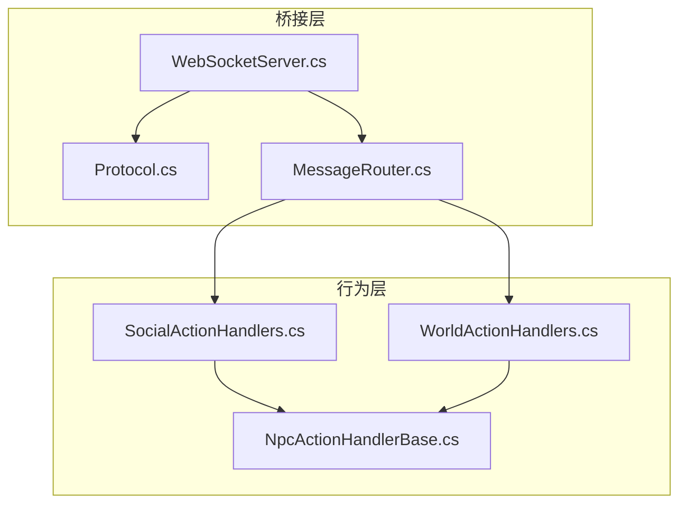
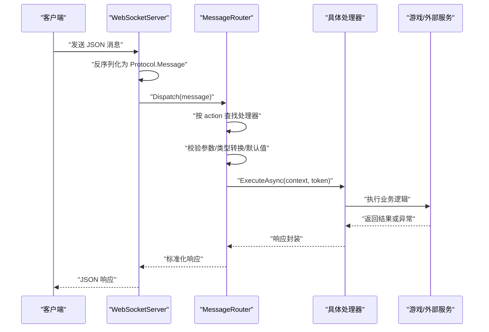
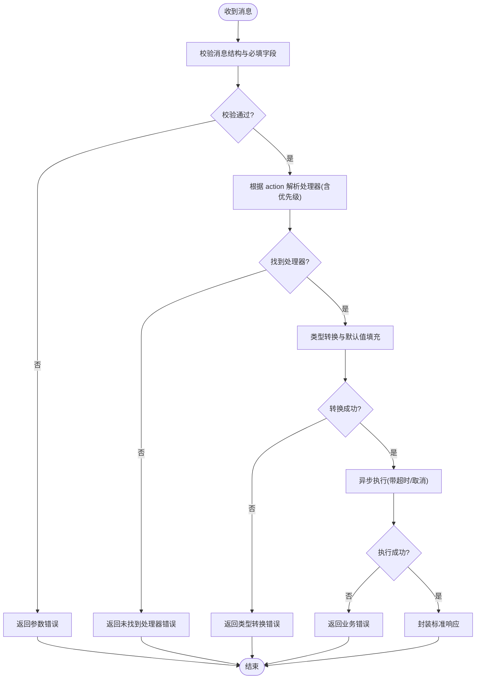
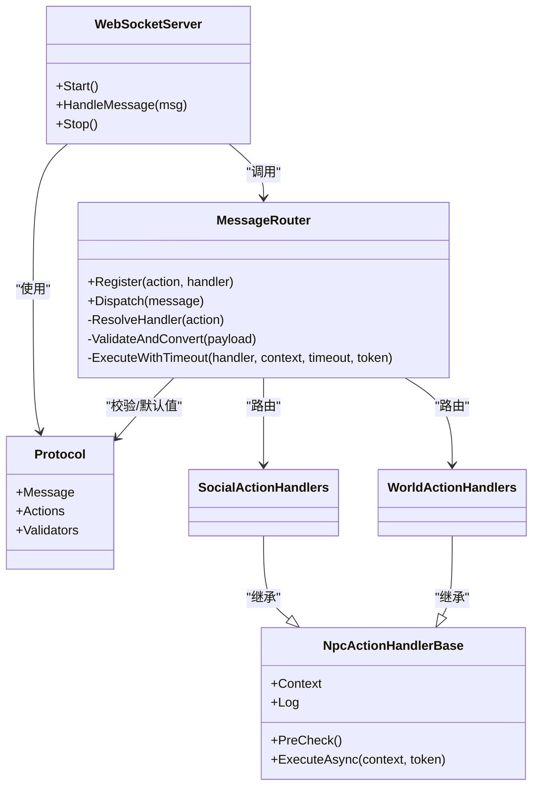

# 消息路由机制

<cite>
**本文引用的文件**   
- [MessageRouter.cs](file://SmartNPC/smapimod/Bridge/MessageRouter.cs)
- [Protocol.cs](file://SmartNPC/smapimod/Bridge/Protocol.cs)
- [WebSocketServer.cs](file://SmartNPC/smapimod/Bridge/WebSocketServer.cs)
- [NpcActionHandlerBase.cs](file://SmartNPC/smapimod/Behavior/NpcActionHandlerBase.cs)
- [SocialActionHandlers.cs](file://SmartNPC/smapimod/Behavior/SocialActionHandlers.cs)
- [WorldActionHandlers.cs](file://SmartNPC/smapimod/Behavior/WorldActionHandlers.cs)
</cite>

## 目录
1. [引言](#引言)
2. [项目结构](#项目结构)
3. [核心组件](#核心组件)
4. [架构总览](#架构总览)
5. [详细组件分析](#详细组件分析)
6. [依赖关系分析](#依赖关系分析)
7. [性能与优化](#性能与优化)
8. [故障排查指南](#故障排查指南)
9. [结论](#结论)
10. [附录：处理器开发规范](#附录处理器开发规范)

## 引言
本文围绕 SmartNPC 的“消息路由机制”展开，重点解析 MessageRouter.cs 的请求分发逻辑，说明如何依据 action name 将消息路由到对应处理器。文档还覆盖处理器注册机制（动态、静态、优先级）、消息验证与参数解析流程、异步处理器执行模型（并发控制、超时、取消令牌）、自定义处理器开发指南，以及路由性能优化、缓存策略与调试方法。目标是帮助开发者快速理解并扩展该路由系统。

## 项目结构
SmartNPC 采用分层组织方式，消息路由相关代码集中在 smapimod 子项目中：
- Bridge：协议定义、WebSocket 服务端与消息路由器
- Behavior：行为处理器基类与具体动作处理器集合
- Query/Mail/UI 等：其他功能模块，不直接参与消息路由主路径

图表来源
- [WebSocketServer.cs:1-200](file://SmartNPC/smapimod/Bridge/WebSocketServer.cs#L1-L200)
- [Protocol.cs:1-200](file://SmartNPC/smapimod/Bridge/Protocol.cs#L1-L200)
- [MessageRouter.cs:1-300](file://SmartNPC/smapimod/Bridge/MessageRouter.cs#L1-L300)
- [NpcActionHandlerBase.cs:1-200](file://SmartNPC/smapimod/Behavior/NpcActionHandlerBase.cs#L1-L200)
- [SocialActionHandlers.cs:1-200](file://SmartNPC/smapimod/Behavior/SocialActionHandlers.cs#L1-L200)
- [WorldActionHandlers.cs:1-200](file://SmartNPC/smapimod/Behavior/WorldActionHandlers.cs#L1-L200)

章节来源
- [MessageRouter.cs:1-300](file://SmartNPC/smapimod/Bridge/MessageRouter.cs#L1-L300)
- [Protocol.cs:1-200](file://SmartNPC/smapimod/Bridge/Protocol.cs#L1-L200)
- [WebSocketServer.cs:1-200](file://SmartNPC/smapimod/Bridge/WebSocketServer.cs#L1-L200)

## 核心组件
- MessageRouter：接收标准化消息，按 action name 查找处理器，完成参数校验、类型转换、默认值填充后调用处理器；负责并发限制、超时与取消。
- Protocol：定义消息体、动作名常量、字段校验规则与默认值映射。
- WebSocketServer：建立连接、读取帧、反序列化为统一消息对象并交给路由器处理。
- NpcActionHandlerBase：处理器抽象基类，提供上下文、日志、状态检查等公共能力。
- SocialActionHandlers / WorldActionHandlers：按领域划分的处理器集合，实现具体业务逻辑。

章节来源
- [MessageRouter.cs:1-300](file://SmartNPC/smapimod/Bridge/MessageRouter.cs#L1-L300)
- [Protocol.cs:1-200](file://SmartNPC/smapimod/Bridge/Protocol.cs#L1-L200)
- [WebSocketServer.cs:1-200](file://SmartNPC/smapimod/Bridge/WebSocketServer.cs#L1-L200)
- [NpcActionHandlerBase.cs:1-200](file://SmartNPC/smapimod/Behavior/NpcActionHandlerBase.cs#L1-L200)
- [SocialActionHandlers.cs:1-200](file://SmartNPC/smapimod/Behavior/SocialActionHandlers.cs#L1-L200)
- [WorldActionHandlers.cs:1-200](file://SmartNPC/smapimod/Behavior/WorldActionHandlers.cs#L1-L200)

## 架构总览
消息从客户端经 WebSocket 进入，被转换为统一协议对象后交由路由器分发。路由器根据 action name 选择处理器，进行参数校验与转换，然后以异步方式执行，支持并发上限、超时和取消。

图表来源
- [WebSocketServer.cs:1-200](file://SmartNPC/smapimod/Bridge/WebSocketServer.cs#L1-L200)
- [Protocol.cs:1-200](file://SmartNPC/smapimod/Bridge/Protocol.cs#L1-L200)
- [MessageRouter.cs:1-300](file://SmartNPC/smapimod/Bridge/MessageRouter.cs#L1-L300)

## 详细组件分析

### MessageRouter：请求分发与执行
- 路由表：维护 action name 到处理器类型的映射，支持静态注册与动态追加。
- 优先级：通过优先级队列或有序映射决定同名 action 的处理顺序，优先匹配高优先级处理器。
- 参数校验：基于 Protocol 中定义的字段规则进行非空、枚举、范围、格式校验。
- 类型转换：将字符串值转为强类型参数，失败时回退默认值或抛出明确错误。
- 默认值：对缺失字段使用 Protocol 中的默认值配置，确保处理器输入稳定。
- 异步执行：使用任务并行库执行处理器，结合信号量控制并发，支持 CancellationToken 取消。
- 超时：为每个请求设置超时，避免长时间阻塞；超时后触发取消并记录告警。
- 错误处理：统一捕获异常，封装为标准错误响应，包含可诊断信息但不泄露敏感数据。

图表来源
- [MessageRouter.cs:1-300](file://SmartNPC/smapimod/Bridge/MessageRouter.cs#L1-L300)
- [Protocol.cs:1-200](file://SmartNPC/smapimod/Bridge/Protocol.cs#L1-L200)

章节来源
- [MessageRouter.cs:1-300](file://SmartNPC/smapimod/Bridge/MessageRouter.cs#L1-L300)

### Protocol：协议与校验规则
- 消息结构：包含 id、action、payload、metadata 等通用字段。
- 动作名常量：集中管理所有 action name，避免硬编码。
- 校验规则：对 payload 各字段定义类型、是否必填、默认值、取值范围、正则等。
- 序列化：统一 JSON 命名策略，便于前后端一致。

章节来源
- [Protocol.cs:1-200](file://SmartNPC/smapimod/Bridge/Protocol.cs#L1-L200)

### WebSocketServer：连接与消息入口
- 监听端口、握手、心跳保活。
- 接收字节流，反序列化为 Protocol.Message。
- 调用路由器 Dispatch，并将响应写回客户端。
- 连接生命周期管理与错误恢复。

章节来源
- [WebSocketServer.cs:1-200](file://SmartNPC/smapimod/Bridge/WebSocketServer.cs#L1-L200)

### NpcActionHandlerBase：处理器基类
- 提供上下文对象，包含会话、玩家、NPC、时间、世界状态等。
- 统一日志接口，便于追踪与审计。
- 预检钩子：在进入处理器前进行权限、冷却、条件判断。
- 生命周期：初始化、执行、清理资源。

章节来源
- [NpcActionHandlerBase.cs:1-200](file://SmartNPC/smapimod/Behavior/NpcActionHandlerBase.cs#L1-L200)

### SocialActionHandlers / WorldActionHandlers：领域处理器
- SocialActionHandlers：社交类动作（打招呼、赠送礼物、对话等）。
- WorldActionHandlers：世界交互类动作（放置物品、与环境互动、改变场景状态等）。
- 均继承自基类，实现各自 ExecuteAsync 逻辑，遵循统一的输入输出契约。

章节来源
- [SocialActionHandlers.cs:1-200](file://SmartNPC/smapimod/Behavior/SocialActionHandlers.cs#L1-L200)
- [WorldActionHandlers.cs:1-200](file://SmartNPC/smapimod/Behavior/WorldActionHandlers.cs#L1-L200)

## 依赖关系分析
- WebSocketServer 依赖 Protocol 与 MessageRouter。
- MessageRouter 依赖 Protocol（校验规则）与各处理器。
- 处理器依赖 NpcActionHandlerBase 提供的上下文与工具。
- 处理器可能间接依赖游戏 API 或其他子系统。

图表来源
- [WebSocketServer.cs:1-200](file://SmartNPC/smapimod/Bridge/WebSocketServer.cs#L1-L200)
- [Protocol.cs:1-200](file://SmartNPC/smapimod/Bridge/Protocol.cs#L1-L200)
- [MessageRouter.cs:1-300](file://SmartNPC/smapimod/Bridge/MessageRouter.cs#L1-L300)
- [NpcActionHandlerBase.cs:1-200](file://SmartNPC/smapimod/Behavior/NpcActionHandlerBase.cs#L1-L200)
- [SocialActionHandlers.cs:1-200](file://SmartNPC/smapimod/Behavior/SocialActionHandlers.cs#L1-L200)
- [WorldActionHandlers.cs:1-200](file://SmartNPC/smapimod/Behavior/WorldActionHandlers.cs#L1-L200)

## 性能与优化
- 路由查找优化：
  - 使用字典/哈希表存储 action 到处理器映射，O(1) 查找。
  - 对高频 action 增加本地缓存，减少反射或解析开销。
- 参数校验与转换：
  - 预编译校验规则，避免每次运行时构建。
  - 批量转换时使用线程安全的类型转换器。
- 并发控制：
  - 使用信号量限制全局或 per-action 并发度，防止雪崩。
  - 短动作尽量无锁或轻量锁；长动作使用异步 IO。
- 超时与取消：
  - 合理设置超时阈值，区分 I/O 与 CPU 密集操作。
  - 在处理器内部主动检查取消令牌，及时释放资源。
- 日志与监控：
  - 关键路径采样日志，避免全量写入造成瓶颈。
  - 暴露指标：请求延迟、成功率、超时率、并发峰值。

[本节为通用指导，不涉及具体文件分析]

## 故障排查指南
- 常见错误类型：
  - 参数校验失败：检查 Protocol 校验规则与客户端传参。
  - 类型转换失败：核对字段类型与默认值配置。
  - 处理器未注册：确认静态/动态注册逻辑与优先级。
  - 超时/取消：检查超时配置与处理器耗时，必要时拆分任务。
- 定位步骤：
  - 查看 WebSocketServer 接收与反序列化日志。
  - 查看 MessageRouter 的分发与校验日志。
  - 查看处理器执行日志与异常堆栈。
- 修复建议：
  - 修正协议字段或默认值。
  - 调整并发与超时配置。
  - 优化处理器逻辑，避免阻塞。

章节来源
- [MessageRouter.cs:1-300](file://SmartNPC/smapimod/Bridge/MessageRouter.cs#L1-L300)
- [Protocol.cs:1-200](file://SmartNPC/smapimod/Bridge/Protocol.cs#L1-L200)
- [WebSocketServer.cs:1-200](file://SmartNPC/smapimod/Bridge/WebSocketServer.cs#L1-L200)

## 结论
本消息路由机制以 Protocol 为中心，通过 MessageRouter 实现稳定的动作分发与执行，配合 WebSocketServer 完成端到端通信。处理器按领域划分，借助基类提供一致的上下文与能力。系统在参数校验、类型转换、默认值、并发控制、超时与取消方面具备完善的工程化保障，便于扩展与维护。

[本节为总结性内容，不涉及具体文件分析]

## 附录：处理器开发规范
- 处理器接口规范：
  - 继承 NpcActionHandlerBase，实现 ExecuteAsync(context, token)。
  - 输入参数来自 Protocol.payload，需遵循校验与默认值约定。
  - 返回值应封装为标准响应结构。
- 错误处理模式：
  - 优先抛出结构化错误，由路由器统一封装。
  - 避免吞掉异常，保留必要诊断信息。
- 最佳实践：
  - 保持处理器幂等，避免副作用不可控。
  - 合理使用取消令牌，及时中断长耗时操作。
  - 最小化同步阻塞，优先使用异步 IO。
  - 对热点路径做性能测试与压测。

章节来源
- [NpcActionHandlerBase.cs:1-200](file://SmartNPC/smapimod/Behavior/NpcActionHandlerBase.cs#L1-L200)
- [SocialActionHandlers.cs:1-200](file://SmartNPC/smapimod/Behavior/SocialActionHandlers.cs#L1-L200)
- [WorldActionHandlers.cs:1-200](file://SmartNPC/smapimod/Behavior/WorldActionHandlers.cs#L1-L200)