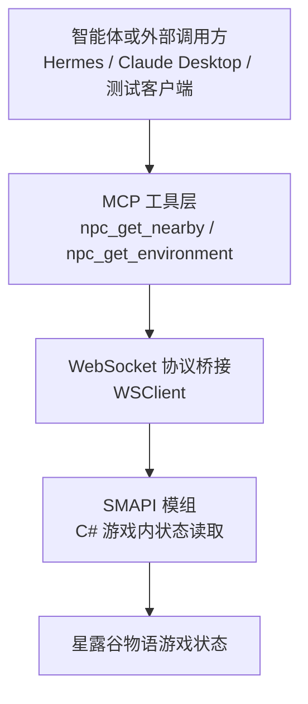
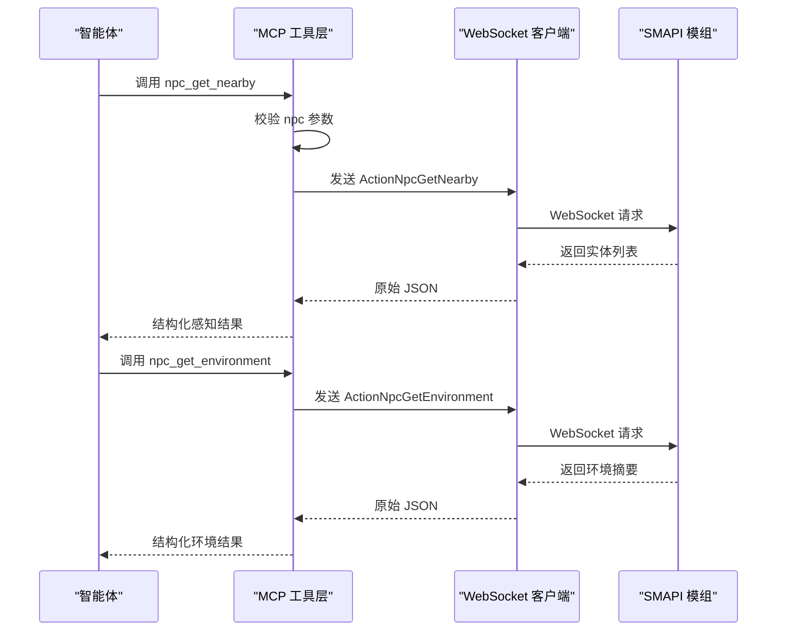
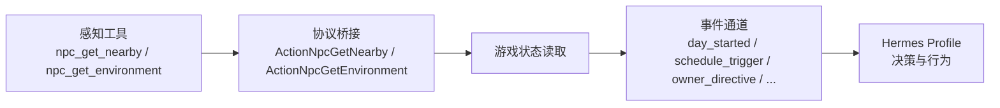
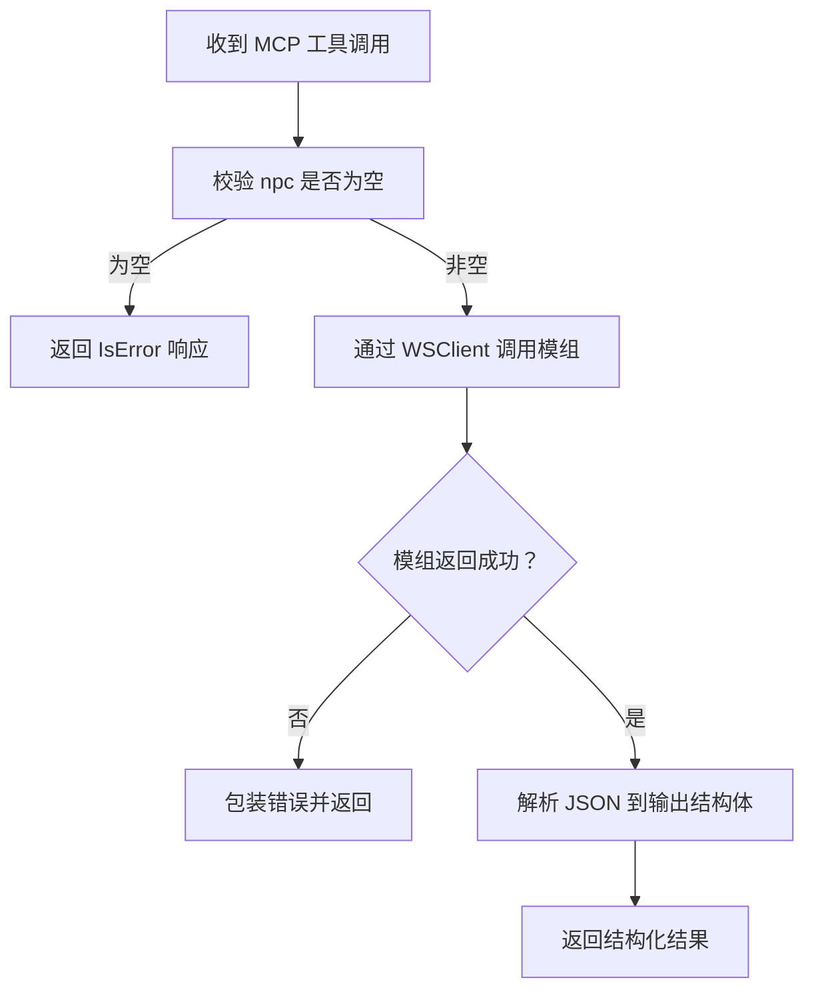
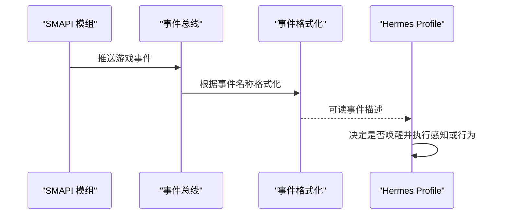
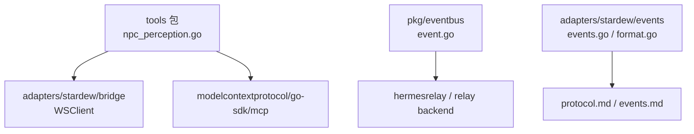
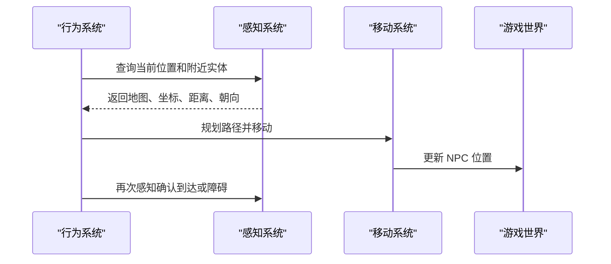

# 感知系统

<cite>
**本文引用的文件**   
- [npc_perception.go](file://SmartNPC/smartnpc-mcp/adapters/stardew/tools/npc_perception.go)
- [npc_perception_test.go](file://SmartNPC/smartnpc-mcp/adapters/stardew/tools/npc_perception_test.go)
- [events.go](file://SmartNPC/smartnpc-mcp/adapters/stardew/events/events.go)
- [format.go](file://SmartNPC/smartnpc-mcp/adapters/stardew/events/format.go)
- [event.go](file://SmartNPC/smartnpc-mcp/pkg/eventbus/event.go)
- [protocol.md](file://SmartNPC/docs/protocol.md)
- [events.md](file://SmartNPC/docs/events.md)
- [current-architecture.md](file://SmartNPC/docs/current-architecture.md)
</cite>

## 目录
1. [引言](#引言)
2. [项目结构与感知能力定位](#项目结构与感知能力定位)
3. [核心组件与数据模型](#核心组件与数据模型)
4. [架构总览](#架构总览)
5. [详细组件分析](#详细组件分析)
6. [依赖关系分析](#依赖关系分析)
7. [性能、精度与内存优化建议](#性能精度与内存优化建议)
8. [扩展指南：新增感知维度与自定义规则](#扩展指南新增感知维度与自定义规则)
9. [与其他系统的集成方式](#与其他系统的集成方式)
10. [故障排查](#故障排查)
11. [结论](#结论)

## 引言

本文件聚焦 SmartNPC 项目中面向 NPC 的“感知系统”。当前仓库中的实现以 `smartnpc-mcp` Go 服务为入口，通过 MCP 工具暴露两类感知能力：

| 能力 | 对应 MCP 工具 | 主要用途 |
|---|---|---|
| NPC 探测 | `npc_get_nearby` | 扫描观察者所在地图上的其他角色（NPC 和玩家），返回名称、类型、坐标、欧几里得距离、朝向等 |
| 环境信息聚合 | `npc_get_environment` | 一次性获取观察者 NPC 的地图、位置、朝向、游戏时间、季节、天气及附近显著物体 |

需要特别说明：**当前源码没有名为 `PerceptionSystem.cs` 的文件**。感知逻辑在仓库中由 Go 侧的工具注册层、WebSocket 协议桥接层以及 SMAPI 模组后端共同构成。因此，本文将以实际代码为依据，解释 NPC 探测、物品识别、地形与光照检测的实现现状、调用流程、可扩展点，并给出基于现有协议的实践示例和优化建议。

**章节来源**
- [npc_perception.go:1-129](file://SmartNPC/smartnpc-mcp/adapters/stardew/tools/npc_perception.go#L1-L129)
- [current-architecture.md:1-170](file://SmartNPC/docs/current-architecture.md#L1-L170)

## 项目结构与感知能力定位

SmartNPC 采用三层分工：

- **MCP 工具层**：定义输入输出结构、参数校验、日志记录，并把请求转发给后端。
- **WebSocket 协议桥接**：使用统一的 `request/response/event` 帧格式，把 MCP 调用映射到具体的 WS action。
- **SMAPI 模组**：负责真正访问游戏对象、计算距离、筛选地图、读取天气和时间。

**图表来源**
- [npc_perception.go:86-129](file://SmartNPC/smartnpc-mcp/adapters/stardew/tools/npc_perception.go#L86-L129)
- [protocol.md:1-120](file://SmartNPC/docs/protocol.md#L1-L120)

**章节来源**
- [npc_perception.go:1-129](file://SmartNPC/smartnpc-mcp/adapters/stardew/tools/npc_perception.go#L1-L129)
- [protocol.md:1-120](file://SmartNPC/docs/protocol.md#L1-L120)

## 核心组件与数据模型

### 近身实体探测：`npc_get_nearby`

该工具用于回答“我周围有谁”的问题。其输入包含：

| 字段 | 类型 | 含义 |
|---|---|---|
| `npc` | string | 观察者 NPC 的内部名称 |
| `radius` | float64 | 可见半径（单位：方块），可选；默认值由工具描述说明为 10 |

返回结果包含头部信息和实体列表：

| 字段 | 类型 | 含义 |
|---|---|---|
| `ok` | bool | 调用是否成功 |
| `npc` | string | 观察者 NPC |
| `map` | string | 观察者当前地图 |
| `radius` | float64 | 实际使用的扫描半径 |
| `count` | int | 返回实体数量 |
| `nearby` | array | 按距离排序的实体列表 |

每个实体项包含：

| 字段 | 类型 | 含义 |
|---|---|---|
| `name` | string | 角色名；NPC 使用内部名，玩家使用玩家名 |
| `type` | string | `npc` 或 `player` |
| `x` | float64 | 方块 X 坐标 |
| `y` | float64 | 方块 Y 坐标 |
| `distance` | float64 | 相对于观察者的欧几里得距离 |
| `facing` | int | 朝向；0=上、1=右、2=下、3=左，未知时为 -1 |
| `map` | string | 实体所在地图（通常与观察者相同） |
| `action` | string | 当前动作或动画提示，尽力而为 |

**章节来源**
- [npc_perception.go:12-53](file://SmartNPC/smartnpc-mcp/adapters/stardew/tools/npc_perception.go#L12-L53)

### 环境信息聚合：`npc_get_environment`

该工具用于减少多次查询带来的往返开销，一次性提供情境判断所需的环境上下文：

| 字段 | 类型 | 含义 |
|---|---|---|
| `ok` | bool | 调用是否成功 |
| `npc` | string | 观察者 NPC |
| `map` | string | 当前地图 |
| `x` / `y` | float64 | 观察者方块坐标 |
| `facing` | int | 观察者朝向 |
| `time_of_day` | int | 原始游戏时间值，例如 1430 |
| `hour` | int | 小时，0–23 |
| `minute` | int | 分钟 |
| `season` | string | 季节：春、夏、秋、冬 |
| `weather` | string | 天气：晴、雨、雪、风暴 |
| `nearby_objects` | array | 附近显著环境对象 |

`nearby_objects` 中的每个对象包含：

| 字段 | 类型 | 含义 |
|---|---|---|
| `name` | string | 对象显示名或内部名 |
| `category` | string | 类别，如作物、地形、家具、建筑等 |
| `x` / `y` | float64 | 对象方块坐标 |
| `distance` | float64 | 距观察者的距离 |

**章节来源**
- [npc_perception.go:56-84](file://SmartNPC/smartnpc-mcp/adapters/stardew/tools/npc_perception.go#L56-L84)

### 工具注册与调用路径

两个工具都通过 `registerNpcPerception` 注册到 MCP Server：

1. 接收 MCP 工具调用。
2. 校验必填字段（当前要求 `npc` 非空）。
3. 记录工具调用日志。
4. 通过 `bridge.WSClient.Call` 发送 WS 请求。
5. 解析后端返回的 JSON 为结构化输出。
6. 将错误包装后返回给上层。

**图表来源**
- [npc_perception.go:86-129](file://SmartNPC/smartnpc-mcp/adapters/stardew/tools/npc_perception.go#L86-L129)

**章节来源**
- [npc_perception.go:86-129](file://SmartNPC/smartnpc-mcp/adapters/stardew/tools/npc_perception.go#L86-L129)

## 架构总览

从系统角度看，感知系统并不只负责“发现”，还承担以下职责：

1. **对外暴露统一接口**：通过 MCP 工具让智能体可查询自身位置和周围世界。
2. **协议转换**：把 MCP 工具语义映射到 WS action。
3. **数据结构契约**：用 Go 结构体定义输入输出，保证测试和文档一致。
4. **事件通道协作**：虽然感知查询是主动 RPC，但系统也通过事件通道把游戏状态变化传给 Hermes profile。

**图表来源**
- [npc_perception.go:86-129](file://SmartNPC/smartnpc-mcp/adapters/stardew/tools/npc_perception.go#L86-L129)
- [events.go:1-290](file://SmartNPC/smartnpc-mcp/adapters/stardew/events/events.go#L1-L290)
- [format.go:1-290](file://SmartNPC/smartnpc-mcp/adapters/stardew/events/format.go#L1-L290)

**章节来源**
- [current-architecture.md:1-170](file://SmartNPC/docs/current-architecture.md#L1-L170)
- [events.md:1-340](file://SmartNPC/docs/events.md#L1-L340)

## 详细组件分析

### 感知输入输出与序列化

感知工具使用强类型结构体承载输入和输出。这样做的好处是：

- 智能体可通过 MCP 工具描述了解参数含义。
- Go 侧可在反序列化时捕获不完整响应。
- 测试可以直接断言结构化字段，而不是比较整段 JSON。

复杂度方面：

| 操作 | 时间复杂度 | 空间复杂度 | 说明 |
|---|---:|---:|---|
| 解析单个感知响应 | O(1) | O(1) | 头部结构很小 |
| 遍历 nearby 列表 | O(n) | O(n) | n 为范围内实体数 |
| 遍历 nearby_objects 列表 | O(m) | O(m) | m 为显著对象数 |
| WS 请求/响应往返 | O(1) 次网络调用 | 取决于响应大小 | 单次 RPC 不批量合并多个感知维度 |

**章节来源**
- [npc_perception.go:12-84](file://SmartNPC/smartnpc-mcp/adapters/stardew/tools/npc_perception.go#L12-L84)

### 参数校验与错误处理

当前实现的关键约束是：

- `npc_get_nearby` 必须传入非空的 `npc`。
- `npc_get_environment` 必须传入非空的 `npc`。
- 如果 WS 调用失败，Go 侧会包装错误并返回。
- 如果后端返回空字节，则输出为空结构体；测试覆盖了成功、空参数、模组报错等路径。

**图表来源**
- [npc_perception.go:86-129](file://SmartNPC/smartnpc-mcp/adapters/stardew/tools/npc_perception.go#L86-L129)
- [npc_perception_test.go:1-305](file://SmartNPC/smartnpc-mcp/adapters/stardew/tools/npc_perception_test.go#L1-L305)

**章节来源**
- [npc_perception.go:86-129](file://SmartNPC/smartnpc-mcp/adapters/stardew/tools/npc_perception.go#L86-L129)
- [npc_perception_test.go:1-305](file://SmartNPC/smartnpc-mcp/adapters/stardew/tools/npc_perception_test.go#L1-L305)

### 事件系统与感知结果的后续处理

感知查询本身是主动调用，但感知结果通常会进入智能体的决策循环。系统中还存在一条事件通道，用于把游戏状态变化通知给 Hermes profile：

- 事件封装为统一 envelope。
- `FormatForHermes` 把结构化事件转成人类可读文本，供智能体理解。
- 实验分支对唤醒事件做了白名单限制，只有部分事件能触发智能体。

**图表来源**
- [event.go:1-76](file://SmartNPC/smartnpc-mcp/pkg/eventbus/event.go#L1-L76)
- [format.go:1-290](file://SmartNPC/smartnpc-mcp/adapters/stardew/events/format.go#L1-L290)
- [events.md:1-340](file://SmartNPC/docs/events.md#L1-L340)

**章节来源**
- [event.go:1-76](file://SmartNPC/smartnpc-mcp/pkg/eventbus/event.go#L1-L76)
- [events.go:1-290](file://SmartNPC/smartnpc-mcp/adapters/stardew/events/events.go#L1-L290)
- [format.go:1-290](file://SmartNPC/smartnpc-mcp/adapters/stardew/events/format.go#L1-L290)
- [events.md:1-340](file://SmartNPC/docs/events.md#L1-L340)

## 依赖关系分析

### 模块依赖图

**图表来源**
- [npc_perception.go:1-129](file://SmartNPC/smartnpc-mcp/adapters/stardew/tools/npc_perception.go#L1-L129)
- [event.go:1-76](file://SmartNPC/smartnpc-mcp/pkg/eventbus/event.go#L1-L76)
- [events.go:1-290](file://SmartNPC/smartnpc-mcp/adapters/stardew/events/events.go#L1-L290)
- [format.go:1-290](file://SmartNPC/smartnpc-mcp/adapters/stardew/events/format.go#L1-L290)

### 耦合与内聚评估

| 组件 | 耦合度 | 内聚性 | 评价 |
|---|---:|---:|---|
| 感知工具 | 低到中 | 高 | 输入输出清晰，依赖 WSClient 和 MCP SDK，职责单一 |
| 事件总线 | 低 | 高 | 核心事件类型不感知具体领域字段 |
| 事件格式器 | 中 | 高 | 把所有事件类型的可读化逻辑集中在一个 switch 中 |
| 协议文档 | 无代码耦合 | 高 | 作为契约被多端引用 |

潜在风险：

- `FormatForHermes` 的 switch 随事件增多而增长，新增事件需同时更新枚举、解码器和格式化逻辑。
- 感知工具目前只做 RPC 转发，真正的空间范围、距离计算、缓存策略位于 SMAPI 模组后端，Go 层无法直接控制。
- 事件路由依赖 `RecipientNPC` 探测 `npc`/`to`/`target` 字段，新增事件若不符合这个约定，可能影响路由。

**章节来源**
- [npc_perception.go:1-129](file://SmartNPC/smartnpc-mcp/adapters/stardew/tools/npc_perception.go#L1-L129)
- [events.go:201-290](file://SmartNPC/smartnpc-mcp/adapters/stardew/events/events.go#L201-L290)
- [format.go:1-290](file://SmartNPC/smartnpc-mcp/adapters/stardew/events/format.go#L1-L290)

## 性能、精度与内存优化建议

### 空间范围限制

当前 Go 层的 `npc_get_nearby` 接受 `radius` 参数，并由工具描述声明默认值为 10 个方块。实际扫描范围和过滤逻辑应在 SMAPI 模组后端完成。推荐实现原则：

- 使用方块坐标系做初步粗筛，避免对所有实体计算平方根。
- 先按地图过滤，再按 x/y 差值阈值裁剪。
- 对最终候选集合计算欧几里得距离，并按距离排序。
- 当 `radius` 超过合理上限时，应拒绝或截断，防止全图扫描。

### 性能优化

| 优化点 | 建议 | 理由 |
|---|---|---|
| 避免频繁重复扫描 | 对默认 radius 的结果做短期缓存 | 智能体可能在一次决策中多次询问周围情况 |
| 区分热路径和冷路径 | 默认 radius 走缓存，自定义 radius 强制刷新 | 自定义半径通常是特殊场景，不应污染通用缓存 |
| 控制返回列表大小 | 设置最大返回实体数 | 防止大量 NPC 或动物导致响应过大 |
| 延迟加载细节字段 | `action` 等尽力而为字段按需填充 | 降低每次扫描的计算成本 |
| 批量化感知 | 把 NPC 探测和环境聚合合并到后端一次扫描 | 减少 WS 往返和重复遍历游戏对象 |

### 缓存策略

建议在后端维护如下缓存键：

| 键要素 | 含义 |
|---|---|
| 观察者 NPC ID | 不同 NPC 有不同位置 |
| 地图名称 | 不同地图对象不同 |
| 方块坐标 | 同一 NPC 在不同格子结果不同 |
| 时间窗口 | 短时间内重复查询可复用结果 |
| 是否精确半径 | 区分默认半径和自定义半径 |

缓存失效条件包括：

- 观察者移动超过一定距离。
- 地图切换。
- 缓存过期。
- 自定义 radius 请求。

### 感知精度调优

| 维度 | 当前实现状态 | 调优建议 |
|---|---|---|
| NPC 探测 | 有 MCP 工具，返回距离、朝向、地图 | 调整 radius、距离阈值、朝向分类 |
| 物品识别 | 环境对象返回 name/category/distance | 增加 category 枚举、稀有度、成熟度等标签 |
| 地形分析 | 未单独暴露地形 API，仅通过 environment 对象间接体现 | 新增地形类别、通行性、危险等级 |
| 光照检测 | 未暴露独立光照字段 | 可结合 weather、time_of_day、室内/室外标志推导 |
| 温度/湿度 | 未暴露 | 可从季节、天气、地图元数据合成 |

### 内存使用优化

- 对 nearby 列表使用预分配切片，避免频繁扩容。
- 对字符串字段尽量复用常量类别名，如 `crop`、`terrain`、`furniture`。
- 对大型地图或洞穴地图，优先使用网格索引而非线性扫描。
- 对事件 payload 使用 `json.RawMessage` 传递原始字节，避免不必要的二次反序列化（当前事件总线已采用该模式）。

**章节来源**
- [npc_perception.go:12-53](file://SmartNPC/smartnpc-mcp/adapters/stardew/tools/npc_perception.go#L12-L53)
- [npc_perception.go:56-84](file://SmartNPC/smartnpc-mcp/adapters/stardew/tools/npc_perception.go#L56-L84)
- [event.go:1-76](file://SmartNPC/smartnpc-mcp/pkg/eventbus/event.go#L1-L76)

## 扩展指南：新增感知维度与自定义规则

### 添加新的感知维度

假设要新增“光照强度”感知，可按以下步骤扩展：

1. **定义输入输出结构**  
   在感知工具文件中新增结构体，例如 `LightingInfo`，包含 `intensity`、`is_indoor`、`source` 等字段。

2. **扩展环境查询或新增专用工具**  
   - 如果光照与环境高度相关，可在 `npc_get_environment` 输出中加入光照字段。
   - 如果光照是独立维度，新增 `npc_get_lighting` 工具，保持单一职责。

3. **注册 MCP 工具**  
   在 `registerNpcPerception` 中新增 `mcp.AddTool` 调用，填写工具名、描述、参数结构和 handler。

4. **实现 WS action**  
   在桥接层新增 action 常量，并在 SMAPI 模组后端实现真实逻辑。

5. **补充测试**  
   仿照现有 `TestNpcGetNearby_EndToEnd` 和 `TestNpcGetEnvironment_EndToEnd`，构造 mock WS 响应并断言结构化字段。

6. **更新文档**  
   在工具描述和协议文档中说明新字段的含义、取值范围和何时调用。

### 自定义感知规则

感知规则可以分为两类：

| 类型 | 说明 | 示例 |
|---|---|---|
| 前端过滤规则 | 在 Go 或 MCP 层提前丢弃无效请求 | 拒绝空 npc、拒绝负半径 |
| 后端判定规则 | 在游戏状态层决定哪些实体或对象可见 | 只返回同地图实体、忽略隐身目标 |

推荐规则存储方式：

- 简单布尔规则放在配置或常量中。
- 复杂评分规则放在可配置的策略表中。
- 对 LLM 可见的规则，通过工具描述或技能说明表达，而不是隐藏逻辑。

### 集成外部传感器数据

外部传感器数据可以通过两种方式接入：

1. **合成事件**  
   像 `owner_directive`、`schedule_trigger` 一样，在 smartnpc-mcp 中产生合成事件，并通过事件通道推送。

2. **增强感知查询**  
   在 WS 后端组装外部传感器数据，并注入到感知输出结构中。例如，在 `nearby_objects` 中加入 `external_sensor_id`。

注意：外部数据应明确来源字段，避免智能体误把传感器噪声当作游戏世界事实。

**章节来源**
- [npc_perception.go:86-129](file://SmartNPC/smartnpc-mcp/adapters/stardew/tools/npc_perception.go#L86-L129)
- [events.go:1-290](file://SmartNPC/smartnpc-mcp/adapters/stardew/events/events.go#L1-L290)
- [format.go:201-290](file://SmartNPC/smartnpc-mcp/adapters/stardew/events/format.go#L201-L290)

## 与其他系统的集成方式

### 与移动系统集成

移动系统关注 NPC 如何到达目标位置；感知系统回答 NPC 当前在哪里、周围有什么。二者典型协作流程：

- 移动系统应避免在感知结果尚未稳定时发起长距离移动。
- 感知系统在返回 `facing` 时应反映最近一次有效状态，避免过时方向误导社交行为。

### 与行为系统集成

行为系统依赖感知结果做决策，例如：

- 看到玩家靠近 → 打招呼。
- 看到作物成熟 → 安排收割。
- 检测到下雨 → 改变外出计划。
- 检测到光照不足 → 关闭自动夜间采集任务。

建议行为系统遵循“先感知，后行动”的顺序，并对感知失败做降级处理：

| 感知结果 | 行为策略 |
|---|---|
| 成功 | 正常决策 |
| 空结果 | 保守行为，例如原地等待或重试 |
| 超时或错误 | 回退到上次已知状态，并记录告警 |

### 与事件系统集成

感知查询是主动 RPC，事件系统是被动推送。最佳实践：

- 感知查询用于即时状态。
- 事件用于状态变更通知。
- 不要在事件回调中执行昂贵感知扫描，应先做轻量检查，必要时再触发查询。

**章节来源**
- [current-architecture.md:1-170](file://SmartNPC/docs/current-architecture.md#L1-L170)
- [events.md:1-340](file://SmartNPC/docs/events.md#L1-L340)

## 故障排查

### 常见错误与定位

| 现象 | 可能原因 | 排查步骤 |
|---|---|---|
| 工具返回空结构体 | WS 返回空字节或未正确解析 | 检查 WS 响应是否为空、JSON 字段是否匹配 |
| 空 npc 时报错 | 参数校验生效 | 确认 MCP 调用方传入了有效的 NPC 内部名 |
| 模组返回错误 | 游戏未加载存档、NPC 不存在 | 查看 WS 层错误消息，确认游戏状态 |
| 感知结果不更新 | 后端缓存未失效或 NPC 未移动 | 检查移动系统是否更新了 NPC 位置 |
| 事件不唤醒智能体 | 事件不在唤醒白名单 | 对照 events.md 和 protocol.md 的白名单 |

### 测试验证方法

仓库中的感知测试提供了标准验证范式：

1. 使用测试 WS server。
2. 注册感知工具。
3. 构造 mock WS handler。
4. 调用 MCP 工具。
5. 断言结构化输出。

推荐新增测试覆盖：

- 空 radius、负 radius、极大 radius。
- nearby 为空列表。
- nearby 包含同名不同地图实体。
- 环境对象类别未知时的容错。

**章节来源**
- [npc_perception_test.go:1-305](file://SmartNPC/smartnpc-mcp/adapters/stardew/tools/npc_perception_test.go#L1-L305)
- [protocol.md:1-120](file://SmartNPC/docs/protocol.md#L1-L120)
- [events.md:1-340](file://SmartNPC/docs/events.md#L1-L340)

## 结论

当前 SmartNPC 感知系统已经具备清晰的 MCP 工具边界：`npc_get_nearby` 负责角色探测，`npc_get_environment` 负责环境与时间、天气、对象聚合。Go 层实现简洁、类型安全、可测试；真正的空间范围、距离计算、缓存策略和光照等深层感知能力由 SMAPI 模组后端承担。

对于未来扩展，建议：

- 保持感知查询与事件通道分离：查询用于即时状态，事件用于状态变更。
- 在后端实现高效的空间索引和缓存，避免全图扫描。
- 谨慎扩展感知维度，确保新增字段有明确的业务含义和下游消费者。
- 通过测试覆盖参数校验、错误路径和边界场景。
- 在文档中同步更新工具描述、协议规范和事件清单，避免实现与文档脱节。

这样，感知系统既能满足 NPC 对环境的基本感知需求，又能为移动系统、行为系统和外部传感器数据提供稳定扩展点。