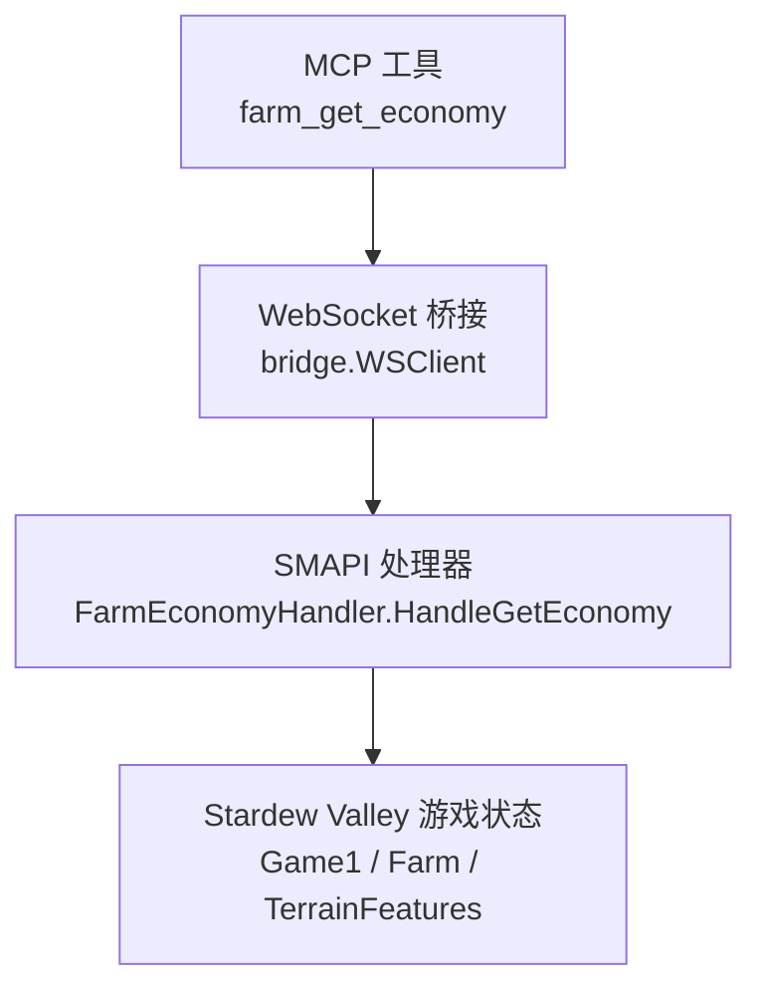
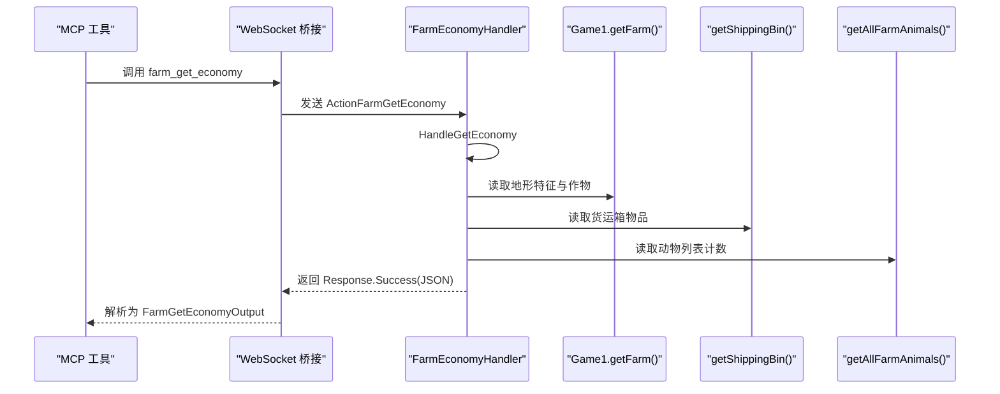
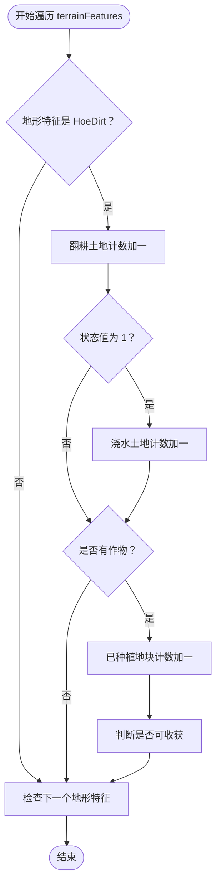
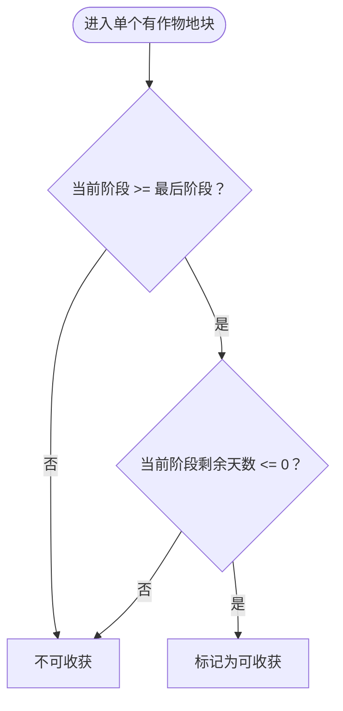
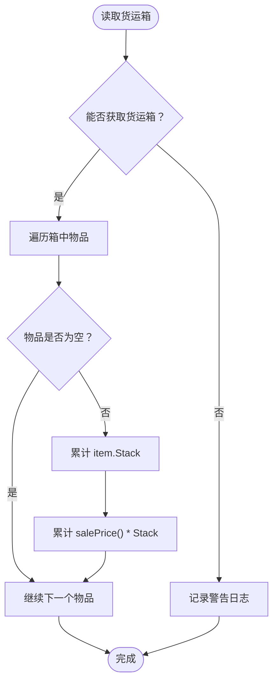

# 农场经济查询

<cite>
**本文引用的文件**   
- [FarmEconomyHandler.cs](file://SmartNPC/smapi-mod/Query/FarmEconomyHandler.cs)
- [farm_economy.go](file://SmartNPC/smartnpc-mcp/adapters/stardew/tools/farm_economy.go)
</cite>

## 目录
1. [简介](#简介)
2. [项目结构](#项目结构)
3. [核心组件](#核心组件)
4. [架构总览](#架构总览)
5. [详细实现分析](#详细实现分析)
6. [依赖关系分析](#依赖关系分析)
7. [性能考虑与优化建议](#性能考虑与优化建议)
8. [故障排查指南](#故障排查指南)
9. [结论](#结论)

## 简介
本文件面向“农场经济查询”功能，聚焦于 SMAPI 侧的 `FarmEconomyHandler.cs` 中 `HandleGetEconomy` 方法的完整实现。该功能以只读方式汇总玩家当前农场的关键经济指标与状态，包括：

- 游戏时间：日期、季节、年份
- 资产指标：金币、累计收益
- 货运箱：装箱物品数量与总售价
- 作物：已种植地块数、可收获作物数
- 地形特征：翻耕土地数、浇水土地数
- 动物：农场动物总数

该能力由 Go 侧 MCP 工具 `farm_get_economy` 通过 WebSocket 桥接到 SMAPI 游戏进程执行，不修改游戏状态，适合用于每日规划、夜间结算和出货前后核对。

## 项目结构
本功能涉及两层代码：

- SMAPI 游戏内处理器：`SmartNPC/smapi-mod/Query/FarmEconomyHandler.cs`
- MCP 工具适配层：`SmartNPC/smartnpc-mcp/adapters/stardew/tools/farm_economy.go`



**图表来源**
- [farm_economy.go:20-57](file://SmartNPC/smartnpc-mcp/adapters/stardew/tools/farm_economy.go#L20-L57)
- [FarmEconomyHandler.cs:1-88](file://SmartNPC/smapi-mod/Query/FarmEconomyHandler.cs#L1-L88)

**章节来源**
- [FarmEconomyHandler.cs:1-88](file://SmartNPC/smapi-mod/Query/FarmEconomyHandler.cs#L1-L88)
- [farm_economy.go:1-57](file://SmartNPC/smartnpc-mcp/adapters/stardew/tools/farm_economy.go#L1-L57)

## 核心组件
- **FarmEconomyHandler**：负责读取游戏世界状态并组装农场经济响应对象。
- **FarmGetEconomyInput / FarmGetEconomyOutput**：Go 侧 MCP 工具输入输出结构体，与 SMAPI 返回数据一一对应。
- **WSClient.Call**：Go 侧通过 WebSocket 调用 SMAPI 动作 `ActionFarmGetEconomy`，并将原始 JSON 反序列化为结构化输出。

**章节来源**
- [FarmEconomyHandler.cs:10-88](file://SmartNPC/smapi-mod/Query/FarmEconomyHandler.cs#L10-L88)
- [farm_economy.go:10-57](file://SmartNPC/smartnpc-mcp/adapters/stardew/tools/farm_economy.go#L10-L57)

## 架构总览
下图展示一次农场经济查询从 MCP 到 SMAPI 再到 Stardew Valley 游戏对象的调用时序。



**图表来源**
- [farm_economy.go:33-57](file://SmartNPC/smartnpc-mcp/adapters/stardew/tools/farm_economy.go#L33-L57)
- [FarmEconomyHandler.cs:18-88](file://SmartNPC/smapi-mod/Query/FarmEconomyHandler.cs#L18-L88)

## 详细实现分析

### HandleGetEconomy 方法入口与前置校验
- 若世界尚未就绪或没有加载存档，直接返回失败响应，错误码为 `mod_not_ready`，消息说明未加载存档。
- 获取 `Game1.getFarm()`；若农场为空，返回失败响应，错误码为 `no_farm`。

这一步确保后续所有农场数据访问都有稳定的上下文。

**章节来源**
- [FarmEconomyHandler.cs:18-27](file://SmartNPC/smapi-mod/Query/FarmEconomyHandler.cs#L18-L27)

### 农场地形特征扫描与耕作、浇水统计
处理器遍历 `farm.terrainFeatures.Pairs`，对每个键值对判断其值是否为 `HoeDirt`（耕地）：

- 若是 `HoeDirt`，则翻耕土地计数加一。
- 若该耕地的状态值为 1，则认为当前处于浇水状态，浇水土地计数加一。
- 若 `dirt.crop` 为空，跳过作物相关逻辑。
- 若存在作物，则已种植地块计数加一。

这一过程的时间复杂度为 O(T)，其中 T 是地形特征条目数量；空间复杂度为常数级，因为只维护几个整型计数器。



**图表来源**
- [FarmEconomyHandler.cs:28-45](file://SmartNPC/smapi-mod/Query/FarmEconomyHandler.cs#L28-L45)

**章节来源**
- [FarmEconomyHandler.cs:28-45](file://SmartNPC/smapi-mod/Query/FarmEconomyHandler.cs#L28-L45)

### 作物生长状态检测算法
可收获的判断条件为：

- 作物的当前阶段索引不小于阶段天数列表长度减一，即已经到达最终生长阶段；
- 且当前阶段的剩余天数为 0 或少于 0，表示当前阶段计时已结束。

该逻辑与 `Crop.harvest` 的可收获门控一致，因此能准确反映标准阶段式作物在当前时刻是否可收获。



**图表来源**
- [FarmEconomyHandler.cs:38-45](file://SmartNPC/smapi-mod/Query/FarmEconomyHandler.cs#L38-L45)

**章节来源**
- [FarmEconomyHandler.cs:36-45](file://SmartNPC/smapi-mod/Query/FarmEconomyHandler.cs#L36-L45)

### 货运箱统计实现
货运箱统计分为两步：

1. 通过 `farm.getShippingBin(Game1.player)` 获取当前玩家的货运箱。
2. 遍历箱中非空物品：
   - 使用 `item.Stack` 累加装箱物品总件数。
   - 使用 `item.salePrice()` 乘以 `item.Stack`，累加装箱物品总价值。

该实现将不同种类物品按数量聚合后计算总价，而不是仅统计箱子中的物品种类数。



**图表来源**
- [FarmEconomyHandler.cs:47-62](file://SmartNPC/smapi-mod/Query/FarmEconomyHandler.cs#L47-L62)

**章节来源**
- [FarmEconomyHandler.cs:47-62](file://SmartNPC/smapi-mod/Query/FarmEconomyHandler.cs#L47-L62)

### 动物数量统计
动物数量通过 `farm.getAllFarmAnimals().Count` 获取。该调用返回农场动物集合，随后取长度作为动物总数。

由于该操作可能因游戏内部状态异常抛出异常，代码将其包裹在 try-catch 中，发生异常时记录警告日志，但不会中断整个响应构建。

**章节来源**
- [FarmEconomyHandler.cs:64-68](file://SmartNPC/smapi-mod/Query/FarmEconomyHandler.cs#L64-L68)

### 响应数据结构
成功路径会返回一个包含以下字段的响应对象：

| 字段 | 含义 | 数据来源 |
|---|---|---|
| `ok` | 本次请求是否成功 | 固定为 `true`，失败时由上层返回失败响应 |
| `day` | 当前季节中的日期 | `Game1.dayOfMonth` |
| `season` | 当前季节名称 | `Game1.currentSeason` |
| `year` | 游戏年份 | `Game1.year` |
| `gold` | 玩家当前金币 | `Game1.player.Money` |
| `total_money_earned` | 累计赚取金币 | `Game1.player.totalMoneyEarned` |
| `shipping_bin_count` | 货运箱中物品总件数 | 累加每个物品的 `Stack` |
| `shipping_bin_value` | 货运箱中物品总售价 | 累加 `salePrice() * Stack` |
| `crops_planted` | 已种植作物地块数 | 遍历 `HoeDirt` 且 `crop` 不为空的数量 |
| `crops_ready` | 当前可收获作物数 | 满足最终阶段且剩余天数为 0 或更少的作物数 |
| `tilled_tiles` | 翻耕土地数量 | 所有 `HoeDirt` 数量 |
| `watered_tiles` | 当前浇水土地数量 | 状态值为 1 的 `HoeDirt` 数量 |
| `animals` | 农场动物数量 | `getAllFarmAnimals().Count` |

**章节来源**
- [FarmEconomyHandler.cs:70-86](file://SmartNPC/smapi-mod/Query/FarmEconomyHandler.cs#L70-L86)

### Go 侧数据结构映射
Go 侧的 `FarmGetEconomyOutput` 字段与 SMAPI 返回 JSON 字段保持一致，便于反序列化：

| Go 字段 | JSON 字段 | 类型 | 含义 |
|---|---|---|---|
| `OK` | `ok` | `bool` | 是否成功 |
| `Day` | `day` | `int` | 季节中的日期 |
| `Season` | `season` | `string` | 季节名称 |
| `Year` | `year` | `int` | 游戏年份 |
| `Gold` | `gold` | `int` | 当前金币 |
| `TotalMoneyEarned` | `total_money_earned` | `uint32` | 累计赚取金币 |
| `ShippingBinCount` | `shipping_bin_count` | `int` | 装箱物品总件数 |
| `ShippingBinValue` | `shipping_bin_value` | `int64` | 装箱物品总价值 |
| `CropsPlanted` | `crops_planted` | `int` | 已种植地块数 |
| `CropsReady` | `crops_ready` | `int` | 可收获作物数 |
| `TilledTiles` | `tilled_tiles` | `int` | 翻耕土地数 |
| `WateredTiles` | `watered_tiles` | `int` | 浇水土地数 |
| `Animals` | `animals` | `int` | 动物数量 |

**章节来源**
- [farm_economy.go:10-28](file://SmartNPC/smartnpc-mcp/adapters/stardew/tools/farm_economy.go#L10-L28)

## 依赖关系分析

```mermaid
classDiagram
    class FarmEconomyHandler {
        -IMonitor _log
        +HandleGetEconomy(id, params) Task~Response~
    }

    class WSClient {
        +Call(context, action, input) byte[]
    }

    class FarmGetEconomyInput {
    }

    class FarmGetEconomyOutput {
        +bool OK
        +int Day
        +string Season
        +int Year
        +int Gold
        +uint32 TotalMoneyEarned
        +int ShippingBinCount
        +int64 ShippingBinValue
        +int CropsPlanted
        +int CropsReady
        +int TilledTiles
        +int WateredTiles
        +int Animals
    }

    FarmEconomyHandler --> "读取" : "Game1 / Farm / TerrainFeatures"
    WSClient --> FarmEconomyHandler : "调用 ActionFarmGetEconomy"
    FarmGetEconomyOutput --> FarmEconomyHandler : "JSON 反序列化映射"
```

**图表来源**
- [FarmEconomyHandler.cs:10-88](file://SmartNPC/smapi-mod/Query/FarmEconomyHandler.cs#L10-L88)
- [farm_economy.go:10-57](file://SmartNPC/smartnpc-mcp/adapters/stardew/tools/farm_economy.go#L10-L57)

**章节来源**
- [FarmEconomyHandler.cs:10-88](file://SmartNPC/smapi-mod/Query/FarmEconomyHandler.cs#L10-L88)
- [farm_economy.go:10-57](file://SmartNPC/smartnpc-mcp/adapters/stardew/tools/farm_economy.go#L10-L57)

## 性能考虑与优化建议

### 现有性能特征
- 地形特征遍历：O(T)，T 为 `terrainFeatures.Pairs` 数量。
- 货运箱遍历：O(B)，B 为货运箱中物品数量。
- 动物计数：取决于 `getAllFarmAnimals()` 的实现，通常为线性或集合查找。
- 整体内存分配较少，主要为临时局部变量和结果对象。

### 可优化点
1. **避免重复访问 Game1 静态状态**  
   当前代码多次读取 `Game1.dayOfMonth`、`Game1.currentSeason`、`Game1.year`、`Game1.player.Money`、`Game1.player.totalMoneyEarned`。可在函数开头缓存这些值，减少重复属性访问。

2. **提前过滤无效地形特征**  
   如果已知大量地形特征不是 `HoeDirt`，可以在遍历时尽早 `continue`，减少分支判断开销。当前实现已经做了类型判断，但仍可考虑先收集候选项再处理。

3. **货运箱空引用保护**  
   当前实现仅在 `foreach` 中对 `item is not null` 做过滤，但未对 `bin` 本身判空。若 `getShippingBin` 在某些场景返回空引用，可能在迭代时报错。建议在 try 前增加 bin 判空。

4. **装箱价值溢出风险**  
   `salePrice()` 返回值与 `Stack` 相乘后累加到 `long`。若装箱物品数量极大或单价极高，仍可能发生溢出。可在累加前做上限检查或使用更安全的数值类型。

5. **日志级别控制**  
   货运箱读取失败和动物计数失败均使用警告日志。若高频调用，可能产生大量日志。可考虑添加采样或开关配置。

6. **并行化限制**  
   该操作必须运行在游戏线程并直接访问游戏状态，不能随意改为多线程并行扫描，否则可能破坏游戏一致性。

### 推荐优化方向
- 引入轻量缓存：在单次调用中缓存 Game1 常用字段。
- 增强健壮性：对 `bin` 判空、对 `salePrice()` 结果做安全转换。
- 可观测性：为关键步骤添加调试日志开关，默认关闭，仅在诊断时启用。
- 单元测试：针对典型农场布局构造 Mock 地形特征，验证耕作、浇水、可收获计数是否正确。

[本节为通用性能指导，不直接分析具体代码行]

## 故障排查指南

### 常见失败场景
| 场景 | 现象 | 原因 | 处理方式 |
|---|---|---|---|
| 未加载存档 | 返回失败响应，错误码 `mod_not_ready` | `Context.IsWorldReady` 为假 | 等待存档加载完成后再调用 |
| 找不到农场 | 返回失败响应，错误码 `no_farm` | `Game1.getFarm()` 返回空 | 检查当前场景是否在农场地图 |
| 货运箱读取失败 | 返回成功响应，但 `shipping_bin_count` 和 `shipping_bin_value` 可能为 0 | 抛异常并被捕获 | 查看 SMAPI 日志中的警告信息 |
| 动物计数失败 | 返回成功响应，但 `animals` 可能为 0 | 抛异常并被捕获 | 查看 SMAPI 日志中的警告信息 |

### 日志定位
- 货运箱读取失败的日志前缀为 `[farm_get_economy] shipping bin read failed:`，附带异常消息。
- 动物计数失败的日志前缀为 `[farm_get_economy] animal count failed:`，附带异常消息。

建议在游戏日志中搜索上述前缀，结合异常消息定位具体原因，例如：

- 货运箱对象为空引用。
- 某个物品对象为空引用。
- 动物集合枚举过程中出现并发或状态不一致。

**章节来源**
- [FarmEconomyHandler.cs:47-68](file://SmartNPC/smapi-mod/Query/FarmEconomyHandler.cs#L47-L68)

## 结论
`FarmEconomyHandler.HandleGetEconomy` 是一个只读、低耦合的农场经济快照接口。它通过直接读取 Stardew Valley 游戏状态，汇总日期、季节、年份、金币、累计收益、货运箱、作物、地形和动物等关键指标，并以结构化 JSON 返回给 MCP 工具层。

其优点包括：

- 实现简单清晰，职责单一。
- 对游戏状态只做读取，不引入副作用。
- 对易失败的子系统（货运箱、动物计数）采用隔离的异常处理和日志记录。

需要注意的风险包括：

- 高度依赖 SMAPI 与 Stardew Valley 内部 API 稳定性。
- 在大农场或多箱多动物场景下，遍历成本随规模增长。
- 缺少对 `bin` 空引用和装箱价值溢出的显式防护。

在生产使用中，建议配合 MCP 工具的定时调用策略，避免过于频繁触发；同时开启可选的诊断日志，以便在异常情况下快速定位问题。