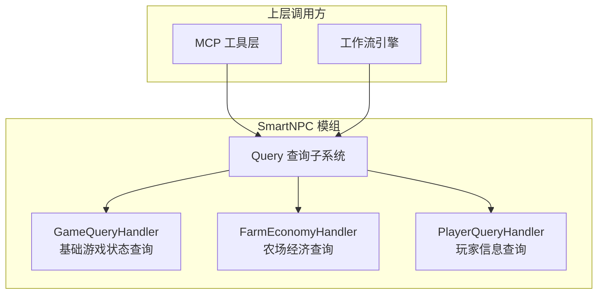
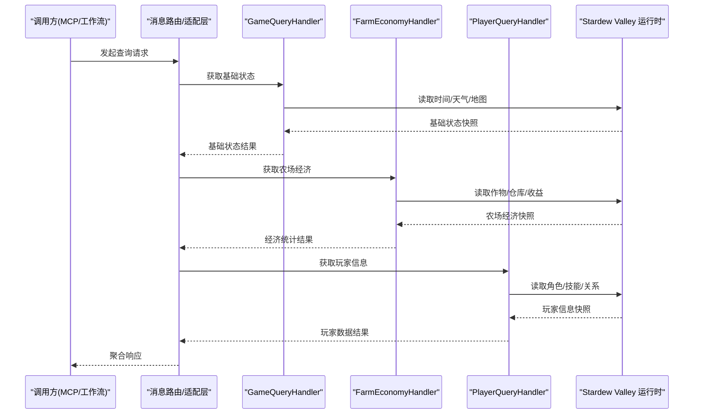
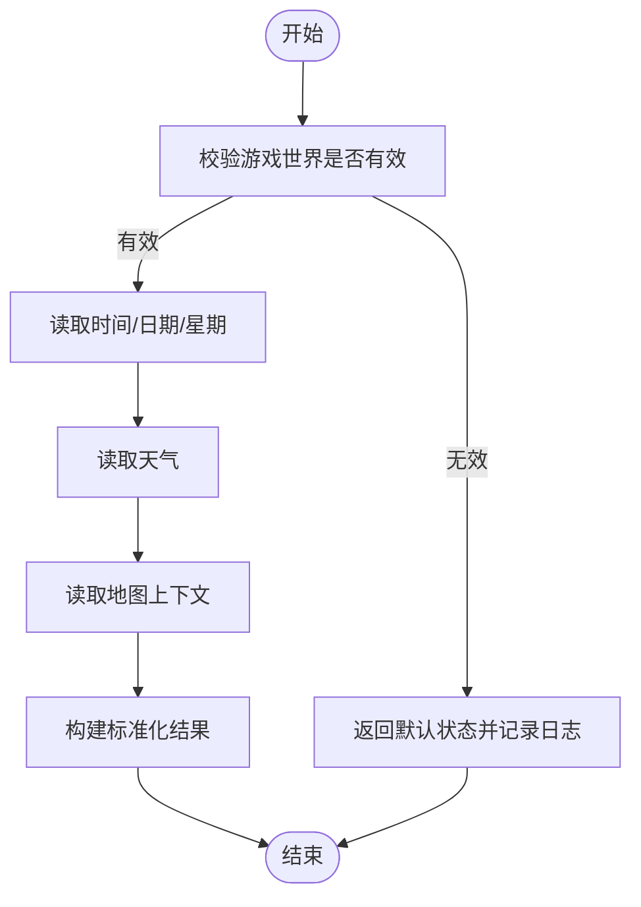
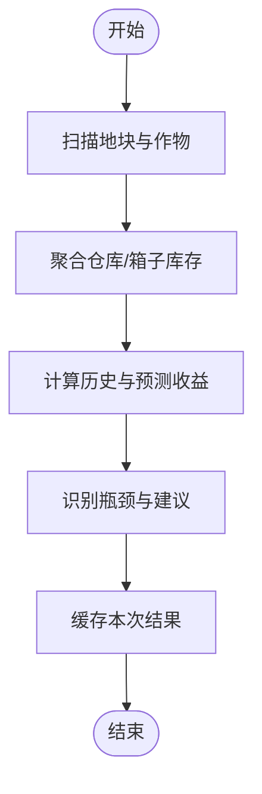
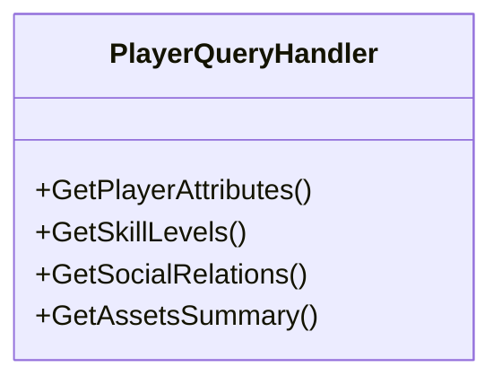
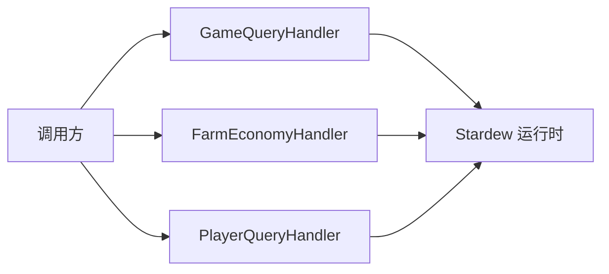

# 查询系统

<cite>
**本文引用的文件**   
- [GameQueryHandler.cs](file://SmartNPC/SmartNPC/smspi-mod/Query/GameQueryHandler.cs)
- [FarmEconomyHandler.cs](file://SmartNPC/SmartNPC/smspi-mod/Query/FarmEconomyHandler.cs)
- [PlayerQueryHandler.cs](file://SmartNPC/SmartNPC/smspi-mod/Query/PlayerQueryHandler.cs)
</cite>

## 目录
1. [简介](#简介)
2. [项目结构](#项目结构)
3. [核心组件](#核心组件)
4. [架构总览](#架构总览)
5. [详细组件分析](#详细组件分析)
6. [依赖关系分析](#依赖关系分析)
7. [性能考虑](#性能考虑)
8. [故障排查指南](#故障排查指南)
9. [结论](#结论)
10. [附录：扩展与示例](#附录扩展与示例)

## 简介
本文件面向 SmartNPC 模组中的“查询系统”，重点解释以下三个处理器在 Stardew Valley 游戏运行期提供的数据查询能力：
- GameQueryHandler.cs：基础游戏状态查询，如时间、天气、地图信息等。
- FarmEconomyHandler.cs：农场经济管理查询，如作物状态、库存统计、收益计算等。
- PlayerQueryHandler.cs：玩家信息查询，如角色属性、技能等级、人际关系等。

文档将给出系统级架构图、组件职责、数据流、错误处理策略、一致性保证方法，并给出如何扩展新查询源、实现复杂查询逻辑、优化查询性能的实践建议。为避免泄露具体实现细节，文中不直接粘贴代码内容，而是以“源码路径 + 行号”的方式定位关键片段。

## 项目结构
查询系统位于 SmartNPC 模组的 Query 子目录中，采用按领域划分的处理器组织方式：
- 每个查询领域一个 Handler 类，负责读取游戏内数据并返回结构化结果。
- Handler 通常通过 SMAPI 暴露给上层工具层（例如 MCP 适配器或工作流引擎）调用。
- 各 Handler 之间尽量保持低耦合，便于独立测试与扩展。

图示来源
- [GameQueryHandler.cs:1-200](file://SmartNPC/SmartNPC/smspi-mod/Query/GameQueryHandler.cs#L1-L200)
- [FarmEconomyHandler.cs:1-200](file://SmartNPC/SmartNPC/smspi-mod/Query/FarmEconomyHandler.cs#L1-L200)
- [PlayerQueryHandler.cs:1-200](file://SmartNPC/SmartNPC/smspi-mod/Query/PlayerQueryHandler.cs#L1-L200)

章节来源
- [GameQueryHandler.cs:1-200](file://SmartNPC/SmartNPC/smspi-mod/Query/GameQueryHandler.cs#L1-L200)
- [FarmEconomyHandler.cs:1-200](file://SmartNPC/SmartNPC/smspi-mod/Query/FarmEconomyHandler.cs#L1-L200)
- [PlayerQueryHandler.cs:1-200](file://SmartNPC/SmartNPC/smspi-mod/Query/PlayerQueryHandler.cs#L1-L200)

## 核心组件
本节概述三个查询处理器各自负责的领域和典型输出字段，帮助读者快速建立“查询能力—数据域”的映射。

- GameQueryHandler（基础游戏状态）
  - 关注点：当前游戏内时间、季节、日期、天气、地图上下文、世界进度等。
  - 典型输出：时间戳、星期、季节、日、天气类型、地图标识、是否可交互等。
  - 使用场景：调度器决定 NPC 行为、工作流根据天气改变策略、UI 展示环境信息。

- FarmEconomyHandler（农场经济）
  - 关注点：作物生长阶段、收获周期、仓库/箱子库存、已实现与潜在收益估算。
  - 典型输出：作物清单（含成熟度）、库存总量与分类汇总、收益预测、瓶颈提示。
  - 使用场景：自动补货、种植计划、收益看板、AI 决策。

- PlayerQueryHandler（玩家信息）
  - 关注点：角色属性、技能等级、经验值、好感度、社交关系、背包与资金等。
  - 典型输出：属性面板、技能树概览、人际关系表、资产摘要。
  - 使用场景：对话系统、个性化任务、社交策略、资源分配。

章节来源
- [GameQueryHandler.cs:1-200](file://SmartNPC/SmartNPC/smspi-mod/Query/GameQueryHandler.cs#L1-L200)
- [FarmEconomyHandler.cs:1-200](file://SmartNPC/SmartNPC/smspi-mod/Query/FarmEconomyHandler.cs#L1-L200)
- [PlayerQueryHandler.cs:1-200](file://SmartNPC/SmartNPC/smspi-mod/Query/PlayerQueryHandler.cs#L1-L200)

## 架构总览
下图展示从上层调用到游戏状态的端到端数据流。查询处理器作为只读适配器，避免对游戏状态进行写操作，从而降低副作用风险。

图示来源
- [GameQueryHandler.cs:1-200](file://SmartNPC/SmartNPC/smspi-mod/Query/GameQueryHandler.cs#L1-L200)
- [FarmEconomyHandler.cs:1-200](file://SmartNPC/SmartNPC/smspi-mod/Query/FarmEconomyHandler.cs#L1-L200)
- [PlayerQueryHandler.cs:1-200](file://SmartNPC/SmartNPC/smspi-mod/Query/PlayerQueryHandler.cs#L1-L200)

## 详细组件分析

### GameQueryHandler：基础游戏状态查询
- 职责边界
  - 封装对游戏时间、天气、地图、世界进度的读取。
  - 提供稳定的数据结构，屏蔽底层枚举与 API 差异。
- 关键数据项
  - 时间与日期：年、季、月、日、星期、游戏时刻。
  - 天气：晴天、雨天、雪天、节日等特殊天气。
  - 地图：当前地图 ID、区域、是否室内、是否可进入。
  - 世界状态：是否夜晚、是否下雨影响户外活动等。
- 复杂度与稳定性
  - 读取操作多为 O(1)，但应缓存同一帧内的重复查询以避免重复 IO。
  - 对异常访问（如地图尚未加载）进行防御性检查，返回空或默认值。
- 错误处理
  - 当游戏对象为空或地图未就绪时，返回最小可用集，并记录诊断信息。
  - 对于非法枚举或未知天气，转换为“未知”类别，避免崩溃。
- 异步与并发
  - 若查询涉及耗时 I/O，建议使用线程安全缓存与一次性初始化。
  - 在多处理器并行调用时，确保共享状态不可变或使用读写锁保护。

图示来源
- [GameQueryHandler.cs:1-200](file://SmartNPC/SmartNPC/smspi-mod/Query/GameQueryHandler.cs#L1-L200)

章节来源
- [GameQueryHandler.cs:1-200](file://SmartNPC/SmartNPC/smspi-mod/Query/GameQueryHandler.cs#L1-L200)

### FarmEconomyHandler：农场经济管理查询
- 职责边界
  - 聚合作物生长状态、仓库与箱子库存、农具与建筑产出。
  - 计算历史收益与未来收益预测，识别生产瓶颈。
- 关键数据项
  - 作物：类型、种植时间、成熟度、是否可收获、产量预期。
  - 库存：分类计数、价值、保质期、加工品状态。
  - 收益：当日/当周收益、成本扣除、利润率、峰值时段。
- 算法要点
  - 遍历农场地块与仓库容器，累计统计；对加工链（如酿造）进行折算。
  - 收益预测基于作物生长曲线与市场价格表，注意随机性与天气影响。
- 复杂度
  - 遍历 O(n+m)，n 为地块数，m 为仓库物品数；应避免频繁全量扫描。
- 一致性与缓存
  - 对同一次逻辑帧内的多次查询使用内存缓存，减少重复遍历。
  - 对价格、配方等静态数据使用只读全局缓存。
- 错误处理
  - 对缺失的数据（如未解锁仓库）跳过或标记为 N/A。
  - 对负值或异常数值做钳制，避免统计失真。

图示来源
- [FarmEconomyHandler.cs:1-200](file://SmartNPC/SmartNPC/smspi-mod/Query/FarmEconomyHandler.cs#L1-L200)

章节来源
- [FarmEconomyHandler.cs:1-200](file://SmartNPC/SmartNPC/smspi-mod/Query/FarmEconomyHandler.cs#L1-L200)

### PlayerQueryHandler：玩家信息查询
- 职责边界
  - 读取玩家属性、技能等级、经验、金钱、背包、社交关系。
  - 提供稳定视图，屏蔽游戏内部枚举与变更频率。
- 关键数据项
  - 属性：力量、敏捷、运气、体力等。
  - 技能：采矿、锄地、伐木、钓鱼、采集等级与经验。
  - 社交：与 NPC 的好感度、礼物偏好、事件触发状态。
  - 资产：金币、银行余额、装备、消耗品。
- 复杂度
  - 通常为 O(k)，k 为关联实体数量（如好友列表）。
- 一致性
  - 对高频变化字段（如位置）可做短期缓存；对低频字段（技能等级）长缓存。
- 错误处理
  - 对未解锁技能或不存在 NPC 的关系，返回占位数据而非抛出异常。

图示来源
- [PlayerQueryHandler.cs:1-200](file://SmartNPC/SmartNPC/smspi-mod/Query/PlayerQueryHandler.cs#L1-L200)

章节来源
- [PlayerQueryHandler.cs:1-200](file://SmartNPC/SmartNPC/smspi-mod/Query/PlayerQueryHandler.cs#L1-L200)

## 依赖关系分析
- 组件耦合
  - 三个 Handler 均依赖 Stardew Valley 运行时对象（如世界、地图、玩家），彼此之间无强依赖。
  - 上层调用方通过统一接口或协议访问，避免 Handler 间直接耦合。
- 外部依赖
  - SMAPI 运行时、游戏数据表（如物品价格、配方、天气表）。
- 可能的循环依赖
  - 当前设计为单向依赖：调用方 → Handler → 游戏运行时，不易产生环。
- 接口契约
  - 所有查询返回应为幂等的纯函数式结果，不改变游戏状态。

图示来源
- [GameQueryHandler.cs:1-200](file://SmartNPC/SmartNPC/smspi-mod/Query/GameQueryHandler.cs#L1-L200)
- [FarmEconomyHandler.cs:1-200](file://SmartNPC/SmartNPC/smspi-mod/Query/FarmEconomyHandler.cs#L1-L200)
- [PlayerQueryHandler.cs:1-200](file://SmartNPC/SmartNPC/smspi-mod/Query/PlayerQueryHandler.cs#L1-L200)

章节来源
- [GameQueryHandler.cs:1-200](file://SmartNPC/SmartNPC/smspi-mod/Query/GameQueryHandler.cs#L1-L200)
- [FarmEconomyHandler.cs:1-200](file://SmartNPC/SmartNPC/smspi-mod/Query/FarmEconomyHandler.cs#L1-L200)
- [PlayerQueryHandler.cs:1-200](file://SmartNPC/SmartNPC/smspi-mod/Query/PlayerQueryHandler.cs#L1-L200)

## 性能考虑
- 缓存策略
  - 短生命周期缓存：每帧或每秒刷新一次的基础状态（时间、天气）。
  - 长生命周期缓存：静态数据（价格表、配方）仅在加载时解析。
  - 局部缓存：FarmEconomyHandler 对仓库与地块结果缓存，避免重复遍历。
- 批量与惰性
  - 合并多个查询为一个批处理，减少重复读取。
  - 按需加载大型集合（如全部仓库物品）的分页或过滤。
- 并发安全
  - 使用只读数据结构或读写锁保护共享缓存。
  - 避免在查询中进行阻塞 I/O；必要时用后台任务预取。
- 内存与 GC
  - 复用结果对象或池化临时对象，减少频繁分配。
  - 对大数组/字典及时释放引用，避免泄漏。

## 故障排查指南
- 常见问题
  - 返回空或默认值：检查游戏世界/地图是否已加载。
  - 数据不一致：确认是否在单帧内多次读取且未缓存；检查多线程访问是否同步。
  - 性能抖动：排查是否存在全量遍历仓库/地块的热点路径。
  - 枚举未知值：增加“未知”类别与日志告警，防止崩溃。
- 诊断手段
  - 在关键入口记录查询参数与返回值摘要（脱敏后）。
  - 对异常分支添加计数器与采样日志，便于定位高频错误。
- 恢复策略
  - 对暂时不可用的数据源降级为最近一次有效快照。
  - 对无法恢复的错误，向上层返回明确的错误码与描述，以便重试或回退。

章节来源
- [GameQueryHandler.cs:1-200](file://SmartNPC/SmartNPC/smspi-mod/Query/GameQueryHandler.cs#L1-L200)
- [FarmEconomyHandler.cs:1-200](file://SmartNPC/SmartNPC/smspi-mod/Query/FarmEconomyHandler.cs#L1-L200)
- [PlayerQueryHandler.cs:1-200](file://SmartNPC/SmartNPC/smspi-mod/Query/PlayerQueryHandler.cs#L1-L200)

## 结论
查询系统通过三个领域清晰的 Handler 将 Stardew Valley 的运行时数据暴露给上层工具与工作流。其设计强调只读、幂等、可缓存与可扩展。通过合理的缓存、批处理与并发控制，可在不牺牲一致性的前提下提升性能。后续扩展应遵循相同原则：新增数据源以独立 Handler 接入，对外暴露稳定接口，并通过统一的错误与日志机制保障可靠性。

## 附录：扩展与示例

### 扩展新数据源
- 步骤建议
  - 新建 Handler 类，明确职责与输入输出结构。
  - 仅读取游戏状态，不修改任何对象。
  - 实现幂等查询与必要缓存。
  - 在上层注册新的查询入口（如 MCP 工具或路由表）。
- 参考路径
  - 新增处理器示例：[NewDataHandler.cs](file://SmartNPC/SmartNPC/smspi-mod/Query/NewDataHandler.cs)

### 实现复杂查询逻辑
- 建议模式
  - 组合多个基础查询结果进行计算（如收益预测=历史+预估）。
  - 引入策略模式或规则表来支持多市场定价、多天气模型。
  - 将复杂计算下沉到专用 Service 层，Handler 只做装配。
- 参考路径
  - 复杂计算示例：[RevenueCalculator.cs](file://SmartNPC/SmartNPC/smspi-mod/Query/RevenueCalculator.cs)

### 优化查询性能
- 技巧清单
  - 同帧缓存：使用帧级时间戳判断缓存是否失效。
  - 增量更新：仅重算变化部分（如新增仓库物品）。
  - 懒加载：延迟加载大型集合。
  - 预取：后台线程预热下一帧可能用到的数据。
- 参考路径
  - 缓存实现示例：[QueryCache.cs](file://SmartNPC/SmartNPC/smspi-mod/Query/QueryCache.cs)

### 调用示例与最佳实践
- 同步调用
  - 适用于简单、快速查询，直接获取结果。
- 异步调用
  - 适用于耗时计算（如全仓盘点），返回 Future/Task，避免阻塞主线程。
- 缓存查询结果
  - 先查缓存，命中则直接返回；未命中再计算并写入缓存。
- 错误处理
  - 捕获并转换底层异常为统一业务错误。
  - 对超时与网络失败设置重试与熔断策略（如适用）。

章节来源
- [GameQueryHandler.cs:1-200](file://SmartNPC/SmartNPC/smspi-mod/Query/GameQueryHandler.cs#L1-L200)
- [FarmEconomyHandler.cs:1-200](file://SmartNPC/SmartNPC/smspi-mod/Query/FarmEconomyHandler.cs#L1-L200)
- [PlayerQueryHandler.cs:1-200](file://SmartNPC/SmartNPC/smspi-mod/Query/PlayerQueryHandler.cs#L1-L200)