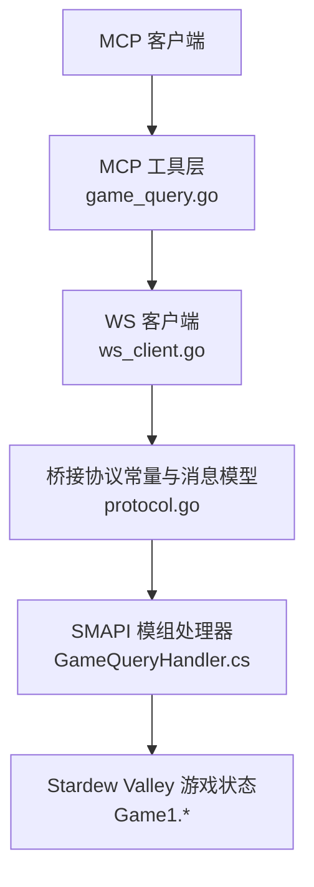
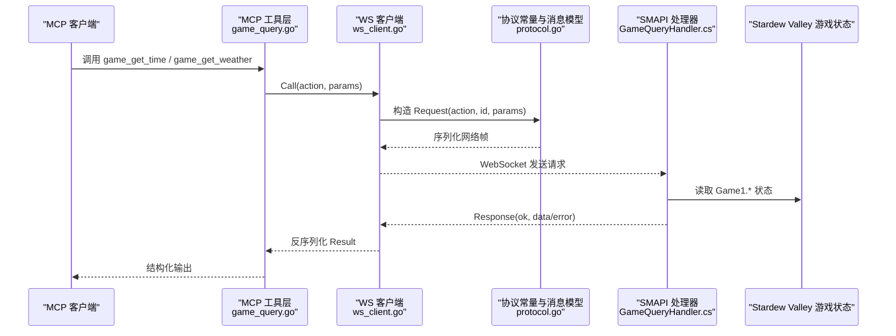
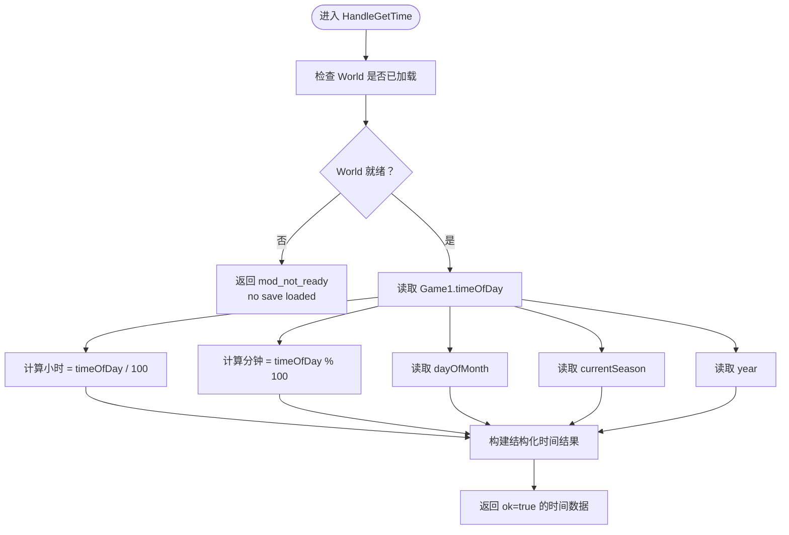
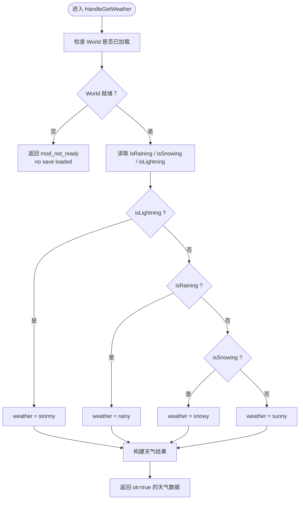
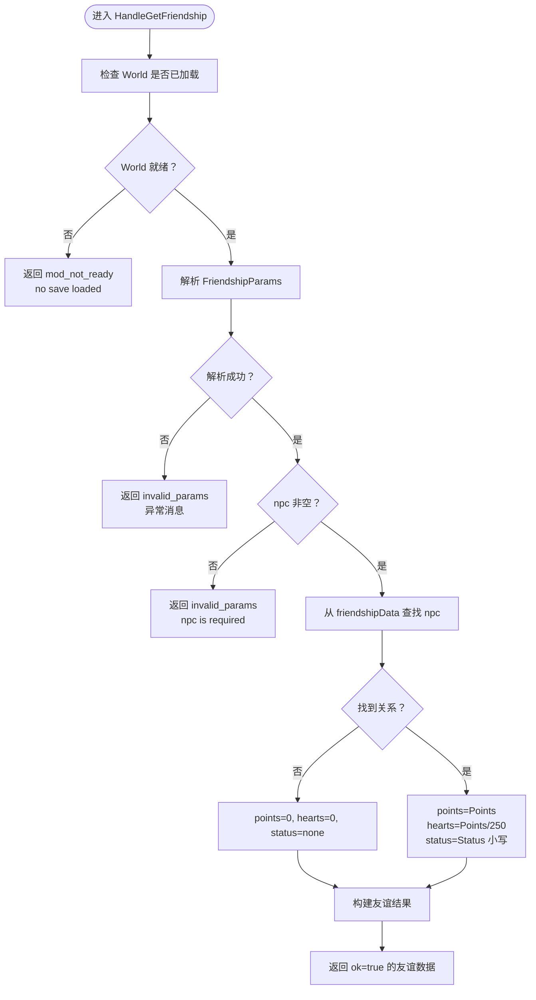
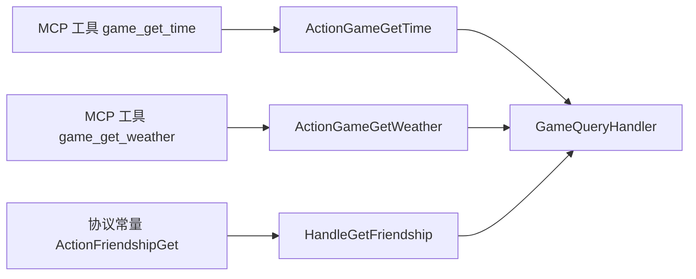

# 游戏状态查询

<cite>
**本文引用的文件**
- [GameQueryHandler.cs](file://SmartNPC/smapi-mod/Query/GameQueryHandler.cs)
- [game_query.go](file://SmartNPC/smartnpc-mcp/adapters/stardew/tools/game_query.go)
- [protocol.go](file://SmartNPC/smartnpc-mcp/adapters/stardew/bridge/protocol.go)
- [ws_client.go](file://SmartNPC/smartnpc-mcp/adapters/stardew/bridge/ws_client.go)
- [game_query_test.go](file://SmartNPC/smartnpc-mcp/adapters/stardew/tools/game_query_test.go)
</cite>

## 目录
1. [简介](#简介)
2. [项目结构](#项目结构)
3. [核心组件](#核心组件)
4. [架构总览](#架构总览)
5. [详细组件分析](#详细组件分析)
6. [依赖关系分析](#依赖关系分析)
7. [性能考虑](#性能考虑)
8. [故障排查指南](#故障排查指南)
9. [结论](#结论)
10. [附录](#附录)

## 简介
本文面向使用 MCP（Model Context Protocol）工具调用 Stardew Valley SMAPI 扩展的开发者，聚焦“游戏状态查询”能力。重点解释 C# 端 `GameQueryHandler` 中三个核心方法：

- `HandleGetTime`：从 `Game1.timeOfDay` 解析小时、分钟、星期、季节与年份。
- `HandleGetWeather`：根据 `isRaining`、`isSnowing`、`isLightning` 判断天气并返回结构化数据。
- `HandleGetFriendship`：处理 NPC 好友关系，包括点数转换、心数计算和状态枚举。

同时给出 MCP 侧 `game_get_time`、`game_get_weather` 工具的参数格式、响应结构、调用示例及错误处理策略，并提供性能优化建议与最佳实践。

## 项目结构
本次文档涉及的两端代码位于不同仓库子项目中：

- SMAPI 模组（C#）：`SmartNPC/smapi-mod/Query/GameQueryHandler.cs`
- MCP 适配器（Go）：`SmartNPC/smartnpc-mcp/adapters/stardew/tools/game_query.go`
- WS 协议常量与消息模型：`SmartNPC/smartnpc-mcp/adapters/stardew/bridge/protocol.go`
- WS 客户端连接与调用封装：`SmartNPC/smartnpc-mcp/adapters/stardew/bridge/ws_client.go`
- 工具测试用例：`SmartNPC/smartnpc-mcp/adapters/stardew/tools/game_query_test.go`



**图示来源**
- [game_query.go:1-89](file://SmartNPC/smartnpc-mcp/adapters/stardew/tools/game_query.go#L1-L89)
- [protocol.go:1-172](file://SmartNPC/smartnpc-mcp/adapters/stardew/bridge/protocol.go#L1-L172)
- [ws_client.go:1-200](file://SmartNPC/smartnpc-mcp/adapters/stardew/bridge/ws_client.go#L1-L200)
- [GameQueryHandler.cs:1-107](file://SmartNPC/smapi-mod/Query/GameQueryHandler.cs#L1-L107)

**章节来源**
- [GameQueryHandler.cs:1-107](file://SmartNPC/smapi-mod/Query/GameQueryHandler.cs#L1-L107)
- [game_query.go:1-89](file://SmartNPC/smartnpc-mcp/adapters/stardew/tools/game_query.go#L1-L89)

## 核心组件
本节概述三类能力在两端的表现形式。

| 能力 | MCP 工具名 | 输入类型 | 主要输出字段 | 后端动作常量 |
|---|---|---|---|---|
| 时间查询 | `game_get_time` | `GameGetTimeInput`（无参） | `ok`、`hour`、`minute`、`timeOfDay`、`day`、`day_of_week`、`season`、`year` | `ActionGameGetTime` |
| 天气查询 | `game_get_weather` | `GameGetWeatherInput`（无参） | `ok`、`weather`、`is_raining`、`is_snowing`、`is_lightning`、`season` | `ActionGameGetWeather` |
| 友谊查询 | 由 MCP 侧移除玩家中心工具；但后端仍保留 `friendship_get` 动作 | `FriendshipParams.npc` | `ok`、`npc`、`points`、`hearts`、`max_hearts`、`status` | `ActionFriendshipGet` |

- `GameGetTimeInput` 与 `GameGetWeatherInput` 均为空结构体，表示这两个工具不需要请求参数。
- `GameGetTimeOutput` 与 `GameGetWeatherOutput` 定义在 Go 侧，用于将服务端返回的 JSON 反序列化为强类型结果。
- `FriendshipParams` 是 C# 侧内部结构，只暴露 `npc` 字段，作为 `friendship_get` 的参数模型。

**章节来源**
- [game_query.go:1-89](file://SmartNPC/smartnpc-mcp/adapters/stardew/tools/game_query.go#L1-L89)
- [protocol.go:70-110](file://SmartNPC/smartnpc-mcp/adapters/stardew/bridge/protocol.go#L70-L110)
- [GameQueryHandler.cs:1-107](file://SmartNPC/smapi-mod/Query/GameQueryHandler.cs#L1-L107)

## 架构总览
MCP 工具调用流程如下：



**图示来源**
- [game_query.go:35-89](file://SmartNPC/smartnpc-mcp/adapters/stardew/tools/game_query.go#L35-L89)
- [protocol.go:120-172](file://SmartNPC/smartnpc-mcp/adapters/stardew/bridge/protocol.go#L120-L172)
- [ws_client.go:1-200](file://SmartNPC/smartnpc-mcp/adapters/stardew/bridge/ws_client.go#L1-L200)
- [GameQueryHandler.cs:15-107](file://SmartNPC/smapi-mod/Query/GameQueryHandler.cs#L15-L107)

## 详细组件分析

### HandleGetTime：时间查询
`HandleGetTime` 负责把 Stardew Valley 的内部时间值转换为人类可读的结构化时间信息。

#### 关键实现要点
- 世界就绪检查：如果 `Context.IsWorldReady` 为假，直接返回失败响应，错误码为 `mod_not_ready`，消息为 `no save loaded`。
- 小时与分钟：
  - 小时通过 `Game1.timeOfDay / 100` 计算。
  - 分钟通过 `Game1.timeOfDay % 100` 计算。
- 原始时间值：`timeOfDay` 以整数形式返回，例如 `1430` 表示下午两点三十。
- 日期：
  - `dayOfMonth` 映射到 `day`，范围通常为当月第 1 至第 28 天。
  - `shortDayNameFromDayOfSeason(Game1.dayOfMonth)` 返回短星期名称，如 `Mon`。
- 季节与年份：
  - `currentSeason` 返回英文季节字符串，如 `spring`、`summer`、`fall`、`winter`。
  - `year` 返回游戏内年份。

#### 数据结构
C# 端返回匿名对象，包含以下字段：

| 字段 | 类型 | 含义 |
|---|---|---|
| `ok` | `bool` | 成功标志 |
| `hour` | `int` | 小时，0–23 |
| `minute` | `int` | 分钟，通常为 0 或 30 |
| `timeOfDay` | `int` | 原始时间值，例如 1430 |
| `day` | `int` | 当月日期，1–28 |
| `day_of_week` | `string` | 短星期名，如 `Mon` |
| `season` | `string` | 当前季节，`spring`/`summer`/`fall`/`winter` |
| `year` | `int` | 游戏年份 |

#### 时间解析流程图


**图示来源**
- [GameQueryHandler.cs:18-42](file://SmartNPC/smapi-mod/Query/GameQueryHandler.cs#L18-L42)

#### MCP 工具定义
Go 侧注册 `game_get_time` 工具：

- 工具名：`game_get_time`
- 输入：`GameGetTimeInput`，为空结构体，无参。
- 行为：记录日志后调用 `br.Call(bridge.ActionGameGetTime, in)`，并将返回的原始字节反序列化为 `GameGetTimeOutput`。
- 错误传播：如果 `br.Call` 抛出异常，则包装为带上下文的消息并返回错误。

**章节来源**
- [GameQueryHandler.cs:18-42](file://SmartNPC/smapi-mod/Query/GameQueryHandler.cs#L18-L42)
- [game_query.go:13-33](file://SmartNPC/smartnpc-mcp/adapters/stardew/tools/game_query.go#L13-L33)
- [game_query.go:35-52](file://SmartNPC/smartnpc-mcp/adapters/stardew/tools/game_query.go#L35-L52)

### HandleGetWeather：天气查询
`HandleGetWeather` 基于游戏当前天气标志位生成结构化天气描述。

#### 关键实现要点
- 世界就绪检查：未加载存档时返回 `mod_not_ready`。
- 天气优先级：
  - 若 `isLightning` 为真，则天气为 `stormy`。
  - 否则若 `isRaining` 为真，则天气为 `rainy`。
  - 否则若 `isSnowing` 为真，则天气为 `snowy`。
  - 否则默认 `sunny`。
- 布尔标志：
  - `is_raining`：是否下雨。
  - `is_snowing`：是否下雪。
  - `is_lightning`：是否雷电风暴。
- 季节：沿用 `Game1.currentSeason`。

#### 数据结构
C# 端返回对象包含：

| 字段 | 类型 | 含义 |
|---|---|---|
| `ok` | `bool` | 成功标志 |
| `weather` | `string` | `sunny`、`rainy`、`snowy`、`stormy` |
| `is_raining` | `bool` | 是否下雨 |
| `is_snowing` | `bool` | 是否下雪 |
| `is_lightning` | `bool` | 是否雷电风暴 |
| `season` | `string` | 当前季节 |

#### 天气判断逻辑图


**图示来源**
- [GameQueryHandler.cs:44-69](file://SmartNPC/smapi-mod/Query/GameQueryHandler.cs#L44-L69)

#### MCP 工具定义
Go 侧注册 `game_get_weather` 工具：

- 工具名：`game_get_weather`
- 输入：`GameGetWeatherInput`，为空结构体，无参。
- 行为：调用 `bridge.ActionGameGetWeather`，并将返回 JSON 反序列化为 `GameGetWeatherOutput`。
- 错误传播：底层调用异常会被包装并返回给 MCP 客户端。

**章节来源**
- [GameQueryHandler.cs:44-69](file://SmartNPC/smapi-mod/Query/GameQueryHandler.cs#L44-L69)
- [game_query.go:35-89](file://SmartNPC/smartnpc-mcp/adapters/stardew/tools/game_query.go#L35-L89)

### HandleGetFriendship：友谊查询
`HandleGetFriendship` 提供对指定 NPC 的好友关系查询能力。虽然 MCP 侧注释说明玩家中心工具已移除，但 C# 后端仍然实现了该动作。

#### 关键实现要点
- 世界就绪检查：未加载存档时返回 `mod_not_ready`。
- 参数解析：
  - 使用 `JsonSerializer.Deserialize<FriendshipParams>` 解析传入参数。
  - 解析失败时返回 `invalid_params`，并携带异常消息。
- 参数校验：
  - 若 `p` 为 `null` 或 `npc` 为空/空白，返回 `invalid_params`，消息为 `npc is required`。
- 好友关系读取：
  - 从 `Game1.player.friendshipData` 查找 `npc` 对应的关系数据。
  - 如果找到关系：
    - `points`：直接取 `friendship.Points`。
    - `hearts`：按 `points / 250` 计算心数。
    - `status`：取 `friendship.Status.ToString().ToLower()`，即小写的枚举字符串。
  - 如果未找到关系：
    - `points` 保持 `0`。
    - `hearts` 保持 `0`。
    - `status` 保持 `none`。
- 最大心数：固定返回 `max_hearts = 10`。

#### FriendshipParams 结构
```text
{
  "npc": "NPC 标识字符串"
}
```

- `npc`：必需字段。对应 `Game1.player.friendshipData` 的键。
- 其他字段：当前实现未使用。

#### 返回值结构
| 字段 | 类型 | 含义 |
|---|---|---|
| `ok` | `bool` | 成功标志 |
| `npc` | `string` | 查询的 NPC 标识 |
| `points` | `int` | 好友点数 |
| `hearts` | `int` | 换算后的朋友心数 |
| `max_hearts` | `int` | 最大心数，固定为 10 |
| `status` | `string` | 关系状态枚举的小写字符串；未找到时为 `none` |

#### 友谊查询流程图


**图示来源**
- [GameQueryHandler.cs:71-107](file://SmartNPC/smapi-mod/Query/GameQueryHandler.cs#L71-L107)

#### MCP 侧备注
Go 侧 `game_query.go` 顶部注释明确说明：`friendship_get` 已被移除，因为自主农场实验不建模玩家关系。因此 MCP 工具注册函数中只注册了 `game_get_time` 与 `game_get_weather`，没有注册 `friendship_get` 工具。不过，协议常量 `ActionFriendshipGet` 仍然存在，后端处理器也保留了完整实现。

**章节来源**
- [GameQueryHandler.cs:71-107](file://SmartNPC/smapi-mod/Query/GameQueryHandler.cs#L71-L107)
- [game_query.go:1-12](file://SmartNPC/smartnpc-mcp/adapters/stardew/tools/game_query.go#L1-L12)
- [protocol.go:70-90](file://SmartNPC/smartnpc-mcp/adapters/stardew/bridge/protocol.go#L70-L90)

## 依赖关系分析

### 工具与服务端动作映射
| MCP 工具 | 调用动作常量 | 处理器方法 | 是否需要参数 |
|---|---|---|---|
| `game_get_time` | `ActionGameGetTime` | `HandleGetTime` | 否 |
| `game_get_weather` | `ActionGameGetWeather` | `HandleGetWeather` | 否 |
| `friendship_get` | `ActionFriendshipGet` | `HandleGetFriendship` | 是，`npc` |



**图示来源**
- [game_query.go:35-89](file://SmartNPC/smartnpc-mcp/adapters/stardew/tools/game_query.go#L35-L89)
- [protocol.go:70-110](file://SmartNPC/smartnpc-mcp/adapters/stardew/bridge/protocol.go#L70-L110)
- [GameQueryHandler.cs:15-107](file://SmartNPC/smapi-mod/Query/GameQueryHandler.cs#L15-L107)

### WS 客户端与协议模型
- `WSClient` 负责 WebSocket 连接、重连、请求 ID 关联以及事件监听。
- `Request`、`Response`、`ResponseError`、`Event` 等结构体定义了客户端与服务端之间的 JSON 帧格式。
- `ActionGameGetTime`、`ActionGameGetWeather`、`ActionFriendshipGet` 是客户端发出的动作名称常量。

**章节来源**
- [ws_client.go:1-200](file://SmartNPC/smartnpc-mcp/adapters/stardew/bridge/ws_client.go#L1-L200)
- [protocol.go:120-172](file://SmartNPC/smartnpc-mcp/adapters/stardew/bridge/protocol.go#L120-L172)

## 性能考虑
- 查询方法均为只读操作，注释明确指出不需要 `PumpOnGameTick`。这意味着它们不应阻塞主线程进行复杂计算。
- 时间查询和天气查询直接读取 `Game1` 全局状态，时间复杂度为常数级。
- 友谊查询通过字典查找 `friendshipData`，平均时间复杂度接近 O(1)，但仍应确保 `npc` 参数有效，避免无效解析。
- MCP 侧工具调用会记录日志并执行 JSON 序列化与反序列化，应避免高频重复调用同一结果；可在上层缓存短时间内的时间或天气快照。
- WS 客户端默认调用超时非常大，适合长时间运行的游戏场景，但调用方仍需关注上游业务超时策略，防止堆积。

[本节为通用性能建议，不直接分析具体代码行]

## 故障排查指南

### 常见错误码
| 错误码 | 触发条件 | 含义 | 处理建议 |
|---|---|---|---|
| `mod_not_ready` | `Context.IsWorldReady` 为假 | 尚未加载存档或模组不可用 | 等待存档加载完成后再调用；重试前应确认游戏世界已就绪 |
| `invalid_params` | 参数解析失败或 `npc` 为空 | 请求参数不符合预期 | 检查 JSON 结构，确保 `npc` 字段存在且非空 |

### HandleGetTime 错误路径
- 未加载存档：返回 `mod_not_ready`，消息为 `no save loaded`。
- 正常路径：返回结构化时间数据。

### HandleGetWeather 错误路径
- 未加载存档：返回 `mod_not_ready`，消息为 `no save loaded`。
- 正常路径：根据天气标志返回结构化天气数据。

### HandleGetFriendship 错误路径
- 未加载存档：返回 `mod_not_ready`。
- 参数解析异常：返回 `invalid_params`，消息为 JSON 解析异常信息。
- `npc` 缺失或为空：返回 `invalid_params`，消息为 `npc is required`。
- 未找到关系：返回 `ok=true`，但 `points=0`、`hearts=0`、`status=none`。

### MCP 侧错误传播
- `game_get_time` 与 `game_get_weather` 在 Go 侧调用 `br.Call` 时捕获异常，并包装成带上下文的错误返回。
- 测试用例验证了当后端返回错误时，MCP 工具调用结果会标记为错误状态。

**章节来源**
- [GameQueryHandler.cs:18-107](file://SmartNPC/smapi-mod/Query/GameQueryHandler.cs#L18-L107)
- [game_query.go:35-89](file://SmartNPC/smartnpc-mcp/adapters/stardew/tools/game_query.go#L35-L89)
- [game_query_test.go:85-118](file://SmartNPC/smartnpc-mcp/adapters/stardew/tools/game_query_test.go#L85-L118)
- [game_query_test.go:158-199](file://SmartNPC/smartnpc-mcp/adapters/stardew/tools/game_query_test.go#L158-L199)

## 结论
`GameQueryHandler` 提供了 Stardew Valley 游戏状态的三类只读查询能力：

- 时间查询将内部时间值拆解为小时、分钟、日期、星期、季节和年份，适合日程规划、日记记录和定时决策。
- 天气查询基于雨、雪、雷电标志生成可读天气类别，并可结合布尔标志做细粒度判断。
- 友谊查询通过 NPC 标识读取好友点数、心数和状态，适用于社交关系管理。

MCP 侧目前暴露 `game_get_time` 与 `game_get_weather` 两个工具，参数简单、响应结构化；`friendship_get` 在后端仍可被调用，但 MCP 工具注册已移除。调用方应优先校验存档是否就绪，并在需要时缓存短期状态以减少频繁查询。

[本节为总结性内容，不直接分析具体代码行]

## 附录

### MCP 工具调用示例

#### 查询游戏时间
- 工具名：`game_get_time`
- 参数：无
- 期望响应关键字段：`ok`、`hour`、`minute`、`timeOfDay`、`day`、`day_of_week`、`season`、`year`

示例调用语义：
```text
调用 MCP 工具 game_get_time
无参数
返回结构化时间信息
```

#### 查询天气
- 工具名：`game_get_weather`
- 参数：无
- 期望响应关键字段：`ok`、`weather`、`is_raining`、`is_snowing`、`is_lightning`、`season`

示例调用语义：
```text
调用 MCP 工具 game_get_weather
无参数
返回结构化天气信息
```

#### 查询 NPC 友谊
- 后端动作：`friendship_get`
- 参数结构：
```json
{
  "npc": "Abigail"
}
```
- 期望响应关键字段：`ok`、`npc`、`points`、`hearts`、`max_hearts`、`status`

示例调用语义：
```text
调用 friendship_get
参数: { "npc": "Abigail" }
返回 Abigail 的好友点数、心数和关系状态
```

**章节来源**
- [game_query.go:13-89](file://SmartNPC/smartnpc-mcp/adapters/stardew/tools/game_query.go#L13-L89)
- [protocol.go:70-110](file://SmartNPC/smartnpc-mcp/adapters/stardew/bridge/protocol.go#L70-L110)
- [GameQueryHandler.cs:71-107](file://SmartNPC/smapi-mod/Query/GameQueryHandler.cs#L71-L107)