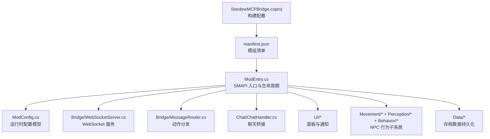
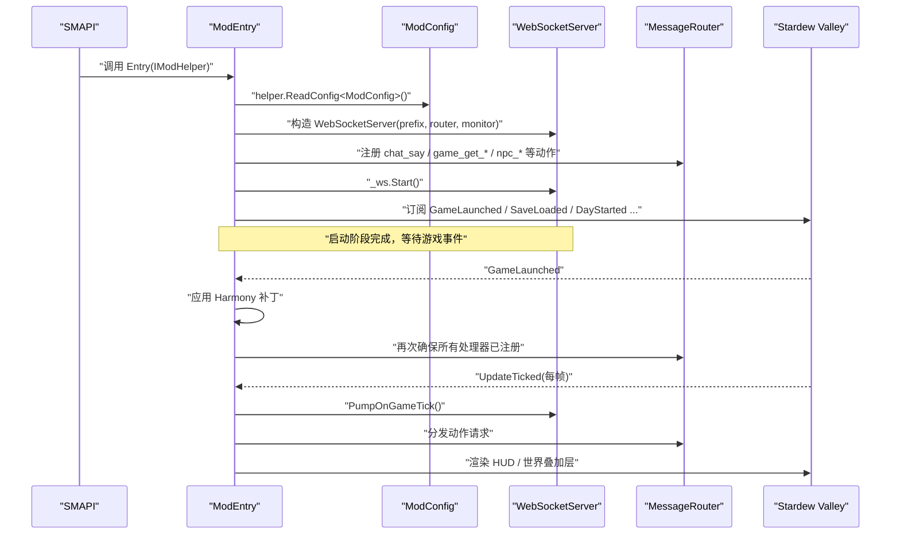
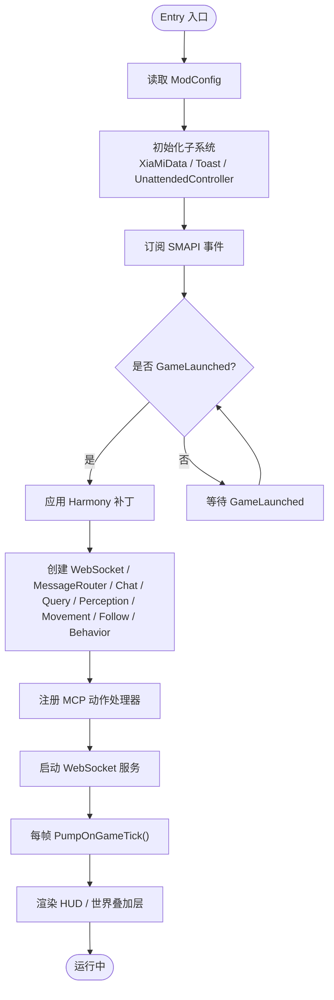
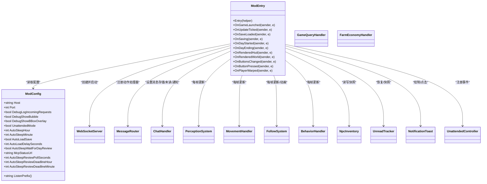

# 模组入口与初始化

<cite>
**本文引用的文件**   
- [ModEntry.cs](file://SmartNPC/smapi-mod/ModEntry.cs)
- [ModConfig.cs](file://SmartNPC/smapi-mod/ModConfig.cs)
- [manifest.json](file://SmartNPC/smapi-mod/manifest.json)
- [StardewMCPBridge.csproj](file://SmartNPC/smapi-mod/StardewMCPBridge.csproj)
</cite>

## 目录
1. [引言](#引言)
2. [项目结构](#项目结构)
3. [核心组件](#核心组件)
4. [架构总览](#架构总览)
5. [详细组件分析](#详细组件分析)
6. [依赖关系分析](#依赖关系分析)
7. [性能考虑](#性能考虑)
8. [故障排查指南](#故障排查指南)
9. [结论](#结论)
10. [附录：扩展实践](#附录扩展实践)

## 引言
本文面向 SMAPI 模组开发者，聚焦 SmartNPC 的 SMAPI 模组入口与初始化流程。目标包括：
- 解释 ModEntry.cs 的生命周期管理，尤其是游戏启动、模组加载、内容打包等阶段的作用边界。
- 解析 ModConfig.cs 配置系统的加载、默认值、热重载行为。
- 说明 manifest.json 字段含义及版本兼容性声明。
- 展示事件处理器注册、子系统初始化、错误处理策略。
- 提供扩展入口、新增配置项、处理依赖关系的实操建议。
- 给出常见问题排查和性能优化建议。

本模组以“组合优先”的方式组织代码：ModEntry.cs 只负责装配与生命周期钩子，具体逻辑下沉到 WebSocket 服务器、消息路由、聊天系统、UI、感知、移动、行为等子系统。

## 项目结构
SMAPI 模组位于 `SmartNPC/smapi-mod`，关键入口和配置如下：

**图表来源**
- [StardewMCPBridge.csproj:1-56](file://SmartNPC/smapi-mod/StardewMCPBridge.csproj#L1-L56)
- [manifest.json:1-10](file://SmartNPC/smapi-mod/manifest.json#L1-L10)
- [ModEntry.cs:1-120](file://SmartNPC/smapi-mod/ModEntry.cs#L1-L120)

**章节来源**
- [StardewMCPBridge.csproj:1-56](file://SmartNPC/smapi-mod/StardewMCPBridge.csproj#L1-L56)
- [manifest.json:1-10](file://SmartNPC/smapi-mod/manifest.json#L1-L10)

## 核心组件
- **ModEntry**：SMAPI 模组入口，继承 `Mod`，实现 `Entry` 生命周期方法，并订阅大量 SMAPI 事件。它不直接承载业务逻辑，而是组装 WebSocket 服务器、消息路由器、聊天处理器、查询处理器、感知系统、移动系统、跟随系统、行为处理器、库存跟踪器、通知面板等子系统。
- **ModConfig**：通过 SMAPI 的配置框架自动序列化/反序列化到 `<Mods>/StardewMCPBridge/config.json`，包含网络监听地址与端口、调试开关、无人值守农场模式等选项。
- **manifest.json**：定义模组元信息、唯一标识、入口程序集、最低 API 版本等。
- **StardewMCPBridge.csproj**：.NET 6 项目配置，启用 ModBuildConfig、Harmony，设置输出名称、根命名空间，并将 manifest.json 和资源复制到输出目录。

**章节来源**
- [ModEntry.cs:1-120](file://SmartNPC/smapi-mod/ModEntry.cs#L1-L120)
- [ModConfig.cs:1-144](file://SmartNPC/smapi-mod/ModConfig.cs#L1-L144)
- [manifest.json:1-10](file://SmartNPC/smapi-mod/manifest.json#L1-L10)
- [StardewMCPBridge.csproj:1-56](file://SmartNPC/smapi-mod/StardewMCPBridge.csproj#L1-L56)

## 架构总览
SMAPI 加载流程从 `ModEntry.Entry` 开始，随后在合适的时机执行 Harmony 补丁、创建并启动 WebSocket 服务、注册 MCP 工具调用映射、挂载 UI 和调试命令、订阅游戏事件。每帧通过 `GameLoop.UpdateTicked` 驱动各子系统更新。

**图表来源**
- [ModEntry.cs:1-120](file://SmartNPC/smapi-mod/ModEntry.cs#L1-L120)
- [ModEntry.cs:201-260](file://SmartNPC/smapi-mod/ModEntry.cs#L201-L260)

## 详细组件分析

### ModEntry 生命周期与事件调度
`ModEntry` 是 SMAPI 模组的入口类，其职责集中在：
- 读取配置与资源。
- 初始化 NPC 数据、聊天、库存、通知、无人值守控制器等。
- 订阅 SMAPI 事件，覆盖游戏启动、保存加载、每日开始/结束、时间变化、输入、渲染、玩家传送等。
- 在 `GameLaunched` 中集中应用 Harmony 补丁并创建全部子系统。
- 在 `UpdateTicked` 中驱动 WebSocket、聊天、感知、移动、行为、跟随系统以及调试可视化。
- 在 `SaveLoaded` 中注册受 Agent 管理的 NPC、恢复存档中的聊天记录与未读计数。
- 在 `Saving` 中持久化聊天历史、未读计数、NPC 库存快照。
- 在 `DayStarted` 中广播新日事件、重置动画、抑制游戏原生日程、将 NPC 传送到农场门口。
- 在 `RenderedHud` / `RenderedWorld` 中绘制通知和调试框。
- 在输入事件中处理面板切换、调试面板打开、点击穿透等交互。

**图表来源**
- [ModEntry.cs:1-120](file://SmartNPC/smapi-mod/ModEntry.cs#L1-L120)
- [ModEntry.cs:201-260](file://SmartNPC/smapi-mod/ModEntry.cs#L201-L260)

#### OnGameLaunched 的职责与时机
- 执行时机：在游戏完全启动后触发，适合做需要完整游戏环境才能完成的初始化。
- 主要职责：
  - 使用 `Harmony` 应用集中式补丁。
  - 创建消息路由器、聊天处理器、查询处理器、农场经济处理器、感知系统、移动系统、跟随系统、行为处理器。
  - 注册所有 MCP 动作处理器，包括聊天、游戏状态查询、NPC 感知、移动、表情、行为、库存读写等。
  - 初始化调试边界框叠加层，并根据配置动态控制开关。
  - 配置 NPC 串行任务队列，按 FollowSystem 的状态逐帧释放任务。
  - 启动 WebSocket 服务，将 NPC 广播通道接入 WS 广播。
  - 可选开启请求调试镜像，把 MCP 请求显示到聊天面板。
  - 注入聊天消息存储、未读计数、消息通知回调。
  - 注册调试控制台命令、NPC 库存 HUD。
  - 捕获异常并记录错误日志，避免启动失败导致整个模组不可用。

注意：仓库中未出现名为 `OnModsLoaded` 或 `OnContentPacked` 的方法。该模组采用 SMAPI 事件模型，实际初始化工作放在 `Entry` 与 `OnGameLaunched` 中；内容相关的数据（如 `agent_npcs.json`）则在 `OnSaveLoaded` 时读取并生效。

**章节来源**
- [ModEntry.cs:1-120](file://SmartNPC/smapi-mod/ModEntry.cs#L1-L120)
- [ModEntry.cs:201-260](file://SmartNPC/smapi-mod/ModEntry.cs#L201-L260)

#### 其他关键事件
- `OnUpdateTicked`：每帧驱动 WebSocket、聊天、感知、移动、行为、跟随系统，更新通知，刷新调试框，排空 NPC 串行任务队列，播放动画。
- `OnSaveLoaded`：重新注册 Agent 管理的 NPC，恢复聊天未读计数与库存快照，抑制已知 NPC 的原生日程。
- `OnSaving`：将聊天历史、未读计数、NPC 库存写入存档。
- `OnDayEnding`：向 WS 广播 `day_ending`。
- `OnDayStarted`：广播 `day_started`，重置动画，抑制日程，传送 NPC 到农场门。
- `OnRenderedHud` / `OnRenderedWorld`：分别绘制通知、库存 HUD 与调试框。
- `OnButtonsChanged` / `OnButtonPressed`：处理 Tab、F2、F3 快捷键与点击穿透。
- `OnPlayerWarped`：本地玩家地图切换时更新跟随系统。

**章节来源**
- [ModEntry.cs:201-260](file://SmartNPC/smapi-mod/ModEntry.cs#L201-L260)
- [ModEntry.cs:261-560](file://SmartNPC/smapi-mod/ModEntry.cs#L261-L560)

### ModConfig 配置系统
`ModConfig` 是 SMAPI 配置文件对应的类型，字段即为 `config.json` 的键名。SMAPI 通过 `helper.ReadConfig<ModConfig>()` 自动加载并生成默认配置。

关键特性：
- 首次运行自动生成 `<Mods>/StardewMCPBridge/config.json`，字段保持向后兼容。
- 网络配置：
  - `Host`：监听地址，默认 `127.0.0.1`，LAN 暴露需改为 `0.0.0.0`，但协议当前无鉴权。
  - `Port`：监听端口，默认 `18745`，需与外部客户端一致。
  - `ListenPrefix()`：拼接 HTTP 前缀，供 `HttpListener` 使用。
- 调试开关：
  - `DebugLogIncomingRequests`：镜像 MCP 请求到聊天面板。
  - `DebugShowBubble`：为 NPC 行为动作显示头顶气泡。
  - `DebugShowBBoxOverlay`：在世界渲染调试矩形框。
- 无人值守实验模式：
  - `UnattendedMode`：主开关，影响窗口失焦暂停、自动睡觉、自动加载存档等行为。
  - `AutoSleepHour` / `AutoSleepMinute`：自动结束当天的游戏内时间。
  - `AutoLoadSave` / `AutoLoadDelaySeconds`：标题界面自动加载最新存档。
  - `AutoSleepWaitForDayReview`：等待 MCP 状态端点报告日回顾完成。
  - `McpStatusUrl` / `AutoSleepReviewPollSeconds`：轮询 MCP `/status` 端点。
  - `AutoSleepReviewDeadlineHour` / `AutoSleepReviewDeadlineMinute`：硬截止线，防止凌晨强制外出惩罚。

配置热重载行为：
- 部分功能通过委托读取配置，例如调试开关、监听前缀、请求调试镜像等。这样修改 `config.json` 并通过 SMAPI 热重载后无需重启游戏即可生效。

**章节来源**
- [ModConfig.cs:1-144](file://SmartNPC/smapi-mod/ModConfig.cs#L1-L144)

### manifest.json 字段与版本兼容性
`manifest.json` 定义 SMAPI 识别模组所需的最小元信息：
- `Name`：模组显示名称。
- `Author`：作者。
- `Version`：模组版本。
- `Description`：描述。
- `UniqueID`：唯一标识，用于 Harmony 补丁隔离和日志追踪。
- `EntryDll`：入口程序集文件名。
- `MinimumApiVersion`：要求的最低 SMAPI API 版本。
- `UpdateKeys`：更新密钥列表，当前为空数组。

该模组要求 SMAPI 至少为 `4.0.0`，因此应确保游戏安装的 SMAPI 版本不低于此值。

**章节来源**
- [manifest.json:1-10](file://SmartNPC/smapi-mod/manifest.json#L1-L10)

### StardewMCPBridge.csproj 构建与依赖
项目使用 .NET 6，根命名空间为 `SmartNPC.Bridge`，程序集名称为 `StardewMCPBridge.dll`，与 manifest 的 `EntryDll` 对应。

重要构建行为：
- 使用 `Pathoschild.Stardew.ModBuildConfig` 自动发现 SDV 安装路径，引用 SMAPI、SDV、XNA 程序集，并可自动部署模组到游戏 Mods 目录。
- 启用 Harmony，以便模组可打补丁。
- `EnableModDeploy=true`：构建后自动部署模组。
- `EnableModZip=false`：不生成 zip 包。
- `manifest.json` 与 `assets` 资源会被复制到输出目录。
- 支持通过环境变量 `SMARTNPC_GAME_PATH` 指定游戏路径。

**章节来源**
- [StardewMCPBridge.csproj:1-56](file://SmartNPC/smapi-mod/StardewMCPBridge.csproj#L1-L56)

## 依赖关系分析
ModEntry 与其他子系统之间的依赖关系如下：

**图表来源**
- [ModEntry.cs:1-120](file://SmartNPC/smapi-mod/ModEntry.cs#L1-L120)
- [ModEntry.cs:201-260](file://SmartNPC/smapi-mod/ModEntry.cs#L201-L260)
- [ModConfig.cs:1-144](file://SmartNPC/smapi-mod/ModConfig.cs#L1-L144)

**章节来源**
- [ModEntry.cs:1-120](file://SmartNPC/smapi-mod/ModEntry.cs#L1-L120)
- [ModEntry.cs:201-260](file://SmartNPC/smapi-mod/ModEntry.cs#L201-L260)
- [ModConfig.cs:1-144](file://SmartNPC/smapi-mod/ModConfig.cs#L1-L144)

## 性能考虑
- 每帧泵送：`OnUpdateTicked` 会同时驱动 WebSocket、聊天、感知、移动、行为、跟随系统和调试叠加层。应避免在子系统 `PumpOnGameTick` 中进行耗时阻塞操作。
- 调试开销：开启 `DebugLogIncomingRequests`、`DebugShowBubble`、`DebugShowBBoxOverlay` 会增加日志、UI 和渲染压力，建议在开发阶段启用，生产环境按需关闭。
- 存档写入：`OnSaving` 会把聊天历史、未读计数、NPC 库存快照写入存档。若 NPC 数量或物品量较大，应考虑限制快照大小或降低写入频率。
- WebSocket 广播：频繁广播可能增加 CPU 和网络负载，应合并或节流高频事件。
- 配置热重载：通过委托读取配置可减少重启成本，但仍应避免在热路径中频繁解析 JSON。

[本节为通用性能指导，不直接分析具体代码行]

## 故障排查指南
- 模组无法启动：
  - 检查 `MinimumApiVersion` 是否满足当前 SMAPI 版本。
  - 查看模组日志，确认 `Entry` 与 `OnGameLaunched` 是否抛出异常。
  - 确认 `EntryDll` 与 `.csproj` 中 `AssemblyName` 一致。
- WebSocket 连接失败：
  - 检查 `Host` 与 `Port` 是否与客户端配置一致。
  - 如果暴露在局域网，确认防火墙允许相应端口，并注意协议无鉴权的安全风险。
- NPC 行为不生效：
  - 确认 `agent_npcs.json` 存在且格式正确。
  - 检查 `OnSaveLoaded` 是否正确注册了 NPC。
  - 确认 `SuppressScheduleForAllNpcs` 是否清除了原生日程。
- 存档数据丢失：
  - 检查 `OnSaving` 是否成功写入聊天历史、未读计数、库存快照。
  - 检查 `OnSaveLoaded` 是否正确恢复数据。
- 调试面板或通知无响应：
  - 检查按键事件是否被其他菜单拦截。
  - 检查 `NotificationToast` 与 `NpcInventoryHud` 的绘制与点击逻辑。

**章节来源**
- [ModEntry.cs:1-120](file://SmartNPC/smapi-mod/ModEntry.cs#L1-L120)
- [ModEntry.cs:201-260](file://SmartNPC/smapi-mod/ModEntry.cs#L201-L260)
- [ModEntry.cs:261-560](file://SmartNPC/smapi-mod/ModEntry.cs#L261-L560)

## 结论
SmartNPC 的 SMAPI 模组入口采用清晰的组合架构：`ModEntry` 负责生命周期与装配，具体能力由 WebSocket、消息路由、聊天、UI、感知、移动、行为等子系统实现。配置系统通过 `ModConfig` 暴露丰富选项，支持热重载调试与无人值守实验模式。`manifest.json` 与 `.csproj` 共同决定模组元信息与构建行为。理解这些入口与事件时序，有助于安全地扩展模组初始化流程、添加配置项、处理依赖关系，并稳定地集成外部 MCP 服务。

[本节为总结性内容，不直接分析具体代码行]

## 附录：扩展实践

### 如何扩展模组初始化流程
推荐做法：
- 在 `Entry` 中只做轻量初始化：读取配置、创建基础对象、注册事件。
- 在 `OnGameLaunched` 中完成重型初始化：应用 Harmony 补丁、创建子系统、注册动作处理器、启动 WebSocket。
- 如需延迟初始化某子系统，可在第一次使用时再创建，或在特定游戏状态事件中初始化。
- 所有可能抛出的异常都应 try-catch 并记录日志，避免破坏其他模组。

参考路径：
- [ModEntry.cs:1-120](file://SmartNPC/smapi-mod/ModEntry.cs#L1-L120)
- [ModEntry.cs:201-260](file://SmartNPC/smapi-mod/ModEntry.cs#L201-L260)

### 如何添加新的配置选项
步骤：
1. 在 `ModConfig` 中添加属性，并为属性提供合理默认值。
2. 在需要的地方通过 `this._config.Xxx` 读取。
3. 对于热重载敏感的值，建议使用委托或每次调用时读取，而不是缓存旧值。
4. 在文档或注释中说明字段的用途、取值范围和安全注意事项。

参考路径：
- [ModConfig.cs:1-144](file://SmartNPC/smapi-mod/ModConfig.cs#L1-L144)

### 如何处理模组依赖关系
- 使用 `manifest.json` 的 `MinimumApiVersion` 声明对 SMAPI 的版本要求。
- 如果需要依赖其他模组，应在 `Entry` 或 `OnGameLaunched` 中检测依赖模组是否存在，并在缺失时记录警告或禁用相关功能。
- 对外部服务（如 WebSocket 客户端、HTTP 端点）进行健康检查与重试，失败时降级而非崩溃。

参考路径：
- [manifest.json:1-10](file://SmartNPC/smapi-mod/manifest.json#L1-L10)
- [ModEntry.cs:1-120](file://SmartNPC/smapi-mod/ModEntry.cs#L1-L120)

### 示例：注册新动作处理器
虽然不应在此复制代码，但可以按以下思路扩展：
- 新建一个处理器类，实现与现有处理器一致的接口。
- 在 `OnGameLaunched` 中将新处理器注册到 `MessageRouter`。
- 如果处理器依赖 UI 或 NPC 状态，确保在 `OnUpdateTicked` 中正确泵送。
- 为处理器参数增加校验，失败时返回结构化错误。

参考路径：
- [ModEntry.cs:201-260](file://SmartNPC/smapi-mod/ModEntry.cs#L201-L260)