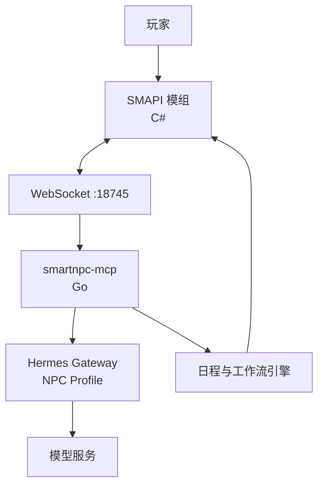
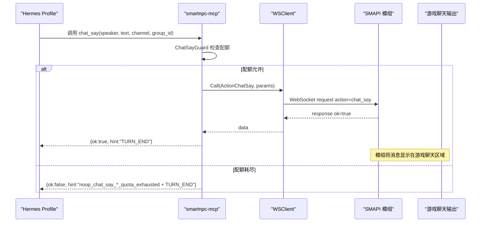
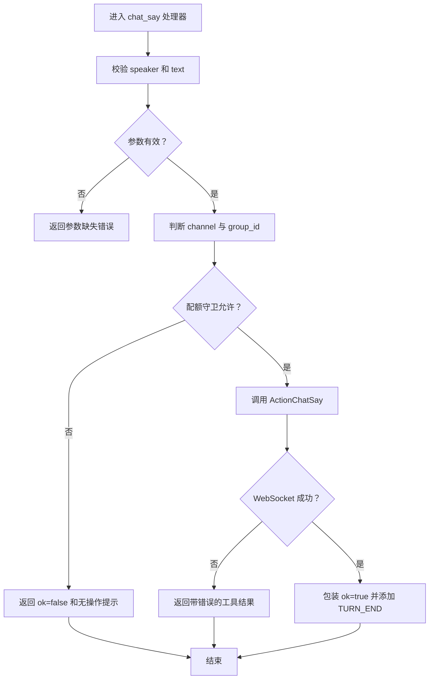
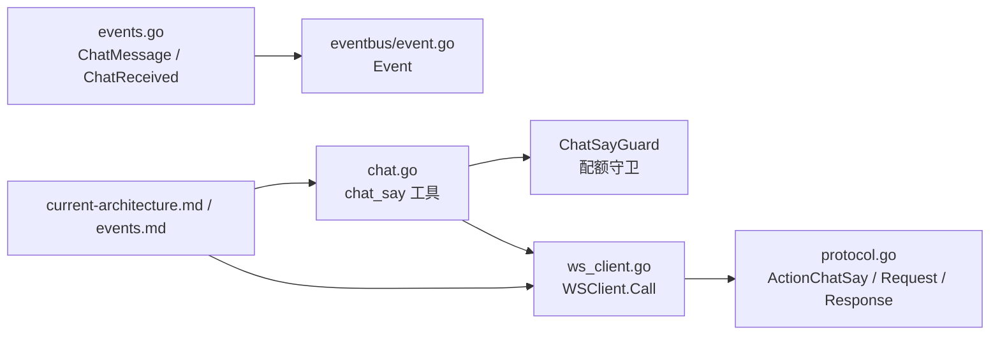
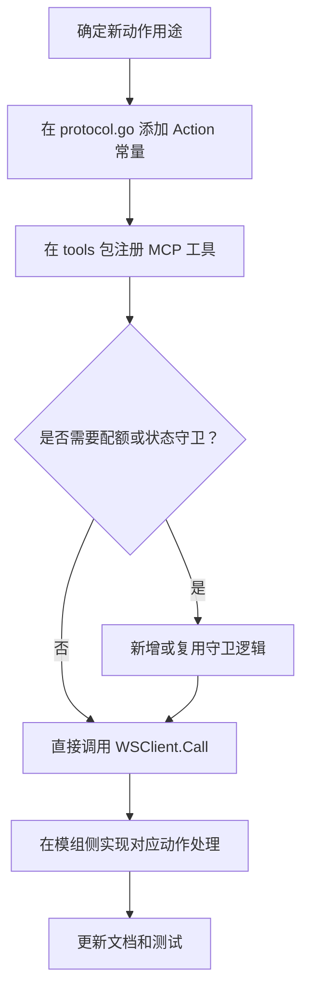

# NPC 聊天栏 NpcChatBar

<cite>
**本文引用的文件**
- [chat.go](file://SmartNPC/smartnpc-mcp/adapters/stardew/tools/chat.go)
- [events.go](file://SmartNPC/smartnpc-mcp/adapters/stardew/events/events.go)
- [event.go](file://SmartNPC/smartnpc-mcp/pkg/eventbus/event.go)
- [ws_client.go](file://SmartNPC/smartnpc-mcp/adapters/stardew/bridge/ws_client.go)
- [protocol.go](file://SmartNPC/smartnpc-mcp/adapters/stardew/bridge/protocol.go)
- [current-architecture.md](file://SmartNPC/docs/current-architecture.md)
- [events.md](file://SmartNPC/docs/events.md)
</cite>

## 目录
1. [引言](#引言)
2. [项目结构](#项目结构)
3. [核心组件](#核心组件)
4. [架构总览](#架构总览)
5. [详细组件分析](#详细组件分析)
6. [依赖关系分析](#依赖关系分析)
7. [性能与稳定性](#性能与稳定性)
8. [扩展指南](#扩展指南)
9. [故障排查](#故障排查)
10. [结论](#结论)

## 引言
本文件围绕 SmartNPC 项目中“NPC 聊天栏”相关能力进行系统性说明。需要特别指出：当前实验分支（2026-10-26）已移除 SMAPI 模组侧的玩家聊天输入面板、群聊界面以及 `chat_message` / `chat_received` / `npc_interact` 等事件入口，因此仓库中不存在一个可直接作为“底部固定聊天栏 UI”的 C# 实现类 `NpcChatBar`。

不过，与“NPC 聊天栏”最接近、仍完整存在的代码是 Go 层的 `chat_say` 工具、WebSocket 桥接协议、事件模型以及文档中对历史聊天界面的描述。它们共同构成一条从智能体到游戏内可见对话的输出通道：智能体通过 MCP 调用 `chat_say`，Go 服务经 WebSocket 转发给 SMAPI 模组，最终由模组把文本显示在玩家可见的聊天区域。

本文以这些真实源码为依据，同时明确区分“已实现功能”和“历史或预留能力”，避免把旧设计当作当前行为。

## 项目结构
SmartNPC 仓库中与 NPC 聊天能力相关的代码分布在三个层次：

| 层次 | 位置 | 职责 |
|---|---|---|
| SMAPI 模组（C#） | `smapi-mod/` | 负责游戏内 UI、角色行为、动作执行、动画播放、世界状态变更；历史上包含聊天面板、群聊管理器和玩家输入捕获 |
| MCP 适配层（Go） | `smartnpc-mcp/` | 提供 MCP 工具、WebSocket 客户端、事件路由、日程与工作流引擎 |
| Hermes 与配置 | `hermes/`、`docs/` | 每个 NPC 的人设、技能、提示词、事件白名单和运行时说明 |

**图表来源**
- [current-architecture.md:1-30](file://SmartNPC/docs/current-architecture.md#L1-L30)

**章节来源**
- [current-architecture.md:1-30](file://SmartNPC/docs/current-architecture.md#L1-L30)
- [events.md:1-20](file://SmartNPC/docs/events.md#L1-L20)

## 核心组件
本节聚焦实际存在于当前源码中的聊天相关组件。

### `chat_say` 工具
`chat_say` 是当前唯一能产生“可见 NPC 对话”的 MCP 工具。它接收说话者、文本、可选颜色、可选频道和群组 ID，并经过配额守卫后发送到模组。

关键特性：
- 必须传入英文内部 NPC 名，例如 `XiaMi`、`Abigail`。
- 文本应为纯 UTF-8，长度建议较短，因为游戏聊天框会截断长行。
- 支持私聊频道与群聊频道：
  - 私聊：`channel` 为空或 `private`。
  - 群聊：`channel="group"`，且必须带 `group_id`。
- 每次唤醒最多只能成功一次 `chat_say`；第二次会返回结构化无操作结果，而不是工具错误。

**章节来源**
- [chat.go:16-36](file://SmartNPC/smartnpc-mcp/adapters/stardew/tools/chat.go#L16-L36)
- [chat.go:160-200](file://SmartNPC/smartnpc-mcp/adapters/stardew/tools/chat.go#L160-L200)

### 对话配额守卫 `ChatSayGuard`
该守卫防止同一个 NPC 在同一轮唤醒中重复发言，也防止群聊中同一说话者在玩家再次输入前连续刷屏。

| 类型 | 限制范围 | 刷新时机 |
|---|---|---|
| 私聊 | 每个 NPC 每收到一次定向事件最多一次 `chat_say` | 下一次定向到达该 NPC 的事件时重置 |
| 群聊 | 每个 `(group_id, speaker)` 每轮玩家输入最多一次 `chat_say` | 仅在玩家向该群发送消息时重置，不在 NPC 互发消息时重置 |

并发安全使用单锁保护两个映射表；正常情况下竞争很小，每个唤醒只调用一次允许和重置逻辑。

**章节来源**
- [chat.go:39-110](file://SmartNPC/smartnpc-mcp/adapters/stardew/tools/chat.go#L39-L110)
- [chat.go:112-158](file://SmartNPC/smartnpc-mcp/adapters/stardew/tools/chat.go#L112-L158)

### WebSocket 桥接客户端 `WSClient`
`WSClient` 连接本地 `ws://127.0.0.1:18745/ws`，承担三类工作：
- 发送请求并等待响应。
- 订阅服务端推送事件。
- 维护连接、心跳、重连和待处理请求映射。

对于 `chat_say`，Go 层通过 `br.Call(action=ActionChatSay, params=ChatSayInput)` 把台词发送给模组。

**章节来源**
- [ws_client.go:1-40](file://SmartNPC/smartnpc-mcp/adapters/stardew/bridge/ws_client.go#L1-L40)
- [ws_client.go:201-280](file://SmartNPC/smartnpc-mcp/adapters/stardew/bridge/ws_client.go#L201-L280)
- [ws_client.go:281-360](file://SmartNPC/smartnpc-mcp/adapters/stardew/bridge/ws_client.go#L281-L360)

### 协议常量与帧格式
协议定义区分三种帧：
- `request`：客户端请求。
- `response`：服务端响应。
- `event`：服务端推送事件。

`ActionChatSay = "chat_say"` 是 Go 层调用模组写聊天动作的规范名称；`EventChatMessage`、`EventChatReceived`、`EventNpcInteract`、`EventGroupCreate` 是历史上定义的模组成事件名。

**章节来源**
- [protocol.go:1-70](file://SmartNPC/smartnpc-mcp/adapters/stardew/bridge/protocol.go#L1-L70)
- [protocol.go:71-120](file://SmartNPC/smartnpc-mcp/adapters/stardew/bridge/protocol.go#L71-L120)
- [protocol.go:121-172](file://SmartNPC/smartnpc-mcp/adapters/stardew/bridge/protocol.go#L121-L172)

### 事件模型
事件模型分为两类：
- 来自 SMAPI 模组的原始事件。
- smartnpc-mcp 自己生成的合成事件。

聊天相关的关键类型包括：
- `ChatMessage`：玩家向指定 NPC 发送的消息。
- `ChatReceived`：通用聊天通道，支持普通聊天和群聊。
- `NpcInteract`：点击 NPC 的交互事件。
- `EventDescriptor`：统一通知信封。

当前实验分支不再发出玩家聊天和点击事件，但数据结构仍保留为向后兼容契约。

**章节来源**
- [events.go:1-40](file://SmartNPC/smartnpc-mcp/adapters/stardew/events/events.go#L1-L40)
- [events.go:41-80](file://SmartNPC/smartnpc-mcp/adapters/stardew/events/events.go#L41-L80)
- [events.go:201-290](file://SmartNPC/smartnpc-mcp/adapters/stardew/events/events.go#L201-L290)
- [events.md:1-40](file://SmartNPC/docs/events.md#L1-L40)

### 领域事件总线
`eventbus.Event` 是 agent-bridge 的核心领域事件类型，字段包括 `kind`、`source`、`subject`、`payload`、`timestamp`。适配器将具体业务数据放入 `Payload`，核心不解析业务字段。

这使 ChatMessage、NpcInteract 等业务类型可以在不同适配器之间保持解耦。

**章节来源**
- [event.go:1-76](file://SmartNPC/smartnpc-mcp/pkg/eventbus/event.go#L1-L76)

## 架构总览
下图展示“智能体决定回复 → 写入游戏聊天”的主路径。注意：图中“玩家输入”在当前实验分支并不存在；实际触发源通常是每日计划、日程触发、工作流技能调用或农场主指令。

**图表来源**
- [chat.go:160-255](file://SmartNPC/smartnpc-mcp/adapters/stardew/tools/chat.go#L160-L255)
- [ws_client.go:201-360](file://SmartNPC/smartnpc-mcp/adapters/stardew/bridge/ws_client.go#L201-L360)
- [protocol.go:71-120](file://SmartNPC/smartnpc-mcp/adapters/stardew/bridge/protocol.go#L71-L120)

## 详细组件分析

### 聊天工具 `chat_say` 的实现流程
`chat_say` 的工具处理器完成以下阶段：
1. 校验必填字段 `speaker` 与 `text`。
2. 判断是否为群聊频道。
3. 如果启用守卫，则按私聊或群聊规则检查是否允许发言。
4. 记录工具调用日志。
5. 通过 WebSocket 调用模组动作。
6. 包装返回结果，始终附加 `TURN_END` 提示，让智能体停止继续调用工具。

**图表来源**
- [chat.go:201-255](file://SmartNPC/smartnpc-mcp/adapters/stardew/tools/chat.go#L201-L255)

**章节来源**
- [chat.go:160-255](file://SmartNPC/smartnpc-mcp/adapters/stardew/tools/chat.go#L160-L255)

### WebSocket 客户端连接与调用
`WSClient` 负责：
- 建立 WebSocket 连接。
- 设置读取上限和心跳。
- 分发响应与事件。
- 失败时取消待处理请求并重连。
- 通过 `Call` 或 `CallAs` 发送动作。

对 `chat_say` 而言，最重要的是 `Call` 会把上下文中的会话绑定转换为 `FromNPC`，并把动作和参数序列化为 JSON 帧。

**章节来源**
- [ws_client.go:100-170](file://SmartNPC/smartnpc-mcp/adapters/stardew/bridge/ws_client.go#L100-L170)
- [ws_client.go:201-360](file://SmartNPC/smartnpc-mcp/adapters/stardew/bridge/ws_client.go#L201-L360)

### 事件命名空间与来源分类
事件命名空间分为三类：
- 模组成事件：如 `chat_message`、`chat_received`、`npc_interact`、`group_create`、`day_started`、`game_time_tick`。
- 预留事件：如 `location_changed`、`friendship_changed`、`npc_perception_update`。
- 合成事件：如 `npc_message`、`npc_broadcast`、`schedule_trigger`。

`RecipientNPC` 提供统一的收件人提取逻辑，优先取 `npc`，其次 `to`，最后 `target`。

**章节来源**
- [events.go:201-290](file://SmartNPC/smartnpc-mcp/adapters/stardew/events/events.go#L201-L290)
- [protocol.go:18-60](file://SmartNPC/smartnpc-mcp/adapters/stardew/bridge/protocol.go#L18-L60)

### 当前实验分支的限制
根据当前架构文档和事件清单，实验分支的行为如下：

| 能力 | 当前状态 |
|---|---|
| 玩家聊天输入面板 | 已移除 |
| 群聊界面 | 已移除 |
| `chat_message` 事件 | 已移除 |
| `chat_received` 事件 | 已移除 |
| `npc_interact` 事件 | 已移除 |
| `group_create` 事件 | 已移除 |
| `chat_say` 工具 | 仍存在，用于单向播报 |
| 每日计划、日程、工作流、农场主指令 | 主要运行入口 |

这意味着“NPC 聊天栏”不能理解为“玩家在底部输入框打字 → NPC 实时回复”的传统聊天 UI，而应理解为“智能体通过工具把一句话写入游戏聊天输出区域”。

**章节来源**
- [current-architecture.md:1-30](file://SmartNPC/docs/current-architecture.md#L1-L30)
- [current-architecture.md:90-170](file://SmartNPC/docs/current-architecture.md#L90-L170)
- [events.md:1-40](file://SmartNPC/docs/events.md#L1-L40)
- [events.md:41-120](file://SmartNPC/docs/events.md#L41-L120)

## 依赖关系分析
聊天能力涉及三层依赖：

**图表来源**
- [chat.go:16-36](file://SmartNPC/smartnpc-mcp/adapters/stardew/tools/chat.go#L16-L36)
- [chat.go:39-110](file://SmartNPC/smartnpc-mcp/adapters/stardew/tools/chat.go#L39-L110)
- [ws_client.go:201-280](file://SmartNPC/smartnpc-mcp/adapters/stardew/bridge/ws_client.go#L201-L280)
- [protocol.go:71-120](file://SmartNPC/smartnpc-mcp/adapters/stardew/bridge/protocol.go#L71-L120)
- [events.go:41-80](file://SmartNPC/smartnpc-mcp/adapters/stardew/events/events.go#L41-L80)
- [event.go:1-76](file://SmartNPC/smartnpc-mcp/pkg/eventbus/event.go#L1-L76)

### 耦合与边界
- `chat_say` 工具强依赖 `ChatSayGuard` 来保证一问一答。
- 工具弱依赖 WebSocket 客户端，仅通过 `Call` 抽象发送动作。
- 事件类型与协议名分离：事件名属于协议层，业务类型属于事件层。
- 文档与源码双向约束：事件清单文档声明契约，源码提供实现和保留字段。

**章节来源**
- [chat.go:39-110](file://SmartNPC/smartnpc-mcp/adapters/stardew/tools/chat.go#L39-L110)
- [ws_client.go:201-360](file://SmartNPC/smartnpc-mcp/adapters/stardew/bridge/ws_client.go#L201-L360)
- [events.go:201-290](file://SmartNPC/smartnpc-mcp/adapters/stardew/events/events.go#L201-L290)
- [protocol.go:1-172](file://SmartNPC/smartnpc-mcp/adapters/stardew/bridge/protocol.go#L1-L172)

## 性能与稳定性
### 时间复杂度
- `ChatSayGuard.AllowPrivate`：平均 O(1)，基于小写 NPC 名的哈希映射。
- `ChatSayGuard.AllowGroup`：平均 O(1)，基于 `(group_id, speaker)` 两级映射。
- `MaybeResetGuard`：O(1) 字符串处理加一次 JSON 反序列化。
- `WSClient.doCall`：网络 I/O 主导，本地映射操作 O(1)。

### 并发与资源
- 配额守卫使用单锁，但临界区极短。
- WebSocket 客户端用 pending map 关联请求 ID 与回调通道。
- 连接断开时取消所有待处理请求，避免内存泄漏。
- 心跳每 30 秒发送一次，防止空闲连接被 C# HttpListener 超时关闭。

### 可观测性
- WS 调用记录包含动作、NPC、耗时、是否成功、错误信息。
- 工具调用可通过实验观察器记录到 `tool-calls.jsonl`。
- 日志中会输出 `elapsed_ms`，便于定位模型往返延迟。

**章节来源**
- [chat.go:39-158](file://SmartNPC/smartnpc-mcp/adapters/stardew/tools/chat.go#L39-L158)
- [ws_client.go:281-510](file://SmartNPC/smartnpc-mcp/adapters/stardew/bridge/ws_client.go#L281-L510)
- [ws_client.go:1-40](file://SmartNPC/smartnpc-mcp/adapters/stardew/bridge/ws_client.go#L1-L40)

## 扩展指南

### 添加新的快捷动作
这里的“快捷动作”对应 MCP 工具概念。新增动作通常包括：

1. 在协议层添加动作常量。
2. 在工具处理器中注册新工具。
3. 如果需要配额控制，新增对应的守卫方法。
4. 在 WebSocket 客户端或桥接层处理新动作。
5. 更新文档和事件清单。

示例参考路径：
- 协议常量：[protocol.go:71-120](file://SmartNPC/smartnpc-mcp/adapters/stardew/bridge/protocol.go#L71-L120)
- 工具注册：[chat.go:160-200](file://SmartNPC/smartnpc-mcp/adapters/stardew/tools/chat.go#L160-L200)
- 配额守卫：[chat.go:39-110](file://SmartNPC/smartnpc-mcp/adapters/stardew/tools/chat.go#L39-L110)

### 自定义输入提示
由于当前实验分支没有玩家聊天输入面板，所谓“输入提示”应理解为“引导智能体如何生成回复”的提示工程，而非前端自动补全。

可调整的位置包括：
- MCP 工具描述：`chat_say` 的描述会告诉模型何时调用、如何填写 `speaker`、`channel`、`group_id`。
- 事件格式化层：历史代码中存在将群聊或私聊上下文渲染成系统提示的逻辑。
- Hermes profile 的 SOUL 文件和 critical policy。

参考路径：
- 工具描述：[chat.go:160-200](file://SmartNPC/smartnpc-mcp/adapters/stardew/tools/chat.go#L160-L200)
- 事件格式化参考：[events.md:41-120](file://SmartNPC/docs/events.md#L41-L120)
- 事件类型定义：[events.go:41-80](file://SmartNPC/smartnpc-mcp/adapters/stardew/events/events.go#L41-L80)

### 扩展聊天功能
如果要恢复或扩展 NPC 聊天能力，建议分两条线：

| 方向 | 建议 |
|---|---|
| 前端 UI | 在 SMAPI 模组中恢复或新建聊天面板、输入框、表情选择、快捷按钮、多行显示和移动端适配 |
| 后端能力 | 先完善 `chat_say`、`npc_emote`、`npc_show_text_bubble` 等动作，再对接 UI |

当前已有动作常量可用于扩展“非纯文本”的聊天表现：
- `ActionNpcEmote`
- `ActionNpcShowTextBubble`
- `ActionNpcApproachAndSpeak`
- `ActionNpcIdleActivity`

参考路径：
- [protocol.go:71-172](file://SmartNPC/smartnpc-mcp/adapters/stardew/bridge/protocol.go#L71-L172)

### 代码级流程图：如何添加一个新动作

**图表来源**
- [protocol.go:71-120](file://SmartNPC/smartnpc-mcp/adapters/stardew/bridge/protocol.go#L71-L120)
- [chat.go:160-255](file://SmartNPC/smartnpc-mcp/adapters/stardew/tools/chat.go#L160-L255)
- [ws_client.go:201-280](file://SmartNPC/smartnpc-mcp/adapters/stardew/bridge/ws_client.go#L201-L280)

## 故障排查

### 智能体多次调用 `chat_say`
现象：同一个 NPC 在一次唤醒中连续发言。

可能原因：
- 未启用 `ChatSayGuard`。
- 使用了不同的 `speaker` 值绕过配额。
- 群聊场景下未正确设置 `channel="group"` 和 `group_id`。

处理方式：
- 检查工具调用链是否传入一致的小写 speaker。
- 确认群聊事件是否要求 `channel="group"`。
- 关注返回结果中的 `hint`，出现 `noop_chat_say_*_quota_exhausted` 时应立即停止后续工具调用。

参考路径：
- [chat.go:112-158](file://SmartNPC/smartnpc-mcp/adapters/stardew/tools/chat.go#L112-L158)
- [chat.go:201-255](file://SmartNPC/smartnpc-mcp/adapters/stardew/tools/chat.go#L201-L255)

### WebSocket 调用失败
现象：`chat_say` 返回错误，或模组没有显示消息。

排查步骤：
1. 检查 `ws://127.0.0.1:18745/ws` 是否可达。
2. 查看 WS 客户端日志中的 `ws write`、`ws action timed out`、`ws connection lost`。
3. 确认模组是否正在监听端口。
4. 检查 `FromNPC` 是否正确；若由调度器或 echo 模式发起，可能需要使用 `CallAs`。
5. 确认模组侧实现了 `chat_say` 动作处理。

参考路径：
- [ws_client.go:281-510](file://SmartNPC/smartnpc-mcp/adapters/stardew/bridge/ws_client.go#L281-L510)
- [protocol.go:121-172](file://SmartNPC/smartnpc-mcp/adapters/stardew/bridge/protocol.go#L121-L172)

### 事件未唤醒智能体
现象：某些事件不会触发 Hermes 调用。

原因：
- 实验分支启用了事件白名单。
- 玩家聊天、点击、群聊事件已被移除。
- 只有 `day_started`、`schedule_trigger`、`workflow_skill_call`、`owner_directive` 会唤醒。

参考路径：
- [current-architecture.md:90-170](file://SmartNPC/docs/current-architecture.md#L90-L170)
- [events.md:1-40](file://SmartNPC/docs/events.md#L1-L40)

## 结论
SmartNPC 当前实验分支并没有一个名为 `NpcChatBar` 的独立底部聊天栏 UI 实现。真正存在的是以 `chat_say` 为核心的“智能体 → Go 服务 → SMAPI 模组 → 游戏聊天输出”链路。它解决了“如何让 NPC 在游戏里说出话”的问题，但没有解决“玩家如何在 UI 中输入消息”的问题，因为后者在当前分支已被移除。

如果目标是构建完整的 NPC 聊天栏，应按以下顺序推进：
1. 先在 SMAPI 模组中实现底部固定定位、自适应宽度、多行支持和移动端适配的聊天 UI。
2. 将用户输入封装为事件，并通过现有 WebSocket 桥接发往 Go 层。
3. 在 Go 层复用 `ChatSayGuard`、`WSClient` 和协议常量，确保消息路由、配额控制和可观测性。
4. 在 Hermes profile 中配置提示词，让模型只在必要时调用 `chat_say`。
5. 补充表情、预设回复、动作菜单等快捷功能，并分别映射到 `chat_say`、`npc_emote`、`npc_show_text_bubble` 等动作。

这样既能继承当前仓库已有的稳定性和可观测性，又能逐步恢复面向用户的 NPC 聊天体验。