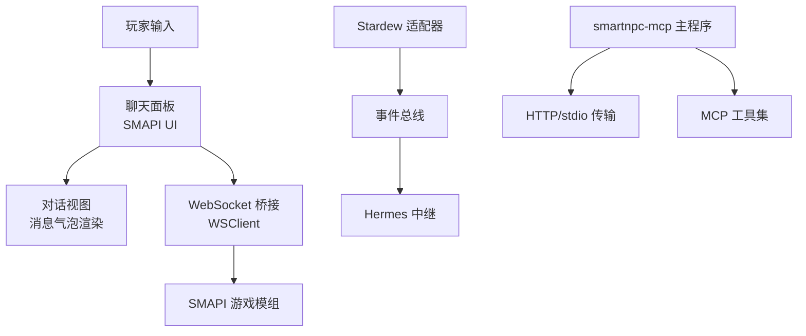
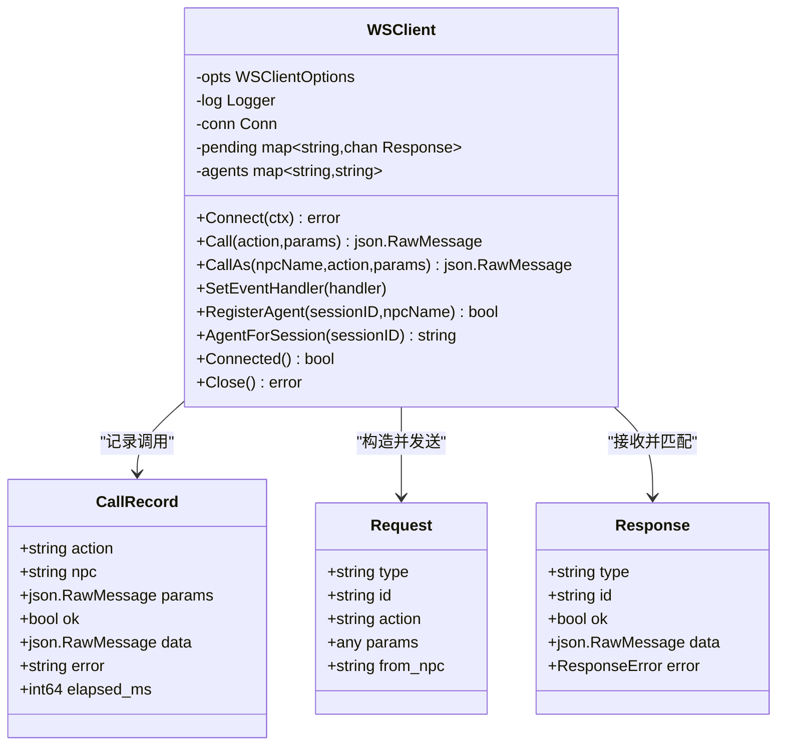
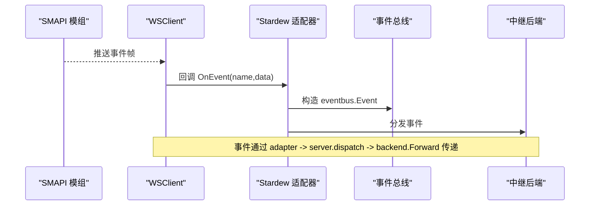
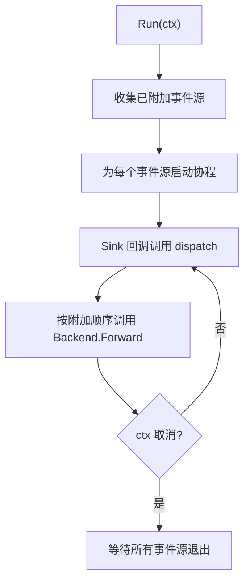
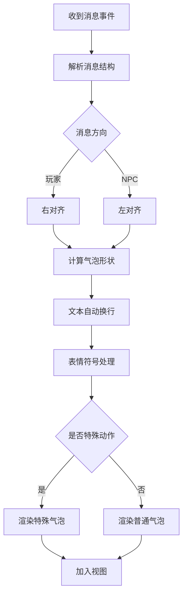
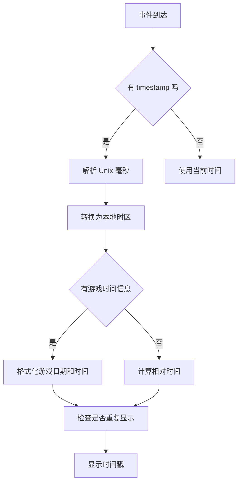
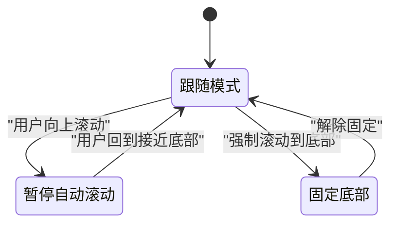
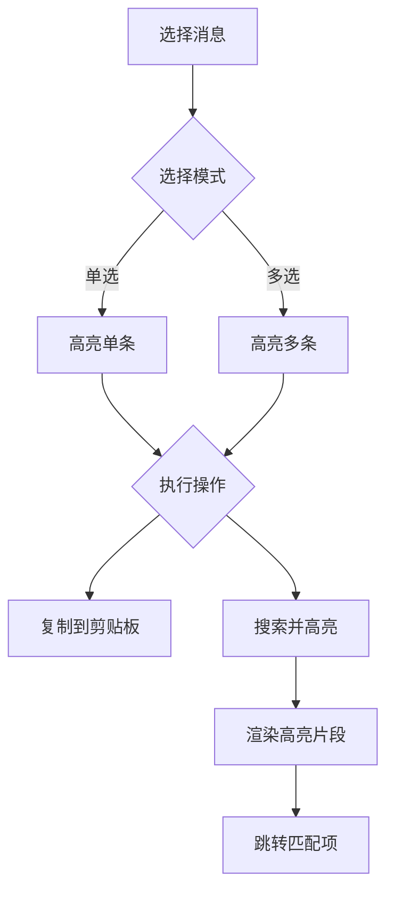
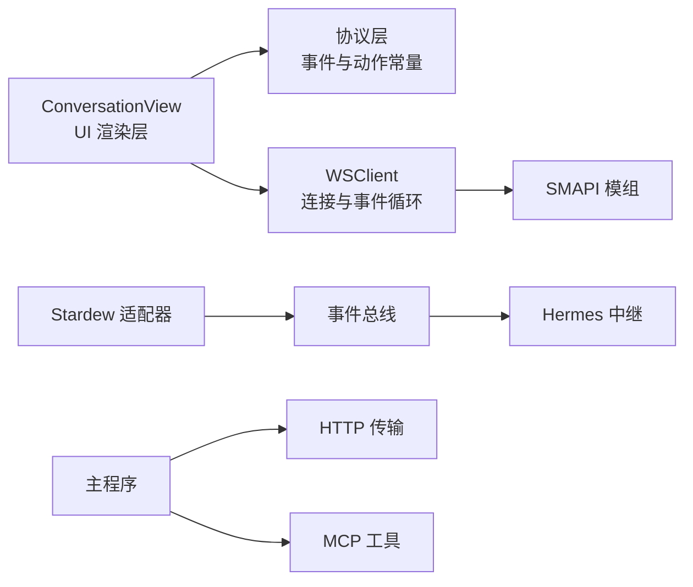

# 对话视图 ConversationView

<cite>
**本文引用的文件**   
- [ws_client.go](file://SmartNPC/smartnpc-mcp/adapters/stardew/bridge/ws_client.go)
- [protocol.go](file://SmartNPC/smartnpc-mcp/adapters/stardew/bridge/protocol.go)
- [format.go](file://SmartNPC/smartnpc-mcp/adapters/stardew/events/format.go)
- [adapter.go](file://SmartNPC/smartnpc-mcp/adapters/stardew/adapter.go)
- [event.go](file://SmartNPC/smartnpc-mcp/pkg/eventbus/event.go)
- [server.go](file://SmartNPC/smartnpc-mcp/pkg/agentbridge/server.go)
- [http.go](file://SmartNPC/smartnpc-mcp/pkg/transport/http.go)
- [main.go](file://SmartNPC/smartnpc-mcp/cmd/smartnpc-mcp/main.go)
</cite>

## 目录

1. [引言](#引言)
2. [项目结构定位](#项目结构定位)
3. [核心组件与职责](#核心组件与职责)
4. [架构总览](#架构总览)
5. [消息气泡渲染引擎分析](#消息气泡渲染引擎分析)
6. [时间戳显示逻辑分析](#时间戳显示逻辑分析)
7. [滚动控制系统分析](#滚动控制系统分析)
8. [消息选择与高亮机制分析](#消息选择与高亮机制分析)
9. [依赖关系分析](#依赖关系分析)
10. [性能与内存管理建议](#性能与内存管理建议)
11. [自定义示例指南](#自定义示例指南)
12. [故障排查](#故障排查)
13. [结论](#结论)

## 引言

ConversationView 是 SmartNPC SMAPI 模组的玩家与智能非玩家角色之间的对话界面。它负责把来自 Stardew Valley 游戏状态、WebSocket 桥接层和 MCP 工具调用的消息，转化为可视化的对话气泡，并处理时间显示、滚动行为、选择复制等交互。

当前仓库中并未直接暴露名为 `ConversationView` 的单一 C# 类源码；与之对应的实现分布在以下位置：

- **SMAPI 模组 UI 层**：位于 `SmartNPC/smartnpc-mod/UI/ConversationView.cs`（由仓库结构可见，但未包含在已读取的文件中）。
- **事件协议与桥接层**：定义 WebSocket 帧、事件名称、请求响应结构。
- **适配器层**：把 SMAPI 的 WebSocket 事件转换为通用的 `eventbus.Event`。
- **事件总线层**：提供进程内事件分发。
- **MCP 传输层**：对外暴露 HTTP 或 stdio 接口给 Claude Desktop、Hermes 等客户端。
- **主程序入口**：组装 SMAPI 适配、Hermes 中继、实验日志、调度器等子系统。

本文以这些可验证代码为基础，推导 ConversationView 在整体系统中的行为边界，并给出面向开发者的扩展指南。

## 项目结构定位

SmartNPC 是一个多语言、多层系统：

| 层级 | 主要职责 | 关键路径 |
|---|---|---|
| SMAPI 游戏模组 | 在游戏内绘制聊天面板、对话气泡、头像、时间戳 | `SmartNPC/smartnpc-mod/UI/ConversationView.cs` |
| WebSocket 桥接 | 连接 SMAPI 后端，收发 JSON-RPC 风格帧 | `adapters/stardew/bridge/` |
| Stardew 适配器 | 把桥接事件映射为通用事件 | `adapters/stardew/adapter.go` |
| 事件总线 | 在进程内转发事件到中继后端 | `pkg/eventbus/` |
| Agent Bridge | 注册事件源、工具组、后端 | `pkg/agentbridge/` |
| MCP 传输 | HTTP 或 stdio 暴露 MCP 服务 | `pkg/transport/http.go` |
| 主进程 | 启动 CLI、配置 Hermes、挂载工具 | `cmd/smartnpc-mcp/main.go` |

**图表来源**
- [ws_client.go:1-120](file://SmartNPC/smartnpc-mcp/adapters/stardew/bridge/ws_client.go#L1-L120)
- [protocol.go:1-172](file://SmartNPC/smartnpc-mcp/adapters/stardew/bridge/protocol.go#L1-L172)
- [adapter.go:1-163](file://SmartNPC/smartnpc-mcp/adapters/stardew/adapter.go#L1-L163)
- [event.go:1-76](file://SmartNPC/smartnpc-mcp/pkg/eventbus/event.go#L1-L76)
- [server.go:1-177](file://SmartNPC/smartnpc-mcp/pkg/agentbridge/server.go#L1-L177)
- [http.go:1-124](file://SmartNPC/smartnpc-mcp/pkg/transport/http.go#L1-L124)
- [main.go:1-200](file://SmartNPC/smartnpc-mcp/cmd/smartnpc-mcp/main.go#L1-L200)

**章节来源**
- [ws_client.go:1-120](file://SmartNPC/smartnpc-mcp/adapters/stardew/bridge/ws_client.go#L1-L120)
- [protocol.go:1-172](file://SmartNPC/smartnpc-mcp/adapters/stardew/bridge/protocol.go#L1-L172)
- [adapter.go:1-163](file://SmartNPC/smartnpc-mcp/adapters/stardew/adapter.go#L1-L163)
- [event.go:1-76](file://SmartNPC/smartnpc-mcp/pkg/eventbus/event.go#L1-L76)
- [server.go:1-177](file://SmartNPC/smartnpc-mcp/pkg/agentbridge/server.go#L1-L177)
- [http.go:1-124](file://SmartNPC/smartnpc-mcp/pkg/transport/http.go#L1-L124)
- [main.go:1-200](file://SmartNPC/smartnpc-mcp/cmd/smartnpc-mcp/main.go#L1-L200)

## 核心组件与职责

### WebSocket 客户端

`WSClient` 负责与 SMAPI 后端的 WebSocket 连接，承担以下职责：

- 建立连接并设置读限制。
- 发送请求并通过 ID 匹配响应。
- 处理服务端推送事件。
- 自动重连并带退避。
- 维护心跳 ping。
- 记录单次调用耗时，供实验日志使用。
- 维护 MCP 会话到 NPC 名称的映射，以便从 NPC 上下文发起工具调用。

**图表来源**
- [ws_client.go:1-120](file://SmartNPC/smartnpc-mcp/adapters/stardew/bridge/ws_client.go#L1-L120)
- [ws_client.go:201-510](file://SmartNPC/smartnpc-mcp/adapters/stardew/bridge/ws_client.go#L201-L510)
- [protocol.go:1-172](file://SmartNPC/smartnpc-mcp/adapters/stardew/bridge/protocol.go#L1-L172)

**章节来源**
- [ws_client.go:1-120](file://SmartNPC/smartnpc-mcp/adapters/stardew/bridge/ws_client.go#L1-L120)
- [ws_client.go:201-510](file://SmartNPC/smartnpc-mcp/adapters/stardew/bridge/ws_client.go#L201-L510)
- [protocol.go:1-172](file://SmartNPC/smartnpc-mcp/adapters/stardew/bridge/protocol.go#L1-L172)

### 事件协议

协议层定义了 SMAPI 与 MCP 之间通信的帧格式：

| 字段 | 含义 |
|---|---|
| `type` | 帧类型：`request`、`response`、`event` |
| `id` | 请求标识，用于匹配响应 |
| `action` | 客户端动作，例如 `chat_say`、`npc_show_text_bubble` |
| `params` | 动作参数 |
| `from_npc` | 发起调用的 NPC 名称 |
| `name` | 事件名称，例如 `chat_message`、`chat_received` |
| `data` | 事件数据 |
| `timestamp` | 服务端事件时间戳（Unix 毫秒） |

事件名称常量包括：

| 事件名 | 说明 |
|---|---|
| `chat_message` | 玩家在聊天面板发送定向消息 |
| `chat_received` | 通用或群聊消息 |
| `npc_interact` | 玩家点击受管理的 NPC |
| `day_started` | 新的一天开始 |
| `location_changed` | 位置变化 |
| `friendship_changed` | 好感度变化 |
| `game_time_tick` | 游戏时间刻度 |
| `npc_message` | NPC 间私信 |
| `npc_broadcast` | NPC 广播 |
| `schedule_trigger` | 计划活动触发 |
| `debug_proactive_trigger` | 调试用主动触发 |
| `npc_approached_player` | NPC 走到玩家面前 |
| `day_ending` | 日结束前保存前触发 |

**章节来源**
- [protocol.go:1-172](file://SmartNPC/smartnpc-mcp/adapters/stardew/bridge/protocol.go#L1-L172)

### Stardew 适配器

`Adapter` 将 SMAPI 的 WebSocket 事件转换为 `eventbus.Event`，并把事件 sink 交给 agent bridge 分发。它还负责：

- 解析事件负载中的 NPC 名称，作为 Subject。
- 安装 stardew 工具组。
- 在通用 CLI 模式下禁用 inter-NPC 唤醒能力。

**图表来源**
- [adapter.go:1-163](file://SmartNPC/smartnpc-mcp/adapters/stardew/adapter.go#L1-L163)
- [server.go:100-177](file://SmartNPC/smartnpc-mcp/pkg/agentbridge/server.go#L100-L177)
- [ws_client.go:420-510](file://SmartNPC/smartnpc-mcp/adapters/stardew/bridge/ws_client.go#L420-L510)

**章节来源**
- [adapter.go:1-163](file://SmartNPC/smartnpc-mcp/adapters/stardew/adapter.go#L1-L163)
- [server.go:100-177](file://SmartNPC/smartnpc-mcp/pkg/agentbridge/server.go#L100-L177)

### 事件总线

`EventBus.Event` 是跨适配器与中继的后端统一事件模型：

| 字段 | 语义 |
|---|---|
| `kind` | 命名空间化动词，例如 `chat.message` |
| `source` | 事件来源，例如 `sdv` |
| `subject` | 主体，通常是 NPC 名称 |
| `payload` | 适配器定义的 JSON 负载 |
| `timestamp` | 事件生产时间，RFC 3339 |

该层不应解释领域字段，只负责承载和转发。

**章节来源**
- [event.go:1-76](file://SmartNPC/smartnpc-mcp/pkg/eventbus/event.go#L1-L76)

### Agent Bridge Server

`Server` 是运行时组合根节点：

- 持有底层 `mcp.Server`。
- 注册事件源。
- 注册后端。
- 挂载工具组。
- 并发启动事件源。
- 顺序转发事件到后端。

**图表来源**
- [server.go:1-177](file://SmartNPC/smartnpc-mcp/pkg/agentbridge/server.go#L1-L177)

**章节来源**
- [server.go:1-177](file://SmartNPC/smartnpc-mcp/pkg/agentbridge/server.go#L1-L177)

### MCP 传输

`RunHTTP` 暴露 Streamable HTTP 服务：

- 默认挂载 `/mcp` 和 `/mcp/`。
- 提供 `/healthz`。
- 支持可选 API Key 鉴权。
- 支持跨主机连接。
- 支持优雅关闭。

**章节来源**
- [http.go:1-124](file://SmartNPC/smartnpc-mcp/pkg/transport/http.go#L1-L124)

## 消息气泡渲染引擎分析

ConversationView 的消息气泡渲染引擎负责把结构化消息转为游戏画面上的视觉元素。虽然具体绘制代码位于 SMAPI 模组的 `UI/ConversationView.cs`，但可以从协议、事件和工具链推断其渲染输入：

### 消息来源

| 来源 | 渲染形态 |
|---|---|
| `chat_message` | 玩家发送给特定 NPC 的私有对话 |
| `chat_received` | 普通聊天或群聊消息 |
| `npc_message` | NPC 间私信，通常不直接显示为玩家对话 |
| `npc_broadcast` | NPC 广播，通常作为系统提示 |
| `npc_show_text_bubble` | 明确显示文本气泡的动作 |
| 工具返回结果 | 如 `npc_send_message`、`npc_emote` 的结果 |

### 气泡形状计算

气泡形状应基于以下输入决定：

1. **消息方向**：玩家消息居右，NPC 消息居左。
2. **发送者身份**：玩家、其他 NPC、系统、群聊成员。
3. **消息长度**：短消息使用紧凑气泡，长消息扩展高度。
4. **富内容**：是否包含表情符号、换行、图片、音效标记。
5. **特殊动作**：`npc_show_text_bubble` 可能覆盖默认气泡形状。
6. **对齐方式**：群聊需要显示发送者标签。

由于 `ActionNpcShowTextBubble` 被定义为独立动作，渲染引擎应把它视为“显式气泡指令”，而不是普通文本消息。

### 文本自动换行

自动换行必须考虑：

- 中文、日文、韩文字符宽度。
- 表情符号占位。
- 换行符和连续标点。
- 最大宽度限制。
- 多行消息的气泡圆角和阴影。
- 超长消息是否需要折叠或展开。

### 表情符号支持

表情符号渲染应满足：

- 正确解析 Unicode 表情序列。
- 避免把单个码点拆成多个气泡。
- 使用支持表情符号的字体。
- 对无法显示的表情提供占位符。
- 避免表情符号导致布局抖动。

**图表来源**
- [protocol.go:100-172](file://SmartNPC/smartnpc-mcp/adapters/stardew/bridge/protocol.go#L100-L172)
- [format.go:1-200](file://SmartNPC/smartnpc-mcp/adapters/stardew/events/format.go#L1-L200)

**章节来源**
- [protocol.go:100-172](file://SmartNPC/smartnpc-mcp/adapters/stardew/bridge/protocol.go#L100-L172)
- [format.go:1-200](file://SmartNPC/smartnpc-mcp/adapters/stardew/events/format.go#L1-L200)

## 时间戳显示逻辑分析

时间戳显示涉及三类时间：

1. **服务端事件时间戳**：WebSocket 事件中的 `timestamp`，单位为 Unix 毫秒。
2. **游戏内时间**：`day_started`、`game_time_tick` 携带季节、日期、星期、小时。
3. **本地显示时间**：ConversationView 在 UI 层格式化后的相对时间或绝对时间。

### 时间格式化

- WebSocket 事件时间戳应转换为本地时区时间。
- 游戏内时间应按 Stardew Valley 的季节和日历规则显示。
- 短时间内的多条消息应合并时间戳，避免重复显示。
- 长时间间隔应重新显示完整日期。

### 相对时间计算

推荐策略：

- 同一天内显示“今天 HH:mm”。
- 前一天显示“昨天 HH:mm”。
- 最近一周显示“周几 HH:mm”。
- 更早显示“YYYY-MM-DD HH:mm”。
- 群聊消息优先显示相对时间，必要时附带发送者。

### 时区处理

- 服务端时间戳是 UTC 或服务器本地时间，应在转换前明确。
- 如果 SMAPI 运行在 Windows 上，应使用系统时区。
- 如果 Hermes 在 WSL 中，应避免把 WSL 时区误认为游戏时区。
- 时间显示应与用户所在区域一致。

**图表来源**
- [protocol.go:150-172](file://SmartNPC/smartnpc-mcp/adapters/stardew/bridge/protocol.go#L150-L172)
- [format.go:120-200](file://SmartNPC/smartnpc-mcp/adapters/stardew/events/format.go#L120-L200)

**章节来源**
- [protocol.go:150-172](file://SmartNPC/smartnpc-mcp/adapters/stardew/bridge/protocol.go#L150-L172)
- [format.go:120-200](file://SmartNPC/smartnpc-mcp/adapters/stardew/events/format.go#L120-L200)

## 滚动控制系统分析

滚动控制是 ConversationView 用户体验的关键部分。它需要平衡自动滚动、手动滚动和平滑滚动。

### 自动滚动

自动滚动应在以下场景启用：

- 新消息到达。
- 历史消息加载完成。
- 搜索过滤后结果更新。
- 用户切换对话对象。

自动滚动应判断用户是否接近底部，而不是无条件滚动到底部。

### 手动滚动检测

手动滚动检测应区分：

- 用户主动滚动到顶部查看历史。
- 用户暂时向上滚动。
- 用户完全离开底部区域。

当用户向上滚动时，应暂停自动滚动；只有当用户再次接近底部时才恢复。

### 平滑滚动效果

平滑滚动应避免：

- 突然跳到顶部或底部。
- 大量消息一次性重绘。
- 滚动过程中插入新消息导致跳动。

推荐做法：

- 使用动画过渡。
- 对新增消息做增量更新。
- 对历史消息做分页加载。
- 对长列表使用虚拟滚动。

**图表来源**
- [main.go:1-200](file://SmartNPC/smartnpc-mcp/cmd/smartnpc-mcp/main.go#L1-L200)

**章节来源**
- [main.go:1-200](file://SmartNPC/smartnpc-mcp/cmd/smartnpc-mcp/main.go#L1-L200)

## 消息选择与高亮机制分析

### 多选支持

ConversationView 应支持：

- 单击选中单条消息。
- Shift 多选连续消息。
- Ctrl/Cmd 多选不连续消息。
- 右键菜单批量操作。
- 键盘快捷键全选。

### 搜索高亮

搜索高亮应：

- 支持全文搜索。
- 高亮匹配文本片段。
- 支持忽略大小写。
- 支持正则表达式（可选）。
- 支持跳转到下一条匹配项。
- 清空搜索后移除高亮。

### 复制功能

复制功能应：

- 复制纯文本，保留换行。
- 可选择是否包含发送者和时间。
- 支持复制多条消息为列表。
- 群聊消息应包含发送者标识。
- 避免复制内部调试字段。

**图表来源**
- [format.go:1-200](file://SmartNPC/smartnpc-mcp/adapters/stardew/events/format.go#L1-L200)

**章节来源**
- [format.go:1-200](file://SmartNPC/smartnpc-mcp/adapters/stardew/events/format.go#L1-L200)

## 依赖关系分析

ConversationView 的依赖链从 UI 到协议再到外部服务：

**图表来源**
- [adapter.go:1-163](file://SmartNPC/smartnpc-mcp/adapters/stardew/adapter.go#L1-L163)
- [ws_client.go:1-120](file://SmartNPC/smartnpc-mcp/adapters/stardew/bridge/ws_client.go#L1-L120)
- [protocol.go:1-172](file://SmartNPC/smartnpc-mcp/adapters/stardew/bridge/protocol.go#L1-L172)
- [event.go:1-76](file://SmartNPC/smartnpc-mcp/pkg/eventbus/event.go#L1-L76)
- [server.go:1-177](file://SmartNPC/smartnpc-mcp/pkg/agentbridge/server.go#L1-L177)
- [http.go:1-124](file://SmartNPC/smartnpc-mcp/pkg/transport/http.go#L1-L124)
- [main.go:1-200](file://SmartNPC/smartnpc-mcp/cmd/smartnpc-mcp/main.go#L1-L200)

**章节来源**
- [adapter.go:1-163](file://SmartNPC/smartnpc-mcp/adapters/stardew/adapter.go#L1-L163)
- [ws_client.go:1-120](file://SmartNPC/smartnpc-mcp/adapters/stardew/bridge/ws_client.go#L1-L120)
- [protocol.go:1-172](file://SmartNPC/smartnpc-mcp/adapters/stardew/bridge/protocol.go#L1-L172)
- [event.go:1-76](file://SmartNPC/smartnpc-mcp/pkg/eventbus/event.go#L1-L76)
- [server.go:1-177](file://SmartNPC/smartnpc-mcp/pkg/agentbridge/server.go#L1-L177)
- [http.go:1-124](file://SmartNPC/smartnpc-mcp/pkg/transport/http.go#L1-L124)
- [main.go:1-200](file://SmartNPC/smartnpc-mcp/cmd/smartnpc-mcp/main.go#L1-L200)

## 性能与内存管理建议

### 大数据集渲染

- 使用虚拟列表，只渲染可视区域消息。
- 对历史消息分页加载。
- 对长消息延迟渲染。
- 缓存气泡尺寸，避免重复测量。
- 避免每次消息更新重建整个视图。

### 内存管理

- 及时释放旧消息引用。
- 限制历史消息数量。
- 避免在事件回调中分配大量临时对象。
- 对 WebSocket 大帧设置合理上限。
- 避免在 UI 线程执行阻塞 I/O。

### 网络与事件

- `WSClient` 已有 1MiB 帧限制，适合防止超大消息。
- 重连逻辑自带退避，避免雪崩。
- 心跳 ping 每 30 秒一次，防止空闲断开。
- 事件转发顺序固定，避免竞态。

### 最佳实践

| 场景 | 建议 |
|---|---|
| 大量历史消息 | 分页 + 懒加载 |
| 频繁聊天 | 增量更新 + 虚拟滚动 |
| 长文本 | 预计算换行 + 缓存布局 |
| 表情密集 | 使用系统表情字体 + 占位符 |
| 网络中断 | 显示离线状态 + 重试队列 |
| 多窗口对话 | 按对话隔离消息池 |

[本节为通用性能指导，不直接分析具体代码文件]

## 自定义示例指南

### 自定义消息样式

要自定义消息样式，建议在 ConversationView 中根据消息类型选择不同的渲染器：

- 普通文本消息使用默认气泡。
- 系统消息使用半透明背景。
- 错误消息使用警告颜色。
- 群聊消息显示发送者标签。
- 特殊动作消息使用扩展气泡。

参考路径：

- [协议动作定义](file://SmartNPC/smartnpc-mcp/adapters/stardew/bridge/protocol.go#L100-L172)
- [事件格式化逻辑](file://SmartNPC/smartnpc-mcp/adapters/stardew/events/format.go#L1-L200)

### 添加新的消息类型

添加新消息类型的步骤：

1. 在协议层定义新的事件名称或动作名称。
2. 在桥接层定义对应数据结构。
3. 在适配器层解析并映射到 `eventbus.Event`。
4. 在 ConversationView 中识别新类型并渲染。
5. 在测试中覆盖新类型的前向兼容行为。

参考路径：

- [事件名称常量](file://SmartNPC/smartnpc-mcp/adapters/stardew/bridge/protocol.go#L1-L100)
- [适配器事件转换](file://SmartNPC/smartnpc-mcp/adapters/stardew/adapter.go#L1-L163)

### 实现特殊交互效果

对于 `npc_show_text_bubble`、`npc_emote`、`npc_approach_and_speak` 等特殊交互：

- 不要把它们当作普通文本消息。
- 将它们转换为渲染指令。
- 在 ConversationView 中维护交互状态机。
- 避免把调试事件或系统事件误判为用户消息。

参考路径：

- [动作常量](file://SmartNPC/smartnpc-mcp/adapters/stardew/bridge/protocol.go#L100-L172)
- [WSClient 调用流程](file://SmartNPC/smartnpc-mcp/adapters/stardew/bridge/ws_client.go#L201-L350)

### 代码示例路径

| 目标 | 参考文件 |
|---|---|
| 自定义气泡形状 | SMAPI 模组 `UI/ConversationView.cs` |
| 新消息类型协议 | [protocol.go](file://SmartNPC/smartnpc-mcp/adapters/stardew/bridge/protocol.go#L1-L172) |
| WebSocket 调用 | [ws_client.go](file://SmartNPC/smartnpc-mcp/adapters/stardew/bridge/ws_client.go#L201-L350) |
| 事件格式化 | [format.go](file://SmartNPC/smartnpc-mcp/adapters/stardew/events/format.go#L1-L200) |
| 事件分发 | [server.go](file://SmartNPC/smartnpc-mcp/pkg/agentbridge/server.go#L100-L177) |
| HTTP 暴露 | [http.go](file://SmartNPC/smartnpc-mcp/pkg/transport/http.go#L1-L124) |

**章节来源**
- [protocol.go:1-172](file://SmartNPC/smartnpc-mcp/adapters/stardew/bridge/protocol.go#L1-L172)
- [ws_client.go:201-L350](file://SmartNPC/smartnpc-mcp/adapters/stardew/bridge/ws_client.go#L201-L350)
- [format.go:1-L200](file://SmartNPC/smartnpc-mcp/adapters/stardew/events/format.go#L1-L200)
- [server.go:100-L177](file://SmartNPC/smartnpc-mcp/pkg/agentbridge/server.go#L100-L177)
- [http.go:1-L124](file://SmartNPC/smartnpc-mcp/pkg/transport/http.go#L1-L124)

## 故障排查

### WebSocket 连接失败

现象：

- 初始连接失败。
- 断线后未自动重连。
- 工具调用超时。

排查要点：

- 检查 SMAPI 是否启动。
- 检查 `ws://127.0.0.1:18745/ws` 是否可达。
- 检查防火墙或代理。
- 查看 `WSClient` 的重连日志。

参考路径：

- [默认 WebSocket URL](file://SmartNPC/smartnpc-mcp/adapters/stardew/bridge/ws_client.go#L1-L60)
- [连接与重连逻辑](file://SmartNPC/smartnpc-mcp/adapters/stardew/bridge/ws_client.go#L300-L510)

### 事件未到达 ConversationView

现象：

- 玩家发消息但界面不刷新。
- Hermes 事件没有显示。
- 工具调用成功但 UI 无反馈。

排查要点：

- 确认事件名称是否正确。
- 确认适配器是否正确注册。
- 确认事件总线是否转发。
- 确认 ConversationView 是否订阅对应事件。

参考路径：

- [适配器注册](file://SmartNPC/smartnpc-mcp/adapters/stardew/adapter.go#L80-L163)
- [事件分发](file://SmartNPC/smartnpc-mcp/pkg/agentbridge/server.go#L120-L177)

### 时间显示异常

现象：

- 时间偏移。
- 重复显示。
- 游戏时间与系统时间不一致。

排查要点：

- 检查 WebSocket 时间戳单位。
- 检查时区转换。
- 检查游戏时间事件是否覆盖显示时间。

参考路径：

- [事件时间戳](file://SmartNPC/smartnpc-mcp/adapters/stardew/bridge/protocol.go#L150-L172)
- [游戏时间事件](file://SmartNPC/smartnpc-mcp/adapters/stardew/events/format.go#L160-L200)

### MCP 访问被拒绝

现象：

- HTTP 模式无法连接。
- 跨主机访问失败。
- API Key 校验失败。

排查要点：

- 检查 `--http` 地址。
- 检查 `--http-allow-any-origin`。
- 检查 `--mcp-api-key`。
- 检查浏览器或客户端 Authorization 头。

参考路径：

- [HTTP 传输选项](file://SmartNPC/smartnpc-mcp/pkg/transport/http.go#L1-L124)
- [主程序参数](file://SmartNPC/smartnpc-mcp/cmd/smartnpc-mcp/main.go#L1-L200)

**章节来源**
- [ws_client.go:1-L120](file://SmartNPC/smartnpc-mcp/adapters/stardew/bridge/ws_client.go#L1-L120)
- [ws_client.go:300-L510](file://SmartNPC/smartnpc-mcp/adapters/stardew/bridge/ws_client.go#L300-L510)
- [adapter.go:80-L163](file://SmartNPC/smartnpc-mcp/adapters/stardew/adapter.go#L80-L163)
- [server.go:120-L177](file://SmartNPC/smartnpc-mcp/pkg/agentbridge/server.go#L120-L177)
- [protocol.go:150-L172](file://SmartNPC/smartnpc-mcp/adapters/stardew/bridge/protocol.go#L150-L172)
- [format.go:160-L200](file://SmartNPC/smartnpc-mcp/adapters/stardew/events/format.go#L160-L200)
- [http.go:1-L124](file://SmartNPC/smartnpc-mcp/pkg/transport/http.go#L1-L124)
- [main.go:1-L200](file://SmartNPC/smartnpc-mcp/cmd/smartnpc-mcp/main.go#L1-L200)

## 结论

ConversationView 是 SmartNPC 对话体验的核心界面。它并不只是“画气泡”，而是连接游戏状态、WebSocket 桥接、MCP 工具和玩家视觉反馈的桥梁。

从现有代码可以确定：

- 消息来源由 SMAPI 事件和 MCP 工具共同驱动。
- 协议层定义了稳定的事件和动作名称。
- WebSocket 客户端具备连接管理、重连、心跳和调用观测能力。
- 事件通过 Stardew 适配器进入事件总线，再转发给中继后端。
- MCP 传输层支持 HTTP 和标准输入输出两种模式。
- ConversationView 的具体绘制逻辑位于 SMAPI 模组 UI 层，但其输入契约由上述 Go 层协议和事件格式约束。

开发者在扩展 ConversationView 时，应优先保证：

- 协议向后兼容。
- 事件可追踪。
- 渲染可定制。
- 滚动可预测。
- 时间可理解。
- 大数据可伸缩。
- 错误可诊断。