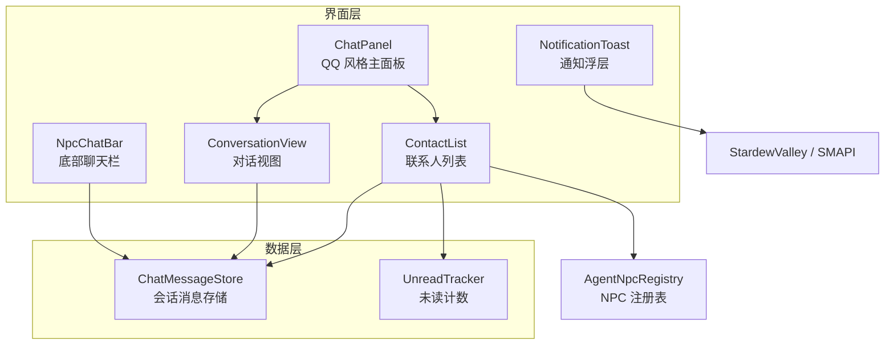
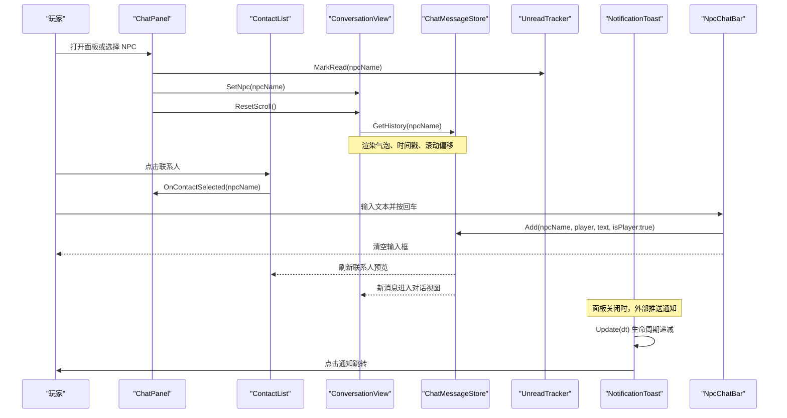
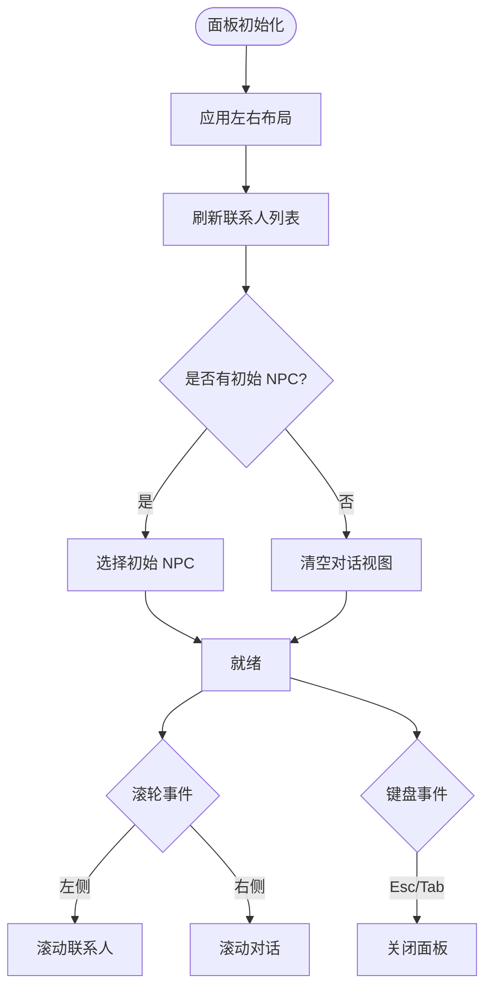
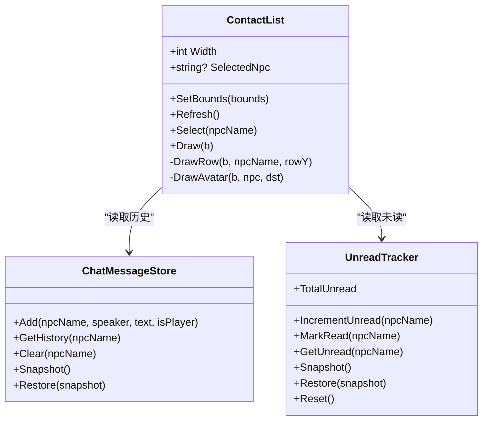
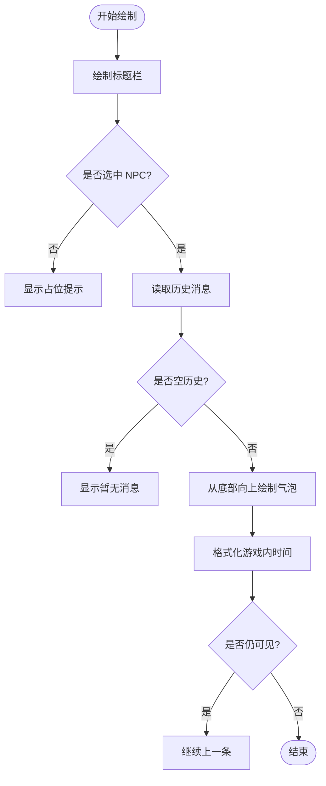
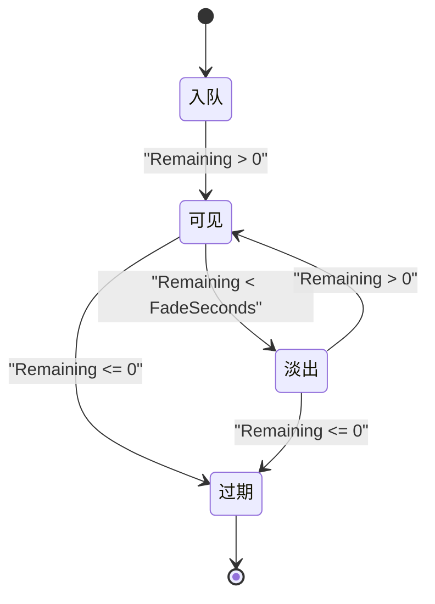
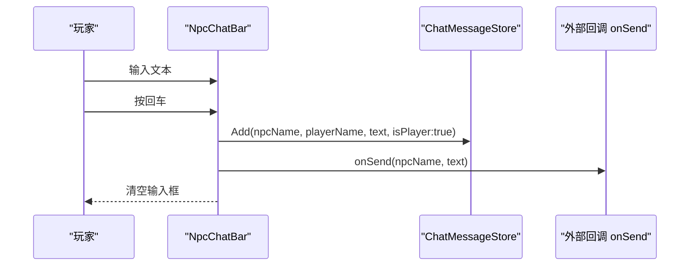
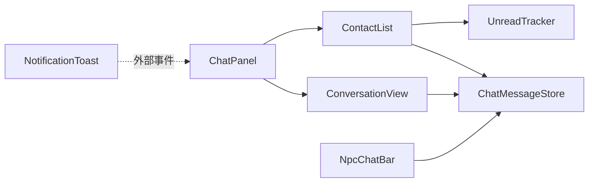

# 用户界面组件

<cite>
**本文引用的文件**   
- [ChatPanel.cs](file://SmartNPC/smapi-mod/UI/ChatPanel.cs)
- [ContactList.cs](file://SmartNPC/smapi-mod/UI/ContactList.cs)
- [ConversationView.cs](file://SmartNPC/smapi-mod/UI/ConversationView.cs)
- [NotificationToast.cs](file://SmartNPC/smapi-mod/UI/NotificationToast.cs)
- [NpcChatBar.cs](file://SmartNPC/smapi-mod/UI/NpcChatBar.cs)
- [ChatMessageStore.cs](file://SmartNPC/smapi-mod/UI/ChatMessageStore.cs)
- [UnreadTracker.cs](file://SmartNPC/smapi-mod/Data/UnreadTracker.cs)
</cite>

## 目录
1. [简介](#简介)
2. [项目结构](#项目结构)
3. [核心组件](#核心组件)
4. [架构总览](#架构总览)
5. [详细组件分析](#详细组件分析)
6. [依赖关系分析](#依赖关系分析)
7. [性能与渲染特性](#性能与渲染特性)
8. [自定义与扩展指南](#自定义与扩展指南)
9. [响应式设计与可访问性](#响应式设计与可访问性)
10. [故障排查](#故障排查)
11. [结论](#结论)

## 简介
本文件系统性梳理 SmartNPC 的 QQ 风格聊天界面实现，围绕五个关键 UI 组件展开：
- ChatPanel：主面板容器，负责布局、全局交互与状态切换。
- ContactList：左侧联系人列表，展示 NPC 头像、在线状态、未读计数与最近消息预览。
- ConversationView：右侧对话视图，按气泡渲染历史消息、时间戳与滚动控制。
- NotificationToast：非模态通知浮层，自动计时、淡出与层级管理。
- NpcChatBar：底部聊天栏，提供 NPC 头像、输入框与发送逻辑。

这些组件共同构成一个以“只读监控”为主的聊天体验，同时保留少量玩家输入入口（NpcChatBar），并通过 ChatMessageStore 与 UnreadTracker 进行会话数据与未读状态管理。

## 项目结构
UI 相关代码集中在 `SmartNPC/smapi-mod/UI` 与 `SmartNPC/smapi-mod/Data` 两个命名空间下，整体组织方式如下：
- UI 层：面板、子控件、通知、底部输入栏。
- 数据层：会话消息存储、未读计数快照与恢复。
- 外部依赖：StardewValley 游戏框架、SMAPI 事件系统、AgentNpcRegistry（由其他模块提供）。

图表来源
- [ChatPanel.cs:1-178](file://SmartNPC/smapi-mod/UI/ChatPanel.cs#L1-L178)
- [ContactList.cs:1-200](file://SmartNPC/smapi-mod/UI/ContactList.cs#L1-L200)
- [ConversationView.cs:1-175](file://SmartNPC/smapi-mod/UI/ConversationView.cs#L1-L175)
- [NotificationToast.cs:1-138](file://SmartNPC/smapi-mod/UI/NotificationToast.cs#L1-L138)
- [NpcChatBar.cs:1-165](file://SmartNPC/smapi-mod/UI/NpcChatBar.cs#L1-L165)
- [ChatMessageStore.cs:1-87](file://SmartNPC/smapi-mod/UI/ChatMessageStore.cs#L1-L87)
- [UnreadTracker.cs:1-56](file://SmartNPC/smapi-mod/Data/UnreadTracker.cs#L1-L56)

章节来源
- [ChatPanel.cs:1-178](file://SmartNPC/smapi-mod/UI/ChatPanel.cs#L1-L178)
- [ContactList.cs:1-200](file://SmartNPC/smapi-mod/UI/ContactList.cs#L1-L200)
- [ConversationView.cs:1-175](file://SmartNPC/smapi-mod/UI/ConversationView.cs#L1-L175)
- [NotificationToast.cs:1-138](file://SmartNPC/smapi-mod/UI/NotificationToast.cs#L1-L138)
- [NpcChatBar.cs:1-165](file://SmartNPC/smapi-mod/UI/NpcChatBar.cs#L1-L165)
- [ChatMessageStore.cs:1-87](file://SmartNPC/smapi-mod/UI/ChatMessageStore.cs#L1-L87)
- [UnreadTracker.cs:1-56](file://SmartNPC/smapi-mod/Data/UnreadTracker.cs#L1-L56)

## 核心组件
本节从职责、数据流、交互与可定制点四个维度概述各组件。

- ChatPanel
  - 职责：承载 ContactList 与 ConversationView；居中布局；处理 Esc/Tab 关闭；打开时标记已读；提供静态 Open 接口。
  - 数据：持有 ChatMessageStore 与 UnreadTracker 引用。
  - 交互：鼠标滚轮按横坐标路由到左/右窗格；点击仅作用于联系人列表。
  - 可定制：窗口尺寸常量、边框绘制、背景遮罩透明度。

- ContactList
  - 职责：列出所有 Agent 管理的 NPC；按最近消息时间排序；显示头像、在线状态点、名称、预览文本与未读数。
  - 数据：通过 AgentNpcRegistry 获取 NPC 列表；通过 ChatMessageStore 取历史；通过 UnreadTracker 取未读计数。
  - 交互：选择 NPC 后回调上层；支持滚动；剪贴区域裁剪行。
  - 可定制：行高、头部高度、内边距、头像大小、颜色主题。

- ConversationView
  - 职责：渲染选中 NPC 的消息历史；气泡左右对齐区分玩家与 NPC；显示游戏内时间；支持滚轮滚动。
  - 数据：通过 ChatMessageStore 读取历史。
  - 交互：接收滚轮事件，调整 _scrollOffset；重置滚动。
  - 可定制：气泡最大宽度比例、气泡内边距、间距、字体、颜色。

- NotificationToast
  - 职责：在 ChatPanel 关闭时弹出通知；最多显示 3 条；按剩余时间淡出；点击通知跳转到对应 NPC。
  - 数据：内部队列维护 Item（包含 NPC 名、显示名、预览、剩余时间、矩形范围）。
  - 交互：Update(dt) 递减生命周期；TryClick(x,y) 判断点击并触发回调；Draw 自底向上堆叠。
  - 可定制：提示宽度、高度、间距、总时长、淡出时长、可见数量。

- NpcChatBar
  - 职责：底部固定栏；显示 NPC 头像与名称；包含 TextBox 输入框；回车发送消息；右上角关闭按钮。
  - 数据：持有 ChatMessageStore；发送消息时写入 store 并调用外部 onSend 回调。
  - 交互：Esc 关闭；点击关闭按钮退出；TextBox Enter 触发发送；窗口大小变化时重排输入框。
  - 可定制：栏高、头像大小、标签宽度、关闭按钮尺寸、背景色、字体。

- ChatMessageStore
  - 职责：按 NPC 保存会话消息；限制每条 NPC 的最大消息数；提供 Snapshot/Restore 持久化。
  - 数据结构：Dictionary<string, List<ChatMessage>>；ChatMessage 包含说话人、文本、是否玩家、创建时间与游戏内时间。
  - 复杂度：Add 为 O(1) 追加，超过上限时移除队首 O(1)；Snapshot 为 O(n)。

- UnreadTracker
  - 职责：按 NPC 统计未读消息；提供 IncrementUnread、MarkRead、GetUnread、TotalUnread。
  - 持久化：Snapshot/Restore 字典；Reset 清空。

章节来源
- [ChatPanel.cs:1-178](file://SmartNPC/smapi-mod/UI/ChatPanel.cs#L1-L178)
- [ContactList.cs:1-200](file://SmartNPC/smapi-mod/UI/ContactList.cs#L1-L200)
- [ConversationView.cs:1-175](file://SmartNPC/smapi-mod/UI/ConversationView.cs#L1-L175)
- [NotificationToast.cs:1-138](file://SmartNPC/smapi-mod/UI/NotificationToast.cs#L1-L138)
- [NpcChatBar.cs:1-165](file://SmartNPC/smapi-mod/UI/NpcChatBar.cs#L1-L165)
- [ChatMessageStore.cs:1-87](file://SmartNPC/smapi-mod/UI/ChatMessageStore.cs#L1-L87)
- [UnreadTracker.cs:1-56](file://SmartNPC/smapi-mod/Data/UnreadTracker.cs#L1-L56)

## 架构总览
ChatPanel 作为顶层菜单，组合 ContactList 与 ConversationView，并通过 ChatMessageStore 和 UnreadTracker 共享数据。NotificationToast 独立于 ChatPanel，由外部循环驱动更新与绘制。NpcChatBar 是另一个独立菜单，用于玩家主动发送消息。

图表来源
- [ChatPanel.cs:1-178](file://SmartNPC/smapi-mod/UI/ChatPanel.cs#L1-L178)
- [ContactList.cs:1-200](file://SmartNPC/smapi-mod/UI/ContactList.cs#L1-L200)
- [ConversationView.cs:1-175](file://SmartNPC/smapi-mod/UI/ConversationView.cs#L1-L175)
- [NotificationToast.cs:1-138](file://SmartNPC/smapi-mod/UI/NotificationToast.cs#L1-L138)
- [NpcChatBar.cs:1-165](file://SmartNPC/smapi-mod/UI/NpcChatBar.cs#L1-L165)
- [ChatMessageStore.cs:1-87](file://SmartNPC/smapi-mod/UI/ChatMessageStore.cs#L1-L87)
- [UnreadTracker.cs:1-56](file://SmartNPC/smapi-mod/Data/UnreadTracker.cs#L1-L56)

## 详细组件分析

### ChatPanel：QQ 风格主面板
- 布局管理
  - 默认面板尺寸为宽 900、高 560；居中放置；当窗口大小改变时重新计算位置并应用左右分区布局。
  - 左侧 ContactList 宽度固定为 300；右侧 ConversationView 填充剩余空间。
- 消息显示与交互
  - 右键面板不消费点击，仅 ContactList 接受点击。
  - 滚轮按鼠标 X 坐标分流到左侧或右侧窗格。
  - 选择 NPC 后调用 UnreadTracker.MarkRead，并切换 ConversationView 的当前 NPC，同时重置滚动。
- 键盘快捷键
  - Esc 或 Tab 关闭面板；ActiveNpc 在 cleanupBeforeExit 中清空。
- 外部 API
  - Open(store, unread, npc?)：将 ChatPanel 设为活动菜单并返回实例。
  - RefreshContacts()：刷新联系人列表。

图表来源
- [ChatPanel.cs:1-178](file://SmartNPC/smapi-mod/UI/ChatPanel.cs#L1-L178)

章节来源
- [ChatPanel.cs:1-178](file://SmartNPC/smapi-mod/UI/ChatPanel.cs#L1-L178)

### ContactList：联系人列表
- 布局与裁剪
  - 使用 ScissorRectangle 裁剪列表区域，避免行溢出到头部区域。
  - 头部显示“联系人”标题与未读总数；主体区域逐行绘制。
- NPC 头像与在线状态
  - 每行包含 48x48 头像占位；右下角绘制绿色圆点表示在线状态（具体头像资源加载逻辑位于 DrawAvatar，未在截取范围内）。
  - 头像旁显示 NPC 显示名；若无显示名则回退到 NPC 名。
- 未读计数与预览
  - 通过 UnreadTracker.GetUnread 显示未读徽章。
  - 通过 ChatMessageStore.GetHistory 获取最后一条消息，截断换行与长度，显示预览文本。
- 交互
  - 鼠标悬停与选中行高亮不同颜色。
  - 选择 NPC 后回调上层；若所选 NPC 不在列表中，会先刷新再选择。

图表来源
- [ContactList.cs:1-200](file://SmartNPC/smapi-mod/UI/ContactList.cs#L1-L200)
- [ChatMessageStore.cs:1-87](file://SmartNPC/smapi-mod/UI/ChatMessageStore.cs#L1-L87)
- [UnreadTracker.cs:1-56](file://SmartNPC/smapi-mod/Data/UnreadTracker.cs#L1-L56)

章节来源
- [ContactList.cs:1-200](file://SmartNPC/smapi-mod/UI/ContactList.cs#L1-L200)

### ConversationView：对话视图
- 渲染逻辑
  - 顶部标题栏显示当前 NPC 显示名或“Agent 工作播报”。
  - 若未选择 NPC，显示引导文字。
  - 消息从底部向上绘制，_scrollOffset 控制从末尾跳过的消息数。
  - 根据 IsPlayer 决定气泡左右对齐：玩家消息靠右，NPC 消息靠左。
  - 气泡宽度基于文本测量结果，最大不超过面板宽度的 75%。
  - 时间戳格式化为“HH:MM”，使用游戏内时间字段。
- 滚动控制
  - ReceiveScrollWheelAction(direction)：上滚减少 _scrollOffset，下滚增加 _scrollOffset。
  - ResetScroll()：回到最底部。
- 边界条件
  - 无消息时显示占位文本。
  - 超出可视区域时停止绘制。

图表来源
- [ConversationView.cs:1-175](file://SmartNPC/smapi-mod/UI/ConversationView.cs#L1-L175)

章节来源
- [ConversationView.cs:1-175](file://SmartNPC/smapi-mod/UI/ConversationView.cs#L1-L175)

### NotificationToast：通知系统
- 动画效果
  - 每个通知有 TotalSeconds 的总生存时间，并在 FadeSeconds 期间线性淡出。
  - 绘制时使用 alpha 混合颜色，背景、边框、标题与正文均受 alpha 影响。
- 自动消失
  - Update(dt) 对队列中每个 Item 减去 dt，移除已过期项。
- 层级管理
  - 最多 MaxVisible=3 条；新增时若超过数量则丢弃最早的一条。
  - 绘制顺序从尾部到首部，最新在最上方。
- 交互
  - TryClick(x,y) 检测点击范围，清空通知并回调 onClick(npcName)，通常用于打开对应对话。

图表来源
- [NotificationToast.cs:1-138](file://SmartNPC/smapi-mod/UI/NotificationToast.cs#L1-L138)

章节来源
- [NotificationToast.cs:1-138](file://SmartNPC/smapi-mod/UI/NotificationToast.cs#L1-L138)

### NpcChatBar：底部聊天栏
- 设计模式
  - 固定高度栏，覆盖屏幕底部；背景半透明深色；顶部装饰线。
  - 左侧显示 NPC 头像（尝试从 Portraits 资源加载，失败则显示灰色占位）。
  - 中间显示 NPC 名称；右侧为 TextBox 输入框；最右侧为关闭按钮。
- 输入与发送
  - TextBox Enter 触发 OnTextBoxEnter：Trim 文本后写入 ChatMessageStore.Add，并调用外部 onSend 回调；随后清空输入框。
- 交互与生命周期
  - Esc 关闭；点击关闭按钮退出；cleanupBeforeExit 清除 ActiveBarNpc 与键盘订阅者。
  - gameWindowSizeChanged 时重算 TextBox 位置与宽度。

图表来源
- [NpcChatBar.cs:1-165](file://SmartNPC/smapi-mod/UI/NpcChatBar.cs#L1-L165)
- [ChatMessageStore.cs:1-87](file://SmartNPC/smapi-mod/UI/ChatMessageStore.cs#L1-L87)

章节来源
- [NpcChatBar.cs:1-165](file://SmartNPC/smapi-mod/UI/NpcChatBar.cs#L1-L165)
- [ChatMessageStore.cs:1-87](file://SmartNPC/smapi-mod/UI/ChatMessageStore.cs#L1-L87)

## 依赖关系分析
- 组件耦合
  - ChatPanel 强耦合 ContactList 与 ConversationView，并依赖 ChatMessageStore、UnreadTracker。
  - ContactList 依赖 AgentNpcRegistry、ChatMessageStore、UnreadTracker。
  - ConversationView 依赖 ChatMessageStore。
  - NpcChatBar 依赖 ChatMessageStore 与外部 onSend 回调。
  - NotificationToast 与 ChatPanel 解耦，通过外部事件驱动。
- 潜在循环依赖
  - UI 组件之间通过回调与共享数据解耦，未见直接循环引用。
- 外部依赖
  - StardewValley 框架提供绘图、字体、输入、菜单基类。
  - SMAPI 事件用于驱动外部逻辑（例如 NotificationToast 的 Update 与 Draw）。

图表来源
- [ChatPanel.cs:1-178](file://SmartNPC/smapi-mod/UI/ChatPanel.cs#L1-L178)
- [ContactList.cs:1-200](file://SmartNPC/smapi-mod/UI/ContactList.cs#L1-L200)
- [ConversationView.cs:1-175](file://SmartNPC/smapi-mod/UI/ConversationView.cs#L1-L175)
- [NpcChatBar.cs:1-165](file://SmartNPC/smapi-mod/UI/NpcChatBar.cs#L1-L165)
- [NotificationToast.cs:1-138](file://SmartNPC/smapi-mod/UI/NotificationToast.cs#L1-L138)
- [ChatMessageStore.cs:1-87](file://SmartNPC/smapi-mod/UI/ChatMessageStore.cs#L1-L87)
- [UnreadTracker.cs:1-56](file://SmartNPC/smapi-mod/Data/UnreadTracker.cs#L1-L56)

章节来源
- [ChatPanel.cs:1-178](file://SmartNPC/smapi-mod/UI/ChatPanel.cs#L1-L178)
- [ContactList.cs:1-200](file://SmartNPC/smapi-mod/UI/ContactList.cs#L1-L200)
- [ConversationView.cs:1-175](file://SmartNPC/smapi-mod/UI/ConversationView.cs#L1-L175)
- [NpcChatBar.cs:1-165](file://SmartNPC/smapi-mod/UI/NpcChatBar.cs#L1-L165)
- [NotificationToast.cs:1-138](file://SmartNPC/smapi-mod/UI/NotificationToast.cs#L1-L138)
- [ChatMessageStore.cs:1-87](file://SmartNPC/smapi-mod/UI/ChatMessageStore.cs#L1-L87)
- [UnreadTracker.cs:1-56](file://SmartNPC/smapi-mod/Data/UnreadTracker.cs#L1-L56)

## 性能与渲染特性
- 渲染优化
  - ContactList 使用 ScissorRectangle 裁剪列表区域，减少无效绘制。
  - ConversationView 从底部向上绘制，配合 _scrollOffset 避免渲染不可见消息。
  - ChatMessageStore 对每条 NPC 的消息数量设置上限，防止内存增长。
- 文本测量与换行
  - ConversationView 使用 Game1.parseText 与 MeasureString 计算气泡宽度与高度，确保文本适配。
- 滚动效率
  - 通过偏移量而非删除历史数据实现滚动，降低频繁集合操作成本。
- 建议
  - 大量消息场景下，考虑分页或虚拟滚动。
  - 头像与字体纹理加载应缓存，避免重复 IO。
  - 通知淡出可使用更平滑插值函数（如缓动曲线）提升视觉体验。

[本节为通用指导，无需特定文件引用]

## 自定义与扩展指南
以下示例面向扩展开发者，说明如何在不复制源码的前提下修改样式、添加元素与处理事件。

- 自定义 UI 样式
  - 修改 ContactList 的行高、头部高度、内边距与颜色常量，以匹配新的 QQ 风格配色。
  - 调整 ConversationView 的气泡最大宽度比例、气泡内边距与间距，获得更紧凑或宽松的布局。
  - 更改 NotificationToast 的宽度、高度、间距、总时长与淡出时长，以获得更明显或更轻量的通知。
  - 调整 NpcChatBar 的栏高、头像大小、标签宽度与关闭按钮尺寸，以适应不同分辨率。

- 添加新的界面元素
  - 在 ContactList.DrawRow 中增加额外信息列（例如角色职业、亲密度），并相应调整文本宽度与裁剪逻辑。
  - 在 ConversationView 中添加消息类型图标或富文本段落分隔。
  - 在 NotificationToast 中增加状态图标（如“正在输入”、“离线”），并在 Push 时传入状态参数。
  - 在 NpcChatBar 中增加快捷表情按钮或附件上传按钮，并扩展 onSend 回调以携带附加数据。

- 处理用户交互事件
  - 在 ChatPanel 中扩展 receiveKeyPress 以支持更多快捷键（例如 Ctrl+O 打开面板）。
  - 在 ContactList 中实现右键菜单，用于快速查看某 NPC 的历史或标记为特别关注。
  - 在 ConversationView 中实现长按或双击行为，用于复制消息或跳转至原事件源。
  - 在 NpcChatBar 中扩展多行输入与自动补全，结合外部工具链生成快捷命令。

- 实际代码路径参考
  - 联系人列表样式与交互：[ContactList.cs:1-200](file://SmartNPC/smapi-mod/UI/ContactList.cs#L1-L200)
  - 对话视图渲染与滚动：[ConversationView.cs:1-175](file://SmartNPC/smapi-mod/UI/ConversationView.cs#L1-L175)
  - 通知动画与层级：[NotificationToast.cs:1-138](file://SmartNPC/smapi-mod/UI/NotificationToast.cs#L1-L138)
  - 底部聊天栏输入与发送：[NpcChatBar.cs:1-165](file://SmartNPC/smapi-mod/UI/NpcChatBar.cs#L1-L165)
  - 会话存储与快照：[ChatMessageStore.cs:1-87](file://SmartNPC/smapi-mod/UI/ChatMessageStore.cs#L1-L87)
  - 未读计数与持久化：[UnreadTracker.cs:1-56](file://SmartNPC/smapi-mod/Data/UnreadTracker.cs#L1-L56)

[本节为扩展指导，无需特定文件引用]

## 响应式设计与可访问性
- 响应式设计
  - ChatPanel 在窗口大小变化时重新居中并应用左右布局；NpcChatBar 在窗口变化时重算输入框位置与宽度。
  - ConversationView 基于面板宽度动态计算气泡最大宽度，确保在不同分辨率下可读。
  - ContactList 使用固定宽度 300，右侧自动填充；如需自适应，可将 ContactList.Width 改为比例或最小宽度。
- 可访问性最佳实践
  - 为关键 UI 元素提供足够对比度（例如联系人列表头与正文颜色对比）。
  - 为通知与错误状态提供清晰文本描述，避免仅依赖颜色传达状态。
  - 支持键盘导航：Esc 关闭面板、Tab 切换焦点；TextBox 已具备基础输入能力。
  - 对于头像与图标，补充语义化文本（如 aria-label 等效的游戏内提示），便于辅助技术识别。
  - 滚动与分页应提供明确反馈（如滚动到底部提示、页码指示）。

[本节为通用指导，无需特定文件引用]

## 故障排查
- 联系人列表空白
  - 检查 AgentNpcRegistry 是否正确注册 NPC。
  - 确认 ChatMessageStore 中存在对应 NPC 的历史记录。
  - 查看 UnreadTracker 是否存在异常计数导致布局错位。
- 对话视图不显示消息
  - 确认 ConversationView.SetNpc 已被调用且 _npcName 非空。
  - 检查 ChatMessageStore.GetHistory 返回是否为空。
  - 验证滚动偏移 _scrollOffset 是否过大导致消息被跳过。
- 通知不出现或立即消失
  - 检查 NotificationToast.Update 是否被外部循环调用。
  - 确认 Push 时 NPC 名、显示名与预览文本有效。
  - 调整 TotalSeconds 与 FadeSeconds，避免过短的生命周期。
- 底部聊天栏无法输入
  - 确认 Game1.keyboardDispatcher.Subscriber 正确指向 TextBox。
  - 检查 OnTextBoxEnter 是否被触发，以及 onSend 回调是否正常工作。
  - 排查窗口大小变化时 TextBox 位置是否被错误覆盖。
- 消息未读计数异常
  - 确保 ChatPanel 在选择 NPC 时调用 UnreadTracker.MarkRead。
  - 检查增量逻辑 IncrementUnread 是否在收到 chat_say 时调用。
  - 使用 Snapshot/Restore 校验持久化前后的一致性。

章节来源
- [ChatPanel.cs:1-178](file://SmartNPC/smapi-mod/UI/ChatPanel.cs#L1-L178)
- [ContactList.cs:1-200](file://SmartNPC/smapi-mod/UI/ContactList.cs#L1-L200)
- [ConversationView.cs:1-175](file://SmartNPC/smapi-mod/UI/ConversationView.cs#L1-L175)
- [NotificationToast.cs:1-138](file://SmartNPC/smapi-mod/UI/NotificationToast.cs#L1-L138)
- [NpcChatBar.cs:1-165](file://SmartNPC/smapi-mod/UI/NpcChatBar.cs#L1-L165)
- [ChatMessageStore.cs:1-87](file://SmartNPC/smapi-mod/UI/ChatMessageStore.cs#L1-L87)
- [UnreadTracker.cs:1-56](file://SmartNPC/smapi-mod/Data/UnreadTracker.cs#L1-L56)

## 结论
SmartNPC 的 QQ 风格聊天界面通过 ChatPanel、ContactList、ConversationView、NotificationToast 与 NpcChatBar 的组合，实现了清晰的布局、高效的渲染与良好的交互体验。ChatMessageStore 与 UnreadTracker 提供了稳健的数据与状态管理能力。开发者可基于现有常量、回调与数据结构，灵活定制样式、扩展功能并优化性能。建议在大规模消息场景下引入分页与虚拟化，进一步提升流畅性与可维护性。

[本节为总结性内容，无需特定文件引用]