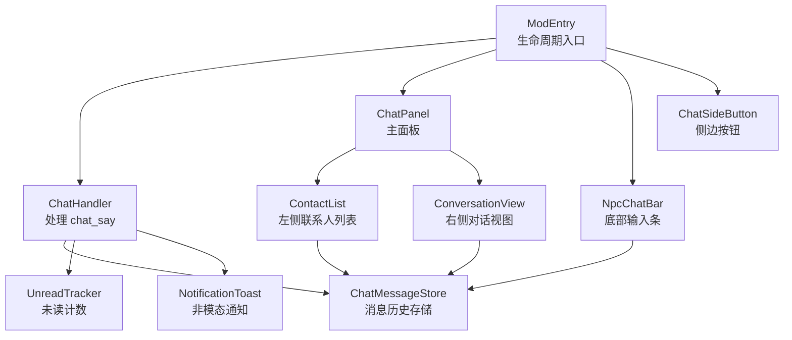
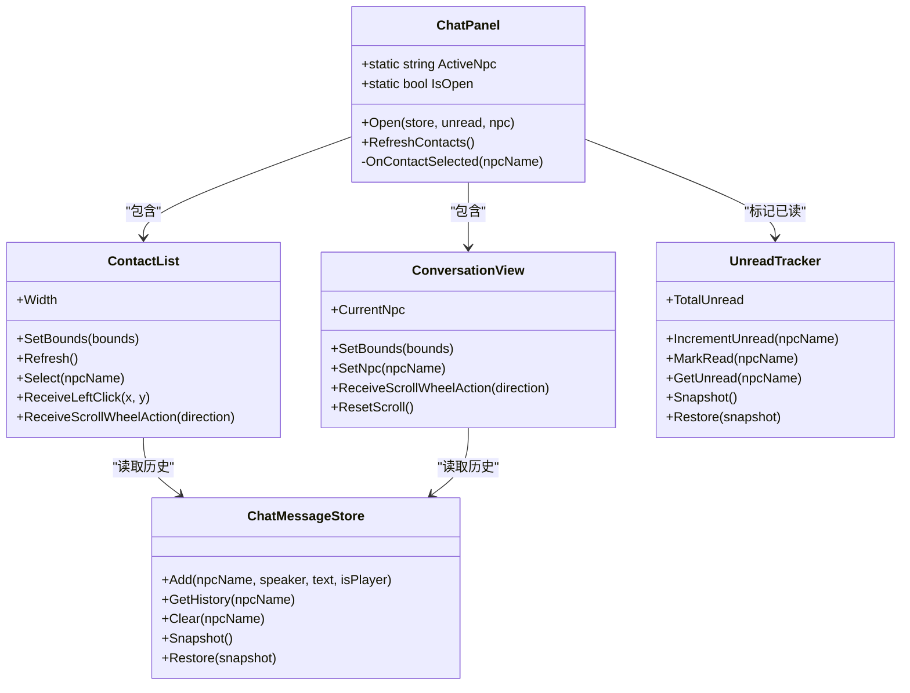
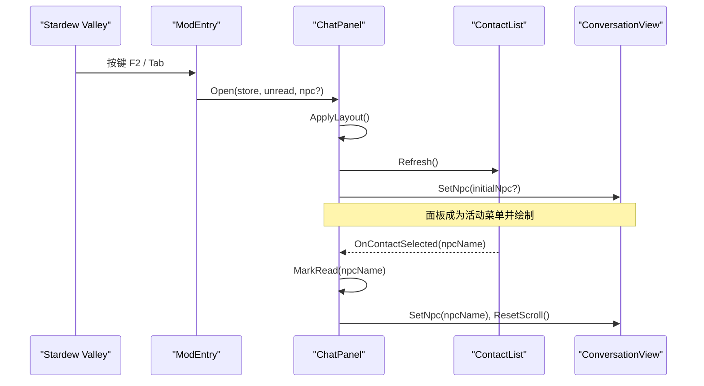
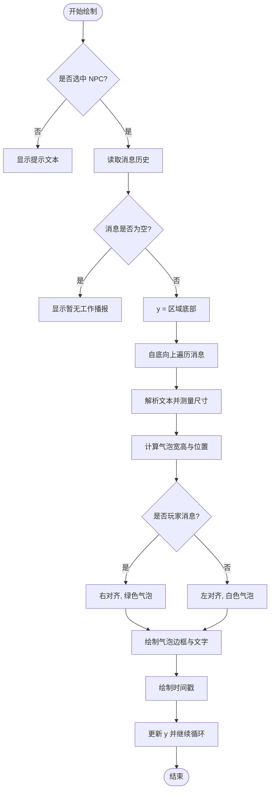
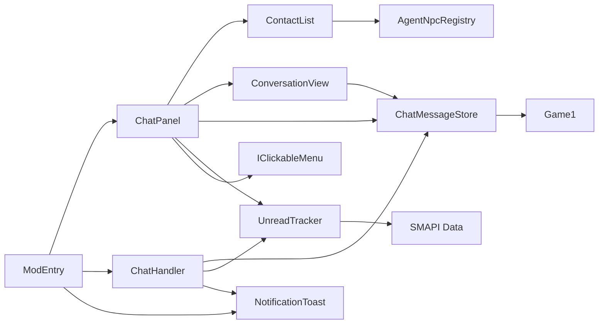

# 聊天面板 ChatPanel

<cite>
**本文引用的文件**   
- [ChatPanel.cs](file://SmartNPC/smapi-mod/UI/ChatPanel.cs)
- [ConversationView.cs](file://SmartNPC/smapi-mod/UI/ConversationView.cs)
- [ContactList.cs](file://SmartNPC/smapi-mod/UI/ContactList.cs)
- [ChatMessageStore.cs](file://SmartNPC/smapi-mod/UI/ChatMessageStore.cs)
- [UnreadTracker.cs](file://SmartNPC/smapi-mod/Data/UnreadTracker.cs)
- [NpcChatBar.cs](file://SmartNPC/smapi-mod/UI/NpcChatBar.cs)
- [NotificationToast.cs](file://SmartNPC/smapi-mod/UI/NotificationToast.cs)
- [ChatSideButton.cs](file://SmartNPC/smapi-mod/UI/ChatSideButton.cs)
- [ChatHandler.cs](file://SmartNPC/smapi-mod/Chat/ChatHandler.cs)
- [ModEntry.cs](file://SmartNPC/smapi-mod/ModEntry.cs)
</cite>

## 目录
1. [引言](#引言)
2. [项目结构](#项目结构)
3. [核心组件](#核心组件)
4. [架构总览](#架构总览)
5. [详细组件分析](#详细组件分析)
6. [依赖关系分析](#依赖关系分析)
7. [性能与渲染优化](#性能与渲染优化)
8. [用户交互与焦点控制](#用户交互与焦点控制)
9. [布局与响应式适配](#布局与响应式适配)
10. [自定义扩展指南](#自定义扩展指南)
11. [故障排查](#故障排查)
12. [结论](#结论)

## 引言
本文件围绕 SmartNPC SMAPI 模组中的 QQ 风格聊天面板 ChatPanel 进行系统化技术文档说明。该面板是一个“只读监控型”聊天界面，用于显示 Agent 广播消息、调试请求镜像和玩家输入消息；同时提供联系人列表、未读数提示、滚动浏览以及多分辨率适配。其设计目标是在不破坏原游戏菜单体系的前提下，通过 XNA StardewValley.Menus 扩展出类似即时通讯软件的面板体验。

## 项目结构
ChatPanel 属于 UI 层，位于 `SmartNPC/smapi-mod/UI` 目录下，并与数据层、桥接层、事件层共同协作：

图表来源
- [ModEntry.cs:1-200](file://SmartNPC/smapi-mod/ModEntry.cs#L1-L200)
- [ChatHandler.cs:1-96](file://SmartNPC/smapi-mod/Chat/ChatHandler.cs#L1-L96)
- [ChatPanel.cs:1-178](file://SmartNPC/smapi-mod/UI/ChatPanel.cs#L1-L178)
- [ContactList.cs:1-200](file://SmartNPC/smapi-mod/UI/ContactList.cs#L1-L200)
- [ConversationView.cs:1-175](file://SmartNPC/smapi-mod/UI/ConversationView.cs#L1-L175)
- [ChatMessageStore.cs:1-87](file://SmartNPC/smapi-mod/UI/ChatMessageStore.cs#L1-L87)
- [UnreadTracker.cs:1-56](file://SmartNPC/smapi-mod/Data/UnreadTracker.cs#L1-L56)
- [NpcChatBar.cs:1-165](file://SmartNPC/smapi-mod/UI/NpcChatBar.cs#L1-L165)
- [NotificationToast.cs:1-138](file://SmartNPC/smapi-mod/UI/NotificationToast.cs#L1-L138)
- [ChatSideButton.cs:1-166](file://SmartNPC/smapi-mod/UI/ChatSideButton.cs#L1-L166)

章节来源
- [ModEntry.cs:1-200](file://SmartNPC/smapi-mod/ModEntry.cs#L1-L200)
- [ChatPanel.cs:1-178](file://SmartNPC/smapi-mod/UI/ChatPanel.cs#L1-L178)

## 核心组件
- ChatPanel：QQ 风格聊天面板顶层容器，负责面板生命周期、布局、热键、绘制、打开/关闭状态、联系人选择回调。
- ContactList：左侧联系人列表，展示 NPC 头像、在线状态、最后消息预览、未读数徽章，支持点击选中与滚轮滚动。
- ConversationView：右侧对话视图，展示当前 NPC 的聊天记录气泡、时间戳、头部标题，支持鼠标滚轮滚动历史。
- ChatMessageStore：每 NPC 的消息历史内存存储，支持添加、查询、清空、快照与恢复。
- UnreadTracker：每 NPC 未读计数追踪器，支持增量、置已读、查询总数与持久化快照。
- NotificationToast：非模态浮动通知，在面板关闭时提示新消息，支持点击跳转到对应 NPC。
- NpcChatBar：底部输入栏，玩家可输入消息并发送，将玩家消息写入 store 并通过回调发送到后端。
- ChatHandler：接收 WebSocket `chat_say`，入队并在游戏 tick 中处理，更新 store、unread、toast 或刷新面板。
- ModEntry：SMAPI 模组入口，装配所有子系统、注册事件、热键、保存/加载、HUD 渲染等。

章节来源
- [ChatPanel.cs:1-178](file://SmartNPC/smapi-mod/UI/ChatPanel.cs#L1-L178)
- [ContactList.cs:1-200](file://SmartNPC/smapi-mod/UI/ContactList.cs#L1-L200)
- [ConversationView.cs:1-175](file://SmartNPC/smapi-mod/UI/ConversationView.cs#L1-L175)
- [ChatMessageStore.cs:1-87](file://SmartNPC/smapi-mod/UI/ChatMessageStore.cs#L1-L87)
- [UnreadTracker.cs:1-56](file://SmartNPC/smapi-mod/Data/UnreadTracker.cs#L1-L56)
- [NpcChatBar.cs:1-165](file://SmartNPC/smapi-mod/UI/NpcChatBar.cs#L1-L165)
- [NotificationToast.cs:1-138](file://SmartNPC/smapi-mod/UI/NotificationToast.cs#L1-L138)
- [ChatHandler.cs:1-96](file://SmartNPC/smapi-mod/Chat/ChatHandler.cs#L1-L96)
- [ModEntry.cs:1-200](file://SmartNPC/smapi-mod/ModEntry.cs#L1-L200)

## 架构总览
ChatPanel 采用“容器 + 子视图”的层次结构，配合消息总线与状态对象实现松耦合：

图表来源
- [ChatPanel.cs:1-178](file://SmartNPC/smapi-mod/UI/ChatPanel.cs#L1-L178)
- [ContactList.cs:1-200](file://SmartNPC/smapi-mod/UI/ContactList.cs#L1-L200)
- [ConversationView.cs:1-175](file://SmartNPC/smapi-mod/UI/ConversationView.cs#L1-L175)
- [ChatMessageStore.cs:1-87](file://SmartNPC/smapi-mod/UI/ChatMessageStore.cs#L1-L87)
- [UnreadTracker.cs:1-56](file://SmartNPC/smapi-mod/Data/UnreadTracker.cs#L1-L56)

## 详细组件分析

### ChatPanel：面板生命周期与显示隐藏逻辑
- 面板尺寸默认宽 900、高 560，使用 StardewValley.Menus.IClickableMenu 基类，自动居中显示并提供右上角关闭按钮。
- 构造阶段初始化 `_store`、`_unread`、`_contacts`、`_conversation`，调用 `ApplyLayout()` 分配左右区域，刷新联系人列表，并根据可选初始 NPC 设置选中项。
- 显示逻辑：
  - `draw` 绘制半透明黑色背景、外框、联系人列表、对话视图，再调用基类绘制。
  - `receiveLeftClick` 仅转发到联系人列表（右侧为只读）。
  - `receiveScrollWheelAction` 根据鼠标 X 坐标路由到左窗格或右窗格的滚轮行为。
  - `receiveKeyPress` 处理 Esc 与 Tab 关闭面板。
  - `gameWindowSizeChanged` 重新计算屏幕位置并应用布局。
  - `cleanupBeforeExit` 清空静态活动 NPC 引用。
- 公开 API：
  - `Open(store, unread, npc)`：以指定 NPC 打开面板，并设置 `Game1.activeClickableMenu` 为当前面板实例。
  - `RefreshContacts()`：新增消息后刷新联系人列表。
- 内部回调 `OnContactSelected`：设置活动 NPC、标记未读为已读、切换对话视图并重置滚动偏移。

图表来源
- [ModEntry.cs:201-360](file://SmartNPC/smapi-mod/ModEntry.cs#L201-L360)
- [ChatPanel.cs:1-178](file://SmartNPC/smapi-mod/UI/ChatPanel.cs#L1-L178)
- [ContactList.cs:1-200](file://SmartNPC/smapi-mod/UI/ContactList.cs#L1-L200)
- [ConversationView.cs:1-175](file://SmartNPC/smapi-mod/UI/ConversationView.cs#L1-L175)

章节来源
- [ChatPanel.cs:1-178](file://SmartNPC/smapi-mod/UI/ChatPanel.cs#L1-L178)
- [ModEntry.cs:201-360](file://SmartNPC/smapi-mod/ModEntry.cs#L201-L360)

### ConversationView：消息气泡渲染与滚动行为
- 右侧区域背景色为浅色，顶部蓝色标题栏显示 NPC 名称或默认标题。
- 当无选中 NPC 时，显示提示文本。
- 渲染流程：
  - 从 `ChatMessageStore.GetHistory` 获取消息列表。
  - 自底向上渲染气泡，使用 `_scrollOffset` 控制跳过的底部消息数量以实现滚动。
  - 每条消息按 `MaxBubbleWidthRatio` 限制最大宽度，使用 `Game1.parseText` 自动换行。
  - 气泡颜色区分玩家消息与 NPC 消息；玩家消息靠右对齐，NPC 消息靠左对齐。
  - 气泡边框使用细线绘制，时间戳以游戏内时间格式显示。
- 滚动：
  - `ReceiveScrollWheelAction` 根据方向增加或减少 `_scrollOffset`，上限为消息数减一。
  - `ResetScroll` 将滚动归零。

图表来源
- [ConversationView.cs:1-175](file://SmartNPC/smapi-mod/UI/ConversationView.cs#L1-L175)

章节来源
- [ConversationView.cs:1-175](file://SmartNPC/smapi-mod/UI/ConversationView.cs#L1-L175)

### ContactList：联系人列表渲染与交互
- 左侧固定宽度 300px，行高 72px，头部高度 56px。
- 数据来源：
  - 通过 `AgentNpcRegistry.GetAll()` 获取所有受控 NPC。
  - 按最近消息时间倒序排序，次要按名称排序。
  - 若当前选中项不在列表中则重置选中项；若无选中且存在 NPC 则自动选中第一个。
- 渲染：
  - 背景色为浅黄，右侧分隔线为棕色。
  - 头部显示“联系人”与总未读数。
  - 列表区域使用 Scissor 裁剪避免溢出。
  - 每行绘制头像、在线点、名称、最后消息预览、未读数徽章。
- 交互：
  - `ReceiveLeftClick` 检测行矩形并触发选中回调。
  - `ReceiveScrollWheelAction` 控制可见行数与滚动偏移。

章节来源
- [ContactList.cs:1-200](file://SmartNPC/smapi-mod/UI/ContactList.cs#L1-L200)
- [ContactList.cs:201-261](file://SmartNPC/smapi-mod/UI/ContactList.cs#L201-L261)

### ChatMessageStore：消息存储结构与复杂度
- 数据结构：
  - `_history`: `Dictionary<string, List<ChatMessage>>`，键为 NPC 名称，值为消息列表。
  - `_maxPerNpc`: 每个 NPC 的最大消息数，默认 100。
- 操作复杂度：
  - `Add`: O(1) 插入，若超过阈值则移除头部 O(1)。
  - `GetHistory`: O(1) 查找返回引用。
  - `Clear`: O(1) 检查键后清空。
  - `Snapshot`: O(N) 复制每个 NPC 的最后 N 条消息。
  - `Restore`: O(M) 替换内存状态。
- 持久化：
  - `Snapshot` 生成可序列化快照供 ModEntry 保存。
  - `Restore` 接受快照并重建内存状态。

章节来源
- [ChatMessageStore.cs:1-87](file://SmartNPC/smapi-mod/UI/ChatMessageStore.cs#L1-L87)

### UnreadTracker：未读计数与持久化
- 数据结构：`Dictionary<string, int>` 记录每个 NPC 的未读数。
- 主要方法：
  - `IncrementUnread`：递增未读。
  - `MarkRead`：移除未读条目。
  - `GetUnread`：查询某 NPC 未读数。
  - `TotalUnread`：汇总所有未读数。
  - `Snapshot`/`Restore`：用于保存与恢复。

章节来源
- [UnreadTracker.cs:1-56](file://SmartNPC/smapi-mod/Data/UnreadTracker.cs#L1-L56)

### NpcChatBar：底部输入条与玩家消息发送
- 固定在屏幕底部，高度 64px，包含 NPC 头像、名称标签、文本输入框、关闭按钮。
- 输入逻辑：
  - 按下回车时，将玩家消息添加到 `ChatMessageStore` 并通过回调发送到后端。
  - 关闭按钮退出面板并释放键盘输入订阅。
- 渲染：
  - 半透明深色背景，顶部棕色边框线。
  - 头像缺失时显示灰色占位块。
  - 关闭按钮悬停变色。

章节来源
- [NpcChatBar.cs:1-165](file://SmartNPC/smapi-mod/UI/NpcChatBar.cs#L1-L165)

### NotificationToast：非模态通知
- 最多显示 3 条通知，右下角堆叠，每条存活约 3 秒，最后 0.6 秒淡出。
- 点击通知跳转至对应 NPC 的聊天面板。
- 每帧更新时间并清理过期通知。

章节来源
- [NotificationToast.cs:1-138](file://SmartNPC/smapi-mod/UI/NotificationToast.cs#L1-L138)

### ChatSideButton：侧边装饰按钮
- 固定于左侧中间位置，带木框纹理、聊天气泡图标、未读脉冲红点。
- 点击播放选择音效并触发回调。

章节来源
- [ChatSideButton.cs:1-166](file://SmartNPC/smapi-mod/UI/ChatSideButton.cs#L1-L166)

### ChatHandler：消息接入与队列处理
- 接收 WebSocket `chat_say` 参数，反序列化为 `ChatSayParams`。
- 参数校验失败返回错误响应。
- 将有效消息入队 `_pending`，在游戏 tick 中批量处理：
  - 写入 `ChatMessageStore`。
  - 如果面板打开且当前对话匹配，则不增加未读。
  - 触发通知回调，用于推送 toast 或刷新面板。
- 日志输出 trace 级别消息。

章节来源
- [ChatHandler.cs:1-96](file://SmartNPC/smapi-mod/Chat/ChatHandler.cs#L1-L96)

### ModEntry：组装与事件驱动
- 生命周期事件：
  - `GameLaunched`：装配 Harmony、WebSocket、消息路由、UI 组件、配置、控制台命令。
  - `UpdateTicked`：泵送 WebSocket、ChatHandler、感知、移动、行为、跟随、动作处理器，更新 toast，清理观察项，动画泵送。
  - `SaveLoaded`：注册 NPC、恢复未读与库存、抑制日程。
  - `Saving`：持久化聊天历史、未读计数、库存快照。
  - `RenderedHud`/`RenderedWorld`：绘制 HUD 层 toast 与世界调试覆盖。
  - `ButtonsChanged`/`ButtonPressed`：热键处理、toast 点击穿透。
- 关键装配：
  - `_toast = new NotificationToast(this.OpenChatPanelForNpc)`。
  - `_chat.SetMessageStore(_messageStore)`。
  - `_chat.SetUnreadTracker(_unread)`。
  - `_chat.SetMessageNotifier(this.OnIncomingChatMessage)`。

章节来源
- [ModEntry.cs:1-200](file://SmartNPC/smapi-mod/ModEntry.cs#L1-L200)
- [ModEntry.cs:201-560](file://SmartNPC/smapi-mod/ModEntry.cs#L201-L560)

## 依赖关系分析
ChatPanel 依赖以下组件与外部系统：

图表来源
- [ChatPanel.cs:1-178](file://SmartNPC/smapi-mod/UI/ChatPanel.cs#L1-L178)
- [ContactList.cs:1-200](file://SmartNPC/smapi-mod/UI/ContactList.cs#L1-L200)
- [ConversationView.cs:1-175](file://SmartNPC/smapi-mod/UI/ConversationView.cs#L1-L175)
- [ChatMessageStore.cs:1-87](file://SmartNPC/smapi-mod/UI/ChatMessageStore.cs#L1-L87)
- [UnreadTracker.cs:1-56](file://SmartNPC/smapi-mod/Data/UnreadTracker.cs#L1-L56)
- [ChatHandler.cs:1-96](file://SmartNPC/smapi-mod/Chat/ChatHandler.cs#L1-L96)
- [NotificationToast.cs:1-138](file://SmartNPC/smapi-mod/UI/NotificationToast.cs#L1-L138)
- [ModEntry.cs:1-200](file://SmartNPC/smapi-mod/ModEntry.cs#L1-L200)

章节来源
- [ChatPanel.cs:1-178](file://SmartNPC/smapi-mod/UI/ChatPanel.cs#L1-L178)
- [ModEntry.cs:1-200](file://SmartNPC/smapi-mod/ModEntry.cs#L1-L200)

## 性能与渲染优化
- 消息历史长度限制：
  - `ChatMessageStore` 每个 NPC 最多保留 `_maxPerNpc` 条消息，超出时删除最旧消息，防止内存增长。
  - 建议保持默认 100，如需更长历史可调大但需评估内存占用。
- 滚动渲染效率：
  - `ConversationView` 自底向上渲染，使用 `_scrollOffset` 跳过底部消息，避免全量重绘。
  - 建议使用合理的 `MaxBubbleWidthRatio` 控制气泡宽度，避免过长换行导致过多文本测量。
- 列表裁剪：
  - `ContactList` 使用 `ScissorRectangle` 裁剪列表区域，减少无关像素绘制。
- 字体测量缓存：
  - 当前实现多次调用 `MeasureString`，在高负载场景可考虑缓存常用字符串度量结果。
- 批次绘制：
  - 使用 `SpriteBatch.Begin/End` 合理分组绘制，避免频繁开启关闭批处理。
- 异步消息处理：
  - `ChatHandler` 使用 `ConcurrentQueue` 缓冲消息，在游戏 tick 中批量泵送，降低单条消息处理开销。

章节来源
- [ChatMessageStore.cs:1-87](file://SmartNPC/smapi-mod/UI/ChatMessageStore.cs#L1-L87)
- [ConversationView.cs:1-175](file://SmartNPC/smapi-mod/UI/ConversationView.cs#L1-L175)
- [ContactList.cs:1-200](file://SmartNPC/smapi-mod/UI/ContactList.cs#L1-L200)
- [ChatHandler.cs:1-96](file://SmartNPC/smapi-mod/Chat/ChatHandler.cs#L1-L96)

## 用户交互与焦点控制
- 热键：
  - Tab：在其他菜单关闭时打开面板；在面板内关闭面板。
  - F2：直接打开面板。
  - Esc：关闭面板或输入条。
- 鼠标点击：
  - 面板右侧只读，点击仅路由到联系人列表。
  - 联系人列表行点击选中 NPC，播放选择音效。
  - toast 点击打开对应 NPC 聊天面板。
- 滚轮：
  - 根据鼠标 X 坐标判断左窗格或右窗格滚动。
  - 联系人列表与对话视图各自维护滚动偏移。
- 键盘输入：
  - 输入条启用 `TextBox`，回车发送消息，Esc 关闭。
  - 面板内仅处理 Esc 与 Tab。
- 焦点管理：
  - 面板打开时成为 `Game1.activeClickableMenu`。
  - 输入条接管 `Game1.keyboardDispatcher.Subscriber`，退出时清空。

章节来源
- [ChatPanel.cs:1-178](file://SmartNPC/smapi-mod/UI/ChatPanel.cs#L1-L178)
- [ContactList.cs:201-261](file://SmartNPC/smapi-mod/UI/ContactList.cs#L201-L261)
- [NpcChatBar.cs:1-165](file://SmartNPC/smapi-mod/UI/NpcChatBar.cs#L1-L165)
- [NotificationToast.cs:1-138](file://SmartNPC/smapi-mod/UI/NotificationToast.cs#L1-L138)
- [ModEntry.cs:201-360](file://SmartNPC/smapi-mod/ModEntry.cs#L201-L360)

## 布局与响应式适配
- 面板尺寸：
  - 默认宽 900、高 560，基于视口居中。
- 左右分栏：
  - 左侧 `ContactList.Width` 固定 300px。
  - 右侧 `ConversationView` 占据剩余空间。
- 窗口变化：
  - `gameWindowSizeChanged` 重新计算面板位置并调用 `ApplyLayout`。
- 输入条：
  - 固定屏幕底部，宽度随视口变化，文本框宽度动态计算。
- 通知：
  - 右下角堆叠，距离视口边缘固定偏移。
- 侧边按钮：
  - 垂直居中于视口，水平固定左边距。

章节来源
- [ChatPanel.cs:1-178](file://SmartNPC/smapi-mod/UI/ChatPanel.cs#L1-L178)
- [ContactList.cs:1-200](file://SmartNPC/smapi-mod/UI/ContactList.cs#L1-L200)
- [NpcChatBar.cs:1-165](file://SmartNPC/smapi-mod/UI/NpcChatBar.cs#L1-L165)
- [NotificationToast.cs:1-138](file://SmartNPC/smapi-mod/UI/NotificationToast.cs#L1-L138)
- [ChatSideButton.cs:1-166](file://SmartNPC/smapi-mod/UI/ChatSideButton.cs#L1-L166)

## 自定义扩展指南

### 自定义消息气泡样式
- 修改气泡颜色与对齐：
  - 在 `ConversationView.DrawTranscript` 中调整 `bubbleColor`、`textColor`、`bubbleX` 的计算逻辑。
  - 示例路径：[ConversationView.cs:60-120](file://SmartNPC/smapi-mod/UI/ConversationView.cs#L60-L120)
- 修改气泡边框：
  - 调整 `DrawBorder` 的颜色与线条厚度。
  - 示例路径：[ConversationView.cs:120-150](file://SmartNPC/smapi-mod/UI/ConversationView.cs#L120-L150)
- 修改时间戳格式：
  - 调整 `FormatGameTime` 的输出字符串。
  - 示例路径：[ConversationView.cs:150-175](file://SmartNPC/smapi-mod/UI/ConversationView.cs#L150-L175)

### 添加新的交互功能
- 新增面板热键：
  - 在 `ModEntry.OnButtonsChanged` 中添加新的按键分支。
  - 示例路径：[ModEntry.cs:201-360](file://SmartNPC/smapi-mod/ModEntry.cs#L201-L360)
- 新增联系人列表交互：
  - 在 `ContactList.ReceiveLeftClick` 中添加额外点击区域或右键菜单。
  - 示例路径：[ContactList.cs:201-261](file://SmartNPC/smapi-mod/UI/ContactList.cs#L201-L261)
- 新增 toast 行为：
  - 在 `NotificationToast.TryClick` 中扩展点击后的回调逻辑。
  - 示例路径：[NotificationToast.cs:80-110](file://SmartNPC/smapi-mod/UI/NotificationToast.cs#L80-L110)

### 扩展面板行为
- 新增面板子组件：
  - 创建新类继承 `IClickableMenu` 或作为独立绘制组件。
  - 在 `ChatPanel` 中组合并分配边界。
  - 示例路径：[ChatPanel.cs:40-120](file://SmartNPC/smapi-mod/UI/ChatPanel.cs#L40-L120)
- 扩展消息存储策略：
  - 修改 `ChatMessageStore._maxPerNpc` 或重写 `Add` 的逻辑。
  - 示例路径：[ChatMessageStore.cs:20-60](file://SmartNPC/smapi-mod/UI/ChatMessageStore.cs#L20-L60)
- 扩展未读计数规则：
  - 在 `UnreadTracker` 中添加更复杂的计数策略。
  - 示例路径：[UnreadTracker.cs:10-40](file://SmartNPC/smapi-mod/Data/UnreadTracker.cs#L10-L40)

## 故障排查
- 面板无法打开：
  - 检查 `ModEntry.OnButtonsChanged` 是否正确注册 F2 与 Tab。
  - 确认 `Game1.activeClickableMenu` 未被其他菜单占用。
  - 参考路径：[ModEntry.cs:201-360](file://SmartNPC/smapi-mod/ModEntry.cs#L201-L360)
- 消息不显示：
  - 检查 `ChatHandler.PumpOnGameTick` 是否正常泵送消息。
  - 确认 `ChatMessageStore.Add` 被调用且消息列表非空。
  - 参考路径：[ChatHandler.cs:40-90](file://SmartNPC/smapi-mod/Chat/ChatHandler.cs#L40-L90)
- 未读数不更新：
  - 检查 `UnreadTracker.IncrementUnread` 是否在非活跃对话时被调用。
  - 确认 `ChatPanel.ActiveNpc` 与消息说话者匹配时未累加未读。
  - 参考路径：[ChatHandler.cs:60-90](file://SmartNPC/smapi-mod/Chat/ChatHandler.cs#L60-L90)
- 滚动异常：
  - 检查 `ConversationView._scrollOffset` 与 `ContactList._scrollOffset` 的边界条件。
  - 参考路径：[ConversationView.cs:140-175](file://SmartNPC/smapi-mod/UI/ConversationView.cs#L140-L175)
- 布局错位：
  - 检查 `ChatPanel.ApplyLayout` 与 `gameWindowSizeChanged` 是否正确计算边界。
  - 参考路径：[ChatPanel.cs:60-110](file://SmartNPC/smapi-mod/UI/ChatPanel.cs#L60-L110)

章节来源
- [ChatHandler.cs:40-90](file://SmartNPC/smapi-mod/Chat/ChatHandler.cs#L40-L90)
- [ChatPanel.cs:60-110](file://SmartNPC/smapi-mod/UI/ChatPanel.cs#L60-L110)
- [ConversationView.cs:140-175](file://SmartNPC/smapi-mod/UI/ConversationView.cs#L140-L175)
- [ModEntry.cs:201-360](file://SmartNPC/smapi-mod/ModEntry.cs#L201-L360)

## 结论
ChatPanel 及其相关组件构成了一个完整、可扩展的 QQ 风格聊天面板系统。它通过清晰的职责分离、高效的渲染机制、稳健的事件驱动架构，实现了消息监听、历史记录、未读提示、滚动浏览、响应式布局与多分辨率适配。开发者可通过修改气泡样式、扩展交互逻辑、定制面板行为来满足更多需求。在性能方面，建议关注消息历史长度、文本测量缓存、绘制批次优化等关键点，以确保在高负载场景下的流畅体验。