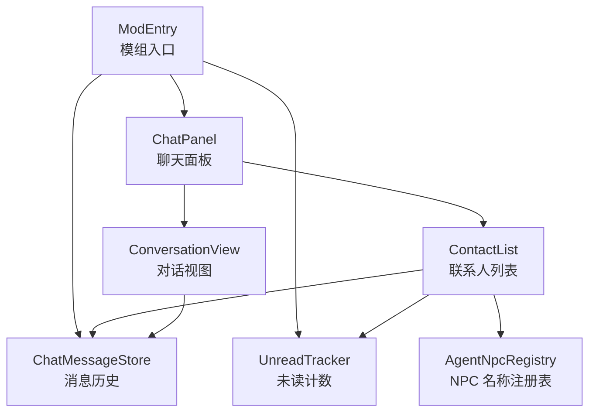
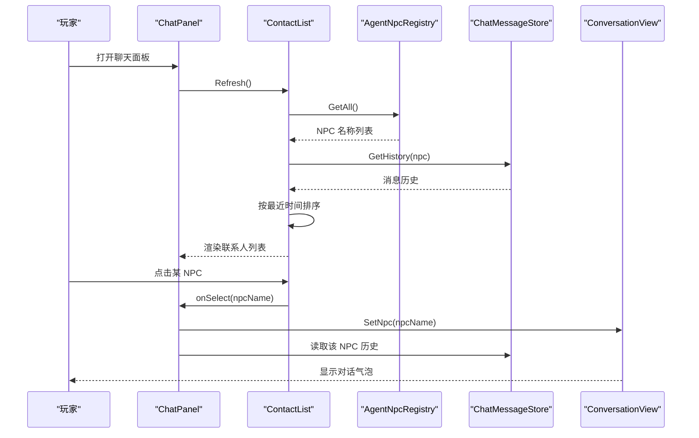
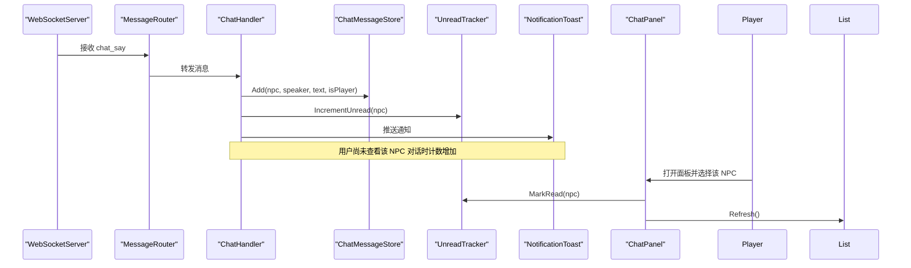
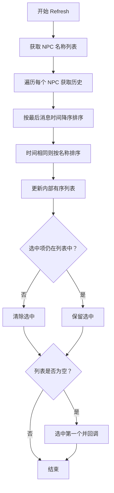
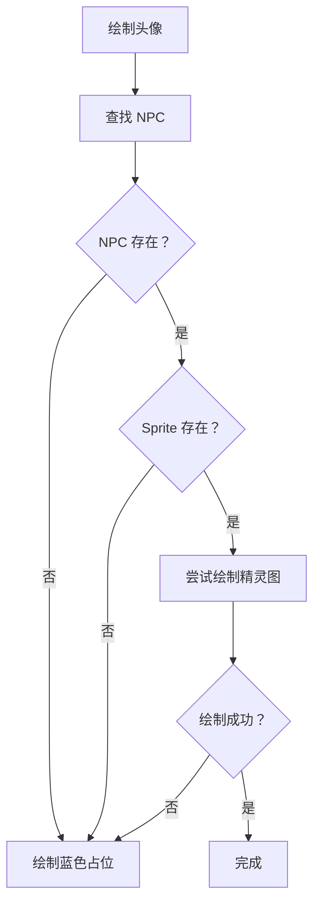
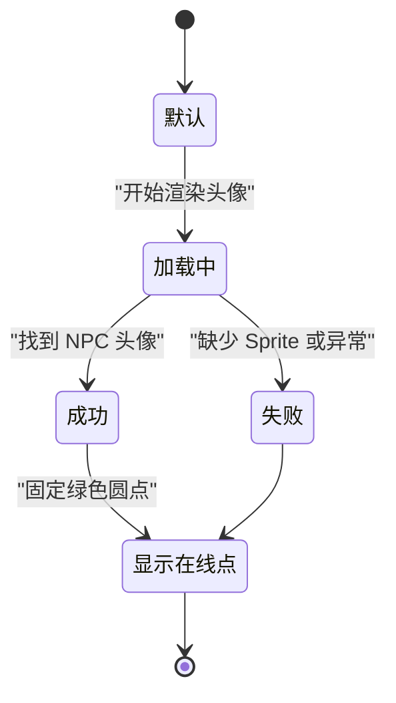
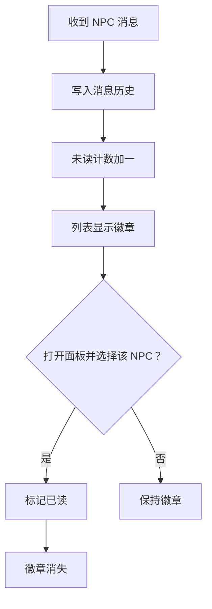
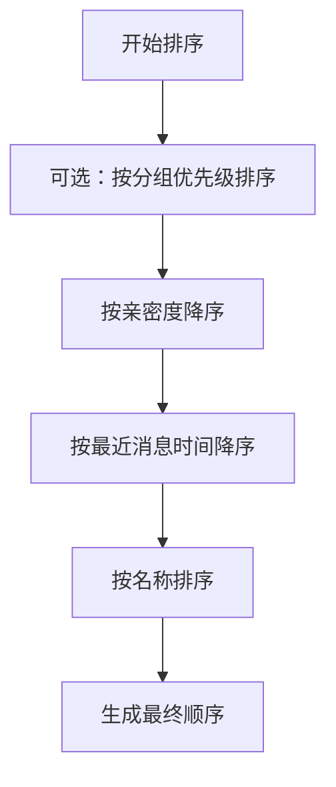

# 联系人列表 ContactList

<cite>
**本文引用的文件**   
- [ContactList.cs](file://SmartNPC/smapi-mod/UI/ContactList.cs)
- [ChatPanel.cs](file://SmartNPC/smapi-mod/UI/ChatPanel.cs)
- [ConversationView.cs](file://SmartNPC/smapi-mod/UI/ConversationView.cs)
- [ChatMessageStore.cs](file://SmartNPC/smapi-mod/UI/ChatMessageStore.cs)
- [UnreadTracker.cs](file://SmartNPC/smapi-mod/Data/UnreadTracker.cs)
- [AgentNpcRegistry.cs](file://SmartNPC/smapi-mod/NPC/AgentNpcRegistry.cs)
- [ModEntry.cs](file://SmartNPC/smapi-mod/ModEntry.cs)
</cite>

## 目录
1. [简介](#简介)
2. [项目结构与角色定位](#项目结构与角色定位)
3. [核心组件总览](#核心组件总览)
4. [架构与数据流](#架构与数据流)
5. [联系人列表详细实现](#联系人列表详细实现)
6. [NPC 头像渲染系统](#npc-头像渲染系统)
7. [在线状态显示逻辑](#在线状态显示逻辑)
8. [未读计数器机制](#未读计数器机制)
9. [联系人分组与排序算法](#联系人分组与排序算法)
10. [自定义与扩展示例](#自定义与扩展示例)
11. [性能优化建议](#性能优化建议)
12. [故障排查指南](#故障排查指南)
13. [结论](#结论)

## 简介
ContactList 是 SmartNPC SMAPI 模组中 QQ 风格聊天面板的左侧联系人子组件。它负责：
- 列出所有由外部 Agent 管理的 NPC；
- 根据最近消息时间对联系人排序；
- 渲染 NPC 头像、名称、最后一条消息预览、未读数徽标；
- 响应点击和滚轮，选择联系人并切换到对应对话视图；
- 与 ChatMessageStore、UnreadTracker、AgentNpcRegistry 协作，构成“列表—历史—未读—持久化”的整体 UI 数据模型。

需要特别说明的是：当前仓库中的 ContactList 是一个**只读聊天监视器**的一部分，并非完整意义上的玩家可编辑联系人应用。因此，“在线状态”在当前代码中表现为一个固定绿色圆点，而不是从网络或游戏状态动态推导的真实在线状态。

## 项目结构与角色定位
ContactList 属于 `SmartNPC/smapi-mod/UI` 层，被顶层菜单 `ChatPanel` 组合使用。它与以下组件形成紧密耦合：

| 组件 | 职责 | 与 ContactList 的关系 |
|---|---|---|
| `ChatPanel` | 聊天面板容器，负责布局、输入分发、打开/关闭面板 | 创建 ContactList，并把鼠标事件路由给它 |
| `ConversationView` | 右侧对话视图，展示某个 NPC 的消息气泡 | 与 ContactList 共享 `ChatMessageStore`，但不直接持有对方引用 |
| `ChatMessageStore` | 每个 NPC 的消息历史、最大长度裁剪、快照恢复 | 提供每条消息的时间戳、文本、是否玩家发送等 |
| `UnreadTracker` | 按 NPC 名称维护未读数 | 提供单个 NPC 未读数和总未读数 |
| `AgentNpcRegistry` | 维护 Agent 管理的 NPC 名称集合 | 为 ContactList 提供联系人名单来源 |
| `ModEntry` | SMAPI 模组入口，装配 WebSocket、消息路由、UI 生命周期 | 初始化 store、unread、toast，并在保存/加载时序列化 |

**图表来源**
- [ModEntry.cs:20-120](file://SmartNPC/smapi-mod/ModEntry.cs#L20-L120)
- [ChatPanel.cs:1-80](file://SmartNPC/smapi-mod/UI/ChatPanel.cs#L1-L80)
- [ContactList.cs:1-40](file://SmartNPC/smapi-mod/UI/ContactList.cs#L1-L40)
- [AgentNpcRegistry.cs:1-29](file://SmartNPC/smapi-mod/NPC/AgentNpcRegistry.cs#L1-L29)

**章节来源**
- [ChatPanel.cs:1-178](file://SmartNPC/smapi-mod/UI/ChatPanel.cs#L1-L178)
- [ContactList.cs:1-261](file://SmartNPC/smapi-mod/UI/ContactList.cs#L1-L261)
- [AgentNpcRegistry.cs:1-29](file://SmartNPC/smapi-mod/NPC/AgentNpcRegistry.cs#L1-L29)
- [ModEntry.cs:1-200](file://SmartNPC/smapi-mod/ModEntry.cs#L1-L200)

## 核心组件总览

### ContactList
- 常量：列表宽度 300、行高 72、头部高度 56、内边距 12。
- 字段：边界矩形、当前选中 NPC、滚动偏移、已排序 NPC 名称列表。
- 主要方法：
  - `Refresh()`：从注册表拉取 NPC，结合历史最新时间排序。
  - `Select(npcName)`：选择指定 NPC，必要时刷新列表。
  - `Draw(SpriteBatch)`：绘制背景、分割线、标题、总未读数、联系人行、空提示。
  - `ReceiveLeftClick(x,y)`：处理点击行切换选中项。
  - `ReceiveScrollWheelAction(direction)`：处理滚轮滚动。

### ChatMessageStore
- 存储每个 NPC 的 `ChatMessage` 列表。
- 每条消息包含说话者、文本、是否玩家、时间、游戏内时间。
- 超出最大长度时移除最早消息。
- 支持快照和恢复，用于存档持久化。

### UnreadTracker
- 基于字典维护每个 NPC 的未读数。
- 提供增加、标记已读、查询、总量、快照、恢复、重置等方法。

### ConversationView
- 右侧只读对话视图。
- 从 `ChatMessageStore` 读取消息并按游戏内时间显示气泡。
- 玩家消息靠右显示，NPC 消息靠左显示。

**章节来源**
- [ContactList.cs:1-261](file://SmartNPC/smapi-mod/UI/ContactList.cs#L1-L261)
- [ChatMessageStore.cs:1-87](file://SmartNPC/smapi-mod/UI/ChatMessageStore.cs#L1-L87)
- [UnreadTracker.cs:1-56](file://SmartNPC/smapi-mod/Data/UnreadTracker.cs#L1-L56)
- [ConversationView.cs:1-175](file://SmartNPC/smapi-mod/UI/ConversationView.cs#L1-L175)

## 架构与数据流

### 联系人列表更新流程

**图表来源**
- [ChatPanel.cs:40-178](file://SmartNPC/smapi-mod/UI/ChatPanel.cs#L40-L178)
- [ContactList.cs:40-120](file://SmartNPC/smapi-mod/UI/ContactList.cs#L40-L120)
- [ConversationView.cs:20-120](file://SmartNPC/smapi-mod/UI/ConversationView.cs#L20-L120)

### 未读消息更新流程

**图表来源**
- [ModEntry.cs:80-180](file://SmartNPC/smapi-mod/ModEntry.cs#L80-L180)
- [ChatMessageStore.cs:20-60](file://SmartNPC/smapi-mod/UI/ChatMessageStore.cs#L20-L60)
- [UnreadTracker.cs:10-56](file://SmartNPC/smapi-mod/Data/UnreadTracker.cs#L10-L56)
- [ChatPanel.cs:120-178](file://SmartNPC/smapi-mod/UI/ChatPanel.cs#L120-L178)

**章节来源**
- [ModEntry.cs:1-200](file://SmartNPC/smapi-mod/ModEntry.cs#L1-L200)

## 联系人列表详细实现

### 构造与依赖注入
ContactList 不直接创建 `ChatMessageStore`、`UnreadTracker` 或 NPC 注册表，而是通过构造函数注入：
- `_store`：提供每个 NPC 的历史消息；
- `_unread`：提供未读计数；
- `_onSelect`：回调给上层，通常是 `ChatPanel.OnContactSelected`。

这种设计让 ContactList 保持单一职责：只负责联系人列表的排序、选择和渲染，不负责消息产生、网络通信或面板生命周期。

### 列表刷新
`Refresh()` 的执行顺序如下：
1. 调用 `AgentNpcRegistry.GetAll()` 获取所有受管 NPC 名称；
2. 对每个 NPC 调用 `_store.GetHistory(npc)`；
3. 以最后一条消息的时间降序排序；
4. 时间相同时按名称忽略大小写升序；
5. 如果当前选中的 NPC 不在新列表中，则清空选中；
6. 如果没有选中且列表非空，自动选中第一个并触发选择回调。

**图表来源**
- [ContactList.cs:40-80](file://SmartNPC/smapi-mod/UI/ContactList.cs#L40-L80)

**章节来源**
- [ContactList.cs:40-80](file://SmartNPC/smapi-mod/UI/ContactList.cs#L40-L80)
- [AgentNpcRegistry.cs:1-29](file://SmartNPC/smapi-mod/NPC/AgentNpcRegistry.cs#L1-L29)

## NPC 头像渲染系统

### 头像缓存机制
ContactList 当前**没有独立的头像纹理缓存**。它每次绘制行时尝试直接从游戏对象获取头像：
- 通过 `Game1.getCharacterFromName(npcName)` 查找 NPC；
- 若 NPC 存在且其 Sprite 有 Texture，则截取左上角 `16×24` 区域；
- 否则回退到纯色占位矩形。

这意味着：
- 同一帧多次渲染同一 NPC 不会复用内存纹理；
- 每帧都可能访问 `Sprite.Texture`；
- 适合行数较少的小列表，但如果联系人数量增长，应考虑引入按 NPC 名称索引的纹理缓存。

### 加载状态管理
当前没有显式的“加载中”状态。头像渲染分为三类结果：
1. 成功：绘制 NPC 精灵图片段；
2. 失败：捕获异常后绘制蓝色占位矩形；
3. 不存在 NPC：同样绘制蓝色占位矩形。

如果需要更丰富的加载体验，可以扩展为：
- 初始：灰色占位；
- 查找中：旋转或进度指示；
- 成功：正常头像；
- 失败：错误图标或默认头像。

### 错误处理
头像绘制使用了 try/catch 包裹精灵绘制逻辑，避免 NPC 或 Sprite 缺失导致整个列表崩溃。这是合理的防御性编程方式。但需要注意：
- 异常路径会绘制占位背景；
- 如果后续逻辑继续假设头像已成功绘制，可能出现视觉不一致；
- 建议在返回前统一设置“是否成功绘制头像”的状态，便于后续叠加状态图标或边框。

**图表来源**
- [ContactList.cs:201-220](file://SmartNPC/smapi-mod/UI/ContactList.cs#L201-L220)

**章节来源**
- [ContactList.cs:180-220](file://SmartNPC/smapi-mod/UI/ContactList.cs#L180-L220)

## 在线状态显示逻辑

### 当前实现
ContactList 在头像右下角绘制一个固定绿色圆点，表示“在线”。这个圆点：
- 位置固定在头像右下角；
- 颜色固定为绿色；
- 对所有联系人始终显示；
- **不与 NPC 实际在线状态绑定**。

### 真实在线状态的扩展思路
如果要将其升级为真实在线状态，建议从以下数据源判断：
1. NPC 是否在场景中；
2. NPC 是否被外部 Agent 激活；
3. WebSocket 连接是否活跃；
4. NPC 是否有正在进行的动作；
5. 最近一次交互时间是否超过阈值。

不同状态可用颜色区分：
- 绿色：在线；
- 黄色：忙碌或执行任务；
- 灰色：离线；
- 红色：异常或连接断开。

### 实时更新机制
当前列表没有后台定时刷新逻辑。列表只在以下时机更新：
- 面板打开时；
- 调用 `RefreshContacts()`；
- 手动调用 `Refresh()`。

若要支持实时状态，可在 `ModEntry.UpdateTicked` 中按配置间隔刷新联系人状态，或者将状态变化作为事件推送到 UI。

**图表来源**
- [ContactList.cs:160-220](file://SmartNPC/smapi-mod/UI/ContactList.cs#L160-L220)

**章节来源**
- [ContactList.cs:140-220](file://SmartNPC/smapi-mod/UI/ContactList.cs#L140-L220)

## 未读计数器机制

### 计数更新触发
未读计数由 `UnreadTracker` 维护。当 Agent 发送 `chat_say` 消息时：
- `ChatHandler` 将消息写入 `ChatMessageStore`；
- 同时调用 `IncrementUnread(npcName)`；
- 如果面板未打开或未选择该 NPC，徽章数字会增加；
- 如果面板打开并选中该 NPC，`MarkRead(npcName)` 会将该 NPC 的未读数清零。

### 视觉反馈
ContactList 在每行右侧显示未读数徽章：
- 数量为 0 时不显示；
- 数量大于 99 时显示“99+”；
- 背景为红色；
- 文字居中显示。

### 清除机制
未读清除发生在两个位置：
1. 用户点击联系人进入对话视图；
2. 面板打开时，如果传入初始 NPC，也会立即标记已读。

**图表来源**
- [UnreadTracker.cs:10-56](file://SmartNPC/smapi-mod/Data/UnreadTracker.cs#L10-L56)
- [ContactList.cs:120-180](file://SmartNPC/smapi-mod/UI/ContactList.cs#L120-L180)
- [ChatPanel.cs:120-178](file://SmartNPC/smapi-mod/UI/ChatPanel.cs#L120-L178)

**章节来源**
- [UnreadTracker.cs:1-56](file://SmartNPC/smapi-mod/Data/UnreadTracker.cs#L1-L56)
- [ContactList.cs:120-180](file://SmartNPC/smapi-mod/UI/ContactList.cs#L120-L180)
- [ChatPanel.cs:120-178](file://SmartNPC/smapi-mod/UI/ChatPanel.cs#L120-L178)

## 联系人分组与排序算法

### 当前排序规则
ContactList 不使用业务分组，而是将所有 Agent 管理的 NPC 放在同一个列表中，排序规则如下：
1. 优先按“最后一条消息时间”降序；
2. 时间相同则按 NPC 名称忽略大小写升序；
3. 没有消息的 NPC 会以 `DateTime.MinValue` 排在末尾；
4. 名称排序保证同一时间戳下顺序稳定。

复杂度分析：
- 获取 NPC 列表：O(N)；
- 遍历历史获取时间戳：O(N)；
- 排序：O(N log N)；
- 整体刷新复杂度约为 O(N log N)。

### 分组显示规则
当前版本没有分组功能。如需分组，可考虑：
- 按亲密度分组：亲密好友、普通朋友、陌生人；
- 按标签分组：工作 NPC、社交 NPC、任务 NPC；
- 按状态分组：在线、离线、忙碌；
- 按最近互动时间分组：今天、本周、更早。

### 按亲密度排序扩展思路
可以在 `Refresh()` 之前计算一个排序键：
- 先按分组优先级排序；
- 组内按亲密度降序；
- 亲密度相同再按最近消息时间；
- 最后按名称稳定排序。

**图表来源**
- [ContactList.cs:50-80](file://SmartNPC/smapi-mod/UI/ContactList.cs#L50-L80)

**章节来源**
- [ContactList.cs:40-80](file://SmartNPC/smapi-mod/UI/ContactList.cs#L40-L80)

## 自定义与扩展示例

### 自定义头像样式
要改变头像样式，可扩展 ContactList 的头像绘制逻辑。推荐步骤：
1. 提取头像绘制为一个独立方法；
2. 增加参数控制头像尺寸、边框、圆角、占位图；
3. 引入纹理缓存，避免重复加载；
4. 支持多种头像来源：内置默认头像、NPC 精灵图、远程资源。

参考实现位置：
- [ContactList.cs:201-220](file://SmartNPC/smapi-mod/UI/ContactList.cs#L201-L220)

### 添加新的状态类型
当前状态只是一个固定绿点。要扩展状态类型：
1. 定义状态枚举：在线、离线、忙碌、隐身、异常；
2. 在 ContactRow 渲染时根据状态选择颜色和图标；
3. 将状态来源接入 WebSocket 事件、NPC 状态查询或 Agent 心跳；
4. 在列表刷新时更新状态缓存。

参考实现位置：
- [ContactList.cs:150-170](file://SmartNPC/smapi-mod/UI/ContactList.cs#L150-L170)

### 扩展联系人信息
ContactList 目前只显示名称和最后一条消息预览。可扩展字段包括：
- 亲密度；
- 分组标签；
- 最近活动时间；
- 当前状态；
- 未读总数；
- 是否置顶。

参考实现位置：
- [ContactList.cs:120-180](file://SmartNPC/smapi-mod/UI/ContactList.cs#L120-L180)

### 数据绑定模式
当前采用命令式 UI 更新：
- 外部调用 `Refresh()`；
- 内部重新构建 `_orderedNpcs`；
- 在 `Draw()` 中遍历渲染。

更适合大型列表的数据绑定模式：
- 定义联系人数据模型；
- 使用观察者模式通知视图变化；
- 仅重绘变化行；
- 虚拟滚动支持大量联系人。

### 性能优化技巧
- 头像纹理缓存：按 NPC 名称缓存 Texture2D；
- 状态缓存：避免每帧查询 NPC；
- 增量排序：只有新增消息时才调整顺序；
- 文本测量缓存：避免重复测量字符串宽度；
- 滚动区域裁剪：已有 ScissorRectangle 裁剪，减少绘制开销；
- 延迟加载：只对可见行渲染头像。

**章节来源**
- [ContactList.cs:120-220](file://SmartNPC/smapi-mod/UI/ContactList.cs#L120-L220)

## 性能优化建议

### 渲染优化
- 当前列表每帧都会遍历可见行并绘制背景、头像、名称、预览、徽章；
- 已使用 ScissorRectangle 裁剪列表区域；
- 若联系人较多，应避免每帧都重新解析字体宽度。

### 数据访问优化
- `GetHistory(npc)` 在排序阶段被多次调用；
- 可将“NPC 名称 → 最后消息时间”映射缓存到 `Refresh()` 局部变量中；
- 避免在排序比较中反复访问 Dictionary。

### 状态同步优化
- 未读计数和消息历史应分离刷新频率；
- 未读计数变化可触发轻量级徽章刷新；
- 联系人列表可仅在 NPC 集合变化或新消息到达时重建。

### 内存优化
- 消息历史有最大长度限制，避免无限增长；
- 未读计数仅存整数，内存占用小；
- 头像缓存应按需释放，例如面板关闭时清理。

[本节为通用性能建议，不直接分析具体代码行]

## 故障排查指南

### 联系人列表为空
可能原因：
- `AgentNpcRegistry` 中没有注册任何 NPC；
- 外部 Agent 尚未向模组上报 NPC 名称；
- 面板刚打开，尚未调用 `Refresh()`。

排查步骤：
1. 检查 Agent 是否调用了注册接口；
2. 在 `ModEntry` 中确认 WebSocket 和消息路由已启动；
3. 在面板打开后调用 `RefreshContacts()`。

参考位置：
- [AgentNpcRegistry.cs:1-29](file://SmartNPC/smapi-mod/NPC/AgentNpcRegistry.cs#L1-L29)
- [ChatPanel.cs:140-178](file://SmartNPC/smapi-mod/UI/ChatPanel.cs#L140-L178)

### 未读数不减少
可能原因：
- 用户未打开面板；
- 打开了面板但没有选中该 NPC；
- `MarkRead` 未被调用；
- 面板关闭后未正确恢复状态。

排查步骤：
1. 确认 `ChatPanel.OnContactSelected` 被调用；
2. 检查 `UnreadTracker.MarkRead` 是否传入正确 NPC 名称；
3. 检查保存/加载过程中未读快照是否正确恢复。

参考位置：
- [ChatPanel.cs:120-178](file://SmartNPC/smapi-mod/UI/ChatPanel.cs#L120-L178)
- [UnreadTracker.cs:10-56](file://SmartNPC/smapi-mod/Data/UnreadTracker.cs#L10-L56)

### 头像显示异常
可能原因：
- NPC 名称无法通过 `Game1.getCharacterFromName` 查找；
- NPC 的 Sprite 或 Texture 为空；
- 资源路径或像素坐标不正确。

排查步骤：
1. 确认 NPC 名称与实际游戏角色一致；
2. 检查头像绘制是否进入异常分支；
3. 验证占位矩形是否正常显示。

参考位置：
- [ContactList.cs:201-220](file://SmartNPC/smapi-mod/UI/ContactList.cs#L201-L220)

### 消息不显示
可能原因：
- WebSocket 未连接；
- `chat_say` 未路由到 `ChatHandler`；
- `ChatMessageStore.Add` 未被调用；
- 面板未刷新或选择了错误的 NPC。

参考位置：
- [ModEntry.cs:80-180](file://SmartNPC/smapi-mod/ModEntry.cs#L80-L180)
- [ChatMessageStore.cs:20-60](file://SmartNPC/smapi-mod/UI/ChatMessageStore.cs#L20-L60)
- [ConversationView.cs:60-140](file://SmartNPC/smapi-mod/UI/ConversationView.cs#L60-L140)

**章节来源**
- [AgentNpcRegistry.cs:1-29](file://SmartNPC/smapi-mod/NPC/AgentNpcRegistry.cs#L1-L29)
- [ChatPanel.cs:120-178](file://SmartNPC/smapi-mod/UI/ChatPanel.cs#L120-L178)
- [UnreadTracker.cs:10-56](file://SmartNPC/smapi-mod/Data/UnreadTracker.cs#L10-L56)
- [ContactList.cs:201-220](file://SmartNPC/smapi-mod/UI/ContactList.cs#L201-L220)
- [ModEntry.cs:80-180](file://SmartNPC/smapi-mod/ModEntry.cs#L80-L180)
- [ChatMessageStore.cs:20-60](file://SmartNPC/smapi-mod/UI/ChatMessageStore.cs#L20-L60)
- [ConversationView.cs:60-140](file://SmartNPC/smapi-mod/UI/ConversationView.cs#L60-L140)

## 结论
ContactList 是当前 SmartNPC SMAPI 模组中聊天面板的核心入口组件。它以简洁的命令式 UI 模式实现了联系人排序、头像渲染、未读徽章和基础交互。其优点是可读性强、职责清晰；缺点是头像缓存、在线状态、分组和实时更新能力较弱。

在实际扩展时，建议：
1. 引入头像纹理缓存和状态缓存；
2. 将固定绿点升级为多状态指示器；
3. 支持分组、置顶、亲密度排序；
4. 使用数据绑定和增量更新优化大列表性能；
5. 明确区分“本地消息历史”“未读计数”“真实在线状态”三类数据；
6. 通过事件驱动方式让 UI 与后端状态保持同步。

这样可以让 ContactList 从简单的联系人列表演进为可扩展、高性能、可定制的 NPC 社交界面。