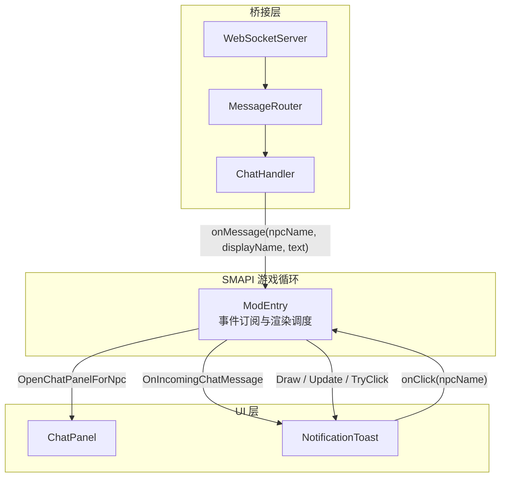
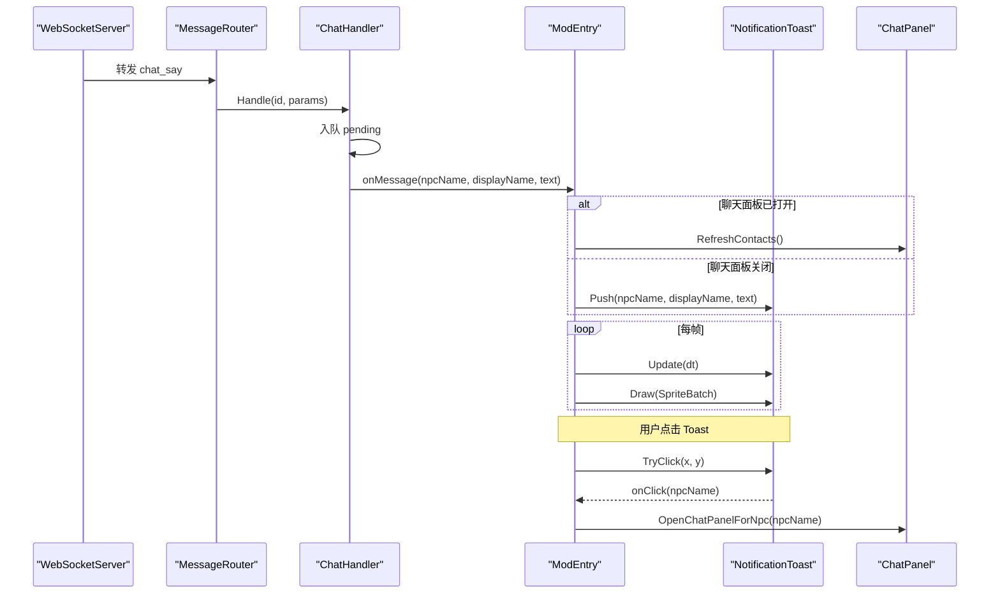
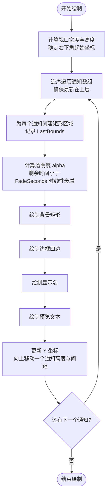
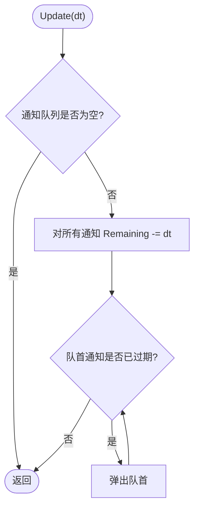
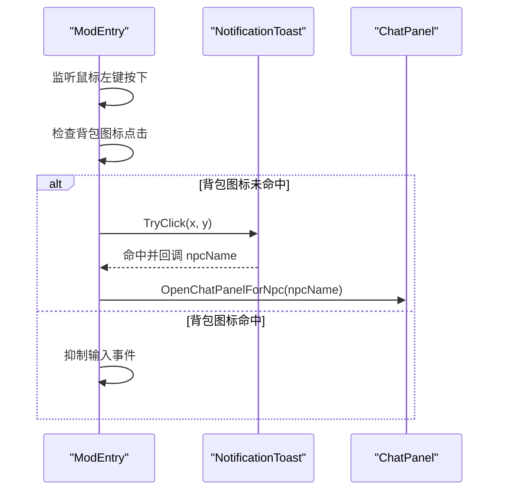
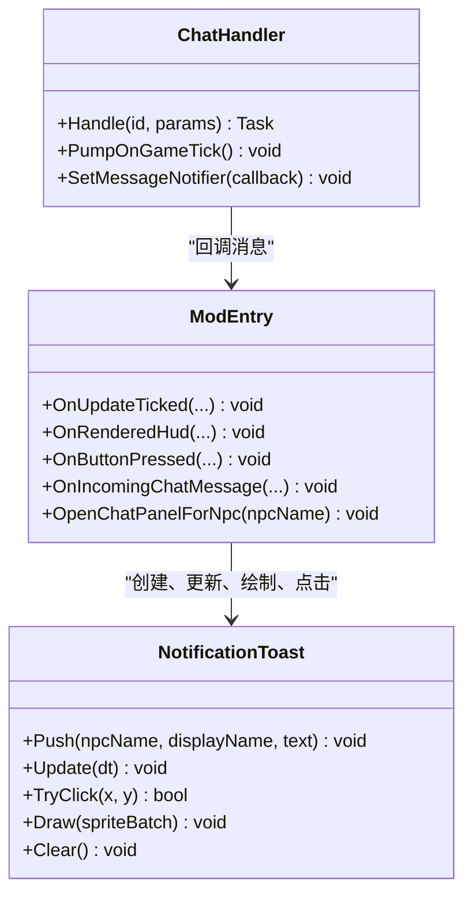

# 通知系统 NotificationToast

<cite>
**本文引用的文件**   
- [NotificationToast.cs](file://SmartNPC/smapi-mod/UI/NotificationToast.cs)
- [ModEntry.cs](file://SmartNPC/smapi-mod/ModEntry.cs)
- [ChatHandler.cs](file://SmartNPC/smapi-mod/Chat/ChatHandler.cs)
</cite>

## 目录
1. [引言](#引言)
2. [项目结构](#项目结构)
3. [核心组件](#核心组件)
4. [架构总览](#架构总览)
5. [详细组件分析](#详细组件分析)
6. [依赖关系分析](#依赖关系分析)
7. [性能考量](#性能考量)
8. [故障排查指南](#故障排查指南)
9. [结论](#结论)
10. [附录：扩展与自定义示例](#附录扩展与自定义示例)

## 引言
NotificationToast 是 SmartNPC SMAPI 模组中的非模态浮动通知组件，用于在游戏主聊天面板关闭时，提示玩家收到来自智能 NPC 的消息。它提供轻量级浮层、堆叠展示、自动过期淡出以及点击打开对话的能力。当前实现聚焦于“可见性管理 + 生命周期管理 + 基础绘制”，并未引入复杂动画曲线或类型化样式体系；但本说明将基于现有代码，解释其动画机制、层级管理、自动消失逻辑、样式策略，并给出可扩展的改进建议。

## 项目结构
NotificationToast 位于 UI 层，作为 ModEntry 的一个可选子组件，由 ChatHandler 在收到消息后驱动。整体调用链如下：

图表来源
- [ModEntry.cs:53-64](file://SmartNPC/smapi-mod/ModEntry.cs#L53-L64)
- [ModEntry.cs:200-220](file://SmartNPC/smapi-mod/ModEntry.cs#L200-L220)
- [ModEntry.cs:333-336](file://SmartNPC/smapi-mod/ModEntry.cs#L333-L336)
- [ModEntry.cs:384-400](file://SmartNPC/smapi-mod/ModEntry.cs#L384-L400)
- [ModEntry.cs:620-656](file://SmartNPC/smapi-mod/ModEntry.cs#L620-L656)
- [ChatHandler.cs:1-40](file://SmartNPC/smapi-mod/Chat/ChatHandler.cs#L1-L40)
- [ChatHandler.cs:40-96](file://SmartNPC/smapi-mod/Chat/ChatHandler.cs#L40-L96)
- [NotificationToast.cs:1-25](file://SmartNPC/smapi-mod/UI/NotificationToast.cs#L1-L25)

章节来源
- [NotificationToast.cs:1-25](file://SmartNPC/smapi-mod/UI/NotificationToast.cs#L1-L25)
- [ModEntry.cs:53-64](file://SmartNPC/smapi-mod/ModEntry.cs#L53-L64)
- [ChatHandler.cs:1-40](file://SmartNPC/smapi-mod/Chat/ChatHandler.cs#L1-L40)

## 核心组件
- NotificationToast：负责通知项入队、生命周期更新、点击检测、绘制与清除。
- ModEntry：负责订阅 SMAPI 事件，驱动 Toast 的 Update 和 Draw，并在用户点击 Toast 时打开对应 NPC 的聊天面板。
- ChatHandler：负责从 WebSocket 接收 `chat_say`，维护消息存储与未读计数，并通过回调将消息交给 ModEntry 处理（最终落到 Toast）。

关键职责划分：
- ChatHandler 不直接操作 UI，仅输出消息事件。
- ModEntry 决定“面板打开时刷新面板”还是“面板关闭时推送到 Toast”。
- NotificationToast 只关心自身状态机与绘制，不感知业务语义。

章节来源
- [ChatHandler.cs:1-40](file://SmartNPC/smapi-mod/Chat/ChatHandler.cs#L1-L40)
- [ModEntry.cs:620-656](file://SmartNPC/smapi-mod/ModEntry.cs#L620-L656)
- [NotificationToast.cs:25-60](file://SmartNPC/smapi-mod/UI/NotificationToast.cs#L25-L60)

## 架构总览
NotificationToast 的生命周期由三个入口协同完成：消息进入、帧更新、渲染与交互。

图表来源
- [ChatHandler.cs:40-96](file://SmartNPC/smapi-mod/Chat/ChatHandler.cs#L40-L96)
- [ModEntry.cs:200-220](file://SmartNPC/smapi-mod/ModEntry.cs#L200-L220)
- [ModEntry.cs:333-336](file://SmartNPC/smapi-mod/ModEntry.cs#L333-L336)
- [ModEntry.cs:384-400](file://SmartNPC/smapi-mod/ModEntry.cs#L384-L400)
- [ModEntry.cs:620-656](file://SmartNPC/smapi-mod/ModEntry.cs#L620-L656)

## 详细组件分析

### 通知项数据模型
NotificationToast 使用内部结构体 Item 保存每条通知的信息与剩余时间：
- NpcName：触发该通知的 NPC 名称，用于后续打开具体对话。
- DisplayName：显示给玩家的友好名称。
- Preview：预览文本，超过长度会被截断并加省略号。
- Remaining：剩余存活秒数，用于控制淡出与移除。
- LastBounds：最后一次的屏幕矩形区域，用于点击命中检测。

复杂度与行为：
- 入队采用队列，先进先出；溢出时丢弃最旧项，保证最多显示 MaxVisible 条。
- 遍历与淘汰均基于 Queue<T>，Update 为 O(n)，n 为当前通知数量（上限很小）。

章节来源
- [NotificationToast.cs:31-44](file://SmartNPC/smapi-mod/UI/NotificationToast.cs#L31-L44)
- [NotificationToast.cs:45-60](file://SmartNPC/smapi-mod/UI/NotificationToast.cs#L45-L60)

### 动画系统
当前动画以“时间驱动 + 透明度插值”为主，没有位移滑入滑出，也没有弹性曲线。

- 淡入淡出：
  - 每条通知有 TotalSeconds 的总生存时长。
  - 在最后 FadeSeconds 内，透明度按剩余时间与淡出时间的比例线性下降至 0。
  - 颜色值（背景、边框、标题、正文）均乘以 alpha，实现统一淡出。

- 滑入滑出：
  - 当前实现没有位置变化动画；通知直接出现在右下角固定坐标。
  - 如需滑入，可在 Item 中增加初始偏移或目标偏移，并在 Update 中根据 dt 插值计算位置。

- 弹性曲线：
  - 当前未使用缓动函数；透明度为线性插值。
  - 可引入标准缓动曲线（如 ease-out、bounce），对透明度或位移进行非线性插值。

- 性能影响：
  - 动画成本极低，仅涉及 float 运算与 Color 乘法。
  - 绘制仍为 SpriteBatch 绘制固定矩形与字符串，无额外纹理开销。

章节来源
- [NotificationToast.cs:25-30](file://SmartNPC/smapi-mod/UI/NotificationToast.cs#L25-L30)
- [NotificationToast.cs:96-130](file://SmartNPC/smapi-mod/UI/NotificationToast.cs#L96-L130)

### 层级管理机制
- 堆栈管理：
  - 使用 Queue<Item> 维护通知顺序。
  - 新通知入队尾部；绘制时从尾部向前遍历，使最新通知在最上层。
  - 超出 MaxVisible 时，从头端弹出最旧通知，避免无限增长。

- Z-index 控制：
  - 通过绘制顺序模拟 z-index：越晚绘制的项覆盖先前项。
  - 不存在真正的分层容器；所有通知在同一 SpriteBatch 中按序绘制。

- 重叠处理：
  - 每个通知的 Y 坐标通过递减 ToastHeight + ToastSpacing 形成垂直堆叠。
  - 若通知过多，超过可视区域时不会滚动；多余部分会被视口裁剪。
  - 点击命中检测使用 LastBounds.Contains，逐条判断，命中即停止。

图表来源
- [NotificationToast.cs:96-130](file://SmartNPC/smapi-mod/UI/NotificationToast.cs#L96-L130)

章节来源
- [NotificationToast.cs:60-64](file://SmartNPC/smapi-mod/UI/NotificationToast.cs#L60-L64)
- [NotificationToast.cs:96-130](file://SmartNPC/smapi-mod/UI/NotificationToast.cs#L96-L130)

### 自动消失逻辑
- 定时器管理：
  - 每条通知的 Remaining 在 Update 中减去 dt。
  - 当队首通知的 Remaining 小于等于 0 时，持续弹出直至不为空且队首有效。

- 用户交互暂停：
  - 当前实现未在点击或悬停时暂停计时器。
  - 点击会立即清空全部通知并触发回调，因此不会产生“悬停暂停”效果。

- 优先级控制：
  - 当前没有显式优先级字段；顺序由入队顺序决定。
  - 可通过 Priority 字段扩展，例如重要通知置顶、普通通知延后。

图表来源
- [NotificationToast.cs:60-64](file://SmartNPC/smapi-mod/UI/NotificationToast.cs#L60-L64)

章节来源
- [NotificationToast.cs:60-64](file://SmartNPC/smapi-mod/UI/NotificationToast.cs#L60-L64)

### 不同类型通知的样式系统
当前样式是统一的视觉风格，而非按成功、警告、错误、信息分类：
- 背景色：深灰半透明。
- 边框色：暖金色。
- 标题颜色：浅金。
- 正文颜色：接近白色。
- 字体：使用 Game1.smallFont。

这种设计适合通用消息提示，但不具备语义化色彩区分。若需要区分类型，可以引入枚举与配色表。

章节来源
- [NotificationToast.cs:96-130](file://SmartNPC/smapi-mod/UI/NotificationToast.cs#L96-L130)

### 交互与点击行为
- 点击检测：
  - 遍历通知，使用 LastBounds.Contains 判断鼠标是否在通知矩形内。
  - 命中后立即清空全部通知，并回调 _onClick(npcName)。

- 输入优先级：
  - ModEntry 在 OnButtonPressed 中优先处理背包图标点击。
  - 若背包图标未被命中，再尝试 Toast 点击。

- 打开对话：
  - Toast 回调打开指定 NPC 的聊天面板，同时清理 Toast。

图表来源
- [ModEntry.cs:384-400](file://SmartNPC/smapi-mod/ModEntry.cs#L384-L400)
- [NotificationToast.cs:65-76](file://SmartNPC/smapi-mod/UI/NotificationToast.cs#L65-L76)
- [ModEntry.cs:620-634](file://SmartNPC/smapi-mod/ModEntry.cs#L620-L634)

章节来源
- [NotificationToast.cs:65-76](file://SmartNPC/smapi-mod/UI/NotificationToast.cs#L65-L76)
- [ModEntry.cs:384-400](file://SmartNPC/smapi-mod/ModEntry.cs#L384-L400)
- [ModEntry.cs:620-634](file://SmartNPC/smapi-mod/ModEntry.cs#L620-L634)

## 依赖关系分析
NotificationToast 的依赖非常清晰：
- 外部依赖：
  - XNA/MonoGame 图形接口：SpriteBatch、Color、Rectangle、Vector2。
  - StardewValley：Game1.uiViewport、Game1.fadeToBlackRect、Game1.smallFont。
  - SMAPI 事件：由 ModEntry 订阅并驱动。

- 被依赖方：
  - ModEntry 持有 NotificationToast 实例，并在多个事件中调用其方法。
  - ChatHandler 不直接依赖 Toast，而是通过回调将消息交给 ModEntry。

耦合度与内聚性：
- NotificationToast 与 ModEntry 存在弱耦合（通过 Action<string> 回调）。
- Toast 内部状态与绘制逻辑高度内聚，职责单一。

潜在循环依赖：
- 无循环依赖；ChatHandler 不引用 UI，UI 也不反向引用业务桥接层。

图表来源
- [NotificationToast.cs:45-76](file://SmartNPC/smapi-mod/UI/NotificationToast.cs#L45-L76)
- [ModEntry.cs:200-220](file://SmartNPC/smapi-mod/ModEntry.cs#L200-L220)
- [ModEntry.cs:333-336](file://SmartNPC/smapi-mod/ModEntry.cs#L333-L336)
- [ModEntry.cs:384-400](file://SmartNPC/smapi-mod/ModEntry.cs#L384-L400)
- [ModEntry.cs:620-656](file://SmartNPC/smapi-mod/ModEntry.cs#L620-L656)
- [ChatHandler.cs:1-40](file://SmartNPC/smapi-mod/Chat/ChatHandler.cs#L1-L40)
- [ChatHandler.cs:40-96](file://SmartNPC/smapi-mod/Chat/ChatHandler.cs#L40-L96)

章节来源
- [NotificationToast.cs:45-76](file://SmartNPC/smapi-mod/UI/NotificationToast.cs#L45-L76)
- [ModEntry.cs:200-220](file://SmartNPC/smapi-mod/ModEntry.cs#L200-L220)
- [ChatHandler.cs:40-96](file://SmartNPC/smapi-mod/Chat/ChatHandler.cs#L40-L96)

## 性能考量
- 内存分配：
  - Update 中对 Queue 元素进行迭代与 Dequeue，属于少量对象操作。
  - 绘制时使用 ToArray 生成副本，避免修改队列的同时迭代；对于最多 3 项的通知，开销可忽略。

- 渲染成本：
  - 每个通知绘制 1 个背景矩形、4 条边框线段、2 行文字。
  - 最大 3 条通知，总绘制开销很低。

- 可能的优化点：
  - 如果未来支持大量通知，可改用环形缓冲或固定容量数组，减少 ToArray 与 GC 压力。
  - 可将颜色常量缓存为静态字段，避免重复构造。
  - 若引入动画，建议使用增量更新与复用顶点缓冲，减少每帧分配。

章节来源
- [NotificationToast.cs:96-104](file://SmartNPC/smapi-mod/UI/NotificationToast.cs#L96-L104)
- [NotificationToast.cs:124-130](file://SmartNPC/smapi-mod/UI/NotificationToast.cs#L124-L130)

## 故障排查指南
常见问题与定位思路：

- 通知不出现：
  - 确认 ModEntry 已创建 NotificationToast 实例。
  - 确认 OnIncomingChatMessage 被调用，且 ChatPanel 未处于打开状态。
  - 检查 ChatHandler.SetMessageNotifier 是否已注册回调。

- 通知无法点击：
  - 确认 ModEntry.OnButtonPressed 未被其他菜单拦截。
  - 确认背包图标未优先命中。
  - 检查 LastBounds 是否正确赋值。

- 通知不消失：
  - 确认 ModEntry.OnUpdateTicked 调用了 _toast.Update(1f/60f)。
  - 检查 Remaining 是否被正确递减。

- 通知遮挡问题：
  - 调整 ToastSpacing 与 ToastHeight。
  - 若通知过多，考虑增加滚动或分页逻辑。

章节来源
- [NotificationToast.cs:65-76](file://SmartNPC/smapi-mod/UI/NotificationToast.cs#L65-L76)
- [ModEntry.cs:200-220](file://SmartNPC/smapi-mod/ModEntry.cs#L200-L220)
- [ModEntry.cs:384-400](file://SmartNPC/smapi-mod/ModEntry.cs#L384-L400)
- [ChatHandler.cs:40-96](file://SmartNPC/smapi-mod/Chat/ChatHandler.cs#L40-L96)

## 结论
NotificationToast 是一个简洁、低耦合的浮动通知组件，适合在小规模 UI 场景中快速反馈消息。它的优势在于实现简单、性能开销小、职责清晰；不足在于动画较为基础、没有类型化样式、缺乏高级交互（如悬停暂停、滚动、优先级排序）。在实际使用中，可根据业务需求逐步扩展动画曲线、类型样式、交互行为与可访问性支持。

## 附录：扩展与自定义示例

### 创建自定义通知类型
步骤建议：
- 定义通知类型枚举，例如成功、警告、错误、信息。
- 在 Item 中添加 Type 字段。
- 在 Push 中传入类型，并在绘制时根据类型选择配色与图标。
- 在 ChatHandler 或上游业务中为不同场景设置类型。

参考路径
- [NotificationToast.cs:31-44](file://SmartNPC/smapi-mod/UI/NotificationToast.cs#L31-L44)
- [NotificationToast.cs:96-130](file://SmartNPC/smapi-mod/UI/NotificationToast.cs#L96-L130)

### 调整动画参数
可配置项：
- TotalSeconds：调整通知总生存时间。
- FadeSeconds：调整淡出阶段持续时间。
- ToastWidth、ToastHeight、ToastSpacing：调整尺寸与间距。
- 透明度衰减方式：从线性改为缓动曲线。

参考路径
- [NotificationToast.cs:25-30](file://SmartNPC/smapi-mod/UI/NotificationToast.cs#L25-L30)
- [NotificationToast.cs:96-110](file://SmartNPC/smapi-mod/UI/NotificationToast.cs#L96-L110)

### 扩展通知行为
可行扩展方向：
- 悬停暂停：在 TryClick 之外增加 Hover 状态，暂停 Remaining 递减。
- 滑动动画：在 Update 中根据时间插值计算初始位置到最终位置的位移。
- 优先级队列：引入 Priority，按优先级排序或置顶。
- 多行预览与截断策略：根据文本长度动态调整行数。
- 可访问性：增加键盘导航、焦点管理、屏幕阅读器描述。

参考路径
- [NotificationToast.cs:60-76](file://SmartNPC/smapi-mod/UI/NotificationToast.cs#L60-L76)
- [ModEntry.cs:384-400](file://SmartNPC/smapi-mod/ModEntry.cs#L384-L400)