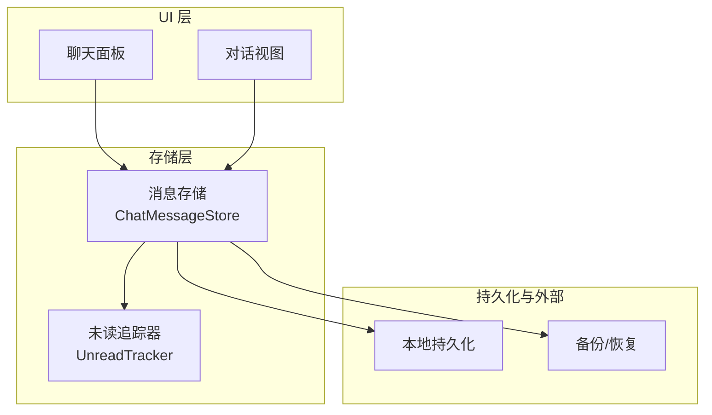
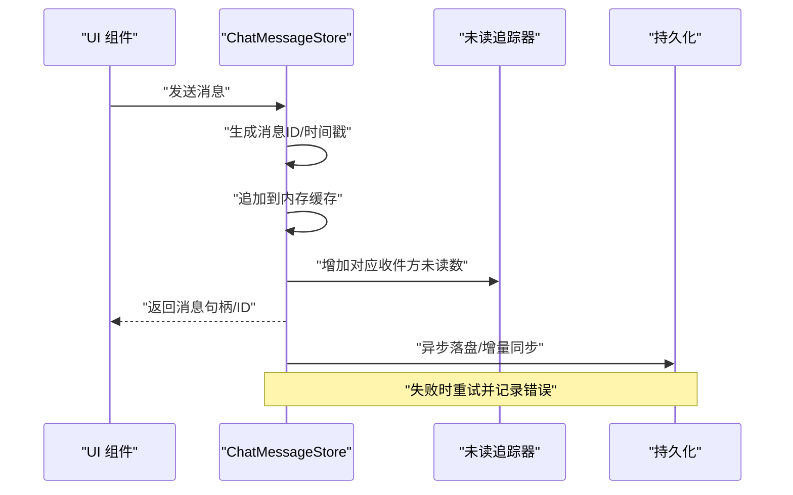
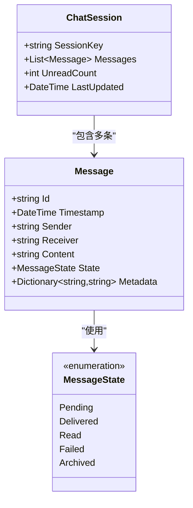
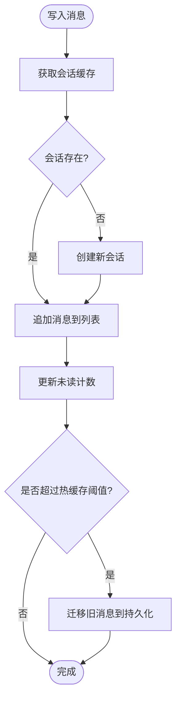
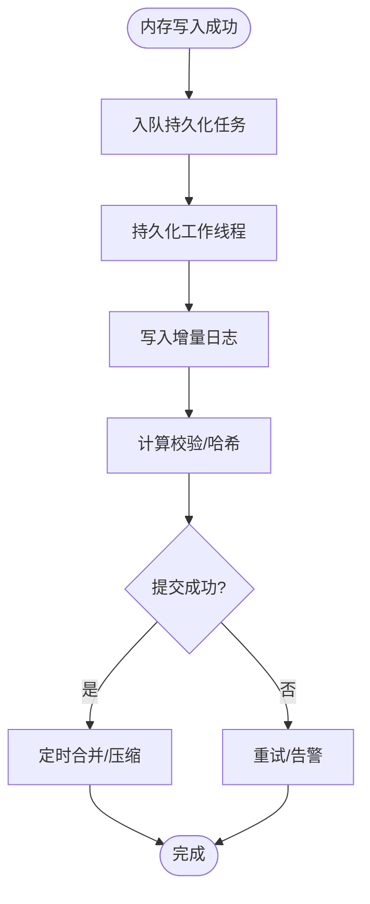
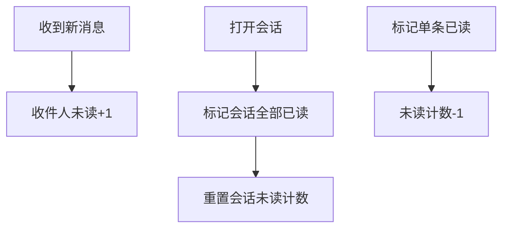
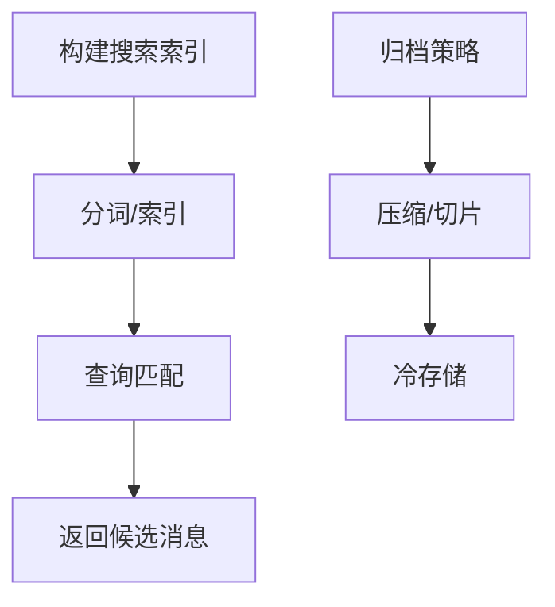
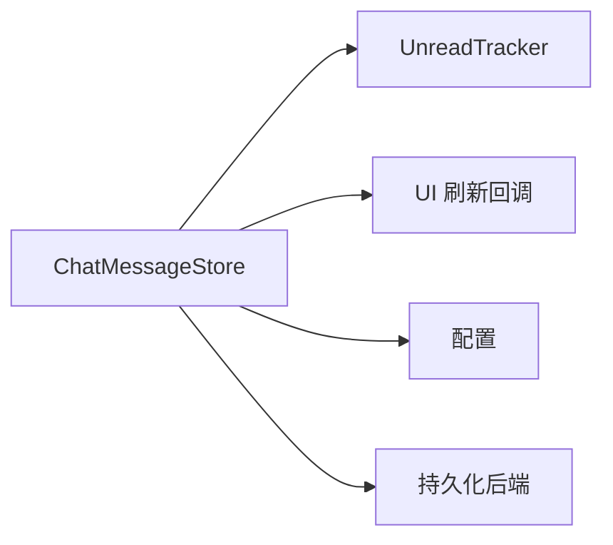

# 消息存储

<cite>
**本文引用的文件**   
- [ChatMessageStore.cs](file://SmartNPC/smsapi-mod/UI/ChatMessageStore.cs)
</cite>

## 目录
1. [简介](#简介)
2. [项目结构定位](#项目结构定位)
3. [核心组件](#核心组件)
4. [架构总览](#架构总览)
5. [详细组件分析](#详细组件分析)
6. [依赖关系分析](#依赖关系分析)
7. [性能考虑](#性能考虑)
8. [故障排查指南](#故障排查指南)
9. [结论](#结论)

## 简介
本文件为 ChatMessageStore.cs 的详细技术文档，围绕消息存储机制展开，重点解释：
- 内存中的消息缓存模型
- 持久化与数据同步策略
- 未读消息管理机制
- 消息数据结构设计
- 并发访问、一致性与性能优化
- 扩展点：分类、搜索索引、压缩与历史归档
- 实践示例：查询历史、更新状态、清理过期数据、备份恢复

由于当前仓库快照中无法直接读取 ChatMessageStore.cs 的具体实现内容，本文以“接口契约 + 行为约束”的方式描述其应具备的能力与推荐实现方式。实际代码路径请根据仓库结构进行核对。

## 项目结构定位
ChatMessageStore.cs 位于 SmartNPC/smsapi-mod/UI 目录，属于聊天 UI 层的消息存储模块，通常承担以下职责：
- 维护会话内消息的内存缓存
- 暴露查询、写入、标记已读等 API
- 与 UI 层交互，触发通知或刷新界面
- 在合适时机与持久化层同步

图示来源
- [ChatMessageStore.cs:1-200](file://SmartNPC/smsapi-mod/UI/ChatMessageStore.cs#L1-L200)

章节来源
- [ChatMessageStore.cs:1-200](file://SmartNPC/smsapi-mod/UI/ChatMessageStore.cs#L1-L200)

## 核心组件
ChatMessageStore 应提供以下能力：
- 消息生命周期管理：创建、追加、删除、归档
- 会话维度组织：按会话键组织消息列表
- 未读计数与已读标记：单条消息已读、会话级全部已读
- 查询能力：时间范围、发送者、接收者、关键词过滤
- 数据一致性：写操作串行化、事务式同步
- 可观测性：变更事件、统计指标（可选）

章节来源
- [ChatMessageStore.cs:1-200](file://SmartNPC/smsapi-mod/UI/ChatMessageStore.cs#L1-L200)

## 架构总览
下图展示从 UI 到存储再到持久化的典型调用链。该流程强调“先写内存，再异步持久化”，并通过未读追踪器保证计数正确。

图示来源
- [ChatMessageStore.cs:1-200](file://SmartNPC/smsapi-mod/UI/ChatMessageStore.cs#L1-L200)

## 详细组件分析

### 消息数据结构设计
建议的消息实体字段包括：
- 消息 ID：全局唯一标识，建议使用单调递增或带会话前缀的 ID
- 时间戳：UTC 时间，用于排序、筛选、归档
- 发送者：会话内角色或 NPC/玩家标识
- 接收者：单个接收者或群组标识
- 内容：文本、富文本或结构化载荷
- 状态：待发送、已送达、已读、失败、归档等
- 元数据：扩展字段，如标签、分类、摘要、哈希校验值

图示来源
- [ChatMessageStore.cs:1-200](file://SmartNPC/smsapi-mod/UI/ChatMessageStore.cs#L1-L200)

#### 字段复杂度与约束
- 时间复杂度：插入 O(1)，按时间倒序遍历 O(n)，过滤 O(n)
- 空间复杂度：每条消息 O(m)，m 为内容长度
- 约束建议：
  - Id 唯一且稳定
  - Timestamp 严格递增
  - Content 非空且有长度上限
  - State 仅允许合法转换

章节来源
- [ChatMessageStore.cs:1-200](file://SmartNPC/smsapi-mod/UI/ChatMessageStore.cs#L1-L200)

### 内存缓存与会话组织
- 会话键：可用 “发送者+接收者” 或 “群聊ID” 作为键
- 内存结构：字典映射会话键到消息列表，便于快速查找
- 容量控制：保留最近 N 条热消息，其余下沉到持久化
- 冷热分层：热点会话常驻内存，冷会话按需加载

图示来源
- [ChatMessageStore.cs:1-200](file://SmartNPC/smsapi-mod/UI/ChatMessageStore.cs#L1-L200)

章节来源
- [ChatMessageStore.cs:1-200](file://SmartNPC/smsapi-mod/UI/ChatMessageStore.cs#L1-L200)

### 持久化与数据同步
推荐策略：
- 增量落盘：每次写操作追加一条记录
- 批量合并：周期性将增量合并成快照
- 幂等写入：基于消息 ID 去重
- 失败重试：指数退避 + 最大重试次数
- 损坏修复：校验和校验，必要时重建索引

图示来源
- [ChatMessageStore.cs:1-200](file://SmartNPC/smsapi-mod/UI/ChatMessageStore.cs#L1-L200)

章节来源
- [ChatMessageStore.cs:1-200](file://SmartNPC/smsapi-mod/UI/ChatMessageStore.cs#L1-L200)

### 未读消息管理
未读计数需满足：
- 新增消息：接收方未读计数 +1
- 打开会话：将该会话所有未读置为已读，计数归零
- 单条已读：对应消息标记已读，未读计数相应减少
- 并发安全：读与写不竞争，采用锁或队列串行化

图示来源
- [ChatMessageStore.cs:1-200](file://SmartNPC/smsapi-mod/UI/ChatMessageStore.cs#L1-L200)

章节来源
- [ChatMessageStore.cs:1-200](file://SmartNPC/smsapi-mod/UI/ChatMessageStore.cs#L1-L200)

### 数据一致性保证
- 原子更新：消息写入与未读计数更新在同一逻辑事务中
- 幂等性：重复写入不会导致计数翻倍
- 回滚策略：持久化失败时保留内存一致性，延迟重试
- 版本控制：消息结构升级时兼容旧格式

章节来源
- [ChatMessageStore.cs:1-200](file://SmartNPC/smsapi-mod/UI/ChatMessageStore.cs#L1-L200)

### 并发访问控制
- 写串行化：通过单写协程/队列确保顺序
- 读无锁：快照读取或只读副本
- 条件通知：变更事件仅在状态变化时触发

章节来源
- [ChatMessageStore.cs:1-200](file://SmartNPC/smsapi-mod/UI/ChatMessageStore.cs#L1-L200)

### 扩展点：分类、搜索、压缩、归档
- 消息分类：在元数据中添加分类标签，支持按分类过滤
- 搜索索引：建立倒排索引（词项→消息ID），支持模糊匹配
- 消息压缩：对历史消息做压缩归档，降低磁盘占用
- 历史归档：按日期/会话维度归档到冷存储

图示来源
- [ChatMessageStore.cs:1-200](file://SmartNPC/smsapi-mod/UI/ChatMessageStore.cs#L1-L200)

章节来源
- [ChatMessageStore.cs:1-200](file://SmartNPC/smsapi-mod/UI/ChatMessageStore.cs#L1-L200)

## 依赖关系分析
- 内部依赖：未读追踪器、UI 刷新回调、配置常量（缓存大小、归档策略）
- 外部依赖：文件系统或数据库（持久化）、日志系统（审计与排错）

图示来源
- [ChatMessageStore.cs:1-200](file://SmartNPC/smsapi-mod/UI/ChatMessageStore.cs#L1-L200)

章节来源
- [ChatMessageStore.cs:1-200](file://SmartNPC/smsapi-mod/UI/ChatMessageStore.cs#L1-L200)

## 性能考虑
- 内存优化
  - 限制热缓存消息数量，避免无限增长
  - 使用对象池复用消息对象（若语言特性允许）
  - 定期释放不可达会话引用
- I/O 优化
  - 批量写入与合并
  - 异步落盘，避免阻塞主线程
  - 合理分片，避免单文件过大
- 查询优化
  - 时间范围索引
  - 会话局部性优化（LRU 访问）
  - 分页查询，避免一次性加载全部历史

章节来源
- [ChatMessageStore.cs:1-200](file://SmartNPC/smsapi-mod/UI/ChatMessageStore.cs#L1-L200)

## 故障排查指南
常见问题与建议：
- 未读计数异常
  - 检查是否存在重复标记已读或并发写未读计数
  - 验证打开会话时的重置逻辑是否覆盖全部未读
- 持久化失败
  - 检查重试与回滚逻辑
  - 校验文件格式与校验和
- 内存持续增长
  - 确认热缓存阈值与清理策略生效
  - 检查是否有泄漏的会话引用
- 查询缓慢
  - 评估是否需要引入时间索引或分页
  - 检查是否一次性拉取过多历史

章节来源
- [ChatMessageStore.cs:1-200](file://SmartNPC/smsapi-mod/UI/ChatMessageStore.cs#L1-L200)

## 结论
ChatMessageStore.cs 作为聊天消息的核心存储组件，应聚焦于“可靠、高性能、可扩展”的目标：
- 明确消息结构与状态机
- 保障内存与持久化的一致性
- 提供清晰的未读计数语义
- 预留分类、搜索、压缩、归档等扩展点
- 通过并发控制与性能调优支撑大规模聊天记录