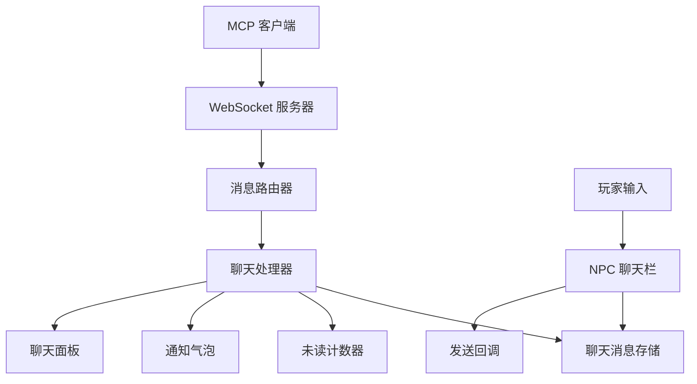
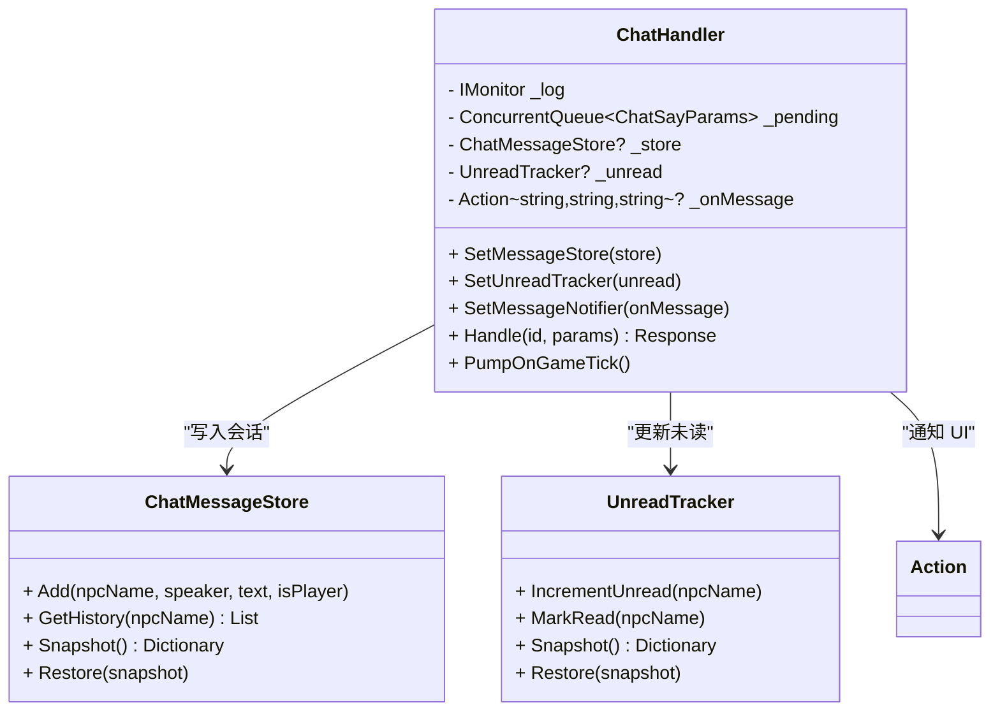
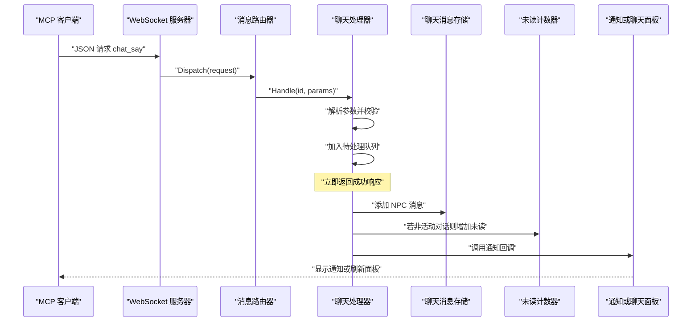
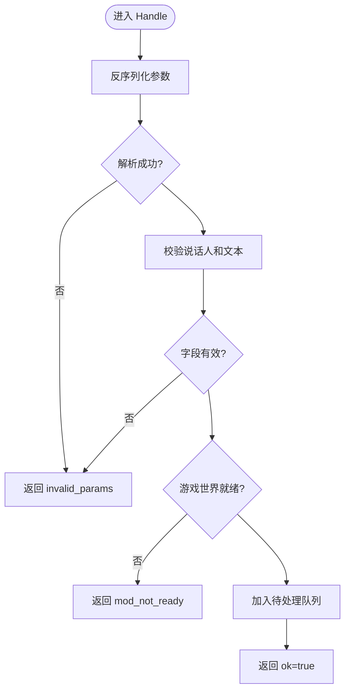
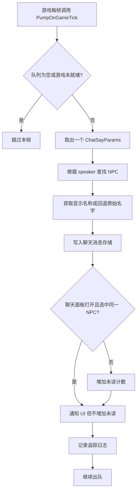
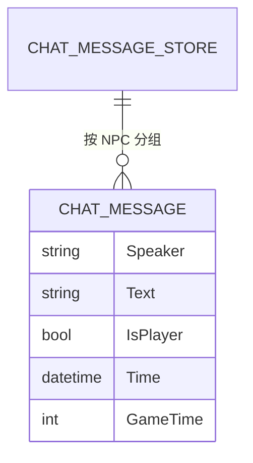
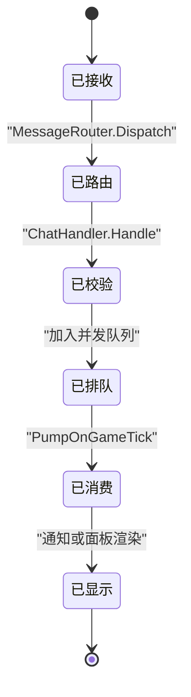
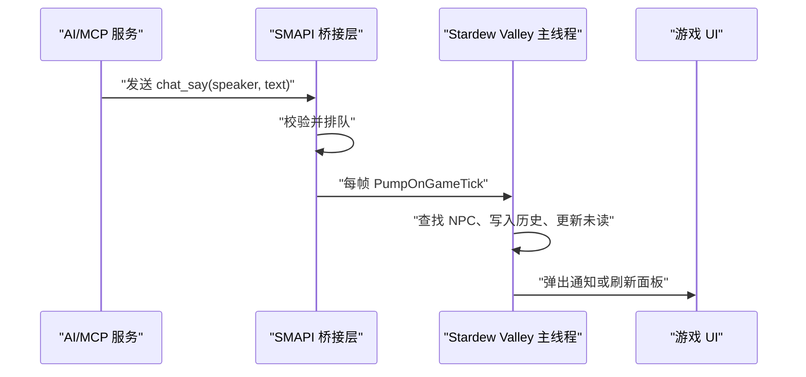
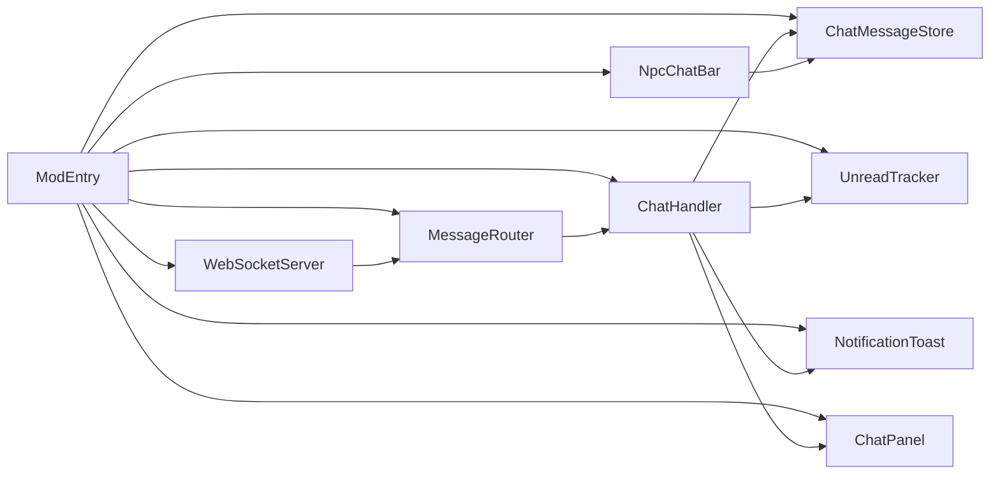

# 聊天处理器

<cite>
**本文引用的文件**   
- [ChatHandler.cs](file://SmartNPC/smapi-mod/Chat/ChatHandler.cs)
- [MessageRouter.cs](file://SmartNPC/smapi-mod/Bridge/MessageRouter.cs)
- [Protocol.cs](file://SmartNPC/smapi-mod/Bridge/Protocol.cs)
- [WebSocketServer.cs](file://SmartNPC/smapi-mod/Bridge/WebSocketServer.cs)
- [ChatPanel.cs](file://SmartNPC/smapi-mod/UI/ChatPanel.cs)
- [ConversationView.cs](file://SmartNPC/smapi-mod/UI/ConversationView.cs)
- [ChatMessageStore.cs](file://SmartNPC/smapi-mod/UI/ChatMessageStore.cs)
- [NpcChatBar.cs](file://SmartNPC/smapi-mod/UI/NpcChatBar.cs)
- [UnreadTracker.cs](file://SmartNPC/smapi-mod/Data/UnreadTracker.cs)
- [NotificationToast.cs](file://SmartNPC/smapi-mod/UI/NotificationToast.cs)
- [ModEntry.cs](file://SmartNPC/smapi-mod/ModEntry.cs)
</cite>

## 目录
1. [引言](#引言)
2. [项目结构定位](#项目结构定位)
3. [核心组件概览](#核心组件概览)
4. [系统架构总览](#系统架构总览)
5. [聊天处理器详细分析](#聊天处理器详细分析)
6. [消息生命周期管理](#消息生命周期管理)
7. [来自 MCP 服务的 NPC 回复处理](#来自-mcp-服务的-npc-回复处理)
8. [错误处理与健壮性设计](#错误处理与健壮性设计)
9. [扩展指南：新消息类型、自定义格式与多语言](#扩展指南新消息类型自定义格式与多语言)
10. [依赖关系分析](#依赖关系分析)
11. [性能与线程模型](#性能与线程模型)
12. [常见问题排查](#常见问题排查)
13. [结论](#结论)

## 引言
本文围绕 `ChatHandler.cs` 展开，说明 SmartNPC SMAPI 模组中“聊天处理器”的职责、数据流、线程模型以及与 MCP 服务、游戏 UI、持久化系统的协作方式。重点包括：

- 接收并解析来自 MCP 桥接层的 `chat_say` 动作。
- 识别 NPC 身份、维护会话历史、更新未读计数。
- 在关闭聊天面板时弹出通知，在打开聊天面板时直接渲染气泡。
- 将异步工作队列推入主游戏线程，保证 Stardew Valley 状态安全。
- 提供扩展点，用于新增消息类型、自定义回复格式和多语言支持。

该文档既适合想理解现有实现的核心开发者，也适合希望扩写聊天能力的二次开发者。

## 项目结构定位
`ChatHandler.cs` 位于 SMAPI 模组的 `Bridge` 命名空间下，属于“桥接层 + 聊天子系统”的交汇点：

| 层级 | 文件 | 职责 |
|---|---|---|
| 网络入口 | `WebSocketServer.cs` | 监听 WebSocket、接收帧、转发到路由 |
| 请求路由 | `MessageRouter.cs` | 根据动作名分发给具体处理器 |
| 协议定义 | `Protocol.cs` | 请求、响应、事件、序列化选项 |
| 聊天处理器 | `ChatHandler.cs` | 解析 `chat_say`、排队、写入历史、更新未读、触发 UI |
| 消息存储 | `ChatMessageStore.cs` | 按 NPC 保存最近 N 条消息 |
| 未读计数 | `UnreadTracker.cs` | 记录每个 NPC 的未读数量 |
| 聊天面板 | `ChatPanel.cs` | QQ 风格只读聊天窗口 |
| 对话视图 | `ConversationView.cs` | 右侧气泡展示区 |
| 玩家输入栏 | `NpcChatBar.cs` | 底部聊天输入框（玩家发送） |
| 弹窗通知 | `NotificationToast.cs` | 面板关闭时的浮动提示 |
| 模组入口 | `ModEntry.cs` | 装配组件、注册动作、绑定 UI 回调 |

**图表来源**
- [WebSocketServer.cs:1-200](file://SmartNPC/smapi-mod/Bridge/WebSocketServer.cs#L1-L200)
- [MessageRouter.cs:1-53](file://SmartNPC/smapi-mod/Bridge/MessageRouter.cs#L1-L53)
- [ChatHandler.cs:1-96](file://SmartNPC/smapi-mod/Chat/ChatHandler.cs#L1-L96)
- [ChatMessageStore.cs:1-87](file://SmartNPC/smapi-mod/UI/ChatMessageStore.cs#L1-L87)
- [UnreadTracker.cs:1-56](file://SmartNPC/smapi-mod/Data/UnreadTracker.cs#L1-L56)
- [NotificationToast.cs:1-138](file://SmartNPC/smapi-mod/UI/NotificationToast.cs#L1-L138)
- [ChatPanel.cs:1-178](file://SmartNPC/smapi-mod/UI/ChatPanel.cs#L1-L178)
- [NpcChatBar.cs:1-165](file://SmartNPC/smapi-mod/UI/NpcChatBar.cs#L1-L165)

**章节来源**
- [ModEntry.cs:1-200](file://SmartNPC/smapi-mod/ModEntry.cs#L1-L200)

## 核心组件概览
`ChatHandler` 不是孤立的类，它通过“依赖注入 + 回调”的方式接入整个桥接系统：

| 组件 | 关键能力 | 与 `ChatHandler` 的关系 |
|---|---|---|
| `IMonitor` | 日志输出 | 记录 `chat_say` 追踪日志 |
| `ConcurrentQueue<ChatSayParams>` | 跨线程消息队列 | 将异步收到的消息交给游戏主循环处理 |
| `ChatMessageStore` | 会话历史存储 | 追加 NPC 发言、限制长度、快照恢复 |
| `UnreadTracker` | 未读计数 | 非活动对话自动加一 |
| `Action<string,string,string>` | 消息通知回调 | 由 `ModEntry` 绑定为 Toast 或刷新面板 |
| `PumpOnGameTick()` | 每帧消费队列 | 避免在 WebSocket 线程直接访问游戏状态 |

**图表来源**
- [ChatHandler.cs:1-96](file://SmartNPC/smapi-mod/Chat/ChatHandler.cs#L1-L96)
- [ChatMessageStore.cs:1-87](file://SmartNPC/smapi-mod/UI/ChatMessageStore.cs#L1-L87)
- [UnreadTracker.cs:1-56](file://SmartNPC/smapi-mod/Data/UnreadTracker.cs#L1-L56)

**章节来源**
- [ChatHandler.cs:1-96](file://SmartNPC/smapi-mod/Chat/ChatHandler.cs#L1-L96)

## 系统架构总览
从 MCP 客户端到玩家看到 NPC 回复，完整链路如下：

**图表来源**
- [WebSocketServer.cs:1-200](file://SmartNPC/smapi-mod/Bridge/WebSocketServer.cs#L1-L200)
- [MessageRouter.cs:1-53](file://SmartNPC/smapi-mod/Bridge/MessageRouter.cs#L1-L53)
- [ChatHandler.cs:1-96](file://SmartNPC/smapi-mod/Chat/ChatHandler.cs#L1-L96)
- [ChatMessageStore.cs:1-87](file://SmartNPC/smapi-mod/UI/ChatMessageStore.cs#L1-L87)
- [UnreadTracker.cs:1-56](file://SmartNPC/smapi-mod/Data/UnreadTracker.cs#L1-L56)
- [NotificationToast.cs:1-138](file://SmartNPC/smapi-mod/UI/NotificationToast.cs#L1-L138)
- [ChatPanel.cs:1-178](file://SmartNPC/smapi-mod/UI/ChatPanel.cs#L1-L178)

## 聊天处理器详细分析

### 1. 构造函数与依赖设置
`ChatHandler` 使用构造注入接收日志器，并通过 setter 注入三个外部依赖：

- `SetMessageStore`：写入会话历史。
- `SetUnreadTracker`：管理未读计数。
- `SetMessageNotifier`：把“某 NPC 发来消息”这一事件暴露给 UI 层。

这种设计使聊天处理器不直接创建 UI，也不直接持有所有 UI 对象，降低耦合。

**章节来源**
- [ChatHandler.cs:12-35](file://SmartNPC/smapi-mod/Chat/ChatHandler.cs#L12-L35)

### 2. 消息接收与解析：`Handle`
`Handle` 是 `chat_say` 动作的实际处理器。其流程可概括为：

1. 使用 `JsonOpts.Web` 反序列化 `params`。
2. 捕获异常并返回失败响应，错误码为 `invalid_params`。
3. 校验 `speaker` 和 `text` 是否为空或空白。
4. 检查游戏是否已加载存档；未就绪时返回 `mod_not_ready`。
5. 将参数对象加入 `ConcurrentQueue`。
6. 立即返回成功响应，不阻塞 MCP 客户端。

**图表来源**
- [ChatHandler.cs:36-63](file://SmartNPC/smapi-mod/Chat/ChatHandler.cs#L36-L63)
- [Protocol.cs:1-67](file://SmartNPC/smapi-mod/Bridge/Protocol.cs#L1-L67)

**章节来源**
- [ChatHandler.cs:36-63](file://SmartNPC/smapi-mod/Chat/ChatHandler.cs#L36-L63)
- [Protocol.cs:1-67](file://SmartNPC/smapi-mod/Bridge/Protocol.cs#L1-L67)

### 3. 主线程分发：`PumpOnGameTick`
真正修改游戏状态的操作不在 WebSocket 接收线程执行，而是在 `OnUpdateTicked` 中被调用：

**图表来源**
- [ChatHandler.cs:64-96](file://SmartNPC/smapi-mod/Chat/ChatHandler.cs#L64-L96)
- [ModEntry.cs:201-230](file://SmartNPC/smapi-mod/ModEntry.cs#L201-L230)

**章节来源**
- [ChatHandler.cs:64-96](file://SmartNPC/smapi-mod/Chat/ChatHandler.cs#L64-L96)
- [ModEntry.cs:201-230](file://SmartNPC/smapi-mod/ModEntry.cs#L201-L230)

### 4. NPC 身份识别
`ChatHandler` 通过 `Game1.getCharacterFromName(p.Speaker)` 把 MCP 传来的 `speaker` 映射为 Stardew Valley 中的 NPC 对象，再取 `displayName`。若 NPC 不存在，则回退到原始 `speaker` 字符串。

这保证了：

- 即使 MCP 侧传入的是内部 NPC 名称，玩家看到的仍是游戏内显示名。
- 如果 NPC 不可用，也不会崩溃，而是降级显示原始名称。

**章节来源**
- [ChatHandler.cs:71-74](file://SmartNPC/smapi-mod/Chat/ChatHandler.cs#L71-L74)

### 5. 会话上下文管理
`ChatHandler` 本身不维护“长对话上下文”，但通过与 `ChatMessageStore` 协作形成会话历史：

- 每次 `chat_say` 都会按 `npcName` 写入一条消息。
- `ChatMessageStore` 默认保留每个 NPC 最近 100 条消息。
- 超过上限时删除最早的一条。
- 提供 `Snapshot` 和 `Restore`，配合 `ModEntry` 做存档持久化。

**图表来源**
- [ChatMessageStore.cs:1-87](file://SmartNPC/smapi-mod/UI/ChatMessageStore.cs#L1-L87)

**章节来源**
- [ChatMessageStore.cs:1-87](file://SmartNPC/smapi-mod/UI/ChatMessageStore.cs#L1-L87)
- [ModEntry.cs:231-300](file://SmartNPC/smapi-mod/ModEntry.cs#L231-L300)

### 6. 未读消息与活动对话判断
当新消息到达时：

- 如果聊天面板打开，并且当前选中的 NPC 就是这条消息的发送者，则认为玩家正在阅读，不增加未读。
- 否则调用 `UnreadTracker.IncrementUnread`。
- 最后通过 `_onMessage` 通知 UI。

这实现了“正在查看的对话不弹未读角标”的用户体验。

**章节来源**
- [ChatHandler.cs:76-87](file://SmartNPC/smapi-mod/Chat/ChatHandler.cs#L76-L87)
- [UnreadTracker.cs:1-56](file://SmartNPC/smapi-mod/Data/UnreadTracker.cs#L1-L56)

## 消息生命周期管理
从 MCP 服务生成 NPC 回复，到玩家最终看到内容，生命周期分为六个阶段：

| 阶段 | 发生位置 | 行为 |
|---|---|---|
| 1. 接收 | `WebSocketServer` | 解析 JSON 帧 |
| 2. 路由 | `MessageRouter` | 查找 `chat_say` 处理器 |
| 3. 校验 | `ChatHandler.Handle` | 校验参数和游戏状态 |
| 4. 排队 | `ChatHandler._pending` | 异步入队，立即返回 |
| 5. 消费 | `ChatHandler.PumpOnGameTick` | 写入历史、更新未读、触发 UI |
| 6. 显示 | `NotificationToast` 或 `ChatPanel` | 弹出通知或刷新对话面板 |

**图表来源**
- [WebSocketServer.cs:1-200](file://SmartNPC/smapi-mod/Bridge/WebSocketServer.cs#L1-L200)
- [MessageRouter.cs:1-53](file://SmartNPC/smapi-mod/Bridge/MessageRouter.cs#L1-L53)
- [ChatHandler.cs:36-96](file://SmartNPC/smapi-mod/Chat/ChatHandler.cs#L36-L96)
- [NotificationToast.cs:1-138](file://SmartNPC/smapi-mod/UI/NotificationToast.cs#L1-L138)
- [ChatPanel.cs:1-178](file://SmartNPC/smapi-mod/UI/ChatPanel.cs#L1-L178)

## 来自 MCP 服务的 NPC 回复处理

### 1. 消息格式解析
`ChatHandler` 期望的参数类型为内部类 `ChatSayParams`，包含：

| 字段 | JSON 键 | 含义 | 是否必需 |
|---|---|---|---|
| `Speaker` | `speaker` | 说话者 NPC 名称 | 是 |
| `Text` | `text` | NPC 回复文本 | 是 |
| `Color` | `color` | 颜色字段（当前处理器未使用） | 否 |

解析失败或缺少必要字段时，返回标准错误响应：

- 反序列化失败：`invalid_params`
- 字段为空：`invalid_params`，附带原因信息

**章节来源**
- [ChatHandler.cs:89-96](file://SmartNPC/smapi-mod/Chat/ChatHandler.cs#L89-L96)
- [Protocol.cs:1-67](file://SmartNPC/smapi-mod/Bridge/Protocol.cs#L1-L67)

### 2. 会话上下文与 NPC 身份
当前实现中，“会话上下文”主要是按 NPC 聚合的历史消息。更复杂的对话状态（例如多轮问答记忆、意图状态机）需要额外扩展：

- 可在 `ChatHandler` 中新增一个会话状态字典。
- 或在 `ChatMessageStore` 外引入专门的会话管理器。
- NPC 身份目前依赖 `speaker` 字段和 `Game1.getCharacterFromName` 映射。

**章节来源**
- [ChatHandler.cs:71-87](file://SmartNPC/smapi-mod/Chat/ChatHandler.cs#L71-L87)
- [ChatMessageStore.cs:20-87](file://SmartNPC/smapi-mod/UI/ChatMessageStore.cs#L20-L87)

### 3. 从 AI 回复到玩家显示的完整流程
MCP 服务通过 WebSocket 调用 `chat_say`，`ChatHandler` 负责把 AI 生成的 NPC 文本变成游戏内的可见内容：

**图表来源**
- [WebSocketServer.cs:1-200](file://SmartNPC/smapi-mod/Bridge/WebSocketServer.cs#L1-L200)
- [ChatHandler.cs:36-96](file://SmartNPC/smapi-mod/Chat/ChatHandler.cs#L36-L96)
- [ModEntry.cs:201-230](file://SmartNPC/smapi-mod/ModEntry.cs#L201-L230)

## 错误处理与健壮性设计

### 1. 参数校验
- 反序列化异常被捕获，返回 `invalid_params`。
- `speaker` 或 `text` 为空或空白时返回失败。
- 游戏尚未加载存档时返回 `mod_not_ready`。

### 2. 队列安全
- 使用 `ConcurrentQueue` 避免多线程竞争。
- 消费时使用 `TryDequeue`，遇到空项直接跳过。

### 3. 游戏状态保护
- 在 `Handle` 中检查 `Context.IsWorldReady`。
- 在 `PumpOnGameTick` 中再次检查 `Context.IsWorldReady`。
- 所有可能影响游戏状态的逻辑都放在主循环中执行。

### 4. 日志与可观测性
- `MessageRouter` 记录每次调用的耗时、动作名和成功状态。
- `ChatHandler` 以 Trace 级别记录每条 `chat_say`。
- `WebSocketServer` 记录连接建立、断开、接受失败等事件。

### 5. 超时与重试
当前代码中：

- **没有显式超时控制**。
- **没有自动重试机制**。
- 失败主要由错误码和日志暴露给上层 MCP 客户端。

这是合理的默认设计：MCP 服务端更适合决定重试策略，而不是让 SMAPI 模组承担不可控的网络语义。

**章节来源**
- [ChatHandler.cs:36-96](file://SmartNPC/smapi-mod/Chat/ChatHandler.cs#L36-L96)
- [MessageRouter.cs:20-53](file://SmartNPC/smapi-mod/Bridge/MessageRouter.cs#L20-L53)
- [WebSocketServer.cs:1-200](file://SmartNPC/smapi-mod/Bridge/WebSocketServer.cs#L1-L200)

## 扩展指南：新消息类型、自定义格式与多语言

### 1. 新增消息类型
要新增一个类似 `chat_say` 的消息类型，推荐遵循以下模式：

1. 在 `ModEntry` 中注册新的动作名。
2. 创建一个专用处理器，或使用 `RequestHandler` 委托。
3. 处理器内部只做参数校验和入队。
4. 在主循环中消费队列，并写入对应的业务状态。
5. 如果需要 UI 反馈，复用 `SetMessageNotifier` 或新增回调。

示例路径参考：

- 注册动作：[ModEntry.cs:120-180](file://SmartNPC/smapi-mod/ModEntry.cs#L120-L180)
- 路由分发：[MessageRouter.cs:20-53](file://SmartNPC/smapi-mod/Bridge/MessageRouter.cs#L20-L53)

### 2. 自定义回复格式
当前 `ChatSayParams` 只使用了 `speaker` 和 `text`，`color` 字段存在但未消费。可扩展方向包括：

- 新增富文本标记字段。
- 新增样式枚举，如普通消息、系统消息、警告消息。
- 在 `ChatMessage` 中扩展视觉元数据。
- 在 `ConversationView` 中根据消息类型渲染不同气泡。

### 3. 多语言支持
当前实现直接透传 `text` 字段，没有本地化逻辑。可考虑：

- 在 MCP 层或 Hermes 层完成自然语言翻译。
- 在游戏层增加语言包，把消息 ID 映射为本地化文本。
- 为 `ChatMessage` 增加 `Language` 或 `LocalizationKey`。
- 在 `ConversationView` 中根据当前游戏语言选择文本。

### 4. 实际代码示例路径
以下示例路径帮助定位相关扩展点，不包含具体代码内容：

| 任务 | 参考文件与行号 |
|---|---|
| 注册消息处理器 | [ModEntry.cs:120-180](file://SmartNPC/smapi-mod/ModEntry.cs#L120-L180) |
| 发送聊天消息 | [NpcChatBar.cs:130-165](file://SmartNPC/smapi-mod/UI/NpcChatBar.cs#L130-L165) |
| 处理用户输入事件 | [NpcChatBar.cs:118-165](file://SmartNPC/smapi-mod/UI/NpcChatBar.cs#L118-L165) |
| 解析 MCP 参数 | [ChatHandler.cs:36-63](file://SmartNPC/smapi-mod/Chat/ChatHandler.cs#L36-L63) |
| 写入会话历史 | [ChatHandler.cs:75-80](file://SmartNPC/smapi-mod/Chat/ChatHandler.cs#L75-L80) |
| 打开聊天面板 | [ChatPanel.cs:140-178](file://SmartNPC/smapi-mod/UI/ChatPanel.cs#L140-L178) |
| 显示 NPC 回复 | [ConversationView.cs:60-175](file://SmartNPC/smapi-mod/UI/ConversationView.cs#L60-L175) |

**章节来源**
- [ChatHandler.cs:36-96](file://SmartNPC/smapi-mod/Chat/ChatHandler.cs#L36-L96)
- [NpcChatBar.cs:1-165](file://SmartNPC/smapi-mod/UI/NpcChatBar.cs#L1-L165)
- [ChatPanel.cs:1-178](file://SmartNPC/smapi-mod/UI/ChatPanel.cs#L1-L178)
- [ConversationView.cs:1-175](file://SmartNPC/smapi-mod/UI/ConversationView.cs#L1-L175)

## 依赖关系分析

**图表来源**
- [ModEntry.cs:1-200](file://SmartNPC/smapi-mod/ModEntry.cs#L1-L200)
- [WebSocketServer.cs:1-200](file://SmartNPC/smapi-mod/Bridge/WebSocketServer.cs#L1-L200)
- [MessageRouter.cs:1-53](file://SmartNPC/smapi-mod/Bridge/MessageRouter.cs#L1-L53)
- [ChatHandler.cs:1-96](file://SmartNPC/smapi-mod/Chat/ChatHandler.cs#L1-L96)
- [ChatMessageStore.cs:1-87](file://SmartNPC/smapi-mod/UI/ChatMessageStore.cs#L1-L87)
- [UnreadTracker.cs:1-56](file://SmartNPC/smapi-mod/Data/UnreadTracker.cs#L1-L56)
- [NotificationToast.cs:1-138](file://SmartNPC/smapi-mod/UI/NotificationToast.cs#L1-L138)
- [ChatPanel.cs:1-178](file://SmartNPC/smapi-mod/UI/ChatPanel.cs#L1-L178)
- [NpcChatBar.cs:1-165](file://SmartNPC/smapi-mod/UI/NpcChatBar.cs#L1-L165)

**章节来源**
- [ModEntry.cs:1-200](file://SmartNPC/smapi-mod/ModEntry.cs#L1-L200)

## 性能与线程模型

### 1. 线程模型
- WebSocket 接收和处理发生在独立任务上。
- 所有可能访问游戏状态的操作都在 `OnUpdateTicked` 中执行。
- `ChatHandler` 使用无界 `ConcurrentQueue` 暂存消息，但消息量通常很小，因为它是人类对话速率。

### 2. 性能特征
- `Handle` 时间复杂度近似 O(1)，主要开销是 JSON 反序列化和队列入队。
- `PumpOnGameTick` 是线性遍历待处理队列，直到队列为空。
- `ChatMessageStore.Add` 是 O(1) 追加，最多移除头部元素。
- `ConversationView.DrawTranscript` 会遍历历史消息并进行文本测量和换行，历史较长时会有一定渲染开销。

### 3. 优化建议
- 如果未来高频广播大量 NPC 消息，可考虑合并批量刷新。
- 对 `ChatMessageStore` 的最大历史长度做配置化。
- 对长文本消息进行截断或分页。
- 对频繁调用的 UI 刷新做节流。

**章节来源**
- [ChatHandler.cs:36-96](file://SmartNPC/smapi-mod/Chat/ChatHandler.cs#L36-L96)
- [ChatMessageStore.cs:20-87](file://SmartNPC/smapi-mod/UI/ChatMessageStore.cs#L20-L87)
- [ConversationView.cs:60-175](file://SmartNPC/smapi-mod/UI/ConversationView.cs#L60-L175)
- [ModEntry.cs:201-230](file://SmartNPC/smapi-mod/ModEntry.cs#L201-L230)

## 常见问题排查

| 问题 | 可能原因 | 排查位置 |
|---|---|---|
| MCP 发送 `chat_say` 后游戏无反应 | 参数缺失或无效 | [ChatHandler.cs:36-63](file://SmartNPC/smapi-mod/Chat/ChatHandler.cs#L36-L63) |
| 聊天面板未显示消息 | 面板未打开或未选中对应 NPC | [ChatPanel.cs:1-178](file://SmartNPC/smapi-mod/UI/ChatPanel.cs#L1-L178) |
| 未读计数不变化 | 面板打开且选中了该 NPC | [ChatHandler.cs:76-87](file://SmartNPC/smapi-mod/Chat/ChatHandler.cs#L76-L87) |
| 通知不出现 | 面板处于打开状态 | [NotificationToast.cs:1-138](file://SmartNPC/smapi-mod/UI/NotificationToast.cs#L1-L138) |
| 消息未持久化 | 存档保存失败或快照为空 | [ModEntry.cs:280-320](file://SmartNPC/smapi-mod/ModEntry.cs#L280-L320) |
| 玩家发送消息后无后续处理 | 缺少 `onSend` 回调绑定 | [NpcChatBar.cs:118-165](file://SmartNPC/smapi-mod/UI/NpcChatBar.cs#L118-L165) |

**章节来源**
- [ChatHandler.cs:36-96](file://SmartNPC/smapi-mod/Chat/ChatHandler.cs#L36-L96)
- [ChatPanel.cs:1-178](file://SmartNPC/smapi-mod/UI/ChatPanel.cs#L1-L178)
- [NotificationToast.cs:1-138](file://SmartNPC/smapi-mod/UI/NotificationToast.cs#L1-L138)
- [NpcChatBar.cs:1-165](file://SmartNPC/smapi-mod/UI/NpcChatBar.cs#L1-L165)
- [ModEntry.cs:270-320](file://SmartNPC/smapi-mod/ModEntry.cs#L270-L320)

## 结论
`ChatHandler.cs` 是 SmartNPC 模组中连接 MCP 服务与 Stardew Valley 聊天界面的关键枢纽。它并不直接渲染界面，也不直接管理网络协议，而是专注于：

- 接收并校验 `chat_say`。
- 将异步消息安全地转移到游戏主线程。
- 维护 NPC 会话历史与未读计数。
- 向 UI 层发出通知或刷新指令。

对于想要扩展聊天系统的开发者来说，最自然的扩展点是：

- 在 `ModEntry` 中注册新动作。
- 在处理器中保持“快速校验 + 快速入队”的模式。
- 在主循环中消费队列，完成业务逻辑。
- 通过回调或共享状态驱动 UI。

当前实现已经具备清晰的错误处理、日志记录和线程隔离能力，但在超时、重试、富文本和多语言方面仍留有扩展空间。这些扩展应遵循现有“处理器 + 存储 + UI 回调”的分层约定，避免破坏桥接层的稳定性。