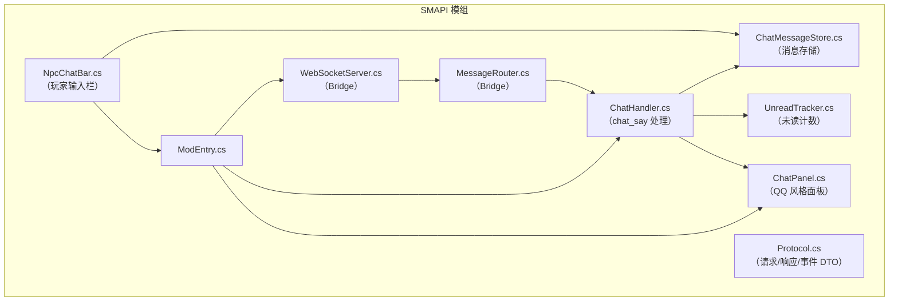
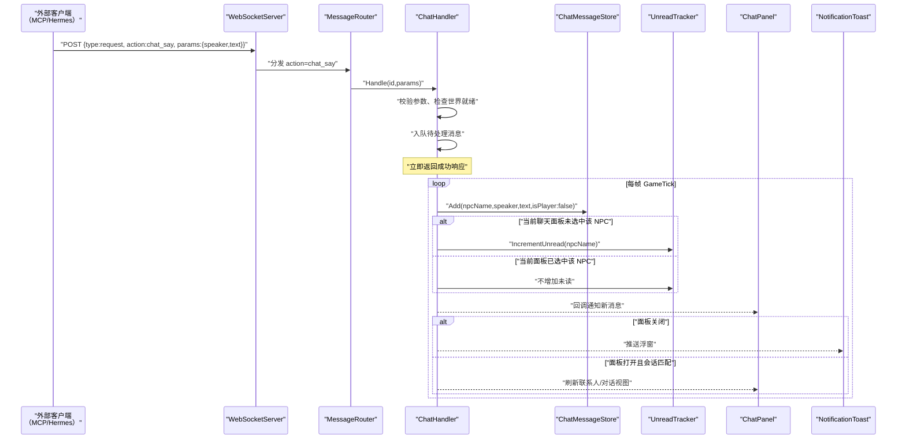
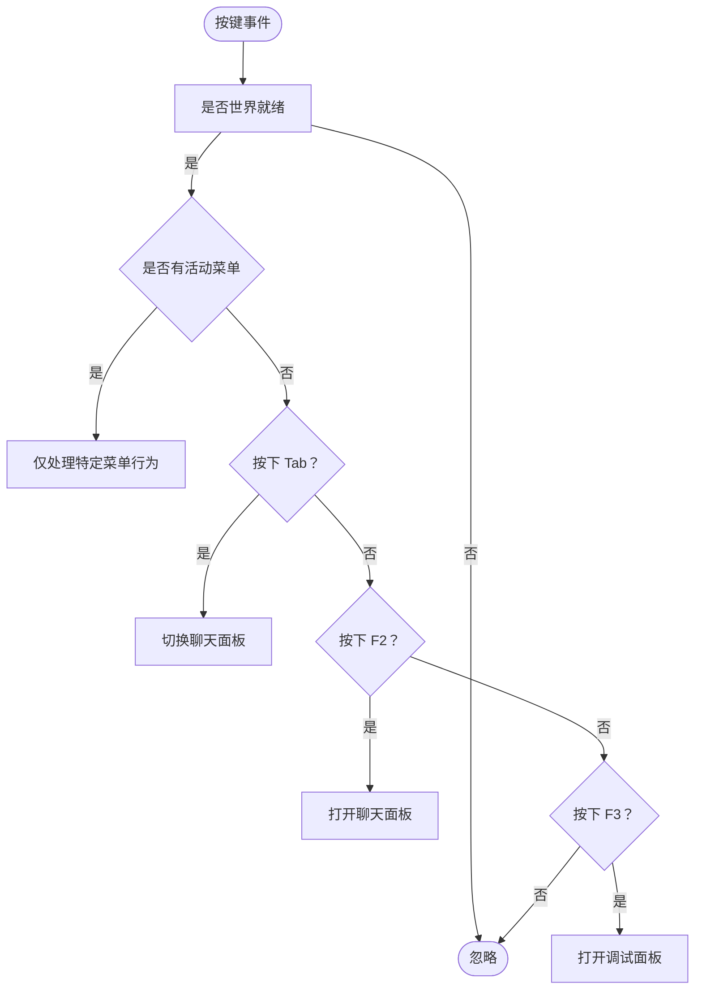
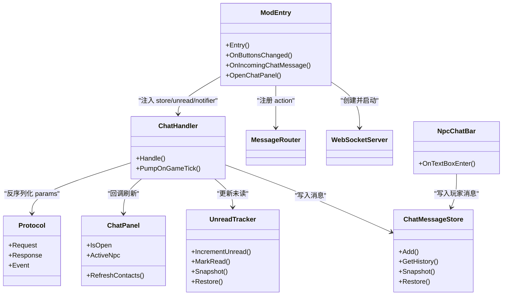

# 聊天系统

<cite>
**本文引用的文件**
- [ChatHandler.cs](file://SmartNPC/smapi-mod/Chat/ChatHandler.cs)
- [ModEntry.cs](file://SmartNPC/smapi-mod/ModEntry.cs)
- [Protocol.cs](file://SmartNPC/smapi-mod/Bridge/Protocol.cs)
- [ChatMessageStore.cs](file://SmartNPC/smapi-mod/UI/ChatMessageStore.cs)
- [UnreadTracker.cs](file://SmartNPC/smapi-mod/Data/UnreadTracker.cs)
- [ChatPanel.cs](file://SmartNPC/smapi-mod/UI/ChatPanel.cs)
- [NpcChatBar.cs](file://SmartNPC/smapi-mod/UI/NpcChatBar.cs)
</cite>

## 目录
1. [引言](#引言)
2. [项目结构](#项目结构)
3. [核心组件](#核心组件)
4. [架构总览](#架构总览)
5. [详细组件分析](#详细组件分析)
6. [依赖关系分析](#依赖关系分析)
7. [性能与扩展性](#性能与扩展性)
8. [故障排查](#故障排查)
9. [结论](#结论)
10. [附录：扩展示例](#附录扩展示例)

## 引言
本文件面向 SmartNPC SMAPI 模组中的“聊天系统”，聚焦以下目标：
- 解释 ChatHandler.cs 的消息处理、会话管理与 NPC 对话生成逻辑。
- 说明 ModEntry.cs 中如何通过输入事件监听打开聊天面板，并给出 Ctrl+T 的扩展点。
- 深入讲解 ChatMessageStore.cs 的消息存储机制：按 NPC 分区、历史查询、快照持久化。
- 说明 UnreadTracker.cs 的未读标记管理。
- 提供扩展指南：新增消息类型、自定义回复逻辑、接入外部服务、消息过滤与防抖、多语言支持。
- 通过流程图和时序图呈现关键数据流。

本项目是 Stardew Valley 的 SMAPI 模组，运行在游戏主线程中；WebSocket 桥接层在后台接收 MCP/Hermes 等外部客户端的请求，再把结果或广播回推至游戏内 UI。

**章节来源**
- [ModEntry.cs:1-120](file://SmartNPC/smapi-mod/ModEntry.cs#L1-L120)

## 项目结构
聊天相关代码主要分布在以下位置：
- Bridge：协议 DTO、WebSocket 服务器、消息路由。
- Chat：Agent 侧 chat_say 广播的处理入口。
- Data：未读计数。
- UI：聊天面板、联系人列表、对话视图、底部输入条（玩家发送）、消息存储。
- ModEntry：组合所有子系统，注册 WS action、热键、保存加载钩子。

**图示来源**
- [ModEntry.cs:1-120](file://SmartNPC/smapi-mod/ModEntry.cs#L1-L120)
- [Protocol.cs:1-67](file://SmartNPC/smapi-mod/Bridge/Protocol.cs#L1-L67)
- [ChatHandler.cs:1-96](file://SmartNPC/smapi-mod/Chat/ChatHandler.cs#L1-L96)
- [ChatMessageStore.cs:1-87](file://SmartNPC/smapi-mod/UI/ChatMessageStore.cs#L1-L87)
- [UnreadTracker.cs:1-56](file://SmartNPC/smapi-mod/Data/UnreadTracker.cs#L1-L56)
- [ChatPanel.cs:1-178](file://SmartNPC/smapi-mod/UI/ChatPanel.cs#L1-L178)
- [NpcChatBar.cs:1-165](file://SmartNPC/smapi-mod/UI/NpcChatBar.cs#L1-L165)

**章节来源**
- [ModEntry.cs:1-120](file://SmartNPC/smapi-mod/ModEntry.cs#L1-L120)
- [Protocol.cs:1-67](file://SmartNPC/smapi-mod/Bridge/Protocol.cs#L1-L67)

## 核心组件
- ChatHandler：解析 WS action `chat_say`，校验参数，入队待处理消息，并在每帧 GameTick 中把 NPC 发言写入 ChatMessageStore，更新 UnreadTracker，并通过回调通知 UI。
- ChatMessageStore：按 NPC 名称维护消息列表；超过上限时丢弃最早消息；提供快照与恢复方法用于跨存档持久化。
- UnreadTracker：按 NPC 统计未读数量；当玩家选中对应会话时清零该 NPC 未读数。
- ChatPanel：只读 QQ 风格聊天面板；左侧联系人、右侧对话记录；支持热键 Tab/F2/Esc。
- NpcChatBar：玩家侧输入条；提交后写入 ChatMessageStore 并调用发送回调，由上层决定如何转发到后端。
- Protocol：定义 Request、Response、Event、ResponseError 等 JSON 结构，以及 Web 序列化选项。
- ModEntry：组装各组件，注册 WebSocket action，绑定热键、保存钩子、渲染钩子，驱动 UI 与通知。

**章节来源**
- [ChatHandler.cs:1-96](file://SmartNPC/smapi-mod/Chat/ChatHandler.cs#L1-L96)
- [ChatMessageStore.cs:1-87](file://SmartNPC/smapi-mod/UI/ChatMessageStore.cs#L1-L87)
- [UnreadTracker.cs:1-56](file://SmartNPC/smapi-mod/Data/UnreadTracker.cs#L1-L56)
- [ChatPanel.cs:1-178](file://SmartNPC/smapi-mod/UI/ChatPanel.cs#L1-L178)
- [NpcChatBar.cs:1-165](file://SmartNPC/smapi-mod/UI/NpcChatBar.cs#L1-L165)
- [Protocol.cs:1-67](file://SmartNPC/smapi-mod/Bridge/Protocol.cs#L1-L67)
- [ModEntry.cs:1-200](file://SmartNPC/smapi-mod/ModEntry.cs#L1-L200)

## 架构总览
聊天系统的整体数据流如下：

**图示来源**
- [ModEntry.cs:160-200](file://SmartNPC/smapi-mod/ModEntry.cs#L160-L200)
- [ChatHandler.cs:30-96](file://SmartNPC/smapi-mod/Chat/ChatHandler.cs#L30-L96)
- [ChatPanel.cs:20-178](file://SmartNPC/smapi-mod/UI/ChatPanel.cs#L20-L178)

**章节来源**
- [ChatHandler.cs:1-96](file://SmartNPC/smapi-mod/Chat/ChatHandler.cs#L1-L96)
- [ModEntry.cs:160-200](file://SmartNPC/smapi-mod/ModEntry.cs#L160-L200)

## 详细组件分析

### ChatHandler：消息处理、会话管理与 NPC 对话生成
ChatHandler 是 Agent 侧工作广播的监控入口，专门处理 `chat_say`：
- 参数校验：反序列化为内部参数对象，要求 speaker 与 text 非空；否则返回错误响应。
- 世界就绪检查：若游戏尚未加载存档，返回 mod_not_ready。
- 异步入队：将消息放入 ConcurrentQueue，避免阻塞 WS 请求线程。
- 游戏帧泵出：PumpOnGameTick 在游戏线程中逐个处理队列：
  - 根据 speaker 获取 NPC displayName。
  - 写入 ChatMessageStore。
  - 若 ChatPanel 打开且选中的正是该 NPC，则不增加未读；否则调用 UnreadTracker.IncrementUnread。
  - 触发 OnMessage 回调，供 UI 推送 Toast 或刷新面板。
  - 输出 Trace 日志。

复杂度与稳定性：
- 入队/出队为 O(1)，适合高频广播。
- 对每个消息进行一次 NPC 查找与一次字典查找，整体开销低。
- 错误路径统一返回 Response.Failure，便于上游客户端识别。

扩展点：
- 可在 PumpOnGameTick 中插入消息过滤、翻译、敏感词检测、频率限制等中间件。
- 可注入新的 IChatProcessor 管道，实现多阶段处理。

**章节来源**
- [ChatHandler.cs:1-96](file://SmartNPC/smapi-mod/Chat/ChatHandler.cs#L1-L96)

### ChatInputCapture：游戏内输入捕获与快捷键拦截
当前仓库中没有名为 ChatInputCapture.cs 的文件；实际的输入捕获逻辑位于 ModEntry.cs：
- 注册 SMAPI 事件：ButtonsChanged、ButtonPressed。
- 热键处理：
  - Tab：切换聊天面板。若当前活动菜单是 ChatPanel，则关闭；若无其他模态菜单，则打开面板。
  - F2：直接打开聊天面板并聚焦联系人列表。
  - F3：打开调试面板。
- 点击穿透：鼠标左键在未激活菜单时，优先交给背包图标或 Toast；必要时抑制输入，防止 SDV 原生交互被误触发。

关于 Ctrl+T：
- 当前默认快捷键不包含 Ctrl+T。
- 可通过扩展 ModEntry.OnButtonsChanged，加入对 Ctrl+T 的判断，复用 OpenChatPanel 逻辑即可。
- 建议同时考虑输入法状态与全局快捷键冲突，避免与系统或游戏内建快捷键冲突。

**图示来源**
- [ModEntry.cs:348-385](file://SmartNPC/smapi-mod/ModEntry.cs#L348-L385)

**章节来源**
- [ModEntry.cs:70-120](file://SmartNPC/smapi-mod/ModEntry.cs#L70-L120)
- [ModEntry.cs:348-385](file://SmartNPC/smapi-mod/ModEntry.cs#L348-L385)

### ChatMessageStore：消息存储、历史查询与持久化
ChatMessageStore 以 NPC 名称为键，维护 List<ChatMessage>：
- Add：追加消息，记录时间、游戏内时间；超过最大长度时删除最旧消息。
- GetHistory：读取某 NPC 的全部历史，不存在时返回空列表。
- Clear：清空某 NPC 的历史。
- Snapshot：为每个 NPC 保留最近 maxPerNpc 条消息的快照。
- Restore：用快照替换内存状态。

注意：
- 当前 ChatMessageStore 自身不提供 Save/Load 钩子；实际持久化应由 ModEntry 在 Saving/SaveLoaded 事件中调用 Snapshot/Restore。
- 由于 ChatMessageStore 字段为 private，外部无法直接访问；应通过 ModEntry 暴露的 API 进行快照与恢复。

复杂度：
- Add 均摊 O(1)。
- Snapshot 遍历所有 NPC 列表，O(N) 其中 N 为消息总数。
- 空间占用受 maxPerNpc 控制，避免无限增长。

**章节来源**
- [ChatMessageStore.cs:1-87](file://SmartNPC/smapi-mod/UI/ChatMessageStore.cs#L1-L87)

### UnreadTracker：未读标记管理
UnreadTracker 维护 Dictionary<npcName,count>：
- IncrementUnread：计数加一。
- MarkRead：选中会话时移除该 NPC 未读计数。
- GetUnread：查询未读数量。
- TotalUnread：汇总未读总数。
- Snapshot/Restore：配合保存/加载流程。

使用场景：
- ChatHandler 在非活跃会话收到 NPC 消息时增加未读。
- ChatPanel 选择联系人时标记已读。

**章节来源**
- [UnreadTracker.cs:1-56](file://SmartNPC/smapi-mod/Data/UnreadTracker.cs#L1-L56)
- [ChatPanel.cs:120-178](file://SmartNPC/smapi-mod/UI/ChatPanel.cs#L120-L178)
- [ChatHandler.cs:60-96](file://SmartNPC/smapi-mod/Chat/ChatHandler.cs#L60-L96)

### ChatPanel：只读聊天面板
ChatPanel 是 QQ 风格的只读面板：
- 左侧 ContactList，右侧 ConversationView。
- 支持 Tab、F2、Esc。
- ActiveNpc 静态属性表示当前选中的 NPC。
- IsOpen 静态属性表示面板是否处于活动菜单状态。
- OnContactSelected：设置 ActiveNpc、MarkRead、设置 ConversationView 并重置滚动。
- RefreshContacts：供 ChatHandler 回调刷新联系人列表。

注意：
- ChatPanel 本身不负责发送消息；它主要用于监视 Agent 广播与调试镜像。
- 玩家发送消息由 NpcChatBar 负责。

**章节来源**
- [ChatPanel.cs:1-178](file://SmartNPC/smapi-mod/UI/ChatPanel.cs#L1-L178)

### NpcChatBar：玩家输入条
NpcChatBar 是屏幕底部的输入条：
- 显示 NPC 头像与名称。
- 内置 TextBox，回车提交。
- 提交时调用 ChatMessageStore.Add，将玩家消息写入当前 NPC 频道。
- 调用 onSend 回调，由上层决定如何发送到后端（例如通过 WebSocket）。
- ESC 关闭输入条。

扩展点：
- 可在 OnTextBoxEnter 前加入输入校验、过滤、防抖、翻译。
- onSend 可对接 MessageRouter 或 WebSocketClient，实现双向聊天。

**章节来源**
- [NpcChatBar.cs:1-165](file://SmartNPC/smapi-mod/UI/NpcChatBar.cs#L1-L165)

### Protocol：协议 DTO
Protocol 定义了 WS 桥接的通用数据结构：
- Request：包含 type、id、action、params、from_npc。
- Response：Success/Failure 工厂方法。
- Event：服务端主动推送的事件。
- JsonOpts.Web：忽略 null 字段的 Web 序列化选项。

用途：
- ChatHandler.Handle 使用 JsonSerializer.Deserialize 与 JsonOpts.Web 反序列化 params。
- 上游 MCP/Hermes 客户端据此构造 chat_say 请求。

**章节来源**
- [Protocol.cs:1-67](file://SmartNPC/smapi-mod/Bridge/Protocol.cs#L1-L67)
- [ChatHandler.cs:30-60](file://SmartNPC/smapi-mod/Chat/ChatHandler.cs#L30-L60)

## 依赖关系分析

**图示来源**
- [ModEntry.cs:1-200](file://SmartNPC/smapi-mod/ModEntry.cs#L1-L200)
- [ChatHandler.cs:1-96](file://SmartNPC/smapi-mod/Chat/ChatHandler.cs#L1-L96)
- [ChatMessageStore.cs:1-87](file://SmartNPC/smapi-mod/UI/ChatMessageStore.cs#L1-L87)
- [UnreadTracker.cs:1-56](file://SmartNPC/smapi-mod/Data/UnreadTracker.cs#L1-L56)
- [ChatPanel.cs:1-178](file://SmartNPC/smapi-mod/UI/ChatPanel.cs#L1-L178)
- [NpcChatBar.cs:1-165](file://SmartNPC/smapi-mod/UI/NpcChatBar.cs#L1-L165)
- [Protocol.cs:1-67](file://SmartNPC/smapi-mod/Bridge/Protocol.cs#L1-L67)

**章节来源**
- [ModEntry.cs:1-200](file://SmartNPC/smapi-mod/ModEntry.cs#L1-L200)
- [ChatHandler.cs:1-96](file://SmartNPC/smapi-mod/Chat/ChatHandler.cs#L1-L96)

## 性能与扩展性

### 性能特性
- 消息入队与出队使用并发队列，避免 WS 线程阻塞。
- 消息泵出在游戏帧中进行，保证 UI 安全。
- ChatMessageStore 限制每 NPC 历史长度，避免内存无限增长。
- UnreadTracker 使用字典 O(1) 读写。

### 可扩展方向
- 新增消息类型：
  - 在 Protocol.Request.Action 中定义新 action，如 npc_whisper、group_broadcast。
  - 在 MessageRouter 中注册处理器。
  - 在 ChatHandler 或新建处理器中实现业务逻辑。
- 自定义回复逻辑：
  - 在 ChatHandler.PumpOnGameTick 中判断文本内容，调用外部 LLM 或规则引擎生成回复。
  - 将生成的回复再次通过 _store.Add 写入，或使用 WS 广播给客户端。
- 集成外部服务：
  - 通过 ModEntry 中已有的 WebSocketServer 广播事件，或将消息转发到 HTTP/MQ。
  - 建议在 ChatHandler 中引入 IExternalService 接口，便于测试与替换。
- 消息过滤：
  - 在 PumpOnGameTick 中增加敏感词、重复检测、长度限制。
- 防抖处理：
  - 对短时间内的重复消息合并；可使用滑动窗口或最近消息哈希比较。
- 多语言支持：
  - 在 ChatHandler 或 ModEntry 中接入翻译服务，将 text 转换为目标语言后再写入 ChatMessageStore。
  - 也可在 ChatPanel 渲染时根据 SMAPI i18n 配置进行本地化显示。

[本节为通用指导，不直接分析具体文件]

## 故障排查

常见问题与建议：
- 无存档时收到 chat_say：
  - ChatHandler 会返回 mod_not_ready。确认游戏已加载存档，或在上游客户端延迟发送。
- 消息未显示或未读未更新：
  - 检查 ChatHandler.PumpOnGameTick 是否被调用；确保 Context.IsWorldReady 为真。
  - 检查 ChatPanel.IsOpen 与 ActiveNpc 是否与 speaker 匹配。
- 玩家消息写入但未被后端接收：
  - 检查 NpcChatBar.onSend 是否被正确调用；确认上层已将消息发送到 WebSocket 或 MessageRouter。
- 面板无法打开：
  - 检查 ModEntry.OnButtonsChanged 中 Tab/F2 分支是否被其他模态菜单拦截。
- 持久化异常：
  - 确保 ModEntry 在 Saving/SaveLoaded 事件中调用 ChatMessageStore.Snapshot/Restore 与 UnreadTracker.Snapshot/Restore。
  - 注意 ChatMessageStore 与 UnreadTracker 的字段为 internal/private，需通过 ModEntry 暴露的方法访问。

**章节来源**
- [ChatHandler.cs:30-96](file://SmartNPC/smapi-mod/Chat/ChatHandler.cs#L30-L96)
- [ChatPanel.cs:120-178](file://SmartNPC/smapi-mod/UI/ChatPanel.cs#L120-L178)
- [NpcChatBar.cs:120-165](file://SmartNPC/smapi-mod/UI/NpcChatBar.cs#L120-L165)
- [ModEntry.cs:348-385](file://SmartNPC/smapi-mod/ModEntry.cs#L348-L385)

## 结论
聊天系统以 ChatHandler 为核心，连接外部 WS 客户端与游戏内 UI；ChatMessageStore 与 UnreadTracker 分别负责消息历史与未读状态；ChatPanel 提供只读对话界面，NpcChatBar 提供玩家输入入口；ModEntry 完成组合与事件绑定。系统在性能上采用队列与帧泵模式，在扩展上预留了协议、处理器与 UI 回调等清晰边界，便于新增消息类型、自定义回复、外部服务集成、过滤与多语言支持。

[本节为总结性内容，不直接分析具体文件]

## 附录：扩展示例

### 示例一：监听聊天事件
- 在 ModEntry 中已有 OnIncomingChatMessage 回调，可用于刷新面板或推送 Toast。
- 若要对外暴露事件，可在 ChatHandler 中增加公共事件，供 ModEntry 或其他模块订阅。

参考路径：
- [ModEntry.cs:180-200](file://SmartNPC/smapi-mod/ModEntry.cs#L180-L200)
- [ChatHandler.cs:60-96](file://SmartNPC/smapi-mod/Chat/ChatHandler.cs#L60-L96)

### 示例二：发送消息
- 玩家发送：NpcChatBar 提交后调用 onSend，由上层决定发送方式。
- NPC 发送：通过 WS 发送 action=chat_say，参数包含 speaker 与 text。

参考路径：
- [NpcChatBar.cs:120-165](file://SmartNPC/smapi-mod/UI/NpcChatBar.cs#L120-L165)
- [Protocol.cs:1-67](file://SmartNPC/smapi-mod/Bridge/Protocol.cs#L1-L67)

### 示例三：处理用户输入
- 在 ModEntry.OnButtonsChanged 中添加 Ctrl+T 快捷键逻辑，复用 OpenChatPanel。
- 在 NpcChatBar.OnTextBoxEnter 中增加输入校验与过滤。

参考路径：
- [ModEntry.cs:348-385](file://SmartNPC/smapi-mod/ModEntry.cs#L348-L385)
- [NpcChatBar.cs:120-165](file://SmartNPC/smapi-mod/UI/NpcChatBar.cs#L120-L165)

### 示例四：消息过滤与防抖
- 在 ChatHandler.PumpOnGameTick 中增加最近消息去重、长度限制、敏感词过滤。
- 可维护一个环形缓冲区记录最近 N 条消息，快速比对。

参考路径：
- [ChatHandler.cs:60-96](file://SmartNPC/smapi-mod/Chat/ChatHandler.cs#L60-L96)

### 示例五：多语言支持
- 在 ChatHandler 或 ModEntry 中接入翻译服务，将 text 转换为当前语言后再写入 ChatMessageStore。
- 或在 ChatPanel 渲染时根据 SMAPI i18n 配置进行本地化。

参考路径：
- [ChatHandler.cs:60-96](file://SmartNPC/smapi-mod/Chat/ChatHandler.cs#L60-L96)
- [ChatPanel.cs:1-178](file://SmartNPC/smapi-mod/UI/ChatPanel.cs#L1-L178)