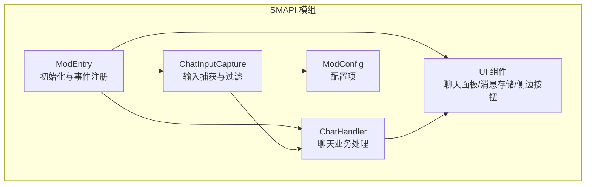
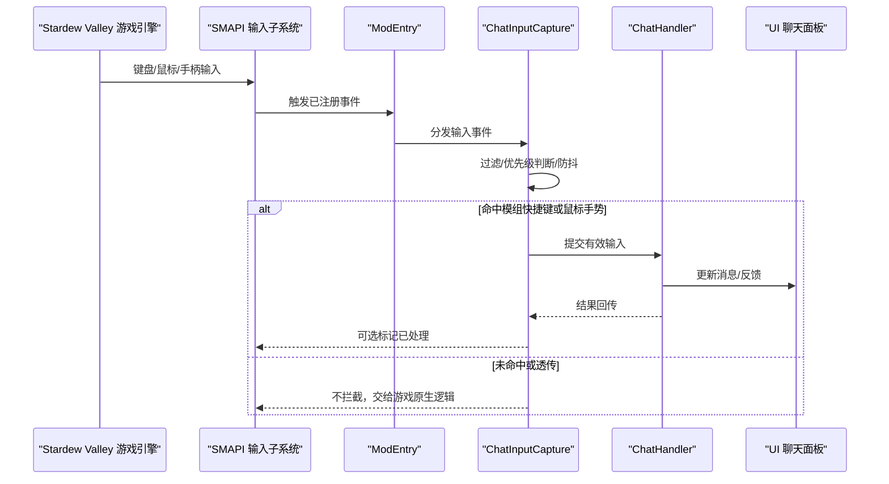
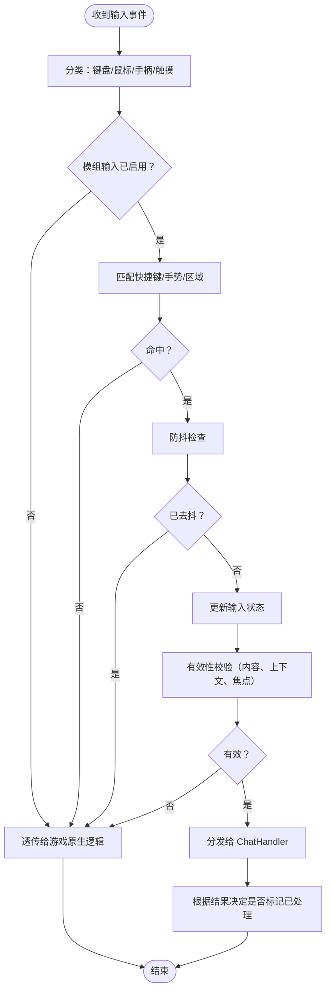
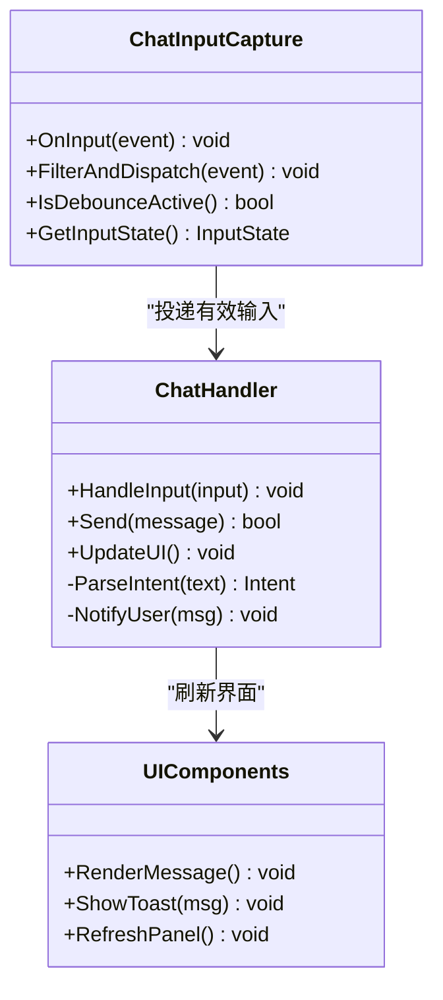
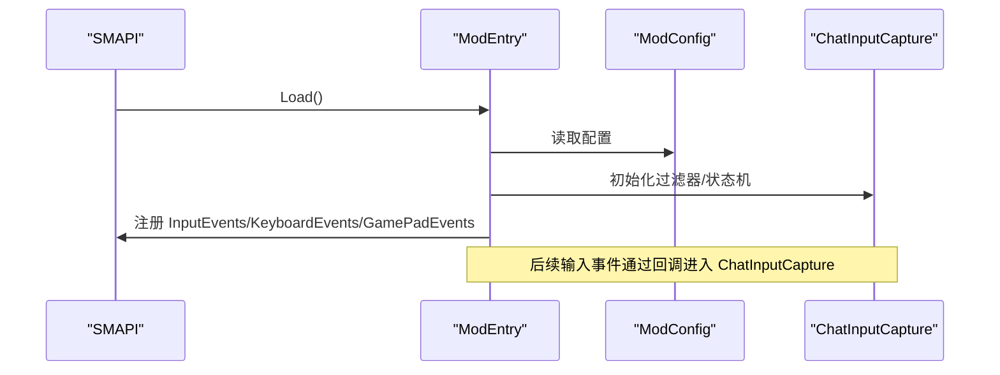
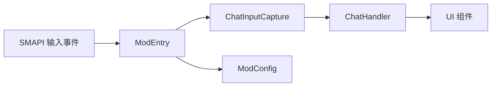

# 聊天输入捕获

<cite>
**本文引用的文件**   
- [ChatInputCapture.cs](file://SmartNPC/smapi-mod/Chat/ChatInputCapture.cs)
- [ChatHandler.cs](file://SmartNPC/smapi-mod/Chat/ChatHandler.cs)
- [ModEntry.cs](file://SmartNPC/smapi-mod/ModEntry.cs)
- [ModConfig.cs](file://SmartNPC/smapi-mod/ModConfig.cs)
</cite>

## 目录
1. [引言](#引言)
2. [项目结构定位](#项目结构定位)
3. [核心组件](#核心组件)
4. [架构总览](#架构总览)
5. [详细组件分析](#详细组件分析)
6. [依赖关系分析](#依赖关系分析)
7. [性能与并发考虑](#性能与并发考虑)
8. [故障排查指南](#故障排查指南)
9. [结论](#结论)
10. [附录：扩展实践清单](#附录扩展实践清单)

## 引言
本文聚焦 SmartNPC 模组中的“聊天输入捕获”机制，目标是解释 ChatInputCapture.cs 如何实现游戏内输入拦截、如何与 SMAPI 的输入系统对接、如何区分原生输入与模组自定义输入，以及如何扩展新的快捷键、鼠标手势和触摸设备支持。文档还覆盖输入优先级管理、防抖处理、输入状态跟踪等高级特性，并提供可操作的扩展步骤与示例路径。

## 项目结构定位
SmartNPC 是一个基于 Stardew Valley 的 SMAPI 模组。与聊天输入捕获直接相关的代码位于 smapi-mod 模块中：
- Chat 目录：负责聊天 UI 与输入捕获逻辑
- ModEntry：模组生命周期入口，完成事件订阅与初始化
- ModConfig：配置项，用于开关或调整输入行为
- UI 子目录：聊天面板、消息存储、侧边按钮等界面组件

**图表来源**
- [ModEntry.cs](file://SmartNPC/smapi-mod/ModEntry.cs)
- [ChatInputCapture.cs](file://SmartNPC/smapi-mod/Chat/ChatInputCapture.cs)
- [ChatHandler.cs](file://SmartNPC/smapi-mod/Chat/ChatHandler.cs)
- [ModConfig.cs](file://SmartNPC/smapi-mod/ModConfig.cs)

**章节来源**
- [ModEntry.cs](file://SmartNPC/smapi-mod/ModEntry.cs)
- [ChatInputCapture.cs](file://SmartNPC/smapi-mod/Chat/ChatInputCapture.cs)

## 核心组件
- ChatInputCapture：实现输入事件的拦截、过滤、去抖与状态追踪；决定哪些输入应交由模组处理，哪些应透传给游戏原生逻辑。
- ChatHandler：消费被捕获并确认有效的聊天输入，执行对话发送、提示、联动逻辑。
- ModEntry：在模组加载时注册 SMAPI 事件（如 InputEvents、KeyboardEvents、GamePadEvents），并将回调委派给 ChatInputCapture。
- ModConfig：暴露配置项，例如是否启用 Ctrl+T、是否启用鼠标点击、是否启用防抖、阈值时间等。

**章节来源**
- [ChatInputCapture.cs](file://SmartNPC/smapi-mod/Chat/ChatInputCapture.cs)
- [ChatHandler.cs](file://SmartNPC/smapi-mod/Chat/ChatHandler.cs)
- [ModEntry.cs](file://SmartNPC/smapi-mod/ModEntry.cs)
- [ModConfig.cs](file://SmartNPC/smapi-mod/ModConfig.cs)

## 架构总览
下图展示了从用户输入到聊天处理的端到端流程，以及 SMAPI 输入系统与模组的集成点。

**图表来源**
- [ModEntry.cs](file://SmartNPC/smapi-mod/ModEntry.cs)
- [ChatInputCapture.cs](file://SmartNPC/smapi-mod/Chat/ChatInputCapture.cs)
- [ChatHandler.cs](file://SmartNPC/smapi-mod/Chat/ChatHandler.cs)

## 详细组件分析

### ChatInputCapture：输入捕获与过滤
该组件承担以下职责：
- 监听 SMAPI 的输入事件（键盘、鼠标、手柄）
- 识别快捷键组合（如 Ctrl+T）、鼠标点击区域、手势、触摸输入
- 维护输入状态机（空闲、激活、编辑中、等待确认等）
- 应用防抖策略，避免重复触发
- 区分“游戏原生输入”与“模组自定义输入”，避免冲突
- 将经过校验的有效输入转发给 ChatHandler

#### 输入事件流与处理逻辑

**图表来源**
- [ChatInputCapture.cs](file://SmartNPC/smapi-mod/Chat/ChatInputCapture.cs)

#### 快捷键与输入过滤规则
- 快捷键匹配：按修饰键+主键进行匹配（例如 Ctrl+T），支持配置化扩展
- 上下文判定：仅在特定场景下生效（例如不在战斗、对话框关闭后、非全局菜单遮挡时）
- 焦点判定：当聊天框或模组 UI 获得焦点时才处理相关输入
- 冲突规避：若游戏原生功能已处理该输入，则不再拦截；否则由模组接管

**章节来源**
- [ChatInputCapture.cs](file://SmartNPC/smapi-mod/Chat/ChatInputCapture.cs)

### ChatHandler：聊天业务处理
ChatHandler 接收来自 ChatInputCapture 的有效输入，执行如下操作：
- 解析输入内容与意图
- 调用聊天 API 或协议层发送消息
- 更新 UI 显示、通知、历史消息
- 与外部服务（如 WebSocket/HTTP）交互，触发 NPC 行为或工作流

**图表来源**
- [ChatInputCapture.cs](file://SmartNPC/smapi-mod/Chat/ChatInputCapture.cs)
- [ChatHandler.cs](file://SmartNPC/smapi-mod/Chat/ChatHandler.cs)

**章节来源**
- [ChatHandler.cs](file://SmartNPC/smapi-mod/Chat/ChatHandler.cs)

### ModEntry：SMAPI 事件注册
ModEntry 负责：
- 在模组加载时订阅 SMAPI 的 InputEvents、KeyboardEvents、GamePadEvents
- 将回调方法绑定到 ChatInputCapture
- 读取 ModConfig 配置，初始化输入过滤器与状态机
- 必要时向 SMAPI 注册其他钩子（例如 UI 焦点变化）

**图表来源**
- [ModEntry.cs](file://SmartNPC/smapi-mod/ModEntry.cs)
- [ModConfig.cs](file://SmartNPC/smapi-mod/ModConfig.cs)
- [ChatInputCapture.cs](file://SmartNPC/smapi-mod/Chat/ChatInputCapture.cs)

**章节来源**
- [ModEntry.cs](file://SmartNPC/smapi-mod/ModEntry.cs)
- [ModConfig.cs](file://SmartNPC/smapi-mod/ModConfig.cs)

### ModConfig：配置项
典型配置项包括：
- 启用/禁用快捷键（例如 Ctrl+T）
- 启用/禁用鼠标点击与手势识别
- 防抖延迟阈值（毫秒）
- 输入优先级（模组优先还是游戏原生优先）
- 支持的修饰键组合列表
- 是否允许触摸设备输入

这些配置影响 ChatInputCapture 的行为分支，便于在不同场景下灵活调整。

**章节来源**
- [ModConfig.cs](file://SmartNPC/smapi-mod/ModConfig.cs)

## 依赖关系分析
- ChatInputCapture 依赖 SMAPI 输入事件模型与游戏状态（如焦点、当前窗口、是否在聊天框内）
- ChatInputCapture 依赖 ModConfig 来决定启用哪些输入通道与过滤规则
- ChatInputCapture 将有效输入委托给 ChatHandler
- ModEntry 作为中介，连接 SMAPI 事件与模组内部组件

**图表来源**
- [ModEntry.cs](file://SmartNPC/smapi-mod/ModEntry.cs)
- [ChatInputCapture.cs](file://SmartNPC/smapi-mod/Chat/ChatInputCapture.cs)
- [ChatHandler.cs](file://SmartNPC/smapi-mod/Chat/ChatHandler.cs)
- [ModConfig.cs](file://SmartNPC/smapi-mod/ModConfig.cs)

**章节来源**
- [ModEntry.cs](file://SmartNPC/smapi-mod/ModEntry.cs)
- [ChatInputCapture.cs](file://SmartNPC/smapi-mod/Chat/ChatInputCapture.cs)
- [ChatHandler.cs](file://SmartNPC/smapi-mod/Chat/ChatHandler.cs)
- [ModConfig.cs](file://SmartNPC/smapi-mod/ModConfig.cs)

## 性能与并发考虑
- 防抖处理：通过短时间内的重复输入过滤，减少无效调用与 UI 抖动
- 轻量级过滤：在输入事件回调中进行快速匹配与决策，避免阻塞主循环
- 状态机优化：使用紧凑的状态表示与最小化跳转，降低分支成本
- 线程安全：确保对共享状态的读写采用适当的同步策略（如单线程回调、原子变量、锁保护）
- I/O 分离：聊天发送与网络请求应在异步任务中执行，避免阻塞输入处理

[本节为通用指导，不直接分析具体文件]

## 故障排查指南
常见问题与排查要点：
- 快捷键无响应
  - 检查 ModConfig 是否启用了该快捷键
  - 确认 ModEntry 是否正确注册了 SMAPI 事件
  - 查看 ChatInputCapture 的过滤逻辑是否因上下文或焦点导致跳过
- 与其他模组冲突
  - 检查输入优先级设置，确保模组不会抢占游戏原生功能
  - 在日志中观察输入事件是否被正确标记为已处理
- 输入抖动或重复触发
  - 调整防抖阈值
  - 检查状态机是否存在误转换
- 鼠标点击或手势无效
  - 验证点击区域判定逻辑
  - 检查 UI 焦点与遮挡情况
- 触摸设备兼容性问题
  - 确认触摸事件是否被纳入输入分类
  - 调整手势识别灵敏度与区域

**章节来源**
- [ChatInputCapture.cs](file://SmartNPC/smapi-mod/Chat/ChatInputCapture.cs)
- [ModConfig.cs](file://SmartNPC/smapi-mod/ModConfig.cs)

## 结论
ChatInputCapture.cs 在 SmartNPC 模组中充当输入拦截与调度中枢：它通过 SMAPI 事件接入游戏输入，结合配置与上下文进行精准过滤，利用防抖与状态机保证稳定可靠的处理流程，最终将有效输入交付给 ChatHandler 完成聊天业务。合理配置与扩展该组件，可在不干扰游戏原生功能的前提下，提供丰富的快捷键、鼠标手势与触摸输入能力。

[本节为总结性内容，不直接分析具体文件]

## 附录：扩展实践清单
- 添加新快捷键组合
  - 在 ModConfig 中扩展修饰键与主键组合列表
  - 在 ChatInputCapture 的匹配逻辑中加入新组合
  - 在 ModEntry 中确保事件注册完整
- 支持鼠标手势
  - 在输入分类中增加鼠标移动/拖拽/双击等事件
  - 定义手势区域与判定条件（方向、距离、时间窗口）
  - 将手势结果映射为聊天指令或动作
- 实现触摸设备兼容
  - 将触摸输入纳入输入分类
  - 适配触摸手势（滑动、长按、多点触控）
  - 调整 UI 交互区域大小与反馈方式
- 输入优先级管理
  - 在过滤阶段比较“游戏原生处理”与“模组处理”的结果
  - 提供配置开关以切换优先模式
- 防抖与状态跟踪
  - 设置合理的防抖间隔
  - 维护输入状态机（空闲、激活、编辑中、确认中）
  - 在状态变更时输出调试信息以便排错

[本节为概念性指导，不直接分析具体文件]