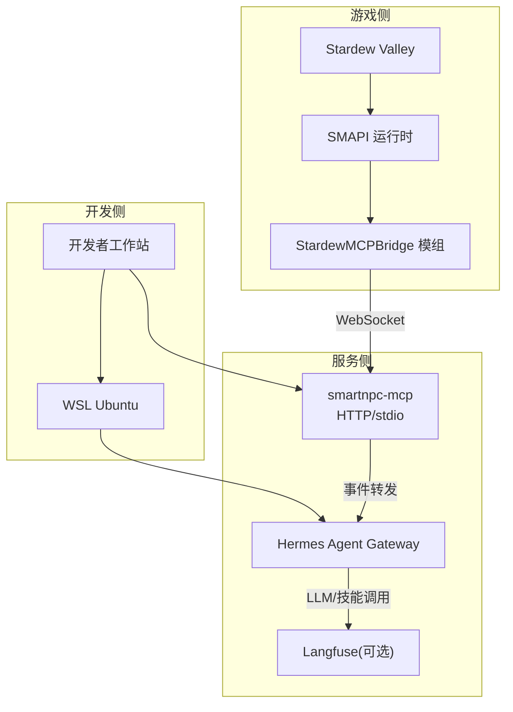
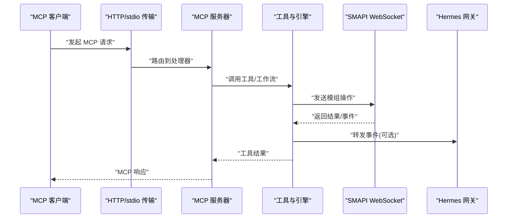
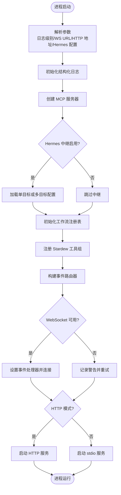
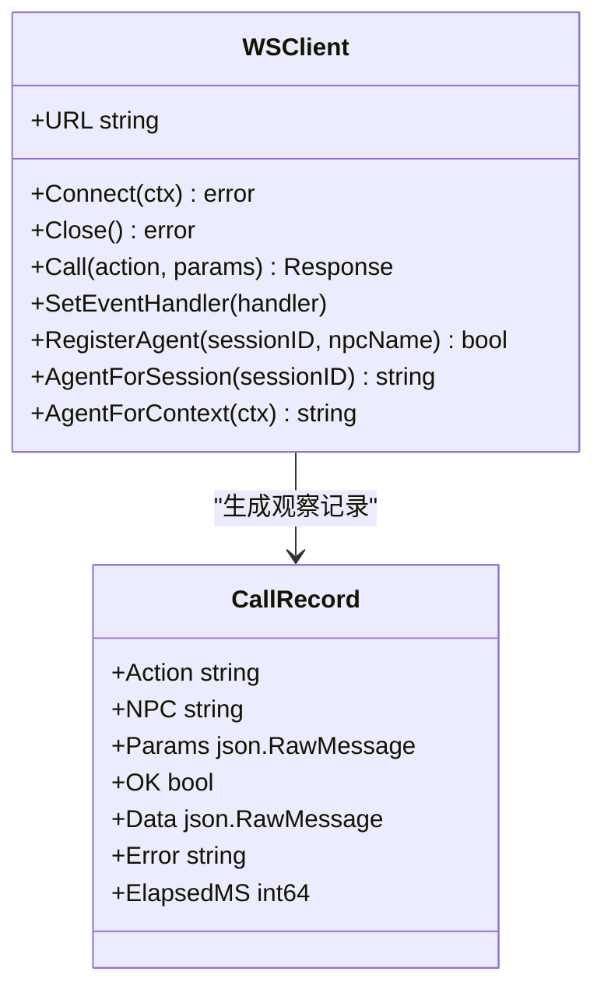
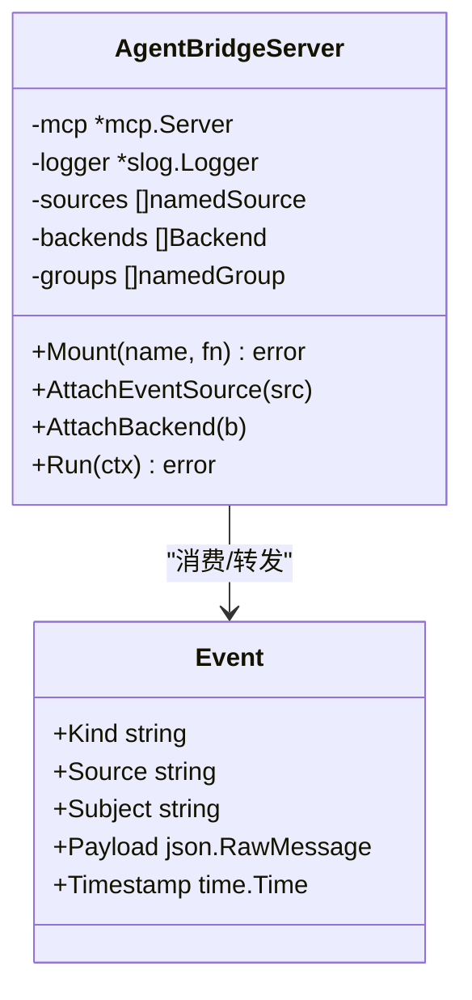
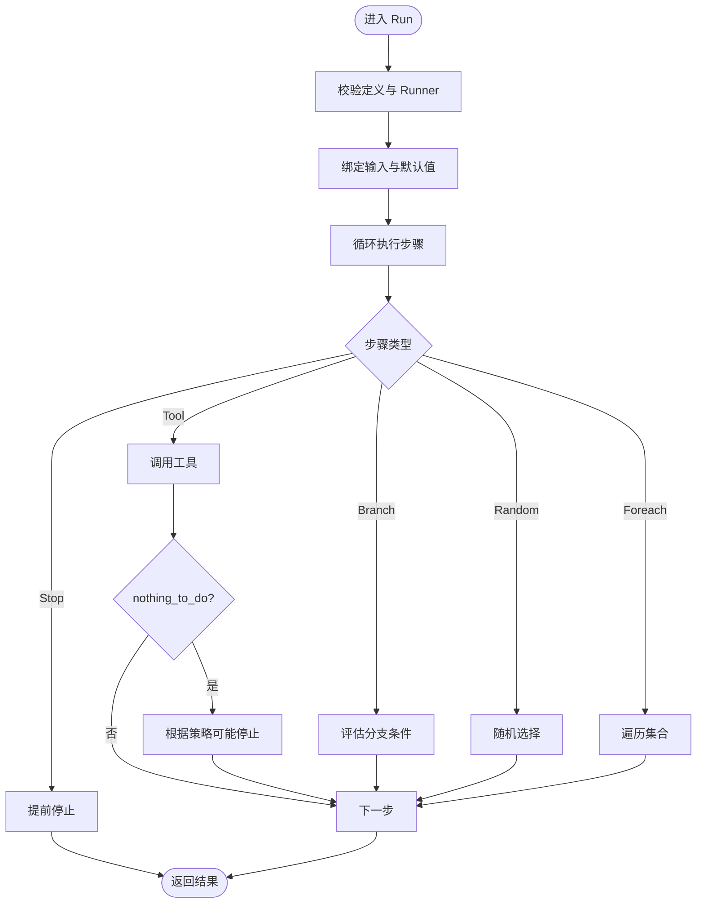
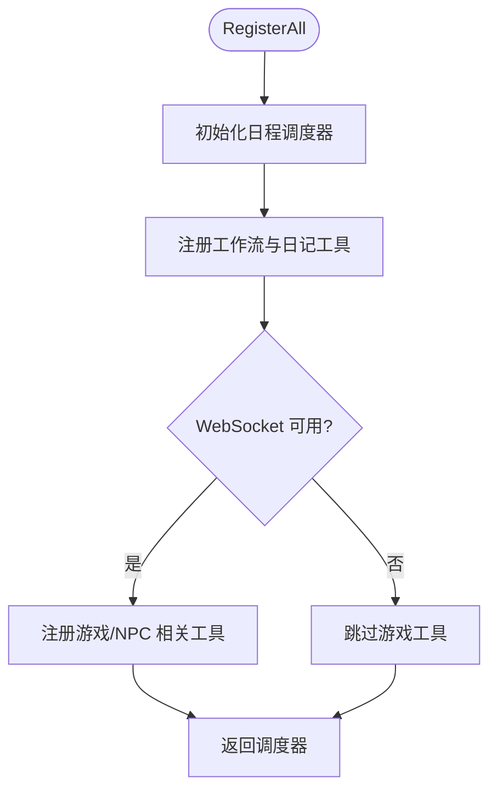
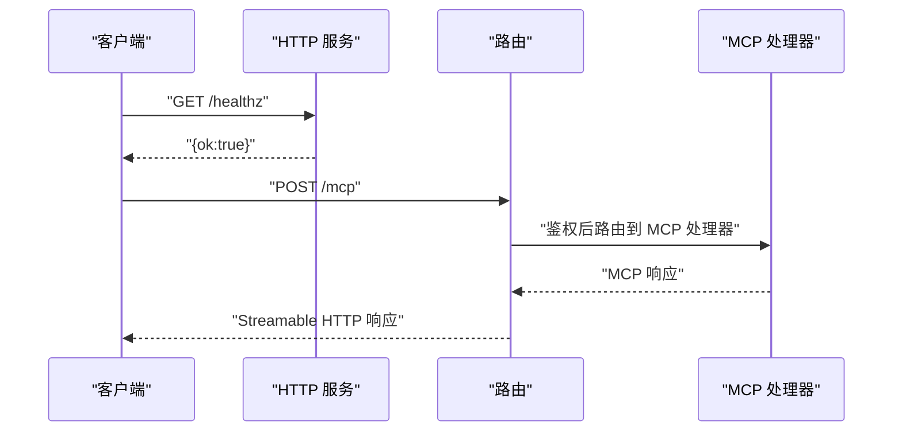
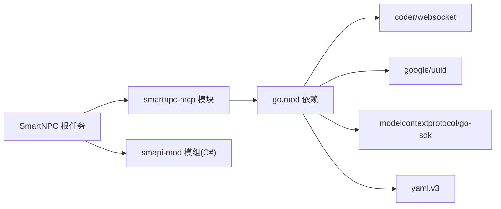
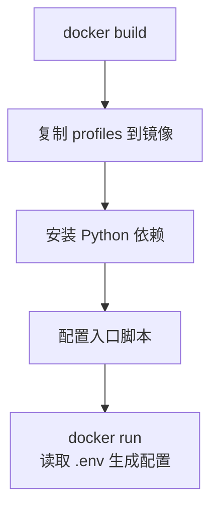

# 开发与部署

<cite>
**本文引用的文件**   
- [SmartNPC/Taskfile.yml](file://SmartNPC/Taskfile.yml)
- [smartnpc-mcp/Taskfile.yml](file://SmartNPC/smartnpc-mcp/Taskfile.yml)
- [smartnpc-mcp/go.mod](file://SmartNPC/smartnpc-mcp/go.mod)
- [smartnpc-mcp/cmd/smartnpc-mcp/main.go](file://SmartNPC/smartnpc-mcp/cmd/smartnpc-mcp/main.go)
- [smartnpc-mcp/internal/log/logger.go](file://SmartNPC/smartnpc-mcp/internal/log/logger.go)
- [smartnpc-mcp/pkg/agentbridge/server.go](file://SmartNPC/smartnpc-mcp/pkg/agentbridge/server.go)
- [smartnpc-mcp/pkg/eventbus/event.go](file://SmartNPC/smartnpc-mcp/pkg/eventbus/event.go)
- [smartnpc-mcp/pkg/transport/http.go](file://SmartNPC/smartnpc-mcp/pkg/transport/http.go)
- [smartnpc-mcp/adapters/stardew/bridge/ws_client.go](file://SmartNPC/smartnpc-mcp/adapters/stardew/bridge/ws_client.go)
- [smartnpc-mcp/adapters/stardew/tools/registry.go](file://SmartNPC/smartnpc-mcp/adapters/stardew/tools/registry.go)
- [smartnpc-mcp/pkg/workflow/engine.go](file://SmartNPC/smartnpc-mcp/pkg/workflow/engine.go)
- [.github/workflows/ci.yml](file://SmartNPC/.github/workflows/ci.yml)
- [.github/workflows/release.yml](file://SmartNPC/.github/workflows/release.yml)
- [.github/workflows/docker-hermes.yml](file://SmartNPC/.github/workflows/docker-hermes.yml)
- [deploy/hermes/Dockerfile](file://SmartNPC/deploy/hermes/Dockerfile)
</cite>

## 目录
1. [简介](#简介)
2. [项目结构](#项目结构)
3. [核心组件](#核心组件)
4. [架构总览](#架构总览)
5. [详细组件分析](#详细组件分析)
6. [依赖关系分析](#依赖关系分析)
7. [构建系统与任务编排](#构建系统与任务编排)
8. [测试策略](#测试策略)
9. [本地开发环境搭建](#本地开发环境搭建)
10. [部署与打包](#部署与打包)
11. [CI/CD 流水线](#cicd-流水线)
12. [性能监控、错误追踪与运维](#性能监控错误追踪与运维)
13. [故障排查指南](#故障排查指南)
14. [结论](#结论)

## 简介
本指南面向 SmartNPC 项目的开发者、测试工程师和运维人员，覆盖以下主题：
- 构建系统：基于 Taskfile 的多子项目任务定义、跨平台支持、Go 模块依赖管理。
- 测试策略：Go 单元测试、竞赛模式检测、SMAPI 模组动画测试、端到端连通性检查。
- 部署流程：Hermes 容器镜像打包、配置文件注入、版本发布与产物校验。
- CI/CD：GitHub Actions 工作流、路径过滤、自动化构建、自动发布。
- 本地开发：WSL 环境、调试端口、日志查看、MCP 工具链运行方式。
- 生产运维：性能监控、错误追踪、健康检查与最佳实践。

## 项目结构
仓库主要包含三类代码与资源：
- `SmartNPC/smartnpc-mcp`：Go 实现的 MCP 服务端，桥接 Stardew Valley SMAPI 模组与外部 MCP/Hermes 客户端。
- `SmartNPC/smapi-mod`：C# 编写的 SMAPI 模组（受限于游戏许可证，不在 CI 中编译）。
- `SmartNPC/deploy/hermes`：Hermes Agent Gateway 的 Docker 部署配置与 profile 数据。
- `.github/workflows`：CI、Release、Docker 构建工作流。
- `scripts`：本地渲染 profiles、检测 WSL IP、测试 API 连通性等辅助脚本。

**图表来源**
- [smartnpc-mcp/cmd/smartnpc-mcp/main.go:201-600](file://SmartNPC/smartnpc-mcp/cmd/smartnpc-mcp/main.go#L201-L600)
- [smartnpc-mcp/adapters/stardew/bridge/ws_client.go:1-200](file://SmartNPC/smartnpc-mcp/adapters/stardew/bridge/ws_client.go#L1-L200)
- [deploy/hermes/Dockerfile:1-28](file://SmartNPC/deploy/hermes/Dockerfile#L1-L28)

**章节来源**
- [SmartNPC/Taskfile.yml:1-146](file://SmartNPC/Taskfile.yml#L1-L146)

## 核心组件
- **MCP 服务端入口**：提供 stdio 与 Streamable HTTP 两种传输，注册 Stardew 工具组、工作流引擎、实验日志与 Hermes 事件中继。
- **WebSocket 适配器**：连接 SMAPI 模组的 WebSocket 服务，处理请求/响应关联、事件订阅、会话代理名绑定。
- **Agent Bridge**：统一的事件源管理与后端分发，挂载工具组，启动事件源并串行转发事件。
- **工作流引擎**：执行预编译或实时工作流步骤，调度工具调用、技能触发、LLM 选择与空闲等待。
- **Transport HTTP**：封装 Streamable HTTP 服务、API Key 鉴权、健康检查、优雅关闭。
- **EventBus**：定义跨适配器的统一事件信封，解耦领域语义与传输层。
- **Logger**：结构化 JSON 日志输出到 stderr，避免污染 MCP stdout 协议流。

**章节来源**
- [smartnpc-mcp/cmd/smartnpc-mcp/main.go:201-600](file://SmartNPC/smartnpc-mcp/cmd/smartnpc-mcp/main.go#L201-L600)
- [smartnpc-mcp/adapters/stardew/bridge/ws_client.go:1-200](file://SmartNPC/smartnpc-mcp/adapters/stardew/bridge/ws_client.go#L1-L200)
- [smartnpc-mcp/pkg/agentbridge/server.go:1-177](file://SmartNPC/smartnpc-mcp/pkg/agentbridge/server.go#L1-L177)
- [smartnpc-mcp/pkg/workflow/engine.go:1-200](file://SmartNPC/smartnpc-mcp/pkg/workflow/engine.go#L1-L200)
- [smartnpc-mcp/pkg/transport/http.go:1-124](file://SmartNPC/smartnpc-mcp/pkg/transport/http.go#L1-L124)
- [smartnpc-mcp/pkg/eventbus/event.go:1-76](file://SmartNPC/smartnpc-mcp/pkg/eventbus/event.go#L1-L76)
- [smartnpc-mcp/internal/log/logger.go:1-35](file://SmartNPC/smartnpc-mcp/internal/log/logger.go#L1-L35)

## 架构总览
SmartNPC 的核心运行时由三个层次组成：
1. **传输层**：stdio 或 HTTP 暴露 MCP 协议；HTTP 支持可插拔鉴权与健康检查。
2. **适配层**：通过 WebSocket 与 SMAPI 模组通信，将游戏事件转换为统一事件。
3. **业务层**：工具注册、工作流执行、Hermes 事件中继、实验日志记录。

**图表来源**
- [smartnpc-mcp/pkg/transport/http.go:1-124](file://SmartNPC/smartnpc-mcp/pkg/transport/http.go#L1-L124)
- [smartnpc-mcp/cmd/smartnpc-mcp/main.go:201-600](file://SmartNPC/smartnpc-mcp/cmd/smartnpc-mcp/main.go#L201-L600)
- [smartnpc-mcp/adapters/stardew/bridge/ws_client.go:1-200](file://SmartNPC/smartnpc-mcp/adapters/stardew/bridge/ws_client.go#L1-L200)

## 详细组件分析

### MCP 服务端入口
- 解析命令行参数，初始化结构化日志、MCP 服务器、Hermes 中继、工作流注册表、实验日志跟踪器。
- 根据环境变量与工作流开关决定使用本地工作流引擎还是 legacy schedule_trigger 路径。
- 注册所有 Stardew 工具组，并在 WebSocket 可用时建立事件路由。
- 支持 HTTP 模式下的 `/status`、`/mcp`、`/healthz` 等端点。

**图表来源**
- [smartnpc-mcp/cmd/smartnpc-mcp/main.go:201-600](file://SmartNPC/smartnpc-mcp/cmd/smartnpc-mcp/main.go#L201-L600)

**章节来源**
- [smartnpc-mcp/cmd/smartnpc-mcp/main.go:201-600](file://SmartNPC/smartnpc-mcp/cmd/smartnpc-mcp/main.go#L201-L600)

### WebSocket 适配器
- 默认连接 `ws://127.0.0.1:18745/ws`，支持自定义超时与重试退避。
- 维护待响应请求映射，保证并发安全。
- 支持会话代理名绑定，使工具调用能携带正确的 NPC 上下文。
- 提供 CallObserver，用于实验日志记录每次调用的动作、参数、耗时与错误。

**图表来源**
- [smartnpc-mcp/adapters/stardew/bridge/ws_client.go:1-200](file://SmartNPC/smartnpc-mcp/adapters/stardew/bridge/ws_client.go#L1-L200)

**章节来源**
- [smartnpc-mcp/adapters/stardew/bridge/ws_client.go:1-200](file://SmartNPC/smartnpc-mcp/adapters/stardew/bridge/ws_client.go#L1-L200)

### Agent Bridge 与 EventBus
- Agent Bridge 作为组合根，管理事件源与后端，按注册顺序串行转发事件。
- EventBus 定义通用事件信封，包含 kind、source、subject、payload、timestamp，解耦领域语义。

**图表来源**
- [smartnpc-mcp/pkg/agentbridge/server.go:1-177](file://SmartNPC/smartnpc-mcp/pkg/agentbridge/server.go#L1-L177)
- [smartnpc-mcp/pkg/eventbus/event.go:1-76](file://SmartNPC/smartnpc-mcp/pkg/eventbus/event.go#L1-L76)

**章节来源**
- [smartnpc-mcp/pkg/agentbridge/server.go:1-177](file://SmartNPC/smartnpc-mcp/pkg/agentbridge/server.go#L1-L177)
- [smartnpc-mcp/pkg/eventbus/event.go:1-76](file://SmartNPC/smartnpc-mcp/pkg/eventbus/event.go#L1-L76)

### 工作流引擎
- 引擎驱动工作流定义，按步骤执行工具调用、分支、随机选择、遍历与停止。
- 支持预编译技能，减少 LLM 延迟；可通过环境变量切换本地工作流泵。
- 记录运行结果，包括步数、工具调用次数、nothing_to_do 计数与停止原因。

**图表来源**
- [smartnpc-mcp/pkg/workflow/engine.go:1-200](file://SmartNPC/smartnpc-mcp/pkg/workflow/engine.go#L1-L200)

**章节来源**
- [smartnpc-mcp/pkg/workflow/engine.go:1-200](file://SmartNPC/smartnpc-mcp/pkg/workflow/engine.go#L1-L200)

### 工具注册与调度
- 工具注册分为框架级工具与 Stardew 特定工具。
- 当 WebSocket 可用时注册聊天、游戏查询、农场经济、NPC 感知/移动/行为/世界操作/社交等工具。
- 返回共享的日程调度器，供事件路由在每日时间推进时触发。

**图表来源**
- [smartnpc-mcp/adapters/stardew/tools/registry.go:1-82](file://SmartNPC/smartnpc-mcp/adapters/stardew/tools/registry.go#L1-L82)

**章节来源**
- [smartnpc-mcp/adapters/stardew/tools/registry.go:1-82](file://SmartNPC/smartnpc-mcp/adapters/stardew/tools/registry.go#L1-L82)

### 传输层与 HTTP 服务
- 封装 Streamable HTTP 处理器，支持跨主机访问控制、API Key 鉴权、健康检查。
- 提供优雅关闭，限制读头超时与关闭超时。

**图表来源**
- [smartnpc-mcp/pkg/transport/http.go:1-124](file://SmartNPC/smartnpc-mcp/pkg/transport/http.go#L1-L124)

**章节来源**
- [smartnpc-mcp/pkg/transport/http.go:1-124](file://SmartNPC/smartnpc-mcp/pkg/transport/http.go#L1-L124)

## 依赖关系分析
- Go 模块依赖集中在 `smartnpc-mcp/go.mod`，包括 WebSocket SDK、UUID、MCP SDK、YAML 解析与系统库。
- 项目使用 `go.work` 进行多模块协同，顶层 Taskfile 通过 `go work sync` 同步依赖。
- C# SMAPI 模组不纳入 CI，因需要本地安装 Stardew Valley 程序集。

**图表来源**
- [smartnpc-mcp/go.mod:1-19](file://SmartNPC/smartnpc-mcp/go.mod#L1-L19)
- [SmartNPC/Taskfile.yml:1-146](file://SmartNPC/Taskfile.yml#L1-L146)

**章节来源**
- [smartnpc-mcp/go.mod:1-19](file://SmartNPC/smartnpc-mcp/go.mod#L1-L19)
- [SmartNPC/Taskfile.yml:1-146](file://SmartNPC/Taskfile.yml#L1-L146)

## 构建系统与任务编排
### 顶层 Taskfile 任务
- `build`：依次执行 mcp 与 mod 子项目构建。
- `test`：依次执行 mcp 与 mod 测试。
- `lint`：同步 go modules 并对 Go 模块执行 vet。
- `ci` / `ci-fast`：本地等效 CI，包含 profiles 验证、静态检查、测试与构建。
- `profiles:render` / `profiles:verify`：渲染与校验 hermes/profiles。
- `net:check`：探测 LLM 端点与 Langfuse 可达性，支持 WSL 与非 WSL。
- `hooks:*`：启用/禁用/查看 Git hooks。
- `tidy`：在每个 Go 模块执行 tidy 并同步。

**章节来源**
- [SmartNPC/Taskfile.yml:1-146](file://SmartNPC/Taskfile.yml#L1-L146)

### MCP 子项目 Taskfile
- `build`：编译 smartnpc-mcp 二进制。
- `test`：带临时目录隔离的单元测试。
- `test-race`：开启竞态检测的测试。
- `run`：以 HTTP 模式启动服务，支持 echo 模式与端口参数。
- `stop` / `health`：停止进程与健康检查。
- `clean`：清理构建产物。

**章节来源**
- [smartnpc-mcp/Taskfile.yml:1-95](file://SmartNPC/smartnpc-mcp/Taskfile.yml#L1-L95)

## 测试策略
### 单元测试
- 使用 Go 原生测试框架，通过 `task mcp:test` 或 `task test` 执行。
- 支持竞态检测 `task mcp:test-race`，在 CI 中也启用 `-race`。
- 测试临时目录通过 `.gotmp` 隔离，避免污染工作区。

**章节来源**
- [smartnpc-mcp/Taskfile.yml:1-95](file://SmartNPC/smartnpc-mcp/Taskfile.yml#L1-L95)
- [.github/workflows/ci.yml:1-97](file://SmartNPC/.github/workflows/ci.yml#L1-L97)

### 动画测试用例
- 存在独立的动画测试项目 `tests/animations`，用于验证 NPC 动画播放逻辑。
- 该测试项目为 .NET/C# 工程，需本地 SMAPI 环境与游戏资源。

**章节来源**
- [SmartNPC/tests/animations/AnimationTests.csproj](file://SmartNPC/tests/animations/AnimationTests.csproj)
- [SmartNPC/tests/animations/Program.cs](file://SmartNPC/tests/animations/Program.cs)

### E2E 测试流程
- 网络连通性检查脚本 `scripts/test_api_connectivity.sh` 可探测 LLM 端点与 Langfuse 健康状态。
- 可在 Windows 下通过 WSL 执行，也可在非 Windows 直接运行。
- 可作为 pre-flight 检查，确保 Hermes 与 MCP 服务就绪后再进行端到端验证。

**章节来源**
- [SmartNPC/Taskfile.yml:1-146](file://SmartNPC/Taskfile.yml#L1-L146)
- [SmartNPC/scripts/test_api_connectivity.sh](file://SmartNPC/scripts/test_api_connectivity.sh)

## 本地开发环境搭建
### WSL 配置
- 使用 `task net:check` 探测 WSL 中的 Hermes 配置与 LLM 端点可达性。
- 若 WSL 路径不同，请调整 `wsl -d <distro>` 命令参数。
- 建议使用 Ubuntu 发行版，并确保 ~/.hermes/profiles/<npc>/.env 正确配置。

**章节来源**
- [SmartNPC/Taskfile.yml:1-146](file://SmartNPC/Taskfile.yml#L1-L146)

### 调试工具设置
- 启动 MCP 服务：`task mcp:run PORT=3000 WS_URL=ws://localhost:18745/ws`。
- Echo 模式：`task mcp:run-echo`，无需 LLM，仅回显消息。
- 健康检查：`task mcp:health PORT=3000`。
- 停止服务：`task mcp:stop`。

**章节来源**
- [smartnpc-mcp/Taskfile.yml:1-95](file://SmartNPC/smartnpc-mcp/Taskfile.yml#L1-L95)

### 日志查看方法
- 结构化日志输出到 stderr，JSON 格式，包含 source 信息。
- 实验日志写入 `<logDir>/exp/y{year}-{season}-d{day}/`，包括 events.jsonl、tool-calls.jsonl、model-io.jsonl、workflow-runs.jsonl、plan.jsonl。
- 可通过环境变量 `SMARTNPC_EXP_MODE` 启用 owner-inbox 轮询与实验日志。

**章节来源**
- [smartnpc-mcp/internal/log/logger.go:1-35](file://SmartNPC/smartnpc-mcp/internal/log/logger.go#L1-L35)
- [smartnpc-mcp/cmd/smartnpc-mcp/main.go:201-600](file://SmartNPC/smartnpc-mcp/cmd/smartnpc-mcp/main.go#L201-L600)

## 部署与打包
### Hermes 容器镜像
- Dockerfile 基于 Python slim，安装 hermes-agent、mcp、aiohttp、langfuse。
- 构建时将 profiles 数据烘焙进镜像，运行时仅需 .env 注入配置。
- 入口脚本根据环境变量自动生成 config.yaml 并启动 gateway。

**图表来源**
- [deploy/hermes/Dockerfile:1-28](file://SmartNPC/deploy/hermes/Dockerfile#L1-L28)

**章节来源**
- [deploy/hermes/Dockerfile:1-28](file://SmartNPC/deploy/hermes/Dockerfile#L1-L28)

### 配置文件管理
- Hermes 配置通过环境变量注入，entrypoint 生成完整配置。
- MCP 服务通过命令行参数与环境变量控制 ws-url、http 地址、hermes 中继、API Key、echo 模式等。
- 工作流定义可通过 `SMARTNPC_WORKFLOW_DIR` 叠加外部定义。

**章节来源**
- [smartnpc-mcp/cmd/smartnpc-mcp/main.go:201-600](file://SmartNPC/smartnpc-mcp/cmd/smartnpc-mcp/main.go#L201-L600)
- [deploy/hermes/Dockerfile:1-28](file://SmartNPC/deploy/hermes/Dockerfile#L1-L28)

### 版本发布步骤
- 推送 semver 标签触发 Release 工作流。
- 构建 Windows 与 Linux 的 Go 二进制，生成 SHA256SUMS。
- 发布 GitHub Release，自动附带变更说明。
- SMAPI 模组 zip 需手动上传至 Release 页面。

**章节来源**
- [.github/workflows/release.yml:1-167](file://SmartNPC/.github/workflows/release.yml#L1-L167)

## CI/CD 流水线
### CI 工作流
- 触发条件：push 到 main/master、pull_request、workflow_dispatch。
- 路径过滤：仅当 Go 相关文件变化时执行 Go job。
- 步骤：setup-go、go work sync、vet、test -race、build。
- 聚合 gate：ci-pass 允许 skipped 或 success。

**章节来源**
- [.github/workflows/ci.yml:1-97](file://SmartNPC/.github/workflows/ci.yml#L1-L97)

### Release 工作流
- 触发条件：semver 标签或 workflow_dispatch。
- 预检：提取版本号，区分 v 前缀。
- 构建矩阵：windows-amd64 与 linux-amd64，CGO_ENABLED=0。
- 发布：下载 artifact、生成 SHA256SUMS、创建 GitHub Release。

**章节来源**
- [.github/workflows/release.yml:1-167](file://SmartNPC/.github/workflows/release.yml#L1-L167)

### Docker Hermes 构建工作流
- 触发条件：deploy/hermes、hermes/profiles、hermes/npcs.yaml、scripts/render_profiles.sh 变化。
- 步骤：同步 profiles、登录 GHCR、元数据生成、构建并推送镜像。
- 标签：latest 与 sha 前缀标签。

**章节来源**
- [.github/workflows/docker-hermes.yml:1-55](file://SmartNPC/.github/workflows/docker-hermes.yml#L1-L55)

## 性能监控、错误追踪与运维
### 性能监控
- 使用 `/healthz` 检查服务可用性。
- 使用 `/status` 获取 WebSocket 连接状态、Hermes 中继健康探针与工作流运行状态。
- 工作流引擎记录每一步耗时、工具调用次数与 nothing_to_do 计数。

**章节来源**
- [smartnpc-mcp/pkg/transport/http.go:1-124](file://SmartNPC/smartnpc-mcp/pkg/transport/http.go#L1-L124)
- [smartnpc-mcp/cmd/smartnpc-mcp/main.go:201-600](file://SmartNPC/smartnpc-mcp/cmd/smartnpc-mcp/main.go#L201-L600)
- [smartnpc-mcp/pkg/workflow/engine.go:1-200](file://SmartNPC/smartnpc-mcp/pkg/workflow/engine.go#L1-L200)

### 错误追踪
- 结构化日志输出到 stderr，便于集中采集与分析。
- 实验日志记录 tool-calls、model-io、events、workflow-runs，便于回溯问题。
- 建议在生产环境启用 payload logger 与 debug payload，谨慎控制日志量。

**章节来源**
- [smartnpc-mcp/internal/log/logger.go:1-35](file://SmartNPC/smartnpc-mcp/internal/log/logger.go#L1-L35)
- [smartnpc-mcp/cmd/smartnpc-mcp/main.go:201-600](file://SmartNPC/smartnpc-mcp/cmd/smartnpc-mcp/main.go#L201-L600)

### 生产环境运维最佳实践
- 使用 API Key 保护 MCP HTTP 端点，避免公网暴露。
- 使用优雅关闭与超时配置，确保服务退出可控。
- 定期清理实验日志目录，避免磁盘占用增长。
- 使用 `task ci` 在本地复现 CI 流程，确保提交质量。

**章节来源**
- [smartnpc-mcp/pkg/transport/http.go:1-124](file://SmartNPC/smartnpc-mcp/pkg/transport/http.go#L1-L124)
- [SmartNPC/Taskfile.yml:1-146](file://SmartNPC/Taskfile.yml#L1-L146)

## 故障排查指南
### 常见问题
- **WebSocket 连接失败**：确认 SMAPI 模组已启动且监听默认端口；检查 WS_URL 参数。
- **Hermes 中继不可达**：检查 hermes-url、API Key、conversation 与 model 配置。
- **HTTP 模式无法访问**：确认 AllowAnyOrigin 与 MCPAPIKey 设置；检查防火墙与端口。
- **日志乱码**：Windows 控制台需启用 UTF-8；或使用终端支持 UTF-8。

**章节来源**
- [smartnpc-mcp/adapters/stardew/bridge/ws_client.go:1-200](file://SmartNPC/smartnpc-mcp/adapters/stardew/bridge/ws_client.go#L1-L200)
- [smartnpc-mcp/cmd/smartnpc-mcp/main.go:201-600](file://SmartNPC/smartnpc-mcp/cmd/smartnpc-mcp/main.go#L201-L600)
- [smartnpc-mcp/pkg/transport/http.go:1-124](file://SmartNPC/smartnpc-mcp/pkg/transport/http.go#L1-L124)

### 诊断步骤
1. 运行 `task mcp:health` 检查 MCP 服务是否就绪。
2. 运行 `task net:check` 检查 LLM 与 Langfuse 连通性。
3. 查看 stderr 日志，定位错误堆栈与上下文。
4. 检查实验日志目录，分析 tool-calls 与 workflow-runs。
5. 如为 WSL 环境问题，确认路径与端口映射是否正确。

**章节来源**
- [smartnpc-mcp/Taskfile.yml:1-95](file://SmartNPC/smartnpc-mcp/Taskfile.yml#L1-L95)
- [SmartNPC/Taskfile.yml:1-146](file://SmartNPC/Taskfile.yml#L1-L146)
- [smartnpc-mcp/internal/log/logger.go:1-35](file://SmartNPC/smartnpc-mcp/internal/log/logger.go#L1-L35)

## 结论
SmartNPC 项目通过 Taskfile 统一管理构建与测试，使用 Go 模块实现高性能 MCP 服务端，并通过 WebSocket 与 SMAPI 模组集成。Hermes 容器化部署简化了远程配置，CI/CD 工作流保障代码质量与发布一致性。建议在本地开发中使用 Taskfile 任务与 WSL 环境，在生产环境中启用结构化日志、健康检查与 API Key 鉴权，结合实验日志进行性能监控与错误追踪。