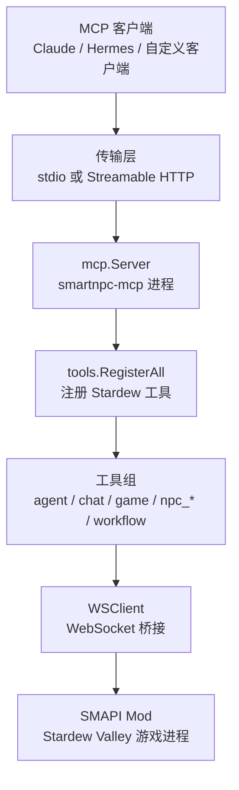
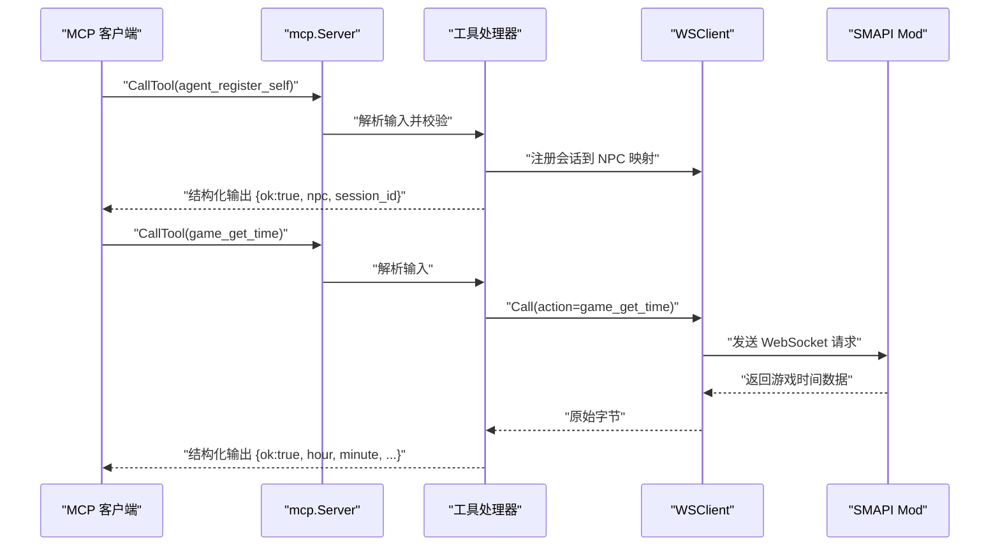
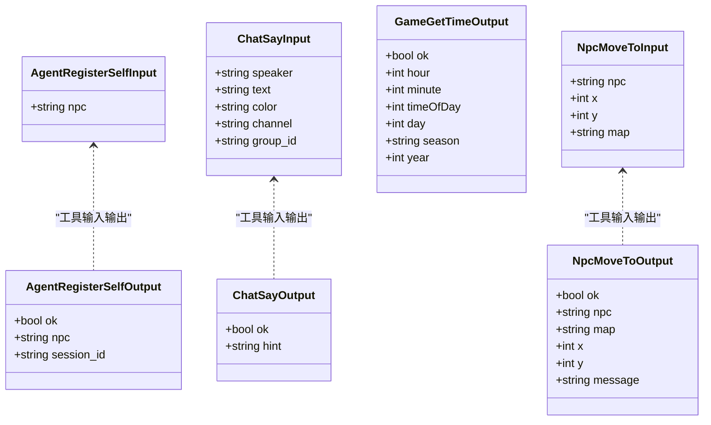
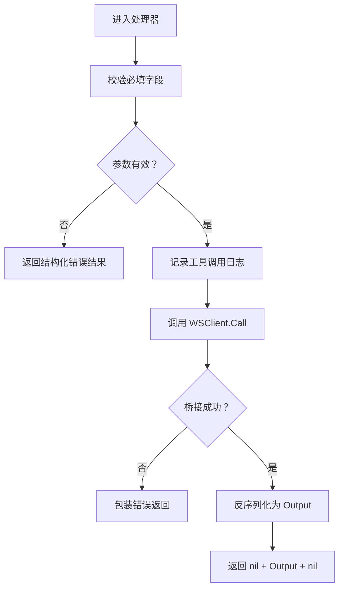
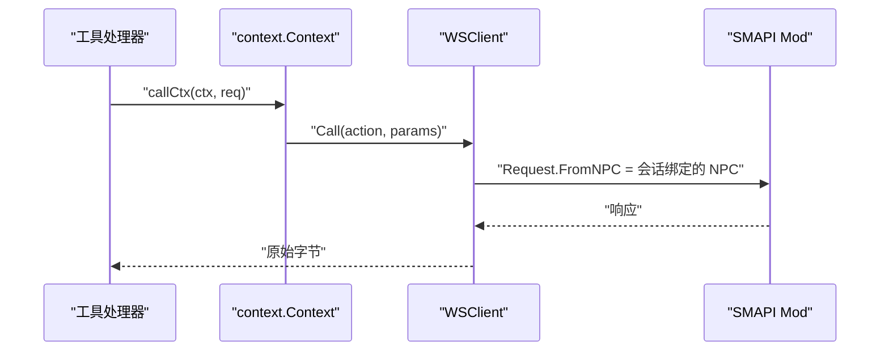
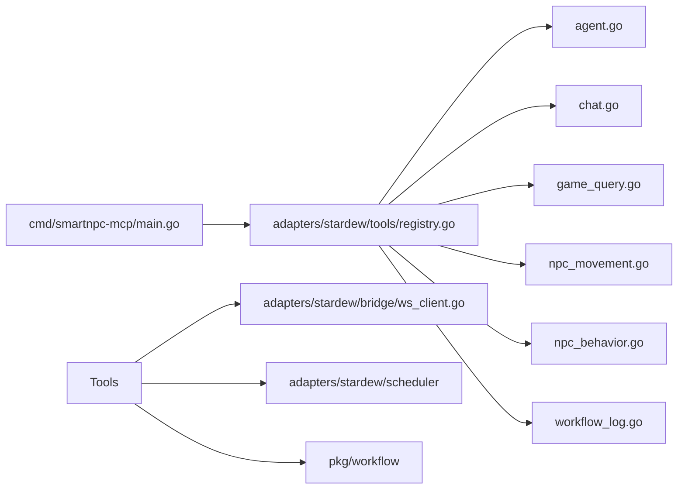
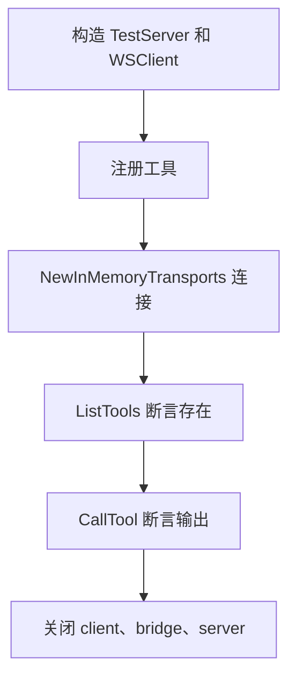
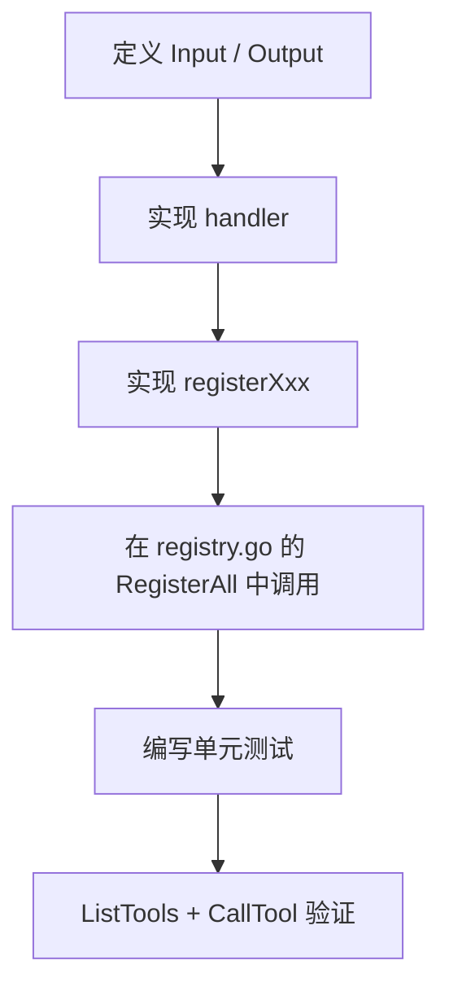

# MCP 工具开发

<cite>
**本文引用的文件**   
- [registry.go](file://SmartNPC/smartnpc-mcp/adapters/stardew/tools/registry.go)
- [agent.go](file://SmartNPC/smartnpc-mcp/adapters/stardew/tools/agent.go)
- [chat.go](file://SmartNPC/smartnpc-mcp/adapters/stardew/tools/chat.go)
- [game_query.go](file://SmartNPC/smartnpc-mcp/adapters/stardew/tools/game_query.go)
- [npc_movement.go](file://SmartNPC/smartnpc-mcp/adapters/stardew/tools/npc_movement.go)
- [npc_behavior.go](file://SmartNPC/smartnpc-mcp/adapters/stardew/tools/npc_behavior.go)
- [workflow_log.go](file://SmartNPC/smartnpc-mcp/adapters/stardew/tools/workflow_log.go)
- [main_test.go](file://SmartNPC/smartnpc-mcp/adapters/stardew/tools/main_test.go)
- [agent_test.go](file://SmartNPC/smartnpc-mcp/adapters/stardew/tools/agent_test.go)
- [chat_test.go](file://SmartNPC/smartnpc-mcp/adapters/stardew/tools/chat_test.go)
- [npc_movement_test.go](file://SmartNPC/smartnpc-mcp/adapters/stardew/tools/npc_movement_test.go)
- [workflow_test.go](file://SmartNPC/smartnpc-mcp/adapters/stardew/tools/workflow_test.go)
- [mcp-tool-design.mdc](file://SmartNPC/.codebuddy/rules/mcp-tool-design.mdc)
- [mcp-tools.md](file://SmartNPC/docs/mcp-tools.md)
- [http.go](file://SmartNPC/smartnpc-mcp/pkg/transport/http.go)
- [main.go](file://SmartNPC/smartnpc-mcp/cmd/smartnpc-mcp/main.go)
- [go.mod](file://SmartNPC/smartnpc-mcp/go.mod)
- [manual-e2e-verification.md](file://SmartNPC/docs/manual-e2e-verification.md)
</cite>

## 目录

1. [引言](#引言)
2. [项目结构](#项目结构)
3. [核心组件](#核心组件)
4. [架构总览](#架构总览)
5. [详细组件分析](#详细组件分析)
6. [依赖分析](#依赖分析)
7. [性能与可观测性](#性能与可观测性)
8. [测试规范](#测试规范)
9. [端到端验证](#端到端验证)
10. [错误处理模式](#错误处理模式)
11. [协议兼容性](#协议兼容性)
12. [工具注册流程](#工具注册流程)
13. [完整工具开发示例](#完整工具开发示例)
14. [故障排查](#故障排查)
15. [结论](#结论)

## 引言

本指南面向在 SmartNPC 项目中新增或修改 MCP（Model Context Protocol）工具的开发者。代码库中的 Stardew Valley 适配器通过 `smartnpc-mcp` Go 服务暴露一组工具，供 Claude Desktop、Hermes 等 MCP 客户端调用；底层再通过 WebSocket 桥接 SMAPI Mod，读写《星露谷物语》游戏状态。

本文聚焦以下目标：

- 明确工具命名约定、输入输出结构体设计、JSON Schema 标签要求。
- 说明与 `github.com/modelcontextprotocol/go-sdk` 的兼容性边界和返回值规范。
- 给出单元测试、集成测试和端到端验证标准。
- 解释工具注册流程、依赖注入方式以及服务启动装配。
- 提供从需求到测试验收的完整开发流程。

## 项目结构

MCP 工具相关代码集中在 `SmartNPC/smartnpc-mcp` 子模块中，关键路径如下：

| 层级 | 路径 | 职责 |
|---|---|---|
| 入口命令 | `cmd/smartnpc-mcp/main.go` | 解析参数、创建 `mcp.Server`、选择 stdio 或 HTTP 传输、装配工具和服务 |
| 工具实现 | `adapters/stardew/tools/*.go` | 每个 domain 一个文件，定义 Input/Output、Handler、注册函数 |
| 工具注册表 | `adapters/stardew/tools/registry.go` | 统一聚合所有工具注册逻辑，返回共享调度器 |
| 测试 | `adapters/stardew/tools/*_test.go` | 使用 `InMemoryTransport` 和 TestServer 进行单测 |
| HTTP 传输 | `pkg/transport/http.go` | Streamable HTTP 适配层 |
| 外部文档 | `docs/mcp-tools.md`、`docs/manual-e2e-verification.md` | 工具目录、端到端验收清单 |
| 规则 | `.codebuddy/rules/mcp-tool-design.mdc` | MCP 工具设计规范 |
| 模块配置 | `go.mod` | 声明 `modelcontextprotocol/go-sdk` 等依赖 |



**图示来源**   
- [main.go:1-120](file://SmartNPC/smartnpc-mcp/cmd/smartnpc-mcp/main.go#L1-L120)
- [registry.go:1-82](file://SmartNPC/smartnpc-mcp/adapters/stardew/tools/registry.go#L1-L82)
- [http.go:1-124](file://SmartNPC/smartnpc-mcp/pkg/transport/http.go#L1-L124)

**章节来源**   
- [registry.go:1-82](file://SmartNPC/smartnpc-mcp/adapters/stardew/tools/registry.go#L1-L82)
- [main.go:1-120](file://SmartNPC/smartnpc-mcp/cmd/smartnpc-mcp/main.go#L1-L120)
- [mcp-tools.md:1-120](file://SmartNPC/docs/mcp-tools.md#L1-L120)

## 核心组件

### 工具包 `tools`

`tools` 包是 Stardew Valley 专属 MCP 工具的实现集合。它不直接持有全局 WS 客户端，而是通过 `RegisterAll` 接收 `*bridge.WSClient`、Hermes 事件处理器、聊天限流守卫、工作流注册表和调度器实例，完成依赖注入。

关键特性：

- 工具按 domain 拆分文件，例如 `agent.go`、`chat.go`、`game_query.go`、`npc_movement.go`、`npc_behavior.go`。
- 非 Mod 依赖的工具（如 `workflow_*`、`diary_write`、`day_review_complete`、`npc_plan_day`）始终注册。
- Mod 依赖工具（如 `agent_register_self`、`chat_say`、`game_*`、`npc_*`）仅在传入非空 `WSClient` 时注册。
- 返回共享的每日 NPC 调度器，供上层事件路由触发。

**章节来源**   
- [registry.go:1-82](file://SmartNPC/smartnpc-mcp/adapters/stardew/tools/registry.go#L1-L82)

### 会话绑定 `agent_register_self`

`agent_register_self` 用于把当前 MCP 会话绑定到一个 NPC 内部名称。后续该会话发起的所有 `br.Call` 都会带上 `from_npc`，使 SMAPI Mod 能正确路由调试镜像和消息。

核心类型：

| 类型 | 字段 | 含义 |
|---|---|---|
| `AgentRegisterSelfInput` | `npc` | 驱动该 MCP 会话的 NPC 内部名称 |
| `AgentRegisterSelfOutput` | `ok`、`npc`、`session_id` | 成功标志、绑定的 NPC、会话 ID |

**章节来源**   
- [agent.go:1-95](file://SmartNPC/smartnpc-mcp/adapters/stardew/tools/agent.go#L1-L95)

### 聊天工具 `chat_say`

`chat_say` 是唯一产生可见 NPC 对话的工具。它同时承担“一问一答”约束和广播能力：

- 私有频道：每个 NPC 每轮入站事件最多一次发言。
- 群组频道：每个 `(group_id, speaker)` 每组玩家回合最多一次发言。
- 超出预算不会返回 Go error，而是结构化 no-op 结果，包含 `hint` 中的停止信号。

**章节来源**   
- [chat.go:1-200](file://SmartNPC/smartnpc-mcp/adapters/stardew/tools/chat.go#L1-L200)

### 游戏查询工具

`game_get_time` 和 `game_get_weather` 是只读工具，用于获取游戏内时间和天气。它们不改变游戏状态，但需要已加载存档。

**章节来源**   
- [game_query.go:1-89](file://SmartNPC/smartnpc-mcp/adapters/stardew/tools/game_query.go#L1-L89)

### NPC 移动与行为工具

移动类工具包括：

- `npc_move_to`：寻路到目标坐标。
- `npc_face_direction`：设置朝向。
- `npc_get_position`：读取当前位置、地图、朝向、是否正在移动。
- `npc_get_named_locations`：农场地标表。
- `npc_emote`：显示原生表情气泡。
- `npc_get_behavior`：查询当前行为模式。

这些工具大多数通过 `WSClient.Call` 转发到 Mod，属于写操作或带副作用的读操作。

**章节来源**   
- [npc_movement.go:1-200](file://SmartNPC/smartnpc-mcp/adapters/stardew/tools/npc_movement.go#L1-L200)
- [npc_behavior.go:1-108](file://SmartNPC/smartnpc-mcp/adapters/stardew/tools/npc_behavior.go#L1-L108)

### 工作流日志

`workflow_log.go` 负责将工作流执行记录写入 JSONL 文件，并支持观察者回调。这是实验构建下诊断工作流、计划、工具调用和行为闭环的重要基础设施。

**章节来源**   
- [workflow_log.go:1-200](file://SmartNPC/smartnpc-mcp/adapters/stardew/tools/workflow_log.go#L1-L200)

## 架构总览



**图示来源**   
- [agent.go:40-95](file://SmartNPC/smartnpc-mcp/adapters/stardew/tools/agent.go#L40-L95)
- [game_query.go:45-89](file://SmartNPC/smartnpc-mcp/adapters/stardew/tools/game_query.go#L45-L89)
- [npc_movement.go:120-200](file://SmartNPC/smartnpc-mcp/adapters/stardew/tools/npc_movement.go#L120-L200)

## 详细组件分析

### 工具设计规范

#### 命名约定

工具名采用 `<domain>_<verb>` 全小写下划线格式：

- 查询类：`get`、`list`、`find`，例如 `game_get_time`、`npc_inventory_get`。
- 写入类：动词原形，例如 `npc_move_to`、`chat_say`、`npc_plan_day`。

文件名按 domain 拆分，不要把全部工具堆在一个文件中。

#### 输入输出结构体

每个工具应定义两个导出结构体：

- `<Tool>Input`：描述请求参数。
- `<Tool>Output`：描述结构化响应。

字段必须同时具备：

- `json` 标签：控制线协议序列化。
- `jsonschema` 标签：控制 MCP SDK 生成的 schema 描述。

可选字段加 `,omitempty`；必填字段不加。Output 的第一个字段固定为 `OK bool`，便于 LLM 快速判断成功。

#### Handler 签名

统一使用泛型 `mcp.AddTool`：

```text
func(ctx, req, in XxxInput) (*mcp.CallToolResult, XxxOutput, error)
```

第一个返回值应为 `nil`，让 SDK 用 Output 自动填充结构化内容。业务错误返回 Go error；协议级错误也返回 Go error。

#### 注册位置

新工具必须在对应 `registerXxx` 函数中调用 `mcp.AddTool`，并在 `registry.go` 的 `RegisterAll` 中注册。外部不应直接持有 `*mcp.Server`。

**章节来源**   
- [mcp-tool-design.mdc:1-65](file://SmartNPC/.codebuddy/rules/mcp-tool-design.mdc#L1-L65)
- [registry.go:25-82](file://SmartNPC/smartnpc-mcp/adapters/stardew/tools/registry.go#L25-L82)

### 输入输出结构设计

以现有工具为例，输入输出设计遵循以下模式：

| 工具 | 输入关键字段 | 输出关键字段 | 设计要点 |
|---|---|---|---|
| `agent_register_self` | `npc` | `ok`、`npc`、`session_id` | 必填字段无 omitempty |
| `chat_say` | `speaker`、`text`、可选 `color`、`channel`、`group_id` | `ok`、`hint` | hint 携带 TURN_END 停止信号 |
| `game_get_time` | 无 | `ok`、`hour`、`minute`、`timeOfDay`、`day`、`season`、`year` | 纯查询 |
| `game_get_weather` | 无 | `ok`、`weather`、`is_raining`、`season` | 纯查询 |
| `npc_move_to` | `npc`、`x`、`y`、可选 `map` | `ok`、`npc`、`map`、`x`、`y`、`message` | 写操作，异步执行 |
| `npc_face_direction` | `npc`、`direction` | `ok`、`npc`、`direction`、`facing` | direction 需校验 |
| `npc_emote` | `npc`、可选 `kind` | `ok`、`npc`、`kind` | kind 有默认值 |
| `npc_get_behavior` | `npc` | `ok`、`npc`、`mode` | 行为模式查询 |



**图示来源**   
- [agent.go:48-80](file://SmartNPC/smartnpc-mcp/adapters/stardew/tools/agent.go#L48-L80)
- [chat.go:15-60](file://SmartNPC/smartnpc-mcp/adapters/stardew/tools/chat.go#L15-L60)
- [game_query.go:12-89](file://SmartNPC/smartnpc-mcp/adapters/stardew/tools/game_query.go#L12-L89)
- [npc_movement.go:15-80](file://SmartNPC/smartnpc-mcp/adapters/stardew/tools/npc_movement.go#L15-L80)

**章节来源**   
- [agent.go:48-80](file://SmartNPC/smartnpc-mcp/adapters/stardew/tools/agent.go#L48-L80)
- [chat.go:15-60](file://SmartNPC/smartnpc-mcp/adapters/stardew/tools/chat.go#L15-L60)
- [game_query.go:12-89](file://SmartNPC/smartnpc-mcp/adapters/stardew/tools/game_query.go#L12-L89)
- [npc_movement.go:15-80](file://SmartNPC/smartnpc-mcp/adapters/stardew/tools/npc_movement.go#L15-L80)

### 工具处理器实现模式

典型工具处理器流程如下：



**图示来源**   
- [game_query.go:45-89](file://SmartNPC/smartnpc-mcp/adapters/stardew/tools/game_query.go#L45-L89)
- [npc_movement.go:120-200](file://SmartNPC/smartnpc-mcp/adapters/stardew/tools/npc_movement.go#L120-L200)

**章节来源**   
- [game_query.go:45-89](file://SmartNPC/smartnpc-mcp/adapters/stardew/tools/game_query.go#L45-L89)
- [npc_movement.go:120-200](file://SmartNPC/smartnpc-mcp/adapters/stardew/tools/npc_movement.go#L120-L200)

### 会话上下文传递

工具处理器通过 `callCtx` 将 MCP 会话 ID 注入 context，再由 `WSClient.Call` 转换为下游 WS 请求的 `from_npc`。这样即使工具本身没有 `npc` 参数，也能根据会话路由到正确的 NPC。



**图示来源**   
- [agent.go:25-45](file://SmartNPC/smartnpc-mcp/adapters/stardew/tools/agent.go#L25-L45)
- [agent_test.go:140-200](file://SmartNPC/smartnpc-mcp/adapters/stardew/tools/agent_test.go#L140-L200)

**章节来源**   
- [agent.go:25-45](file://SmartNPC/smartnpc-mcp/adapters/stardew/tools/agent.go#L25-L45)
- [agent_test.go:140-200](file://SmartNPC/smartnpc-mcp/adapters/stardew/tools/agent_test.go#L140-L200)

## 依赖分析

### 模块依赖

`smartnpc-mcp` 模块的核心依赖如下：

| 依赖 | 用途 |
|---|---|
| `github.com/modelcontextprotocol/go-sdk` | MCP SDK，提供 `mcp.Server`、`mcp.Client`、`mcp.Tool`、`mcp.AddTool`、`mcp.NewInMemoryTransports` |
| `github.com/coder/websocket` | WebSocket 客户端连接 SMAPI Mod |
| `gopkg.in/yaml.v3` | 解析 Hermes 多 profile 配置 |
| `github.com/google/uuid` | UUID 生成 |
| `github.com/google/jsonschema-go` | JSON Schema 支持（间接依赖） |

**章节来源**   
- [go.mod:1-19](file://SmartNPC/smartnpc-mcp/go.mod#L1-L19)

### 组件耦合关系



**图示来源**   
- [registry.go:10-82](file://SmartNPC/smartnpc-mcp/adapters/stardew/tools/registry.go#L10-L82)
- [main.go:60-120](file://SmartNPC/smartnpc-mcp/cmd/smartnpc-mcp/main.go#L60-L120)

**章节来源**   
- [registry.go:10-82](file://SmartNPC/smartnpc-mcp/adapters/stardew/tools/registry.go#L10-L82)
- [main.go:60-120](file://SmartNPC/smartnpc-mcp/cmd/smartnpc-mcp/main.go#L60-L120)

## 性能与可观测性

### 并发安全

- `ChatSayGuard` 使用互斥锁保护私聊和群聊配额，避免同一 wake-up 内重复发言。
- 工作流运行日志按文件分配独立互斥锁，不同 NPC 或日期的写入不会互相阻塞。
- 日志写入失败只会记录警告，不会中断主流程。

### 日志与观测

- 工具调用通过 `logToolCall` 记录。
- 工作流运行结果通过 `LogWorkflowRun` 写入 JSONL。
- 实验构建下，`expTracker` 会把事件、工具调用、模型交互、工作流运行归档到按日期分目录的结构中。
- HTTP 模式下可通过 `/healthz` 做健康检查。

**章节来源**   
- [chat.go:60-120](file://SmartNPC/smartnpc-mcp/adapters/stardew/tools/chat.go#L60-L120)
- [workflow_log.go:1-120](file://SmartNPC/smartnpc-mcp/adapters/stardew/tools/workflow_log.go#L1-L120)
- [http.go:60-124](file://SmartNPC/smartnpc-mcp/pkg/transport/http.go#L60-L124)

## 测试规范

### 单元测试要求

每个工具至少应覆盖：

1. **ListTools 包含性**：注册后 `ListTools` 能发现该工具。
2. **结构化输出**：`CallTool` 返回 `StructuredContent`，且能反序列化为预期 Output。
3. **参数校验**：必填字段为空时返回 `IsError=true`。
4. **桥接调用**：涉及 Mod 的工具应验证实际调用的 action 名称和参数。
5. **错误分支**：模拟 Mod 返回错误或桥接失败时的行为。

### InMemoryTransport 使用

测试通常构造以下环境：

1. 创建 `mcp.Server`。
2. 调用对应 `registerXxx` 注册工具。
3. 使用 `mcp.NewInMemoryTransports()` 连接 server 和 client。
4. 使用 `bridge.NewTestServer` 模拟 Mod 的 WebSocket 响应。
5. 调用 `cs.ListTools` 和 `cs.CallTool` 断言。



**图示来源**   
- [agent_test.go:20-80](file://SmartNPC/smartnpc-mcp/adapters/stardew/tools/agent_test.go#L20-L80)
- [chat_test.go:20-80](file://SmartNPC/smartnpc-mcp/adapters/stardew/tools/chat_test.go#L20-L80)
- [npc_movement_test.go:15-60](file://SmartNPC/smartnpc-mcp/adapters/stardew/tools/npc_movement_test.go#L15-L60)

### 测试套件组织

- `main_test.go` 在包初始化阶段禁用实验模式的自动注入，保证计划数量断言稳定。
- `agent_test.go` 覆盖会话绑定、反向路由、空 NPC 拒绝。
- `chat_test.go` 覆盖私聊配额、群聊配额、入站事件重置。
- `npc_movement_test.go` 覆盖移动、朝向、位置、错误场景。
- `workflow_test.go` 覆盖工作流列表、获取、inline 运行。

**章节来源**   
- [main_test.go:1-15](file://SmartNPC/smartnpc-mcp/adapters/stardew/tools/main_test.go#L1-L15)
- [agent_test.go:1-120](file://SmartNPC/smartnpc-mcp/adapters/stardew/tools/agent_test.go#L1-L120)
- [chat_test.go:1-120](file://SmartNPC/smartnpc-mcp/adapters/stardew/tools/chat_test.go#L1-L120)
- [npc_movement_test.go:1-120](file://SmartNPC/smartnpc-mcp/adapters/stardew/tools/npc_movement_test.go#L1-L120)
- [workflow_test.go:1-120](file://SmartNPC/smartnpc-mcp/adapters/stardew/tools/workflow_test.go#L1-L120)

## 端到端验证

端到端验证不在单元测试范围内，而是在真实环境中运行完整链路：

- SMAPI + Stardew Valley
- smartnpc-mcp
- Hermes gateway
- Watchdog

关键验收项包括：

| 编号 | 场景 | 通过标准 |
|---|---|---|
| E1 | 自动加载存档 | SMAPI 日志显示自动加载，`/status` 显示 WS 已连接 |
| E2 | 新天开始规划 | `events.jsonl` 出现 `day_started`，`plan.jsonl` 存在 |
| E3 | 调度工作流执行 | `schedule.log` 有 firing 记录，`tool-calls.jsonl` 有工具调用 |
| E4 | 22:30 日复盘 | `diary.md` 生成，`review.jsonl` 包含完成信号 |
| E5 | 23:50 自动休眠 | 保存时间戳前进，`experiment.day_ended=true` |
| E6 | 出货结算 | 出货后经济面板变化 |
| E7 | 所有者指令投递 | 指令出现在 plan 或 diary 中 |
| E8 | 两天日志 | 两套日期目录完整 |
| E9 | 自愈 | 重启游戏、MCP、Hermes 后恢复 |
| E10 | 增量模型输出 | 日志增量增长，无重复块 |

**章节来源**   
- [manual-e2e-verification.md:1-200](file://SmartNPC/docs/manual-e2e-verification.md#L1-L200)

## 错误处理模式

### 业务错误 vs 协议错误

- **业务错误**：例如 NPC 不存在、路径不可达、参数语义无效。应返回 Go error，SDK 会将其转为 MCP 层的 `IsError=true`。
- **结构化 no-op**：例如 `chat_say` 超出预算。不应返回 Go error，而应返回 `ok=false` 和提示性 `hint`，告诉 LLM 本轮结束。

### 常见错误分类

| 错误来源 | 处理方式 | 示例 |
|---|---|---|
| 参数缺失 | 校验失败，返回结构化错误 | `agent_register_self` 的 `npc` 为空 |
| 参数非法 | 校验失败，返回结构化错误 | `npc_face_direction` 方向不是 up/down/left/right |
| 桥接失败 | 包装 error 返回 | `game_get_time`、`npc_move_to` 的 `br.Call` 报错 |
| Mod 返回失败 | 包装 error 返回 | 路径不存在、NPC 不存在 |
| 配额限制 | 结构化 no-op，携带 hint | `chat_say` 私聊或群聊配额耗尽 |
| 文件写入失败 | 记录警告，不中断主流程 | 工作流日志 mkdir 或 write 失败 |

**章节来源**   
- [agent.go:65-95](file://SmartNPC/smartnpc-mcp/adapters/stardew/tools/agent.go#L65-L95)
- [chat.go:120-200](file://SmartNPC/smartnpc-mcp/adapters/stardew/tools/chat.go#L120-L200)
- [game_query.go:60-89](file://SmartNPC/smartnpc-mcp/adapters/stardew/tools/game_query.go#L60-L89)
- [npc_movement.go:120-200](file://SmartNPC/smartnpc-mcp/adapters/stardew/tools/npc_movement.go#L120-L200)
- [workflow_log.go:20-120](file://SmartNPC/smartnpc-mcp/adapters/stardew/tools/workflow_log.go#L20-L120)

## 协议兼容性

### ModelContextProtocol SDK 兼容性

项目使用 `github.com/modelcontextprotocol/go-sdk v1.5.0`。关键兼容点：

| 接口 | 用法 | 注意事项 |
|---|---|---|
| `mcp.NewServer` | 创建 MCP 服务器 | 传入 Implementation 和 ServerOptions |
| `mcp.AddTool` | 注册工具 | 第一个返回值传 `nil`，由 SDK 填充 StructuredContent |
| `mcp.Tool` | 工具元数据 | Name、Description、InputSchema 由 SDK 推导 |
| `mcp.NewInMemoryTransports` | 测试传输 | 适合单元测试，无需真实网络 |
| `client.Connect` | 客户端连接 | 测试中用于调用 ListTools 和 CallTool |
| `StreamableHTTPHandler` | HTTP 传输 | 生产环境可跨主机暴露 |

### 传输模式

| 模式 | 入口 | 适用场景 |
|---|---|---|
| stdio | 默认 | 本地 MCP 客户端作为子进程启动 |
| Streamable HTTP | `--http :PORT` | 跨主机客户端，例如 WSL 中的 Hermes |

HTTP 传输支持：

- `/mcp` 和 `/mcp/` 路由。
- `/healthz` 健康检查。
- 可选 Bearer Token 鉴权。
- 可关闭 localhost 保护以支持跨主机访问。

**章节来源**   
- [go.mod:1-19](file://SmartNPC/smartnpc-mcp/go.mod#L1-L19)
- [http.go:1-124](file://SmartNPC/smartnpc-mcp/pkg/transport/http.go#L1-L124)
- [main.go:1-120](file://SmartNPC/smartnpc-mcp/cmd/smartnpc-mcp/main.go#L1-L120)

## 工具注册流程

### 在 `registry.go` 中添加新工具

新增工具的标准步骤：

1. 新建工具文件，例如 `tools/new_domain.go`。
2. 定义 `<Tool>Input` 和 `<Tool>Output`，加上 `json` 和 `jsonschema` 标签。
3. 实现 `registerNewDomain(s *mcp.Server, br *bridge.WSClient, ...)`。
4. 在 `registry.go` 的 `RegisterAll` 中调用注册函数。
5. 如果工具依赖 Mod，放在 `if br != nil` 分支。
6. 如果工具不依赖 Mod，放在无条件注册分支。
7. 编写对应 `_test.go`。



**图示来源**   
- [registry.go:25-82](file://SmartNPC/smartnpc-mcp/adapters/stardew/tools/registry.go#L25-L82)
- [agent.go:80-95](file://SmartNPC/smartnpc-mcp/adapters/stardew/tools/agent.go#L80-L95)
- [chat.go:180-255](file://SmartNPC/smartnpc-mcp/adapters/stardew/tools/chat.go#L180-L255)

### 依赖注入与服务绑定

`RegisterAll` 的依赖注入顺序：

1. 创建共享 `scheduler.Scheduler`。
2. 注册工作流相关工具。
3. 注册日记工具。
4. 注册日程工具。
5. 若存在 bridge，注册 agent、chat、game、farm、npc 系列工具。
6. 返回 scheduler，供上层事件路由使用。

主进程 `main.go` 负责：

- 创建 `mcp.Server`。
- 根据参数决定启用 Hermes relay、echo mode、HTTP 传输。
- 创建 `ChatSayGuard`。
- 设置实验日志 tracker。
- 调用 `tools.RegisterAll`。
- 启动 stdio 或 HTTP 服务。

**章节来源**   
- [registry.go:25-82](file://SmartNPC/smartnpc-mcp/adapters/stardew/tools/registry.go#L25-L82)
- [main.go:60-200](file://SmartNPC/smartnpc-mcp/cmd/smartnpc-mcp/main.go#L60-L200)

## 完整工具开发示例

下面以一个假设的新工具 `farm_inspect_tile` 为例，展示从需求到测试的全流程。注意：本文不粘贴具体代码内容，只给出结构和参考路径。

### 第一步：需求分析

- 工具目的：读取指定 tile 上的可交互对象信息。
- 是否依赖 Mod：是。
- 是否改变游戏状态：否，只读。
- 目标用户：自主农场管家在工作流中选择目标地块前使用。

### 第二步：定义结构体

参考路径：

- 输入结构体定义位置：[npc_movement.go:15-80](file://SmartNPC/smartnpc-mcp/adapters/stardew/tools/npc_movement.go#L15-L80)
- 输出结构体定义位置：[npc_movement.go:60-80](file://SmartNPC/smartnpc-mcp/adapters/stardew/tools/npc_movement.go#L60-L80)

建议字段：

| 字段 | 类型 | 标签 | 是否必填 |
|---|---|---|---|
| `npc` | string | `json:"npc"`、`jsonschema:"..."` | 是 |
| `x` | int | `json:"x"`、`jsonschema:"..."` | 是 |
| `y` | int | `json:"y"`、`jsonschema:"..."` | 是 |
| `map` | string | `json:"map,omitempty"`、`jsonschema:"..."` | 否 |

输出建议：

| 字段 | 类型 | 标签 | 含义 |
|---|---|---|---|
| `ok` | bool | `json:"ok"` | 成功标志 |
| `object_id` | string | `json:"object_id"` | 对象 ID |
| `name` | string | `json:"name"` | 对象名称 |
| `actions` | []string | `json:"actions,omitempty"` | 可执行动作 |

### 第三步：实现处理器

参考路径：

- 处理器签名模式：[game_query.go:60-89](file://SmartNPC/smartnpc-mcp/adapters/stardew/tools/game_query.go#L60-L89)
- 桥接调用模式：[npc_movement.go:120-200](file://SmartNPC/smartnpc-mcp/adapters/stardew/tools/npc_movement.go#L120-L200)

处理器逻辑：

1. 校验 `npc`、`x`、`y`。
2. 记录工具调用日志。
3. 调用 `br.Call(callCtx(ctx, req), bridge.ActionFarmInspectTile, in)`。
4. 将返回字节反序列化为 Output。
5. 返回 `nil, output, nil`；桥接失败返回 error。

### 第四步：注册工具

参考路径：

- 注册函数：[npc_movement.go:180-215](file://SmartNPC/smartnpc-mcp/adapters/stardew/tools/npc_movement.go#L180-L215)
- 聚合注册：[registry.go:40-82](file://SmartNPC/smartnpc-mcp/adapters/stardew/tools/registry.go#L40-L82)

在 `registerNpcMovement` 或新 `registerFarmInspect` 中调用 `mcp.AddTool`，并在 `registry.go` 中调用。

### 第五步：编写单元测试

参考路径：

- 基础测试骨架：[npc_movement_test.go:15-60](file://SmartNPC/smartnpc-mcp/adapters/stardew/tools/npc_movement_test.go#L15-L60)
- ListTools 断言：[npc_movement_test.go:60-100](file://SmartNPC/smartnpc-mcp/adapters/stardew/tools/npc_movement_test.go#L60-L100)
- EndToEnd 断言：[npc_movement_test.go:100-160](file://SmartNPC/smartnpc-mcp/adapters/stardew/tools/npc_movement_test.go#L100-L160)
- 空参数错误：[npc_movement_test.go:160-200](file://SmartNPC/smartnpc-mcp/adapters/stardew/tools/npc_movement_test.go#L160-L200)

测试应覆盖：

- ListTools 包含 `farm_inspect_tile`。
- 正常调用返回结构化输出。
- 空 npc 返回 `IsError=true`。
- 桥接错误返回 `IsError=true`。
- 参数被原样转发到 Mod。

### 第六步：更新文档

参考路径：

- 工具目录文档：[mcp-tools.md:1-120](file://SmartNPC/docs/mcp-tools.md#L1-L120)
- 设计规范：[mcp-tool-design.mdc:1-65](file://SmartNPC/.codebuddy/rules/mcp-tool-design.mdc#L1-L65)

在 `docs/mcp-tools.md` 中补充工具说明，包括：

- 副作用。
- 是否需要存档。
- 输入字段。
- 错误类型。

### 第七步：端到端验证

参考路径：

- 端到端验收清单：[manual-e2e-verification.md:1-200](file://SmartNPC/docs/manual-e2e-verification.md#L1-L200)

确认：

- 工作流可以调用新工具。
- 日志中出现新工具调用。
- 对游戏状态的影响符合预期。

**章节来源**   
- [npc_movement.go:15-215](file://SmartNPC/smartnpc-mcp/adapters/stardew/tools/npc_movement.go#L15-L215)
- [game_query.go:45-89](file://SmartNPC/smartnpc-mcp/adapters/stardew/tools/game_query.go#L45-L89)
- [registry.go:40-82](file://SmartNPC/smartnpc-mcp/adapters/stardew/tools/registry.go#L40-L82)
- [npc_movement_test.go:15-200](file://SmartNPC/smartnpc-mcp/adapters/stardew/tools/npc_movement_test.go#L15-L200)
- [mcp-tools.md:1-120](file://SmartNPC/docs/mcp-tools.md#L1-L120)
- [mcp-tool-design.mdc:1-65](file://SmartNPC/.codebuddy/rules/mcp-tool-design.mdc#L1-L65)
- [manual-e2e-verification.md:1-200](file://SmartNPC/docs/manual-e2e-verification.md#L1-L200)

## 故障排查

### 工具未出现在 ListTools

可能原因：

- 未在 `registry.go` 的 `RegisterAll` 中调用注册函数。
- 工具依赖 bridge，但启动时未传入 WSClient。
- 工具注册在 `if br != nil` 分支，但 `ws-url` 为空。

排查方法：

- 检查 `RegisterAll` 调用链。
- 检查启动参数 `--ws-url`。
- 查看 `docs/mcp-tools.md` 中工具是否列出。

**章节来源**   
- [registry.go:25-82](file://SmartNPC/smartnpc-mcp/adapters/stardew/tools/registry.go#L25-L82)
- [mcp-tools.md:1-120](file://SmartNPC/docs/mcp-tools.md#L1-L120)

### chat_say 多次调用被拒绝

现象：

- 第一次 `chat_say` 成功。
- 第二次 `chat_say` 返回 `ok=false`，hint 中包含配额耗尽和 TURN_END。

原因：

- 同一 wake-up 内重复发言。
- 群组频道内同一 speaker 重复发言。
- 尚未收到新的入站事件重置配额。

处理方法：

- 阅读 hint，停止继续调用工具。
- 等待下一次入站事件。
- 如果是群聊，确认 `channel="group"` 和 `group_id` 正确。

**章节来源**   
- [chat.go:60-200](file://SmartNPC/smartnpc-mcp/adapters/stardew/tools/chat.go#L60-L200)
- [chat_test.go:120-200](file://SmartNPC/smartnpc-mcp/adapters/stardew/tools/chat_test.go#L120-L200)

### 会话绑定失效

现象：

- 后续工具调用没有带上 `from_npc`。
- Mod 侧无法把调试消息路由到正确 NPC。

排查方法：

- 确认先调用 `agent_register_self`。
- 确认同一个 MCP 会话。
- 检查 `agent_test.go` 中的端到端回归用例。

**章节来源**   
- [agent.go:1-95](file://SmartNPC/smartnpc-mcp/adapters/stardew/tools/agent.go#L1-L95)
- [agent_test.go:140-200](file://SmartNPC/smartnpc-mcp/adapters/stardew/tools/agent_test.go#L140-L200)

### HTTP 模式无法远程访问

现象：

- 本地访问 `/mcp` 正常。
- WSL 或其他主机访问失败。

处理方法：

- 使用 `--http :PORT` 启动。
- 如需跨主机，确认 `AllowAnyOrigin` 行为。
- 如需鉴权，配置 `--mcp-api-key`。

**章节来源**   
- [http.go:1-124](file://SmartNPC/smartnpc-mcp/pkg/transport/http.go#L1-L124)
- [main.go:1-120](file://SmartNPC/smartnpc-mcp/cmd/smartnpc-mcp/main.go#L1-L120)

## 结论

SmartNPC 的 MCP 工具体系围绕 `tools` 包展开：工具按 domain 拆分，输入输出使用 json 和 jsonschema 标签，处理器通过 `mcp.AddTool` 注册，并由 `registry.go` 统一装配。测试基于 `InMemoryTransport` 和 TestServer，端到端验证则覆盖真实 SMAPI、Hermes 和 watchdog 链路。

新增工具时应遵守以下原则：

- 使用 `domain_verb` 命名。
- 明确 Input/Output 和 jsonschema 标签。
- 区分业务错误、协议错误和结构化 no-op。
- 通过 `WSClient.Call` 访问 Mod，不持有全局状态。
- 在 `registry.go` 中注册，并在 `_test.go` 中验证 ListTools 和 CallTool。
- 在 `docs/mcp-tools.md` 中同步工具说明。
- 在真实环境中验证端到端行为。