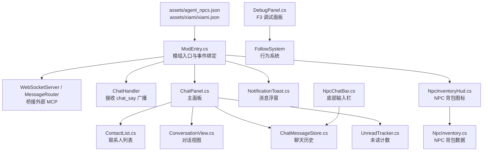
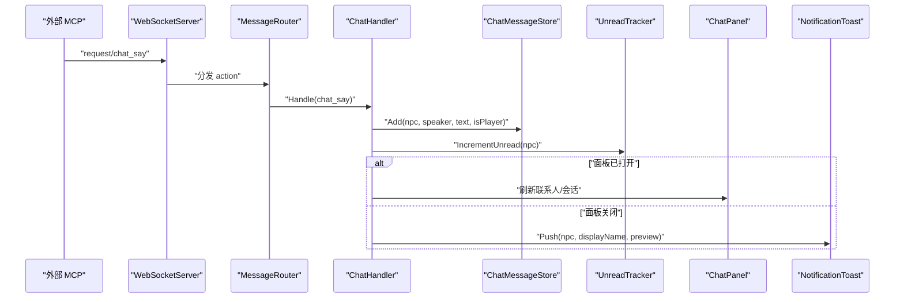
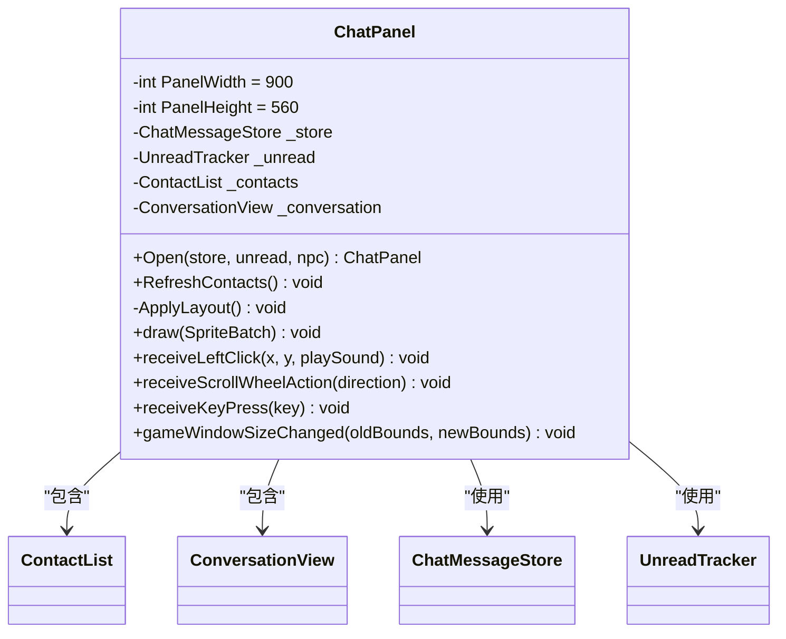
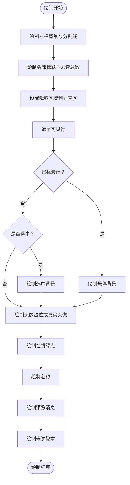
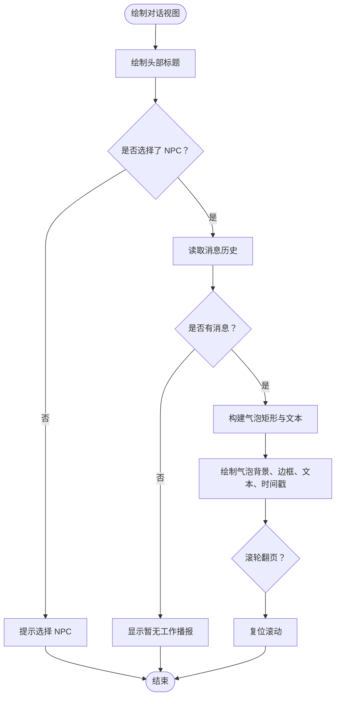
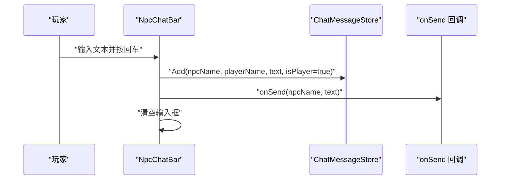
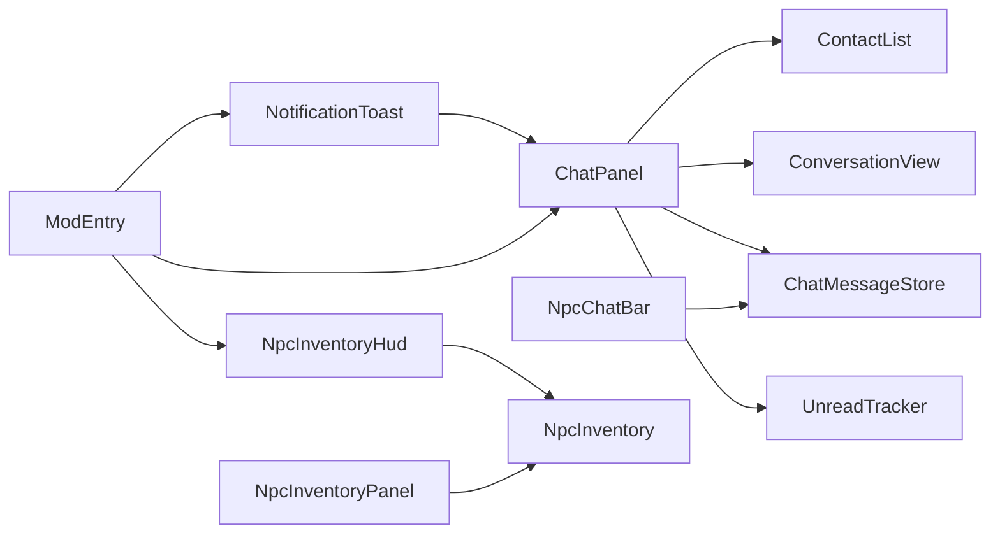

# 主题定制开发

<cite>
**本文引用的文件**
- [ChatPanel.cs](file://SmartNPC/smapi-mod/UI/ChatPanel.cs)
- [ContactList.cs](file://SmartNPC/smapi-mod/UI/ContactList.cs)
- [ConversationView.cs](file://SmartNPC/smapi-mod/UI/ConversationView.cs)
- [NpcChatBar.cs](file://SmartNPC/smapi-mod/UI/NpcChatBar.cs)
- [ChatMessageStore.cs](file://SmartNPC/smapi-mod/UI/ChatMessageStore.cs)
- [ChatSideButton.cs](file://SmartNPC/smapi-mod/UI/ChatSideButton.cs)
- [NotificationToast.cs](file://SmartNPC/smapi-mod/UI/NotificationToast.cs)
- [NpcInventoryHud.cs](file://SmartNPC/smapi-mod/UI/NpcInventoryHud.cs)
- [NpcInventoryPanel.cs](file://SmartNPC/smapi-mod/UI/NpcInventoryPanel.cs)
- [DebugPanel.cs](file://SmartNPC/smapi-mod/UI/DebugPanel.cs)
- [UnreadTracker.cs](file://SmartNPC/smapi-mod/Data/UnreadTracker.cs)
- [NpcInventory.cs](file://SmartNPC/smapi-mod/Data/NpcInventory.cs)
- [ModEntry.cs](file://SmartNPC/smapi-mod/ModEntry.cs)
- [ModConfig.cs](file://SmartNPC/smapi-mod/ModConfig.cs)
- [manifest.json](file://SmartNPC/smapi-mod/manifest.json)
- [agent_npcs.json](file://SmartNPC/smapi-mod/assets/agent_npcs.json)
- [xiami.json](file://SmartNPC/smapi-mod/assets/xiami/xiami.json)
- [zh.json](file://SV.v1.6.15/smapi-internal/i18n/zh.json)
- [default.json](file://SV.v1.6.15/smapi-internal/i18n/default.json)
</cite>

## 目录
1. [引言](#引言)
2. [项目结构](#项目结构)
3. [核心组件](#核心组件)
4. [架构总览](#架构总览)
5. [详细组件分析](#详细组件分析)
6. [依赖关系分析](#依赖关系分析)
7. [性能与兼容性](#性能与兼容性)
8. [调试与故障排查](#调试与故障排查)
9. [主题定制示例](#主题定制示例)
10. [结论](#结论)

## 引言
本指南面向希望为 SmartNPC SMAPI 模组进行 UI 主题定制与二次开发的读者。文档聚焦以下目标：
- 理解 ChatPanel、ContactList、NpcChatBar、ConversationView 等核心 UI 组件的职责、布局与交互。
- 掌握样式定制方法，包括颜色、字体、边框、气泡形状、通知弹窗和侧边按钮风格。
- 了解资源替换路径：贴图、头像、动画配置、字体与游戏内字符串。
- 解释当前国际化支持现状与扩展方式。
- 提供从简单换色到复杂界面重构的完整实践路径，并给出性能优化、兼容性与调试建议。

## 项目结构
SmartNPC 的 SMAPI 模组以 C# 实现，UI 代码集中在 `smapi-mod/UI` 目录下；数据层位于 `Data`；入口在 `ModEntry.cs`；模组清单在 `manifest.json`；资产在 `assets`；SMAPI 内置本地化文件位于 `sv-game/smapi-internal/i18n`。

**图表来源**
- [ModEntry.cs:1-200](file://SmartNPC/smapi-mod/ModEntry.cs#L1-L200)
- [ChatPanel.cs:1-178](file://SmartNPC/smapi-mod/UI/ChatPanel.cs#L1-L178)
- [ContactList.cs:1-261](file://SmartNPC/smapi-mod/UI/ContactList.cs#L1-L261)
- [ConversationView.cs:1-175](file://SmartNPC/smapi-mod/UI/ConversationView.cs#L1-L175)
- [NpcChatBar.cs:1-165](file://SmartNPC/smapi-mod/UI/NpcChatBar.cs#L1-L165)
- [NotificationToast.cs:1-138](file://SmartNPC/smapi-mod/UI/NotificationToast.cs#L1-L138)
- [NpcInventoryHud.cs:1-106](file://SmartNPC/smapi-mod/UI/NpcInventoryHud.cs#L1-L106)
- [NpcInventoryPanel.cs:1-170](file://SmartNPC/smapi-mod/UI/NpcInventoryPanel.cs#L1-L170)
- [DebugPanel.cs:1-200](file://SmartNPC/smapi-mod/UI/DebugPanel.cs#L1-L200)
- [agent_npcs.json:1-8](file://SmartNPC/smapi-mod/assets/agent_npcs.json#L1-L8)
- [xiami.json:1-200](file://SmartNPC/smapi-mod/assets/xiami/xiami.json#L1-L200)

**章节来源**
- [ModEntry.cs:1-200](file://SmartNPC/smapi-mod/ModEntry.cs#L1-L200)
- [manifest.json:1-10](file://SmartNPC/smapi-mod/manifest.json#L1-L10)

## 核心组件
本节概述每个 UI 组件的职责、关键属性、绘制流程与可定制点。

| 组件 | 职责 | 关键布局/常量 | 主要交互 | 主题定制切入点 |
|---|---|---:|---|---|
| ChatPanel | QQ 风格聊天主面板，左侧联系人、右侧对话 | 宽 900、高 560，左右分栏 | Tab/F2/Esc 开关，鼠标滚轮分区域滚动 | 背景遮罩、外框、左右栏尺寸、关闭按钮 |
| ContactList | 联系人列表，按最近消息排序，显示头像、在线状态、未读数 | 固定宽 300，行高 72，头部 56 | 点击选择 NPC，滚轮滚动列表 | 背景色、分割线、头部颜色、行选中态、头像占位、徽章 |
| ConversationView | 只读工作播报视图，气泡展示 NPC 消息 | 头部 56，最大气泡宽度 75% | 滚轮翻页，重置滚动 | 背景色、气泡圆角/边框、文本颜色、时间戳位置 |
| NpcChatBar | 底部 NPC 输入栏，带头像、名称、输入框、关闭按钮 | 高 64，头像 48，关闭按钮 36 | 回车发送，Esc 关闭，点击关闭 | 背景透明度、顶部线条颜色、头像加载失败占位、关闭按钮样式 |
| ChatSideButton | 左侧悬浮聊天入口按钮，含未读脉冲红点 | 按钮 48×44，红点 10 | 左键打开聊天 | 阴影、木纹边框、气泡图标、红点脉冲动画 |
| NotificationToast | 非模态消息浮窗，最多 3 条，右下角堆叠 | Toast 320×72，生存 3 秒，淡出 0.6 秒 | 点击打开对应 NPC 对话 | 背景色、边框色、标题/正文颜色、间距、淡出曲线 |
| NpcInventoryHud | 在 NPC 头顶上方绘制背包图标 | 图标 18×18，屏幕偏移 80 | 左键点击打开背包面板 | 图标缩放、透明度、热区大小 |
| NpcInventoryPanel | NPC 背包网格面板，4 列，悬停显示详情 | 单元格 64，最小 2 行 | Esc/X 关闭，悬停高亮 | 面板背景、格子背景、悬停高亮、底部详情文字 |
| DebugPanel | F3 调试面板，列出 NPC 并执行召唤/跟随/带路/停止 | 宽 560，行高 64 | 点击按钮触发行为 | 窗口背景、行交替色、按钮填充/边框、模式标签颜色 |

**章节来源**
- [ChatPanel.cs:1-178](file://SmartNPC/smapi-mod/UI/ChatPanel.cs#L1-L178)
- [ContactList.cs:1-261](file://SmartNPC/smapi-mod/UI/ContactList.cs#L1-L261)
- [ConversationView.cs:1-175](file://SmartNPC/smapi-mod/UI/ConversationView.cs#L1-L175)
- [NpcChatBar.cs:1-165](file://SmartNPC/smapi-mod/UI/NpcChatBar.cs#L1-L165)
- [ChatSideButton.cs:1-166](file://SmartNPC/smapi-mod/UI/ChatSideButton.cs#L1-L166)
- [NotificationToast.cs:1-138](file://SmartNPC/smapi-mod/UI/NotificationToast.cs#L1-L138)
- [NpcInventoryHud.cs:1-106](file://SmartNPC/smapi-mod/UI/NpcInventoryHud.cs#L1-L106)
- [NpcInventoryPanel.cs:1-170](file://SmartNPC/smapi-mod/UI/NpcInventoryPanel.cs#L1-L170)
- [DebugPanel.cs:1-200](file://SmartNPC/smapi-mod/UI/DebugPanel.cs#L1-L200)

## 架构总览
UI 组件通过 ModEntry 的事件系统注册到游戏循环中。外部 MCP 请求经 WebSocket 进入后，由 MessageRouter 分发；chat_say 广播被 ChatHandler 捕获，写入 ChatMessageStore，同时更新 UnreadTracker，并在 ChatPanel 或 NotificationToast 中呈现。

**图表来源**
- [ModEntry.cs:1-200](file://SmartNPC/smapi-mod/ModEntry.cs#L1-L200)
- [ChatMessageStore.cs:1-87](file://SmartNPC/smapi-mod/UI/ChatMessageStore.cs#L1-L87)
- [UnreadTracker.cs:1-56](file://SmartNPC/smapi-mod/Data/UnreadTracker.cs#L1-L56)
- [ChatPanel.cs:1-178](file://SmartNPC/smapi-mod/UI/ChatPanel.cs#L1-L178)
- [NotificationToast.cs:1-138](file://SmartNPC/smapi-mod/UI/NotificationToast.cs#L1-L138)

## 详细组件分析

### ChatPanel：主面板与布局
ChatPanel 是顶层菜单，采用左右两栏布局。左侧 ContactList 宽 300，右侧 ConversationView 自适应剩余宽度。它负责：
- 初始化子组件并应用布局。
- 绘制半透明背景、外框。
- 根据鼠标横坐标路由滚轮事件到左栏或右栏。
- 处理 Tab/F2/Esc 快捷键。
- 暴露静态 Open/RefreshContacts API 给 ModEntry。

**图表来源**
- [ChatPanel.cs:1-178](file://SmartNPC/smapi-mod/UI/ChatPanel.cs#L1-L178)
- [ContactList.cs:1-261](file://SmartNPC/smapi-mod/UI/ContactList.cs#L1-L261)
- [ConversationView.cs:1-175](file://SmartNPC/smapi-mod/UI/ConversationView.cs#L1-L175)
- [ChatMessageStore.cs:1-87](file://SmartNPC/smapi-mod/UI/ChatMessageStore.cs#L1-L87)
- [UnreadTracker.cs:1-56](file://SmartNPC/smapi-mod/Data/UnreadTracker.cs#L1-L56)

**章节来源**
- [ChatPanel.cs:1-178](file://SmartNPC/smapi-mod/UI/ChatPanel.cs#L1-L178)

### ContactList：联系人列表
ContactList 负责渲染 NPC 列表，并按最后一条消息时间排序。每行显示头像、在线指示点、名称、预览消息和未读数徽章。其绘制流程如下：

**图表来源**
- [ContactList.cs:1-261](file://SmartNPC/smapi-mod/UI/ContactList.cs#L1-L261)

**章节来源**
- [ContactList.cs:1-261](file://SmartNPC/smapi-mod/UI/ContactList.cs#L1-L261)

### ConversationView：对话视图
ConversationView 将 ChatMessageStore 中的历史记录以气泡形式自底向上绘制。玩家消息靠右，NPC 消息靠左。它支持滚轮翻页与滚动复位。

**图表来源**
- [ConversationView.cs:1-175](file://SmartNPC/smapi-mod/UI/ConversationView.cs#L1-L175)

**章节来源**
- [ConversationView.cs:1-175](file://SmartNPC/smapi-mod/UI/ConversationView.cs#L1-L175)

### NpcChatBar：底部输入栏
NpcChatBar 是底部输入栏，承载 TextBox 输入、NPC 头像、名称标签和关闭按钮。按下回车后将消息加入 ChatMessageStore，并通过回调发送给外部系统。

**图表来源**
- [NpcChatBar.cs:1-165](file://SmartNPC/smapi-mod/UI/NpcChatBar.cs#L1-L165)
- [ChatMessageStore.cs:1-87](file://SmartNPC/smapi-mod/UI/ChatMessageStore.cs#L1-L87)

**章节来源**
- [NpcChatBar.cs:1-165](file://SmartNPC/smapi-mod/UI/NpcChatBar.cs#L1-L165)

### ChatSideButton：侧边入口按钮
ChatSideButton 使用原语绘制像素风气泡图标，并带有一个脉动红点表示未读。点击时播放音效并调用回调打开聊天面板。

**章节来源**
- [ChatSideButton.cs:1-166](file://SmartNPC/smapi-mod/UI/ChatSideButton.cs#L1-L166)

### NotificationToast：消息浮窗
NotificationToast 维护一个队列，最多保留 3 条消息。每条消息有生命周期（默认 3 秒）和淡出阶段（默认 0.6 秒）。点击某条 toast 会清除队列并回调打开对应 NPC 对话。

**章节来源**
- [NotificationToast.cs:1-138](file://SmartNPC/smapi-mod/UI/NotificationToast.cs#L1-L138)

### NpcInventoryHud 与 NpcInventoryPanel：NPC 背包
NpcInventoryHud 在游戏 HUD 层为每个 Agent NPC 绘制背包图标，并根据 NpcInventory.HasItems 调整透明度。点击图标打开 NpcInventoryPanel。NpcInventoryPanel 以 4 列网格展示物品，悬停显示物品 ID、数量与品质。

**章节来源**
- [NpcInventoryHud.cs:1-106](file://SmartNPC/smapi-mod/UI/NpcInventoryHud.cs#L1-L106)
- [NpcInventoryPanel.cs:1-170](file://SmartNPC/smapi-mod/UI/NpcInventoryPanel.cs#L1-L170)
- [NpcInventory.cs:1-116](file://SmartNPC/smapi-mod/Data/NpcInventory.cs#L1-L116)

### DebugPanel：调试面板
DebugPanel 列出所有 Agent NPC，并提供“召唤”“跟随”“带路”“停止”四个按钮，直接调用 FollowSystem。它还提供一个二级目的地选择菜单。

**章节来源**
- [DebugPanel.cs:1-200](file://SmartNPC/smapi-mod/UI/DebugPanel.cs#L1-L200)

## 依赖关系分析
UI 组件之间的耦合关系如下：
- ChatPanel 组合 ContactList 与 ConversationView，并通过 ChatMessageStore 和 UnreadTracker 共享数据。
- NpcChatBar 依赖 ChatMessageStore 保存玩家消息，并通过 Action<string,string> 回调与外部系统通信。
- NotificationToast 独立于面板，但通过回调与 ChatPanel 打开逻辑联动。
- NpcInventoryHud 依赖 NpcInventory 判断背包是否为空，并通过回调打开 NpcInventoryPanel。
- ModEntry 作为装配中心，注册事件、创建 UI 实例并连接 WebSocket 与聊天处理。

**图表来源**
- [ChatPanel.cs:1-178](file://SmartNPC/smapi-mod/UI/ChatPanel.cs#L1-L178)
- [NpcChatBar.cs:1-165](file://SmartNPC/smapi-mod/UI/NpcChatBar.cs#L1-L165)
- [NotificationToast.cs:1-138](file://SmartNPC/smapi-mod/UI/NotificationToast.cs#L1-L138)
- [NpcInventoryHud.cs:1-106](file://SmartNPC/smapi-mod/UI/NpcInventoryHud.cs#L1-L106)
- [NpcInventoryPanel.cs:1-170](file://SmartNPC/smapi-mod/UI/NpcInventoryPanel.cs#L1-L170)
- [NpcInventory.cs:1-116](file://SmartNPC/smapi-mod/Data/NpcInventory.cs#L1-L116)
- [ModEntry.cs:1-200](file://SmartNPC/smapi-mod/ModEntry.cs#L1-L200)

**章节来源**
- [ModEntry.cs:1-200](file://SmartNPC/smapi-mod/ModEntry.cs#L1-L200)

## 性能与兼容性
- 避免频繁纹理加载：NpcChatBar 在构造时加载 textBox 纹理，应避免在 draw 中重复加载。
- 减少不必要的字符串测量：ContactList 对预览消息进行截断前先测量，应缓存常用字体度量结果。
- 控制气泡绘制复杂度：ConversationView 使用 fadeToBlackRect 绘制边框，大量气泡会增加绘制开销，可考虑合并边框绘制或使用更简单的几何图元。
- 滚动分页：ContactList 与 ConversationView 都基于可见行数计算滚动偏移，避免全量重绘。
- SMAPI 事件频率：ModEntry 订阅了 GameLoop.UpdateTicked、Display.RenderedHud 等高频事件，UI 更新应尽量轻量。
- 分辨率适配：ChatPanel 在 gameWindowSizeChanged 中重新定位，确保在不同视口下布局正确。
- 输入法与键盘焦点：NpcChatBar 设置 Game1.keyboardDispatcher.Subscriber，退出时需清理，避免键盘焦点泄漏。

[本节为通用指导，不直接分析具体代码片段]

## 调试与故障排查
- 启用调试气泡：ModConfig.DebugShowBubble 控制 NPC 行为动作是否在头上显示文本气泡。
- 启用边界框可视化：ModConfig.DebugShowBBoxOverlay 显示工具决策的区域框。
- 镜像入站请求：ModConfig.DebugLogIncomingRequests 将 MCP 入站请求镜像到聊天面板，便于观察 LLM 调用的工具与参数。
- 控制台命令：ModEntry 注册了 DebugCommands，可用于调试 WebSocket、FollowSystem、NpcInventory 等子系统。
- 常见问题：
  - 头像加载失败：NpcChatBar 在 Portraits\<npcName\> 不存在时会回退到灰色占位。
  - 未读数不消失：ContactList 选择 NPC 时调用 UnreadTracker.MarkRead，若 UI 未触发选择回调，未读数不会清零。
  - 浮窗不显示：NotificationToast.Push 需要面板关闭时才有效；如果面板打开，消息应直接进入 ChatPanel。
  - 背包图标不可见：NpcInventoryHud 仅在无活动菜单且 NPC 在当前地图时绘制。

**章节来源**
- [ModConfig.cs:1-144](file://SmartNPC/smapi-mod/ModConfig.cs#L1-L144)
- [ModEntry.cs:1-200](file://SmartNPC/smapi-mod/ModEntry.cs#L1-L200)
- [NpcChatBar.cs:1-165](file://SmartNPC/smapi-mod/UI/NpcChatBar.cs#L1-L165)
- [NotificationToast.cs:1-138](file://SmartNPC/smapi-mod/UI/NotificationToast.cs#L1-L138)
- [NpcInventoryHud.cs:1-106](file://SmartNPC/smapi-mod/UI/NpcInventoryHud.cs#L1-L106)

## 主题定制示例

### 示例一：修改聊天面板主题色
目标：将 ChatPanel 背景遮罩改为深蓝色，ContactList 头部改为深紫色，ConversationView 背景改为浅灰。

步骤：
- 在 ChatPanel.draw 中将背景遮罩颜色从黑色半透明改为深蓝半透明。
- 在 ContactList.Draw 中修改头部 Color(100,130,180) 为深紫色。
- 在 ConversationView.Draw 中修改背景 Color(252,248,232) 为浅灰。

参考路径：
- [ChatPanel.draw](file://SmartNPC/smapi-mod/UI/ChatPanel.cs#L60-L90)
- [ContactList.Draw 头部](file://SmartNPC/smapi-mod/UI/ContactList.cs#L70-L100)
- [ConversationView.Draw 背景](file://SmartNPC/smapi-mod/UI/ConversationView.cs#L40-L70)

### 示例二：自定义联系人列表行样式
目标：选中行使用渐变色背景，悬停行添加细边框，未读数徽章改为圆形。

步骤：
- 在 ContactList.DrawRow 中根据 selected/hover 分别绘制不同背景色。
- 使用 fadeToBlackRect 绘制行边框。
- 在 DrawBadge 中改用圆形绘制未读数。

参考路径：
- [ContactList.DrawRow](file://SmartNPC/smapi-mod/UI/ContactList.cs#L120-L190)
- [ContactList.DrawBadge](file://SmartNPC/smapi-mod/UI/ContactList.cs#L220-L261)

### 示例三：更换对话气泡风格
目标：将气泡改为圆角矩形，玩家消息气泡使用品牌色，NPC 消息气泡使用中性色，时间戳移到气泡下方居中。

步骤：
- 在 ConversationView.DrawTranscript 中调整 bubbleColor 与 textColor。
- 使用 fadeToBlackRect 绘制圆角边框。
- 调整 timeX 与时间戳绘制位置。

参考路径：
- [ConversationView.DrawTranscript](file://SmartNPC/smapi-mod/UI/ConversationView.cs#L70-L140)

### 示例四：自定义底部输入栏外观
目标：将 NpcChatBar 背景改为深色玻璃效果，顶部线条改为品牌色，关闭按钮改为圆形图标。

步骤：
- 在 NpcChatBar.draw 中修改背景 Color.Black * 0.8f 为深色半透明。
- 修改顶部线条颜色为品牌色。
- 用圆形绘制关闭按钮，并在 hover 时改变颜色。

参考路径：
- [NpcChatBar.draw](file://SmartNPC/smapi-mod/UI/NpcChatBar.cs#L40-L120)

### 示例五：自定义侧边按钮与未读红点
目标：将 ChatSideButton 的木纹边框改为金属质感，未读红点改为呼吸动画，气泡图标改为品牌图标。

步骤：
- 在 ChatSideButton.Draw 中修改 frameColor 与 cornerColor。
- 调整 pulseTimer 与 dotSize 实现呼吸动画。
- 重写 DrawSpeechBubble 绘制新图标。

参考路径：
- [ChatSideButton.Draw](file://SmartNPC/smapi-mod/UI/ChatSideButton.cs#L20-L120)
- [ChatSideButton.DrawSpeechBubble](file://SmartNPC/smapi-mod/UI/ChatSideButton.cs#L120-L166)

### 示例六：自定义消息浮窗样式
目标：将 NotificationToast 背景改为半透明黑蓝，边框改为品牌金边，标题与正文颜色调整为可读对比度。

步骤：
- 在 NotificationToast.Draw 中修改 bg、border、titleColor、textColor。
- 调整 ToastSpacing 与 FadeSeconds 控制堆叠与淡出节奏。

参考路径：
- [NotificationToast.Draw](file://SmartNPC/smapi-mod/UI/NotificationToast.cs#L60-L120)

### 示例七：自定义 NPC 背包面板
目标：将 NpcInventoryPanel 的背景改为毛玻璃，格子悬停高亮改为品牌色，底部详情显示物品图片缩略图。

步骤：
- 在 NpcInventoryPanel.draw 中修改背景与悬停高亮颜色。
- 使用 ItemRegistry.Create 获取物品并绘制缩略图。
- 调整 FooterH 与 detail 文本布局。

参考路径：
- [NpcInventoryPanel.draw](file://SmartNPC/smapi-mod/UI/NpcInventoryPanel.cs#L40-L140)

### 示例八：自定义调试面板
目标：将 DebugPanel 的行交替色改为深浅品牌色，按钮改为圆角，模式标签根据 Idle/Active 显示不同颜色。

步骤：
- 在 DebugPanel.draw 中修改行背景颜色。
- 在 DrawButton 中绘制圆角矩形。
- 根据 NpcBehaviorMode 设置模式标签颜色。

参考路径：
- [DebugPanel.draw](file://SmartNPC/smapi-mod/UI/DebugPanel.cs#L60-L140)
- [DebugPanel.DrawButton](file://SmartNPC/smapi-mod/UI/DebugPanel.cs#L160-L200)

## 资源替换方法

### 贴图与头像替换
- NPC 头像：NpcChatBar 尝试加载 `Portraits\<npcName\>` 纹理，若不存在则显示灰色占位。替换头像需保持文件名与 NPC 名称一致。
- 聊天输入框纹理：NpcChatBar 在构造时加载 `LooseSprites\\textBox`。如需自定义输入框外观，可替换该纹理或修改绘制逻辑。
- 背包图标：NpcInventoryHud 使用 Game1.mouseCursors 中 (280,411,16,16) 的金币袋图标。如需替换，可改用自定义纹理或调整 sourceRectangle。

参考路径：
- [NpcChatBar 头像加载](file://SmartNPC/smapi-mod/UI/NpcChatBar.cs#L60-L90)
- [NpcChatBar 输入框纹理](file://SmartNPC/smapi-mod/UI/NpcChatBar.cs#L20-L40)
- [NpcInventoryHud 背包图标](file://SmartNPC/smapi-mod/UI/NpcInventoryHud.cs#L40-L80)

### 字体自定义
- 对话面板使用 Game1.dialogueFont、Game1.smallFont、Game1.tinyFont。
- 如需自定义字体，可在 SMAPI 环境下注入字体资源，并在 UI 组件中引用新字体对象。
- 注意字体度量变化会影响气泡宽度、行高与按钮布局，需同步调整常量与布局计算。

参考路径：
- [ConversationView 文本绘制](file://SmartNPC/smapi-mod/UI/ConversationView.cs#L90-L140)
- [ContactList 文本绘制](file://SmartNPC/smapi-mod/UI/ContactList.cs#L100-L160)

### 音效资源管理
- ChatSideButton.HandleClick 与 NpcChatBar.receiveLeftClick 使用 Game1.playSound 播放 bigSelect、bigDeSelect、smallSelect。
- 如需自定义音效，可在 SMAPI 环境下替换音效资源或修改调用处。

参考路径：
- [ChatSideButton.HandleClick](file://SmartNPC/smapi-mod/UI/ChatSideButton.cs#L150-L166)
- [NpcChatBar.receiveLeftClick](file://SmartNPC/smapi-mod/UI/NpcChatBar.cs#L110-L140)

### 动画与角色资产
- agent_npcs.json 定义哪些 NPC 受 Agent 管理。
- xiami.json 定义 XiaMi 角色的动画帧布局、方向、帧率与变换。如需替换角色动画，需同步修改 JSON 中的 source_image、layout、animations。

参考路径：
- [agent_npcs.json](file://SmartNPC/smapi-mod/assets/agent_npcs.json#L1-L8)
- [xiami.json](file://SmartNPC/smapi-mod/assets/xiami/xiami.json#L1-L200)

## 国际化支持机制

### 现状
- SMAPI 内置本地化文件位于 `sv-game/smapi-internal/i18n`，包含 default.json 与 zh.json 等语言文件。
- 这些文件主要用于 SMAPI 自身 UI 与日期格式化，例如 generic.date、config.section.features 等。
- SmartNPC 的 UI 组件目前直接使用硬编码中文文本，如“联系人”“未读”“Agent 工作播报”“XiaMi 的背包”等。

### 扩展方式
- 为 SmartNPC 新增 i18n 键值对，并在 UI 组件中通过 SMAPI 的本地化 API 获取文本。
- 新建 `SmartNPC/smapi-mod/i18n/zh.json`、`SmartNPC/smapi-mod/i18n/default.json` 等文件，遵循 SMAPI 本地化约定。
- 在 UI 绘制前加载本地化字符串，避免在 draw 中重复查找。

参考路径：
- [SMAPI zh.json](file://SV.v1.6.15/smapi-internal/i18n/zh.json#L1-L55)
- [SMAPI default.json](file://SV.v1.6.15/smapi-internal/i18n/default.json#L1-L54)

### 动态语言切换
- 当前 UI 组件未实现动态语言切换逻辑。
- 若需支持运行时切换，可在 ModEntry 中监听语言变更事件，重建 UI 字符串缓存，并刷新所有面板。

[本节为概念性说明，不直接分析具体代码片段]

## 最佳实践

### 性能优化
- 缓存字体度量与纹理引用，避免在 draw 中重复加载。
- 使用 ScissorTest 裁剪列表区域，减少无效绘制。
- 控制气泡数量与文本长度，必要时分页或折叠。
- 避免在高频事件中进行昂贵计算，将逻辑下沉到 UpdateTicked 或后台任务。

### 兼容性考虑
- 确保 UI 在不同分辨率与缩放比例下正常显示。
- 兼容 SMAPI 版本升级导致的 API 变化，定期检查 ModEntry 中的 Harmony patch 与事件绑定。
- 与其他 UI 模组共存时，避免覆盖全局状态，如 Game1.keyboardDispatcher.Subscriber。

### 调试技巧
- 启用 DebugShowBubble 与 DebugShowBBoxOverlay 观察 NPC 行为。
- 使用 DebugLogIncomingRequests 观察 MCP 入站请求。
- 通过控制台命令调试 WebSocket、FollowSystem、NpcInventory。
- 在 ChatPanel 中查看 chat_say 广播与 debug-request 镜像。

**章节来源**
- [ModConfig.cs:1-144](file://SmartNPC/smapi-mod/ModConfig.cs#L1-L144)
- [ModEntry.cs:1-200](file://SmartNPC/smapi-mod/ModEntry.cs#L1-L200)
- [ChatPanel.cs:1-178](file://SmartNPC/smapi-mod/UI/ChatPanel.cs#L1-L178)

## 结论
SmartNPC 的 UI 主题定制围绕 ChatPanel、ContactList、ConversationView、NpcChatBar、NotificationToast、ChatSideButton、NpcInventoryHud、NpcInventoryPanel 与 DebugPanel 展开。开发者可通过修改颜色、边框、布局常量、纹理与字体来实现个性化体验。当前国际化支持有限，建议在模组内新增 i18n 文件并逐步替换硬编码文本。性能方面应关注纹理加载、字符串测量与高频事件优化；兼容性方面需关注 SMAPI 版本与多模组共存场景。通过上述实践，开发者可以完成从简单换色到复杂界面重构的主题定制目标。