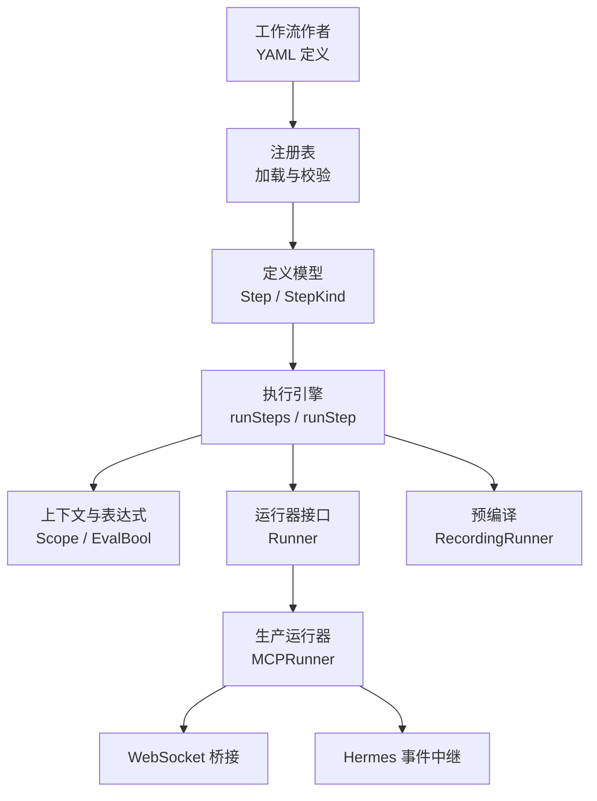
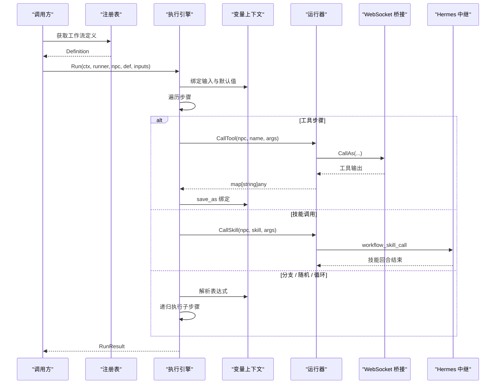
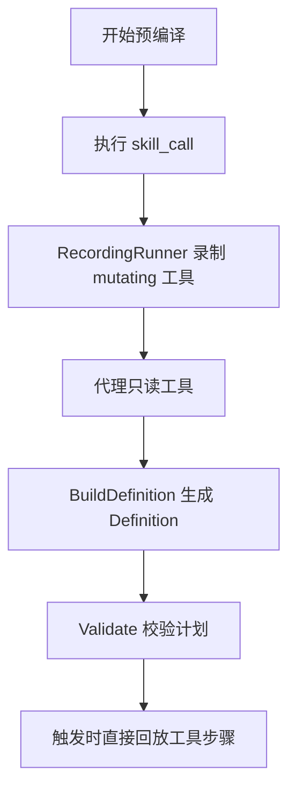
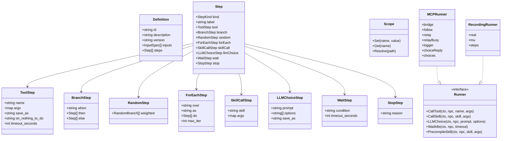

# 工作流作者指南

<cite>
**本文引用的文件**
- [workflow-authoring.md](file://SmartNPC/docs/workflow-authoring.md)
- [definition.go](file://SmartNPC/smartnpc-mcp/pkg/workflow/definition.go)
- [engine.go](file://SmartNPC/smartnpc-mcp/pkg/workflow/engine.go)
- [context.go](file://SmartNPC/smartnpc-mcp/pkg/workflow/context.go)
- [registry.go](file://SmartNPC/smartnpc-mcp/pkg/workflow/registry.go)
- [precompile.go](file://SmartNPC/smartnpc-mcp/pkg/workflow/precompile.go)
- [runner_mcp.go](file://SmartNPC/smartnpc-mcp/pkg/workflow/runner_mcp.go)
- [farm_care.yaml](file://提示词导出-20261026-004143/11-内置工作流定义/farm_care.yaml)
- [social_round_robin.yaml](file://提示词导出-20261026-004143/11-内置工作流定义/social_round_robin.yaml)
- [mine_crawl.yaml](file://提示词导出-20261026-004143/11-内置工作流定义/mine_crawl.yaml)
- [farm_cleanup.yaml](file://提示词导出-20261026-004143/11-内置工作流定义/farm_cleanup.yaml)
- [farm_evening_close.yaml](file://提示词导出-20261026-004143/11-内置工作流定义/farm_evening_close.yaml)
- [social_interact.yaml](file://提示词导出-20261026-004143/11-内置工作流定义/social_interact.yaml)
</cite>

## 目录
1. [引言](#引言)
2. [项目结构](#项目结构)
3. [核心组件](#核心组件)
4. [架构总览](#架构总览)
5. [详细组件分析](#详细组件分析)
6. [依赖关系分析](#依赖关系分析)
7. [性能与优化](#性能与优化)
8. [故障排查指南](#故障排查指南)
9. [结论](#结论)
10. [附录：实战示例与工作流设计模式](#附录实战示例与工作流设计模式)

## 引言
本指南面向工作流作者，说明 SmartNPC 工作流引擎的 YAML 语法、步骤类型、变量解析、表达式求值、预编译机制、验证规则、执行流程以及错误处理策略。工作流用于描述 NPC 的多步自动化行为；大多数日常任务通过 `skill_call` 委派给 Hermes 技能完成复杂决策，而条件分支、循环、随机选择等编排逻辑由本地引擎直接执行，避免每步调用大模型。

## 项目结构
工作流代码集中在 Go 包 `smartnpc-mcp/pkg/workflow` 中，采用“定义 + 注册表 + 表达式上下文 + 执行引擎 + 运行器 + 预编译”的分层组织方式：

**图示来源**
- [definition.go:1-60](file://SmartNPC/smartnpc-mcp/pkg/workflow/definition.go#L1-L60)
- [registry.go:1-60](file://SmartNPC/smartnpc-mcp/pkg/workflow/registry.go#L1-L60)
- [engine.go:1-60](file://SmartNPC/smartnpc-mcp/pkg/workflow/engine.go#L1-L60)
- [context.go:1-40](file://SmartNPC/smartnpc-mcp/pkg/workflow/context.go#L1-L40)
- [runner_mcp.go:1-60](file://SmartNPC/smartnpc-mcp/pkg/workflow/runner_mcp.go#L1-L60)
- [precompile.go:1-40](file://SmartNPC/smartnpc-mcp/pkg/workflow/precompile.go#L1-L40)

**章节来源**
- [definition.go:1-60](file://SmartNPC/smartnpc-mcp/pkg/workflow/definition.go#L1-L60)
- [registry.go:1-60](file://SmartNPC/smartnpc-mcp/pkg/workflow/registry.go#L1-L60)

## 核心组件
- **定义模型**：`Definition`、`Step`、`StepKind` 以及各步骤子结构（`ToolStep`、`BranchStep`、`RandomStep`、`ForEachStep`、`SkillCallStep`、`LLMChoiceStep`、`WaitStep`、`StopStep`）。
- **注册表**：负责从嵌入式 `builtin/*.yaml` 和可选额外目录加载工作流，进行重复 ID 检查与静态校验。
- **上下文与表达式**：`Scope` 提供作用域链和路径查找，`EvalBool`、`Eval` 实现小型表达式语言。
- **执行引擎**：`Run` 是公共入口，按顺序调度步骤，统计结果并处理中断、停止、nothing_to_do 策略。
- **运行器接口**：`Runner` 抽象 MCP 工具调用、Hermes 技能调用、LLM 选项选择、空闲等待和预编译。
- **生产运行器**：`MCPRunner` 通过 WebSocket 桥接调用 Mod 工具，通过事件中继触发 Hermes 技能，并轮询 FollowSystem 状态。
- **预编译系统**：`RecordingRunner` 记录 LLM 调用的 mutating 工具，生成可直接重放的纯工具工作流。

**章节来源**
- [definition.go:60-190](file://SmartNPC/smartnpc-mcp/pkg/workflow/definition.go#L60-L190)
- [engine.go:60-120](file://SmartNPC/smartnpc-mcp/pkg/workflow/engine.go#L60-L120)
- [runner_mcp.go:60-120](file://SmartNPC/smartnpc-mcp/pkg/workflow/runner_mcp.go#L60-L120)
- [precompile.go:40-120](file://SmartNPC/smartnpc-mcp/pkg/workflow/precompile.go#L40-L120)

## 架构总览
工作流执行的基本路径如下：

**图示来源**
- [engine.go:120-220](file://SmartNPC/smartnpc-mcp/pkg/workflow/engine.go#L120-L220)
- [runner_mcp.go:120-220](file://SmartNPC/smartnpc-mcp/pkg/workflow/runner_mcp.go#L120-L220)
- [context.go:40-120](file://SmartNPC/smartnpc-mcp/pkg/workflow/context.go#L40-L120)

## 详细组件分析

### YAML 定义语法
工作流 YAML 使用以下顶层字段：
- `id`：必填的工作流唯一标识。
- `description`：可选的人类可读描述。
- `version`：可选版本字符串。
- `inputs`：可选的命名参数列表，每个条目包含 `name`、`description`、`default`。
- `steps`：必填的步骤数组，每个步骤由 `kind` 决定具体结构。

输入变量在工作流表达式中以 `$name` 引用，例如 `$inspect_radius`、`$target_seed`。

**章节来源**
- [definition.go:24-58](file://SmartNPC/smartnpc-mcp/pkg/workflow/definition.go#L24-L58)
- [workflow-authoring.md:1-40](file://SmartNPC/docs/workflow-authoring.md#L1-L40)

### 步骤类型与参数

#### tool：调用 MCP 工具
- `name`：MCP 工具名称。
- `args`：可包含 `$` 前缀变量的参数字典。
- `save_as`：将工具返回结果绑定到当前作用域的变量名。
- `on_nothing_to_do`：当工具返回 `nothing_to_do=true` 时的策略，支持 `skip`、`stop`、`fail`。
- `timeout_seconds`：单个工具调用的超时上限；未设置时由引擎默认值兜底。

语义要点：
- 引擎会先解析 `args`，再将结果写入 `scope`。
- `nothing_to_do=skip` 继续下一步；`stop` 以工具原因为理由提前结束；`fail` 抛出错误。
- 如果未设置 `timeout_seconds`，引擎对工具调用有安全超时保护。

**章节来源**
- [definition.go:86-118](file://SmartNPC/smartnpc-mcp/pkg/workflow/definition.go#L86-L118)
- [engine.go:240-340](file://SmartNPC/smartnpc-mcp/pkg/workflow/engine.go#L240-L340)

#### branch：条件分支
- `when`：表达式，结果为真则执行 `then`，否则执行 `else`。
- `then`：条件为真时的步骤序列。
- `else`：可选的备选步骤序列。

语义要点：
- 分支本身不计数为工具调用，但其中的 tool 步骤会累计。
- 若 `then` 与 `else` 都为空，静态校验会报错。

**章节来源**
- [definition.go:120-134](file://SmartNPC/smartnpc-mcp/pkg/workflow/definition.go#L120-L134)
- [engine.go:360-400](file://SmartNPC/smartnpc-mcp/pkg/workflow/engine.go#L360-L400)
- [registry.go:240-270](file://SmartNPC/smartnpc-mcp/pkg/workflow/registry.go#L240-L270)

#### random：加权随机选择
- `weighted`：分支数组，每个分支包含 `weight` 和 `do`。
- 权重不必总和为 1，运行时归一化。
- 权重为 0 表示禁用该分支；所有分支权重非正时会静默跳过。

**章节来源**
- [definition.go:136-152](file://SmartNPC/smartnpc-mcp/pkg/workflow/definition.go#L136-L152)
- [engine.go:400-460](file://SmartNPC/smartnpc-mcp/pkg/workflow/engine.go#L400-L460)
- [registry.go:270-300](file://SmartNPC/smartnpc-mcp/pkg/workflow/registry.go#L270-L300)

#### foreach：列表循环
- `over`：引用一个列表变量。
- `as`：每次迭代绑定的局部变量名。
- `do`：循环体步骤。
- `max_iter`：最大迭代次数，默认 50。

语义要点：
- 每次迭代创建子作用域，外层变量仍可见。
- 超出 `max_iter` 会提前终止循环，而不是报错。

**章节来源**
- [definition.go:154-172](file://SmartNPC/smartnpc-mcp/pkg/workflow/definition.go#L154-L172)
- [engine.go:460-520](file://SmartNPC/smartnpc-mcp/pkg/workflow/engine.go#L460-L520)
- [registry.go:300-320](file://SmartNPC/smartnpc-mcp/pkg/workflow/registry.go#L300-L320)

#### skill_call：调用 Hermes 技能
- `skill`：Hermes 技能名称。
- `args`：可选参数，支持变量引用。

语义要点：
- 引擎调用 `Runner.CallSkill`，实际由 `MCPRunner` 发送合成事件并等待 NPC 空闲稳定。
- 适合封装需要大模型动态决策的复杂流程。

**章节来源**
- [definition.go:174-186](file://SmartNPC/smartnpc-mcp/pkg/workflow/definition.go#L174-L186)
- [engine.go:520-560](file://SmartNPC/smartnpc-mcp/pkg/workflow/engine.go#L520-L560)
- [runner_mcp.go:160-220](file://SmartNPC/smartnpc-mcp/pkg/workflow/runner_mcp.go#L160-L220)

#### llm_choice：让大模型在固定选项中择一
- `prompt`：向模型提问。
- `options`：候选选项数组。
- `save_as`：将选中的选项绑定到变量。

语义要点：
- 如果模型返回值不在选项中，引擎回退到第一个选项。
- 应谨慎使用，优先用确定性 `branch`。

**章节来源**
- [definition.go:188-200](file://SmartNPC/smartnpc-mcp/pkg/workflow/definition.go#L188-L200)
- [engine.go:560-610](file://SmartNPC/smartnpc-mcp/pkg/workflow/engine.go#L560-L610)
- [runner_mcp.go:240-280](file://SmartNPC/smartnpc-mcp/pkg/workflow/runner_mcp.go#L240-L280)

#### wait：等待 NPC 空闲
- `condition`：目前仅支持 `idle`。
- `timeout_seconds`：默认 30 秒。

语义要点：
- 底层通过 `FollowSystemQuery.GetMode` 轮询。
- 超时不会直接失败，但可能影响后续步骤的行为预期。

**章节来源**
- [definition.go:202-214](file://SmartNPC/smartnpc-mcp/pkg/workflow/definition.go#L202-L214)
- [engine.go:610-626](file://SmartNPC/smartnpc-mcp/pkg/workflow/engine.go#L610-L626)
- [runner_mcp.go:300-325](file://SmartNPC/smartnpc-mcp/pkg/workflow/runner_mcp.go#L300-L325)

#### stop：提前结束
- `reason`：可选原因，记录在运行结果中。

语义要点：
- 设置 `Stopped=true`，不影响已发生的工具调用计数。

**章节来源**
- [definition.go:216-224](file://SmartNPC/smartnpc-mcp/pkg/workflow/definition.go#L216-L224)
- [engine.go:220-240](file://SmartNPC/smartnpc-mcp/pkg/workflow/engine.go#L220-L240)

### 变量与作用域
- 顶级作用域用于保存声明的 `inputs` 及工作流级 `save_as`。
- `foreach` 每次迭代创建子作用域，局部变量遮蔽同名外层变量。
- 变量查找支持点号路径，如 `$obs.water.count`。
- 变量赋值具有作用域内不可变性：同一作用域内不能重复 `save_as`。

**章节来源**
- [context.go:12-60](file://SmartNPC/smartnpc-mcp/pkg/workflow/context.go#L12-L60)
- [engine.go:100-120](file://SmartNPC/smartnpc-mcp/pkg/workflow/engine.go#L100-L120)

### 表达式求值
支持的表达式能力：
- 变量路径查找。
- 字面量：数字、引号字符串、`true`、`false`、`nil`。
- 比较运算符：`==`、`!=`、`<`、`<=`、`>`、`>=`。
- 布尔逻辑：`&&`、`||`、`!`。
- 括号分组。

不支持算术运算、函数调用或字符串插值。

真值规则：
- `nil` 为假。
- 非零数字为真。
- 非空字符串为真。
- 非空列表或映射为真。

**章节来源**
- [context.go:120-200](file://SmartNPC/smartnpc-mcp/pkg/workflow/context.go#L120-L200)
- [context.go:200-452](file://SmartNPC/smartnpc-mcp/pkg/workflow/context.go#L200-L452)
- [workflow-authoring.md:40-80](file://SmartNPC/docs/workflow-authoring.md#L40-L80)

### 参数解析
`args` 中的字符串值如果以 `$` 开头，会被当作变量引用解析；否则作为原始字面量传递。嵌套字典和列表也会递归解析。未解析的引用会变为 `nil`，由下游工具决定是否报错。

**章节来源**
- [engine.go:620-626](file://SmartNPC/smartnpc-mcp/pkg/workflow/engine.go#L620-L626)

### 预编译机制
预编译的目标是让需要大模型动态规划的技能在执行时不再产生延迟：

1. 工作流通过 `skill_call` 触发技能。
2. `RecordingRunner` 包裹真实 `Runner`，代理只读工具调用，录制 mutating 工具调用。
3. 技能执行结束后，`BuildDefinition` 把录制的工具调用转换为纯 `tool` 步骤。
4. 生成的 `Definition` 可在触发时间直接回放，零大模型延迟。

**图示来源**
- [precompile.go:40-120](file://SmartNPC/smartnpc-mcp/pkg/workflow/precompile.go#L40-L120)
- [precompile.go:120-200](file://SmartNPC/smartnpc-mcp/pkg/workflow/precompile.go#L120-L200)
- [runner_mcp.go:280-325](file://SmartNPC/smartnpc-mcp/pkg/workflow/runner_mcp.go#L280-L325)

**章节来源**
- [precompile.go:1-120](file://SmartNPC/smartnpc-mcp/pkg/workflow/precompile.go#L1-L120)
- [precompile.go:120-226](file://SmartNPC/smartnpc-mcp/pkg/workflow/precompile.go#L120-L226)
- [runner_mcp.go:280-325](file://SmartNPC/smartnpc-mcp/pkg/workflow/runner_mcp.go#L280-L325)

### 工作流验证
注册表在加载 YAML 时立即调用 `Validate`，主要检查：
- `Definition` 非空且 `id` 非空。
- `steps` 非空。
- 每个步骤的 `kind` 有效且必需字段存在。
- `tool` 的 `on_nothing_to_do` 只能是 `skip`、`stop`、`fail` 或空。
- `branch` 至少有一个分支非空。
- `random` 至少有一个正权重分支。
- `foreach` 必须指定 `over`、`as` 且 `do` 非空。
- `llm_choice` 必须有 `save_as` 和非空 `options`。
- `wait` 的 `condition` 必须是 `idle` 或空。
- 同一作用域内不允许重复 `save_as`。

**章节来源**
- [registry.go:160-220](file://SmartNPC/smartnpc-mcp/pkg/workflow/registry.go#L160-L220)
- [registry.go:220-376](file://SmartNPC/smartnpc-mcp/pkg/workflow/registry.go#L220-L376)
- [workflow-authoring.md:80-120](file://SmartNPC/docs/workflow-authoring.md#L80-L120)

### 执行引擎工作原理
`Run` 的主要职责：
- 校验定义和运行器非空。
- 创建初始作用域，绑定声明输入和额外输入。
- 初始化 RNG、运行结果对象。
- 依次执行步骤，统计步骤数、工具调用数、nothing_to_do 次数、是否提前停止。
- 根据错误级别记录日志。

步骤调度：
- 每种 `StepKind` 对应一个 `runXxx` 方法。
- `tool` 调用运行器、处理 `nothing_to_do`、绑定 `save_as`。
- `branch` 计算表达式并选择 `then` 或 `else`。
- `random` 按权重采样。
- `foreach` 循环并维护子作用域。
- `skill_call` 委托运行器异步或同步完成技能回合。
- `llm_choice` 调用运行器的选项选择。
- `wait` 等待空闲。
- `stop` 标记停止原因并返回。

**章节来源**
- [engine.go:60-120](file://SmartNPC/smartnpc-mcp/pkg/workflow/engine.go#L60-L120)
- [engine.go:120-220](file://SmartNPC/smartnpc-mcp/pkg/workflow/engine.go#L120-L220)
- [engine.go:220-626](file://SmartNPC/smartnpc-mcp/pkg/workflow/engine.go#L220-L626)

### 运行器与外部集成
`MCPRunner` 是生产环境实现：
- `CallTool`：通过 WebSocket 桥接调用 Mod 工具，自动注入 `npc` 参数，解析 JSON 响应。
- `CallSkill`：发送 `workflow_skill_call` 事件，等待 Hermes 回合结束并轮询 FollowSystem 直到稳定空闲。
- `LLMChoice`：当前若无中继配置，默认返回第一个选项；完整同步流程由调度器集成。
- `PrecompileSkill`：发送带 `precompile=true` 的计划请求，等待 `workflow_precompile_result` 回调。
- `WaitIdle`：按 250ms 间隔轮询 FollowSystem 模式。

**章节来源**
- [runner_mcp.go:1-120](file://SmartNPC/smartnpc-mcp/pkg/workflow/runner_mcp.go#L1-L120)
- [runner_mcp.go:120-220](file://SmartNPC/smartnpc-mcp/pkg/workflow/runner_mcp.go#L120-L220)
- [runner_mcp.go:240-325](file://SmartNPC/smartnpc-mcp/pkg/workflow/runner_mcp.go#L240-L325)

## 依赖关系分析

**图示来源**
- [definition.go:60-224](file://SmartNPC/smartnpc-mcp/pkg/workflow/definition.go#L60-L224)
- [runner_mcp.go:1-120](file://SmartNPC/smartnpc-mcp/pkg/workflow/runner_mcp.go#L1-L120)
- [precompile.go:40-120](file://SmartNPC/smartnpc-mcp/pkg/workflow/precompile.go#L40-L120)

**章节来源**
- [definition.go:60-224](file://SmartNPC/smartnpc-mcp/pkg/workflow/definition.go#L60-L224)
- [runner_mcp.go:1-120](file://SmartNPC/smartnpc-mcp/pkg/workflow/runner_mcp.go#L1-L120)
- [precompile.go:40-120](file://SmartNPC/smartnpc-mcp/pkg/workflow/precompile.go#L40-L120)

## 性能与优化

### 减少大模型调用
- 能用 `branch`、`random`、`foreach` 决定的逻辑不要交给 `llm_choice`。
- 复杂 NPC 行为尽量使用 `skill_call` 配合预编译，把一次规划转化为多次快速工具回放。

### 控制循环规模
- `foreach` 默认最多 50 次迭代，避免数据异常导致长时间运行。
- 对大型列表应先过滤再循环。

### 合理设置超时
- 重型工具应显式设置 `timeout_seconds`，避免被父上下文覆盖。
- `wait` 超时不会直接失败，但要确保后续步骤能容忍未完成状态。

### 利用 nothing_to_do 策略
- 对于巡检类工具，优先使用 `skip`，避免无意义中断。
- 关键业务失败时使用 `fail`，便于上层监控告警。
- 可选流程可使用 `stop` 优雅退出。

### 预编译缓存
- 对频繁执行的技能，启用预编译可减少推理延迟。
- 注意只读工具和 mutating 工具的区别，预编译只录制 mutating 操作。

[本节为通用指导，不直接分析特定源码行]

## 故障排查指南

常见错误与定位建议：
- **未知 step kind**：检查 YAML 中 `kind` 拼写是否为 `tool`、`branch`、`random`、`foreach`、`skill_call`、`llm_choice`、`wait`、`stop`。
- **缺少必需字段**：`tool` 缺 `name`；`branch` 缺 `when`；`foreach` 缺 `over` 或 `as`；`llm_choice` 缺 `save_as` 或 `options`。
- **重复 save_as**：同一作用域内两个步骤使用相同 `save_as`。
- **on_nothing_to_do 非法值**：只能是 `skip`、`stop`、`fail`。
- **wait condition 非法**：目前只支持 `idle`。
- **变量未解析**：确认变量是否在 `inputs` 中声明，或由前序步骤 `save_as` 产出。
- **技能调用无响应**：检查 `MCPRunner` 是否配置了 `Relay` 和 `RelayBusy`，以及 Hermes 是否正常处理 `workflow_skill_call`。
- **LLMChoice 返回非预期值**：检查中继是否接入 `ChoiceReply`，否则默认返回第一个选项。

**章节来源**
- [registry.go:220-376](file://SmartNPC/smartnpc-mcp/pkg/workflow/registry.go#L220-L376)
- [engine.go:240-626](file://SmartNPC/smartnpc-mcp/pkg/workflow/engine.go#L240-L626)
- [runner_mcp.go:120-325](file://SmartNPC/smartnpc-mcp/pkg/workflow/runner_mcp.go#L120-L325)

## 结论
SmartNPC 工作流引擎通过结构化 YAML 将 NPC 行为拆解为可验证、可调试、可优化的步骤。作者应优先使用确定性编排步骤，仅在确实需要大模型判断时使用 `llm_choice` 或 `skill_call`。结合预编译、作用域变量、表达式语言和丰富的事件桥接，工作流能够支撑从简单日常任务到复杂农场管理流程的自动化需求。

[本节为总结性内容，不直接分析特定源码行]

## 附录：实战示例与工作流设计模式

### 示例一：简单农场养护
这是一个极简工作流，通过 `skill_call` 把农场养护决策交给 Hermes 技能，同时暴露巡视半径输入。

参考文件：
- [farm_care.yaml](file://提示词导出-20261026-004143/11-内置工作流定义/farm_care.yaml)

设计要点：
- 使用 `inputs` 暴露 `inspect_radius`。
- 使用 `skill_call` 调用 `smartnpc-farm-care`。
- 适合日常巡检、浇水、清理等常规任务。

**章节来源**
- [farm_care.yaml:1-12](file://提示词导出-20261026-004143/11-内置工作流定义/farm_care.yaml#L1-L12)

### 示例二：轻量社交轮询
该工作流触发社交轮询技能，无需额外输入，适合定时触发的轻度 NPC 社交行为。

参考文件：
- [social_round_robin.yaml](file://提示词导出-20261026-004143/11-内置工作流定义/social_round_robin.yaml)

设计要点：
- 不声明 `inputs`，直接调用技能。
- 适合低延迟、低风险的社交动作。

**章节来源**
- [social_round_robin.yaml:1-8](file://提示词导出-20261026-004143/11-内置工作流定义/social_round_robin.yaml#L1-L8)

### 示例三：矿洞探索
该工作流封装矿洞探索技能，暴露探测半径，适合地下场景的动态探索流程。

参考文件：
- [mine_crawl.yaml](file://提示词导出-20261026-004143/11-内置工作流定义/mine_crawl.yaml)

设计要点：
- 通过 `inspect_radius` 控制感知范围。
- 适合高风险区域探索、资源采集、危险规避等复杂逻辑。

**章节来源**
- [mine_crawl.yaml:1-12](file://提示词导出-20261026-004143/11-内置工作流定义/mine_crawl.yaml#L1-L12)

### 示例四：傍晚收尾与补种
该工作流允许作者指定补种植物种子，适合一天结束时关闭农场、整理库存、补种作物。

参考文件：
- [farm_evening_close.yaml](file://提示词导出-20261026-004143/11-内置工作流定义/farm_evening_close.yaml)

设计要点：
- 多输入组合：`inspect_radius` 与 `target_seed`。
- 适合一天结束后的收尾型任务。

**章节来源**
- [farm_evening_close.yaml:1-16](file://提示词导出-20261026-004143/11-内置工作流定义/farm_evening_close.yaml#L1-L16)

### 示例五：玩家互动
该工作流暴露宠物优先、送货优先、送礼物开关，适合社交行为的可配置模板。

参考文件：
- [social_interact.yaml](file://提示词导出-20261026-004143/11-内置工作流定义/social_interact.yaml)

设计要点：
- 使用布尔输入控制行为偏好。
- 适合个性化 NPC 社交风格。

**章节来源**
- [social_interact.yaml:1-20](file://提示词导出-20261026-004143/11-内置工作流定义/social_interact.yaml#L1-L20)

### 示例六：农场清理
该工作流封装农场清理技能，适合周期性清理杂物、修复围栏、回收资源。

参考文件：
- [farm_cleanup.yaml](file://提示词导出-20261026-004143/11-内置工作流定义/farm_cleanup.yaml)

设计要点：
- 与 farm_care 互补，侧重清理与维护。
- 可与其他工作流组合形成全天日程。

**章节来源**
- [farm_cleanup.yaml:1-12](file://提示词导出-20261026-004143/11-内置工作流定义/farm_cleanup.yaml#L1-L12)

### 工作流设计模式

#### 条件分支设计
适用场景：
- 根据天气、季节、地形、物品数量决定下一步。
- 根据 NPC 状态或观察结果切换行为。

推荐做法：
- 先用 `tool` 观察状态并 `save_as`。
- 再用 `branch.when` 做表达式判断。
- 对可选分支使用 `else`，避免死胡同。

**章节来源**
- [engine.go:360-400](file://SmartNPC/smartnpc-mcp/pkg/workflow/engine.go#L360-L400)
- [context.go:120-200](file://SmartNPC/smartnpc-mcp/pkg/workflow/context.go#L120-L200)

#### 循环处理模式
适用场景：
- 批量收割、批量浇水、逐个检查地块。
- 对集合数据进行统一操作。

推荐做法：
- 使用 `foreach.over` 指向工具返回的列表。
- 使用 `foreach.as` 绑定当前项。
- 设置合理的 `max_iter` 防止异常数据拖垮执行。

**章节来源**
- [engine.go:460-520](file://SmartNPC/smartnpc-mcp/pkg/workflow/engine.go#L460-L520)
- [registry.go:300-320](file://SmartNPC/smartnpc-mcp/pkg/workflow/registry.go#L300-L320)

#### 随机与性格模式
适用场景：
- 不同性格 NPC 有不同行为概率。
- 同一工作流在不同时间或条件下表现多样化。

推荐做法：
- 使用 `random.weighted` 配置行为概率。
- 权重为 0 的分支可用于按输入或状态禁用某行为。

**章节来源**
- [engine.go:400-460](file://SmartNPC/smartnpc-mcp/pkg/workflow/engine.go#L400-L460)
- [registry.go:270-300](file://SmartNPC/smartnpc-mcp/pkg/workflow/registry.go#L270-L300)

#### 异常恢复模式
适用场景：
- 某个工具没有可做工作时不应中断整个流程。
- 关键失败需要上报，可选失败应继续。

推荐做法：
- 使用 `on_nothing_to_do=skip` 容错。
- 使用 `on_nothing_to_do=stop` 优雅退出。
- 使用 `on_nothing_to_do=fail` 触发上层错误处理。

**章节来源**
- [engine.go:280-340](file://SmartNPC/smartnpc-mcp/pkg/workflow/engine.go#L280-L340)
- [registry.go:220-240](file://SmartNPC/smartnpc-mcp/pkg/workflow/registry.go#L220-L240)

#### 性能优化模式
适用场景：
- 高频任务希望避免每次推理。
- 长耗时技能希望稳定等待 NPC 空闲。

推荐做法：
- 使用预编译把技能规划转为工具回放。
- 使用 `wait.condition=idle` 保证后续步骤不被打断。
- 对重型工具设置明确超时。

**章节来源**
- [precompile.go:120-226](file://SmartNPC/smartnpc-mcp/pkg/workflow/precompile.go#L120-L226)
- [runner_mcp.go:300-325](file://SmartNPC/smartnpc-mcp/pkg/workflow/runner_mcp.go#L300-L325)