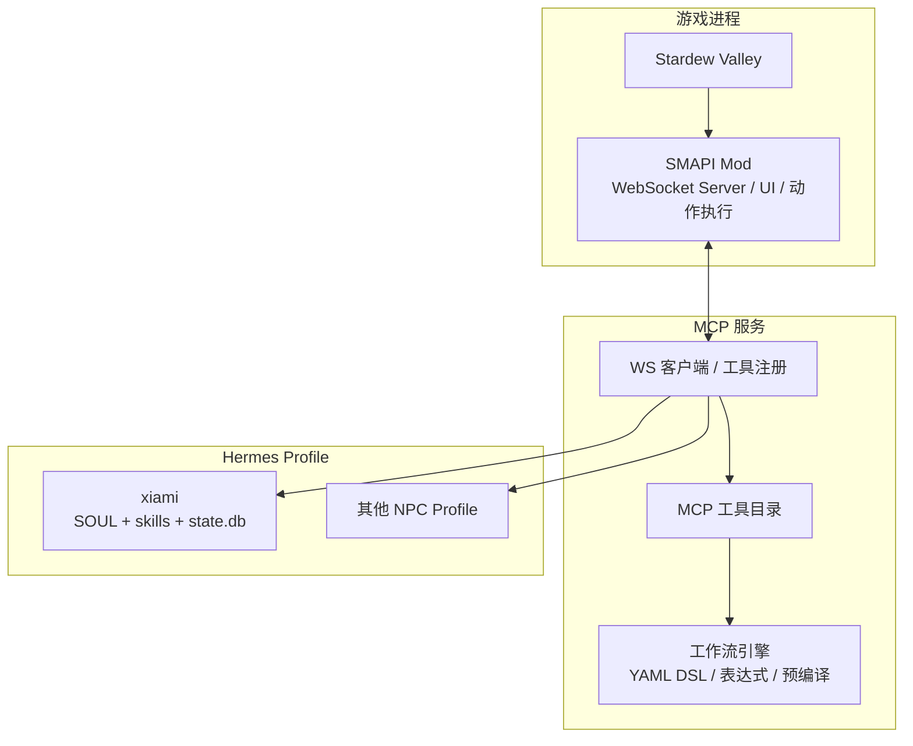
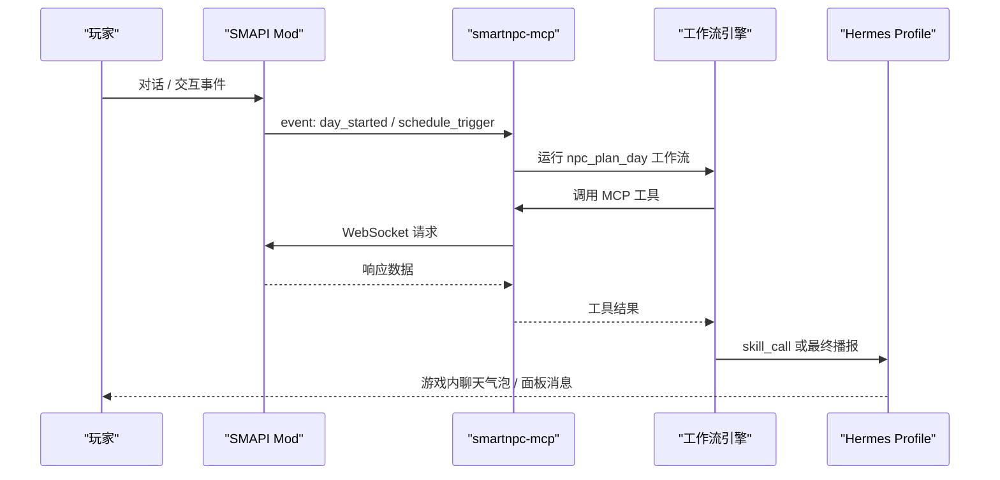
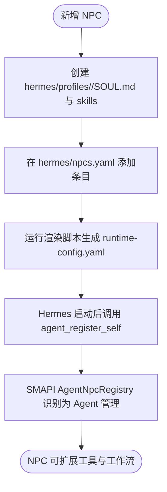
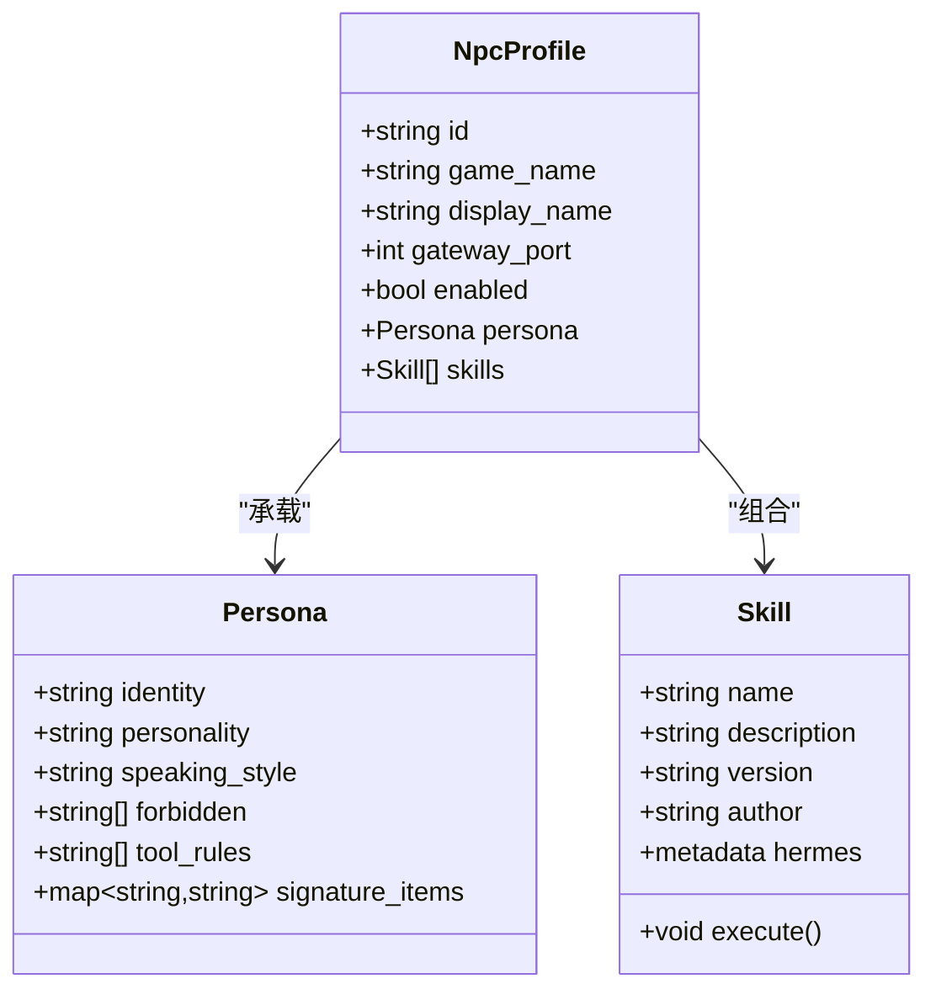
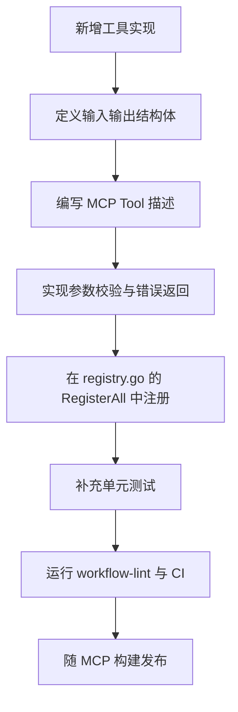
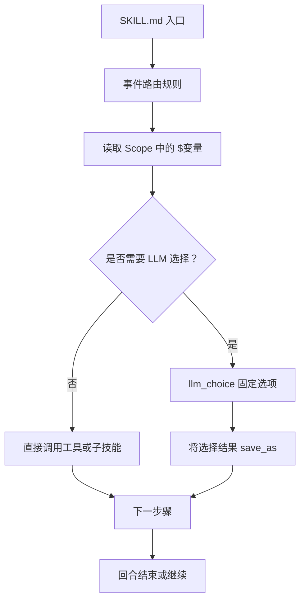
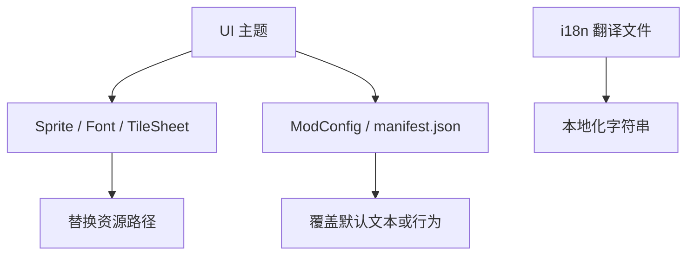
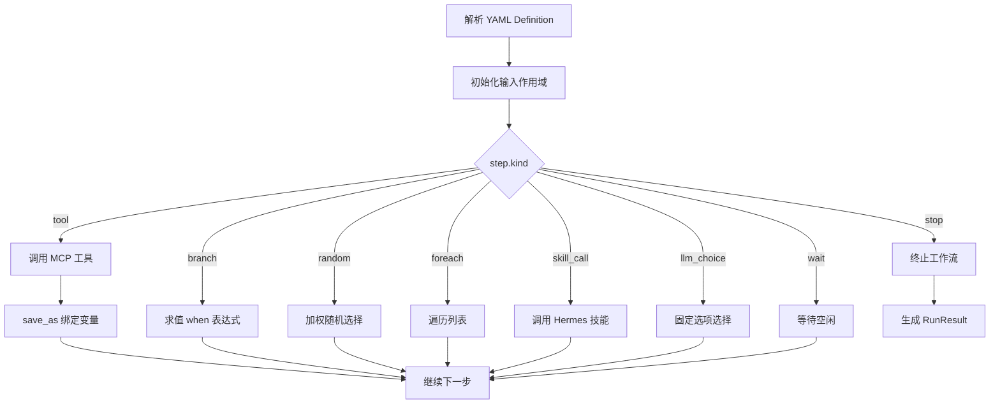
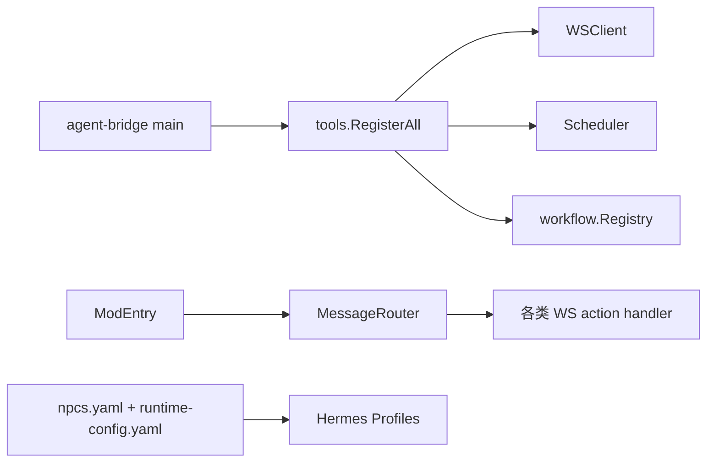

# 扩展开发指南

<cite>
**本文引用的文件**   
- [README.md](file://SmartNPC/README.md)
- [workflow-authoring.md](file://SmartNPC/docs/workflow-authoring.md)
- [definition.go](file://SmartNPC/smartnpc-mcp/pkg/workflow/definition.go)
- [engine.go](file://SmartNPC/smartnpc-mcp/pkg/workflow/engine.go)
- [context.go](file://SmartNPC/smartnpc-mcp/pkg/workflow/context.go)
- [precompile.go](file://SmartNPC/smartnpc-mcp/pkg/workflow/precompile.go)
- [registry.go](file://SmartNPC/smartnpc-mcp/adapters/stardew/tools/registry.go)
- [main_test.go](file://SmartNPC/smartnpc-mcp/adapters/stardew/tools/main_test.go)
- [agent.go](file://SmartNPC/smartnpc-mcp/adapters/stardew/tools/agent.go)
- [npc_behavior.go](file://SmartNPC/smartnpc-mcp/adapters/stardew/tools/npc_behavior.go)
- [workflow.go](file://SmartNPC/smartnpc-mcp/adapters/stardew/tools/workflow.go)
- [main.go](file://SmartNPC/smartnpc-mcp/cmd/agent-bridge/main.go)
- [ModEntry.cs](file://SmartNPC/smapi-mod/ModEntry.cs)
- [AgentNpcRegistry.cs](file://SmartNPC/smapi-mod/NPC/AgentNpcRegistry.cs)
- [smartnpc-core/SKILL.md](file://SmartNPC/hermes/profiles/_master/skills/smartnpc/smartnpc-core/SKILL.md)
- [xiami/SOUL.md](file://SmartNPC/hermes/profiles/xiami/SOUL.md)
- [abigail/SOUL.md](file://SmartNPC/hermes/profiles/abigail/SOUL.md)
- [npcs.yaml](file://SmartNPC/hermes/npcs.yaml)
- [runtime-config.yaml](file://SmartNPC/hermes/runtime-config.yaml)
- [protocol.md](file://SmartNPC/docs/protocol.md)
</cite>

## 目录
1. [引言](#引言)
2. [项目结构](#项目结构)
3. [核心组件](#核心组件)
4. [架构总览](#架构总览)
5. [详细组件分析](#详细组件分析)
6. [依赖关系分析](#依赖关系分析)
7. [性能与稳定性](#性能与稳定性)
8. [故障排查](#故障排查)
9. [结论](#结论)
10. [附录：完整扩展开发示例](#附录完整扩展开发示例)

## 引言
本指南面向希望为 SmartNPC 系统扩展能力的开发者，覆盖以下主题：
- 自定义 NPC 开发流程：注册、人格定义、行为模式设计。
- 新 MCP 工具开发规范：设计规范、协议兼容性、测试标准、注册流程。
- 技能开发方法：SKILL.md 编写规范、技能组合、上下文管理。
- 主题定制与资源替换：UI 主题、资产组织、国际化基础。
- 工作流作者指南：YAML DSL、预编译机制、执行引擎使用。
- 从需求分析到上线部署的端到端示例。

当前仓库处于“Hermes-first”实验分支，主线能力围绕单 Agent（XiaMi）自主农场经营；但 NPC 注册、MCP 工具注册、工作流引擎、Hermes profile 和技能体系仍具备通用扩展价值。

**章节来源**
- [README.md:1-120](file://SmartNPC/README.md#L1-L120)

## 项目结构
SmartNPC 由三层组成：
- SMAPI Mod（C#）：贴近游戏线程，负责 WebSocket Server、动作执行、UI、NPC 注册与调度。
- smartnpc-mcp（Go）：MCP 服务层，暴露工具、解析 YAML 工作流、桥接游戏与 Hermes Profile。
- hermes/profiles：每个 NPC 的人格、技能与工作流配置，驱动决策与记忆。

**图表来源**
- [README.md:1-120](file://SmartNPC/README.md#L1-L120)
- [ModEntry.cs:1-120](file://SmartNPC/smapi-mod/ModEntry.cs#L1-L120)
- [registry.go:1-82](file://SmartNPC/smartnpc-mcp/adapters/stardew/tools/registry.go#L1-L82)

**章节来源**
- [README.md:1-120](file://SmartNPC/README.md#L1-L120)
- [ModEntry.cs:1-120](file://SmartNPC/smapi-mod/ModEntry.cs#L1-L120)
- [registry.go:1-82](file://SmartNPC/smartnpc-mcp/adapters/stardew/tools/registry.go#L1-L82)

## 核心组件
- **SMAPI Mod 入口**：初始化 Harmony Patch、消息路由、查询处理器、感知系统、移动系统、跟随系统、行为处理器、UI 和 WebSocket Server。
- **MCP 工具注册中心**：统一挂载 Stardew 专用工具组，并返回共享日程调度器。
- **工作流定义与引擎**：用结构化 YAML 描述多步 NPC 行动，引擎支持工具调用、分支、随机选择、循环、技能调用、LLM 选择、等待与提前终止。
- **工作流上下文**：作用域链、变量绑定、路径查找与表达式求值。
- **工作流预编译**：录制 LLM 的工具调用序列，生成可回放、零推理延迟的工作流定义。
- **Hermes Profile 与 SKILL**：每个 NPC 拥有 SOUL.md 和 skills 目录，通过事件路由加载可选技能。
- **协议层**：WebSocket JSON 帧定义 request/response/event 三态，以及当前实验分支的唤醒白名单。

**章节来源**
- [ModEntry.cs:1-200](file://SmartNPC/smapi-mod/ModEntry.cs#L1-L200)
- [registry.go:1-82](file://SmartNPC/smartnpc-mcp/adapters/stardew/tools/registry.go#L1-L82)
- [definition.go:1-120](file://SmartNPC/smartnpc-mcp/pkg/workflow/definition.go#L1-L120)
- [engine.go:1-120](file://SmartNPC/smartnpc-mcp/pkg/workflow/engine.go#L1-L120)
- [context.go:1-120](file://SmartNPC/smartnpc-mcp/pkg/workflow/context.go#L1-L120)
- [precompile.go:1-120](file://SmartNPC/smartnpc-mcp/pkg/workflow/precompile.go#L1-L120)
- [smartnpc-core/SKILL.md:1-68](file://SmartNPC/hermes/profiles/_master/skills/smartnpc/smartnpc-core/SKILL.md#L1-L68)
- [protocol.md:1-120](file://SmartNPC/docs/protocol.md#L1-L120)

## 架构总览
SmartNPC 的扩展点分布在三个边界：
1. **游戏状态边界**：SMAPI Mod 暴露 WS action，供 MCP 查询或触发游戏内效果。
2. **工具能力边界**：MCP 工具提供结构化输入输出，供 LLM 规划调用。
3. **决策边界**：Hermes Profile 通过 SOUL.md 与 SKILL.md 决定如何组合工具和工作流。

**图表来源**
- [README.md:1-120](file://SmartNPC/README.md#L1-L120)
- [protocol.md:1-120](file://SmartNPC/docs/protocol.md#L1-L120)
- [engine.go:120-260](file://SmartNPC/smartnpc-mcp/pkg/workflow/engine.go#L120-L260)

## 详细组件分析

### 自定义 NPC 开发流程

#### NPC 注册与生命周期
- **Hermes 侧注册**：在 `hermes/npcs.yaml` 中声明 NPC 的 id、game_name、display_name、gateway_port、enabled 等元信息。
- **运行时配置**：`hermes/runtime-config.yaml` 由渲染脚本生成，将 profile 映射到 gateway_url、conversation、model 和 API Key 环境变量。
- **SMAPI 侧注册**：`AgentNpcRegistry` 维护被外部 Agent 管理的 NPC 名称集合，这些 NPC 可绕过每日对话次数限制。
- **会话绑定**：每个 Hermes Profile 启动时必须调用 `agent_register_self`，将 MCP 会话绑定到 NPC 内部名，使后续工具调用能被正确归因。

**图表来源**
- [npcs.yaml:1-70](file://SmartNPC/hermes/npcs.yaml#L1-L70)
- [runtime-config.yaml:1-15](file://SmartNPC/hermes/runtime-config.yaml#L1-L15)
- [AgentNpcRegistry.cs:1-29](file://SmartNPC/smapi-mod/NPC/AgentNpcRegistry.cs#L1-L29)
- [agent.go:1-95](file://SmartNPC/smartnpc-mcp/adapters/stardew/tools/agent.go#L1-L95)

**章节来源**
- [npcs.yaml:1-70](file://SmartNPC/hermes/npcs.yaml#L1-L70)
- [runtime-config.yaml:1-15](file://SmartNPC/hermes/runtime-config.yaml#L1-L15)
- [AgentNpcRegistry.cs:1-29](file://SmartNPC/smapi-mod/NPC/AgentNpcRegistry.cs#L1-L29)
- [agent.go:1-95](file://SmartNPC/smartnpc-mcp/adapters/stardew/tools/agent.go#L1-L95)

#### 人格定义最佳实践
- **SOUL.md 分层**：身份、性格、说话风格、灵魂层次、绝对禁止项、工具使用原则、签名物品或行为特征。
- **角色边界清晰**：明确哪些是游戏内互动对象，哪些不是；例如实验分支中 XiaMi 不直接互动玩家，只接收农场主指示。
- **播报约束**：限定 `chat_say` 的使用场景、频率和 speaker 命名规则，避免把工具细节暴露给玩家。
- **失败表达**：要求以角色语言轻描淡写失败，错误详情写入日记而非聊天。

**图表来源**
- [abigail/SOUL.md:1-74](file://SmartNPC/hermes/profiles/abigail/SOUL.md#L1-L74)
- [smartnpc-core/SKILL.md:1-68](file://SmartNPC/hermes/profiles/_master/skills/smartnpc/smartnpc-core/SKILL.md#L1-L68)
- [xiami/SOUL.md:1-27](file://SmartNPC/hermes/profiles/xiami/SOUL.md#L1-L27)

**章节来源**
- [abigail/SOUL.md:1-74](file://SmartNPC/hermes/profiles/abigail/SOUL.md#L1-L74)
- [smartnpc-core/SKILL.md:1-68](file://SmartNPC/hermes/profiles/_master/skills/smartnpc/smartnpc-core/SKILL.md#L1-L68)
- [xiami/SOUL.md:1-27](file://SmartNPC/hermes/profiles/xiami/SOUL.md#L1-L27)

#### 行为模式设计原则
- **读取优先**：先查时间、天气、位置、环境，再决定动作。
- **最小副作用**：视觉表情、气泡类动作不应替代真实游戏状态变更。
- **可观测性**：行为模式应可通过 `npc_get_behavior` 查询，便于工作流判断是否空闲。
- **工具组合**：复杂行为应拆成多个小工具步骤，由工作流编排，而不是让 LLM 一次性做所有事。

**章节来源**
- [npc_behavior.go:1-108](file://SmartNPC/smartnpc-mcp/adapters/stardew/tools/npc_behavior.go#L1-L108)
- [smartnpc-core/SKILL.md:1-68](file://SmartNPC/hermes/profiles/_master/skills/smartnpc/smartnpc-core/SKILL.md#L1-L68)

### 新 MCP 工具开发规范

#### 工具设计规范
- **输入输出强类型**：使用 Go struct 定义输入输出，并通过 jsonschema 注释说明字段含义。
- **副作用标注**：在工具描述中标明 READ/WRITE，帮助 LLM 理解工具影响范围。
- **错误语义稳定**：保持 `ok`、`error.code`、`error.message` 的稳定语义，便于上游校验。
- **上下文传播**：通过 `callCtx` 将 MCP session 注入底层 WS 调用，确保调试镜像能回到正确 NPC 面板。

#### 协议兼容性要求
- **WebSocket 帧**：遵循 `request`、`response`、`event` 三种帧类型。
- **实验分支白名单**：仅允许 `day_started`、`schedule_trigger`、`workflow_skill_call`、`owner_directive` 等事件唤醒 Hermes。
- **已移除能力**：实验构建移除了部分玩家交互 WS action 和 MCP-only 工具，新工具需评估是否与当前无人值守目标冲突。

#### 测试标准
- **包级测试入口**：通过 `TestMain` 关闭自动注入的实验特性，保证计划计数断言稳定。
- **工具单元测试**：每个工具文件配套 `_test.go`，验证参数校验、错误分支、nothing_to_do 处理。
- **工作流 lint**：提交前运行 `workflow-lint`，检查 step kind、工具名、技能名、save_as 重复和变量引用。

#### 注册流程
1. 在 `adapters/stardew/tools` 下新增工具实现文件。
2. 在 `RegisterAll` 中按功能分组调用对应 `register*` 函数。
3. 若工具依赖 WS Client，则放在 `if br != nil` 分支内。
4. 对调试型工具，通过 `schedDebug` 控制是否注册。

**图表来源**
- [registry.go:1-82](file://SmartNPC/smartnpc-mcp/adapters/stardew/tools/registry.go#L1-L82)
- [main_test.go:1-15](file://SmartNPC/smartnpc-mcp/adapters/stardew/tools/main_test.go#L1-L15)
- [workflow-authoring.md:1-172](file://SmartNPC/docs/workflow-authoring.md#L1-L172)

**章节来源**
- [registry.go:1-82](file://SmartNPC/smartnpc-mcp/adapters/stardew/tools/registry.go#L1-L82)
- [main_test.go:1-15](file://SmartNPC/smartnpc-mcp/adapters/stardew/tools/main_test.go#L1-L15)
- [protocol.md:1-120](file://SmartNPC/docs/protocol.md#L1-L120)
- [workflow-authoring.md:1-172](file://SmartNPC/docs/workflow-authoring.md#L1-L172)

### 技能开发方法

#### SKILL.md 编写规范
- **元数据头**：包含 name、description、version、author、license 及 hermes metadata tags。
- **会话约定**：明确首次调用 `agent_register_self`。
- **事件路由表**：根据入站事件加载对应可选 skill，避免无条件加载全部技能。
- **播报契约**：规定 `chat_say` 作为回合终止符，限制频道、speaker、频率。
- **失败风格**：要求模糊化对外报错，内部记录到日记。

#### 技能组合设计
- **核心技能优先**：`smartnpc-core` 作为 always-load 的核心路由器，可选技能在其基础上扩展。
- **工作流驱动技能**：工作流引擎通过 `kind: skill_call` 触发 Hermes 技能，适合需要动态决策的场景。
- **技能复用**：将常见交互封装为独立 skill，如问候、社交、记忆、日程等，由核心或工作流按需加载。

#### 上下文管理机制
- **Scope 链式作用域**：顶层 scope 保存输入和 save_as 变量；foreach 迭代时创建子 scope，避免污染外层。
- **不可变绑定**：同一作用域内同名变量只能设置一次，防止“哪个步骤覆盖了值”的调试问题。
- **表达式方言**：支持路径查找、比较、布尔逻辑、括号，不支持算术和函数调用；复杂计算应在 Go 侧完成后再绑定。

**图表来源**
- [smartnpc-core/SKILL.md:1-68](file://SmartNPC/hermes/profiles/_master/skills/smartnpc/smartnpc-core/SKILL.md#L1-L68)
- [definition.go:120-234](file://SmartNPC/smartnpc-mcp/pkg/workflow/definition.go#L120-L234)
- [context.go:1-200](file://SmartNPC/smartnpc-mcp/pkg/workflow/context.go#L1-L200)

**章节来源**
- [smartnpc-core/SKILL.md:1-68](file://SmartNPC/hermes/profiles/_master/skills/smartnpc/smartnpc-core/SKILL.md#L1-L68)
- [definition.go:120-234](file://SmartNPC/smartnpc-mcp/pkg/workflow/definition.go#L120-L234)
- [context.go:1-200](file://SmartNPC/smartnpc-mcp/pkg/workflow/context.go#L1-L200)

### 主题定制与资源替换

#### UI 主题开发
- SMAPI Mod 中的 UI 组件包括聊天面板、联系人列表、对话视图、通知 Toast、库存 HUD 等，位于 `smapi-mod/UI`。
- 主题定制通常涉及替换 Sprite、字体、界面布局和资源路径；仓库中包含字体目录、LooseSprites、TileSheets 等资源组织方式可作为参考。

#### 资源替换
- 示例资产位于 `smapi-mod/assets/xiami`，包含精灵图集构建脚本和 xiami 资源清单。
- 对于动画、头像、表情等，建议保持文件名与代码引用一致，或通过配置覆盖路径。

#### 国际化支持
- SMAPI 内置 i18n 文件位于 `smapi-internal/i18n`，支持多语言默认文本。
- 扩展时应优先使用 SMAPI 的多语言机制，避免硬编码中文或英文文案。

**图表来源**
- [ModEntry.cs:1-200](file://SmartNPC/smapi-mod/ModEntry.cs#L1-L200)
- [README.md:1-120](file://SmartNPC/README.md#L1-L120)

**章节来源**
- [ModEntry.cs:1-200](file://SmartNPC/smapi-mod/ModEntry.cs#L1-L200)
- [README.md:1-120](file://SmartNPC/README.md#L1-L120)

### 工作流作者指南

#### YAML 定义语法
工作流由 `id`、`description`、`version`、`inputs`、`steps` 组成，step 是 tagged union，通过 `kind` 区分：
- `tool`：调用 MCP 工具，支持 `save_as`、`on_nothing_to_do`、`timeout_seconds`。
- `branch`：基于表达式选择 then 或 else。
- `random`：按权重随机选择一个分支。
- `foreach`：遍历列表变量，每次迭代拥有独立子作用域。
- `skill_call`：触发 Hermes 技能。
- `llm_choice`：让 LLM 从固定选项中选一个。
- `wait`：等待 NPC 空闲。
- `stop`：提前终止并记录原因。

#### 预编译机制
- `RecordingRunner` 拦截 mutating 工具调用，只代理 read-only 工具。
- 录制结束后生成 `Definition`，可在触发时直接回放，无需再次调用 LLM。
- 通过 channel 注册表协调 precompile 结果传递，避免并发竞争。

#### 执行引擎使用
- 引擎入口为 `Run(ctx, runner, npc, def, inputs)`，返回 `RunResult`，包含步骤数、工具调用数、nothing_to_do 计数、是否提前停止等信息。
- 引擎对未知 step kind、缺少必填字段、表达式语法错误、超时、取消等情况进行严格错误处理。

**图表来源**
- [definition.go:1-120](file://SmartNPC/smartnpc-mcp/pkg/workflow/definition.go#L1-L120)
- [engine.go:120-420](file://SmartNPC/smartnpc-mcp/pkg/workflow/engine.go#L120-L420)
- [precompile.go:120-226](file://SmartNPC/smartnpc-mcp/pkg/workflow/precompile.go#L120-L226)

**章节来源**
- [workflow-authoring.md:1-172](file://SmartNPC/docs/workflow-authoring.md#L1-L172)
- [definition.go:1-234](file://SmartNPC/smartnpc-mcp/pkg/workflow/definition.go#L1-L234)
- [engine.go:1-626](file://SmartNPC/smartnpc-mcp/pkg/workflow/engine.go#L1-L626)
- [precompile.go:1-226](file://SmartNPC/smartnpc-mcp/pkg/workflow/precompile.go#L1-L226)

## 依赖关系分析
- `cmd/agent-bridge/main.go` 通过副作用导入 `adapters/stardew`、`pkg/relay/echo`、`pkg/relay/hermes`，实现配置驱动的组装。
- `tools.RegisterAll` 依赖 `bridge.WSClient`、`scheduler.Scheduler`、`workflow.Registry`，并根据是否存在 bridge 决定是否注册游戏相关工具。
- SMAPI Mod 的 `ModEntry` 负责注册 WS action 和处理函数，并将 FollowSystem 广播到 WebSocket。
- Hermes 配置通过 `npcs.yaml` 和 `runtime-config.yaml` 关联 profile 与网关端口。

**图表来源**
- [main.go:1-123](file://SmartNPC/smartnpc-mcp/cmd/agent-bridge/main.go#L1-L123)
- [registry.go:1-82](file://SmartNPC/smartnpc-mcp/adapters/stardew/tools/registry.go#L1-L82)
- [ModEntry.cs:1-200](file://SmartNPC/smapi-mod/ModEntry.cs#L1-L200)
- [npcs.yaml:1-70](file://SmartNPC/hermes/npcs.yaml#L1-L70)
- [runtime-config.yaml:1-15](file://SmartNPC/hermes/runtime-config.yaml#L1-L15)

**章节来源**
- [main.go:1-123](file://SmartNPC/smartnpc-mcp/cmd/agent-bridge/main.go#L1-L123)
- [registry.go:1-82](file://SmartNPC/smartnpc-mcp/adapters/stardew/tools/registry.go#L1-L82)
- [ModEntry.cs:1-200](file://SmartNPC/smapi-mod/ModEntry.cs#L1-L200)
- [npcs.yaml:1-70](file://SmartNPC/hermes/npcs.yaml#L1-L70)
- [runtime-config.yaml:1-15](file://SmartNPC/hermes/runtime-config.yaml#L1-L15)

## 性能与稳定性
- **工作流超时**：工具调用有默认超时保护，重型操作应在 YAML 中显式设置 timeout。
- **Nothing-to-do 策略**：引擎支持 skip、stop、fail 三种策略，避免无效工具调用阻塞工作流。
- **Random 分支**：权重归一化后采样，避免全零权重导致空执行。
- **Foreach 上限**：默认最大迭代 50，防止异常数据导致无限循环。
- **Precompile 录制**：只录制 mutating 工具，read-only 工具仍走真实 runner，保证环境数据准确。
- **日志级别**：引擎对正常步骤使用 debug，错误或提前终止使用 warn/info，便于定位性能瓶颈。

**章节来源**
- [engine.go:260-626](file://SmartNPC/smartnpc-mcp/pkg/workflow/engine.go#L260-L626)
- [precompile.go:120-226](file://SmartNPC/smartnpc-mcp/pkg/workflow/precompile.go#L120-L226)

## 故障排查
- **MCP 会话未绑定 NPC**：如果忘记调用 `agent_register_self`，调试镜像可能无法路由到正确 NPC 面板。
- **WS 连接失败**：确认 SMAPI Mod WebSocket Server 已启动，端口与地址配置正确。
- **工作流表达式错误**：检查表达式语法、变量路径、save_as 是否在同一作用域。
- **工具 nothing_to_do**：根据 on_nothing_to_do 策略判断是继续、停止还是失败。
- **Hermes Profile 未唤醒**：确认事件属于唤醒白名单，且 npc_filter 与 game_name 匹配。

**章节来源**
- [agent.go:1-95](file://SmartNPC/smartnpc-mcp/adapters/stardew/tools/agent.go#L1-L95)
- [protocol.md:1-120](file://SmartNPC/docs/protocol.md#L1-L120)
- [engine.go:260-626](file://SmartNPC/smartnpc-mcp/pkg/workflow/engine.go#L260-L626)

## 结论
SmartNPC 的扩展体系围绕“游戏状态边界、工具能力边界、决策边界”展开。开发者应：
- 先在 SMAPI 或 MCP 层增加稳定、可测试的能力。
- 再用 SKILL.md 和 SOUL.md 表达 NPC 人格和行为策略。
- 最后用工作流 YAML 编排多步自动化任务，并利用预编译提升确定性。
- 始终遵守协议、超时、错误语义和日志约定，保证扩展可维护、可观察、可回滚。

## 附录：完整扩展开发示例

### 示例：新增“农场巡检员”自定义 NPC

#### 需求分析
- 目标：新增一名专注农场巡检的 NPC，能够在雨天执行清理和采集，晴天执行浇水和收获。
- 约束：不主动与游戏内玩家互动；播报使用 `chat_say`，每天不超过 3 次；所有移动和动作由工作流授权。

#### 步骤一：定义人格
- 创建 `hermes/profiles/farmer_inspector/SOUL.md`，包含身份、性格、语气、工具使用原则、播报纪律。
- 参考现有 SOUL.md 结构，明确“不以玩家为对象”“决策自主”“失败写日记”。

**章节来源**
- [abigail/SOUL.md:1-74](file://SmartNPC/hermes/profiles/abigail/SOUL.md#L1-L74)
- [xiami/SOUL.md:1-27](file://SmartNPC/hermes/profiles/xiami/SOUL.md#L1-L27)

#### 步骤二：注册 Hermes Profile
- 在 `hermes/npcs.yaml` 中添加 farmer_inspector 条目，分配 gateway_port 和 enabled 标志。
- 运行渲染脚本更新 `runtime-config.yaml`，确保 Hermes relay 能 fan-out 到该 profile。

**章节来源**
- [npcs.yaml:1-70](file://SmartNPC/hermes/npcs.yaml#L1-L70)
- [runtime-config.yaml:1-15](file://SmartNPC/hermes/runtime-config.yaml#L1-L15)

#### 步骤三：编写技能
- 在 `hermes/profiles/farmer_inspector/skills/` 下创建 `SKILL.md`，定义事件路由：
  - `day_started` → 加载日程技能。
  - `workflow_skill_call` → 根据 skill 字段加载巡检技能。
  - `owner_directive` → 评估农场主指示。
- 遵守 core skill 的会话启动、播报契约和失败风格。

**章节来源**
- [smartnpc-core/SKILL.md:1-68](file://SmartNPC/hermes/profiles/_master/skills/smartnpc/smartnpc-core/SKILL.md#L1-L68)

#### 步骤四：创建工作流
- 在 `smartnpc-mcp/pkg/workflow/builtin/` 下新增 `farmer_inspection.yaml`：
  - 使用 `tool` 查询天气、作物状态。
  - 使用 `branch` 判断是否下雨。
  - 使用 `foreach` 遍历待浇水区域。
  - 使用 `wait idle` 等待 NPC 空闲。
  - 使用 `skill_call` 触发具体巡检子技能。
- 运行 `workflow-lint` 检查工具名、技能名、变量引用。

**章节来源**
- [workflow-authoring.md:1-172](file://SmartNPC/docs/workflow-authoring.md#L1-L172)
- [definition.go:1-120](file://SmartNPC/smartnpc-mcp/pkg/workflow/definition.go#L1-L120)
- [engine.go:120-420](file://SmartNPC/smartnpc-mcp/pkg/workflow/engine.go#L120-L420)

#### 步骤五：扩展 MCP 工具
- 如果巡检需要新的查询能力，新增 Go 工具：
  - 定义输入输出结构体。
  - 在 `registry.go` 中注册。
  - 补充单元测试。
  - 确保 WS action 符合 protocol.md 规范。

**章节来源**
- [registry.go:1-82](file://SmartNPC/smartnpc-mcp/adapters/stardew/tools/registry.go#L1-L82)
- [protocol.md:1-120](file://SmartNPC/docs/protocol.md#L1-L120)

#### 步骤六：集成与测试
- 构建 MCP 和 SMAPI Mod。
- 启动 agent-bridge 或 smartnpc-mcp。
- 启动 Hermes Profile，确认 `agent_register_self` 成功。
- 运行本地 CI，包括 lint、test、build。
- 在实验中验证：
  - `day_started` 触发 `npc_plan_day`。
  - 工作流正确分支到浇水或清理。
  - `chat_say` 播报不超过限制。
  - 失败写入日记而不泄露错误细节。

**章节来源**
- [README.md:1-120](file://SmartNPC/README.md#L1-L120)
- [main_test.go:1-15](file://SmartNPC/smartnpc-mcp/adapters/stardew/tools/main_test.go#L1-L15)
- [engine.go:1-120](file://SmartNPC/smartnpc-mcp/pkg/workflow/engine.go#L1-L120)

#### 步骤七：上线部署
- 将 SOUL.md、SKILL.md、工作流 YAML、工具实现纳入版本控制。
- 更新 `npcs.yaml` 和 CI 配置。
- 在目标环境的 WSL Hermes 中启用新 profile。
- 监控日志，关注 workflow run、tool call、nothing_to_do、stop_reason。
- 准备回滚方案：保留旧版 YAML 和 profile，必要时禁用新 NPC。

**章节来源**
- [README.md:1-120](file://SmartNPC/README.md#L1-L120)
- [engine.go:120-260](file://SmartNPC/smartnpc-mcp/pkg/workflow/engine.go#L120-L260)