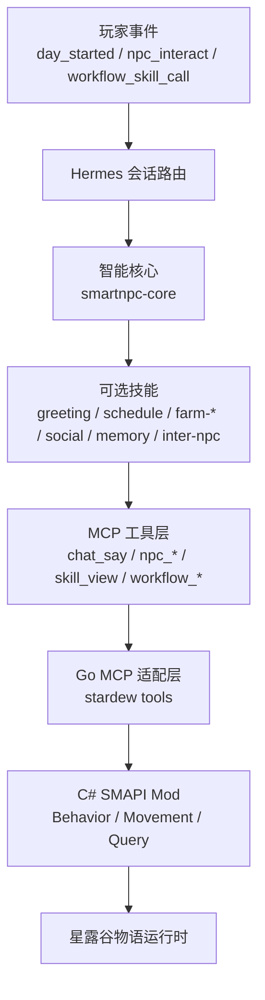
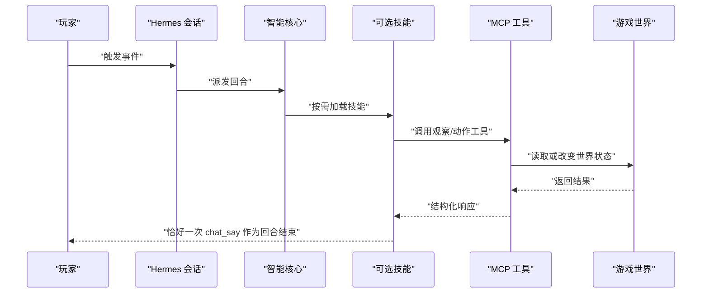
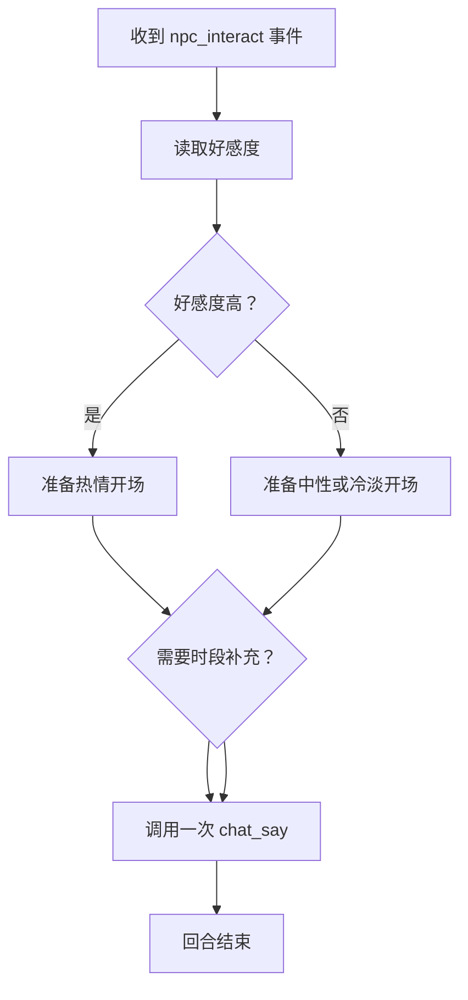
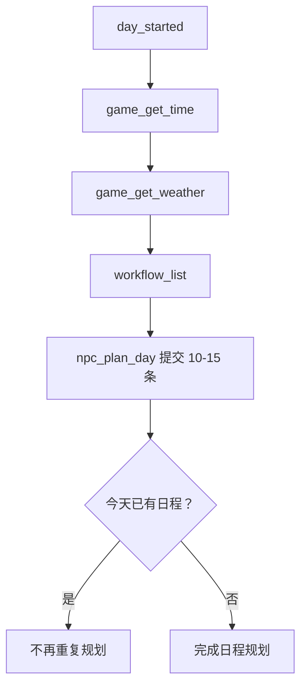
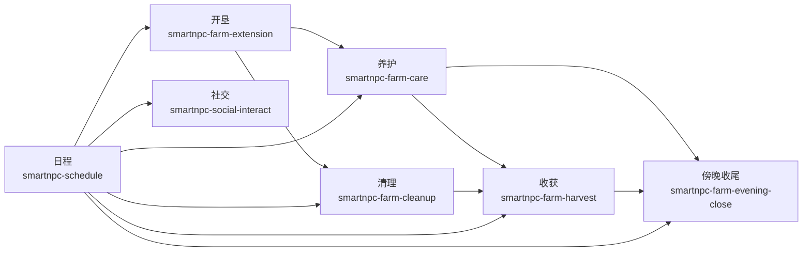

# 技能系统开发

<cite>
**本文引用的文件**   
- [SKILL.md](file://SmartNPC/.claude/skills/smartnpc-action-development/SKILL.md)
- [smartnpc-core SKILL.md](file://提示词导出-20261026-004143/04-全部游戏技能/smartnpc/smartnpc-core/SKILL.md)
- [smartnpc-greeting SKILL.md](file://提示词导出-20261026-004143/04-全部游戏技能/smartnpc/smartnpc-greeting/SKILL.md)
- [smartnpc-farm-care SKILL.md](file://提示词导出-20261026-004143/04-全部游戏技能/smartnpc/smartnpc-farm-care/SKILL.md)
- [smartnpc-farm-harvest SKILL.md](file://提示词导出-20261026-004143/04-全部游戏技能/smartnpc/smartnpc-farm-harvest/SKILL.md)
- [smartnpc-farm-cleanup SKILL.md](file://提示词导出-20261026-004143/04-全部游戏技能/smartnpc/smartnpc-farm-cleanup/SKILL.md)
- [smartnpc-farm-extension SKILL.md](file://提示词导出-20261026-004143/04-全部游戏技能/smartnpc/smartnpc-farm-extension/SKILL.md)
- [smartnpc-farm-evening-close SKILL.md](file://提示词导出-20261026-004143/04-全部游戏技能/smartnpc/smartnpc-farm-evening-close/SKILL.md)
- [smartnpc-social-interact SKILL.md](file://提示词导出-20261026-004143/04-全部游戏技能/smartnpc/smartnpc-social-interact/SKILL.md)
- [smartnpc-schedule SKILL.md](file://提示词导出-20261026-004143/04-全部游戏技能/smartnpc/smartnpc-schedule/SKILL.md)
- [smartnpc-memory SKILL.md](file://提示词导出-20261026-004143/04-全部游戏技能/smartnpc/smartnpc-memory/SKILL.md)
- [smartnpc-inter-npc SKILL.md](file://提示词导出-20261026-004143/04-全部游戏技能/smartnpc/smartnpc-inter-npc/SKILL.md)
- [smartnpc-mine-crawl SKILL.md](file://提示词导出-20261026-004143/04-全部游戏技能/smartnpc-mine-crawl/SKILL.md)
</cite>

## 目录
1. [引言](#引言)
2. [项目结构](#项目结构)
3. [核心组件](#核心组件)
4. [架构总览](#架构总览)
5. [详细组件分析](#详细组件分析)
6. [依赖关系分析](#依赖关系分析)
7. [性能与资源管理](#性能与资源管理)
8. [故障排查指南](#故障排查指南)
9. [结论](#结论)
10. [附录：SKILL.md 编写模板与检查清单](#附录skillmd-编写模板与检查清单)

## 引言
本指南面向 SmartNPC 项目的技能开发者，目标是把“如何写一个可靠的 SKILL.md”讲清楚，并展示从简单问候到复杂农场管理的完整技能组合方式。文档覆盖以下主题：
- SKILL.md 元数据、描述、上下文定义、工具调用规则、响应格式要求
- 技能组合设计原则：依赖、上下文共享、执行顺序控制
- 上下文管理机制：状态传递、变量作用域、记忆与内存边界
- 最佳实践：错误处理、性能优化、调试技巧
- 示例路径：从 `smartnpc-greeting` 到 `smartnpc-farm-extension` / `smartnpc-farm-harvest` / `smartnpc-schedule` 的渐进式实现

## 项目结构
SmartNPC 的技能体系以 SKILL.md 为核心，配合工作流引擎（workflow）、MCP 工具层、C# Mod 行为层以及 NPC Profile 配置共同运行。仓库中与技能开发直接相关的证据主要分布在两类位置：
- 技能说明文件：位于 `提示词导出-20261026-004143/04-全部游戏技能/smartnpc/*` 下的每个技能的 `SKILL.md`
- 跨层动作开发规范：位于 `SmartNPC/.claude/skills/smartnpc-action-development/SKILL.md`



**图表来源**
- [smartnpc-core SKILL.md:1-74](file://提示词导出-20261026-004143/04-全部游戏技能/smartnpc/smartnpc-core/SKILL.md#L1-L74)
- [SKILL.md:1-101](file://SmartNPC/.claude/skills/smartnpc-action-development/SKILL.md#L1-L101)

**章节来源**
- [smartnpc-core SKILL.md:1-74](file://提示词导出-20261026-004143/04-全部游戏技能/smartnpc/smartnpc-core/SKILL.md#L1-L74)
- [SKILL.md:1-101](file://SmartNPC/.claude/skills/smartnpc-action-development/SKILL.md#L1-L101)

## 核心组件
### 智能核心：smartnpc-core
- 角色定位：始终加载的核心路由器，负责根据入站事件类型选择是否加载可选技能，并统一发言契约和失败风格。
- 关键职责：
  - 新会话首次调用注册接口，暴露 NPC 名称。
  - 按事件路由：私聊、群聊、玩家点击、日程、工作流调度、记忆查询等。
  - 规定 `chat_say` 为回合终止符，禁止无意义的多轮工具输出。
  - 禁止在闲聊中暴露工具名、JSON、坐标或错误细节。

**章节来源**
- [smartnpc-core SKILL.md:1-74](file://提示词导出-20261026-004143/04-全部游戏技能/smartnpc/smartnpc-core/SKILL.md#L1-L74)

### 跨层动作开发规范
该规范定义了新增 NPC 动作必须走的全链路：Go MCP tool → C# Handler → FollowSystem → Debug 命令，并明确“瞬发动作”和“持续动作”的区别。持续动作必须由 FollowSystem 持有 `npc.controller` 生命周期，否则原版 NPC 下一 tick 会清掉控制器。

**章节来源**
- [SKILL.md:1-101](file://SmartNPC/.claude/skills/smartnpc-action-development/SKILL.md#L1-L101)

## 架构总览
技能系统的执行可以分为四层：
1. **事件与路由层**：Hermes 根据事件类型把回合交给 smartnpc-core，再由 core 决定是否加载某个可选技能。
2. **技能决策层**：每个 SKILL.md 描述一套可被 LLM 遵循的规则，包括观察、条件判断、工具调用顺序、禁止事项、性格影响、参数默认值等。
3. **工具执行层**：LLM 调用的 MCP 工具由 Go 层注册，再转发给 C# SMAPI Mod，最终驱动游戏世界。
4. **持久化与记忆层**：通过记忆技能保存玩家偏好、承诺、延迟回复等长期事实；普通对话不写入记忆。



**图表来源**
- [smartnpc-core SKILL.md:1-74](file://提示词导出-20261026-004143/04-全部游戏技能/smartnpc/smartnpc-core/SKILL.md#L1-L74)
- [SKILL.md:1-101](file://SmartNPC/.claude/skills/smartnpc-action-development/SKILL.md#L1-L101)

## 详细组件分析

### 技能说明文件 SKILL.md 编写规范
每个 SKILL.md 应包含以下要素：
- 元数据头：`name`、`description`、`version`、`author`、`license`、`metadata.hermes.tags`，部分技能还带 `metadata.npc`。
- 目标说明：技能要完成什么任务，属于哪类工作流。
- 固定序列或示例驱动流程：明确步骤编号、条件分支、依赖关系。
- 工具箱与前置条件：列出可用工具、何时调用、参数来源、默认值。
- 禁止事项：明确哪些工具绝对不调，避免语义混淆。
- 参数说明表：参数名、来源、默认值、含义。
- 性格影响：不同特质只影响半径、概率、是否跳过某步，不应打乱固定顺序。
- 响应约定：是否允许 `chat_say`、气泡、情绪表达、静默执行。

| 类别 | 建议字段 | 说明 |
|---|---|---|
| 身份 | `name`、`description` | 唯一标识与一句话用途 |
| 版本 | `version`、`author`、`license` | 便于追踪变更 |
| 平台 | `metadata.hermes.tags` | 标签用于分类与路由 |
| 角色 | `metadata.npc` | 可选，指定该技能默认绑定的 NPC |
| 流程 | 步骤编号 + 条件 | 保证 LLM 可线性执行 |
| 约束 | 禁止事项 + 硬性依赖 | 防止错误工具组合 |
| 参数 | 表格 | 明确来源与默认值 |
| 风格 | 性格影响 + 响应约定 | 保持角色一致性 |

**章节来源**
- [smartnpc-greeting SKILL.md:1-26](file://提示词导出-20261026-004143/04-全部游戏技能/smartnpc/smartnpc-greeting/SKILL.md#L1-L26)
- [smartnpc-farm-extension SKILL.md:1-137](file://提示词导出-20261026-004143/04-全部游戏技能/smartnpc/smartnpc-farm-extension/SKILL.md#L1-L137)
- [smartnpc-farm-cleanup SKILL.md:1-90](file://提示词导出-20261026-004143/04-全部游戏技能/smartnpc/smartnpc-farm-cleanup/SKILL.md#L1-L90)

### 简单技能示例：问候技能 smartnpc-greeting
- 触发场景：玩家走近并点击 NPC。
- 行为模式：
  1. 读取好感度决定语气。
  2. 可选读取时间以调整时段语气。
  3. 调用恰好一次 `chat_say` 结束回合。
- 容错策略：工具失败时仍给出符合角色的通用开场白；玩家忙时保持静默。



**图表来源**
- [smartnpc-greeting SKILL.md:1-26](file://提示词导出-20261026-004143/04-全部游戏技能/smartnpc/smartnpc-greeting/SKILL.md#L1-L26)

**章节来源**
- [smartnpc-greeting SKILL.md:1-26](file://提示词导出-20261026-004143/04-全部游戏技能/smartnpc/smartnpc-greeting/SKILL.md#L1-L26)

### 农场维护技能：smartnpc-farm-care
- 目标：日常维护已有农田，浇水、清杂物、补种空地，不开垦、不收获。
- 固定序列：观察环境 → 浇水 → 清杂物 → 补种 → 填充空隙 → 存箱 → 收尾气泡。
- 条件执行：各步骤依据观察桶中的 `count` 决定是否执行。
- 参数：`inspect_radius` 从工作流参数传入，性格影响半径和是否跳过填充空隙。

```mermaid
flowchart TD
    Observe["npc_inspect_object(what=\"farm_actions\")"] --> Buckets{"得到 water/clear/plant/fill 桶"}
    Buckets --> Water{"water.count > 0？"}
    Water -->|是| DoWater["npc_water_crops"]
    Water -->|否| ClearCheck{"clear.count > 0？"}
    DoWater --> ClearCheck
    ClearCheck -->|是| DoClear["npc_clear_debris"]
    ClearCheck -->|否| PlantCheck{"plant.count > 0？"}
    DoClear --> PlantCheck
    PlantCheck -->|是| DoPlant["npc_plant_seeds"]
    PlantCheck -->|否| FillCheck{"fill.count > 0？"}
    DoPlant --> FillCheck
    FillCheck -->|是| DoFill["npc_fill_gaps"]
    FillCheck -->|否| Deposit["npc_deposit_items"]
    DoFill --> Deposit
    Deposit --> Bubble["npc_show_text_bubble"]
    Bubble --> End["结束"]
```

**图表来源**
- [smartnpc-farm-care SKILL.md:1-102](file://提示词导出-20261026-004143/04-全部游戏技能/smartnpc/smartnpc-farm-care/SKILL.md#L1-L102)

**章节来源**
- [smartnpc-farm-care SKILL.md:1-102](file://提示词导出-20261026-004143/04-全部游戏技能/smartnpc/smartnpc-farm-care/SKILL.md#L1-L102)

### 农场开垦技能：smartnpc-farm-extension
- 目标：将荒地变为农田，完整链路为清理 → 翻耕 → 施肥 → 播种 → 浇水 → 存箱 → 收尾。
- 硬性依赖：
  - 必须先清理才能翻耕。
  - 肥料必须在播种前施加。
  - 播种后必须浇水。
- 关键设计点：
  - 翻耕后必须重新观察，因为旧 `plant.bbox` 不再准确。
  - 肥料背包为空时跳过施肥，但播种可使用免种子模式。
  - 冬季停止开垦。

```mermaid
flowchart TD
    Observe["npc_inspect_object(what=\"farm_actions\")"] --> TillCheck{"till.count > 0？"}
    TillCheck -->|是| Clear["npc_clear_debris"]
    Clear --> Till["npc_till_soil"]
    TillCheck -->|否| SkipTill["跳过翻耕"]
    SkipTill --> ReObserveSkip["跳过重新观察"]
    Till --> FertilizeCheck{"有肥料？"}
    FertilizeCheck -->|是| Fertilize["npc_fertilize"]
    FertilizeCheck -->|否| NoFertilize["跳过施肥"]
    Fertilize --> ReInspect["npc_inspect_object 重新观察"]
    NoFertilize --> ReInspect
    ReInspect --> PlantCheck{"plant.count > 0？"}
    PlantCheck -->|是| Plant["npc_plant_seeds"]
    PlantCheck -->|否| SkipPlant["跳过播种"]
    Plant --> Water["npc_water_crops"]
    SkipPlant --> Deposit["npc_deposit_items"]
    Water --> Deposit
    Deposit --> Bubble["npc_show_text_bubble"]
    Bubble --> End["结束"]
```

**图表来源**
- [smartnpc-farm-extension SKILL.md:1-137](file://提示词导出-20261026-004143/04-全部游戏技能/smartnpc/smartnpc-farm-extension/SKILL.md#L1-L137)

**章节来源**
- [smartnpc-farm-extension SKILL.md:1-137](file://提示词导出-20261026-004143/04-全部游戏技能/smartnpc/smartnpc-farm-extension/SKILL.md#L1-L137)

### 农场收获技能：smartnpc-farm-harvest
- 特点：不是固定脚本，而是“示例驱动”。先观察成熟作物，再匹配示例 A/B/C/D，动态组合收获 → 存入/交付 → 补种 → 浇水。
- 关键依赖：
  - 收获后必须立即存入或交付，不能把物品留在背包里。
  - 补种后可浇水；若季节末尾则不建议补种。
- 典型决策：大丰收分两轮收获；少量收获速战速决；路过顺手收；周期结束时收获+补种+施肥。

```mermaid
flowchart TD
    Start["开始收获流程"] --> Inspect["npc_inspect_object(what=\"crops\")"]
    Inspect --> Match{"匹配示例 A/B/C/D"}
    Match --> Harvest["npc_harvest_crops"]
    Harvest --> DecideStore{"背包是否满或有箱子？"}
    DecideStore -->|是| Store["npc_deposit_items"]
    DecideStore -->|否| Deliver["npc_deliver_items"]
    Store --> MoreMature{"还有成熟作物？"}
    Deliver --> MoreMature
    MoreMature -->|是| Harvest
    MoreMature -->|否| SeedCheck{"有种子且适合补种？"}
    SeedCheck -->|是| Plant["npc_plant_seeds"]
    SeedCheck -->|否| End["结束"]
    Plant --> Water["npc_water_crops"]
    Water --> End
```

**图表来源**
- [smartnpc-farm-harvest SKILL.md:1-261](file://提示词导出-20261026-004143/04-全部游戏技能/smartnpc/smartnpc-farm-harvest/SKILL.md#L1-L261)

**章节来源**
- [smartnpc-farm-harvest SKILL.md:1-261](file://提示词导出-20261026-004143/04-全部游戏技能/smartnpc/smartnpc-farm-harvest/SKILL.md#L1-L261)

### 社交互动技能：smartnpc-social-interact
- 目标：完整的社交流程，包括远距离打招呼、摸宠、送货、走近聊天、送礼、收尾。
- 固定序列：打招呼 → 可选摸宠 → 可选送货 → 走近 → 多轮聊天 → 可选送礼 → 收尾。
- 限制：
  - 不调用任何农场工具。
  - 聊天不超过 4 轮。
  - 玩家请求帮忙时，不要当场调工具，改为排进日程。

**章节来源**
- [smartnpc-social-interact SKILL.md:1-104](file://提示词导出-20261026-004143/04-全部游戏技能/smartnpc/smartnpc-social-interact/SKILL.md#L1-L104)

### 每日日程技能：smartnpc-schedule
- 触发：`day_started` 时必须规划全天；旧版 `schedule_trigger` 已禁用。
- 流程：
  1. 读取时间与天气。
  2. 查询可用 workflow 列表。
  3. 提交 10-15 条 workflow 条目，覆盖农场、采集、社交、收尾。
- 配额与时段：
  - 早上优先开垦。
  - 上午/中午/下午多次养护。
  - 上午/下午安排清理与采集。
  - 傍晚收尾收割补种。
  - 午后/傍晚穿插社交。
- 护栏：
  - 每次计划前先查是否已有日程。
  - 忽略过时警告文案，以实际接受条目数为准。
  - 雨天/冬天用社交活动补足室外活动缺口。



**图表来源**
- [smartnpc-schedule SKILL.md:1-141](file://提示词导出-20261026-004143/04-全部游戏技能/smartnpc/smartnpc-schedule/SKILL.md#L1-L141)

**章节来源**
- [smartnpc-schedule SKILL.md:1-141](file://提示词导出-20261026-004143/04-全部游戏技能/smartnpc/smartnpc-schedule/SKILL.md#L1-L141)

### 其他辅助技能
- 农场清理 `smartnpc-farm-cleanup`：清理杂物、砍树碎石、捡采集物，然后存箱、气泡收尾。
- 傍晚收尾 `smartnpc-farm-evening-close`：收割 → 入库 → 补种 → 存箱 → 气泡或情绪表达。
- 矿洞探索 `smartnpc-mine-crawl`：敲石头、捡矿石、入库、汇报，适合雨天或闲时。
- NPC 间消息 `smartnpc-inter-npc`：使用 `npc_send_message`，禁止自行编造其他 NPC 对话，收件箱需逐项确认处理。
- 记忆策略 `smartnpc-memory`：仅保存持久性事实，不保存原始对话、坐标、临时推理。

**章节来源**
- [smartnpc-farm-cleanup SKILL.md:1-90](file://提示词导出-20261026-004143/04-全部游戏技能/smartnpc/smartnpc-farm-cleanup/SKILL.md#L1-L90)
- [smartnpc-farm-evening-close SKILL.md:1-94](file://提示词导出-20261026-004143/04-全部游戏技能/smartnpc/smartnpc-farm-evening-close/SKILL.md#L1-L94)
- [smartnpc-mine-crawl SKILL.md:1-30](file://提示词导出-20261026-004143/04-全部游戏技能/smartnpc-mine-crawl/SKILL.md#L1-L30)
- [smartnpc-inter-npc SKILL.md:1-49](file://提示词导出-20261026-004143/04-全部游戏技能/smartnpc/smartnpc-inter-npc/SKILL.md#L1-L49)
- [smartnpc-memory SKILL.md:1-45](file://提示词导出-20261026-004143/04-全部游戏技能/smartnpc/smartnpc-memory/SKILL.md#L1-L45)

## 依赖关系分析

### 技能依赖图
农场相关技能之间存在清晰的职责划分与依赖关系：



**图表来源**
- [smartnpc-schedule SKILL.md:1-141](file://提示词导出-20261026-004143/04-全部游戏技能/smartnpc/smartnpc-schedule/SKILL.md#L1-L141)
- [smartnpc-farm-extension SKILL.md:1-137](file://提示词导出-20261026-004143/04-全部游戏技能/smartnpc/smartnpc-farm-extension/SKILL.md#L1-L137)
- [smartnpc-farm-care SKILL.md:1-102](file://提示词导出-20261026-004143/04-全部游戏技能/smartnpc/smartnpc-farm-care/SKILL.md#L1-L102)
- [smartnpc-farm-harvest SKILL.md:1-261](file://提示词导出-20261026-004143/04-全部游戏技能/smartnpc/smartnpc-farm-harvest/SKILL.md#L1-L261)
- [smartnpc-farm-cleanup SKILL.md:1-90](file://提示词导出-20261026-004143/04-全部游戏技能/smartnpc/smartnpc-farm-cleanup/SKILL.md#L1-L90)
- [smartnpc-farm-evening-close SKILL.md:1-94](file://提示词导出-20261026-004143/04-全部游戏技能/smartnpc/smartnpc-farm-evening-close/SKILL.md#L1-L94)
- [smartnpc-social-interact SKILL.md:1-104](file://提示词导出-20261026-004143/04-全部游戏技能/smartnpc/smartnpc-social-interact/SKILL.md#L1-L104)

### 技能组合设计原则
- **职责单一**：开垦只做新地，养护只做已有农田，清理不做耕种，收获不翻地。
- **固定序列优先**：多数农场技能采用严格顺序，防止 LLM 自由发挥导致无效操作。
- **条件执行**：通过 `count`、背包状态、季节、天气等条件跳过不必要步骤。
- **示例驱动**：收获技能通过示例匹配代替硬编码分支，增强泛化能力。
- **日程集中编排**：`smartnpc-schedule` 负责把多个技能串联成全天计划，LLM 不需要在每个回合都决定所有事。

**章节来源**
- [smartnpc-farm-extension SKILL.md:1-137](file://提示词导出-20261026-004143/04-全部游戏技能/smartnpc/smartnpc-farm-extension/SKILL.md#L1-L137)
- [smartnpc-farm-harvest SKILL.md:1-261](file://提示词导出-20261026-004143/04-全部游戏技能/smartnpc/smartnpc-farm-harvest/SKILL.md#L1-L261)
- [smartnpc-schedule SKILL.md:1-141](file://提示词导出-20261026-004143/04-全部游戏技能/smartnpc/smartnpc-schedule/SKILL.md#L1-L141)

## 性能与资源管理

### 上下文管理与状态传递
- 会话级状态：每个新会话先注册自身，后续可选技能可假定该操作已完成。
- 事件级上下文：工作流引擎通过 `workflow_skill_call` 把 `skill` 字段和 workflow args 传给对应技能。
- 技能级上下文：每个 SKILL.md 内部维护当前步骤、观察结果、条件分支结果；不应跨技能隐式共享原始 JSON。
- 记忆级状态：仅保存持久性事实，如玩家偏好、承诺、关系转折点、延迟回复。

### 变量作用域
- 工作流参数：如 `inspect_radius`、`target_seed`、`fertilizer_id`、`pet_first`、`deliver_first`、`give_gift`，由外部工作流注入。
- 技能内部变量：观察桶 `water`、`clear`、`plant`、`fill`、`harvest`、`break`、`forage`，只在当前技能执行期间有效。
- 游戏状态：背包、箱子、作物成熟度、天气、时间等通过工具读取，不应缓存为全局变量。

### 内存管理建议
- 不在记忆里保存原始工具输出、坐标、时间戳、临时推理。
- 不在对话中保留大量中间状态；每回合结束时让 LLM 忘记未使用的中间结果。
- 对长时间运行的工作流，使用阶段性存箱、分批操作，避免背包溢出导致后续步骤失效。
- 对于可能失败的观察结果，使用重试或降级策略，例如 fallback 到较小半径或默认种子。

**章节来源**
- [smartnpc-core SKILL.md:1-74](file://提示词导出-20261026-004143/04-全部游戏技能/smartnpc/smartnpc-core/SKILL.md#L1-L74)
- [smartnpc-memory SKILL.md:1-45](file://提示词导出-20261026-004143/04-全部游戏技能/smartnpc/smartnpc-memory/SKILL.md#L1-L45)
- [smartnpc-farm-extension SKILL.md:1-137](file://提示词导出-20261026-004143/04-全部游戏技能/smartnpc/smartnpc-farm-extension/SKILL.md#L1-L137)
- [smartnpc-farm-harvest SKILL.md:1-261](file://提示词导出-20261026-004143/04-全部游戏技能/smartnpc/smartnpc-farm-harvest/SKILL.md#L1-L261)

## 故障排查指南

### 常见问题与修复思路
| 现象 | 可能原因 | 修复方向 |
|---|---|---|
| NPC 短暂移动后立即停止 | 持续动作未走 FollowSystem，`npc.controller` 被 Idle guard 清理 | 通过 FollowSystem 的 `StartXxx` 进入非 Idle 模式 |
| 自定义 NPC 正常但原版 NPC 异常 | 直接赋值 `npc.controller` 而非走 FollowSystem | 遵循跨层动作开发规范，增加 NpcBehaviorMode 分支 |
| 寻路结果为空 | 当前地图位置为空或不可达 | 在 gather 或类似逻辑中加 null 守卫 |
| Debug 命令与 MCP 行为不一致 | Handler 逻辑未提取为静态复用方法 | 提取 `public static DoXxx`，两端共用 |
| 农场工具顺序混乱 | 技能未定义固定序列或禁止事项不清 | 在 SKILL.md 中明确步骤编号、条件、禁止项 |
| 收获后物品丢失 | 收获后未及时存箱或交付 | 强制 harvest → deposit/deliver 配对 |
| 日程太短或太长 | 没有遵守 10-15 条配额 | 检查 weather、season、性格影响后的实际条目数 |
| 记忆膨胀 | 保存了对话、坐标、临时推理 | 只保存持久性事实，删除敏感或无用信息 |

**章节来源**
- [SKILL.md:1-101](file://SmartNPC/.claude/skills/smartnpc-action-development/SKILL.md#L1-L101)
- [smartnpc-farm-harvest SKILL.md:1-261](file://提示词导出-20261026-004143/04-全部游戏技能/smartnpc/smartnpc-farm-harvest/SKILL.md#L1-L261)
- [smartnpc-schedule SKILL.md:1-141](file://提示词导出-20261026-004143/04-全部游戏技能/smartnpc/smartnpc-schedule/SKILL.md#L1-L141)
- [smartnpc-memory SKILL.md:1-45](file://提示词导出-20261026-004143/04-全部游戏技能/smartnpc/smartnpc-memory/SKILL.md#L1-L45)

### 调试建议
- 先在 MCP 层验证工具输入输出是否正确注册。
- 再用 SMAPI Debug 命令测试自定义 NPC 和原版 NPC。
- 关注 SMAPI 日志，确认 FollowSystem 模式切换是否正常。
- 对农场技能，先跑最小序列：观察 → 一个动作 → 存箱 → 气泡，逐步叠加复杂度。
- 对日程技能，先验证 `workflow_list` 与 `npc_plan_day` 的条目数量和接受状态。

**章节来源**
- [SKILL.md:1-101](file://SmartNPC/.claude/skills/smartnpc-action-development/SKILL.md#L1-L101)

## 结论
SmartNPC 的技能系统以 SKILL.md 为契约，以 smartnpc-core 为路由中枢，以工作流为编排骨架，以 MCP 工具和 SMAPI 行为层为执行后端。优秀的技能应具备：
- 明确的元数据和目标
- 固定的步骤顺序与清晰的条件分支
- 严格的工具使用约束和禁止项
- 合理的参数默认值和性格影响
- 与日程系统和记忆系统的协同

从简单问候到复杂农场管理，技能开发的关键在于“用 SKILL.md 把人类意图变成机器可执行的稳定流程”，而不是让 LLM 在每个回合自由发明动作。

## 附录：SKILL.md 编写模板与检查清单

### 推荐模板结构
1. 元数据块：`name`、`description`、`version`、`author`、`license`、`metadata.hermes.tags`、可选 `metadata.npc`
2. 标题与目标：一句话说明技能用途和适用场景
3. 触发条件：说明由哪个事件或工作流加载
4. 工具箱：列出工具、前置条件、参数来源
5. 固定序列或示例驱动流程：编号步骤、条件、依赖
6. 禁止事项：明确不允许的工具和行为
7. 参数说明表：参数名、来源、默认值、含义
8. 性格影响：只影响半径、概率、是否跳过某步
9. 响应约定：是否允许 `chat_say`、气泡、情绪、静默执行
10. 失败风格：工具失败时的降级策略

### 编写检查清单
- [ ] 是否写明技能名称、描述、版本、作者、许可证、标签？
- [ ] 是否说明触发事件或工作流入口？
- [ ] 是否列出所有可用工具及前置条件？
- [ ] 是否提供固定步骤编号或示例映射？
- [ ] 是否声明硬性依赖关系？
- [ ] 是否列出禁止事项？
- [ ] 是否提供参数来源和默认值？
- [ ] 是否说明性格影响但不打乱顺序？
- [ ] 是否规定 `chat_say` 调用次数和回合终止语义？
- [ ] 是否包含失败降级策略？
- [ ] 是否与 smartnpc-core 的路由规则和发言契约一致？
- [ ] 是否考虑雨天、季节、早期/中期/季末等环境差异？
- [ ] 是否避免把原始 JSON、坐标、工具名暴露给用户？

**章节来源**
- [smartnpc-core SKILL.md:1-74](file://提示词导出-20261026-004143/04-全部游戏技能/smartnpc/smartnpc-core/SKILL.md#L1-L74)
- [smartnpc-greeting SKILL.md:1-26](file://提示词导出-20261026-004143/04-全部游戏技能/smartnpc/smartnpc-greeting/SKILL.md#L1-L26)
- [smartnpc-farm-extension SKILL.md:1-137](file://提示词导出-20261026-004143/04-全部游戏技能/smartnpc/smartnpc-farm-extension/SKILL.md#L1-L137)
- [smartnpc-farm-harvest SKILL.md:1-261](file://提示词导出-20261026-004143/04-全部游戏技能/smartnpc/smartnpc-farm-harvest/SKILL.md#L1-L261)
- [smartnpc-schedule SKILL.md:1-141](file://提示词导出-20261026-004143/04-全部游戏技能/smartnpc/smartnpc-schedule/SKILL.md#L1-L141)