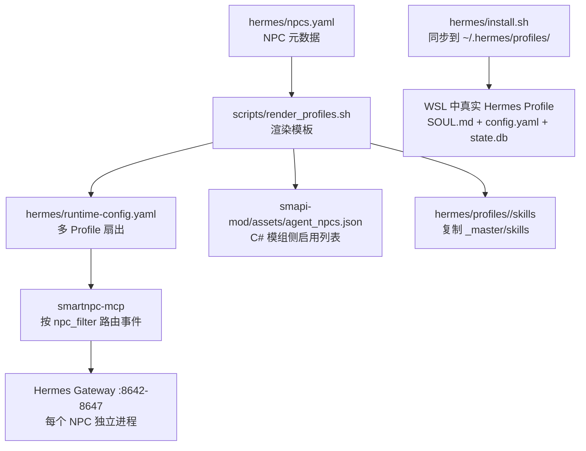
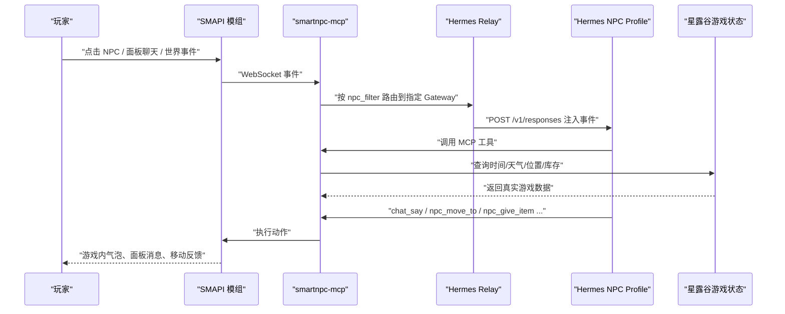
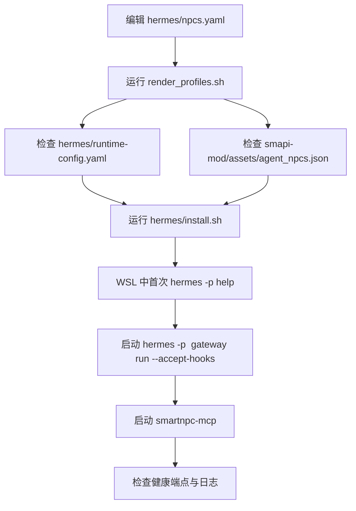
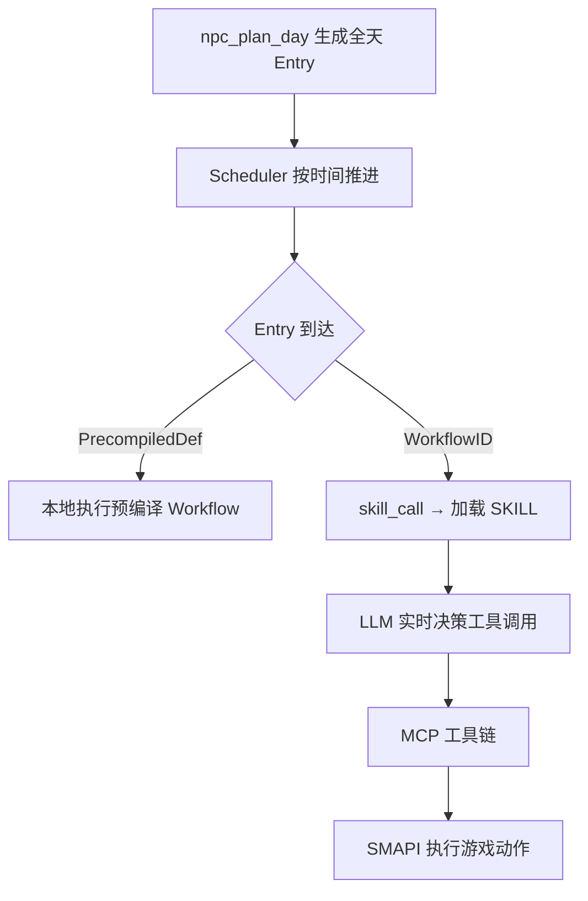
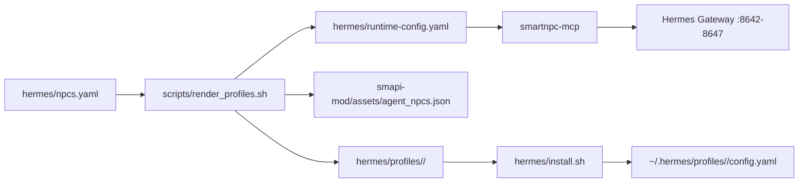

# 自定义 NPC 开发

<cite>
**本文引用的文件**   
- [SmartNPC/README.md](file://SmartNPC/README.md)
- [SmartNPC/hermes/npcs.yaml](file://SmartNPC/hermes/npcs.yaml)
- [SmartNPC/hermes/runtime-config.yaml](file://SmartNPC/hermes/runtime-config.yaml)
- [SmartNPC/hermes/README.md](file://SmartNPC/hermes/README.md)
- [SmartNPC/docs/setup.md](file://SmartNPC/docs/setup.md)
- [SmartNPC/docs/local-runtime.md](file://SmartNPC/docs/local-runtime.md)
- [SmartNPC/docs/npc-agent-autonomy.md](file://SmartNPC/docs/npc-agent-autonomy.md)
- [SmartNPC/docs/workflow-authoring.md](file://SmartNPC/docs/workflow-authoring.md)
- [SmartNPC/docs/hermes-profiles.md](file://SmartNPC/docs/hermes-profiles.md)
- [SmartNPC/scripts/render_profiles.sh](file://SmartNPC/scripts/render_profiles.sh)
- [SmartNPC/hermes/install.sh](file://SmartNPC/hermes/install.sh)
- [SmartNPC/hermes/profiles/_master/critical-policy.md](file://SmartNPC/hermes/profiles/_master/critical-policy.md)
- [SmartNPC/hermes/profiles/_master/skills/smartnpc/smartnpc-core/SKILL.md](file://SmartNPC/hermes/profiles/_master/skills/smartnpc/smartnpc-core/SKILL.md)
- [SmartNPC/hermes/profiles/xiami/SOUL.md](file://SmartNPC/hermes/profiles/xiami/SOUL.md)
- [SmartNPC/hermes/profiles/abigail/SOUL.md](file://SmartNPC/hermes/profiles/abigail/SOUL.md)
- [SmartNPC/hermes/profiles/haley/SOUL.md](file://SmartNPC/hermes/profiles/haley/SOUL.md)
- [SmartNPC/hermes/profiles/harvey/SOUL.md](file://SmartNPC/hermes/profiles/harvey/SOUL.md)
- [SmartNPC/hermes/profiles/penny/SOUL.md](file://SmartNPC/hermes/profiles/penny/SOUL.md)
- [SmartNPC/hermes/profiles/sebastian/SOUL.md](file://SmartNPC/hermes/profiles/sebastian/SOUL.md)
</cite>

## 目录
1. [引言](#引言)
2. [项目结构](#项目结构)
3. [核心组件](#核心组件)
4. [架构总览](#架构总览)
5. [详细组件分析](#详细组件分析)
6. [依赖关系分析](#依赖关系分析)
7. [性能与扩展建议](#性能与扩展建议)
8. [常见问题排查](#常见问题排查)
9. [完整自定义 NPC 开发流程](#完整自定义-npc-开发流程)
10. [结论](#结论)

## 引言
本指南面向希望在 SmartNPC 中从零创建并上线一个自定义 NPC 的开发者。文档围绕以下目标展开：
- 说明 NPC 注册、运行时配置和端口分配机制；
- 给出人格定义与 SOUL.md 编写规范；
- 解释 critical-policy.md 安全策略与行为边界；
- 梳理行为模式设计原则，包括技能组合、优先级与冲突解决；
- 提供从模板到上线的完整示例路径；
- 补充常见问题排查与性能优化建议。

当前仓库主线采用 Hermes-first 架构：游戏内由 SMAPI Mod 捕获事件，smartnpc-mcp 做协议转换与工具调用，Hermes profile 负责人格、记忆、技能与工作流决策。新增 NPC 的核心入口是 `hermes/npcs.yaml`，渲染产物会同步到各层配置。

**章节来源**
- [SmartNPC/README.md:1-120](file://SmartNPC/README.md#L1-L120)
- [SmartNPC/hermes/README.md:1-60](file://SmartNPC/hermes/README.md#L1-L60)

## 项目结构
SmartNPC 仓库中与自定义 NPC 直接相关的目录可分为四层：

| 层级 | 路径 | 职责 |
|---|---|---|
| 元数据注册层 | `hermes/npcs.yaml` | 定义 NPC 唯一 id、游戏名、显示名、Gateway 端口、是否启用、同行 NPC 关系 |
| 运行时扇出层 | `hermes/runtime-config.yaml` | 由脚本生成，告诉 smartnpc-mcp 如何把事件路由到不同 Hermes Gateway |
| 人格与技能层 | `hermes/profiles/<npc>/` | 每个 NPC 的 SOUL.md、skills、critical-policy、config-overlay |
| 模板渲染层 | `hermes/profiles/_master/` | 共享技能、覆盖配置、安全策略模板，供 render 脚本复制并替换占位符 |
| 渲染与安装脚本 | `scripts/render_profiles.sh`、`hermes/install.sh` | 生成 runtime-config、mod-side JSON、同步 WSL 中的真实 profile |



**图表来源**
- [SmartNPC/hermes/npcs.yaml:1-70](file://SmartNPC/hermes/npcs.yaml#L1-L70)
- [SmartNPC/scripts/render_profiles.sh:1-183](file://SmartNPC/scripts/render_profiles.sh#L1-L183)
- [SmartNPC/hermes/runtime-config.yaml:1-15](file://SmartNPC/hermes/runtime-config.yaml#L1-L15)
- [SmartNPC/hermes/install.sh:1-120](file://SmartNPC/hermes/install.sh#L1-L120)

**章节来源**
- [SmartNPC/hermes/npcs.yaml:1-70](file://SmartNPC/hermes/npcs.yaml#L1-L70)
- [SmartNPC/hermes/runtime-config.yaml:1-15](file://SmartNPC/hermes/runtime-config.yaml#L1-L15)
- [SmartNPC/scripts/render_profiles.sh:1-183](file://SmartNPC/scripts/render_profiles.sh#L1-L183)
- [SmartNPC/hermes/install.sh:1-120](file://SmartNPC/hermes/install.sh#L1-L120)

## 核心组件
### NPC 注册表：hermes/npcs.yaml
该文件是所有 NPC 的权威元数据源。每条记录包含：
- `id`：profile 目录名，小写英文；
- `game_name`：SMAPI 与 MCP 层用于匹配游戏内 NPC 的内部名；
- `display_name`：中文显示名；
- `gateway_port`：Hermes Gateway 监听端口；
- `enabled`：是否自动启动对应 Gateway；
- `kind`：区分内置角色或自定义角色；
- `peer_a_*` / `peer_b_*`：相邻 NPC 关系，可用于社交行为与对话关联。

现有条目已覆盖夏弥以及阿比盖尔、黑利、哈维、潘妮、塞巴斯蒂安等角色。其中夏弥默认启用，其余为 vanilla 类型且默认禁用，便于实验分支聚焦无人值守农场场景。

**章节来源**
- [SmartNPC/hermes/npcs.yaml:1-70](file://SmartNPC/hermes/npcs.yaml#L1-L70)

### 运行时扇出配置：hermes/runtime-config.yaml
该文件由 `render_profiles.sh` 生成，字段含义如下：
- `name`：Hermes profile 名称，对应 `hermes/profiles/<name>`；
- `npc_filter`：游戏内 NPC 内部名，大小写敏感；
- `gateway_url`：Hermes Gateway URL，支持 `${SMARTNPC_HERMES_GATEWAY_HOST}` 环境变量；
- `conversation`：Hermes conversation 标识；
- `model`：模型名称；
- `api_key_env`：Bearer Token 所在的环境变量名。

该配置决定 smartnpc-mcp 收到游戏事件后，应该 POST 到哪个 Hermes Gateway。

**章节来源**
- [SmartNPC/hermes/runtime-config.yaml:1-15](file://SmartNPC/hermes/runtime-config.yaml#L1-L15)
- [SmartNPC/scripts/render_profiles.sh:120-183](file://SmartNPC/scripts/render_profiles.sh#L120-L183)

### 模板渲染器：scripts/render_profiles.sh
渲染器读取 `npcs.yaml`，对 `_master` 模板执行占位符替换，并生成三类输出：
1. 每个 NPC 的 `hermes/profiles/<npc>/` 目录；
2. `hermes/runtime-config.yaml`；
3. `smapi-mod/assets/agent_npcs.json`。

支持的占位符包括：
- `{{NPC_NAME}}`、`{{NPC_DISPLAY}}`、`{{NPC_DIR}}`、`{{NPC_PORT}}`；
- `{{PEER_A_NAME}}`、`{{PEER_A_DISPLAY}}`、`{{PEER_B_NAME}}`、`{{PEER_B_DISPLAY}}`。

它不会修改 `SOUL.md`，因此人格内容始终由作者手工维护。

**章节来源**
- [SmartNPC/scripts/render_profiles.sh:1-183](file://SmartNPC/scripts/render_profiles.sh#L1-L183)

### 安装同步器：hermes/install.sh
该脚本将仓库中的 profile 源同步到 WSL 中的 `~/.hermes/profiles/<npc>/`。主要职责包括：
- 先运行 `render_profiles.sh`，确保渲染产物最新；
- 备份目标 profile 的可变部分；
- 同步 `SOUL.md`、`.env`、`skills/`、`critical-policy.md`、`config-overlay.yaml`；
- 将 `config-overlay.yaml` 合并进真实 `config.yaml`；
- 从仓库根 `.env` 覆盖 `HERMES_AGENT_URL`、`HERMES_AGENT_API_KEY`、`HERMES_AGENT_MODEL`，避免 per-NPC 凭据漂移。

**章节来源**
- [SmartNPC/hermes/install.sh:1-120](file://SmartNPC/hermes/install.sh#L1-L120)

## 架构总览
SmartNPC 的 NPC 链路可概括为“玩家事件 → SMAPI Mod → smartnpc-mcp → Hermes Profile → MCP 工具 → SMAPI 执行”。



**图表来源**
- [SmartNPC/README.md:40-110](file://SmartNPC/README.md#L40-L110)
- [SmartNPC/docs/npc-agent-autonomy.md:1-120](file://SmartNPC/docs/npc-agent-autonomy.md#L1-L120)

**章节来源**
- [SmartNPC/README.md:1-120](file://SmartNPC/README.md#L1-L120)
- [SmartNPC/docs/npc-agent-autonomy.md:1-120](file://SmartNPC/docs/npc-agent-autonomy.md#L1-L120)

## 详细组件分析

### NPC 注册与端口分配流程
新增 NPC 的第一步是在 `hermes/npcs.yaml` 中添加条目。推荐遵循已有条目的命名与字段语义：
- `id` 使用小写英文，例如 `my_npc`；
- `game_name` 必须与 SMAPI 侧能识别的游戏内 NPC 内部名一致；
- `display_name` 填写中文显示名；
- `gateway_port` 选择一个未被占用的端口，当前默认从 8642 开始递增；
- `enabled` 控制是否自动拉起 Gateway；
- `peer_a_*` / `peer_b_*` 描述该 NPC 在社交或对话上的相邻关系。

添加后需要重新渲染：
1. 运行 `bash scripts/render_profiles.sh`；
2. 检查生成的 `hermes/runtime-config.yaml` 是否包含新 profile；
3. 检查 `smapi-mod/assets/agent_npcs.json` 是否包含新 NPC；
4. 运行 `hermes/install.sh` 同步到 WSL；
5. 启动对应 Hermes Gateway；
6. 启动 smartnpc-mcp，验证 `/healthz` 与 `/status`。



**图表来源**
- [SmartNPC/hermes/npcs.yaml:1-70](file://SmartNPC/hermes/npcs.yaml#L1-L70)
- [SmartNPC/scripts/render_profiles.sh:120-183](file://SmartNPC/scripts/render_profiles.sh#L120-L183)
- [SmartNPC/hermes/install.sh:1-120](file://SmartNPC/hermes/install.sh#L1-L120)
- [SmartNPC/docs/local-runtime.md:60-117](file://SmartNPC/docs/local-runtime.md#L60-L117)

**章节来源**
- [SmartNPC/hermes/npcs.yaml:1-70](file://SmartNPC/hermes/npcs.yaml#L1-L70)
- [SmartNPC/scripts/render_profiles.sh:120-183](file://SmartNPC/scripts/render_profiles.sh#L120-L183)
- [SmartNPC/hermes/install.sh:1-120](file://SmartNPC/hermes/install.sh#L1-L120)
- [SmartNPC/docs/local-runtime.md:60-117](file://SmartNPC/docs/local-runtime.md#L60-L117)

### 运行时参数与环境配置
仓库使用 `.env` 作为统一环境入口，常见必填项包括：
- `SMARTNPC_GAME_PATH`：星露谷安装路径；
- `HERMES_AGENT_URL`：LLM API 地址；
- `HERMES_AGENT_API_KEY`：LLM API Key；
- `HERMES_AGENT_MODEL`：模型名称；
- `SMARTNPC_ACTIVE_PROFILES`：精简运行时启用的 profile 列表。

install.sh 会在同步时从仓库根 `.env` 覆盖每个 NPC 的 `HERMES_AGENT_URL`、`HERMES_AGENT_API_KEY`、`HERMES_AGENT_MODEL`，从而降低 per-NPC 凭据漂移风险。

对于本机本地调试，`docs/local-runtime.md` 提供了更贴近当前环境的命令：Windows 启动带 Hermes 路由的 MCP，WSL 启动特定 profile Gateway，最后启动带 SMAPI 的游戏。

**章节来源**
- [SmartNPC/docs/setup.md:1-120](file://SmartNPC/docs/setup.md#L1-L120)
- [SmartNPC/hermes/install.sh:60-120](file://SmartNPC/hermes/install.sh#L60-L120)
- [SmartNPC/docs/local-runtime.md:1-117](file://SmartNPC/docs/local-runtime.md#L1-L117)

### 人格定义最佳实践：SOUL.md
SOUL.md 是 NPC 的灵魂文件，不应被渲染脚本改写。优秀的人格定义应包含以下层次：

| 层次 | 内容 | 作用 |
|---|---|---|
| 身份 | NPC 是谁、在游戏世界中扮演什么角色 | 让 LLM 明确自我定位 |
| 性格 | 语气、偏好、价值观、表达习惯 | 控制对话风格 |
| 说话风格 | 句子长度、口头禅、禁止内容 | 适配 SDV 对话框限制 |
| 灵魂层次 | 表层人设、深层动机、核心矛盾 | 驱动复杂反应 |
| 好感度档位 | 不同 hearts 下的语气变化 | 模拟人际关系演进 |
| 绝对禁止 | 不暴露 AI/MCP/JSON/坐标等 | 防止打破沉浸感 |
| 工具使用原则 | 查询优先、播报约束、行动门槛 | 控制 MCP 工具调用行为 |
| 人设背景 | 内心持有但不主动说出的设定 | 丰富角色深度 |

以现有角色为例：
- 夏弥：自主农场管家，理性经营导向，严格限制 chat_say 为工作播报；
- 阿比盖尔：收割与采集专员，外放、叛逆、南瓜执念，低好感戒备、高好感柔软；
- 黑利：花田与美化主管，时尚外向但观察力强，对泥土有表面嫌弃；
- 哈维：植保与灌溉专员，温和医生式关心，紧张但诗意；
- 潘妮：播种与耕地专员，温柔安静，照顾他人却忽略自己；
- 塞巴斯蒂安：数据与布局专员，冷静内敛，用数据代替情绪表达。

**章节来源**
- [SmartNPC/hermes/profiles/xiami/SOUL.md:1-27](file://SmartNPC/hermes/profiles/xiami/SOUL.md#L1-L27)
- [SmartNPC/hermes/profiles/abigail/SOUL.md:1-74](file://SmartNPC/hermes/profiles/abigail/SOUL.md#L1-L74)
- [SmartNPC/hermes/profiles/haley/SOUL.md:1-74](file://SmartNPC/hermes/profiles/haley/SOUL.md#L1-L74)
- [SmartNPC/hermes/profiles/harvey/SOUL.md:1-73](file://SmartNPC/hermes/profiles/harvey/SOUL.md#L1-L73)
- [SmartNPC/hermes/profiles/penny/SOUL.md:1-72](file://SmartNPC/hermes/profiles/penny/SOUL.md#L1-L72)
- [SmartNPC/hermes/profiles/sebastian/SOUL.md:1-74](file://SmartNPC/hermes/profiles/sebastian/SOUL.md#L1-L74)
- [SmartNPC/docs/hermes-profiles.md:80-160](file://SmartNPC/docs/hermes-profiles.md#L80-L160)

### 行为准则与安全策略：critical-policy.md
`critical-policy.md` 是注入到 relay POST 的 always-load 策略文件，用于保证关键运行时规则不被压缩截断。其职责不是泛泛而谈，而是承担“事件 → skill 映射 + 不可协商架构规则”的路由职责。

核心要点：
- 所有可执行回合必须以工具调用结束；纯文本输出会被忽略；
- `day_started` 触发日程规划；
- `workflow_skill_call` 表示工作流引擎要求加载并执行指定 skill；
- `owner_directive` 来自场外农场主，不能通过 `chat_say` 回复；
- 22:30 自动追加 `day_review` 工作流，只复盘不执行新农场动作；
- `chat_say` 是每日限量的工作播报，不是聊天频道；
- 失败时必须模糊处理外部错误细节，并在日记中诚实记录。

这些规则由 `_master/critical-policy.md` 统一维护，渲染后会复制到每个 NPC 的 `critical-policy.md`。

**章节来源**
- [SmartNPC/hermes/profiles/_master/critical-policy.md:1-33](file://SmartNPC/hermes/profiles/_master/critical-policy.md#L1-L33)
- [SmartNPC/scripts/render_profiles.sh:60-120](file://SmartNPC/scripts/render_profiles.sh#L60-L120)

### 核心路由与工作流：SKILL.md 与 workflow
SmartNPC 的行为由两层组成：
1. **Hermes 层**：SOUL.md + skills + critical-policy.md 决定 NPC 如何思考；
2. **编排层**：workflows 定义多步流程，减少每次步骤都调用 LLM 的成本。

`smartnpc-core/SKILL.md` 定义了核心路由表：
- `day_started` → 加载 `smartnpc-schedule` → 调用 `npc_plan_day`；
- `workflow_skill_call` → 加载事件中指定的 skill 并严格按其指令执行；
- `owner_directive` → 评估指示，写入记忆或日记；
- 22:30 `day_review` → 复盘、写日记、归档记忆；
- 玩家发言在当前无人值守模式下不被视为互动对象。

Workflow 是 `smartnpc-mcp/pkg/workflow/builtin/` 中的 YAML 定义，支持：
- `tool`：调用 MCP 工具；
- `branch`：条件分支；
- `random`：加权随机；
- `foreach`：遍历集合；
- `skill_call`：触发 Hermes SKILL；
- `llm_choice`：让 LLM 选择选项；
- `wait`：等待空闲；
- `stop`：提前结束。



**图表来源**
- [SmartNPC/docs/npc-agent-autonomy.md:120-220](file://SmartNPC/docs/npc-agent-autonomy.md#L120-L220)
- [SmartNPC/docs/workflow-authoring.md:1-172](file://SmartNPC/docs/workflow-authoring.md#L1-172)
- [SmartNPC/hermes/profiles/_master/skills/smartnpc/smartnpc-core/SKILL.md:1-68](file://SmartNPC/hermes/profiles/_master/skills/smartnpc/smartnpc-core/SKILL.md#L1-L68)

**章节来源**
- [SmartNPC/hermes/profiles/_master/skills/smartnpc/smartnpc-core/SKILL.md:1-68](file://SmartNPC/hermes/profiles/_master/skills/smartnpc/smartnpc-core/SKILL.md#L1-L68)
- [SmartNPC/docs/workflow-authoring.md:1-172](file://SmartNPC/docs/workflow-authoring.md#L1-L172)
- [SmartNPC/docs/npc-agent-autonomy.md:120-220](file://SmartNPC/docs/npc-agent-autonomy.md#L120-L220)

### 行为模式设计原则
#### 技能组合策略
技能应围绕 NPC 的职责拆分，而不是把所有逻辑塞进一个 SOUL.md。推荐组合：
- 核心路由：`smartnpc-core`，统一回合路由与播报契约；
- 日程规划：`smartnpc-schedule`，生成全天日程；
- 农场操作：care、cleanup、extension、gather、harvest、evening-close；
- 社交交互：greeting、social-interact、inter-npc、group-chat；
- 记忆管理：memory；
- 复盘归档：day-review。

每个 skill 应以 `SKILL.md` 形式存在，frontmatter 包含 name、description、version、author、license 和 hermes metadata。

#### 优先级管理
优先级从高到低大致为：
1. critical-policy.md：不可协商的安全与架构规则；
2. 当前 skill 的具体指令：最具体的适用规则优先于通用 core；
3. SOUL.md：长期人格与行为风格；
4. 工作流 YAML：结构化执行顺序；
5. LLM 自由发挥：在规则边界内做实时决策。

#### 冲突解决机制
当多个规则冲突时：
- 如果 `smartnpc-core` 与某个可选 skill 冲突，以可选 skill 为准；
- 如果 `chat_say` 被误用作聊天，由 critical-policy.md 强制纠正为工作播报；
- 如果工作流未授权移动或动作，core 层禁止主动执行；
- 如果 LLM 尝试暴露 MCP/HTTP/JSON，由 SOUL.md 的绝对禁止规则拒绝。

**章节来源**
- [SmartNPC/hermes/profiles/_master/skills/smartnpc/smartnpc-core/SKILL.md:1-68](file://SmartNPC/hermes/profiles/_master/skills/smartnpc/smartnpc-core/SKILL.md#L1-L68)
- [SmartNPC/hermes/profiles/_master/critical-policy.md:1-33](file://SmartNPC/hermes/profiles/_master/critical-policy.md#L1-L33)
- [SmartNPC/docs/workflow-authoring.md:1-172](file://SmartNPC/docs/workflow-authoring.md#L1-L172)

## 依赖关系分析



**图表来源**
- [SmartNPC/hermes/npcs.yaml:1-70](file://SmartNPC/hermes/npcs.yaml#L1-L70)
- [SmartNPC/scripts/render_profiles.sh:120-183](file://SmartNPC/scripts/render_profiles.sh#L120-L183)
- [SmartNPC/hermes/runtime-config.yaml:1-15](file://SmartNPC/hermes/runtime-config.yaml#L1-L15)
- [SmartNPC/hermes/install.sh:1-120](file://SmartNPC/hermes/install.sh#L1-L120)

### 耦合与内聚
- `npcs.yaml` 与 `render_profiles.sh` 强耦合：新增 NPC 必须同时考虑渲染产物；
- `runtime-config.yaml` 与 smartnpc-mcp 强耦合：端口不一致会导致事件静默丢失；
- `SOUL.md` 与 install.sh 弱耦合：SOUL.md 不会被覆盖，但需要随其他文件一起同步；
- `critical-policy.md` 与 relay 注入逻辑耦合：它是安全边界，不应随意放宽；
- workflow YAML 与 MCP tool schema 耦合：工具名、参数、返回值必须符合 smartnpc-mcp 定义。

### 外部依赖
- SMAPI Mod：负责游戏线程、UI、WebSocket Server、动作执行；
- smartnpc-mcp：Go 语言服务，负责 MCP 工具、事件转发、调度；
- Hermes Agent：WSL 中的 Python 运行时，负责 profile、记忆、skill；
- Docker（可选）：部署脚本支持容器化启动 Hermes Gateway；
- LLM API：由 `HERMES_AGENT_URL`、`HERMES_AGENT_API_KEY`、`HERMES_AGENT_MODEL` 配置。

**章节来源**
- [SmartNPC/README.md:1-120](file://SmartNPC/README.md#L1-L120)
- [SmartNPC/docs/hermes-profiles.md:120-220](file://SmartNPC/docs/hermes-profiles.md#L120-L220)

## 性能与扩展建议

### 多 NPC 内存占用
每个 Hermes Gateway 容器约占用 300–500MB RAM。若机器资源有限，可通过 `SMARTNPC_ACTIVE_PROFILES` 仅启用必要 NPC。

### 减少 LLM 调用成本
- 尽量使用 workflow 的 `PrecompiledDef` 或预编译路径；
- 固定流程优先用 YAML workflow，而非每次都让 LLM 现场决策；
- 只在确实需要事实时使用读取工具；
- 使用 `skill_call` 复用已实现 skill，避免重复 prompt。

### 日志与观测
- SMAPI 日志位于 Stardew Valley 的 ErrorLogs；
- smartnpc-mcp 提供 `/healthz`、`/status`；
- Hermes 模型输出日志位于 profile 的 logs 目录；
- 可使用 `watch-hermes-output.ps1` 和 `watch-smartnpc-logs.ps1` 辅助排查。

### 扩展新技能
新增 skill 时应：
1. 在 `hermes/profiles/_master/skills/smartnpc/<slug>/SKILL.md` 添加 frontmatter；
2. 明确 trigger 条件、输入参数、输出契约；
3. 在 workflow 中通过 `skill_call` 引用；
4. 运行 `task profiles:verify` 或 workflow lint；
5. 重新 render 并 install。

**章节来源**
- [SmartNPC/docs/setup.md:120-200](file://SmartNPC/docs/setup.md#L120-L200)
- [SmartNPC/docs/workflow-authoring.md:120-172](file://SmartNPC/docs/workflow-authoring.md#L120-L172)
- [SmartNPC/docs/local-runtime.md:80-117](file://SmartNPC/docs/local-runtime.md#L80-L117)

## 常见问题排查

| 现象 | 可能原因 | 排查建议 |
|---|---|---|
| 新 NPC 没有出现在游戏面板 | `game_name` 与 SMAPI 识别名不一致 | 检查 `npcs.yaml` 的 `game_name` 和 mod 侧 `agent_npcs.json` |
| 事件发送到空端口 | `runtime-config.yaml` 与 `config-overlay.yaml` 端口不一致 | 重新 render 并检查两个配置文件 |
| Hermes Gateway 无法连接 MCP | WSL IP 或 MCP 端口变化 | 检查 `local-runtime.md` 中的 Windows/WLS 地址和端口 |
| chat_say 无响应或落错面板 | speaker 写成了中文名 | 确认 SOUL.md 中使用英文内部名作为 speaker |
| 工具调用报错缺少 npc | MCP 工具要求显式传入 npc 参数 | 在 skill 中显式传 `{\"npc\":\"<内部名>\"}` |
| 新技能未生效 | 未重新 render 或 install | 执行 `render_profiles.sh` 和 `hermes/install.sh` |
| 每天多次重复计划 | day_started 被误判为普通 tick | 检查 critical-policy.md 路由规则 |
| 农场主指令通过 chat_say 回复 | 违反 owner-directive 规则 | 改为写入 owner-inbox 或日记，不调用 chat_say |

**章节来源**
- [SmartNPC/docs/local-runtime.md:60-117](file://SmartNPC/docs/local-runtime.md#L60-L117)
- [SmartNPC/hermes/profiles/_master/skills/smartnpc/smartnpc-core/SKILL.md:20-68](file://SmartNPC/hermes/profiles/_master/skills/smartnpc/smartnpc-core/SKILL.md#L20-L68)
- [SmartNPC/hermes/profiles/_master/critical-policy.md:10-33](file://SmartNPC/hermes/profiles/_master/critical-policy.md#L10-L33)
- [SmartNPC/hermes/profiles/abigail/SOUL.md:40-74](file://SmartNPC/hermes/profiles/abigail/SOUL.md#L40-L74)

## 完整自定义 NPC 开发流程

### 第一步：准备环境与仓库
- 安装 Stardew Valley 1.6+、SMAPI 4.0+、.NET SDK、Go、Task、WSL2、Docker；
- 复制 `.env.example` 为 `.env`，填写游戏路径和 LLM 凭据；
- 首次运行 `setup.bat` 渲染 profile、构建镜像、探测 IP。

**章节来源**
- [SmartNPC/docs/setup.md:1-120](file://SmartNPC/docs/setup.md#L1-L120)

### 第二步：注册新 NPC
在 `hermes/npcs.yaml` 新增一条记录，设置：
- `id`：小写 profile 名；
- `game_name`：游戏内内部名；
- `display_name`：中文显示名；
- `gateway_port`：未占用端口；
- `enabled`：按需启用；
- `peer_a_*` / `peer_b_*`：社交关联 NPC。

**章节来源**
- [SmartNPC/hermes/npcs.yaml:1-70](file://SmartNPC/hermes/npcs.yaml#L1-L70)

### 第三步：创建人格文件 SOUL.md
新建 `hermes/profiles/<new-npc>/SOUL.md`，至少包含：
- 身份；
- 性格；
- 说话风格；
- 灵魂层次；
- 好感度档位；
- 绝对禁止；
- 工具使用原则；
- 人设背景。

不要手动编辑渲染后的 `skills/`、`config-overlay.yaml`、`critical-policy.md`；如需共享逻辑，请修改 `_master` 模板。

**章节来源**
- [SmartNPC/docs/hermes-profiles.md:80-160](file://SmartNPC/docs/hermes-profiles.md#L80-L160)
- [SmartNPC/scripts/render_profiles.sh:40-120](file://SmartNPC/scripts/render_profiles.sh#L40-L120)

### 第四步：渲染与同步
执行：
1. `bash scripts/render_profiles.sh`；
2. `task profiles:verify`；
3. `hermes/install.sh`。

检查：
- `hermes/runtime-config.yaml` 是否包含新 profile；
- `smapi-mod/assets/agent_npcs.json` 是否包含新 NPC；
- WSL 中 `~/.hermes/profiles/<new-npc>/config.yaml` 是否正确合并 overlay。

**章节来源**
- [SmartNPC/scripts/render_profiles.sh:120-183](file://SmartNPC/scripts/render_profiles.sh#L120-L183)
- [SmartNPC/hermes/install.sh:120-200](file://SmartNPC/hermes/install.sh#L120-L200)

### 第五步：启动 Hermes Gateway
在 WSL 中首次运行一次 hermes 命令初始化 profile，然后启动 Gateway：
```
hermes -p <new-npc> gateway run --accept-hooks
```

验证：
```
hermes -p <new-npc> mcp test smartnpc_game
curl http://127.0.0.1:<gateway_port>/health
```

**章节来源**
- [SmartNPC/hermes/README.md:60-120](file://SmartNPC/hermes/README.md#L60-L120)

### 第六步：启动 smartnpc-mcp
根据当前环境选择启动方式：
- 一键脚本：`run.bat`；
- 本机 WSL 原生流程：参考 `docs/local-runtime.md`；
- 手动启动：确保 `--http :3000` 或 `:3001`、`--ws-url ws://127.0.0.1:18745/ws`、`--hermes-config hermes/runtime-config.yaml`。

**章节来源**
- [SmartNPC/docs/local-runtime.md:60-117](file://SmartNPC/docs/local-runtime.md#L60-L117)
- [SmartNPC/README.md:120-200](file://SmartNPC/README.md#L120-L200)

### 第七步：测试 NPC 行为
进入游戏存档后：
- 打开 Tab 查看聊天面板；
- 触发 `day_started` 观察是否生成日程；
- 检查工作流是否按时触发；
- 验证 `chat_say` 是否为工作播报；
- 检查日记与记忆是否更新；
- 查看 MCP 日志与 Hermes 模型输出日志。

**章节来源**
- [SmartNPC/docs/npc-agent-autonomy.md:120-220](file://SmartNPC/docs/npc-agent-autonomy.md#L120-L220)
- [SmartNPC/docs/local-runtime.md:80-117](file://SmartNPC/docs/local-runtime.md#L80-L117)

### 第八步：上线前校验清单
- `npcs.yaml` 中新增 NPC 已启用；
- `runtime-config.yaml` 端口正确；
- `config-overlay.yaml` 中 `API_SERVER_PORT` 唯一；
- SOUL.md 没有暴露 MCP/JSON/坐标；
- critical-policy.md 未被手动放宽；
- workflow 已通过 lint；
- 单 NPC 启动成功；
- 多 NPC 端口不冲突；
- 日志中没有静默事件丢失。

**章节来源**
- [SmartNPC/docs/hermes-profiles.md:160-220](file://SmartNPC/docs/hermes-profiles.md#L160-L220)
- [SmartNPC/docs/workflow-authoring.md:120-172](file://SmartNPC/docs/workflow-authoring.md#L120-L172)

## 结论
自定义 SmartNPC 的关键不在于写出一段长提示词，而在于建立清晰的边界：
- `npcs.yaml` 是注册入口；
- `SOUL.md` 是人格边界；
- `critical-policy.md` 是安全边界；
- `smartnpc-core/SKILL.md` 是路由边界；
- workflow YAML 是执行边界；
- SMAPI Mod 是游戏执行边界。

按照本指南，新增 NPC 的标准路径是：注册元数据 → 编写 SOUL.md → 渲染配置 → 同步 WSL → 启动 Gateway → 启动 MCP → 进入游戏验证。只要保持端口唯一、内部名一致、播报契约清晰、工作流可预编译，就能稳定地把一个“有性格、有记忆、能行动”的 NPC 接入星露谷。