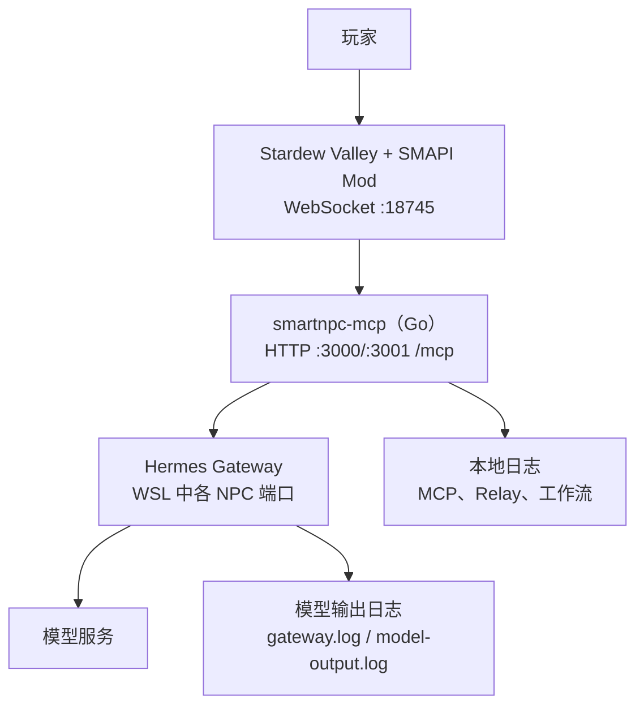
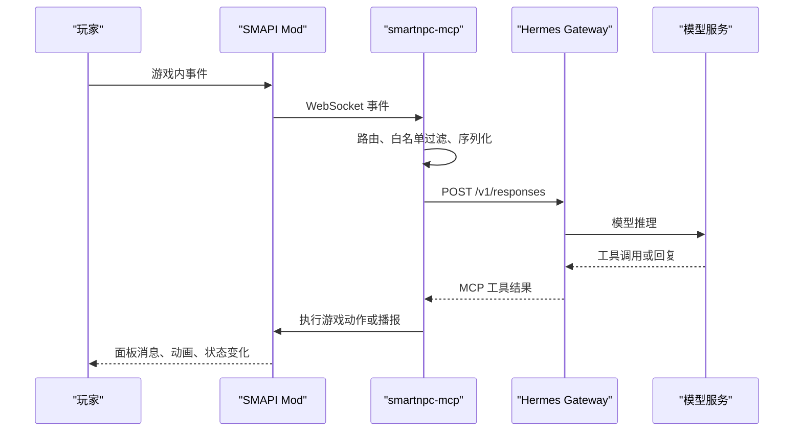
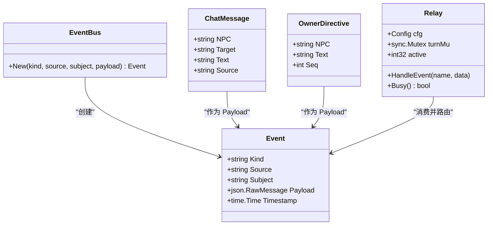
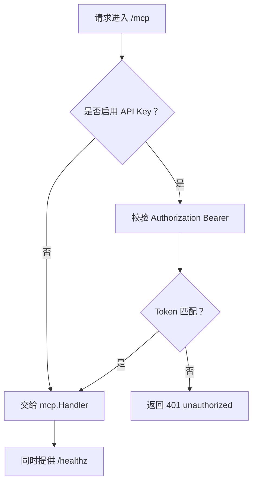
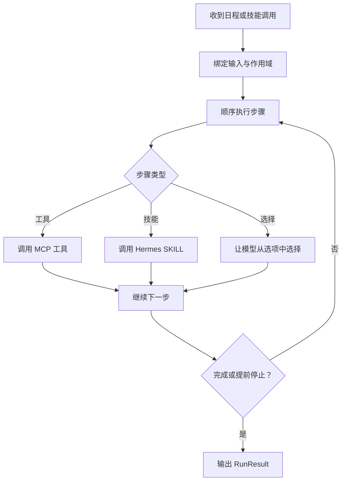
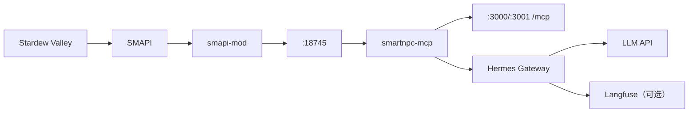
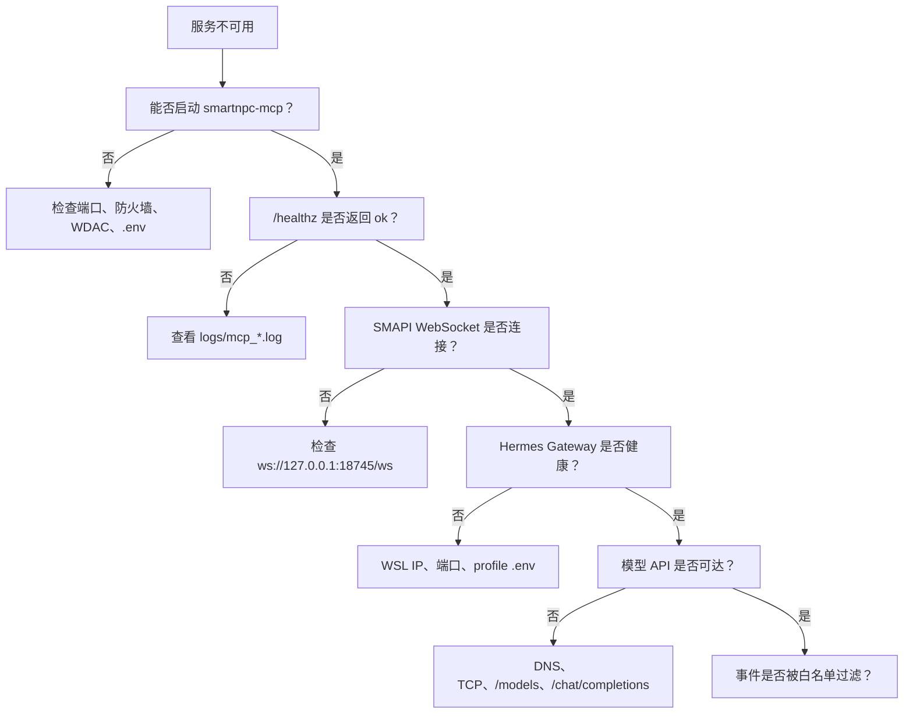
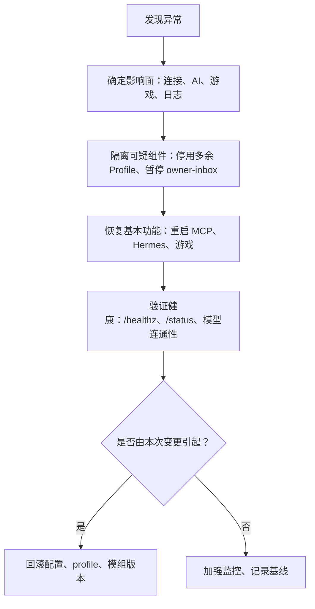

# 故障排查与维护

<cite>
**本文引用的文件**   
- [README.md](file://SmartNPC/README.md)
- [current-architecture.md](file://SmartNPC/docs/current-architecture.md)
- [local-runtime.md](file://SmartNPC/docs/local-runtime.md)
- [setup.md](file://SmartNPC/docs/setup.md)
- [Taskfile.yml](file://SmartNPC/Taskfile.yml)
- [run.bat](file://SmartNPC/run.bat)
- [run.sh](file://SmartNPC/run.sh)
- [run-wsl.bat](file://SmartNPC/run-wsl.bat)
- [setup.bat](file://SmartNPC/setup.bat)
- [logger.go](file://SmartNPC/smartnpc-mcp/internal/log/logger.go)
- [console_windows.go](file://SmartNPC/smartnpc-mcp/internal/log/console_windows.go)
- [server.go](file://SmartNPC/smartnpc-mcp/pkg/agentbridge/server.go)
- [event.go](file://SmartNPC/smartnpc-mcp/pkg/eventbus/event.go)
- [events.go](file://SmartNPC/smartnpc-mcp/adapters/stardew/events/events.go)
- [http.go](file://SmartNPC/smartnpc-mcp/pkg/transport/http.go)
- [relay.go](file://SmartNPC/smartnpc-mcp/pkg/relay/hermes/relay.go)
- [explog.go](file://SmartNPC/smartnpc-mcp/adapters/stardew/explog/explog.go)
- [engine.go](file://SmartNPC/smartnpc-mcp/pkg/workflow/engine.go)
- [detect_wsl_ips.sh](file://SmartNPC/scripts/detect_wsl_ips.sh)
- [test_api_connectivity.sh](file://SmartNPC/scripts/test_api_connectivity.sh)
- [watch_hermes_model_output.ps1](file://SmartNPC/scripts/watch_hermes_model_output.ps1)
- [watch-smartnpc-logs.ps1](file://SmartNPC/watch-smartnpc-logs.ps1)
- [watch-hermes-output.ps1](file://SmartNPC/watch-hermes-output.ps1)
- [apply_hermes_tuning.sh](file://SmartNPC/scripts/apply_hermes_tuning.sh)
- [reset-hermes.bat](file://SmartNPC/scripts/reset-hermes.bat)
</cite>

## 目录
1. [引言](#引言)
2. [项目结构](#项目结构)
3. [核心组件](#核心组件)
4. [架构总览](#架构总览)
5. [详细组件分析](#详细组件分析)
6. [依赖关系分析](#依赖关系分析)
7. [性能考虑](#性能考虑)
8. [故障排查指南](#故障排查指南)
9. [维护脚本与操作手册](#维护脚本与操作手册)
10. [应急响应与回滚策略](#应急响应与回滚策略)
11. [结论](#结论)

## 引言
本指南面向 SmartNPC 的运维人员、调试者和游戏管理员，目标是把“连不上、WSL 异常、权限问题、内存泄漏、日志看不懂、服务卡住、模型调用失败”等常见故障转化为可执行的诊断步骤。文档覆盖以下范围：

- 连接问题：SMAPI WebSocket、MCP HTTP、Hermes Gateway、WSL 网络、LLM API、Langfuse。
- WSL 环境问题：发行版、IP 探测、路径转换、Docker 与原生 Hermes 模式差异。
- 权限问题：WDAC 阻止可执行文件、Windows 控制台编码、文件写入和存档路径。
- 日志方法：结构化日志级别、关键日志位置、可读摘要、错误追踪。
- 维护脚本：`run.bat`、`run.sh`、`run-wsl.bat`、`setup.bat`、连通性检测、配置调优、重置。
- 调试工具：调试面板、边界框显示、调试命令、工作流运行记录。
- 性能优化：内存控制、并发限制、超时重连、上下文压缩、事件过滤。
- 应急流程：快速止血、隔离、恢复、验证、回滚。

SmartNPC 当前实验分支是“单 Agent 农场管家”形态：只有 `xiami` 被唤醒，玩家聊天、群聊、多 NPC 私信等旧交互已移除；`chat_say` 主要用于单向播报，实际行为以源码和架构文档为准。

**章节来源**
- [README.md:1-120](file://SmartNPC/README.md#L1-L120)
- [current-architecture.md:1-60](file://SmartNPC/docs/current-architecture.md#L1-L60)

## 项目结构
从排障视角，仓库可以拆成四层：

| 层次 | 主要职责 | 关键路径 |
|---|---|---|
| 游戏层 | Stardew Valley + SMAPI Mod，负责 UI、NPC、动作、WebSocket Server | `SV.v1.6.15/`、`smapi-mod/` |
| MCP 层 | Go 服务，暴露工具、桥接 WS、转发事件到 Hermes | `smartnpc-mcp/` |
| Hermes 层 | 每个 NPC 的决策边界，负责人格、记忆、模型调用 | `hermes/profiles/`、WSL 中运行时 |
| 脚本层 | 启动、构建、渲染 profile、连通性检测、日志查看 | `scripts/`、`run.bat`、`run.sh`、`run-wsl.bat` |

**图示来源**
- [current-architecture.md:1-60](file://SmartNPC/docs/current-architecture.md#L1-L60)
- [local-runtime.md:1-40](file://SmartNPC/docs/local-runtime.md#L1-L40)

**章节来源**
- [current-architecture.md:1-80](file://SmartNPC/docs/current-architecture.md#L1-L80)
- [local-runtime.md:1-60](file://SmartNPC/docs/local-runtime.md#L1-L60)

## 核心组件
排障时不必理解全部代码，但必须知道以下组件的职责和失败点：

| 组件 | 作用 | 常见故障信号 | 优先检查 |
|---|---|---|---|
| SMAPI Mod | 捕获游戏内输入、管理 NPC、播放动画、暴露 WebSocket | 游戏能进但没有 SmartNPC 面板；动作无效果 | `StardewModdingAPI.exe`、模组安装目录、`ErrorLogs/SMAPI-latest.txt` |
| smartnpc-mcp | 接收 WS 事件、注册 MCP 工具、转发到 Hermes | `/healthz` 不通、`/status` 无 `mod_ws_connected` | `logs/mcp_*.log`、HTTP 端口、`.env` |
| Hermes Gateway | 加载 profile、调用模型、执行工具循环 | `/health` 不通、`model-output.log` 长时间无新回合 | WSL profile `.env`、Gateway 端口、LLM API |
| 工作流引擎 | 按日程执行本地或 LLM 驱动的步骤 | 计划未触发、`day_review` 不结束 | `workflow-runs.jsonl`、`schedule.log`、`/status.experiment.*` |
| 日志系统 | JSON 结构化日志、可读摘要、多窗口聚合 | 中文乱码、找不到可读日志 | `logger.go`、PowerShell 日志查看器 |

**章节来源**
- [server.go:1-177](file://SmartNPC/smartnpc-mcp/pkg/agentbridge/server.go#L1-L177)
- [http.go:1-124](file://SmartNPC/smartnpc-mcp/pkg/transport/http.go#L1-L124)
- [logger.go:1-35](file://SmartNPC/smartnpc-mcp/internal/log/logger.go#L1-L35)
- [console_windows.go:1-18](file://SmartNPC/smartnpc-mcp/internal/log/console_windows.go#L1-L18)

## 架构总览
SmartNPC 的实时链路包含多个边界：游戏线程不能直接做耗时操作；MCP 层负责协议转换和安全校验；Hermes 层负责 AI 决策；WSL 提供模型运行时。

**图示来源**
- [events.go:1-120](file://SmartNPC/smartnpc-mcp/adapters/stardew/events/events.go#L1-L120)
- [relay.go:1-120](file://SmartNPC/smartnpc-mcp/pkg/relay/hermes/relay.go#L1-L120)
- [current-architecture.md:60-140](file://SmartNPC/docs/current-architecture.md#L60-L140)

## 详细组件分析

### 事件总线与中继
事件在系统中经历“适配器 → 事件总线 → 后端中继”的路径。适配器定义具体事件类型，事件总线只关心通用信封，中继根据 NPC 和事件白名单决定是否唤醒 Hermes。

**图示来源**
- [event.go:1-76](file://SmartNPC/smartnpc-mcp/pkg/eventbus/event.go#L1-L76)
- [events.go:1-120](file://SmartNPC/smartnpc-mcp/adapters/stardew/events/events.go#L1-L120)
- [relay.go:1-120](file://SmartNPC/smartnpc-mcp/pkg/relay/hermes/relay.go#L1-L120)

#### 关键行为
- `EventBus.New` 构造统一事件，时间戳由适配器侧决定，避免跨层时间漂移。
- `Relay.HandleEvent` 先走白名单和格式化，再异步 POST 到 Hermes；活跃计数用于防止调度器误判 NPC 空闲。
- `turnMu` 串行化同一 NPC 的模型回合，避免服务端对话历史交错导致无效 `tool_calls`。

**章节来源**
- [event.go:1-76](file://SmartNPC/smartnpc-mcp/pkg/eventbus/event.go#L1-L76)
- [relay.go:1-200](file://SmartNPC/smartnpc-mcp/pkg/relay/hermes/relay.go#L1-L200)

### HTTP 与 MCP 传输
MCP 使用 Streamable HTTP 暴露 `/mcp` 和 `/healthz`。跨主机访问（WSL 访问 Windows 宿主）需要关闭 localhost 保护，也可通过可选 API Key 鉴权。

**图示来源**
- [http.go:1-124](file://SmartNPC/smartnpc-mcp/pkg/transport/http.go#L1-L124)

**章节来源**
- [http.go:1-124](file://SmartNPC/smartnpc-mcp/pkg/transport/http.go#L1-L124)

### 工作流引擎与无人值守
工作流引擎负责执行预编译或 LLM 驱动的步骤，并统计步数、工具调用次数、停止原因和耗时。无人值守模式下，日终复盘和自动过夜依赖状态标记。

**图示来源**
- [engine.go:1-120](file://SmartNPC/smartnpc-mcp/pkg/workflow/engine.go#L1-L120)

**章节来源**
- [engine.go:1-200](file://SmartNPC/smartnpc-mcp/pkg/workflow/engine.go#L1-L200)
- [explog.go:1-120](file://SmartNPC/smartnpc-mcp/adapters/stardew/explog/explog.go#L1-L120)

## 依赖关系分析
SmartNPC 的运行时依赖包括：

| 依赖 | 版本或环境要求 | 失效影响 | 定位方式 |
|---|---|---|---|
| Stardew Valley 1.6+ | Steam 安装路径正确 | 无法加载 SMAPI | `SMARTNPC_GAME_PATH`、`StardewModdingAPI.exe` |
| SMAPI 4.0+ | 已安装并成功启动一次 | 模组不加载 | SMAPI 控制台、`ErrorLogs/SMAPI-latest.txt` |
| .NET SDK | 构建 smapi-mod | 无法编译 C# 模组 | `dotnet --version` |
| Go 1.22+ / 1.25+ | 构建 smartnpc-mcp | 无法编译 Go 服务 | `go version`、CI 声明 |
| Task | `task.exe` | 无法统一执行任务 | `task --list` |
| WSL2 Ubuntu | Docker 或原生 hermes | Hermes 无法启动 | `wsl --status`、`docker info` |
| Docker Engine | WSL 内 | Docker Compose 模式失败 | `docker compose ps/logs` |
| 模型 API | URL、Key、Model | Hermes 无法生成推理 | `test_api_connectivity.sh` |
| Langfuse（可选） | Public/Secret Key | 观测数据缺失 | Langfuse 健康端点 |

**图示来源**
- [setup.md:1-80](file://SmartNPC/docs/setup.md#L1-L80)
- [Taskfile.yml:1-60](file://SmartNPC/Taskfile.yml#L1-L60)

**章节来源**
- [setup.md:1-120](file://SmartNPC/docs/setup.md#L1-L120)
- [Taskfile.yml:1-146](file://SmartNPC/Taskfile.yml#L1-L146)

## 性能考虑
SmartNPC 的性能瓶颈通常不在单个函数，而在跨进程、跨平台、模型推理和游戏帧之间的组合。

| 问题 | 现象 | 根因方向 | 建议 |
|---|---|---|---|
| 聊天排队 | 多次输入后响应变慢 | 同一 NPC 的 `turnMu` 串行、Hermes 队列积压 | 减少高频唤醒；检查 `owner-inbox.md` 轮询频率 |
| 内存增长 | 长时间运行后占用上升 | 会话历史、日志、动画帧、模型输出累积 | 精简 Active Profiles；清理旧日志；监控 `state.db` |
| 模型慢 | 每日规划或复盘卡顿 | 模型冷启动、上下文过大、网络延迟 | 调整压缩阈值；确认 `/models` 和 `/chat/completions` 延迟 |
| 并发冲突 | 工具历史错乱 | 并发 POST 同会话 | 保持 `turnMu`；避免同一 NPC 并行请求 |
| 动画覆盖 | 自定义动作被行走覆盖 | 更新时机或帧映射 | 使用调试命令观察帧序列 |
| 日志膨胀 | 可读日志过大 | 连续回放、完整 payload | 使用 `-Once`、独立 OutputPath、限制文件大小 |

**章节来源**
- [relay.go:1-120](file://SmartNPC/smartnpc-mcp/pkg/relay/hermes/relay.go#L1-L120)
- [engine.go:1-120](file://SmartNPC/smartnpc-mcp/pkg/workflow/engine.go#L1-L120)
- [apply_hermes_tuning.sh:1-189](file://SmartNPC/scripts/apply_hermes_tuning.sh#L1-L189)

## 故障排查指南

### 一、连接问题诊断树

**操作步骤**
1. 先确认 MCP HTTP 存活：`curl http://127.0.0.1:3000/healthz` 或本机默认端口 `3001`。
2. 再确认 `/status` 中的 `mod_ws_connected`。
3. 若 MCP 存活但无事件，检查事件白名单和 `owner-inbox.md`。
4. 若 Hermes 不健康，检查 WSL IP 是否正确、Gateway 端口是否被占用。
5. 若模型不可达，使用连通性脚本单独测试 TCP、`/models`、`/chat/completions`。

**章节来源**
- [local-runtime.md:40-117](file://SmartNPC/docs/local-runtime.md#L40-L117)
- [test_api_connectivity.sh:1-120](file://SmartNPC/scripts/test_api_connectivity.sh#L1-L120)

### 二、WSL 环境问题
WSL 相关故障通常表现为“脚本找不到路径”“容器启动失败”“Hermes 端口不通”。

| 症状 | 可能原因 | 处理 |
|---|---|---|
| `run.bat` 提示缺少 `deploy/hermes/docker-compose.yml` | 未执行 `setup.bat` | 重新运行首次设置 |
| WSL IP 为空 | `hostname -I` 或默认网关解析失败 | 检查 WSL 网络、发行版 |
| 端口不通 | 端口映射错误或 WSL 重启后 IP 变化 | 重新探测 IP，核对 `WIN_HOST_IP`、`WSL_IP` |
| Docker 拉取失败 | 网络或镜像不存在 | 切换到本地构建或修复代理 |
| 原生 Hermes 模式报错 | profile `.env` 未同步或 `hermes` CLI 路径不对 | 使用 `run-wsl.bat` 或手动执行 `launch_hermes_wsl.sh` |

**章节来源**
- [detect_wsl_ips.sh:1-16](file://SmartNPC/scripts/detect_wsl_ips.sh#L1-L16)
- [run.bat:1-120](file://SmartNPC/run.bat#L1-L120)
- [run-wsl.bat:1-120](file://SmartNPC/run-wsl.bat#L1-L120)
- [setup.bat:1-155](file://SmartNPC/setup.bat#L1-L155)

### 三、权限问题
常见权限问题包括：

| 问题 | 表现 | 解决 |
|---|---|---|
| WDAC 阻止 `smartnpc-mcp.exe` | 启动时回退到 `go run` | 放行 EXE 或使用 PowerShell 显式启动 |
| 控制台中文乱码 | stderr 出现非 ASCII 字符乱码 | Windows 控制台启用 UTF-8 输出页 |
| 模组未安装 | Mods 目录没有 DLL | 退出游戏后执行模组安装任务 |
| 日志写入失败 | `logs/` 或 WSL 路径不可写 | 检查目录权限、防病毒软件、OneDrive 同步 |
| 模型 Key 泄露 | 日志或截图中出现真实密钥 | 脱敏、轮换密钥、不要提交 `.env` |

**章节来源**
- [run.bat:80-160](file://SmartNPC/run.bat#L80-L160)
- [console_windows.go:1-18](file://SmartNPC/smartnpc-mcp/internal/log/console_windows.go#L1-L18)
- [local-runtime.md:1-40](file://SmartNPC/docs/local-runtime.md#L1-L40)

### 四、内存泄漏与资源增长
SmartNPC 不是典型内存泄漏型程序，但长期运行仍可能出现资源增长：

1. **会话历史增长**：Hermes 会保留对话历史并通过压缩机制裁剪。若压缩窗口过大，长会话会占用更多内存。
2. **日志增长**：`model-output.log`、`gateway.log`、`agent.log`、`errors.log`、`mcp_*.log` 会持续增长。
3. **工作流与事件记录**：实验模式下按游戏日目录落盘，长时间运行会产生大量 JSONL。
4. **动画与控制状态**：如果取消、切图、换存档逻辑未被触发，动画控制器可能持续持有状态。

**排查建议**
- 定期归档 `logs/` 和 `<logDir>/exp/y{year}-{season}-d{day}/`。
- 使用 `test_api_connectivity.sh` 判断模型侧是否频繁重试导致请求堆积。
- 检查 `Relay.active` 是否长期大于零，表示有未完成的消息。
- 对 Active Profiles 做减法：仅保留必要 NPC。

**章节来源**
- [relay.go:1-120](file://SmartNPC/smartnpc-mcp/pkg/relay/hermes/relay.go#L1-L120)
- [explog.go:1-120](file://SmartNPC/smartnpc-mcp/adapters/stardew/explog/explog.go#L1-L120)
- [apply_hermes_tuning.sh:1-189](file://SmartNPC/scripts/apply_hermes_tuning.sh#L1-L189)

### 五、日志分析方法
SmartNPC 的日志分为三类：

| 日志类型 | 位置 | 用途 |
|---|---|---|
| SMAPI 日志 | `%APPDATA%\StardewValley\ErrorLogs\SMAPI-latest.txt` | 模组加载、游戏事件、C# 错误 |
| MCP 日志 | `logs/mcp_*.log`、`smartnpc-mcp/logs/mcp/relay.log` | HTTP 启动、WS 连接、Relay 转发 |
| Hermes 日志 | WSL profile 下 `gateway.log`、`agent.log`、`errors.log`、`model-output.log` | Gateway 生命周期、模型输出、工具执行 |

推荐用法：

- 日常快速查看：`.\watch-hermes-output.ps1`
- 综合排查：`.\watch-smartnpc-logs.ps1 -Detailed`
- 单次快照：`.\watch-hermes-model-output.ps1 -Once`
- 外部依赖自检：`bash scripts/test_api_connectivity.sh`

**章节来源**
- [watch_hermes_model_output.ps1:1-194](file://SmartNPC/scripts/watch_hermes_model_output.ps1#L1-L194)
- [watch-smartnpc-logs.ps1:1-95](file://SmartNPC/watch-smartnpc-logs.ps1#L1-L95)
- [logger.go:1-35](file://SmartNPC/smartnpc-mcp/internal/log/logger.go#L1-L35)

### 六、调试工具使用
SmartNPC 的调试能力分布在游戏内 UI、命令行和日志读取器中。

| 工具 | 入口 | 说明 |
|---|---|---|
| 聊天面板 | 游戏内 Tab 或快捷键 | 查看消息、Toast、未读提示 |
| 调试面板 | 游戏内 Debug UI | 查看内部状态、触发调试项 |
| 边界框显示 | `Debug/BBoxOverlay.cs` | 可视化 NPC 边界框，适合定位渲染问题 |
| 调试命令 | SMAPI 控制台命令 | 触发主动行为、强制事件、查看状态 |
| 工作流记录 | `workflow-runs.jsonl`、`schedule.log` | 查看步骤、工具调用、停止原因 |
| 模型输出阅读 | `watch_hermes_model_output.ps1` | 将原始日志转为 `[思考]`、`[执行]`、`[回复]` |

注意：实验分支已移除玩家聊天、群聊和部分社交工具；调试命令应结合当前源码能力使用，不要假设旧版交互仍存在。

**章节来源**
- [current-architecture.md:80-163](file://SmartNPC/docs/current-architecture.md#L80-L163)
- [events.go:120-290](file://SmartNPC/smartnpc-mcp/adapters/stardew/events/events.go#L120-L290)

## 维护脚本与操作手册

### 一键启动脚本对比

| 脚本 | 适用场景 | 主要行为 |
|---|---|---|
| `run.bat` | Windows 开发机 + Docker Hermes | 构建、杀旧进程、安装模组、启动 MCP、拉起 Docker Compose、启动游戏 |
| `run.sh` | Linux / WSL Bash 环境 | 等效 Windows 启动流程，支持 local 或 Docker 模式 |
| `run-wsl.bat` | WSL 原生 Hermes 模式 | 构建、安装模组、启动 MCP、同步 profile、在 WSL 原生运行 hermes gateway |
| `setup.bat` | 首次初始化 | 检查前置条件、渲染 profile、生成 compose、构建镜像 |

**章节来源**
- [run.bat:1-199](file://SmartNPC/run.bat#L1-L199)
- [run.sh:1-244](file://SmartNPC/run.sh#L1-L244)
- [run-wsl.bat:1-210](file://SmartNPC/run-wsl.bat#L1-L210)
- [setup.bat:1-155](file://SmartNPC/setup.bat#L1-L155)

### 备份与恢复
虽然仓库中没有通用数据库备份脚本，但关键数据位置明确：

| 数据类型 | 位置 | 备份建议 |
|---|---|---|
| 游戏存档 | `C:\Users\<用户>\AppData\Roaming\StardewValley\Saves` | 复制整个 Saves 目录 |
| 模组存档 | `SV.v1.6.15\save-backups` | 保留最近若干次自动备份 |
| Hermes 记忆 | WSL `~/.hermes/profiles/<npc>/state.db`、`memories-snapshot/` | 停 Gateway 后拷贝 |
| 工作流记录 | `<logDir>/exp/y{year}-{season}-d{day}/` | 按日期归档 |
| 配置模板 | `hermes/profiles/_master/` | Git 管理 |
| 运行时配置 | `hermes/profiles/<npc>/config.yaml`、`.env` | 不提交密钥，但本地保留副本 |

恢复顺序：
1. 停止游戏和所有 Hermes Gateway。
2. 恢复存档和记忆文件。
3. 恢复 `config-overlay.yaml` 或 `config.yaml`。
4. 重新启动 MCP 和 Hermes。
5. 验证 `/healthz`、`/status`、模型连通性。

**章节来源**
- [local-runtime.md:1-40](file://SmartNPC/docs/local-runtime.md#L1-L40)
- [explog.go:120-287](file://SmartNPC/smartnpc-mcp/adapters/stardew/explog/explog.go#L120-L287)

### 配置更新
常见配置变更包括：

| 变更 | 推荐操作 |
|---|---|
| 修改 LLM 凭据 | 编辑 `.env`，必要时重跑 `setup.bat` |
| 增删 NPC | 修改 `hermes/npcs.yaml`，重跑 render 和 setup |
| 调整模型上下文 | 使用 `apply_hermes_tuning.sh` |
| 重置 Hermes overlay | 使用 `reset-hermes.bat` |
| 切换 Docker 到原生 Hermes | 使用 `run-wsl.bat` 或本地 `run.sh` local 模式 |

**章节来源**
- [apply_hermes_tuning.sh:1-189](file://SmartNPC/scripts/apply_hermes_tuning.sh#L1-L189)
- [reset-hermes.bat:1-34](file://SmartNPC/scripts/reset-hermes.bat#L1-L34)
- [render_profiles.ps1:1-192](file://SmartNPC/scripts/render_profiles.ps1#L1-L192)

### 服务重启
安全重启顺序：

1. 在游戏内保存进度。
2. 正常退出游戏。
3. 停止 Hermes Gateway。
4. 停止 smartnpc-mcp。
5. 重建或重装模组。
6. 启动 MCP。
7. 启动 Hermes。
8. 通过 `StardewModdingAPI.exe` 启动游戏。
9. 检查 `/healthz`、`/status`、日志。

**章节来源**
- [local-runtime.md:80-117](file://SmartNPC/docs/local-runtime.md#L80-L117)
- [run.sh:120-244](file://SmartNPC/run.sh#L120-L244)

## 应急响应与回滚策略

### 应急响应流程

**步骤说明**
1. **快速止血**：优先保证游戏可玩、MCP 存活、至少一个 Hermes Gateway 健康。
2. **缩小范围**：禁用非必要 NPC；暂停高频 `owner-directive`。
3. **恢复基础链路**：MCP → WS → SMAPI；Hermes → 模型。
4. **验证关键指标**：`mod_ws_connected`、Gateway `/health`、模型 `/chat/completions`。
5. **回滚**：若由配置或 profile 变更引起，恢复到上一稳定版本。

### 回滚策略
| 回滚对象 | 回滚方式 | 注意事项 |
|---|---|---|
| 模组 DLL | 重新安装上一版本 build | 必须完全退出游戏并重进存档 |
| MCP 版本 | 回退 Go 模块版本并重建 | 检查 `/mcp` 和 `/healthz` |
| Hermes profile | 恢复 `_master` 模板并重新 render | 不要覆盖 SOUL.md 以外的敏感记忆 |
| 模型配置 | 切换回已知可用的 URL/Key/Model | 使用连通性脚本验证 |
| 工作流定义 | 回退内置 workflow YAML | 检查 `workflow-runs.jsonl` 停止原因 |
| 部署环境 | 回退 Docker Compose 或 WSL 原生模式 | 注意端口和 IP 变化 |

**章节来源**
- [current-architecture.md:120-171](file://SmartNPC/docs/current-architecture.md#L120-L171)
- [test_api_connectivity.sh:120-225](file://SmartNPC/scripts/test_api_connectivity.sh#L120-L225)

## 结论
SmartNPC 的排障重点不是单一模块，而是“游戏 → SMAPI → MCP → Hermes → 模型”这条链路的整体健康。实践中建议遵循以下原则：

- 先看日志，再看连接；先看 MCP，再看 Hermes。
- 区分“服务存活”和“事件可达”：`/healthz` 不等于聊天已送达。
- 区分“WSL 原生 Hermes”和“Docker Hermes”两种模式。
- 不要把模型慢等同于 MCP 或游戏卡死。
- 每次变更后只改一个变量，并用连通性脚本和 `/status` 验证。
- 重大变更前先备份存档、记忆、配置文件和最近一轮实验日志。
- 回滚优先于反复调试：当不确定根因时，先恢复可用状态。