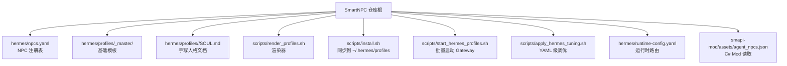
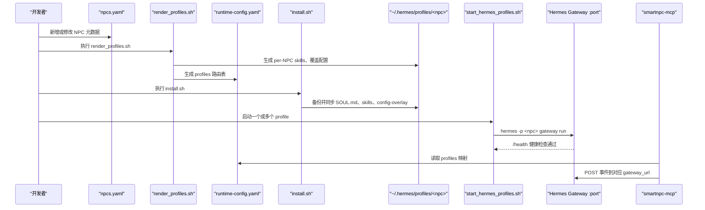
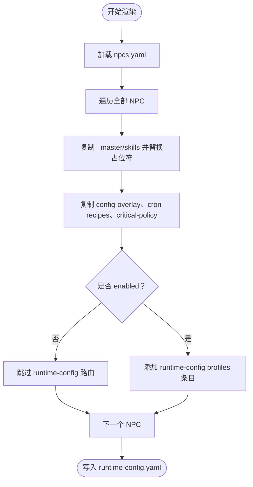
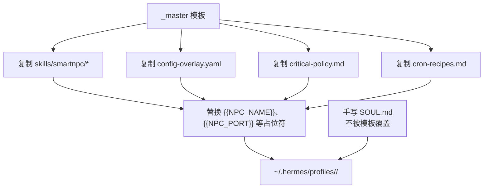
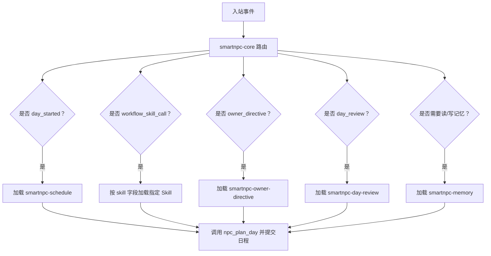
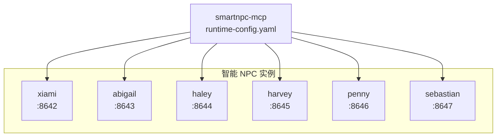
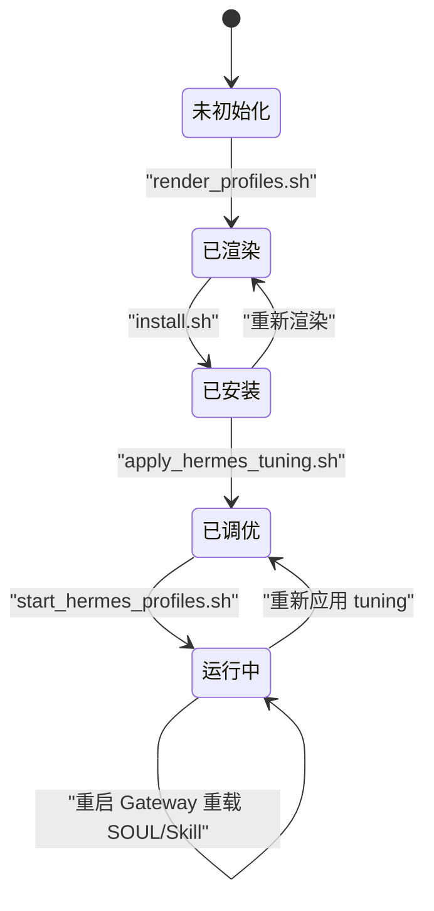
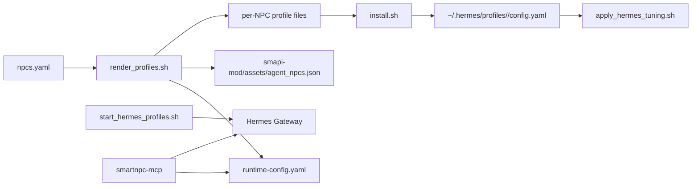

# Hermes Agent Profiles 架构

<cite>
**本文引用的文件**   
- [npcs.yaml](file://SmartNPC/hermes/npcs.yaml)
- [runtime-config.yaml](file://SmartNPC/hermes/runtime-config.yaml)
- [hermes README](file://SmartNPC/hermes/README.md)
- [Hermes Profiles 文档](file://SmartNPC/docs/hermes-profiles.md)
- [render_profiles.sh](file://SmartNPC/scripts/render_profiles.sh)
- [install.sh](file://SmartNPC/scripts/install.sh)
- [start_hermes_profiles.sh](file://SmartNPC/scripts/start_hermes_profiles.sh)
- [apply_hermes_tuning.sh](file://SmartNPC/scripts/apply_hermes_tuning.sh)
- [xiami SOUL.md](file://SmartNPC/hermes/profiles/xiami/SOUL.md)
- [_master critical-policy.md](file://SmartNPC/hermes/profiles/_master/critical-policy.md)
- [_master smartnpc-core SKILL.md](file://SmartNPC/hermes/profiles/_master/skills/smartnpc/smartnpc-core/SKILL.md)
- [_master smartnpc-schedule SKILL.md](file://SmartNPC/hermes/profiles/_master/skills/smartnpc/smartnpc-schedule/SKILL.md)
</cite>

## 目录
1. [引言](#引言)
2. [项目结构](#项目结构)
3. [核心组件](#核心组件)
4. [架构总览](#架构总览)
5. [详细组件分析](#详细组件分析)
6. [依赖关系分析](#依赖关系分析)
7. [性能与资源特性](#性能与资源特性)
8. [故障排查指南](#故障排查指南)
9. [结论](#结论)
10. [附录：创建自定义 NPC Profile 完整流程](#附录创建自定义-npc-profile-完整流程)

## 引言
本文件系统化梳理 SmartNPC 项目中 Hermes Agent Profiles 的架构，重点回答以下问题：
- 如何通过 `npcs.yaml` 注册 NPC，并生成运行时配置。
- SOUL.md 如何描述角色背景、行为准则和技能入口。
- `_master` 基础模板如何被渲染到每个具体 NPC Profile。
- SKILL.md 的技能结构、组合方式和上下文管理。
- 多 NPC 如何独立运行、事件隔离和资源分配。
- Profile 生命周期管理与配置热重载机制。
- 从 SOUL.md 编写到技能配置的完整自定义示例。

## 项目结构
Hermes Profile 相关源码集中在仓库根下的 `SmartNPC/hermes/` 与 `SmartNPC/scripts/` 中，同时由 C# SMAPI Mod 和 Go 侧 `smartnpc-mcp` 共同消费。



**图示来源**
- [npcs.yaml:1-70](file://SmartNPC/hermes/npcs.yaml#L1-L70)
- [render_profiles.sh:1-183](file://SmartNPC/scripts/render_profiles.sh#L1-L183)
- [install.sh:1-200](file://SmartNPC/scripts/install.sh#L1-L200)
- [start_hermes_profiles.sh:1-110](file://SmartNPC/scripts/start_hermes_profiles.sh#L1-L110)
- [apply_hermes_tuning.sh:1-189](file://SmartNPC/scripts/apply_hermes_tuning.sh#L1-L189)
- [runtime-config.yaml:1-15](file://SmartNPC/hermes/runtime-config.yaml#L1-L15)

**章节来源**
- [hermes README:1-147](file://SmartNPC/hermes/README.md#L1-L147)
- [Hermes Profiles 文档:1-200](file://SmartNPC/docs/hermes-profiles.md#L1-L200)

## 核心组件
Hermes Profile 体系由五类核心构件组成：
- **NPC 注册表**：`hermes/npcs.yaml`，定义所有 NPC 的 id、游戏内名称、显示名、Gateway 端口、启用状态和同伴关系。
- **基础模板**：`hermes/profiles/_master/`，包含共享 Skill、关键策略、定时任务配方和配置覆盖层。
- **每 NPC 人格文档**：各 `<npc>/SOUL.md`，手写身份、性格、说话风格、边界和工具原则。
- **渲染与安装脚本**：`render_profiles.sh` 生成每 NPC 副本及运行时配置；`install.sh` 把仓库版本同步到用户本地 Hermes profile 目录。
- **运行时控制脚本**：`start_hermes_profiles.sh` 启动多个 Gateway；`apply_hermes_tuning.sh` 修正并合并 `config.yaml` 中的模型与压缩参数。

**章节来源**
- [npcs.yaml:1-70](file://SmartNPC/hermes/npcs.yaml#L1-L70)
- [_master critical-policy.md:1-33](file://SmartNPC/hermes/profiles/_master/critical-policy.md#L1-L33)
- [xiami SOUL.md:1-27](file://SmartNPC/hermes/profiles/xiami/SOUL.md#L1-L27)
- [render_profiles.sh:1-183](file://SmartNPC/scripts/render_profiles.sh#L1-L183)
- [install.sh:1-200](file://SmartNPC/scripts/install.sh#L1-L200)
- [start_hermes_profiles.sh:1-110](file://SmartNPC/scripts/start_hermes_profiles.sh#L1-L110)
- [apply_hermes_tuning.sh:1-189](file://SmartNPC/scripts/apply_hermes_tuning.sh#L1-L189)

## 架构总览
Hermes Profile 并非只存在于静态文件中，而是经历“注册 → 渲染 → 安装 → 启动 → 运行时路由”的完整流水线。



**图示来源**
- [render_profiles.sh:1-183](file://SmartNPC/scripts/render_profiles.sh#L1-L183)
- [runtime-config.yaml:1-15](file://SmartNPC/hermes/runtime-config.yaml#L1-L15)
- [install.sh:1-200](file://SmartNPC/scripts/install.sh#L1-L200)
- [start_hermes_profiles.sh:1-110](file://SmartNPC/scripts/start_hermes_profiles.sh#L1-L110)

## 详细组件分析

### NPC 注册机制与 `npcs.yaml` 格式
`npcs.yaml` 是 Profile 注册的单一事实来源。它维护一个 `npcs` 列表，每个条目至少包含：
- `id`：内部小写 ID，用于目录名、conversation 和 model 名。
- `game_name`：PascalCase 游戏内名称，如 `XiaMi`、`Abigail`。
- `display_name`：中文显示名，用于日志和渲染占位符。
- `gateway_port`：该 NPC Gateway 独占的 HTTP 端口。
- `enabled`：是否允许自动启动。
- `kind`：区分 `custom` 或 `vanilla` 等 NPC 类型。
- `peer_a_*` / `peer_b_*`：同伴 NPC 的名称和显示名，用于模板占位符注入。

渲染脚本会解析该注册表，为所有 NPC（包括未启用的）生成 Profile 文件，并为启用的 NPC 生成 `runtime-config.yaml` 中的路由条目。

| 字段 | 含义 | 影响范围 |
|---|---|---|
| `id` | Profile 目录名、conversation、model | 渲染输出、Gateway 启动参数 |
| `game_name` | 游戏内 PascalCase 名称 | runtime-config 的 `npc_filter`、Mod 侧判断 |
| `display_name` | 中文显示名 | 渲染占位符 `{{NPC_DISPLAY}}` |
| `gateway_port` | Gateway 监听端口 | 进程绑定、健康检查、MCP 路由 |
| `enabled` | 是否允许批量启动 | `start_hermes_profiles.sh` 忽略禁用项 |
| `kind` | NPC 分类 | 当前主要用于标识，不直接改变渲染逻辑 |
| `peer_a_name` / `peer_b_name` | 同伴 PascalCase 名 | 渲染进 SOUL、Skill、策略中的对话上下文 |
| `peer_a_display` / `peer_b_display` | 同伴中文显示名 | 渲染进人类可读内容 |

**章节来源**
- [npcs.yaml:1-70](file://SmartNPC/hermes/npcs.yaml#L1-L70)
- [render_profiles.sh:1-183](file://SmartNPC/scripts/render_profiles.sh#L1-L183)

### 运行时配置生成过程
`render_profiles.sh` 会生成 `hermes/runtime-config.yaml`，其 `profiles` 列表仅包含 `enabled: true` 的 NPC。每条记录包含：
- `name`：小写 profile 名。
- `npc_filter`：PascalCase 游戏内名称，供 smartnpc-mcp 按 NPC 匹配事件。
- `gateway_url`：使用 `${SMARTNPC_HERMES_GATEWAY_HOST}` 加端口拼接。
- `conversation`：默认等于 profile 名。
- `model`：默认等于 profile 名。
- `api_key_env`：Bearer Token 环境变量名。

这个文件不是手写维护的；每次渲染都会重写。开发者只需要维护 `npcs.yaml`，然后重新执行渲染脚本。



**图示来源**
- [render_profiles.sh:1-183](file://SmartNPC/scripts/render_profiles.sh#L1-L183)
- [runtime-config.yaml:1-15](file://SmartNPC/hermes/runtime-config.yaml#L1-L15)

**章节来源**
- [render_profiles.sh:1-183](file://SmartNPC/scripts/render_profiles.sh#L1-L183)
- [runtime-config.yaml:1-15](file://SmartNPC/hermes/runtime-config.yaml#L1-L15)

### SOUL.md 文件格式与语义
`SOUL.md` 是每个 NPC 的人格文档，属于“不可由渲染脚本改写”的手写文件。它描述的是 NPC 的长期身份和行为倾向，而不是当天状态或会话历史。

以夏弥为例，其 SOUL.md 主要体现以下层次：
- **身份**：说明 NPC 是谁、受雇于谁、职责边界。
- **性格**：决策风格和语气基调，例如理性、经营导向、汇报简洁。
- **纪律**：明确禁止的行为，例如不把游戏内玩家当作互动对象、限制 `chat_say` 用途。
- **经营信条**：业务层面的优先级，例如出货变现、留种与库存平衡、雨天调整计划。
- **边界**：对农场主指示的处理方式、对外暴露信息的限制。

Hermes Profiles 文档将 SOUL.md 的常见章节归纳为身份、性格、说话风格、灵魂层次、好感度对应语气、绝对禁止、工具使用原则和人设背景。这些内容共同构成系统提示词的人格层，但不应承载易变的游戏状态。

| SOUL.md 主题 | 作用 | 变更频率 |
|---|---|---|
| 身份 | 定义 NPC 在系统中的角色 | 低 |
| 性格 | 决定语言风格和决策倾向 | 低 |
| 说话风格 | 控制回复长度、语气和禁忌 | 低 |
| 灵魂层次 | 表面人设与隐藏深度 | 低 |
| 好感度对应语气 | 不同好感档位的语言表现 | 低 |
| 绝对禁止 | 不可突破的角色边界 | 极低 |
| 工具使用原则 | 引导何时调用 MCP 工具 | 中 |
| 人设背景 | 内部设定，不一定主动表达 | 低 |

**章节来源**
- [xiami SOUL.md:1-27](file://SmartNPC/hermes/profiles/xiami/SOUL.md#L1-L27)
- [Hermes Profiles 文档:1-200](file://SmartNPC/docs/hermes-profiles.md#L1-L200)

### Profile 继承机制：`_master` 与具体 NPC Profile
本项目没有使用传统面向对象意义上的“继承”，而是采用**模板 + 渲染 + 覆盖**机制：
- `_master/` 是所有 Profile 的基础模板。
- `render_profiles.sh` 会把 `_master/skills/` 完整复制到每个 NPC 的 `skills/` 目录，并删除目标目录后重建，确保已移除的 Skill 不会残留。
- `_master/config-overlay.yaml`、`_master/cron-recipes.md`、`_master/critical-policy.md` 会被复制到每个 NPC 目录。
- 渲染过程中，所有 `.md` 和 `.yaml` 文件中的占位符会被替换为 `npcs.yaml` 提供的值。
- `SOUL.md` 不在 `_master/` 中，也不会被渲染脚本修改，因此它是真正“每 NPC 独有”的文件。



**图示来源**
- [render_profiles.sh:1-183](file://SmartNPC/scripts/render_profiles.sh#L1-L183)
- [hermes README:1-147](file://SmartNPC/hermes/README.md#L1-L147)

需要特别注意：**不要直接编辑生成的 per-NPC 的 `skills/`、`config-overlay.yaml`、`cron-recipes.md` 或 `critical-policy.md`**。正确做法是修改 `_master/` 对应文件，再运行 `render_profiles.sh`。

**章节来源**
- [render_profiles.sh:1-183](file://SmartNPC/scripts/render_profiles.sh#L1-L183)
- [hermes README:1-147](file://SmartNPC/hermes/README.md#L1-L147)

### 技能系统：SKILL.md、技能组合与上下文管理
每个 Skill 是一个子目录，目录下必须有一个 `SKILL.md`。其 YAML frontmatter 通常包含：
- `name`：Skill 唯一名。
- `description`：Hermes 用来判断 Skill 相关性的简短描述。
- `version`、`author`、`license`。
- `metadata.hermes.tags`：用于分类和检索。
- `metadata.hermes.always_load`：标记某些关键 Skill 始终加载。

系统中已有若干 Skill，例如：
- `smartnpc-core`：核心路由，负责根据入站事件选择其他 Skill。
- `smartnpc-schedule`：日程规划，指导 `day_started` 时提交 workflow 条目。
- `smartnpc-memory`、`smartnpc-owner-directive`、各类农场工作 Skill。

#### 核心路由与上下文管理
`smartnpc-core` 定义了“可选 Skill 与本核心的关系”：当回合触发某个可选 Skill 时，该 Skill 的规则在与核心冲突时优先，遵循最具体的适用指令。

它的主要职责包括：
- 新会话先调用 `agent_register_self` 完成自我注册。
- 根据事件类型加载对应 Skill：
  - `day_started` → `smartnpc-schedule`。
  - `workflow_skill_call` → 按事件中指定的 Skill 动态加载。
  - `owner_directive` → `smartnpc-owner-directive`。
  - `day_review` → `smartnpc-day-review`。
  - 读/写长期记忆 → `smartnpc-memory`。
- 约束 `chat_say` 作为每日限量的工作播报，并在收到 `TURN_END` 后停止继续调用工具。
- 要求 MCP 工具调用显式传入当前 NPC 的内部名。



**图示来源**
- [_master smartnpc-core SKILL.md:1-68](file://SmartNPC/hermes/profiles/_master/skills/smartnpc/smartnpc-core/SKILL.md#L1-L68)
- [_master smartnpc-schedule SKILL.md:1-128](file://SmartNPC/hermes/profiles/_master/skills/smartnpc/smartnpc-schedule/SKILL.md#L1-L128)

#### 日程 Skill 的工作流组合
`smartnpc-schedule` 强调日程不是纯文本，而是由 `workflow_id` 驱动的任务条目。它要求：
- 首次规划前调用 `workflow_list` 发现可用工作流。
- 调用 `npc_get_schedule` 避免重复规划。
- 提交 9-13 条条目，覆盖全天。
- 不排入 23:30 的 `day_review`，因为该条目由系统自动追加。
- 根据天气、季节、游戏阶段调整优先级。

典型工作流包括农场扩展、日常养护、清理、采集、傍晚收尾和日终复盘。

**章节来源**
- [_master smartnpc-core SKILL.md:1-68](file://SmartNPC/hermes/profiles/_master/skills/smartnpc/smartnpc-core/SKILL.md#L1-L68)
- [_master smartnpc-schedule SKILL.md:1-128](file://SmartNPC/hermes/profiles/_master/skills/smartnpc/smartnpc-schedule/SKILL.md#L1-L128)

### 多 NPC 管理模式：独立运行、事件隔离与资源分配
多 NPC 管理的关键在于“一 NPC 一 Gateway、一 NPC 一端口”。

| 维度 | 实现方式 |
|---|---|
| 独立运行 | 每个启用的 NPC 由 `start_hermes_profiles.sh` 单独启动 `hermes -p <npc> gateway run --accept-hooks` |
| 端口隔离 | `npcs.yaml` 中每个 NPC 有独立 `gateway_port` |
| 进程隔离 | 每个 Gateway 子进程独立运行，日志写入各自 `~/.hermes/profiles/<npc>/logs/` |
| 事件路由 | `runtime-config.yaml` 把 `npc_filter` 映射到对应 `gateway_url` |
| 配置隔离 | 每个 Profile 拥有自己的 `config.yaml`、`.env`、`state.db`、`memories/`、`sessions/` |
| Mod 侧开关 | `render_profiles.sh` 还会生成 `smapi-mod/assets/agent_npcs.json`，供 C# Mod 读取 |

`start_hermes_profiles.sh` 会：
- 校验请求的 profile 是否存在且已启用。
- 尝试终止占用端口的旧进程。
- 加载对应 Profile 的 `.env`。
- 后台启动 Gateway。
- 轮询 `/health`，直到超时或健康。



**图示来源**
- [npcs.yaml:1-70](file://SmartNPC/hermes/npcs.yaml#L1-L70)
- [runtime-config.yaml:1-15](file://SmartNPC/hermes/runtime-config.yaml#L1-L15)
- [start_hermes_profiles.sh:1-110](file://SmartNPC/scripts/start_hermes_profiles.sh#L1-L110)

**章节来源**
- [npcs.yaml:1-70](file://SmartNPC/hermes/npcs.yaml#L1-L70)
- [runtime-config.yaml:1-15](file://SmartNPC/hermes/runtime-config.yaml#L1-L15)
- [start_hermes_profiles.sh:1-110](file://SmartNPC/scripts/start_hermes_profiles.sh#L1-L110)

### Profile 生命周期管理与配置热重载
Profile 的生命周期分为六个阶段：

| 阶段 | 动作 | 关键文件 |
|---|---|---|
| 初始化 | 首次执行任意 `hermes -p <name>` 命令创建本地 profile 目录 | `~/.hermes/profiles/<name>/` |
| 渲染 | 从 `_master/` 复制并替换占位符，生成 per-NPC 文件 | `render_profiles.sh` |
| 安装 | 备份、同步 SOUL.md、skills、配置覆盖层，合并 `config.yaml` | `install.sh` |
| 调优 | 用 PyYAML 安全写入 model、providers、compression、agent 配置 | `apply_hermes_tuning.sh` |
| 启动 | 启动 Gateway 并等待 `/health` | `start_hermes_profiles.sh` |
| 运行时 | smartnpc-mcp 按 `npc_filter` 转发事件 | `runtime-config.yaml` |

关于热重载：
- 修改 `SOUL.md` 或 Skill 内容后，需要重新执行 `install.sh`，并重启 Gateway，才能生效。
- 修改 `npcs.yaml` 后，需要重新执行 `render_profiles.sh`，再根据需要重新安装。
- `config.yaml` 级别的共享改动应放在 `_master/config-overlay.yaml`，然后重新渲染。
- `apply_hermes_tuning.sh` 是对已存在的 `config.yaml` 做幂等合并，避免重复 top-level key 导致 Hermes 静默丢弃配置。



**图示来源**
- [hermes README:1-147](file://SmartNPC/hermes/README.md#L1-L147)
- [render_profiles.sh:1-183](file://SmartNPC/scripts/render_profiles.sh#L1-L183)
- [install.sh:1-200](file://SmartNPC/scripts/install.sh#L1-L200)
- [apply_hermes_tuning.sh:1-189](file://SmartNPC/scripts/apply_hermes_tuning.sh#L1-L189)
- [start_hermes_profiles.sh:1-110](file://SmartNPC/scripts/start_hermes_profiles.sh#L1-L110)

**章节来源**
- [hermes README:1-147](file://SmartNPC/hermes/README.md#L1-L147)
- [apply_hermes_tuning.sh:1-189](file://SmartNPC/scripts/apply_hermes_tuning.sh#L1-L189)

## 依赖关系分析
Profile 系统依赖多层协作：



**图示来源**
- [render_profiles.sh:1-183](file://SmartNPC/scripts/render_profiles.sh#L1-L183)
- [install.sh:1-200](file://SmartNPC/scripts/install.sh#L1-L200)
- [apply_hermes_tuning.sh:1-189](file://SmartNPC/scripts/apply_hermes_tuning.sh#L1-L189)
- [start_hermes_profiles.sh:1-110](file://SmartNPC/scripts/start_hermes_profiles.sh#L1-L110)

耦合关系要点：
- `npcs.yaml` 是渲染器和启动器的共同输入。
- `runtime-config.yaml` 是 smartnpc-mcp 的路依据。
- `install.sh` 依赖 Python 的 PyYAML，否则无法安全合并配置。
- `apply_hermes_tuning.sh` 依赖 PyYAML 进行真正的 YAML union，避免 dumb append 造成键覆盖。
- `start_hermes_profiles.sh` 依赖端口未被占用，并依赖 `/health` 健康检查。

**章节来源**
- [render_profiles.sh:1-183](file://SmartNPC/scripts/render_profiles.sh#L1-L183)
- [install.sh:1-200](file://SmartNPC/scripts/install.sh#L1-L200)
- [apply_hermes_tuning.sh:1-189](file://SmartNPC/scripts/apply_hermes_tuning.sh#L1-L189)
- [start_hermes_profiles.sh:1-110](file://SmartNPC/scripts/start_hermes_profiles.sh#L1-L110)

## 性能与资源特性
- **并发隔离**：每个 NPC 使用独立 Gateway 进程和端口，避免 LLM 调用、MCP 工具和事件处理互相阻塞。
- **端口分配**：每个 NPC 必须分配唯一 `gateway_port`，否则会因端口冲突启动失败。
- **配置合并成本**：`apply_hermes_tuning.sh` 使用 PyYAML 解析并回写 `config.yaml`，对大配置文件有少量 I/O 开销，但保证幂等和安全。
- **Skill 加载策略**：核心 Skill 可标记为 always load，其他 Skill 按需通过 `skill_view` 加载，减少初始上下文膨胀。
- **工作流驱动**：日程和工作流由引擎自动执行，LLM 只在必要节点参与决策，避免无意义循环。
- **压缩与上下文窗口**：tuning 脚本开启 compression，并设置较大的 context_length，以便容纳长对话和日程信息，同时保留输出空间。

[本节为通用性能讨论，不直接分析具体代码行]

## 故障排查指南

| 现象 | 可能原因 | 排查步骤 |
|---|---|---|
| 新增 NPC 后消息丢失 | `runtime-config.yaml` 缺少对应条目或端口不一致 | 重新执行 `render_profiles.sh`，核对 `gateway_url` 与 `API_SERVER_PORT` |
| Gateway 启动失败 | 端口被占用 | 查看 `start_hermes_profiles.sh` 是否杀掉了旧进程；检查 `/tmp/hermes-<profile>.pid` |
| MCP 连不上 Hermes | WSL 或 host IP 不通 | 从 WSL curl Gateway `/health`，确认端口绑定 |
| `mcp test` 报 streamable_http 不可用 | Hermes venv 缺少 mcp Python 包 | 按 hermes README 安装 `mcp` |
| `config.yaml` 出现重复顶层 key | `install.sh` 的 dumb append 与现有 block 冲突 | 使用 `apply_hermes_tuning.sh` 重新调优 |
| Skill 更新未生效 | 未重新安装或未重启 Gateway | 重新执行 `install.sh`，重启对应 Gateway |
| 调度过于稀疏 | 日程条目少于推荐范围 | 检查 `smartnpc-schedule` 的 9-13 条规则和配额 |
| 播报过多或循环调用工具 | system prompt 与 Skill 策略冲突 | 确认 `agent.tool_use_enforcement=false` 已生效 |

**章节来源**
- [hermes README:1-147](file://SmartNPC/hermes/README.md#L1-L147)
- [start_hermes_profiles.sh:1-110](file://SmartNPC/scripts/start_hermes_profiles.sh#L1-L110)
- [apply_hermes_tuning.sh:1-189](file://SmartNPC/scripts/apply_hermes_tuning.sh#L1-L189)

## 结论
Hermes Agent Profiles 的核心思想是“声明式注册 + 模板渲染 + 运行时路由”。`npcs.yaml` 提供统一注册源，`_master/` 提供共享能力，`SOUL.md` 保持每 NPC 独特人格，`runtime-config.yaml` 把游戏事件精确投递到对应 Gateway。Skill 系统通过核心路由和可选 Skill 的组合，既保证一致性，又支持灵活扩展。多 NPC 通过端口、进程和配置隔离实现稳定并行运行。

## 附录：创建自定义 NPC Profile 完整流程

### 第一步：注册 NPC
在 `hermes/npcs.yaml` 中添加一条 NPC 记录，包含：
- 唯一 `id`。
- `game_name` 和 `display_name`。
- 空闲的 `gateway_port`。
- `enabled: true`。
- 合适的 `peer_a_*` / `peer_b_*`。

**章节来源**
- [npcs.yaml:1-70](file://SmartNPC/hermes/npcs.yaml#L1-L70)

### 第二步：创建 SOUL.md
新建 `hermes/profiles/<new-npc>/SOUL.md`，至少涵盖：
- 身份。
- 性格。
- 说话风格。
- 三条纪律或等价行为约束。
- 业务信条或领域偏好。
- 边界条件，包括是否与其他 NPC 或玩家互动。

可以参照夏弥的结构，但不要复制其具体内容；应根据新 NPC 的职责定制。

**章节来源**
- [xiami SOUL.md:1-27](file://SmartNPC/hermes/profiles/xiami/SOUL.md#L1-L27)
- [Hermes Profiles 文档:1-200](file://SmartNPC/docs/hermes-profiles.md#L1-L200)

### 第三步：准备配置覆盖层
若该 NPC 需要独立的 Gateway，则创建 `hermes/profiles/<new-npc>/config-overlay.yaml`，并确保：
- `API_SERVER_PORT` 不与其它 Profile 冲突。
- `API_SERVER_MODEL_NAME` 与该 profile 一致。
- `mcp_servers` 指向 smartnpc-mcp 的 MCP endpoint。

如果不需要独立 Gateway，可复用已有端口策略，但需确保与 `runtime-config.yaml` 和 Mod 侧注册一致。

**章节来源**
- [hermes README:1-147](file://SmartNPC/hermes/README.md#L1-L147)

### 第四步：渲染并验证
执行：
```bash
bash scripts/render_profiles.sh
task profiles:verify
```

验证点：
- `hermes/profiles/<new-npc>/` 下存在 `skills/`、`config-overlay.yaml`、`critical-policy.md`、`cron-recipes.md`。
- `hermes/runtime-config.yaml` 中包含新 NPC 的 profile 条目。
- `smapi-mod/assets/agent_npcs.json` 中包含新 NPC 的启用状态。

**章节来源**
- [render_profiles.sh:1-183](file://SmartNPC/scripts/render_profiles.sh#L1-L183)

### 第五步：安装到本地 Hermes
在 WSL 中执行：
```bash
bash /mnt/d/SmartNPC/hermes/install.sh
```

成功后检查：
- `~/.hermes/profiles/<new-npc>/SOUL.md` 已同步。
- `~/.hermes/profiles/<new-npc>/config.yaml` 包含 `mcp_servers` 和 `API_SERVER_*`。
- `~/.hermes/profiles/<new-npc>/skills/smartnpc/` 已包含共享 Skill。

**章节来源**
- [install.sh:1-200](file://SmartNPC/scripts/install.sh#L1-L200)

### 第六步：调优模型与压缩
执行：
```bash
bash scripts/apply_hermes_tuning.sh <new-npc>
```

这会写入：
- `model.provider = custom:smartnpc-agent`。
- `model.default` 和 `model.base_url`。
- `providers.smartnpc-agent.key_env`。
- `compression.*`。
- `agent.tool_use_enforcement = false`。

**章节来源**
- [apply_hermes_tuning.sh:1-189](file://SmartNPC/scripts/apply_hermes_tuning.sh#L1-L189)

### 第七步：启动并验证
执行：
```bash
bash scripts/start_hermes_profiles.sh <new-npc>
```

然后：
- 确认 Gateway `/health` 返回健康。
- 在 WSL 中测试 MCP 连接。
- 确认 smartnpc-mcp 能向新 Gateway 发送事件。

**章节来源**
- [start_hermes_profiles.sh:1-110](file://SmartNPC/scripts/start_hermes_profiles.sh#L1-L110)
- [hermes README:1-147](file://SmartNPC/hermes/README.md#L1-L147)

### 第八步：扩展或修改 Skill
如需修改共享 Skill：
- 编辑 `hermes/profiles/_master/skills/smartnpc/<skill>/SKILL.md`。
- 重新执行 `render_profiles.sh`。
- 重新执行 `install.sh`。
- 重启对应 Gateway。

如需新增 Skill：
- 在 `_master/skills/smartnpc/<new-skill>/` 创建 `SKILL.md`。
- 在 frontmatter 中填写 `name`、`description`、`version`、`author`、`license` 和 `metadata.hermes.tags`。
- 在 `smartnpc-core` 或相关 Skill 中增加路由或调用约定。

**章节来源**
- [hermes README:1-147](file://SmartNPC/hermes/README.md#L1-L147)
- [_master smartnpc-core SKILL.md:1-68](file://SmartNPC/hermes/profiles/_master/skills/smartnpc/smartnpc-core/SKILL.md#L1-L68)