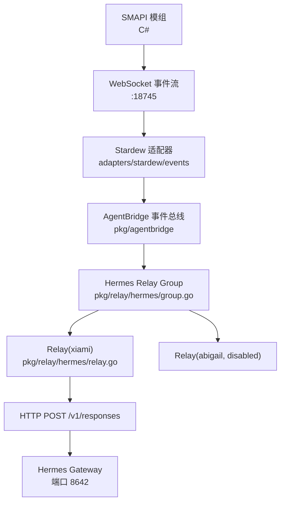
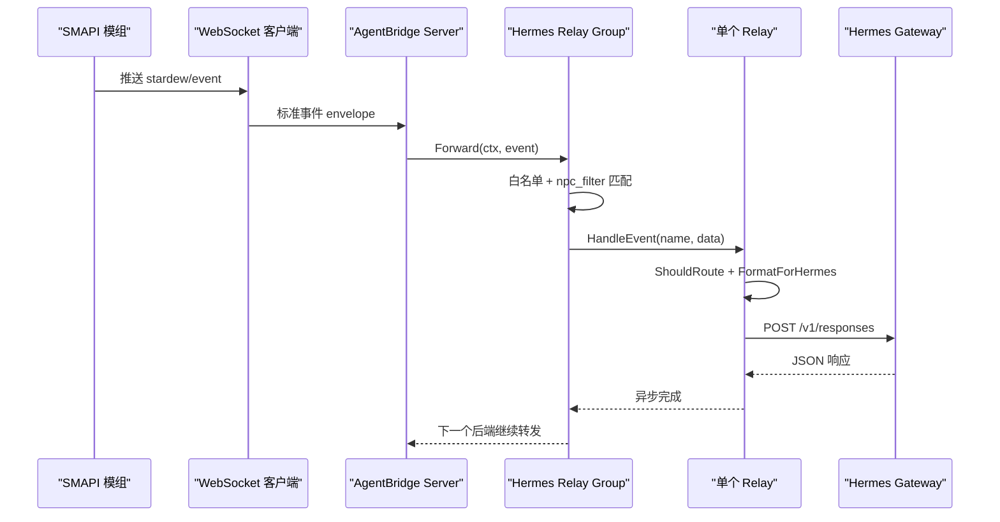
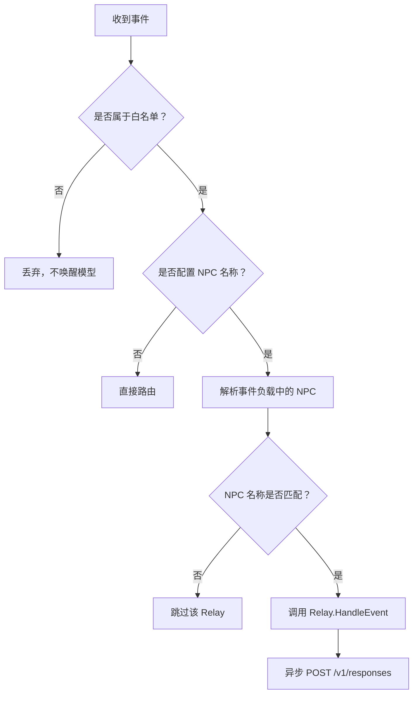
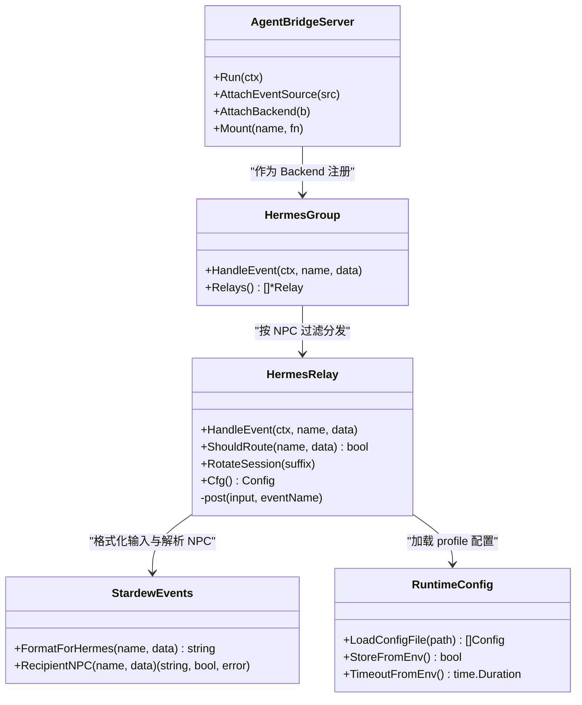

# Hermes 中继系统

<cite>
**本文引用的文件**   
- [current-architecture.md](file://SmartNPC/docs/current-architecture.md)
- [hermes-profiles.md](file://SmartNPC/docs/hermes-profiles.md)
- [events.md](file://SmartNPC/docs/events.md)
- [protocol.md](file://SmartNPC/docs/protocol.md)
- [hermes-event-trigger.md](file://SmartNPC/docs/hermes-event-trigger.md)
- [npcs.yaml](file://SmartNPC/hermes/npcs.yaml)
- [runtime-config.yaml](file://SmartNPC/hermes/runtime-config.yaml)
- [relay.go](file://SmartNPC/smartnpc-mcp/pkg/relay/hermes/relay.go)
- [config.go](file://SmartNPC/smartnpc-mcp/pkg/relay/hermes/config.go)
- [factory.go](file://SmartNPC/smartnpc-mcp/pkg/relay/hermes/factory.go)
- [group.go](file://SmartNPC/smartnpc-mcp/pkg/relay/hermes/group.go)
- [format.go](file://SmartNPC/smartnpc-mcp/adapters/stardew/events/format.go)
- [events.go](file://SmartNPC/smartnpc-mcp/adapters/stardew/events/events.go)
- [eventsource.go](file://SmartNPC/smartnpc-mcp/pkg/agentbridge/eventsource.go)
- [server.go](file://SmartNPC/smartnpc-mcp/pkg/agentbridge/server.go)
- [config.go](file://SmartNPC/smartnpc-mcp/pkg/agentbridge/config.go)
</cite>

## 目录
1. [引言](#引言)
2. [项目结构](#项目结构)
3. [核心组件](#核心组件)
4. [架构总览](#架构总览)
5. [详细组件分析](#详细组件分析)
6. [依赖关系分析](#依赖关系分析)
7. [性能与调优](#性能与调优)
8. [故障恢复与排障](#故障恢复与排障)
9. [结论](#结论)

## 引言
Hermes 中继系统位于 SmartNPC 的 Go 服务 `smartnpc-mcp` 中，负责把 Stardew Valley SMAPI 模组产生的游戏事件转发给 Hermes Gateway，并让模型通过 MCP 工具反向驱动游戏状态。当前仓库的实验分支将 SmartNPC 收缩为“单 Agent 农场管家”运行形态：只有 `xiami`（游戏内名 `XiaMi`）被启用；其余 NPC profile 仍保留但不激活。

文档聚焦以下目标：
- 解释单 Profile 模式与多 Profile 扇出模式的实现差异。
- 描述连接管理、消息分发策略和会话轮换。
- 说明路由器的过滤规则、优先级排序及负载均衡设计。
- 阐述过滤器机制，包括基于 NPC ID、事件类型和事件渲染结果的匹配。
- 梳理会话状态管理，包括上下文保持、超时处理和资源回收。
- 提供性能调优建议和故障恢复机制。

## 项目结构
Hermes 中继相关代码集中在 `smartnpc-mcp/pkg/relay/hermes`，并通过 agent-bridge 框架接入统一的事件总线；配置由 `hermes/npcs.yaml` 生成 `hermes/runtime-config.yaml`，再由 relay 加载。

**图表来源**
- [server.go:104-177](file://SmartNPC/smartnpc-mcp/pkg/agentbridge/server.go#L104-L177)
- [factory.go:17-68](file://SmartNPC/smartnpc-mcp/pkg/relay/hermes/factory.go#L17-L68)
- [group.go:13-81](file://SmartNPC/smartnpc-mcp/pkg/relay/hermes/group.go#L13-L81)
- [relay.go:104-167](file://SmartNPC/smartnpc-mcp/pkg/relay/hermes/relay.go#L104-L167)

**章节来源**
- [current-architecture.md:1-40](file://SmartNPC/docs/current-architecture.md#L1-L40)
- [hermes-profiles.md:1-80](file://SmartNPC/docs/hermes-profiles.md#L1-L80)
- [npcs.yaml:1-70](file://SmartNPC/hermes/npcs.yaml#L1-L70)
- [runtime-config.yaml:1-15](file://SmartNPC/hermes/runtime-config.yaml#L1-L15)

## 核心组件
| 组件 | 职责 | 关键文件 |
|---|---|---|
| AgentBridge Server | 启动所有 EventSource，按注册顺序把事件分发给 Backend | [server.go](file://SmartNPC/smartnpc-mcp/pkg/agentbridge/server.go) |
| Stardew 适配器 | 从 WebSocket 读取事件，构造标准 envelope | [events.go](file://SmartNPC/smartnpc-mcp/adapters/stardew/events/events.go) |
| 事件格式化器 | 把原始事件转成 Hermes 可读的 `input` 文本 | [format.go](file://SmartNPC/smartnpc-mcp/adapters/stardew/events/format.go) |
| Hermes Relay Group | 根据 `npc_filter` 把事件扇出到匹配的 Relay | [group.go](file://SmartNPC/smartnpc-mcp/pkg/relay/hermes/group.go) |
| Hermes Relay | 单次 NPC 对话的出站转发、会话轮换、超时控制 | [relay.go](file://SmartNPC/smartnpc-mcp/pkg/relay/hermes/relay.go) |
| Runtime 配置加载 | 解析 `runtime-config.yaml`，注入环境变量、鉴权键和日志开关 | [config.go](file://SmartNPC/smartnpc-mcp/pkg/relay/hermes/config.go) |
| Factory | 把 hermes relay 注册为 agent-bridge 的 Backend | [factory.go](file://SmartNPC/smartnpc-mcp/pkg/relay/hermes/factory.go) |

**章节来源**
- [eventsource.go:1-40](file://SmartNPC/smartnpc-mcp/pkg/agentbridge/eventsource.go#L1-L40)
- [server.go:24-177](file://SmartNPC/smartnpc-mcp/pkg/agentbridge/server.go#L24-L177)
- [config.go:1-154](file://SmartNPC/smartnpc-mcp/pkg/agentbridge/config.go#L1-L154)

## 架构总览
Hermes 中继不是独立进程，而是 `smartnpc-mcp` 内部的一个后端。它复用同一个 MCP server，既接收模型侧的工具调用，也接收来自 SMAPI 模组的游戏事件。

**图表来源**
- [server.go:104-177](file://SmartNPC/smartnpc-mcp/pkg/agentbridge/server.go#L104-L177)
- [group.go:44-81](file://SmartNPC/smartnpc-mcp/pkg/relay/hermes/group.go#L44-L81)
- [relay.go:104-167](file://SmartNPC/smartnpc-mcp/pkg/relay/hermes/relay.go#L104-L167)
- [events.go:1-60](file://SmartNPC/smartnpc-mcp/adapters/stardew/events/events.go#L1-L60)

## 详细组件分析

### 单 Profile 模式与多 Profile 扇出模式
当前运行时只启用了 `xiami`，因此实际是“单 Profile 模式”。但代码支持多 Profile 扇出：每个 profile 对应一个 Relay，Group 会遍历所有 Relay，把事件投递给 `npc_filter` 匹配的目标。

| 维度 | 单 Profile 模式 | 多 Profile 扇出模式 |
|---|---|---|
| 配置来源 | `hermes/runtime-config.yaml` 中只有一个 enabled 条目 | 多个 `profiles:` 条目，每个有唯一 `gateway_url` 和 `conversation` |
| 路由逻辑 | Group 只匹配一个 Relay | Group 遍历所有 Relay，按 NPC 名称过滤 |
| 会话隔离 | 一个 conversation ID | 每个 profile 拥有独立 conversation、模型、API key |
| 失败影响 | 仅影响该 NPC | 其他 Relay 不受失败事件影响 |
| 调试建议 | 查看单一 `logs/hermes/xiami-readable.log` | 检查 matched/skipped 日志，确认未发生端口或名称错配 |

**章节来源**
- [current-architecture.md:12-24](file://SmartNPC/docs/current-architecture.md#L12-L24)
- [hermes-profiles.md:60-100](file://SmartNPC/docs/hermes-profiles.md#L60-L100)
- [npcs.yaml:1-70](file://SmartNPC/hermes/npcs.yaml#L1-L70)
- [runtime-config.yaml:1-15](file://SmartNPC/hermes/runtime-config.yaml#L1-L15)

### 路由器设计：事件白名单、NPC 过滤与分发策略
路由器分为两层：

1. **全局白名单层**：`hermesEventAllowed` 只允许四类事件唤醒 Hermes。
2. **Per-NPC 过滤层**：`ShouldRoute` 根据 `cfg.NPCName` 与事件负载中的 recipient 字段做精确匹配。

**图表来源**
- [relay.go:219-263](file://SmartNPC/smartnpc-mcp/pkg/relay/hermes/relay.go#L219-L263)
- [group.go:44-81](file://SmartNPC/smartnpc-mcp/pkg/relay/hermes/group.go#L44-L81)

#### 事件白名单
实验分支只允许：
- `day_started`
- `schedule_trigger`
- `workflow_skill_call`
- `owner_directive`

其余事件，例如 `game_time_tick`、`day_ending`、`forage_collected`，只走本地日程或记账路径，不会唤醒 Hermes。

**章节来源**
- [relay.go:237-263](file://SmartNPC/smartnpc-mcp/pkg/relay/hermes/relay.go#L237-L263)
- [events.md:20-55](file://SmartNPC/docs/events.md#L20-L55)
- [protocol.md:13-33](file://SmartNPC/docs/protocol.md#L13-L33)

#### NPC 过滤规则
- 若 Relay 没有配置 `NPCName`，则所有白名单事件都通过。
- 若事件不包含 recipient 字段，且已配置 NPC 过滤，则视为“无法确认目标”，默认丢弃，避免广播误发。
- 若事件包含 recipient 字段，必须与 `NPCName` 完全一致才通过。

这种“安全默认”设计意味着：配置不一致时宁可丢失消息，也不会把 A 角色的消息误投到 B 角色。

**章节来源**
- [relay.go:225-236](file://SmartNPC/smartnpc-mcp/pkg/relay/hermes/relay.go#L225-L236)
- [group.go:44-72](file://SmartNPC/smartnpc-mcp/pkg/relay/hermes/group.go#L44-L72)

#### 负载均衡算法
当前 Group 的实现是**确定性遍历 + 条件匹配**，而不是传统意义上的负载均衡：
- 按配置文件中的 profile 顺序逐个判断。
- 每个事件最多投递到一个匹配的 Relay。
- 没有轮询、权重、健康检查或失败回退到其他 profile 的逻辑。

因此，多 Profile 模式更接近“按 NPC 名称分流”，而不是“在多个可用实例间分摊负载”。

**章节来源**
- [group.go:44-81](file://SmartNPC/smartnpc-mcp/pkg/relay/hermes/group.go#L44-L81)

### 过滤器机制：NPC ID、事件类型与时间窗口
#### 基于 NPC ID 的过滤
`npc_filter` 使用游戏内部 PascalCase 名称，例如 `XiaMi`。它与 `hermes/profiles/_master` 模板中的占位符和 `npcs.yaml` 的 `game_name` 保持一致。

**章节来源**
- [runtime-config.yaml:1-15](file://SmartNPC/hermes/runtime-config.yaml#L1-L15)
- [npcs.yaml:1-70](file://SmartNPC/hermes/npcs.yaml#L1-L70)
- [hermes-profiles.md:60-80](file://SmartNPC/docs/hermes-profiles.md#L60-L80)

#### 基于事件类型的过滤
事件类型由 `hermesEventAllowed` 硬编码决定。新增可唤醒事件需要同时修改：
1. `hermesEventAllowed` 白名单。
2. `FormatForHermes` 渲染逻辑。
3. 事件文档与测试。

**章节来源**
- [relay.go:237-263](file://SmartNPC/smartnpc-mcp/pkg/relay/hermes/relay.go#L237-L263)
- [format.go:1-60](file://SmartNPC/smartnpc-mcp/adapters/stardew/events/format.go#L1-L60)

#### 基于时间窗口的过滤
当前没有独立的“时间窗口”过滤器。时间相关行为由以下机制间接体现：
- `day_started` 触发每日计划与会话轮换。
- `game_time_tick` 只驱动本地日程，不唤醒模型。
- `schedule_trigger` 携带具体游戏小时和分钟，由模型在触发时刻决定参数。
- `day_ending` 用于日终记账，不进入中继白名单。

如果未来需要“只在白天唤醒”“避开夜间自动睡觉前”等规则，应优先在工作流调度层或工作流技能层实现，而不是在 Relay 层扩展通用时间窗口匹配。

**章节来源**
- [events.md:56-120](file://SmartNPC/docs/events.md#L56-L120)
- [events.go:110-210](file://SmartNPC/smartnpc-mcp/adapters/stardew/events/events.go#L110-L210)

### 连接管理与消息分发策略
#### 出站连接
每个 Relay 持有自己的 `net/http.Client`，默认超时 120 秒。POST 请求附加：
- `model`
- `input`
- `conversation`
- `instructions`
- `store`
- 可选 `Authorization: Bearer <api_key>`

**章节来源**
- [relay.go:27-97](file://SmartNPC/smartnpc-mcp/pkg/relay/hermes/relay.go#L27-L97)
- [relay.go:298-385](file://SmartNPC/smartnpc-mcp/pkg/relay/hermes/relay.go#L298-L385)
- [config.go:27-75](file://SmartNPC/smartnpc-mcp/pkg/relay/hermes/config.go#L27-L75)

#### 并发与串行化
- 不同 NPC 的 Relay 可以并行运行。
- 同一 Relay 内部使用 `turnMu` 串行化一次完整的模型回合，防止并发 POST 导致服务端 transcript 交错。
- `HandleEvent` 本身会启动 goroutine 执行 `post`，但 `post` 内部再次加锁，保证每个 NPC 的 in-flight turn 互斥。

这意味着：**同 NPC 不会双回合并行**，但不同 NPC 之间互不影响。

**章节来源**
- [relay.go:63-74](file://SmartNPC/smartnpc-mcp/pkg/relay/hermes/relay.go#L63-L74)
- [relay.go:104-167](file://SmartNPC/smartnpc-mcp/pkg/relay/hermes/relay.go#L104-L167)
- [relay.go:298-385](file://SmartNPC/smartnpc-mcp/pkg/relay/hermes/relay.go#L298-L385)
- [current-architecture.md:39-54](file://SmartNPC/docs/current-architecture.md#L39-L54)

#### 消息分发策略
- 事件先经过 agent-bridge 的统一 dispatch，再进入 hermes relay group。
- Group 对每个 Relay 调用 `ShouldRoute`。
- 匹配成功的 Relay 异步 POST；不匹配的 Relay 记录 debug 或 warn 日志。
- 如果没有任何 Relay 匹配，Group 记录告警并丢弃事件。

**章节来源**
- [server.go:136-177](file://SmartNPC/smartnpc-mcp/pkg/agentbridge/server.go#L136-L177)
- [group.go:44-81](file://SmartNPC/smartnpc-mcp/pkg/relay/hermes/group.go#L44-L81)

### 会话状态管理：上下文保持、超时处理与资源回收
#### 上下文保持
- mcp 侧不维护短期对话历史。
- 对话历史交给 Hermes Gateway 管理，`Store=true` 时每次事件写入服务端 transcript。
- `instructions` 每次请求附带 critical policy 和 persona，确保压缩后仍可访问关键规则。

**章节来源**
- [relay.go:309-341](file://SmartNPC/smartnpc-mcp/pkg/relay/hermes/relay.go#L309-L341)
- [config.go:117-126](file://SmartNPC/smartnpc-mcp/pkg/relay/hermes/config.go#L117-L126)
- [current-architecture.md:39-54](file://SmartNPC/docs/current-architecture.md#L39-L54)

#### 会话轮换
`day_started` 会触发 `RotateSession`，把 conversation ID 改为 `<base>-<suffix>`，从而开启新的 Hermes 会话，同时保留 gateway/model/persona 配置。

**章节来源**
- [relay.go:201-217](file://SmartNPC/smartnpc-mcp/pkg/relay/hermes/relay.go#L201-L217)
- [current-architecture.md:27-38](file://SmartNPC/docs/current-architecture.md#L27-L38)

#### 超时处理
- 默认 120 秒。
- 可通过 `SMARTNPC_RELAY_TIMEOUT_MS` 覆盖。
- 超时值小于 1000ms 或非数字会被回退到默认值。
- 请求使用 `context.WithTimeout`，错误会记录 elapsed_ms。

**章节来源**
- [relay.go:45-54](file://SmartNPC/smartnpc-mcp/pkg/relay/hermes/relay.go#L45-L54)
- [config.go:128-156](file://SmartNPC/smartnpc-mcp/pkg/relay/hermes/config.go#L128-L156)
- [relay.go:347-385](file://SmartNPC/smartnpc-mcp/pkg/relay/hermes/relay.go#L347-L385)

#### 资源回收
- HTTP 响应体使用 `io.LimitReader(64KB)` 限制读取大小。
- `defer resp.Body.Close()` 确保连接可复用。
- 每个 Relay 持有一个 logger、http client 和内存中缓存的 persona/critical rules。
- agent-bridge 在 ctx 取消后等待所有 EventSource goroutine 结束。

**章节来源**
- [relay.go:347-385](file://SmartNPC/smartnpc-mcp/pkg/relay/hermes/relay.go#L347-L385)
- [server.go:136-177](file://SmartNPC/smartnpc-mcp/pkg/agentbridge/server.go#L136-L177)

## 依赖关系分析

**图表来源**
- [server.go:24-177](file://SmartNPC/smartnpc-mcp/pkg/agentbridge/server.go#L24-L177)
- [factory.go:17-68](file://SmartNPC/smartnpc-mcp/pkg/relay/hermes/factory.go#L17-L68)
- [group.go:13-81](file://SmartNPC/smartnpc-mcp/pkg/relay/hermes/group.go#L13-L81)
- [relay.go:27-167](file://SmartNPC/smartnpc-mcp/pkg/relay/hermes/relay.go#L27-L167)
- [config.go:17-156](file://SmartNPC/smartnpc-mcp/pkg/relay/hermes/config.go#L17-L156)
- [format.go:1-60](file://SmartNPC/smartnpc-mcp/adapters/stardew/events/format.go#L1-L60)

**章节来源**
- [factory.go:17-68](file://SmartNPC/smartnpc-mcp/pkg/relay/hermes/factory.go#L17-L68)
- [group.go:13-81](file://SmartNPC/smartnpc-mcp/pkg/relay/hermes/group.go#L13-L81)
- [relay.go:27-167](file://SmartNPC/smartnpc-mcp/pkg/relay/hermes/relay.go#L27-L167)
- [config.go:17-156](file://SmartNPC/smartnpc-mcp/pkg/relay/hermes/config.go#L17-L156)

## 性能与调优

### 关键瓶颈
1. **模型往返延迟**：默认 120 秒超时，因为 LLM 推理远慢于 HTTP 开销。
2. **persona 与 instructions 大小**：每条请求都会携带 persona 和 critical policy，可能增加 token 消耗。
3. **串行化同一 NPC 回合**：避免 transcript 交错，但也限制同 NPC 并发回复能力。
4. **Group 线性遍历**：profile 数量较多时，每个事件都要逐个判断。

### 推荐调优项
| 类别 | 配置或行为 | 建议 |
|---|---|---|
| 超时 | `SMARTNPC_RELAY_TIMEOUT_MS` | 不要低于 1000ms；生产环境通常保持默认或略高于模型冷启动延迟 |
| 会话存储 | `SMARTNPC_RELAY_STORE` | 默认开启；仅在排查重复记忆问题时临时关闭 |
| 调试日志 | `SMARTNPC_RELAY_DEBUG_PAYLOAD`、`SMARTNPC_RELAY_PAYLOAD_LOG` | 仅用于问题定位，避免长期输出完整 persona 和请求体 |
| 多 profile | `runtime-config.yaml` | 确保每个 profile 使用不同端口、不同 conversation、不同 API key 环境变量 |
| 事件过滤 | `hermesEventAllowed` | 谨慎扩展白名单，避免高频 tick 事件唤醒模型 |
| 会话轮换 | `day_started` 后的 `RotateSession` | 保持每游戏日一轮会话，避免无限增长的历史 |
| 模型缓存 | Hermes/Gateway 层 | 关注返回的 `cached_tokens` 与 `cache_ratio`，合理设置上下文长度与保护最近消息数 |

**章节来源**
- [relay.go:45-54](file://SmartNPC/smartnpc-mcp/pkg/relay/hermes/relay.go#L45-L54)
- [relay.go:347-437](file://SmartNPC/smartnpc-mcp/pkg/relay/hermes/relay.go#L347-L437)
- [config.go:117-156](file://SmartNPC/smartnpc-mcp/pkg/relay/hermes/config.go#L117-L156)
- [current-architecture.md:45-54](file://SmartNPC/docs/current-architecture.md#L45-L54)

## 故障恢复与排障

### 常见故障场景
| 现象 | 可能原因 | 处理方式 |
|---|---|---|
| 某 NPC 完全不唤醒 | `npc_filter` 与事件负载 NPC 不匹配 | 检查 `runtime-config.yaml` 的 `npc_filter` 与 `npcs.yaml` 的 `game_name` |
| 端口配置正确但仍无响应 | 多 profile 的 `API_SERVER_PORT` 与 `runtime-config.yaml` 不一致 | 同步更新 overlay、runtime config 和启动脚本 |
| 非 2xx 响应 | Hermes Gateway 不可用、鉴权失败或 transcript 损坏 | 检查网关状态、API key、日志中的 status 和 body |
| 连续空 tool_calls 报错 | 服务端 transcript 损坏 | Relay 自动旋转会话并重试后续请求 |
| 事件被丢弃 | 不在白名单、render 为空、或 NPC 过滤不匹配 | 查看 debug 日志中的 “filtered”、“suppressed”、“no profile matched” |
| 会话历史异常 | 客户端与服务端历史拼接或压缩异常 | 检查 transcript 修复脚本、context projection 脚本和 `Store` 设置 |

### 自动恢复机制
当 `/v1/responses` 返回非 2xx 且响应体包含损坏 transcript 的典型特征时，Relay 会自动调用 `RotateSession`，为该 NPC 创建新会话。注意：
- 这是针对“无效 stored transcript”的兼容性修复。
- 它不等于原请求已成功重试。
- 其他 NPC 的会话不受影响。

**章节来源**
- [relay.go:347-374](file://SmartNPC/smartnpc-mcp/pkg/relay/hermes/relay.go#L347-L374)
- [current-architecture.md:45-54](file://SmartNPC/docs/current-architecture.md#L45-L54)

### 排障步骤
1. 确认 SMAPI 模组能正常连接 `ws://127.0.0.1:18745/ws`。
2. 确认 `smartnpc-mcp` 已挂载 hermes relay backend。
3. 查看 Group 日志中的 matched/skipped/no profile matched。
4. 检查 Relay 的 outbound payload 和 inbound response。
5. 验证 Hermes Gateway 端口、conversation 和 model 名称。
6. 如需调试，启用 `SMARTNPC_RELAY_DEBUG_PAYLOAD` 和 `SMARTNPC_RELAY_PAYLOAD_LOG`。
7. 如果是 transcript 损坏导致的连续失败，观察是否出现会话旋转日志。

**章节来源**
- [group.go:56-81](file://SmartNPC/smartnpc-mcp/pkg/relay/hermes/group.go#L56-L81)
- [relay.go:309-437](file://SmartNPC/smartnpc-mcp/pkg/relay/hermes/relay.go#L309-L437)
- [config.go:117-156](file://SmartNPC/smartnpc-mcp/pkg/relay/hermes/config.go#L117-L156)

## 结论
Hermes 中继系统以 agent-bridge 为中心，把 Stardew Valley 游戏事件标准化后，经 hermes relay group 路由到对应的 Hermes Gateway。当前实验分支采用单 Profile 模式，但底层已经具备多 Profile 扇出能力。

其核心设计特点包括：
- 使用事件白名单严格限制可唤醒模型的事件类型。
- 使用 `npc_filter` 进行安全的 NPC 级别路由。
- 使用 `turnMu` 串行化同一 NPC 的模型回合，避免 transcript 交错。
- 使用 per-conversation 的会话轮换与 Hermes 服务端历史管理。
- 通过 runtime config 和环境变量解耦 profile、端口、模型和鉴权。

未来若需要更强的多 Profile 负载均衡、时间窗口过滤或主动故障转移，应在 Group 层引入健康检查、权重分配、回退策略，并在事件层增加更细粒度的过滤条件，同时保持当前“安全默认”的设计原则。