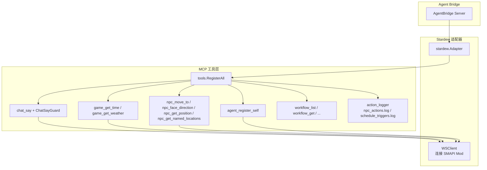
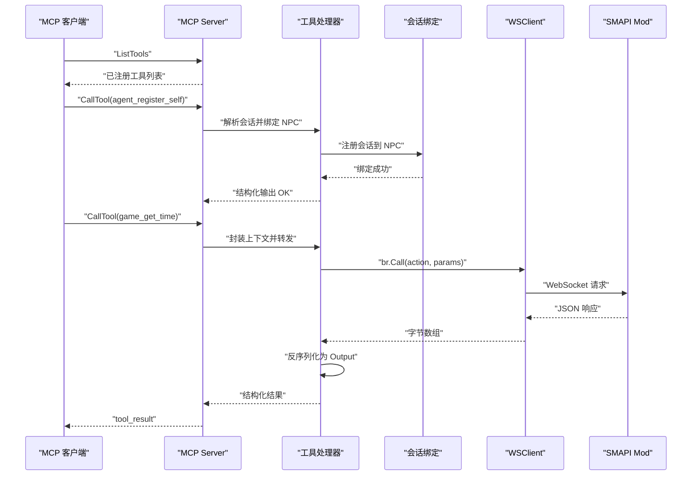
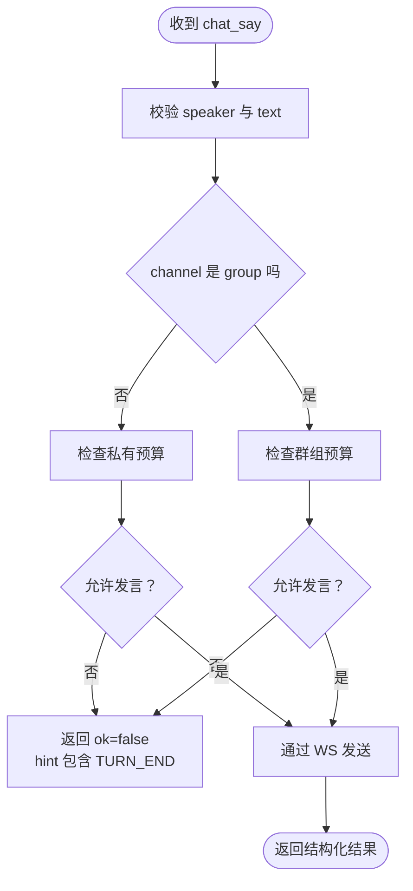
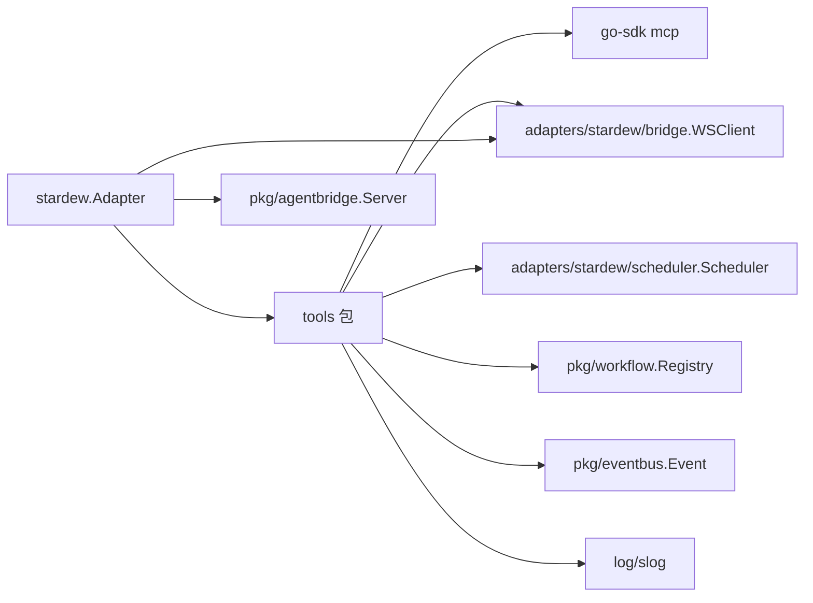

# MCP 工具系统

<cite>
**本文引用的文件**
- [registry.go](file://SmartNPC/smartnpc-mcp/adapters/stardew/tools/registry.go)
- [adapter.go](file://SmartNPC/smartnpc-mcp/adapters/stardew/adapter.go)
- [chat.go](file://SmartNPC/smartnpc-mcp/adapters/stardew/tools/chat.go)
- [game_query.go](file://SmartNPC/smartnpc-mcp/adapters/stardew/tools/game_query.go)
- [npc_movement.go](file://SmartNPC/smartnpc-mcp/adapters/stardew/tools/npc_movement.go)
- [agent.go](file://SmartNPC/smartnpc-mcp/adapters/stardew/tools/agent.go)
- [workflow.go](file://SmartNPC/smartnpc-mcp/adapters/stardew/tools/workflow.go)
- [action_logger.go](file://SmartNPC/smartnpc-mcp/adapters/stardew/tools/action_logger.go)
- [mcp-tool-design.mdc](file://SmartNPC/.codebuddy/rules/mcp-tool-design.mdc)
- [mcp-tools.md](file://SmartNPC/docs/mcp-tools.md)
- [game_query_test.go](file://SmartNPC/smartnpc-mcp/adapters/stardew/tools/game_query_test.go)
- [npc_movement_test.go](file://SmartNPC/smartnpc-mcp/adapters/stardew/tools/npc_movement_test.go)
- [chat_test.go](file://SmartNPC/smartnpc-mcp/adapters/stardew/tools/chat_test.go)
</cite>

## 目录
1. [简介](#简介)
2. [项目结构](#项目结构)
3. [核心组件](#核心组件)
4. [架构总览](#架构总览)
5. [详细组件分析](#详细组件分析)
6. [依赖关系分析](#依赖关系分析)
7. [性能与资源特性](#性能与资源特性)
8. [新工具开发指南](#新工具开发指南)
9. [故障排查](#故障排查)
10. [结论](#结论)

## 简介
本文件面向 SmartNPC 的 MCP 工具系统，重点说明 Stardew Valley 适配层中工具注册表、工具接口规范、现有工具分类、权限与会话绑定、调用频率限制、日志与监控机制，并给出新增工具的完整开发流程。

该系统的核心思想是：
- 通过 `tools.RegisterAll` 统一把“框架级工具”和“Stardew 专属工具”挂载到 MCP Server。
- 需要访问游戏状态的工具通过 WebSocket 桥接调用 SMAPI Mod；不需要 Mod 的工具可在离线或纯进程模式下使用。
- 每个工具用结构化 Input/Output 描述参数与返回值，错误分为“协议级错误”和“业务级失败”。
- 会话级身份绑定由 `agent_register_self` 完成，使出站请求携带来源 NPC。
- 聊天工具通过 `ChatSayGuard` 实现“一问一答”的运行时预算控制。
- 所有工具调用默认写入 `npc_actions.log`，调度触发写入 `schedule_triggers.log`，便于审计与排障。

## 项目结构
MCP 工具系统位于 `smartnpc-mcp/adapters/stardew/tools`，由 `stardew` 适配器装配到上层 agent-bridge 服务中。

**图表来源**
- [adapter.go:1-163](file://SmartNPC/smartnpc-mcp/adapters/stardew/adapter.go#L1-L163)
- [registry.go:1-82](file://SmartNPC/smartnpc-mcp/adapters/stardew/tools/registry.go#L1-L82)
- [agent.go:1-95](file://SmartNPC/smartnpc-mcp/adapters/stardew/tools/agent.go#L1-L95)
- [chat.go:1-200](file://SmartNPC/smartnpc-mcp/adapters/stardew/tools/chat.go#L1-L200)
- [game_query.go:1-89](file://SmartNPC/smartnpc-mcp/adapters/stardew/tools/game_query.go#L1-L89)
- [npc_movement.go:1-200](file://SmartNPC/smartnpc-mcp/adapters/stardew/tools/npc_movement.go#L1-L200)
- [workflow.go:1-200](file://SmartNPC/smartnpc-mcp/adapters/stardew/tools/workflow.go#L1-L200)
- [action_logger.go:1-200](file://SmartNPC/smartnpc-mcp/adapters/stardew/tools/action_logger.go#L1-L200)

**章节来源**
- [adapter.go:1-163](file://SmartNPC/smartnpc-mcp/adapters/stardew/adapter.go#L1-L163)
- [registry.go:1-82](file://SmartNPC/smartnpc-mcp/adapters/stardew/tools/registry.go#L1-L82)

## 核心组件
### 工具注册表
`RegisterAll` 是 Stardew 工具组的唯一入口。它负责：
- 初始化共享调度器实例。
- 注册与工作流相关的发现/调试工具。
- 注册实验日记、日程管理等不依赖 Mod 的工具。
- 当存在 WS 客户端时，再注册 Agent 绑定、聊天、游戏查询、农场经济、感知、移动、行为、世界交互、背包、社交等 Mod 工具。
- 返回共享调度器，供事件路由在 `game_time_tick` 时驱动每日计划执行。

关键点：
- 若 WS 客户端为空，仍可运行纯进程工具（工作流、日记、日程等），保证无 Mod 部署可用。
- 若 Hermes 事件处理器为空，跨 NPC 消息广播不会唤醒接收方，但工具仍会注册。
- 聊天预算守卫可传入空值以关闭限流（测试或无需速率控制的场景）。

**章节来源**
- [registry.go:1-82](file://SmartNPC/smartnpc-mcp/adapters/stardew/tools/registry.go#L1-L82)

### 适配器装配
`stardew.Adapter` 负责：
- 构造 WS 客户端。
- 将适配器作为 EventSource 挂载到 agent-bridge Server。
- 挂载 `stardew/tools` 命名空间，调用 `RegisterAll`。
- 为通用 CLI 模式创建 `ChatSayGuard`，但不注入 Hermes EventHandler，因此跨 NPC 唤醒被标记为禁用。

生命周期约束：
- `Start` 阻塞直到上下文取消，WS 断连由底层客户端重试。
- `Register` 只安装订阅和工具，不要求 Mod 已经就绪。

**章节来源**
- [adapter.go:1-163](file://SmartNPC/smartnpc-mcp/adapters/stardew/adapter.go#L1-L163)

### 会话与身份绑定
`agent_register_self` 把当前 MCP 会话绑定到一个 NPC 内部名称。后续通过 `callCtx` 把会话 ID 注入到 WS 请求上下文中，使 Mod 侧能够把调试镜像路由回对应 NPC 对话面板。

设计要点：
- 每个 Hermes 配置文件启动时应首先调用一次。
- 绑定键是 MCP 会话 ID；重复绑定相同 NPC 是幂等的。
- 没有绑定会导致无参查询无法标注来源 NPC。

**章节来源**
- [agent.go:1-95](file://SmartNPC/smartnpc-mcp/adapters/stardew/tools/agent.go#L1-L95)

### 日志与监控
`action_logger` 提供：
- `logToolCall`：记录工具名与原始输入参数到 `npc_actions.log`。
- `LogScheduleTriggers`：记录调度触发明细到 `schedule_triggers.log`。
- 日志根目录优先级：环境变量 `SMARTNPC_LOG_DIR` > 可执行文件上级 `logs/` > 当前目录。
- 可选镜像到按游戏日期的实验日志目录。

**章节来源**
- [action_logger.go:1-200](file://SmartNPC/smartnpc-mcp/adapters/stardew/tools/action_logger.go#L1-L200)

## 架构总览
MCP 工具系统采用“适配器 + 工具组 + WS 桥接”的分层设计。

**图表来源**
- [agent.go:1-95](file://SmartNPC/smartnpc-mcp/adapters/stardew/tools/agent.go#L1-L95)
- [game_query.go:1-89](file://SmartNPC/smartnpc-mcp/adapters/stardew/tools/game_query.go#L1-L89)
- [registry.go:1-82](file://SmartNPC/smartnpc-mcp/adapters/stardew/tools/registry.go#L1-L82)

## 详细组件分析

### 工具接口规范
工具定义遵循统一的 Go 结构体约定：
- 每个工具有独立导出类型 `<Tool>Input` 与 `<Tool>Output`。
- 字段同时声明 `json` tag 与 `jsonschema` tag，分别控制网络字段与 LLM 可见的 schema 描述。
- 可选字段使用 `,omitempty`；必填字段不加。
- Output 首字段通常为 `OK bool`，便于 LLM 快速判断成功与否。
- Handler 使用泛型 `mcp.AddTool`，第一个返回值固定为 `nil`，由 SDK 基于 Output 生成结构化内容。
- 错误语义：
  - 协议级错误：例如参数缺失、非法值，直接返回 Go error。
  - 业务级失败：通常返回 `ok=false` 的结构化结果，让 LLM 根据 hint 决定停止或调整策略。

该规范在项目规则文件中明确约束了命名、输入输出、注册方式和 ws 协议一致性。

**章节来源**
- [mcp-tool-design.mdc:1-65](file://SmartNPC/.codebuddy/rules/mcp-tool-design.mdc#L1-L65)

### 聊天工具组
聊天工具的核心是 `chat_say`，用于输出角色台词。其职责不仅是“发消息”，更是整个对话流程的“回合结束信号”。

关键设计：
- 输入包含说话者、文本、可选颜色、可选频道与群组标识。
- 输出包含是否送达和提示语；提示语中的 `TURN_END` 表示本轮不再继续调用工具。
- 私有频道（一对一）和群组频道各自维护预算：同一唤醒周期内每个说话者只能发言一次。
- 预算重置由 `MaybeResetGuard` 根据入站事件触发：
  - 玩家进入群组聊天时重置群组预算。
  - 目标 NPC 的入站事件重置该 NPC 的私有预算。
- 如果未启用 guard，则不进行硬限流；否则第二次调用返回结构化 no-op 而非 Go 错误，避免 LLM 重试循环。

**图表来源**
- [chat.go:1-200](file://SmartNPC/smartnpc-mcp/adapters/stardew/tools/chat.go#L1-L200)

**章节来源**
- [chat.go:1-200](file://SmartNPC/smartnpc-mcp/adapters/stardew/tools/chat.go#L1-L200)

### 游戏查询工具组
游戏查询工具包括时间查询与天气查询。它们属于只读操作，需要已加载存档并通过 WS 桥接到 Mod。

设计特点：
- 输入为空结构体，体现“读取类工具不带业务参数”。
- 输出包含 `ok` 及具体游戏状态字段。
- 调用路径统一为：记录日志 → 通过 `br.Call` 转发 → 反序列化响应 → 返回结构化 Output。
- 测试覆盖 ListTools 发现、端到端字段校验和 Mod 报错路径。

**章节来源**
- [game_query.go:1-89](file://SmartNPC/smartnpc-mcp/adapters/stardew/tools/game_query.go#L1-L89)
- [game_query_test.go:1-199](file://SmartNPC/smartnpc-mcp/adapters/stardew/tools/game_query_test.go#L1-L199)

### NPC 移动工具组
NPC 移动工具负责角色位置、朝向、地图定位与地标查询。

主要工具：
- `npc_move_to`：寻路到目标坐标，支持同地图行走与跨地图传送。
- `npc_face_direction`：设置朝向。
- `npc_get_position`：读取当前位置、地图、朝向和是否正在移动。
- `npc_get_named_locations`：返回农场地标表，帮助自然语言地名转坐标。

参数验证：
- NPC 名称必填。
- 方向必须为 up/down/left/right 之一。
- 其他非法参数返回协议级错误。

输出语义：
- `ok` 表示请求被接受，不代表 NPC 已经到达。
- 移动是异步的，实际执行由 Mod 的寻路系统在后续游戏刻推进。

**章节来源**
- [npc_movement.go:1-200](file://SmartNPC/smartnpc-mcp/adapters/stardew/tools/npc_movement.go#L1-L200)
- [npc_movement_test.go:1-200](file://SmartNPC/smartnpc-mcp/adapters/stardew/tools/npc_movement_test.go#L1-L200)

### 工作流工具组
工作流工具提供内置工作流的发现、查看和调试能力。

关键能力：
- `workflow_list`：列出所有注册的工作流及其输入规格。
- `workflow_get`：获取单个工作流定义。
- `workflow_run_inline`：调试工具，使用 no-op runner 验证工作流逻辑，仅在调试开关开启时注册。
- 工作流选择回复机制通过 `workflow_choice_reply` 与 pending choice 通道协作，支持 LLM 交互式分支。

这类工具不依赖 WS 桥接，属于进程内能力，适合在无 Mod 环境中进行计划编排与验证。

**章节来源**
- [workflow.go:1-200](file://SmartNPC/smartnpc-mcp/adapters/stardew/tools/workflow.go#L1-L200)

### 工具分类总览
根据文档目录，工具可分为以下类别：
- 会话与对话：`ping`、`agent_register_self`、`chat_say`。
- 游戏状态查询：`game_get_time`、`game_get_weather`、`farm_get_economy`。
- 日程与工作流：`npc_plan_day`、`npc_get_schedule`、`workflow_*`。
- 日记：`diary_write`、`day_review_complete`。
- 感知与移动：`npc_get_position`、`npc_get_nearby`、`npc_get_environment`、`npc_move_to`、`npc_face_direction`、`npc_wander`。
- 农场作业：耕地、施肥、播种、浇水、收割、清理杂物、采集、破坏资源、抚摸动物等。
- 物流与背包：存取物品、装箱、出货、转移物品、背包读写、物体扫描与放置。
- 表情与视觉动作：冒泡、情绪、舞蹈、踱步等视觉表现。

注意：部分工具在实验构建中被移除或仅保留有限功能；实际可用工具数受注册条件、Hermes 配置白名单和 Mod 连接状态影响。

**章节来源**
- [mcp-tools.md:1-200](file://SmartNPC/docs/mcp-tools.md#L1-L200)

## 依赖关系分析
工具系统依赖多个子系统，耦合点清晰且分层明确。

依赖特征：
- 工具包不直接持有全局 WSClient，而是通过函数参数注入，提高可测试性。
- `RegisterAll` 是对外暴露的唯一装配点，外部不应直接操作 `*mcp.Server`。
- WS 桥接失败表现为工具调用失败，而不是整个服务崩溃。
- 日志模块是进程内副作用，不影响工具主流程。

**图表来源**
- [registry.go:1-82](file://SmartNPC/smartnpc-mcp/adapters/stardew/tools/registry.go#L1-L82)
- [adapter.go:1-163](file://SmartNPC/smartnpc-mcp/adapters/stardew/adapter.go#L1-L163)
- [action_logger.go:1-200](file://SmartNPC/smartnpc-mcp/adapters/stardew/tools/action_logger.go#L1-L200)

**章节来源**
- [registry.go:1-82](file://SmartNPC/smartnpc-mcp/adapters/stardew/tools/registry.go#L1-L82)
- [adapter.go:1-163](file://SmartNPC/smartnpc-mcp/adapters/stardew/adapter.go#L1-L163)

## 性能与资源特性
### 工具发现与注册
- 注册阶段只做内存映射与闭包绑定，不涉及 I/O。
- 工具数量约 50 个左右，加上调试工具可达 51 个；Hermes 配置可能进一步过滤可见工具集。
- `ListTools` 开销主要来自 SDK 序列化描述信息。

### 调用路径成本
- 普通查询工具直接返回结构化结果。
- Mod 相关工具需经过 WS 往返，延迟取决于 SMAPI Mod 响应。
- 移动类工具是“请求接受即返回”，实际移动由 Mod 异步执行，避免同步阻塞游戏线程。

### 聊天预算
- `ChatSayGuard` 使用互斥锁保护两个 map，键空间较小，竞争极低。
- 预算按唤醒周期和群组轮次重置，防止 NPC 连续自言自语。

### 日志与磁盘
- `npc_actions.log` 和 `schedule_triggers.log` 使用懒初始化文件句柄。
- 写入失败会降级为默认日志器或警告，不中断主流程。
- 日志目录可通过环境变量覆盖，便于容器或 CI 环境收集。

**章节来源**
- [chat.go:1-200](file://SmartNPC/smartnpc-mcp/adapters/stardew/tools/chat.go#L1-L200)
- [action_logger.go:1-200](file://SmartNPC/smartnpc-mcp/adapters/stardew/tools/action_logger.go#L1-L200)
- [mcp-tools.md:1-200](file://SmartNPC/docs/mcp-tools.md#L1-L200)

## 新工具开发指南

### 第一步：确定工具域与命名
- 工具名使用 `<domain>_<verb>`，全小写下划线。
- 查询类用 `get`、`list`、`find`；写入类用动词原形。
- 按领域拆分文件，不要把所有工具堆在一个文件中。

**章节来源**
- [mcp-tool-design.mdc:1-65](file://SmartNPC/.codebuddy/rules/mcp-tool-design.mdc#L1-L65)

### 第二步：定义 Input 与 Output
- 定义导出的 `<Tool>Input` 和 `<Tool>Output`。
- 每个字段添加 `json` 与 `jsonschema` 标签。
- 可选字段加 `,omitempty`。
- Output 的第一个字段建议为 `OK bool`。

参考路径：
- [game_query.go:1-89](file://SmartNPC/smartnpc-mcp/adapters/stardew/tools/game_query.go#L1-L89)
- [npc_movement.go:1-200](file://SmartNPC/smartnpc-mcp/adapters/stardew/tools/npc_movement.go#L1-L200)
- [chat.go:1-200](file://SmartNPC/smartnpc-mcp/adapters/stardew/tools/chat.go#L1-L200)

### 第三步：实现处理器
- 使用 `mcp.AddTool` 注册处理器。
- 第一个返回值固定为 `nil`。
- 参数校验失败返回 Go error。
- 业务失败返回 `ok=false` 的结构化输出。
- 涉及 Mod 调用的处理器通过 `br.Call` 发送，并使用 `callCtx` 包裹上下文。

参考路径：
- [agent.go:1-95](file://SmartNPC/smartnpc-mcp/adapters/stardew/tools/agent.go#L1-L95)
- [game_query.go:1-89](file://SmartNPC/smartnpc-mcp/adapters/stardew/tools/game_query.go#L1-L89)

### 第四步：加入注册表
- 在 `RegisterAll` 中调用新的注册函数。
- 如果工具需要 WS 桥接，放在 `if br != nil` 分支。
- 如果工具是进程内能力，放在无条件注册分支。

参考路径：
- [registry.go:1-82](file://SmartNPC/smartnpc-mcp/adapters/stardew/tools/registry.go#L1-L82)

### 第五步：编写测试
- 至少使用 InMemoryTransport 测试 ListTools 是否包含新工具。
- 对 CallTool 返回的结构化内容进行反序列化断言。
- 对 Mod 报错路径使用 bridge 测试服务器模拟。
- 对聊天工具应覆盖预算拒绝与重置路径。

参考路径：
- [game_query_test.go:1-199](file://SmartNPC/smartnpc-mcp/adapters/stardew/tools/game_query_test.go#L1-L199)
- [npc_movement_test.go:1-200](file://SmartNPC/smartnpc-mcp/adapters/stardew/tools/npc_movement_test.go#L1-L200)
- [chat_test.go:1-200](file://SmartNPC/smartnpc-mcp/adapters/stardew/tools/chat_test.go#L1-L200)

### 第六步：更新协议与文档
- 新增工具需要同步更新 ws action 映射与文档。
- 在工具描述中明确副作用、适用时机、关键输入和常见错误。
- 如果工具属于 MCP 工具目录，更新 `mcp-tools.md`。

**章节来源**
- [mcp-tool-design.mdc:1-65](file://SmartNPC/.codebuddy/rules/mcp-tool-design.mdc#L1-L65)
- [mcp-tools.md:1-200](file://SmartNPC/docs/mcp-tools.md#L1-L200)

## 故障排查

### 工具不在 ListTools 中
可能原因：
- 未在 `RegisterAll` 中注册。
- 工具属于 Mod 依赖分支，但 WS 客户端为空。
- Hermes 配置过滤了该工具。

排查步骤：
- 检查 `RegisterAll` 调用链。
- 确认 `stardew.Adapter.Register` 是否正确挂载工具命名空间。
- 检查 Hermes profile 的工具 include 白名单。

**章节来源**
- [registry.go:1-82](file://SmartNPC/smartnpc-mcp/adapters/stardew/tools/registry.go#L1-L82)
- [adapter.go:1-163](file://SmartNPC/smartnpc-mcp/adapters/stardew/adapter.go#L1-L163)
- [mcp-tools.md:1-200](file://SmartNPC/docs/mcp-tools.md#L1-L200)

### 聊天工具重复输出或被拦截
现象：
- 同一唤醒周期内第二次 `chat_say` 返回 no-op。
- 群组聊天中 NPC 持续发言。

排查步骤：
- 确认是否启用了 `ChatSayGuard`。
- 检查入站事件是否触发 `MaybeResetGuard`。
- 确认群组事件中 `source=player_group` 与 `group_id` 正确。
- 观察测试中私有预算耗尽和重置路径。

**章节来源**
- [chat.go:1-200](file://SmartNPC/smartnpc-mcp/adapters/stardew/tools/chat.go#L1-L200)
- [chat_test.go:1-200](file://SmartNPC/smartnpc-mcp/adapters/stardew/tools/chat_test.go#L1-L200)

### WS 调用失败
现象：
- 工具返回 `IsError=true`。
- 日志中出现 Mod 连接或调用错误。

排查步骤：
- 检查 WS URL 配置。
- 确认 SMAPI Mod 已启动并可连接。
- 检查测试中 `TestActionHandler` 是否返回预期错误或成功响应。
- 查看 `npc_actions.log` 中最近一次工具调用参数。

**章节来源**
- [game_query_test.go:1-199](file://SmartNPC/smartnpc-mcp/adapters/stardew/tools/game_query_test.go#L1-L199)
- [action_logger.go:1-200](file://SmartNPC/smartnpc-mcp/adapters/stardew/tools/action_logger.go#L1-L200)

### 日志不可见
现象：
- `npc_actions.log` 或 `schedule_triggers.log` 不存在。
- 日志写入到预期目录之外。

排查步骤：
- 检查 `SMARTNPC_LOG_DIR` 环境变量。
- 检查可执行文件上级 `logs/` 目录权限。
- 确认首次写入后文件句柄是否成功打开。
- 查看控制台警告是否出现日志目录创建失败。

**章节来源**
- [action_logger.go:1-200](file://SmartNPC/smartnpc-mcp/adapters/stardew/tools/action_logger.go#L1-L200)

## 结论
SmartNPC 的 MCP 工具系统通过清晰的注册入口、统一的输入输出契约、明确的错误语义和可插拔的 WS 桥接，实现了“可观测、可测试、可扩展”的工具生态。聊天预算守卫解决了 LLM 多轮工具调用导致的对话失控问题；会话绑定让调试镜像能准确路由到对应 NPC；日志系统提供了工具调用与调度触发的持久化审计。

新增工具时，应优先遵循既有命名、结构体和注册模式，确保：
- 工具描述对 LLM 友好。
- 参数校验严格。
- 业务失败使用结构化输出。
- 测试覆盖发现、调用与错误路径。
- 与 ws action 和文档保持一致。

这样可以在保持现有架构稳定的前提下，逐步扩展 SmartNPC 的游戏控制能力。