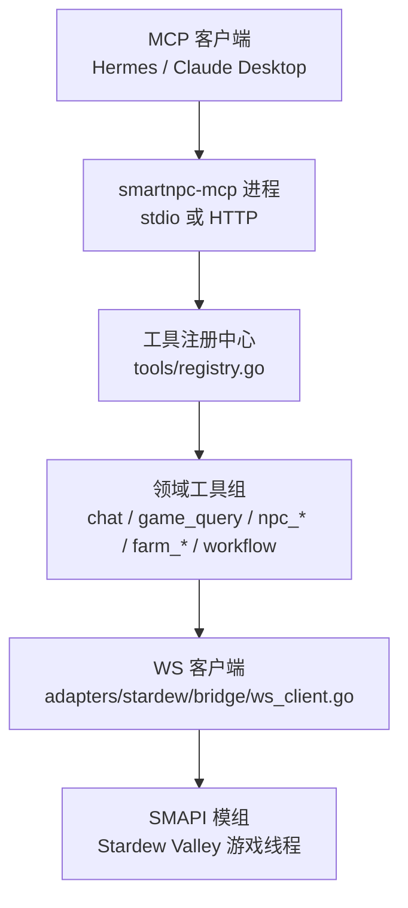
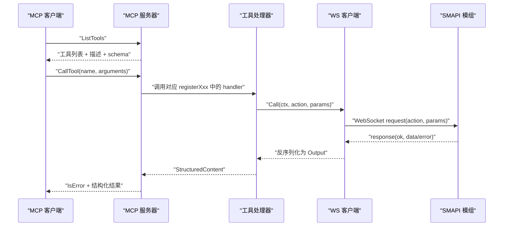
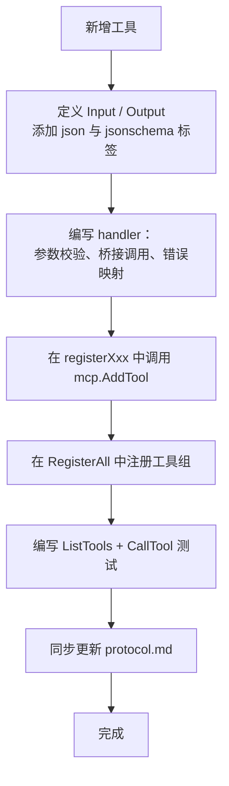
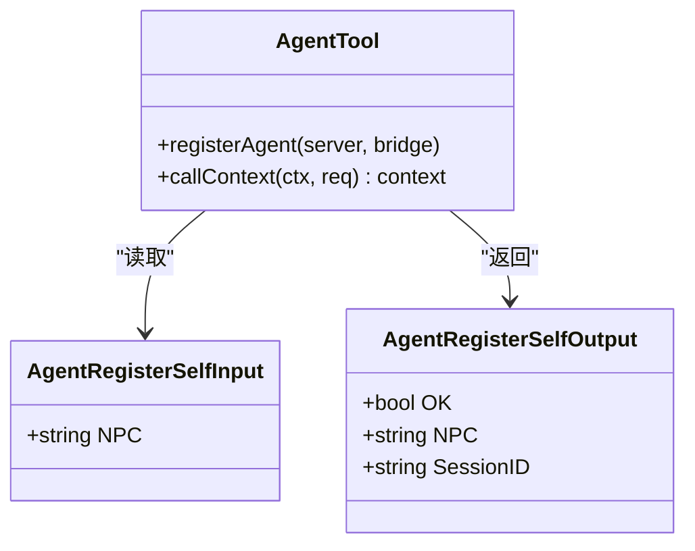
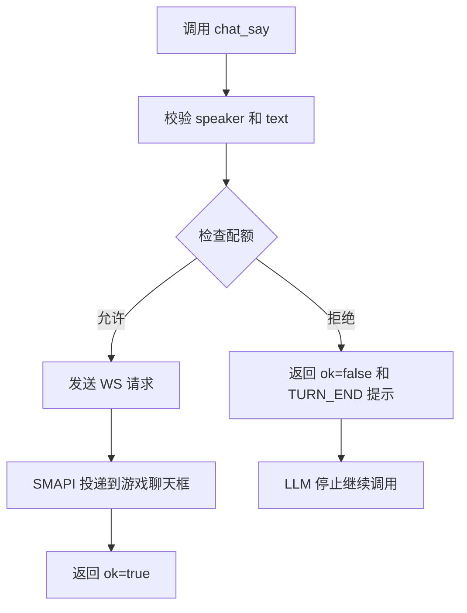
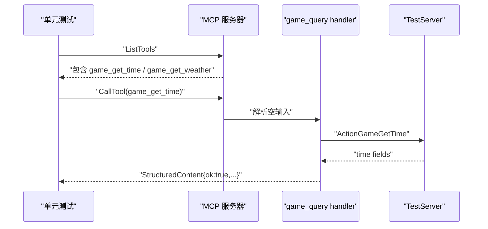
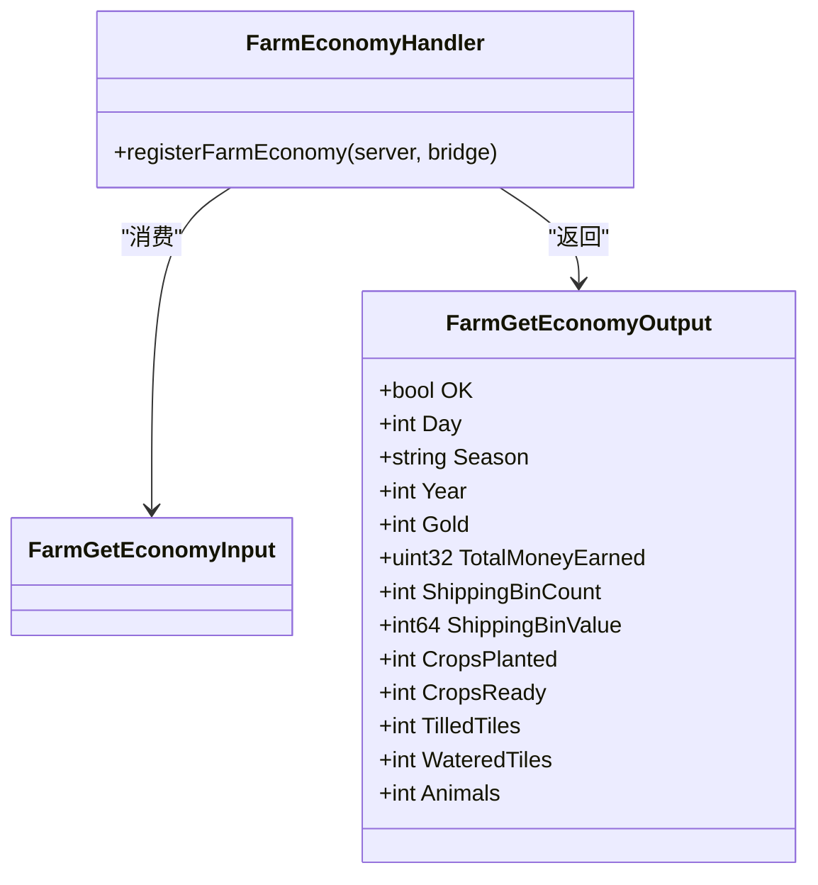
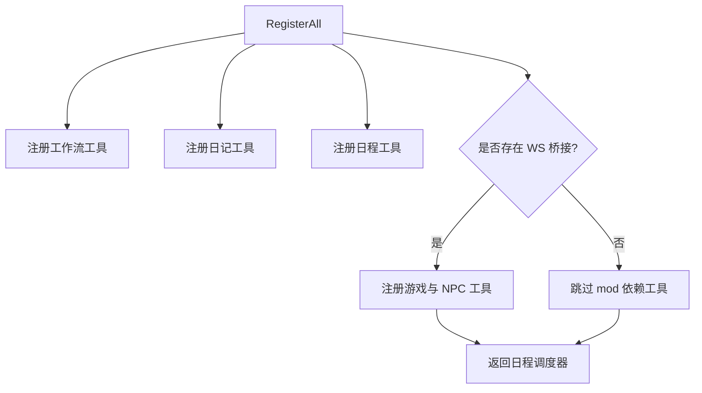
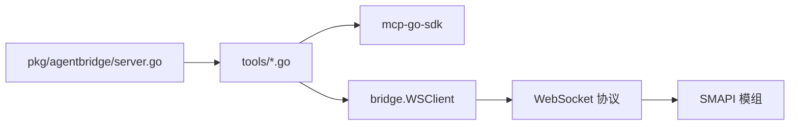

# 工具开发指南

<cite>
**本文引用的文件**   
- [mcp-tools.md](file://SmartNPC/docs/mcp-tools.md)
- [mcp-tool-design.mdc](file://SmartNPC/.codebuddy/rules/mcp-tool-design.mdc)
- [protocol.md](file://SmartNPC/docs/protocol.md)
- [registry.go](file://SmartNPC/smartnpc-mcp/adapters/stardew/tools/registry.go)
- [agent.go](file://SmartNPC/smartnpc-mcp/adapters/stardew/tools/agent.go)
- [chat.go](file://SmartNPC/smartnpc-mcp/adapters/stardew/tools/chat.go)
- [game_query.go](file://SmartNPC/smartnpc-mcp/adapters/stardew/tools/game_query.go)
- [farm_economy.go](file://SmartNPC/smartnpc-mcp/adapters/stardew/tools/farm_economy.go)
- [agent_test.go](file://SmartNPC/smartnpc-mcp/adapters/stardew/tools/agent_test.go)
- [chat_test.go](file://SmartNPC/smartnpc-mcp/adapters/stardew/tools/chat_test.go)
- [main_test.go](file://SmartNPC/smartnpc-mcp/adapters/stardew/tools/main_test.go)
- [game_query_test.go](file://SmartNPC/smartnpc-mcp/adapters/stardew/tools/game_query_test.go)
- [npc_movement_test.go](file://SmartNPC/smartnpc-mcp/adapters/stardew/tools/npc_movement_test.go)
- [testserver.go](file://SmartNPC/smartnpc-mcp/adapters/stardew/bridge/testserver.go)
- [server.go](file://SmartNPC/smartnpc-mcp/pkg/agentbridge/server.go)
</cite>

## 目录
1. [引言](#引言)
2. [项目结构](#项目结构)
3. [核心组件](#核心组件)
4. [架构总览](#架构总览)
5. [详细组件分析](#详细组件分析)
6. [依赖关系分析](#依赖关系分析)
7. [性能与资源约束](#性能与资源约束)
8. [测试策略](#测试策略)
9. [调试与常见问题](#调试与常见问题)
10. [结论](#结论)

## 引言
本文面向希望为 SmartNPC MCP 服务新增工具的开发者，目标是给出从“定义工具接口”到“注册、测试、上线”的完整流程。仓库中的 `smartnpc-mcp` 是一个基于 Go 和 Model Context Protocol 的工具服务器，通过 WebSocket 桥接 Stardew Valley SMAPI 模组，暴露 NPC 行为、游戏状态、日程与工作流等能力。

现有实现已经提供了大量成熟样例：每个工具通常由一对 `<Tool>Input` / `<Tool>Output` 结构体、一个使用 `mcp.AddTool` 注册的 handler，以及一份端到端测试组成。新增工具时，应优先参考已有领域（如 `game_*`、`npc_*`）的实现模式，而不是复制粘贴。

## 项目结构
MCP 工具相关代码集中在 `SmartNPC/smartnpc-mcp/adapters/stardew/tools/`，按领域拆分文件；协议文档位于 `SmartNPC/docs/protocol.md`；规则说明位于 `.codebuddy/rules/mcp-tool-design.mdc`。

**图表来源**
- [registry.go:1-82](file://SmartNPC/smartnpc-mcp/adapters/stardew/tools/registry.go#L1-L82)
- [protocol.md:1-120](file://SmartNPC/docs/protocol.md#L1-L120)

**章节来源**
- [mcp-tools.md:1-80](file://SmartNPC/docs/mcp-tools.md#L1-L80)
- [registry.go:1-82](file://SmartNPC/smartnpc-mcp/adapters/stardew/tools/registry.go#L1-L82)

## 核心组件
本节梳理新增工具时必须接触的核心类型与约定。

| 角色 | 职责 | 关键文件 |
|---|---|---|
| 工具输入输出类型 | 定义 JSON schema 与结构化返回值 | 各工具文件中的 `*Input` / `*Output` |
| 工具 handler | 参数校验、调用桥接、错误映射 | `mcp.AddTool` 闭包 |
| 工具注册函数 | 把工具挂载到 `mcp.Server` | `registerXxx(s, ...)` |
| 全局注册入口 | 统一装配所有工具组 | `RegisterAll` |
| WS 桥接 | 将 MCP 调用转发为 `action + params` | `bridge.WSClient.Call` |
| 测试辅助 | 模拟 WS 服务端、MCP InMemoryTransport | `bridge.TestServer`、`mcp.NewInMemoryTransports` |

**章节来源**
- [mcp-tool-design.mdc:1-65](file://SmartNPC/.codebuddy/rules/mcp-tool-design.mdc#L1-L65)
- [registry.go:1-82](file://SmartNPC/smartnpc-mcp/adapters/stardew/tools/registry.go#L1-L82)

## 架构总览
MCP 工具的生命周期可以概括为：客户端发现工具 → 调用工具 → handler 执行参数校验 → 通过桥接发送 WS 请求 → 解析模组响应 → 返回结构化结果。

**图表来源**
- [game_query.go:1-89](file://SmartNPC/smartnpc-mcp/adapters/stardew/tools/game_query.go#L1-L89)
- [protocol.md:120-220](file://SmartNPC/docs/protocol.md#L120-L220)

## 详细组件分析

### 工具设计模板
根据仓库规则，新增工具应遵循以下模式：

1. **命名规范**
   - 工具名使用 `<domain>_<verb>`，全小写下划线。
   - 查询类用 `get` / `list` / `find`；写入类使用动词原形。
   - 文件按领域拆分，不要把所有工具堆在一个文件中。

2. **输入输出类型**
   - 每个工具定义两个导出结构体：`<Tool>Input` 和 `<Tool>Output`。
   - 字段必须包含 `json` tag 和 `jsonschema` tag。
   - 可选字段加 `,omitempty`；必填字段不加。
   - Output 第一个字段固定为 `OK bool`，便于 LLM 快速判断成功。

3. **handler 签名**
   - 使用 `mcp.AddTool` 注册，handler 接收 `ctx`、`req`、`in XxxInput`。
   - 业务错误返回 `(nil, zero, err)` 或通过 SDK 设置 `IsError`。
   - 协议级错误直接返回 Go error；可让 LLM 自我修正的错误使用结构化失败消息。

4. **注册方式**
   - 在对应领域的 `registerXxx` 中调用 `mcp.AddTool`。
   - 在 `tools/registry.go` 的 `RegisterAll` 中调用该注册函数。
   - 需要访问 SMAPI 的工具通过传入的 `bridge.WSClient` 调用，不持有全局连接。

**图表来源**
- [mcp-tool-design.mdc:1-65](file://SmartNPC/.codebuddy/rules/mcp-tool-design.mdc#L1-L65)
- [registry.go:1-82](file://SmartNPC/smartnpc-mcp/adapters/stardew/tools/registry.go#L1-L82)

**章节来源**
- [mcp-tool-design.mdc:1-65](file://SmartNPC/.codebuddy/rules/mcp-tool-design.mdc#L1-L65)

### 会话绑定工具：`agent_register_self`
该工具用于把当前 MCP 会话绑定到一个 NPC 内部名称，使后续所有通过桥接发出的 WS 请求都携带 `from_npc`，从而让 SMAPI 模组能够把调试镜像路由到正确的 NPC 对话面板。

关键点：
- 必须在其他游戏状态工具之前调用一次。
- 如果传入空 NPC，返回错误。
- 底层通过 `callCtx` 把会话 ID 注入上下文，供下游 `br.Call` 使用。

**图表来源**
- [agent.go:1-95](file://SmartNPC/smartnpc-mcp/adapters/stardew/tools/agent.go#L1-L95)

**章节来源**
- [agent.go:1-95](file://SmartNPC/smartnpc-mcp/adapters/stardew/tools/agent.go#L1-L95)
- [agent_test.go:1-120](file://SmartNPC/smartnpc-mcp/adapters/stardew/tools/agent_test.go#L1-L120)

### 聊天播报工具：`chat_say`
`chat_say` 是实验构建中唯一可见的 NPC 对话工具，但语义已从“玩家对话回复”收缩为“向游戏内聊天框播报一条短消息”。它具备运行时配额控制，防止同一个唤醒周期内重复说话。

核心机制：
- `ChatSayGuard` 维护私有频道和群频道的已发言标记。
- 同一唤醒周期内，同一 speaker 只能调用一次。
- 第二次调用不会抛出 Go 错误，而是返回 `ok=false` 并附带提示，要求 LLM 停止继续生成工具调用。
- 收到新的针对该 NPC 的入站事件时，配额会重置。

**图表来源**
- [chat.go:1-200](file://SmartNPC/smartnpc-mcp/adapters/stardew/tools/chat.go#L1-L200)
- [chat_test.go:1-200](file://SmartNPC/smartnpc-mcp/adapters/stardew/tools/chat_test.go#L1-L200)

**章节来源**
- [chat.go:1-200](file://SmartNPC/smartnpc-mcp/adapters/stardew/tools/chat.go#L1-L200)
- [chat_test.go:1-200](file://SmartNPC/smartnpc-mcp/adapters/stardew/tools/chat_test.go#L1-L200)

### 游戏状态查询工具：`game_get_time`、`game_get_weather`
这两个工具没有业务参数，只负责读取游戏时间或天气，并通过 WS 桥接获取数据。它们的测试覆盖了：
- `ListTools` 是否包含工具。
- 成功时的结构化输出。
- 模组返回错误时 `IsError=true`。

**图表来源**
- [game_query.go:1-89](file://SmartNPC/smartnpc-mcp/adapters/stardew/tools/game_query.go#L1-L89)
- [game_query_test.go:1-199](file://SmartNPC/smartnpc-mcp/adapters/stardew/tools/game_query_test.go#L1-L199)

**章节来源**
- [game_query.go:1-89](file://SmartNPC/smartnpc-mcp/adapters/stardew/tools/game_query.go#L1-L89)
- [game_query_test.go:1-199](file://SmartNPC/smartnpc-mcp/adapters/stardew/tools/game_query_test.go#L1-L199)

### 农场经济工具：`farm_get_economy`
该工具返回农场记分板，包括金币、历史收入、出货箱数量与价值、种植作物、翻耕地块、浇水地块和动物数量。它是只读工具，适合在规划日程、结算或验证出货时使用。

**图表来源**
- [farm_economy.go:1-57](file://SmartNPC/smartnpc-mcp/adapters/stardew/tools/farm_economy.go#L1-L57)

**章节来源**
- [farm_economy.go:1-57](file://SmartNPC/smartnpc-mcp/adapters/stardew/tools/farm_economy.go#L1-L57)

### 工具注册与组合根
`RegisterAll` 是 Stardew 适配器的统一注册入口。它负责：
- 创建工作流工具组。
- 注册实验日记和日终完成工具。
- 注册 NPC 日程工具。
- 当存在 WS 桥接时，注册 agent、聊天、游戏查询、农场经济、NPC 感知、移动、行为、世界动作、背包、社交动作等工具。
- 返回共享的每日日程调度器。

**图表来源**
- [registry.go:1-82](file://SmartNPC/smartnpc-mcp/adapters/stardew/tools/registry.go#L1-L82)

**章节来源**
- [registry.go:1-82](file://SmartNPC/smartnpc-mcp/adapters/stardew/tools/registry.go#L1-L82)

## 依赖关系分析
工具层依赖顺序如下：

1. `mcp-go-sdk`：提供 `mcp.Server`、`mcp.Tool`、`mcp.AddTool`、`mcp.CallToolRequest` 等抽象。
2. `tools` 包：定义输入输出类型、handler 和注册函数。
3. `bridge` 包：封装 WebSocket 客户端、协议帧、测试服务器。
4. `pkg/agentbridge`：提供框架级的工具分组挂载、事件源与后端分发。
5. SMAPI 模组：运行在游戏进程中，处理真实游戏状态。

**图表来源**
- [registry.go:1-82](file://SmartNPC/smartnpc-mcp/adapters/stardew/tools/registry.go#L1-L82)
- [server.go:1-150](file://SmartNPC/smartnpc-mcp/pkg/agentbridge/server.go#L1-L150)
- [protocol.md:1-120](file://SmartNPC/docs/protocol.md#L1-L120)

**章节来源**
- [server.go:1-150](file://SmartNPC/smartnpc-mcp/pkg/agentbridge/server.go#L1-L150)
- [registry.go:1-82](file://SmartNPC/smartnpc-mcp/adapters/stardew/tools/registry.go#L1-L82)

## 性能与资源约束
仓库中已实现的资源约束主要体现在 `chat_say` 的配额控制和 WS 桥接模型上，新增工具应继承相同思路：

| 约束类型 | 现有实现 | 新增工具建议 |
|---|---|---|
| 调用频率限制 | `ChatSayGuard` 限制每唤醒周期每条 NPC 只能播报一次 | 对易刷屏工具引入 per-session 或 per-scope 配额 |
| 异步执行 | NPC 移动等行为被加入队列，由 FollowSystem 在后续游戏 tick 执行 | 写入型工具明确“接受即排队”，避免误以为立即生效 |
| 长耗时操作 | 推荐用进度通知或异步回调 | 优先同步阻塞加超时；只有确认不可接受再引入事件 |
| 外部依赖 | 需要 WS 桥接的工具在 `br != nil` 时才注册 | 保持无桥接部署可用，至少保留纯进程内工具 |
| 日志与监控 | 工具调用通过 `logToolCall` 记录 | 对副作用工具增加必要埋点，但不要泄露敏感数据 |

**章节来源**
- [chat.go:1-200](file://SmartNPC/smartnpc-mcp/adapters/stardew/tools/chat.go#L1-L200)
- [mcp-tools.md:80-200](file://SmartNPC/docs/mcp-tools.md#L80-L200)

## 测试策略
仓库测试覆盖三个层次：MCP 工具发现、结构化返回值、WS 桥接协议。

### 单元测试
每个工具至少应覆盖：
- `ListTools` 中包含该工具且 description 非空。
- `CallTool` 返回结构化内容。
- 输入校验失败时返回错误。
- 桥接层返回错误时，MCP 结果标记为 `IsError=true`。

典型测试结构：
- 使用 `bridge.NewTestServer` 模拟 SMAPI。
- 使用 `mcp.NewInMemoryTransports` 连接 MCP server 和 client。
- 通过 `OnRawRequest` 断言 WS 请求字段，例如 `from_npc`、`action`、`params`。

**章节来源**
- [game_query_test.go:1-199](file://SmartNPC/smartnpc-mcp/adapters/stardew/tools/game_query_test.go#L1-L199)
- [npc_movement_test.go:1-200](file://SmartNPC/smartnpc-mcp/adapters/stardew/tools/npc_movement_test.go#L1-L200)

### 集成测试
`agent_test.go` 展示了完整的端到端场景：
1. 启动 MCP server。
2. 调用 `agent_register_self` 绑定 NPC。
3. 断言后续 WS 请求携带正确 `from_npc`。
4. 验证空 NPC 被拒绝。

**章节来源**
- [agent_test.go:1-200](file://SmartNPC/smartnpc-mcp/adapters/stardew/tools/agent_test.go#L1-L200)

### 模拟数据构造
测试中使用的主要模拟手段包括：
- `bridge.TestServer`：本地 WebSocket 服务端，拦截 action 并返回自定义数据。
- `bridge.TestActionHandler`：根据 action 决定返回成功数据或错误。
- `OnRawRequest`：捕获原始 WS 请求对象，适合验证路由字段。
- `mcp.NewInMemoryTransports`：避免真正网络 I/O。

**章节来源**
- [testserver.go:1-147](file://SmartNPC/smartnpc-mcp/adapters/stardew/bridge/testserver.go#L1-L147)
- [chat_test.go:1-200](file://SmartNPC/smartnpc-mcp/adapters/stardew/tools/chat_test.go#L1-L200)

### 环境隔离
`main_test.go` 通过设置环境变量禁用实验模式的自动日终审查注入，保证计划计数测试稳定。新增工具若也有实验分支逻辑，应在测试中显式控制环境变量。

**章节来源**
- [main_test.go:1-15](file://SmartNPC/smartnpc-mcp/adapters/stardew/tools/main_test.go#L1-L15)

## 调试与常见问题

### 如何定位工具未注册
- 检查是否在对应 `registerXxx` 中调用了 `mcp.AddTool`。
- 检查 `RegisterAll` 是否调用了该注册函数。
- 如果工具依赖 WS 桥接，确认 `RegisterAll` 调用时 `br` 不为 nil。
- 使用 `ListTools` 打印工具列表，确认工具名和描述是否正确。

**章节来源**
- [registry.go:1-82](file://SmartNPC/smartnpc-mcp/adapters/stardew/tools/registry.go#L1-L82)

### 为什么 WS 请求没有 `from_npc`
- 忘记先调用 `agent_register_self`。
- 没有在 handler 中使用 `callCtx(ctx, req)` 包装上下文。
- 测试中使用了没有会话 ID 的 InMemoryTransport，此时应依赖单会话键映射逻辑。

**章节来源**
- [agent.go:1-95](file://SmartNPC/smartnpc-mcp/adapters/stardew/tools/agent.go#L1-L95)
- [agent_test.go:120-200](file://SmartNPC/smartnpc-mcp/adapters/stardew/tools/agent_test.go#L120-L200)

### 为什么 `chat_say` 被拒绝
- 同一唤醒周期内重复调用。
- 使用了错误的频道或 group_id。
- 配额耗尽时返回的是结构化 no-op，不是 Go 错误，不应重试。

**章节来源**
- [chat.go:1-200](file://SmartNPC/smartnpc-mcp/adapters/stardew/tools/chat.go#L1-L200)
- [chat_test.go:1-200](file://SmartNPC/smartnpc-mcp/adapters/stardew/tools/chat_test.go#L1-L200)

### 如何查看 WS 协议问题
- 使用 `bridge.TestServer.OnRawRequest` 捕获原始请求。
- 对照 `protocol.md` 中 envelope、request、response、event 的定义。
- 确认 action 名称与 MCP 工具名一一对应。

**章节来源**
- [protocol.md:1-200](file://SmartNPC/docs/protocol.md#L1-L200)
- [testserver.go:1-147](file://SmartNPC/smartnpc-mcp/adapters/stardew/bridge/testserver.go#L1-L147)

## 结论
SmartNPC 的 MCP 工具体系以“输入输出结构体 + 注册函数 + WS 桥接 + 结构化返回”为核心模式。新增工具时，最重要的是：
- 明确工具是读取还是写入。
- 清晰定义 Input 和 Output，尤其是 `OK` 字段和 `jsonschema` 描述。
- 通过 `RegisterAll` 统一注册。
- 使用 `bridge.TestServer` 和 InMemoryTransport 写端到端测试。
- 同步更新 `protocol.md`，保持 MCP 工具名与 WS action 名一致。
- 对可能刷屏或昂贵的操作引入配额、超时或异步机制。

这样既能保证 MCP 客户端拿到稳定的工具描述和结构化结果，也能让 SMAPI 模组侧接收到正确的路由、参数和执行意图。