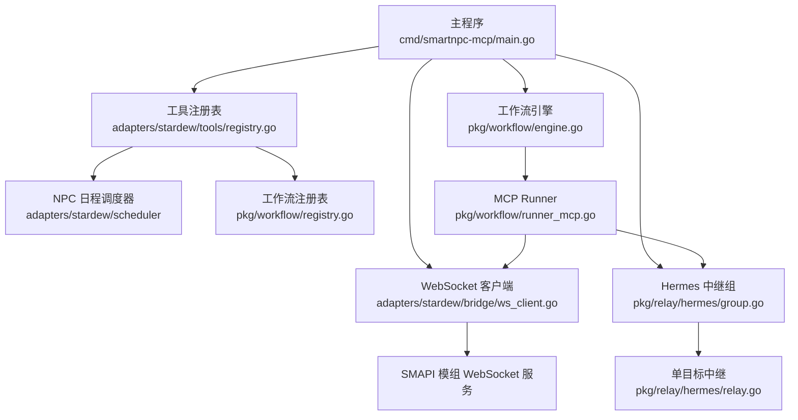
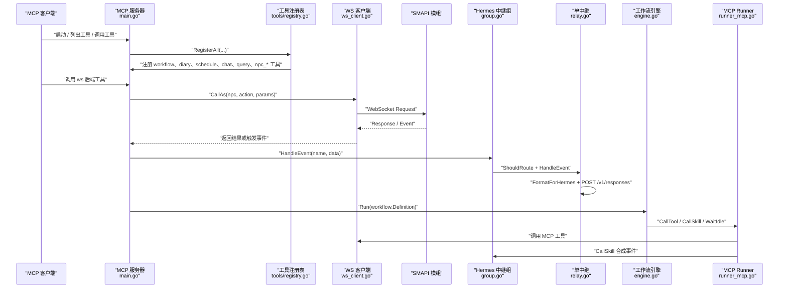
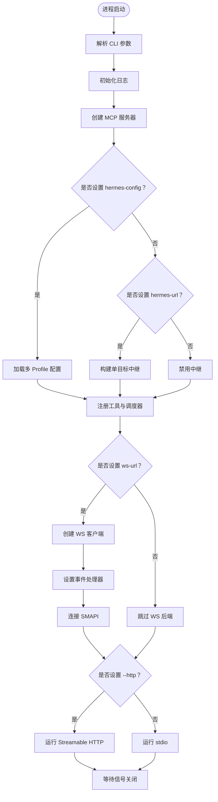
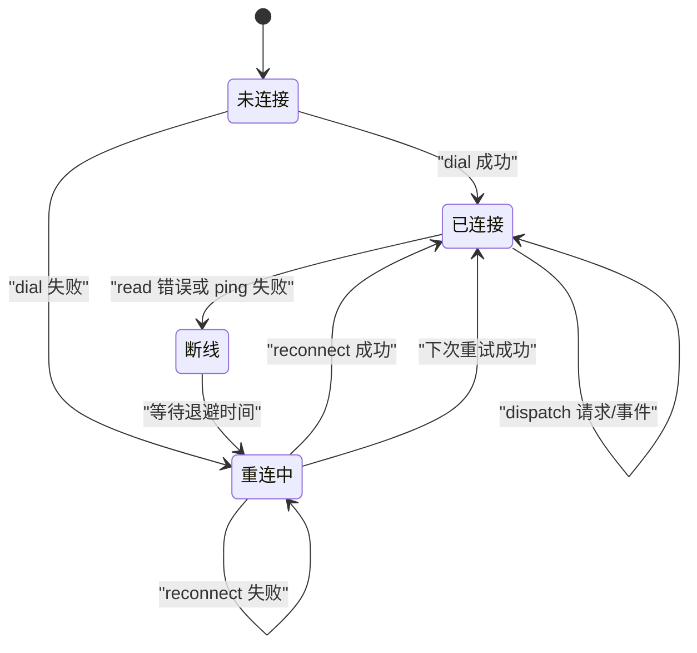
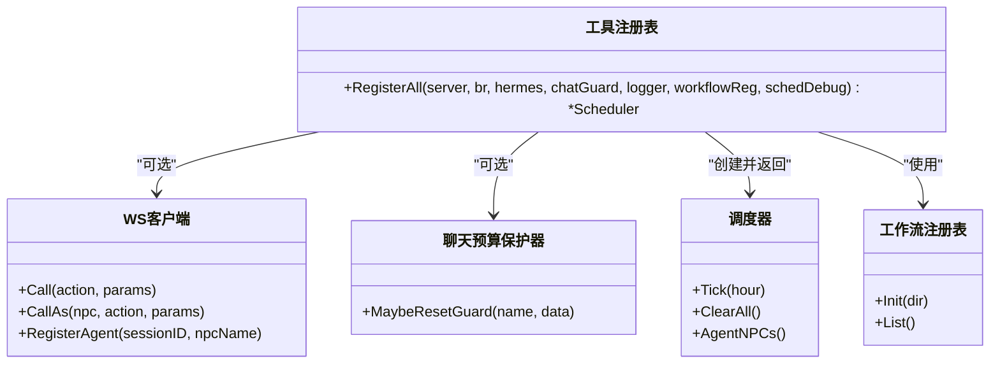
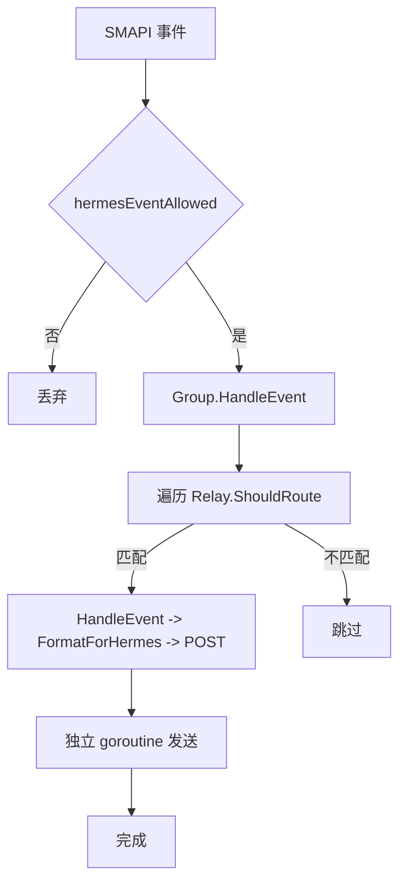
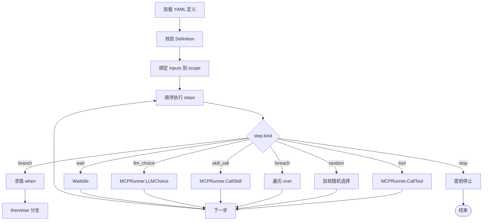
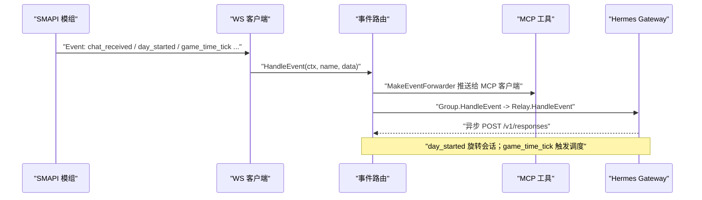
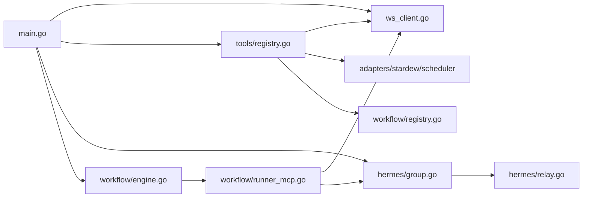

# MCP 服务层架构

<cite>
**本文引用的文件**   
- [main.go](file://SmartNPC/smartnpc-mcp/cmd/smartnpc-mcp/main.go)
- [ws_client.go](file://SmartNPC/smartnpc-mcp/adapters/stardew/bridge/ws_client.go)
- [registry.go](file://SmartNPC/smartnpc-mcp/adapters/stardew/tools/registry.go)
- [group.go](file://SmartNPC/smartnpc-mcp/pkg/relay/hermes/group.go)
- [relay.go](file://SmartNPC/smartnpc-mcp/pkg/relay/hermes/relay.go)
- [engine.go](file://SmartNPC/smartnpc-mcp/pkg/workflow/engine.go)
- [precompile.go](file://SmartNPC/smartnpc-mcp/pkg/workflow/precompile.go)
- [definition.go](file://SmartNPC/smartnpc-mcp/pkg/workflow/definition.go)
- [runner_mcp.go](file://SmartNPC/smartnpc-mcp/pkg/workflow/runner_mcp.go)
</cite>

## 目录
1. [简介](#简介)
2. [项目结构](#项目结构)
3. [核心组件](#核心组件)
4. [架构总览](#架构总览)
5. [详细组件分析](#详细组件分析)
6. [依赖关系分析](#依赖关系分析)
7. [性能与可靠性](#性能与可靠性)
8. [故障排查指南](#故障排查指南)
9. [结论](#结论)
10. [附录：添加新 MCP 工具的完整示例](#附录添加新-mcp-工具的完整示例)

## 简介
本文件面向希望理解并扩展 Stardew Valley MCP 服务层的开发者，系统说明以下关键路径：
- `cmd/smartnpc-mcp/main.go` 如何解析 CLI 参数、选择 stdio 或 Streamable HTTP 传输、初始化日志、WebSocket 客户端、工具注册表、Hermes 中继和工作流引擎。
- `adapters/stardew/bridge/ws_client.go` 如何建立 WebSocket 连接、处理请求响应、实现心跳与错误重连，以及如何将事件分发给上层路由。
- `adapters/stardew/tools/registry.go` 的工具发现与注册模式，包括桥接条件、工作流调试开关、聊天预算保护器与调度器共享。
- `pkg/relay/hermes` 的 Hermes 中继系统：单 Profile 模式和多 Profile 扇出、事件过滤、会话轮换、对话记忆策略。
- `pkg/workflow` 的工作流引擎：YAML 定义解析、预编译录制、执行调度、对 WS 桥和 Hermes 的调用方式。
- 协议转换流程图和数据同步机制，以及新增 MCP 工具的完整步骤。

## 项目结构
MCP 服务层主要位于 Go 模块 `smartnpc-mcp` 中，采用分层组织：
- `cmd/smartnpc-mcp`：进程入口、CLI 参数、传输选择、启动编排。
- `adapters/stardew`：SMAPI 模组适配器，包含 WebSocket 客户端、事件模型、调度器和 MCP 工具实现。
- `pkg/agentbridge`：框架级 MCP 元数据与服务器能力（由 main 注册）。
- `pkg/relay/hermes`：将游戏事件转发到 Hermes Gateway 的中继。
- `pkg/workflow`：工作流 DSL、引擎、预编译、Runner 适配。
- `pkg/transport`：Streamable HTTP 传输封装。
- `internal/log`：跨平台 UTF-8 控制台日志。

**图示来源**  
- [main.go:1-120](file://SmartNPC/smartnpc-mcp/cmd/smartnpc-mcp/main.go#L1-L120)
- [registry.go:1-82](file://SmartNPC/smartnpc-mcp/adapters/stardew/tools/registry.go#L1-L82)
- [ws_client.go:1-60](file://SmartNPC/smartnpc-mcp/adapters/stardew/bridge/ws_client.go#L1-L60)
- [group.go:1-81](file://SmartNPC/smartnpc-mcp/pkg/relay/hermes/group.go#L1-L81)
- [relay.go:1-120](file://SmartNPC/smartnpc-mcp/pkg/relay/hermes/relay.go#L1-L120)
- [engine.go:1-60](file://SmartNPC/smartnpc-mcp/pkg/workflow/engine.go#L1-L60)
- [runner_mcp.go:1-60](file://SmartNPC/smartnpc-mcp/pkg/workflow/runner_mcp.go#L1-L60)

**章节来源**  
- [main.go:1-120](file://SmartNPC/smartnpc-mcp/cmd/smartnpc-mcp/main.go#L1-L120)

## 核心组件
本节概述五个核心组件的职责与协作关系。

| 组件 | 位置 | 职责 | 关键行为 |
|---|---|---|---|
| 主程序 | `cmd/smartnpc-mcp/main.go` | 解析 CLI、创建 MCP 服务器、选择传输、装配 WS 客户端、工具、中继与工作流 | 支持 stdio 与 Streamable HTTP；根据 `--hermes-config` 选择多 Profile 或单 Profile 中继；初始化日志、实验日志、调度器、工作流引擎 |
| WebSocket 客户端 | `adapters/stardew/bridge/ws_client.go` | 连接 SMAPI 模组、发送 RPC、接收事件、心跳保活、自动重连 | 默认端口 `ws://127.0.0.1:18745/ws`；30 秒 Ping；固定退避重连；按 ID 关联请求与响应 |
| 工具注册表 | `adapters/stardew/tools/registry.go` | 将 Stardew 相关 MCP 工具挂载到服务器 | 可选桥接、工作流调试、日记、日程、聊天、查询、NPC 行为等工具；返回共享调度器 |
| Hermes 中继 | `pkg/relay/hermes/group.go`、`relay.go` | 将桥接事件转发到 Hermes Gateway | 单 Profile 通过 `New`；多 Profile 通过 `NewGroup`；支持 NPC 名称过滤、会话轮换、指令注入 |
| 工作流引擎 | `pkg/workflow/engine.go`、`definition.go`、`precompile.go`、`runner_mcp.go` | 解析 YAML 定义、预编译技能、顺序执行步骤 | 支持 tool、branch、random、foreach、skill_call、llm_choice、wait、stop；MCPRunner 调用 WS 和 Hermes |

**章节来源**  
- [main.go:1-200](file://SmartNPC/smartnpc-mcp/cmd/smartnpc-mcp/main.go#L1-L200)
- [ws_client.go:1-120](file://SmartNPC/smartnpc-mcp/adapters/stardew/bridge/ws_client.go#L1-L120)
- [registry.go:1-82](file://SmartNPC/smartnpc-mcp/adapters/stardew/tools/registry.go#L1-L82)
- [group.go:1-81](file://SmartNPC/smartnpc-mcp/pkg/relay/hermes/group.go#L1-L81)
- [relay.go:1-120](file://SmartNPC/smartnpc-mcp/pkg/relay/hermes/relay.go#L1-L120)
- [engine.go:1-120](file://SmartNPC/smartnpc-mcp/pkg/workflow/engine.go#L1-L120)
- [definition.go:1-120](file://SmartNPC/smartnpc-mcp/pkg/workflow/definition.go#L1-L120)
- [precompile.go:1-80](file://SmartNPC/smartnpc-mcp/pkg/workflow/precompile.go#L1-L80)
- [runner_mcp.go:1-80](file://SmartNPC/smartnpc-mcp/pkg/workflow/runner_mcp.go#L1-L80)

## 架构总览
MCP 服务层是“SMAPI 模组 ↔ MCP 客户端”的双向桥梁，同时承担“事件 → Hermes 通知”和“调度 → 工作流执行”的职责。

**图示来源**  
- [main.go:200-600](file://SmartNPC/smartnpc-mcp/cmd/smartnpc-mcp/main.go#L200-L600)
- [ws_client.go:201-510](file://SmartNPC/smartnpc-mcp/adapters/stardew/bridge/ws_client.go#L201-L510)
- [registry.go:1-82](file://SmartNPC/smartnpc-mcp/adapters/stardew/tools/registry.go#L1-L82)
- [group.go:1-81](file://SmartNPC/smartnpc-mcp/pkg/relay/hermes/group.go#L1-L81)
- [relay.go:120-220](file://SmartNPC/smartnpc-mcp/pkg/relay/hermes/relay.go#L120-L220)
- [engine.go:60-160](file://SmartNPC/smartnpc-mcp/pkg/workflow/engine.go#L60-L160)
- [runner_mcp.go:60-180](file://SmartNPC/smartnpc-mcp/pkg/workflow/runner_mcp.go#L60-L180)

## 详细组件分析

### 主程序：CLI 参数、传输与服务发现
`main.go` 是 MCP 服务的组合根。它完成以下关键任务：

1. **版本与日志**  
   - 输出版本并退出：`--version`。
   - 使用 `internal/log` 启用 UTF-8 控制台，避免 Windows 下 CJK 乱码。
   - 所有日志走 `stderr`，因为 stdio 模式下 stdout 是 MCP JSON-RPC 流。

2. **CLI 参数**  
   - `--log-level`：日志级别。
   - `--ws-url`：SMAPI 模组 WebSocket URL；为空时禁用模组后端工具。
   - `--echo-mode`、`--echo-speaker`：无 LLM 的回声 NPC，用于验证往返。
   - `--http`：启用 Streamable HTTP 传输，替代 stdio。
   - `--http-allow-any-origin`：允许跨主机连接。
   - `--mcp-api-key`：HTTP 模式下 `/mcp` 的 Bearer Token。
   - `--hermes-url`、`--hermes-api-key`、`--hermes-conversation`、`--hermes-model`、`--hermes-npc`、`--hermes-persona-file`：单 Profile 中继配置。
   - `--hermes-config`：多 Profile YAML 配置，优先级高于单 Profile 参数。

3. **MCP 服务器与传输**  
   - 创建 `mcp.Server`，传入实现信息与 logger。
   - 若设置 `--http`，则通过 `pkg/transport.RunHTTP` 暴露 `/mcp`、`/healthz`，并挂载 `/status`。
   - 否则使用 `mcp.StdioTransport` 在 stdin/stdout 上运行。

4. **Hermes 中继装配**  
   - 优先读取 `--hermes-config`，构造 `hermesrelay.Group`，得到 `HandleEvent` 和可诊断的 relays 列表。
   - 否则如果设置了 `--hermes-url`，构造单个 `hermesrelay.Relay`。
   - 如果均未设置，中继禁用。

5. **工具与调度器装配**  
   - 创建 `ChatSayGuard` 控制群聊私聊发言预算。
   - 初始化实验日志跟踪器，并将工具回调、工作流运行观察器、日程计划观察器接入。
   - 调用 `tools.RegisterAll` 注册 Stardew 工具，返回共享 `scheduler.Scheduler`。
   - 从 relay 配置填充调度器的 agent NPC 列表。
   - 注册框架级元工具 `agentbridge.RegisterMeta`。
   - 注册工作流状态工具 `npc_workflow_status`。

6. **WS 客户端与事件路由**  
   - 若启用 WS，则创建 `WSClient`，设置 `SetCallObserver` 记录工具调用日志。
   - 创建工作流注册表，支持环境变量 `SMARTNPC_WORKFLOW_DIR` 覆盖内置定义。
   - 根据 `SMARTNPC_WORKFLOW_PUMP` 决定是否启用本地工作流泵。
   - 调用 `tools.RegisterAll` 后，设置 `SetEventHandler(makeRouter(...))`，再调用 `Connect`。
   - 初始连接失败不会阻止非模组工具运行，WS 后台会自动重试。

7. **Owner Inbox 轮询**  
   - 当实验模式开启且存在 relay 时，轮询 `<logDir>/exp/owner-inbox.md`，把新行转换为 `owner_directive` 事件。

8. **进程生命周期**  
   - 使用 `signal.NotifyContext` 处理 `SIGINT`、`SIGTERM`。
   - stdio 模式通过 `server.Run` 阻塞直到关闭。
   - HTTP 模式通过 `transport.RunHTTP` 启动 HTTP 服务。

**图示来源**  
- [main.go:1-200](file://SmartNPC/smartnpc-mcp/cmd/smartnpc-mcp/main.go#L1-L200)
- [main.go:200-600](file://SmartNPC/smartnpc-mcp/cmd/smartnpc-mcp/main.go#L200-L600)

**章节来源**  
- [main.go:1-200](file://SmartNPC/smartnpc-mcp/cmd/smartnpc-mcp/main.go#L1-L200)
- [main.go:200-600](file://SmartNPC/smartnpc-mcp/cmd/smartnpc-mcp/main.go#L200-L600)

### WebSocket 客户端：连接、心跳与重连
`ws_client.go` 是 MCP 服务与 SMAPI 模组之间的可靠通道。

#### 关键设计
- **默认地址与超时**  
  - 默认 URL：`ws://127.0.0.1:18745/ws`。
  - 调用超时：默认 60 分钟，实际接近“不超时”。
  - 拨号超时：5 秒。
  - 重连退避：2 秒。
- **并发安全**  
  - 使用互斥锁保护连接、待响应映射、Agent 注册表。
  - `Call`、`CallAs`、`RegisterAgent`、`SetEventHandler` 都是并发安全的。
- **会话绑定**  
  - 通过 `WithCallSession` 将 MCP server session ID 注入 context。
  - `RegisterAgent` 将 sessionID 映射到 NPC 名称。
  - `AgentForContext` 让工具调用自动带上 `FromNPC`。
  - 对 stdio 或测试内存传输，使用合成 key `__solo_session__` 保证单会话可用。
- **请求响应关联**  
  - 每次 `doCall` 生成 UUID，放入 `pending` map。
  - 收到 `TypeResponse` 时按 ID 投递到对应 channel。
  - 连接断开时调用 `failPending`，让等待者收到空响应并报错。
- **事件分发**  
  - 收到 `TypeEvent` 时调用注册的 `OnEvent`，即 `makeRouter` 返回的路由函数。

#### 心跳与重连
- **心跳**  
  - `pingLoop` 每 30 秒发送一次 `Ping`。
  - 如果 ping 失败或上下文取消，停止心跳循环。
- **重连**  
  - `readLoopForever` 持续读消息；一旦读结束，标记 pending 请求失败，清空连接，等待 `RetryBackoff` 后重新 dial。
  - 首次连接失败也会启动后台重连，因此主流程只记录警告而不直接退出。

**图示来源**  
- [ws_client.go:201-510](file://SmartNPC/smartnpc-mcp/adapters/stardew/bridge/ws_client.go#L201-L510)

**章节来源**  
- [ws_client.go:1-120](file://SmartNPC/smartnpc-mcp/adapters/stardew/bridge/ws_client.go#L1-L120)
- [ws_client.go:201-510](file://SmartNPC/smartnpc-mcp/adapters/stardew/bridge/ws_client.go#L201-L510)

### 工具注册表：发现、条件注册与共享状态
`registry.go` 提供 `RegisterAll`，负责把 Stardew 相关 MCP 工具挂载到 `mcp.Server`。

#### 设计要点
- **桥接条件**  
  - 若 `br` 为 nil，则仅注册不依赖 SMAPI 的工具：workflow、diary、day review、schedule。
  - 若 `br` 非 nil，则额外注册 agent、chat、game query、farm economy、npc perception/movement/behavior/world/inventory/social 等工具。
- **共享调度器**  
  - 每个进程只创建一个 `scheduler.New()`，并由 `RegisterAll` 返回给 main 继续装配。
- **聊天预算保护器**  
  - `ChatSayGuard` 限制每次唤醒的 `chat_say` 数量，防止 NPC 刷屏。
  - 必须由 router 在同一实例中调用 `MaybeResetGuard`，才能正确重置。
- **Hermes 事件回调**  
  - 内部 NPC 消息工具通过 `hermes bridge.EventHandler` 广播合成事件，使目标 NPC 的 Hermes profile 立即被唤醒。
- **工作流调试开关**  
  - `schedDebug` 控制是否注册 `workflow_run_inline` 等调试工具。

**图示来源**  
- [registry.go:1-82](file://SmartNPC/smartnpc-mcp/adapters/stardew/tools/registry.go#L1-L82)

**章节来源**  
- [registry.go:1-82](file://SmartNPC/smartnpc-mcp/adapters/stardew/tools/registry.go#L1-L82)

### Hermes 中继系统：单 Profile 与多 Profile 扇出
Hermes 中继负责把 SMAPI 事件转发到 Hermes Gateway 的 `/v1/responses`。

#### 单 Profile 模式
- 通过 `hermesrelay.New(Config, logger)` 创建。
- Config 包含 URL、API Key、Conversation、Model、NPCName、PersonaFile、CriticalPolicyFile、Timeout、DebugPayload、Store。
- `HandleEvent` 会：
  - 检查 `ShouldRoute`。
  - 使用 `events.FormatForHermes` 渲染事件。
  - 如果渲染结果为空，则静默丢弃。
  - 异步 goroutine 发起 HTTP POST。
  - 使用 `turnMu` 串行化同一 NPC 对话的请求，避免工具调用数组交错。

#### 多 Profile 扇出
- `NewGroup(configs, logger)` 为每个 config 构造一个 Relay。
- `HandleEvent` 遍历所有 Relay，调用 `ShouldRoute` 判断是否匹配。
- 如果没有任何 profile 匹配，记录警告并丢弃。
- 可通过 `Relays()` 暴露底层列表供 `/status` 诊断。

#### 事件过滤与会话轮换
- `ShouldRoute` 基于事件名、事件数据和 NPCName 过滤。
- `day_started` 事件中，main 会为每个 relay 调用 `RotateSession(suffix)`，以 `{conversation}-{season}-d{day}-y{year}` 形式切换会话，使每天开始新的对话历史。
- Critical policy 文件会被自动探测并注入到每条请求的 instructions 中，确保压缩后仍保留关键规则。

**图示来源**  
- [group.go:1-81](file://SmartNPC/smartnpc-mcp/pkg/relay/hermes/group.go#L1-L81)
- [relay.go:120-220](file://SmartNPC/smartnpc-mcp/pkg/relay/hermes/relay.go#L120-L220)

**章节来源**  
- [group.go:1-81](file://SmartNPC/smartnpc-mcp/pkg/relay/hermes/group.go#L1-L81)
- [relay.go:1-220](file://SmartNPC/smartnpc-mcp/pkg/relay/hermes/relay.go#L1-L220)

### 工作流引擎：YAML 定义、预编译与执行调度
工作流引擎负责把声明式 YAML 定义转化为对 MCP 工具、Hermes skill 和运行时条件的调用。

#### 定义模型
`definition.go` 定义了工作流的 DSL：
- `Definition`：包含 id、description、version、inputs、steps。
- `Step`：tagged union，由 `kind` 字段决定具体子类型。
- 支持的 step 类型：
  - `tool`：调用 MCP 工具。
  - `branch`：条件分支。
  - `random`：加权随机分支。
  - `foreach`：列表迭代。
  - `skill_call`：触发 Hermes skill。
  - `llm_choice`：让 LLM 从固定选项中选择。
  - `wait`：等待 runtime 条件。
  - `stop`：提前终止。

#### 执行引擎
`engine.go` 的 `Run` 是单一入口：
- 校验 definition 和 runner。
- 绑定输入变量到 scope。
- 顺序执行 steps，统计 step count、tool calls、nothing_to_do 次数、停止原因。
- 遇到错误或缺少必要依赖时返回错误。

#### Runner 适配
`runner_mcp.go` 的 `MCPRunner` 实现 `Runner` 接口：
- `CallTool`：通过 WS 客户端调用 MCP 工具，自动补全 `npc` 参数，反序列化为 `map[string]any`。
- `CallSkill`：通过 relay 发送 `workflow_skill_call` 合成事件，然后轮询 `npc_get_behavior`，直到 NPC 稳定 idle 或超时。
- `LLMChoice`：注册 pending choice，等待 MCP 工具回复。
- `WaitIdle`：委托 FollowSystemQuery。

#### 预编译机制
`precompile.go` 提供 `RecordingRunner`：
- 拦截写操作工具调用，记录为 concrete ToolSteps。
- 读操作工具调用直接代理到真实 runner，保证环境数据准确。
- `PrecompileSkill` 运行 skill 录制阶段，最终 `BuildDefinition` 生成无需 LLM 的纯工具执行定义。
- 全局 `precompileChs` 通过 plan_id 通道传递预编译结果。

**图示来源**  
- [definition.go:1-200](file://SmartNPC/smartnpc-mcp/pkg/workflow/definition.go#L1-L200)
- [engine.go:60-200](file://SmartNPC/smartnpc-mcp/pkg/workflow/engine.go#L60-L200)
- [runner_mcp.go:60-180](file://SmartNPC/smartnpc-mcp/pkg/workflow/runner_mcp.go#L60-L180)
- [precompile.go:80-226](file://SmartNPC/smartnpc-mcp/pkg/workflow/precompile.go#L80-L226)

**章节来源**  
- [definition.go:1-200](file://SmartNPC/smartnpc-mcp/pkg/workflow/definition.go#L1-L200)
- [engine.go:1-200](file://SmartNPC/smartnpc-mcp/pkg/workflow/engine.go#L1-L200)
- [runner_mcp.go:1-180](file://SmartNPC/smartnpc-mcp/pkg/workflow/runner_mcp.go#L1-L180)
- [precompile.go:1-226](file://SmartNPC/smartnpc-mcp/pkg/workflow/precompile.go#L1-L226)

### 协议转换流程图与数据同步机制
MCP 服务层涉及三类协议转换与数据同步：

| 转换方向 | 源协议 | 目标协议 | 关键逻辑 |
|---|---|---|---|
| MCP 工具调用 → SMAPI 动作 | MCP tool call | WebSocket Request | `MCPRunner.CallTool` → `WSClient.CallAs` → `doCall` 写入 JSON-RPC-like frame |
| SMAPI 事件 → MCP 通知 | WebSocket Event | MCP notification | `WSClient.dispatch` → `OnEvent` → `makeRouter` → `MakeEventForwarder` |
| SMAPI 事件 → Hermes 对话 | WebSocket Event | HTTP `/v1/responses` | `Group.HandleEvent` → `Relay.HandleEvent` → `FormatForHermes` → HTTP POST |
| 调度条目 → 工作流执行 | Schedule entry | Workflow engine | `makeRouter` 根据 `workflowPump` 决定本地执行或 legacy schedule_trigger |

**图示来源**  
- [ws_client.go:201-510](file://SmartNPC/smartnpc-mcp/adapters/stardew/bridge/ws_client.go#L201-L510)
- [main.go:200-600](file://SmartNPC/smartnpc-mcp/cmd/smartnpc-mcp/main.go#L200-L600)
- [group.go:1-81](file://SmartNPC/smartnpc-mcp/pkg/relay/hermes/group.go#L1-L81)
- [relay.go:120-220](file://SmartNPC/smartnpc-mcp/pkg/relay/hermes/relay.go#L120-L220)

**章节来源**  
- [ws_client.go:201-510](file://SmartNPC/smartnpc-mcp/adapters/stardew/bridge/ws_client.go#L201-L510)
- [main.go:200-600](file://SmartNPC/smartnpc-mcp/cmd/smartnpc-mcp/main.go#L200-L600)
- [group.go:1-81](file://SmartNPC/smartnpc-mcp/pkg/relay/hermes/group.go#L1-L81)
- [relay.go:120-220](file://SmartNPC/smartnpc-mcp/pkg/relay/hermes/relay.go#L120-L220)

## 依赖关系分析
组件之间的耦合关系如下：

**图示来源**  
- [main.go:1-200](file://SmartNPC/smartnpc-mcp/cmd/smartnpc-mcp/main.go#L1-L200)
- [registry.go:1-82](file://SmartNPC/smartnpc-mcp/adapters/stardew/tools/registry.go#L1-L82)
- [ws_client.go:1-120](file://SmartNPC/smartnpc-mcp/adapters/stardew/bridge/ws_client.go#L1-L120)
- [group.go:1-81](file://SmartNPC/smartnpc-mcp/pkg/relay/hermes/group.go#L1-L81)
- [relay.go:1-120](file://SmartNPC/smartnpc-mcp/pkg/relay/hermes/relay.go#L1-L120)
- [engine.go:1-60](file://SmartNPC/smartnpc-mcp/pkg/workflow/engine.go#L1-L60)
- [runner_mcp.go:1-60](file://SmartNPC/smartnpc-mcp/pkg/workflow/runner_mcp.go#L1-L60)

**章节来源**  
- [main.go:1-200](file://SmartNPC/smartnpc-mcp/cmd/smartnpc-mcp/main.go#L1-L200)
- [registry.go:1-82](file://SmartNPC/smartnpc-mcp/adapters/stardew/tools/registry.go#L1-L82)
- [ws_client.go:1-120](file://SmartNPC/smartnpc-mcp/adapters/stardew/bridge/ws_client.go#L1-L120)
- [group.go:1-81](file://SmartNPC/smartnpc-mcp/pkg/relay/hermes/group.go#L1-L81)
- [relay.go:1-120](file://SmartNPC/smartnpc-mcp/pkg/relay/hermes/relay.go#L1-L120)
- [engine.go:1-60](file://SmartNPC/smartnpc-mcp/pkg/workflow/engine.go#L1-L60)
- [runner_mcp.go:1-60](file://SmartNPC/smartnpc-mcp/pkg/workflow/runner_mcp.go#L1-L60)

## 性能与可靠性
- **WebSocket 连接**  
  - 使用 30 秒心跳保持长连接，避免 SMAPI 侧 HttpListener 超时。
  - 连接断开后以固定退避重连，避免风暴式重试。
  - 单次调用默认 60 分钟超时，适合游戏内长时间动作。
- **并发模型**  
  - WS 客户端内部使用互斥锁保护连接和 pending 映射。
  - Hermes relay 使用 `turnMu` 串行化同一 NPC 的对话请求，避免服务端 transcript 错乱。
  - 主程序为每个 agent NPC 创建缓冲队列和 worker goroutine，限制并发数并提供背压。
- **工作流执行**  
  - 预编译录制可减少重复 LLM 决策延迟，回放阶段只执行已确定的工具步骤。
  - `CallSkill` 轮询 NPC behavior mode，最多等待 120 秒，超过视为软超时，不中断工作流。
- **日志与观测**  
  - 所有日志走 stderr，避免破坏 stdio MCP 流。
  - 实验日志记录 events.jsonl、tool-calls.jsonl、model-io.jsonl、workflow-runs.jsonl、plan.jsonl。
  - `/status` 暴露 WS 连接状态和 Hermes gateway 健康探针。

[本节为通用指导，不直接分析特定代码片段]

## 故障排查指南
常见问题和定位建议：

| 现象 | 可能原因 | 排查方法 |
|---|---|---|
| MCP 客户端无法连接 | 未设置 `--http` 或使用 stdio 但外部进程期望 HTTP | 检查是否传入 `--http :PORT`，并确认 `--http-allow-any-origin` |
| WS 连接失败 | SMAPI 模组未启动或端口不是 18745 | 检查 `--ws-url`，查看 initial connect 警告；确认模组 WebSocket 服务运行 |
| 工具调用超时 | SMAPI 侧动作卡住或网络问题 | 查看 `ws action timed out` 日志；确认 `CallTimeout` 是否过短 |
| Hermes 事件未转发 | NPCName 过滤不匹配或 `FormatForHermes` 返回空 | 检查 `hermes-npc` 或配置文件中的 NPCName；查看 group 未匹配警告 |
| 对话历史混乱 | 并发 POST 导致工具调用交错 | 确认 relay 使用 `turnMu` 串行化；检查是否绕过 relay 直接调用 |
| 工作流未执行 | `SMARTNPC_WORKFLOW_PUMP=0` 或 workflow registry 初始化失败 | 检查环境变量；查看 workflow registry 初始化日志 |
| NPC 一直忙碌不 idle | FollowSystem 未回到 Idle 或轮询失败 | 查看 `CallSkill: wait for idle timed out`；检查 `npc_get_behavior` 返回值 |

**章节来源**  
- [ws_client.go:201-510](file://SmartNPC/smartnpc-mcp/adapters/stardew/bridge/ws_client.go#L201-L510)
- [relay.go:120-220](file://SmartNPC/smartnpc-mcp/pkg/relay/hermes/relay.go#L120-L220)
- [runner_mcp.go:120-220](file://SmartNPC/smartnpc-mcp/pkg/workflow/runner_mcp.go#L120-L220)
- [main.go:200-600](file://SmartNPC/smartnpc-mcp/cmd/smartnpc-mcp/main.go#L200-L600)

## 结论
MCP 服务层通过清晰的层次划分实现了四个关键目标：
1. **统一入口**：`main.go` 作为组合根，集中管理 CLI、传输、日志、工具、中继与工作流。
2. **可靠桥接**：`ws_client.go` 提供带心跳、重连、会话绑定的 WebSocket 客户端，屏蔽 SMAPI 连接不稳定。
3. **可扩展工具**：`registry.go` 以条件注册模式分离模组依赖工具与纯进程工具，便于无模组部署。
4. **双路径事件处理**：Hermes 中继支持单 Profile 与多 Profile 扇出，工作流引擎支持本地预编译执行，降低 LLM 延迟。

对于需要扩展 MCP 能力的开发者，推荐优先遵循现有注册模式、WS 调用约定和 Hermes 事件格式，而不是直接修改底层协议。

[本节为总结性内容，不直接分析特定代码片段]

## 附录：添加新 MCP 工具的完整示例
以下示例演示如何添加一个名为 `example_npc_greet` 的新 MCP 工具。该工具模拟 NPC 打招呼，并通过 WS 客户端转发到 SMAPI 模组。

### 步骤一：创建工具实现文件
在 `adapters/stardew/tools/` 下新建 `example_greet.go`，实现以下要素：
- 工具元数据：name、description、parameters schema。
- 参数验证：必填字段、类型校验、默认值。
- WS 调用：使用 `br.CallAs` 或 `br.Call`。
- 错误处理：区分 WS 连接错误、SMAPI 返回错误和业务错误。
- 日志：记录调用耗时、NPC、参数摘要。

参考现有工具结构，例如：
- [registry.go:1-82](file://SmartNPC/smartnpc-mcp/adapters/stardew/tools/registry.go#L1-L82)
- [runner_mcp.go:60-120](file://SmartNPC/smartnpc-mcp/pkg/workflow/runner_mcp.go#L60-L120)
- [ws_client.go:201-360](file://SmartNPC/smartnpc-mcp/adapters/stardew/bridge/ws_client.go#L201-L360)

### 步骤二：注册工具
在 `registry.go` 的 `RegisterAll` 中添加对新工具文件的调用。

- 如果工具依赖 WS 桥，放在 `if br != nil` 分支。
- 如果工具不依赖 WS，放在桥接条件之外。
- 示例：`registerExampleGreet(s, br)`。

**章节来源**  
- [registry.go:1-82](file://SmartNPC/smartnpc-mcp/adapters/stardew/tools/registry.go#L1-L82)

### 步骤三：在主程序中验证
启动 MCP 服务后：
1. 调用 `list_tools`，确认新工具出现在列表中。
2. 调用 `example_npc_greet`，检查：
   - WS 客户端是否成功写出帧。
   - SMAPI 模组是否返回 OK。
   - 实验日志是否记录 `tool-calls.jsonl`。
   - 如果使用 Hermes，确认事件是否正确路由。

### 步骤四：编写单元测试
参考现有工具测试结构：
- 使用 mock WS 客户端或 in-memory transport。
- 验证参数校验失败时的错误信息。
- 验证 WS 调用成功、失败、超时三种路径。
- 如果使用 Hermes relay，验证合成事件是否发送。

参考测试文件：
- [ws_client_test.go](file://SmartNPC/smartnpc-mcp/adapters/stardew/bridge/ws_client_test.go)
- [workflow_test.go](file://SmartNPC/smartnpc-mcp/adapters/stardew/tools/workflow_test.go)

### 步骤五：更新文档与配置
- 如果工具影响工作流，更新 `definition.go` 相关注释或内置 workflow YAML。
- 如果工具影响 Hermes 事件，更新 `events/format.go` 或中继过滤规则。
- 在部署配置中补充新工具的参数说明。

[本节为通用指导，不直接分析特定代码片段]