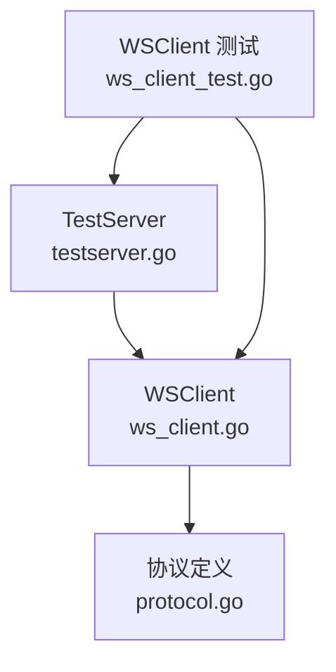
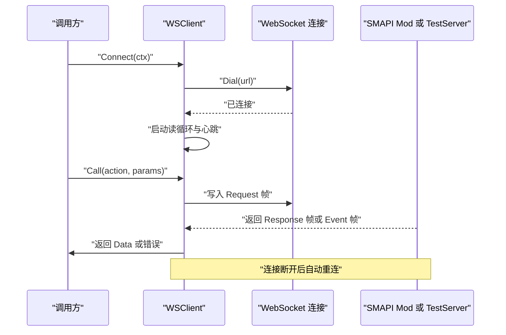
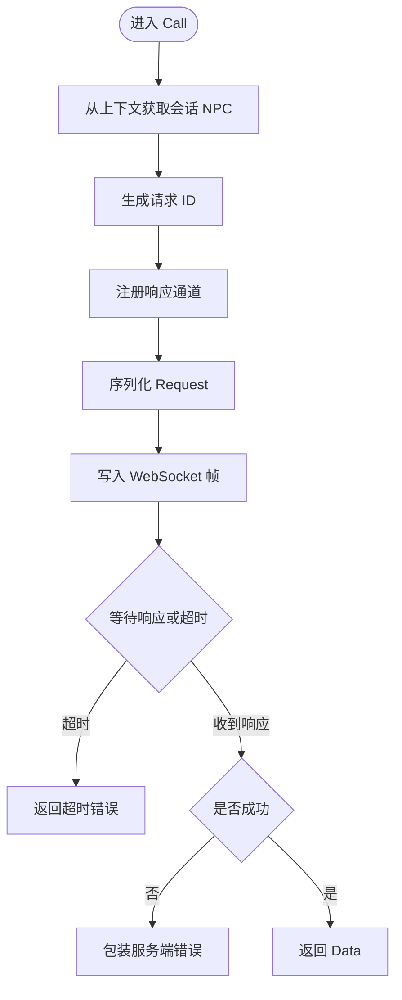
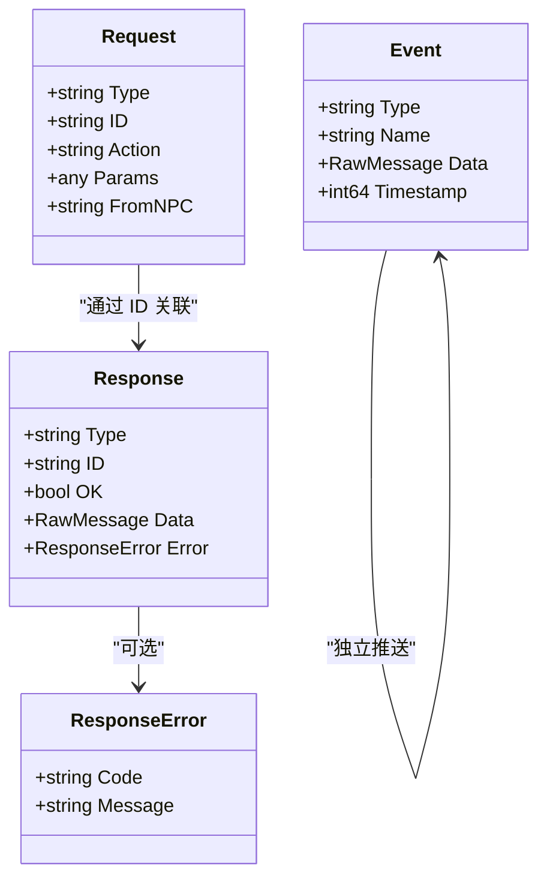
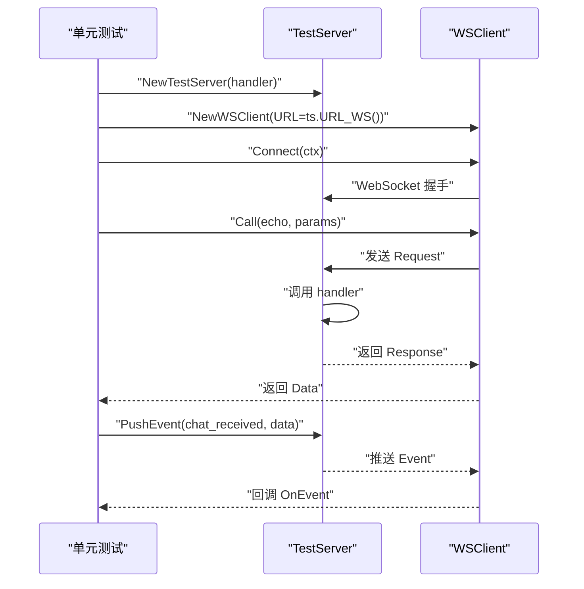
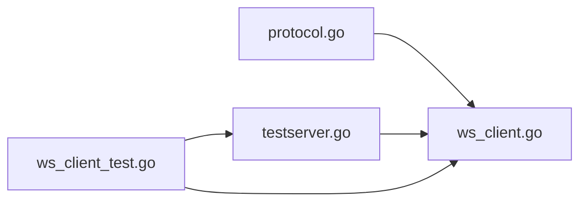

# SMAPI 适配器层

<cite>
**本文引用的文件**
- [ws_client.go](file://SmartNPC/smartnpc-mcp/adapters/stardew/bridge/ws_client.go)
- [protocol.go](file://SmartNPC/smartnpc-mcp/adapters/stardew/bridge/protocol.go)
- [testserver.go](file://SmartNPC/smartnpc-mcp/adapters/stardew/bridge/testserver.go)
- [ws_client_test.go](file://SmartNPC/smartnpc-mcp/adapters/stardew/bridge/ws_client_test.go)
</cite>

## 目录
1. [引言](#引言)
2. [项目结构](#项目结构)
3. [核心组件](#核心组件)
4. [架构总览](#架构总览)
5. [详细组件分析](#详细组件分析)
6. [依赖关系分析](#依赖关系分析)
7. [性能与并发模型](#性能与并发模型)
8. [故障排查指南](#故障排查指南)
9. [结论](#结论)

## 引言
本技术文档聚焦于 SMAPI 适配器层中与游戏端桥接通信相关的关键实现：WebSocket 客户端、协议定义以及用于单元测试的模拟测试服务器。目标读者包括需要理解 SmartNPC 如何通过 WebSocket 与 Stardew Valley SMAPI Mod 交互的后端开发者、集成者与维护者。

该适配器层承担以下职责：
- 建立并维护到 SMAPI Mod 的 WebSocket 连接。
- 通过 JSON-RPC 风格的帧进行请求/响应调用。
- 消费服务端推送的事件流。
- 在连接中断后自动重连，并通过心跳保活避免空闲断开。
- 为 MCP 工具提供会话级 NPC 上下文注入能力。
- 提供可复用的测试服务器以驱动端到端单元测试。

## 项目结构
本节仅分析与 SMAPI 适配器层直接相关的 Go 源文件。

**图示来源**
- [ws_client.go:1-200](file://SmartNPC/smartnpc-mcp/adapters/stardew/bridge/ws_client.go#L1-L200)
- [protocol.go:1-172](file://SmartNPC/smartnpc-mcp/adapters/stardew/bridge/protocol.go#L1-L172)
- [testserver.go:1-147](file://SmartNPC/smartnpc-mcp/adapters/stardew/bridge/testserver.go#L1-L147)
- [ws_client_test.go:1-121](file://SmartNPC/smartnpc-mcp/adapters/stardew/bridge/ws_client_test.go#L1-L121)

**章节来源**
- [ws_client.go:1-200](file://SmartNPC/smartnpc-mcp/adapters/stardew/bridge/ws_client.go#L1-L200)
- [protocol.go:1-172](file://SmartNPC/smartnpc-mcp/adapters/stardew/bridge/protocol.go#L1-L172)
- [testserver.go:1-147](file://SmartNPC/smartnpc-mcp/adapters/stardew/bridge/testserver.go#L1-L147)
- [ws_client_test.go:1-121](file://SmartNPC/smartnpc-mcp/adapters/stardew/bridge/ws_client_test.go#L1-L121)

## 核心组件
SMAPI 适配器层由三个关键构件组成：

| 组件 | 职责 | 关键行为 |
|---|---|---|
| WSClient | WebSocket 客户端 | 连接管理、请求发送、响应匹配、事件分发、自动重连、心跳保活、会话 NPC 映射、调用观测 |
| Protocol | 协议数据结构 | 帧类型、事件名常量、动作名常量、请求/响应/错误/事件结构体 |
| TestServer | 测试用 WebSocket 服务器 | 接收请求、调用测试处理器、回写响应、推送事件、模拟连接关闭 |

**章节来源**
- [ws_client.go:1-200](file://SmartNPC/smartnpc-mcp/adapters/stardew/bridge/ws_client.go#L1-L200)
- [protocol.go:1-172](file://SmartNPC/smartnpc-mcp/adapters/stardew/bridge/protocol.go#L1-L172)
- [testserver.go:1-147](file://SmartNPC/smartnpc-mcp/adapters/stardew/bridge/testserver.go#L1-L147)

## 架构总览
下图展示 WSClient 与协议、测试服务器之间的关系，以及数据在连接生命周期中的流动方式。

**图示来源**
- [ws_client.go:180-260](file://SmartNPC/smartnpc-mcp/adapters/stardew/bridge/ws_client.go#L180-L260)
- [ws_client.go:320-510](file://SmartNPC/smartnpc-mcp/adapters/stardew/bridge/ws_client.go#L320-L510)
- [testserver.go:60-147](file://SmartNPC/smartnpc-mcp/adapters/stardew/bridge/testserver.go#L60-L147)

## 详细组件分析

### WSClient：WebSocket 客户端
WSClient 是 SMAPI 适配器的网络入口，负责连接生命周期、消息编解码、响应关联、事件回调、自动重连和心跳保活。

#### 关键状态与字段
- 配置选项：URL、日志器、调用超时、拨号超时、重试退避、事件处理器、调用观测器。
- 连接状态：互斥锁保护的当前连接、待处理响应通道映射、关闭标记。
- 会话注册表：MCP 会话 ID 到 NPC 名称的映射，支持空会话键以兼容单会话场景。

#### 连接建立
- `Connect` 先尝试拨号；首次失败仍会启动后台重连循环。
- `dial` 设置每帧最大读取限制，保存连接并开始心跳循环。
- 心跳使用固定周期 Ping，防止 C# HttpListener 因空闲而断开连接。

#### 请求与响应
- `Call` 从上下文提取会话对应的 NPC，再委托内部方法完成调用。
- `CallAs` 允许显式指定 FromNPC，绕过会话注册表。
- 每次调用生成唯一 ID，将响应通道放入待处理映射。
- 响应按 ID 分派；非 OK 响应会被包装为带错误码和消息的错误返回。
- 调用耗时与字节数会被记录，便于定位 Hermes 往返延迟。

#### 事件流
- 读循环持续读取文本帧。
- 帧类型解析成功后，Response 路由到 pending channel，Event 则调用 OnEvent。
- 长耗时事件处理应放在回调内部另启 goroutine，避免阻塞读循环。

#### 自动重连
- `readLoopForever` 在单次读循环结束后清理 pending 通道、清空连接，并按退避时间重试。
- 客户端 Close 会标记 closed 并阻止后续调用。

#### 会话与 NPC 上下文
- `WithCallSession` 把 MCP 会话 ID 注入 context。
- `RegisterAgent` / `AgentForSession` / `AgentForContext` 共同维护 sessionID 到 npcName 的绑定。
- 空 sessionID 会映射到合成键，保证 stdio 与内存传输测试也能正确路由 from_npc。

**图示来源**
- [ws_client.go:201-319](file://SmartNPC/smartnpc-mcp/adapters/stardew/bridge/ws_client.go#L201-L319)
- [ws_client.go:320-510](file://SmartNPC/smartnpc-mcp/adapters/stardew/bridge/ws_client.go#L320-L510)

**章节来源**
- [ws_client.go:1-200](file://SmartNPC/smartnpc-mcp/adapters/stardew/bridge/ws_client.go#L1-L200)
- [ws_client.go:201-510](file://SmartNPC/smartnpc-mcp/adapters/stardew/bridge/ws_client.go#L201-L510)

### Protocol：协议定义
Protocol 定义了客户端与服务端之间的 JSON 帧格式、事件命名空间和动作命名空间。

#### 帧类型
- request：客户端发起的请求。
- response：服务端对请求的应答。
- event：服务端主动推送的事件。

#### 事件常量
- 已实现事件：聊天消息、聊天接收、NPC 交互等。
- 预留事件：新的一天开始、位置变更、好感度变更、感知更新、游戏时间 tick 等。
- 合成事件：NPC 消息广播、日程触发、调试主动触发、玩家接近事件、实验所有者指令等。

#### 动作常量
覆盖邮件发送、聊天、游戏状态查询、好友值、农场经济、NPC 移动/表情/跟随、采集/种植/施肥、物品存取、社交表达、行为查询等。

#### 数据结构
- Request：包含 type、id、action、params、from_npc。
- Response：包含 type、id、ok、data、error。
- ResponseError：包含稳定 code 与人类可读 message。
- Event：包含 type、name、data、timestamp。

**图示来源**
- [protocol.go:1-172](file://SmartNPC/smartnpc-mcp/adapters/stardew/bridge/protocol.go#L1-L172)

**章节来源**
- [protocol.go:1-172](file://SmartNPC/smartnpc-mcp/adapters/stardew/bridge/protocol.go#L1-L172)

### TestServer：SMAPI 行为模拟服务器
TestServer 是一个进程内 WebSocket 服务器，用于在不启动真实 SMAPI Mod 的情况下执行单元测试。

#### 核心能力
- 监听 `/ws` 路径。
- 接受 WebSocket 连接并限制帧大小。
- 将收到的 Request 解包后交给测试处理器。
- 根据处理器结果构造 Response。
- 支持推送 Event 给已连接客户端。
- 支持拦截原始 Request，用于验证 from_npc 等协议细节。

#### 典型测试流程
- 创建 TestServer 并注册处理器。
- 使用 WSClientOptions.URL 指向测试服务器。
- 调用 Connect 建立连接。
- 调用 Call 验证请求/响应。
- 使用 PushEvent 验证事件消费。
- 校验非 OK 响应是否正确转为错误。

**图示来源**
- [testserver.go:1-147](file://SmartNPC/smartnpc-mcp/adapters/stardew/bridge/testserver.go#L1-L147)
- [ws_client_test.go:1-121](file://SmartNPC/smartnpc-mcp/adapters/stardew/bridge/ws_client_test.go#L1-L121)

**章节来源**
- [testserver.go:1-147](file://SmartNPC/smartnpc-mcp/adapters/stardew/bridge/testserver.go#L1-L147)
- [ws_client_test.go:1-121](file://SmartNPC/smartnpc-mcp/adapters/stardew/bridge/ws_client_test.go#L1-L121)

## 依赖关系分析
适配器层的内部依赖如下：

- ws_client.go 依赖 protocol.go 定义的帧结构与常量。
- testserver.go 复用同一套协议结构作为测试端点。
- ws_client_test.go 同时依赖客户端与测试服务器，形成闭环测试。

**图示来源**
- [protocol.go:1-172](file://SmartNPC/smartnpc-mcp/adapters/stardew/bridge/protocol.go#L1-L172)
- [ws_client.go:1-200](file://SmartNPC/smartnpc-mcp/adapters/stardew/bridge/ws_client.go#L1-L200)
- [testserver.go:1-147](file://SmartNPC/smartnpc-mcp/adapters/stardew/bridge/testserver.go#L1-L147)
- [ws_client_test.go:1-121](file://SmartNPC/smartnpc-mcp/adapters/stardew/bridge/ws_client_test.go#L1-L121)

**章节来源**
- [protocol.go:1-172](file://SmartNPC/smartnpc-mcp/adapters/stardew/bridge/protocol.go#L1-L172)
- [ws_client.go:1-200](file://SmartNPC/smartnpc-mcp/adapters/stardew/bridge/ws_client.go#L1-L200)
- [testserver.go:1-147](file://SmartNPC/smartnpc-mcp/adapters/stardew/bridge/testserver.go#L1-L147)
- [ws_client_test.go:1-121](file://SmartNPC/smartnpc-mcp/adapters/stardew/bridge/ws_client_test.go#L1-L121)

## 性能与并发模型

### 并发安全设计
- WSClient 使用互斥锁保护连接、待处理映射和关闭状态。
- 每个 Call 拥有独立的响应通道，避免不同请求之间互相覆盖。
- 会话注册表使用读写锁，提高只读访问效率。
- 事件处理器从读循环中调用，因此长时间逻辑应异步执行，避免阻塞事件分发。

### 连接池管理
当前实现未提供多连接连接池。WSClient 在同一时刻维护单一 WebSocket 连接；自动重连会在连接失效后重建连接。若上层需要多连接或多实例隔离，应在业务层管理多个 WSClient 实例。

### 超时与重试策略
- 拨号超时：默认较短，避免阻塞启动。
- 调用超时：默认较长，适合游戏工具调用的长耗时场景。
- 重试退避：固定退避时间，适用于简单环境；生产可根据失败次数引入指数退避。
- 心跳保活：固定周期 Ping，防止服务端空闲断开。

### 性能优化建议
- 批量事件处理：如果 OnEvent 订阅者较多，可在回调内部做去重或批处理。
- 控制事件回调阻塞：确保回调不持有长时间锁，避免影响读循环。
- 合理设置 ReadLimit：当前默认 1MiB，若服务端可能推送较大 payload，应根据业务调整。
- 监控指标：结合 OnCall 观测器输出 elapsed_ms、bytes_in、error 等指标，建立延迟与错误率看板。

[本节为通用指导，不直接分析具体代码行]

## 故障排查指南

### 常见连接问题

| 现象 | 可能原因 | 排查步骤 | 解决建议 |
|---|---|---|---|
| 连接后立即断开 | 服务端空闲超时或网络不稳定 | 检查心跳是否正常；查看日志中“心跳 Ping”“连接丢失”相关记录 | 确认心跳开启；增加重试退避；检查代理或防火墙 |
| Call 一直等待 | 服务端未返回响应或响应 ID 不匹配 | 检查服务端是否收到 Request；核对 ID 对应 pending channel | 使用 TestServer 复现；检查服务端是否丢弃未知帧 |
| 事件未到达 | OnEvent 未设置或被替换；事件处理阻塞 | 确认 SetEventHandler 已调用；观察事件回调是否阻塞 | 在回调中异步处理；添加事件计数日志 |
| 自动重连未生效 | 上下文被取消或客户端已 Close | 检查 ctx 生命周期；确认未提前 Close | 延长上下文超时；避免重复 Close |
| from_npc 为空 | 未设置 WithCallSession 或未注册 Agent | 检查 MCP 会话 ID 是否正确注入；检查 agent_register_self 调用 | 使用 WithCallSession；或通过 CallAs 显式传入 |

### 日志关键字
- “ws connected”：表示拨号成功。
- “ws action”：表示一次成功的工具调用，附带耗时与字节数。
- “ws action failed (write)”：写入失败。
- “ws action timed out”：调用超时。
- “ws action returned not-ok”：服务端返回失败。
- “ws read ended”：读循环结束，通常意味着连接断开。
- “ws disconnected, reconnecting”：自动重连触发。
- “ws reconnect failed”：重连失败。
- “ws frame: invalid json”：无法解析的帧。
- “ws response: no pending call”：响应找不到对应请求。

### 单元测试定位
- 使用 NewTestServer 快速验证请求/响应与事件。
- 使用 OnRawRequest 断言 from_npc 等协议字段。
- 使用 PushEvent 验证事件订阅。
- 使用自定义错误类型验证非 OK 响应路径。

**章节来源**
- [ws_client.go:201-510](file://SmartNPC/smartnpc-mcp/adapters/stardew/bridge/ws_client.go#L201-L510)
- [testserver.go:60-147](file://SmartNPC/smartnpc-mcp/adapters/stardew/bridge/testserver.go#L60-L147)
- [ws_client_test.go:1-121](file://SmartNPC/smartnpc-mcp/adapters/stardew/bridge/ws_client_test.go#L1-L121)

## 结论
SMAPI 适配器层通过 WSClient 提供了稳定、可观测、具备自动重连与心跳保活能力的 WebSocket 客户端；通过 Protocol 定义了清晰的 JSON 帧、事件与动作语义；通过 TestServer 构建了完整的单元测试闭环。其并发模型以单连接为主，适合大多数 SMAPI Mod 接入场景；若需更高吞吐或连接池，可在上层封装多实例管理器。运维侧应重点关注心跳、重连、调用超时与事件回调阻塞等关键点，并结合日志与观测器构建可诊断的运行视图。