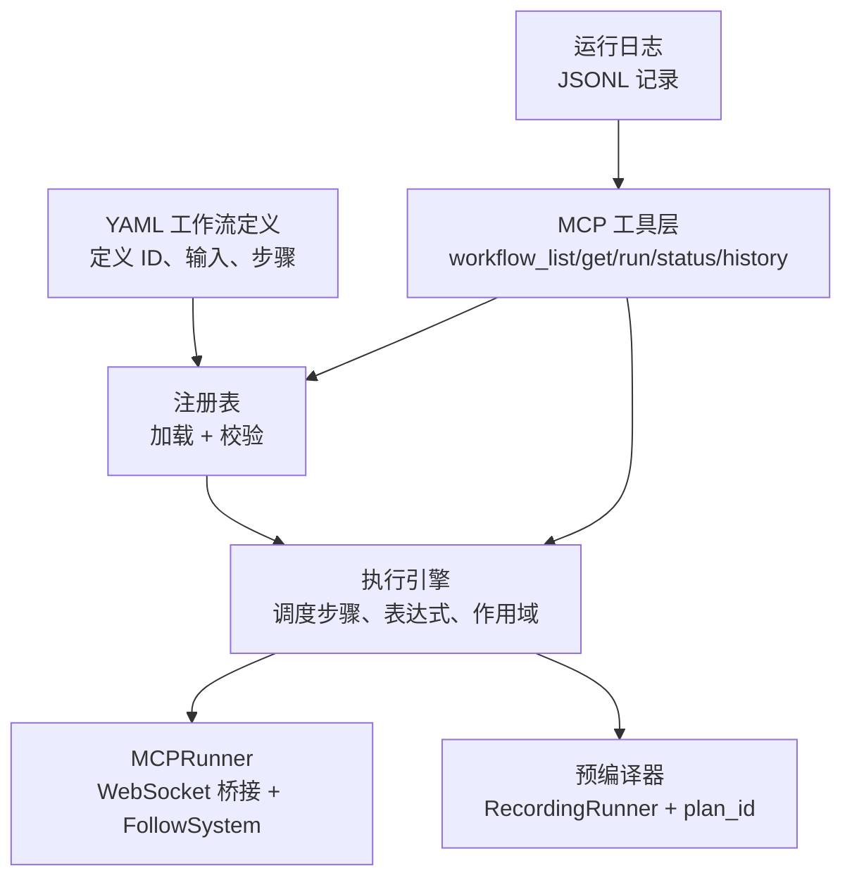
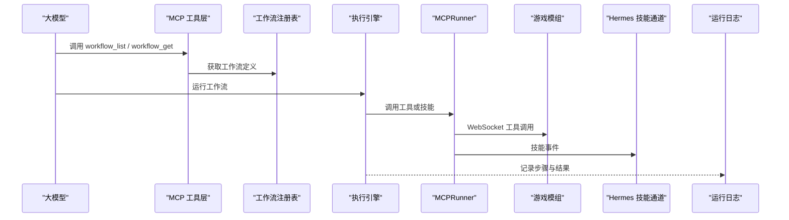
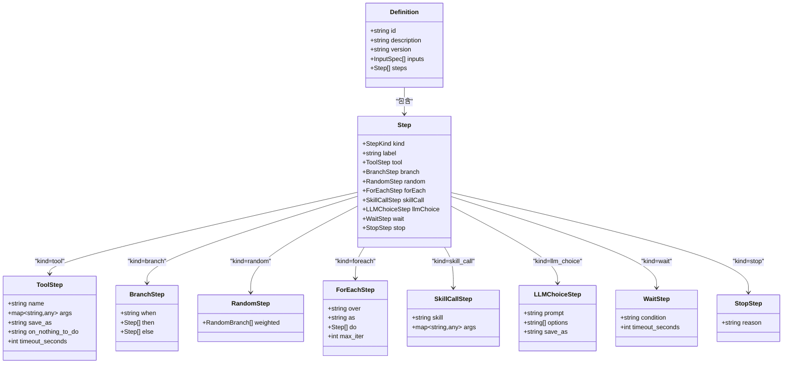
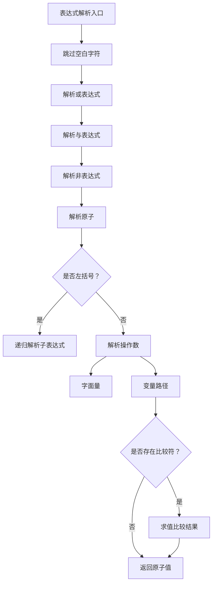
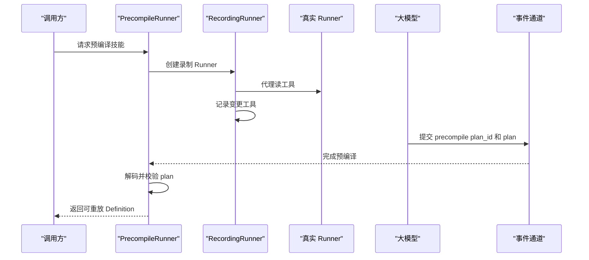
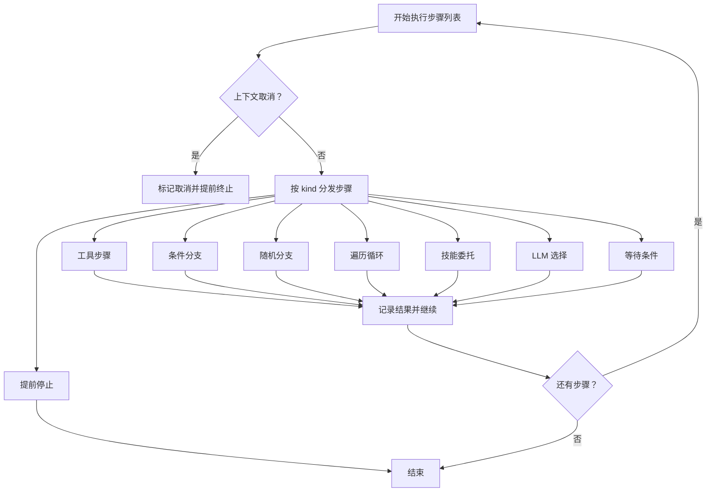
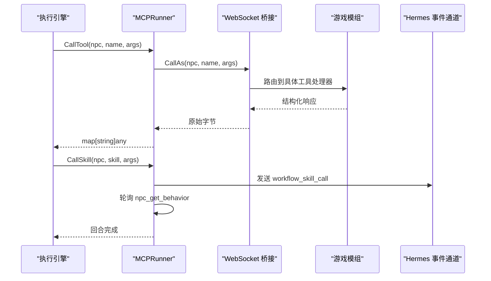
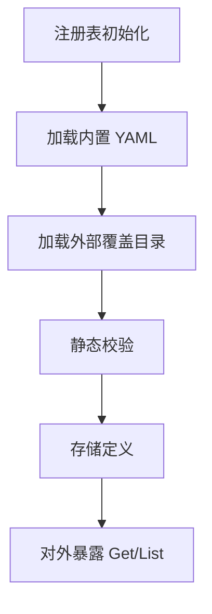
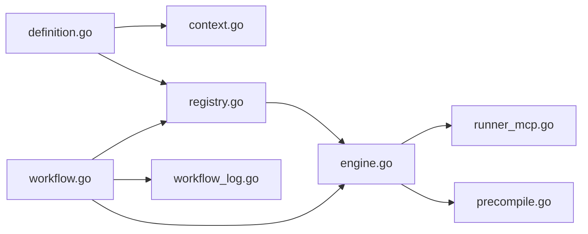
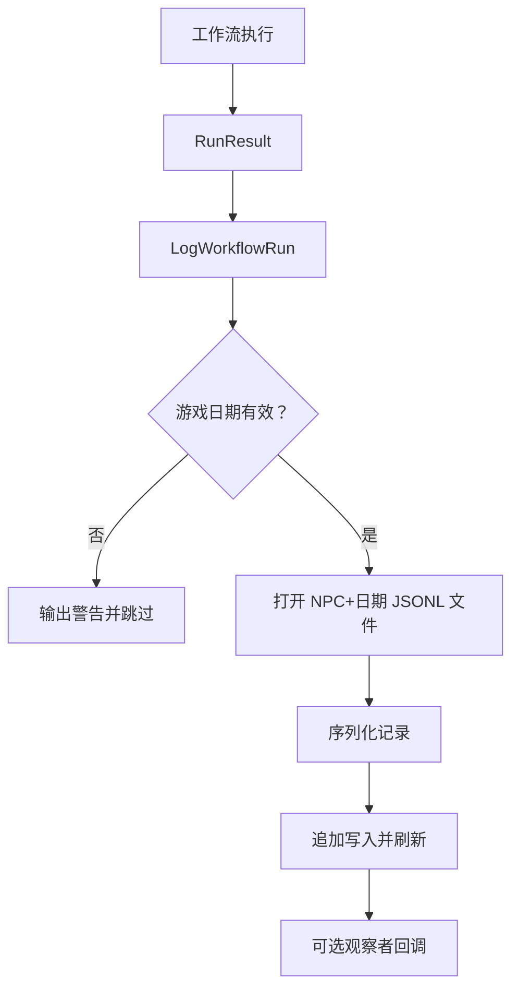

# 工作流引擎

<cite>
**本文引用的文件**   
- [definition.go](file://SmartNPC/smartnpc-mcp/pkg/workflow/definition.go)
- [context.go](file://SmartNPC/smartnpc-mcp/pkg/workflow/context.go)
- [registry.go](file://SmartNPC/smartnpc-mcp/pkg/workflow/registry.go)
- [engine.go](file://SmartNPC/smartnpc-mcp/pkg/workflow/engine.go)
- [runner_mcp.go](file://SmartNPC/smartnpc-mcp/pkg/workflow/runner_mcp.go)
- [workflow.go](file://SmartNPC/smartnpc-mcp/adapters/stardew/tools/workflow.go)
- [workflow_log.go](file://SmartNPC/smartnpc-mcp/adapters/stardew/tools/workflow_log.go)
- [precompile.go](file://SmartNPC/smartnpc-mcp/pkg/workflow/precompile.go)
- [main.go（workflow-lint）](file://SmartNPC/smartnpc-mcp/cmd/workflow-lint/main.go)
- [farm_care.yaml](file://提示词导出-20261026-004143/11-内置工作流定义/farm_care.yaml)
- [social_round_robin.yaml](file://提示词导出-20261026-004143/11-内置工作流定义/social_round_robin.yaml)
- [mine_crawl.yaml](file://提示词导出-20261026-004143/11-内置工作流定义/mine_crawl.yaml)
</cite>

## 目录
1. [引言](#引言)
2. [项目结构](#项目结构)
3. [核心组件](#核心组件)
4. [架构总览](#架构总览)
5. [详细组件分析](#详细组件分析)
6. [依赖关系分析](#依赖关系分析)
7. [性能与扩展性](#性能与扩展性)
8. [调试与日志分析](#调试与日志分析)
9. [最佳实践](#最佳实践)
10. [结论](#结论)

## 引言
本文件面向希望理解和使用 SmartNPC 工作流引擎的开发者与配置作者。文档聚焦以下目标：
- 解释 YAML 工作流定义的数据模型、节点类型、表达式语法、条件分支和循环控制。
- 说明预编译机制如何把“由大模型动态决策”的技能执行，转换成零延迟、可重放的工具调用序列。
- 梳理执行引擎的任务调度、作用域状态管理、异常处理与终止语义。
- 说明 Runner MCP 集成方式，即工作流步骤如何映射到游戏模组工具、Hermes 技能与 LLM 选择协议。
- 提供工作流设计最佳实践、性能优化建议以及调试与日志分析方法。

## 项目结构
工作流能力集中在 `smartnpc-mcp` 子项目中，关键路径如下：
- 数据模型与 DSL：`pkg/workflow/definition.go`、`pkg/workflow/context.go`
- 加载与校验：`pkg/workflow/registry.go`
- 执行引擎：`pkg/workflow/engine.go`
- 运行时适配器：`pkg/workflow/runner_mcp.go`、`pkg/workflow/precompile.go`
- MCP 工具暴露：`adapters/stardew/tools/workflow.go`、`adapters/stardew/tools/workflow_log.go`
- 静态检查工具：`cmd/workflow-lint/main.go`
- 示例工作流 YAML：`提示词导出-20261026-004143/11-内置工作流定义/*.yaml`

**图示来源**
- [registry.go:1-80](file://SmartNPC/smartnpc-mcp/pkg/workflow/registry.go#L1-L80)
- [engine.go:1-80](file://SmartNPC/smartnpc-mcp/pkg/workflow/engine.go#L1-L80)
- [runner_mcp.go:1-60](file://SmartNPC/smartnpc-mcp/pkg/workflow/runner_mcp.go#L1-L60)
- [workflow.go:1-60](file://SmartNPC/smartnpc-mcp/adapters/stardew/tools/workflow.go#L1-L60)
- [workflow_log.go:1-40](file://SmartNPC/smartnpc-mcp/adapters/stardew/tools/workflow_log.go#L1-L40)

**章节来源**
- [registry.go:1-80](file://SmartNPC/smartnpc-mcp/pkg/workflow/registry.go#L1-L80)
- [engine.go:1-80](file://SmartNPC/smartnpc-mcp/pkg/workflow/engine.go#L1-L80)
- [workflow.go:1-60](file://SmartNPC/smartnpc-mcp/adapters/stardew/tools/workflow.go#L1-L60)

## 核心组件
工作流系统由五个相互协作的核心部分组成：
- **定义模型**：描述工作流 ID、版本、输入参数、有序步骤集合。
- **上下文与作用域**：变量绑定、点路径解析、表达式求值。
- **注册表与校验器**：从嵌入的内置 YAML 或外部覆盖目录加载工作流，并做静态校验。
- **执行引擎**：按顺序调度步骤，处理工具调用、条件分支、随机分支、遍历、技能委托、LLM 选择、等待和停止。
- **Runner 与 MCP 工具层**：将引擎抽象为可测试接口，生产实现通过 WebSocket 桥接游戏模组；同时暴露工作流发现、调试、历史查询等 MCP 工具。

**章节来源**
- [definition.go:1-120](file://SmartNPC/smartnpc-mcp/pkg/workflow/definition.go#L1-L120)
- [context.go:1-60](file://SmartNPC/smartnpc-mcp/pkg/workflow/context.go#L1-L60)
- [registry.go:1-80](file://SmartNPC/smartnpc-mcp/pkg/workflow/registry.go#L1-L80)
- [engine.go:1-80](file://SmartNPC/smartnpc-mcp/pkg/workflow/engine.go#L1-L80)
- [runner_mcp.go:1-60](file://SmartNPC/smartnpc-mcp/pkg/workflow/runner_mcp.go#L1-L60)

## 架构总览
工作流的生命周期可以概括为：
1. 启动时加载内置 YAML，并允许外部目录覆盖同名 ID。
2. 大模型或调度器通过 MCP 工具查询可用工作流。
3. 工作流被传入引擎执行，引擎根据步骤类型分派到对应处理器。
4. 工具调用经 MCPRunner 转发到游戏模组；技能委托通过 Hermes 事件触发。
5. 运行结果写入 JSONL 日志，供 `workflow_run_history` 查询。
6. 预编译模式让大模型在不执行变更操作的情况下生成可重放的工作流计划。

**图示来源**
- [workflow.go:60-160](file://SmartNPC/smartnpc-mcp/adapters/stardew/tools/workflow.go#L60-L160)
- [registry.go:60-120](file://SmartNPC/smartnpc-mcp/pkg/workflow/registry.go#L60-L120)
- [engine.go:80-180](file://SmartNPC/smartnpc-mcp/pkg/workflow/engine.go#L80-L180)
- [runner_mcp.go:60-140](file://SmartNPC/smartnpc-mcp/pkg/workflow/runner_mcp.go#L60-L140)
- [workflow_log.go:1-60](file://SmartNPC/smartnpc-mcp/adapters/stardew/tools/workflow_log.go#L1-L60)

## 详细组件分析

### YAML 定义模型与节点类型
工作流定义由顶层对象描述，包含 ID、可选描述、版本、输入声明和步骤列表。每个步骤是一个“标签联合体”，通过 `kind` 字段决定实际子结构。

支持的步骤类型包括：
- `tool`：调用一个 MCP 工具，支持参数中的变量引用、输出保存名、无任务策略和超时。
- `branch`：基于表达式的 if/else 分支。
- `random`：按权重随机选择一个分支执行。
- `foreach`：对列表变量逐项迭代，每次迭代拥有独立子作用域，并可限制最大迭代次数。
- `skill_call`：委托给现有 Hermes 技能，适合复用复杂提示驱动流程。
- `llm_choice`：让大模型从固定选项中选择一个字符串，结果保存到作用域。
- `wait`：阻塞直到运行时条件满足，当前只支持空闲条件。
- `stop`：提前终止工作流，并记录原因。

**图示来源**
- [definition.go:1-120](file://SmartNPC/smartnpc-mcp/pkg/workflow/definition.go#L1-L120)

**章节来源**
- [definition.go:1-120](file://SmartNPC/smartnpc-mcp/pkg/workflow/definition.go#L1-L120)

### 表达式与作用域
作用域是链式可变绑定结构：父作用域可见，子作用域不可写父作用域已绑定的同名变量。这保证同一作用域内 `save_as` 的结果不可被重复覆盖，减少调试歧义。

表达式语法刻意保持简单，只支持：
- 变量路径查找，例如 `$obs.water.count` 或省略 `$` 的 `obs.water.count`。
- 字面量：数字、引号字符串、布尔值、空值。
- 比较运算符：等于、不等于、小于、小于等于、大于、大于等于。
- 逻辑运算符：与、或、非。
- 括号分组。

表达式不会执行任意算术或函数调用；需要复杂计算时应在工作流上游准备数据，并通过 `save_as` 暴露。

**图示来源**
- [context.go:120-220](file://SmartNPC/smartnpc-mcp/pkg/workflow/context.go#L120-L220)
- [context.go:220-320](file://SmartNPC/smartnpc-mcp/pkg/workflow/context.go#L220-L320)
- [context.go:320-420](file://SmartNPC/smartnpc-mcp/pkg/workflow/context.go#L320-L420)

**章节来源**
- [context.go:1-120](file://SmartNPC/smartnpc-mcp/pkg/workflow/context.go#L1-L120)
- [context.go:120-452](file://SmartNPC/smartnpc-mcp/pkg/workflow/context.go#L120-L452)

### 预编译机制
预编译的目标是让“由大模型观察环境后决定工具调用”的流程，变成一次性的、可重放的纯工具调用工作流。

预编译有两种主要路径：
1. **录制式预编译**：`RecordingRunner` 包装真实 Runner，拦截所有变更型工具调用，只记录工具名称和参数；读操作则透传到真实 Runner，使大模型能拿到准确的环境数据。录制结束后，将其转换为仅包含 `tool` 步骤的 `Definition`。
2. **事件式预编译**：生产 Runner 通过 `workflow_skill_call` 事件携带 `precompile=true` 和 `plan_id`，大模型在预编译模式下只调用读工具，然后通过 `workflow_precompile_result` 提交完整计划。

**图示来源**
- [precompile.go:1-120](file://SmartNPC/smartnpc-mcp/pkg/workflow/precompile.go#L1-L120)
- [runner_mcp.go:220-298](file://SmartNPC/smartnpc-mcp/pkg/workflow/runner_mcp.go#L220-L298)
- [workflow.go:420-512](file://SmartNPC/smartnpc-mcp/adapters/stardew/tools/workflow.go#L420-L512)

**章节来源**
- [precompile.go:1-120](file://SmartNPC/smartnpc-mcp/pkg/workflow/precompile.go#L1-L120)
- [runner_mcp.go:220-298](file://SmartNPC/smartnpc-mcp/pkg/workflow/runner_mcp.go#L220-L298)
- [workflow.go:420-512](file://SmartNPC/smartnpc-mcp/adapters/stardew/tools/workflow.go#L420-L512)

### 执行引擎核心逻辑
引擎负责将工作流定义转化为实际执行轨迹。其关键点包括：
- 初始化作用域，绑定输入参数，保留调用者额外变量。
- 顺序执行步骤，每步记录编号、类型、耗时、是否提前终止。
- 工具调用支持 `on_nothing_to_do` 策略：默认跳过、`stop` 提前终止、`fail` 作为错误返回。
- 分支、随机、遍历分别走不同处理器，但统一通过 `runSteps` 继续调度。
- 技能委托通过 Runner 异步或同步完成，引擎会等待其返回。
- LLM 选择会把模型返回结果限制到选项集合，否则回退到第一个选项。
- 等待步骤默认等待空闲状态，超时不失败，而是按 Runner 约定返回。

**图示来源**
- [engine.go:80-180](file://SmartNPC/smartnpc-mcp/pkg/workflow/engine.go#L80-L180)
- [engine.go:180-420](file://SmartNPC/smartnpc-mcp/pkg/workflow/engine.go#L180-L420)

**章节来源**
- [engine.go:80-420](file://SmartNPC/smartnpc-mcp/pkg/workflow/engine.go#L80-L420)

### Runner MCP 集成与工作流步骤映射
`Runner` 接口把引擎与具体后端解耦。生产实现 `MCPRunner` 负责：
- 工具调用：通过 WebSocket 客户端调用游戏模组的动作工具，自动注入 `npc` 参数，并对响应进行 JSON 反序列化。
- 技能委托：向 Hermes 发送合成事件，然后轮询 NPC 行为模式，直到长时间处于空闲状态，认为大模型回合结束。
- LLM 选择：当前默认实现未连接 relay 时直接返回第一个选项；完整同步往返会在调度集成中启用。
- 空闲等待：周期性查询 FollowSystem，直到达到空闲状态或超时。

工作流步骤到 MCP 工具的映射关系如下：
- `tool` → 调用某个 MCP 工具，例如 `npc_water_crops`、`game_get_weather`。
- `skill_call` → 触发 Hermes 技能，例如 `smartnpc-farm-care`。
- `llm_choice` → 通过 `workflow_choice_reply` 完成选择结果回填。
- 预编译相关 → 使用 `workflow_skill_call` 事件和 `workflow_precompile_result` 工具。

**图示来源**
- [runner_mcp.go:60-200](file://SmartNPC/smartnpc-mcp/pkg/workflow/runner_mcp.go#L60-L200)
- [engine.go:300-420](file://SmartNPC/smartnpc-mcp/pkg/workflow/engine.go#L300-L420)

**章节来源**
- [runner_mcp.go:1-200](file://SmartNPC/smartnpc-mcp/pkg/workflow/runner_mcp.go#L1-L200)
- [engine.go:280-420](file://SmartNPC/smartnpc-mcp/pkg/workflow/engine.go#L280-L420)

### 工作流注册、加载与静态校验
注册表在启动时加载嵌入的内置 YAML，再加载可选的外部覆盖目录。同名 ID 会被外部文件完全替换。加载过程会调用校验器，确保：
- 工作流 ID 非空。
- 步骤列表非空。
- 每种步骤类型必填字段存在。
- `save_as` 在同一作用域不重复。
- 分支、随机、遍历体不为空。
- `on_nothing_to_do` 取值合法。
- `skill_call` 不误引用 MCP 工具名。
- `llm_choice` 至少有一个选项。
- `wait` 的条件为空或 `idle`。

此外，`workflow-lint` 命令维护已知 MCP 工具名和 Hermes 技能名的白名单，进一步检查：
- 工具名是否在模组中注册。
- `skill_call` 是否指向已知技能。
- 变量引用是否超出当前作用域。

**图示来源**
- [registry.go:60-160](file://SmartNPC/smartnpc-mcp/pkg/workflow/registry.go#L60-L160)
- [registry.go:160-376](file://SmartNPC/smartnpc-mcp/pkg/workflow/registry.go#L160-L376)
- [main.go（workflow-lint）:1-120](file://SmartNPC/smartnpc-mcp/cmd/workflow-lint/main.go#L1-L120)
- [main.go（workflow-lint）:200-308](file://SmartNPC/smartnpc-mcp/cmd/workflow-lint/main.go#L200-L308)

**章节来源**
- [registry.go:60-376](file://SmartNPC/smartnpc-mcp/pkg/workflow/registry.go#L60-L376)
- [main.go（workflow-lint）:1-120](file://SmartNPC/smartnpc-mcp/cmd/workflow-lint/main.go#L1-L120)
- [main.go（workflow-lint）:200-308](file://SmartNPC/smartnpc-mcp/cmd/workflow-lint/main.go#L200-L308)

### 示例工作流 YAML
仓库导出的内置工作流展示了常见用法：
- `farm_care.yaml`：农场日常养护，通过 `skill_call` 委托给 `smartnpc-farm-care`，并使用输入参数 `inspect_radius`。
- `social_round_robin.yaml`：轻量社交，委托给 `smartnpc-social-round-robin`。
- `mine_crawl.yaml`：矿洞探索，委托给 `smartnpc-mine-crawl`。
- `resource_gather.yaml`：资源采集，委托给 `smartnpc-farm-gather`。
- `social_interact.yaml`：玩家互动，带多个布尔输入参数。

这些示例说明工作流常用于组合高层技能，而不是直接编排底层工具。

**章节来源**
- [farm_care.yaml:1-12](file://提示词导出-20261026-004143/11-内置工作流定义/farm_care.yaml#L1-L12)
- [social_round_robin.yaml:1-8](file://提示词导出-20261026-004143/11-内置工作流定义/social_round_robin.yaml#L1-L8)
- [mine_crawl.yaml:1-12](file://提示词导出-20261026-004143/11-内置工作流定义/mine_crawl.yaml#L1-L12)
- [resource_gather.yaml:1-12](file://提示词导出-20261026-004143/11-内置工作流定义/resource_gather.yaml#L1-L12)
- [social_interact.yaml:1-20](file://提示词导出-20261026-004143/11-内置工作流定义/social_interact.yaml#L1-L20)

## 依赖关系分析
工作流包内部依赖清晰：
- `definition.go` 定义数据结构，不含网络、I/O 或服务端逻辑。
- `context.go` 实现表达式与作用域，只依赖基础字符串和数值处理。
- `registry.go` 依赖 YAML 解析和嵌入文件系统，负责加载和校验。
- `engine.go` 依赖 Runner 接口、作用域、表达式求值和随机数。
- `runner_mcp.go` 依赖 WebSocket 桥接和 Hermes 事件通道。
- `precompile.go` 依赖 Runner 接口和全局 channel 注册表。
- MCP 工具层依赖 registry、engine 和日志模块。

**图示来源**
- [definition.go:1-40](file://SmartNPC/smartnpc-mcp/pkg/workflow/definition.go#L1-L40)
- [context.go:1-40](file://SmartNPC/smartnpc-mcp/pkg/workflow/context.go#L1-L40)
- [registry.go:1-40](file://SmartNPC/smartnpc-mcp/pkg/workflow/registry.go#L1-L40)
- [engine.go:1-40](file://SmartNPC/smartnpc-mcp/pkg/workflow/engine.go#L1-L40)
- [runner_mcp.go:1-40](file://SmartNPC/smartnpc-mcp/pkg/workflow/runner_mcp.go#L1-L40)
- [workflow.go:1-40](file://SmartNPC/smartnpc-mcp/adapters/stardew/tools/workflow.go#L1-L40)

**章节来源**
- [definition.go:1-40](file://SmartNPC/smartnpc-mcp/pkg/workflow/definition.go#L1-L40)
- [engine.go:1-40](file://SmartNPC/smartnpc-mcp/pkg/workflow/engine.go#L1-L40)
- [workflow.go:1-40](file://SmartNPC/smartnpc-mcp/adapters/stardew/tools/workflow.go#L1-L40)

## 性能与扩展性
从实现角度，工作流引擎具备以下性能特征和优化空间：
- 步骤数量较小：注释明确指出典型规模是每个工作流不超过 50 个步骤，因此使用单 struct 承载多种步骤类型的内存开销可接受。
- 表达式求值轻量：没有函数调用和任意算术，避免昂贵的解析树构建。
- 工具调用超时保护：每个工具调用有上下文超时，默认安全上限用于重型操作。
- 遍历保护：`foreach` 默认最多 50 次迭代，防止大数据集导致长尾。
- 随机分支权重归一化：运行时累加权重并抽样，避免无效分支。
- 日志写入按 NPC+日期分文件，并发安全，避免单文件锁竞争。
- 预编译可减少运行时大模型延迟：将动态决策转为静态工具序列。

潜在优化方向：
- 如果工作流长期增长，可考虑缓存常用表达式求值结果，尤其是频繁读取的相同路径。
- 对于大量并行工作流，可引入调度队列和并发池，而不是每个 Runner 实例都无限等待。
- `workflow_run_inline` 目前是无操作 Runner，适合调试，但不适合性能基准；应配合真实 Runner 或在测试中注入可控 Runner。
- 表达式语言可扩展为支持更多类型比较和简单算术，但需权衡安全性与复杂度。

**章节来源**
- [definition.go:1-40](file://SmartNPC/smartnpc-mcp/pkg/workflow/definition.go#L1-L40)
- [engine.go:180-360](file://SmartNPC/smartnpc-mcp/pkg/workflow/engine.go#L180-L360)
- [workflow_log.go:1-120](file://SmartNPC/smartnpc-mcp/adapters/stardew/tools/workflow_log.go#L1-L120)

## 调试与日志分析

### 调试工具
- `workflow_list`：列出所有注册的工作流及其输入说明。
- `workflow_get`：查看单个工作流的完整结构。
- `workflow_run_inline`：在 debug 模式下用无操作 Runner 验证工作流结构和流程。
- `npc_workflow_status`：查看每个 NPC 当前运行的工作流、队列深度和待处理日程条目。
- `workflow_run_history`：读取某 NPC 在某天的历史工作流运行记录。
- `workflow_choice_reply`：回复大模型的选择请求。
- `workflow_precompile_result`：提交预编译模式下的计划。
- `workflow-lint`：命令行静态检查工具，检查 schema、工具名、技能名和变量引用。

**章节来源**
- [workflow.go:60-220](file://SmartNPC/smartnpc-mcp/adapters/stardew/tools/workflow.go#L60-L220)
- [workflow.go:220-512](file://SmartNPC/smartnpc-mcp/adapters/stardew/tools/workflow.go#L220-L512)
- [main.go（workflow-lint）:1-120](file://SmartNPC/smartnpc-mcp/cmd/workflow-lint/main.go#L1-L120)

### 日志位置与格式
工作流运行记录以 JSONL 形式写入：
- 目录：日志根目录下的 `mcp/workflow_runs`。
- 文件名：`<npc>-<season>-d<day>-y<year>.jsonl`。
- 每条记录包含时间戳、NPC、工作流 ID、步骤数、工具调用数、nothing-to-do 计数、是否停止、停止原因、失败步骤、持续时间、错误信息和参数。

如果游戏日期尚未正确填充，例如季节为未知、天数为 0、年份为 0，日志写入会被跳过，并输出警告。

**图示来源**
- [workflow_log.go:1-120](file://SmartNPC/smartnpc-mcp/adapters/stardew/tools/workflow_log.go#L1-L120)
- [workflow_log.go:120-235](file://SmartNPC/smartnpc-mcp/adapters/stardew/tools/workflow_log.go#L120-L235)

**章节来源**
- [workflow_log.go:1-120](file://SmartNPC/smartnpc-mcp/adapters/stardew/tools/workflow_log.go#L1-L120)
- [workflow_log.go:120-235](file://SmartNPC/smartnpc-mcp/adapters/stardew/tools/workflow_log.go#L120-L235)

### 常见问题排查
- 工作流无法启动：先调用 `workflow_list` 确认 ID，再用 `workflow_get` 检查步骤结构。
- 工具一直返回 nothing_to_do：检查 `on_nothing_to_do` 策略，确认工具确实没有找到可执行内容。
- 大模型选择不生效：确认 `llm_choice` 的 `save_as` 和 `options` 是否正确，并检查是否有 `workflow_choice_reply` 的回填链路。
- 预编译超时：检查 Hermes relay 是否正常、plan_id 是否匹配、大模型是否提交了合法的 plan。
- 日志缺失：检查游戏日期是否已设置，避免写入 `unknown-d0-y0.jsonl`。
- 变量未找到：检查 `save_as` 命名和作用域，注意 `foreach` 会为每次迭代创建子作用域。

**章节来源**
- [engine.go:180-420](file://SmartNPC/smartnpc-mcp/pkg/workflow/engine.go#L180-L420)
- [runner_mcp.go:200-298](file://SmartNPC/smartnpc-mcp/pkg/workflow/runner_mcp.go#L200-L298)
- [workflow_log.go:1-120](file://SmartNPC/smartnpc-mcp/adapters/stardew/tools/workflow_log.go#L1-L120)

## 最佳实践
### 工作流设计
- 优先使用 `skill_call` 委托复杂智能流程，避免把所有逻辑写成扁平工具序列。
- 明确定义 `inputs`，并为常用参数提供合理默认值。
- 对可能返回 no-work 的工具设置合适的 `on_nothing_to_do`：默认跳过，严重场景用 `stop` 或 `fail`。
- 使用 `branch` 表达确定性业务规则，例如天气、时间、库存状态。
- 使用 `random` 表达风格化或人格化选择，权重为 0 的分支可用于开关控制。
- 使用 `foreach` 批量处理列表数据，并设置 `max_iter` 防止数据膨胀。
- 谨慎使用 `llm_choice`，只在选项有限且必须依赖模型判断时使用。
- 使用 `wait` 等待 NPC 空闲，避免后续工具与长任务冲突。
- 使用 `stop` 显式结束工作流，并在日志中留下可读原因。

### 预编译与执行分离
- 在预编译阶段只调用读工具，避免副作用污染环境。
- 使用 `workflow_precompile_result` 提交完整 plan，并在运行前做 `Validate`。
- 对需要强一致性的场景，优先使用预编译后的工作流，而不是每次运行时重新推理。

### 性能优化
- 把高频读操作放在前置步骤，并通过 `save_as` 缓存结果。
- 对重型工具调用设置合理的 `timeout_seconds`。
- 控制 `foreach` 的最大迭代次数。
- 避免在热路径上频繁创建新的大模型选择；必要时缓存决策结果。
- 合理使用工作流层次：高层工作流调用技能，技能内部再编排工具。

**章节来源**
- [definition.go:1-120](file://SmartNPC/smartnpc-mcp/pkg/workflow/definition.go#L1-L120)
- [engine.go:180-420](file://SmartNPC/smartnpc-mcp/pkg/workflow/engine.go#L180-L420)
- [precompile.go:1-120](file://SmartNPC/smartnpc-mcp/pkg/workflow/precompile.go#L1-L120)

## 结论
SmartNPC 工作流引擎提供了一个轻量但足够强大的 DSL，既能编排确定性工具流程，又能与 Hermes 技能和 LLM 决策交互。它通过清晰的职责划分——定义模型、作用域、注册校验、执行引擎、Runner 适配器和 MCP 工具层——实现了可测试、可调试、可扩展的工作流体系。对于使用者而言，推荐把高价值、重复性强的智能行为封装为技能和工作流，并通过预编译机制降低运行时不确定性；对于维护者而言，应优先关注步骤校验、变量作用域、工具超时、nothing_to_do 策略和日志完整性。