# 服务入口与配置管理

<cite>
**本文引用的文件**   
- [main.go](file://SmartNPC/smartnpc-mcp/cmd/agent-bridge/main.go)
- [config.go](file://SmartNPC/smartnpc-mcp/pkg/agentbridge/config.go)
- [server.go](file://SmartNPC/smartnpc-mcp/pkg/agentbridge/server.go)
- [meta.go](file://SmartNPC/smartnpc-mcp/pkg/agentbridge/meta.go)
- [http.go](file://SmartNPC/smartnpc-mcp/pkg/transport/http.go)
- [logger.go](file://SmartNPC/smartnpc-mcp/internal/log/logger.go)
- [ws_client.go](file://SmartNPC/smartnpc-mcp/adapters/stardew/bridge/ws_client.go)
- [hermes_config.go](file://SmartNPC/smartnpc-mcp/pkg/relay/hermes/config.go)
- [smartnpc_main.go](file://SmartNPC/smartnpc-mcp/cmd/smartnpc-mcp/main.go)
</cite>

## 目录
1. [引言](#引言)
2. [项目结构定位](#项目结构定位)
3. [核心组件总览](#核心组件总览)
4. [架构总览](#架构总览)
5. [主程序启动流程分析](#主程序启动流程分析)
6. [配置模型与加载机制](#配置模型与加载机制)
7. [服务器初始化与传输层](#服务器初始化与传输层)
8. [适配器、中继与健康检查](#适配器中继与健康检查)
9. [依赖关系分析](#依赖关系分析)
10. [性能与可靠性特征](#性能与可靠性特征)
11. [故障排查指南](#故障排查指南)
12. [结论](#结论)

## 引言
本文聚焦 SmartNPC 的 MCP（Model Context Protocol）桥接服务，重点说明两个入口及其配置管理：

- `cmd/agent-bridge`：通用 MCP 桥接入口，通过 `bridge.yaml` 组装适配器、中继和 MCP 传输。
- `cmd/smartnpc-mcp`：面向 Stardew Valley SMAPI 模组的专用 MCP 服务，支持 WebSocket 适配器、Hermes 中继、HTTP/stdio 传输以及多模式运行。

文档覆盖 CLI 参数解析、环境变量读取、配置文件加载、服务器初始化、端口绑定、日志系统、中间件注册、健康检查端点与监控指标暴露机制。

## 项目结构定位
MCP 相关代码位于 `SmartNPC/smartnpc-mcp` 子模块中，关键路径如下：

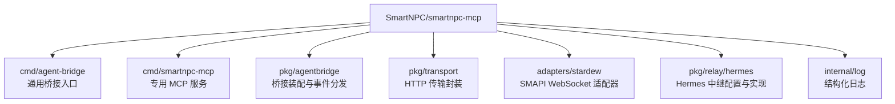

**图表来源**
- [main.go:1-30](file://SmartNPC/smartnpc-mcp/cmd/agent-bridge/main.go#L1-L30)
- [smartnpc_main.go:1-40](file://SmartNPC/smartnpc-mcp/cmd/smartnpc-mcp/main.go#L1-L40)
- [config.go:1-30](file://SmartNPC/smartnpc-mcp/pkg/agentbridge/config.go#L1-L30)
- [http.go:1-25](file://SmartNPC/smartnpc-mcp/pkg/transport/http.go#L1-L25)

**章节来源**
- [main.go:1-30](file://SmartNPC/smartnpc-mcp/cmd/agent-bridge/main.go#L1-L30)
- [smartnpc_main.go:1-40](file://SmartNPC/smartnpc-mcp/cmd/smartnpc-mcp/main.go#L1-L40)

## 核心组件总览
| 组件 | 职责 | 关键行为 |
|---|---|---|
| `agent-bridge` 主程序 | 解析 CLI 参数、加载 `bridge.yaml`、装配 Server、启动 stdio 或 HTTP 传输 | 版本打印、必需参数校验、日志初始化、信号处理 |
| `BridgeConfig` | 描述适配器、中继、传输配置 | 轻量验证、按 kind 查找工厂、调用 Assemble |
| `Server` | 包装底层 `mcp.Server`，管理事件源、后端、工具组 | Mount、AttachEventSource、AttachBackend、Run |
| `transport.RunHTTP` | 暴露 Streamable HTTP 端点 | `/mcp`、`/healthz`、可选 API Key 鉴权、优雅关闭 |
| `internal/log` | 统一 JSON 日志到 stderr | 支持 debug/info/warn/error |
| `stardew WSClient` | 连接 SMAPI 模组 WebSocket | 默认地址、重连、会话映射、超时与回调 |
| `hermes relay config` | 加载 Hermes 运行时配置 | 环境变量扩展、API Key、调试负载日志、存储开关、超时 |

**章节来源**
- [config.go:31-154](file://SmartNPC/smartnpc-mcp/pkg/agentbridge/config.go#L31-L154)
- [server.go:1-177](file://SmartNPC/smartnpc-mcp/pkg/agentbridge/server.go#L1-L177)
- [http.go:26-124](file://SmartNPC/smartnpc-mcp/pkg/transport/http.go#L26-L124)
- [logger.go:1-35](file://SmartNPC/smartnpc-mcp/internal/log/logger.go#L1-L35)
- [ws_client.go:1-120](file://SmartNPC/smartnpc-mcp/adapters/stardew/bridge/ws_client.go#L1-L120)
- [hermes_config.go:1-80](file://SmartNPC/smartnpc-mcp/pkg/relay/hermes/config.go#L1-L80)

## 架构总览
`agent-bridge` 是“配置驱动”的入口：构建 `mcp.Server`，从 `bridge.yaml` 装配适配器与中继，再根据 `transport.kind` 选择 stdio 或 HTTP。`smartnpc-mcp` 是更完整的专用服务，除了复用 agentbridge 的装配思想外，还直接组合 SMAPI WebSocket 适配器、Hermes 中继、工作流、调度器和实验日志。

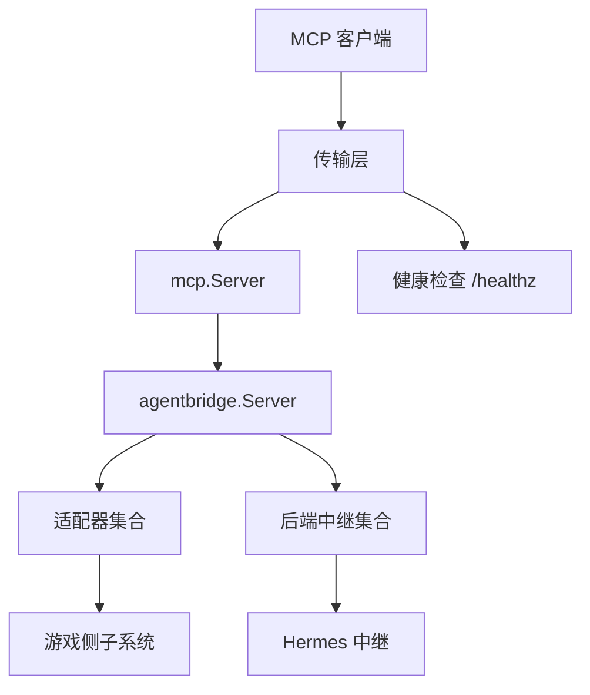

**图表来源**
- [main.go:60-123](file://SmartNPC/smartnpc-mcp/cmd/agent-bridge/main.go#L60-L123)
- [server.go:30-177](file://SmartNPC/smartnpc-mcp/pkg/agentbridge/server.go#L30-L177)
- [http.go:60-124](file://SmartNPC/smartnpc-mcp/pkg/transport/http.go#L60-L124)

## 主程序启动流程分析

### agent-bridge 启动序列
1. 解析 CLI 参数：`--version`、`--config`、`--log-level`、`--http-allow-any-origin`。
2. 若请求版本则直接输出并退出。
3. 若未提供 `--config`，向 stderr 报错并退出码 2。
4. 初始化结构化日志，设置全局 `slog`。
5. 调用 `agentbridge.LoadConfig` 读取并校验 `bridge.yaml`。
6. 创建 `mcp.Server`，使用桥接名称和版本号。
7. 调用 `cfg.Assemble` 装配适配器、中继、元工具。
8. 创建带信号取消的上下文。
9. 在 goroutine 中执行 `srv.Run(ctx)`，用于驱动事件源生命周期。
10. 根据 `Transport.Kind` 选择：
    - `stdio`：直接运行 `mcp.StdioTransport`。
    - `http`：调用 `transport.RunHTTP` 暴露 Streamable HTTP。
11. 收到上下文取消后等待事件源退出，记录干净关闭日志。

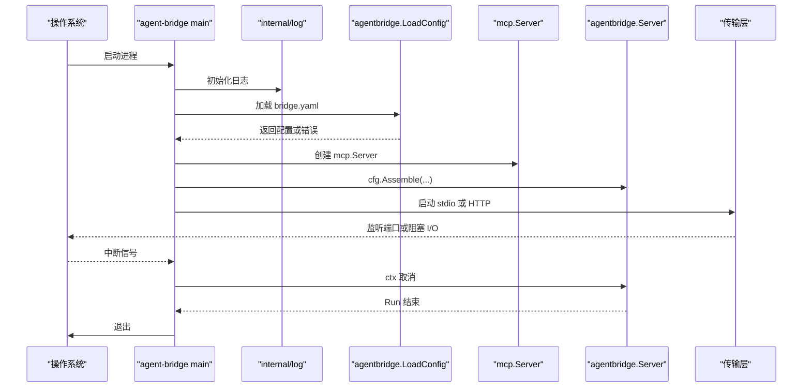

**图表来源**
- [main.go:31-123](file://SmartNPC/smartnpc-mcp/cmd/agent-bridge/main.go#L31-L123)

**章节来源**
- [main.go:31-123](file://SmartNPC/smartnpc-mcp/cmd/agent-bridge/main.go#L31-L123)

### smartnpc-mcp 启动差异
`smartnpc-mcp` 在主程序中额外处理：

- Windows UTF-8 控制台输出。
- 更多 CLI 参数：WebSocket URL、echo 模式、Hermes 单目标或多配置文件、MCP API Key。
- 优先使用 `--hermes-config` 多配置文件；回退到 legacy 单目标参数；否则禁用中继。
- 初始化实验日志、聊天守卫、工作流等专用能力。
- 同样支持 stdio 和 HTTP 两种传输。

这说明 `smartnpc-mcp` 不是简单复用 `agent-bridge`，而是将 agentbridge 的装配概念融入更复杂的业务流水线。

**章节来源**
- [smartnpc_main.go:1-120](file://SmartNPC/smartnpc-mcp/cmd/smartnpc-mcp/main.go#L1-L120)

## 配置模型与加载机制

### bridge.yaml 配置结构
`BridgeConfig` 定义三个顶层字段：

| 字段 | 类型 | 含义 |
|---|---|---|
| `adapters` | 数组 | 至少一个适配器条目 |
| `relays` | 可选数组 | 零个或多个中继条目 |
| `transport` | 对象 | 指定 stdio 或 http，并在 http 时要求 addr |

每个适配器或中继条目包含：

| 字段 | 类型 | 含义 |
|---|---|---|
| `kind` | 字符串 | 对应全局注册的适配器或中继工厂键 |
| `config` | YAML 节点 | 由具体工厂自行解码，框架不枚举内部字段 |

传输配置包含：

| 字段 | 类型 | 含义 |
|---|---|---|
| `kind` | 字符串 | 当前仅支持 `stdio` 或 `http` |
| `addr` | 可选字符串 | `kind=http` 时必须提供 |

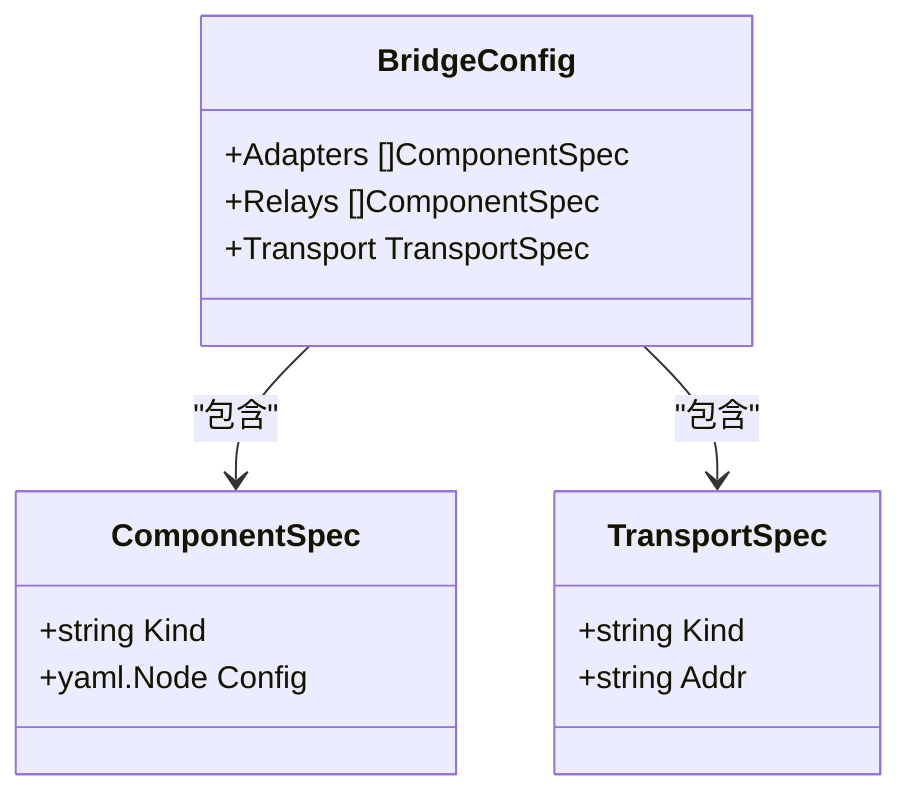

**图表来源**
- [config.go:17-54](file://SmartNPC/smartnpc-mcp/pkg/agentbridge/config.go#L17-L54)

**章节来源**
- [config.go:17-54](file://SmartNPC/smartnpc-mcp/pkg/agentbridge/config.go#L17-L54)

### 配置加载与验证规则
`LoadConfig` 完成三步：

1. 读取文件内容。
2. 反序列化为 `BridgeConfig`。
3. 调用 `validate()` 进行轻量校验。

校验规则如下：

| 规则 | 条件 | 错误语义 |
|---|---|---|
| 至少一个适配器 | `len(Adapters) == 0` | “至少需要一个适配器” |
| 适配器必须指定 kind | `a.Kind == ""` | “adapters[i]: kind is required” |
| 中继必须指定 kind | `r.Kind == ""` | “relays[i]: kind is required” |
| transport.kind 必填 | 空字符串 | “transport.kind is required” |
| transport.kind 值合法 | 非 `stdio` 且非 `http` | “want stdio | http” |
| http 模式需要 addr | `kind=http` 但 `Addr==""` | “transport.addr is required when kind=http” |

注意：这里的验证不包含 registry 是否存在该 kind；未知 kind 的错误发生在 `Assemble` 阶段。

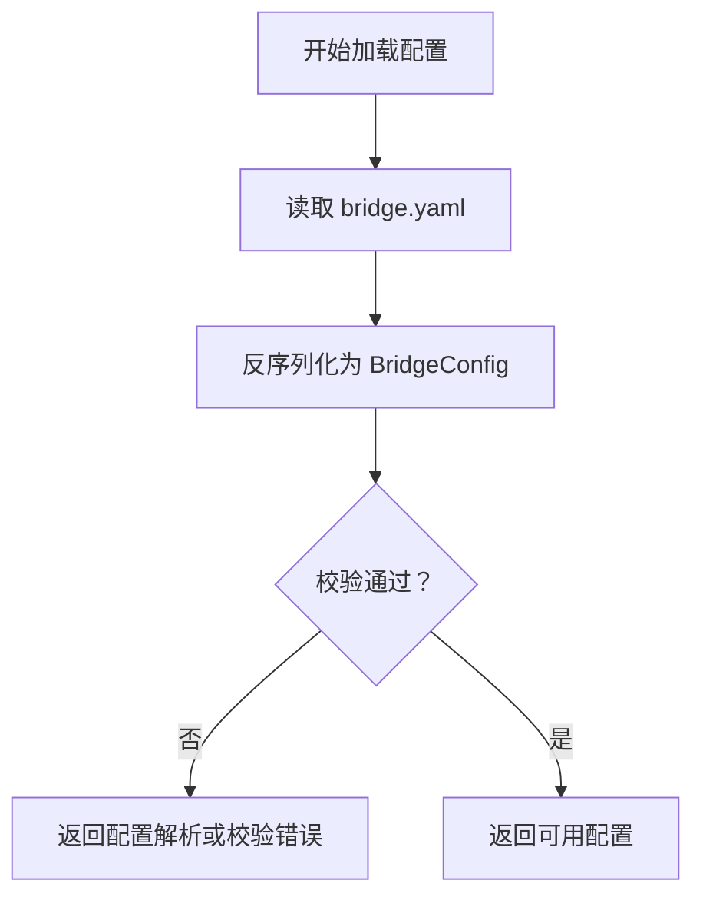

**图表来源**
- [config.go:55-100](file://SmartNPC/smartnpc-mcp/pkg/agentbridge/config.go#L55-L100)

**章节来源**
- [config.go:55-100](file://SmartNPC/smartnpc-mcp/pkg/agentbridge/config.go#L55-L100)

### 完整配置示例
以下是一个符合当前实现的示例结构，适用于 `agent-bridge`：

```yaml
adapters:
  - kind: stardew
    config:
      ws_url: ws://127.0.0.1:18745/ws
relays:
  - kind: hermes
    config:
      runtime_config: ./hermes/runtime-config.yaml
  - kind: echo
transport:
  kind: http
  addr: ":3000"
```

关键约束：

- `adapters` 不能为空。
- 每个 `kind` 必须匹配构建时注册的适配器或中继。
- `transport.kind` 必须是 `stdio` 或 `http`。
- `transport.kind=http` 时必须有 `transport.addr`。
- `config` 的具体字段由适配器或中继工厂决定；框架不会强加 schema。

**章节来源**
- [config.go:17-30](file://SmartNPC/smartnpc-mcp/pkg/agentbridge/config.go#L17-L30)
- [config.go:55-100](file://SmartNPC/smartnpc-mcp/pkg/agentbridge/config.go#L55-L100)

## 服务器初始化与传输层

### MCP Server 初始化
`agent-bridge` 使用 `mcp.NewServer` 创建底层 MCP 服务，传入实现名称、版本和 logger。随后调用 `cfg.Assemble` 装配事件源、中继和元工具。Server 本身不负责网络监听，只负责事件分发和工具挂载。

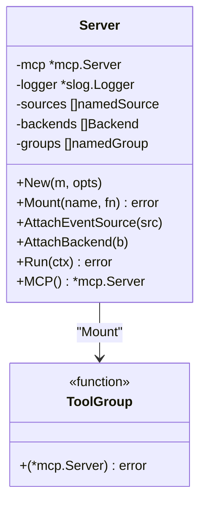

**图表来源**
- [server.go:12-110](file://SmartNPC/smartnpc-mcp/pkg/agentbridge/server.go#L12-L110)

**章节来源**
- [server.go:12-110](file://SmartNPC/smartnpc-mcp/pkg/agentbridge/server.go#L12-L110)

### HTTP 传输与端口绑定
`transport.RunHTTP` 是 HTTP 模式的实际监听入口：

- 创建 `http.ServeMux`，如未提供则分配新实例。
- 注册 `/mcp` 和 `/mcp/` 为 Streamable MCP 处理器。
- 注册 `/healthz` 健康检查端点。
- 当启用 `MCPAPIKey` 时，对 `/mcp` 请求增加 Bearer Token 鉴权。
- 使用 `AllowAnyOrigin` 控制是否关闭底层 localhost 保护。
- 监听 `opts.Addr`，默认读头超时 5 秒，默认优雅关闭超时 5 秒。
- 响应 `ctx.Done()` 时调用 `httpServer.Shutdown`。

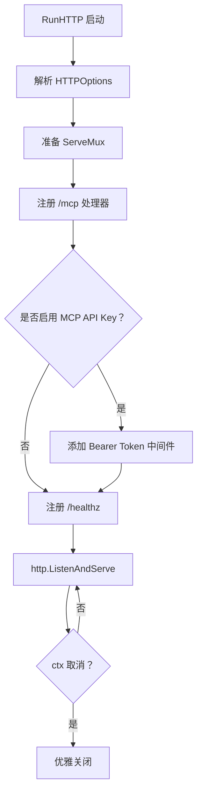

**图表来源**
- [http.go:60-124](file://SmartNPC/smartnpc-mcp/pkg/transport/http.go#L60-L124)

**章节来源**
- [http.go:26-124](file://SmartNPC/smartnpc-mcp/pkg/transport/http.go#L26-L124)

### 日志系统配置
日志通过 `internal/log.New(level string)` 初始化：

- 所有日志写入 stderr，避免污染 stdio 模式下 MCP 协议所需的 stdout。
- 支持 `debug`、`info`、`warn`、`error` 四个级别。
- 启用 `AddSource`，每条日志附带函数、文件和行号。
- 使用 JSON Handler，便于结构化采集。

CLI 参数 `--log-level` 直接映射到该日志器。

**章节来源**
- [logger.go:1-35](file://SmartNPC/smartnpc-mcp/internal/log/logger.go#L1-L35)
- [main.go:40-55](file://SmartNPC/smartnpc-mcp/cmd/agent-bridge/main.go#L40-L55)

## 适配器、中继与健康检查

### SMAPI WebSocket 适配器
SMAPI 适配器通过 WebSocket 与 Stardew Valley 模组通信：

- 默认地址为 `ws://127.0.0.1:18745/ws`。
- 支持连接超时、调用超时、重试退避。
- 支持自动重连。
- 支持会话到 NPC 名称映射，用于标注来自哪个角色。
- 支持事件回调和调用记录回调。

这意味着 `bridge.yaml` 中 `adapters[0].config.ws_url` 指向的是 SMAPI 模组暴露的 WebSocket 服务，而不是 MCP 客户端。

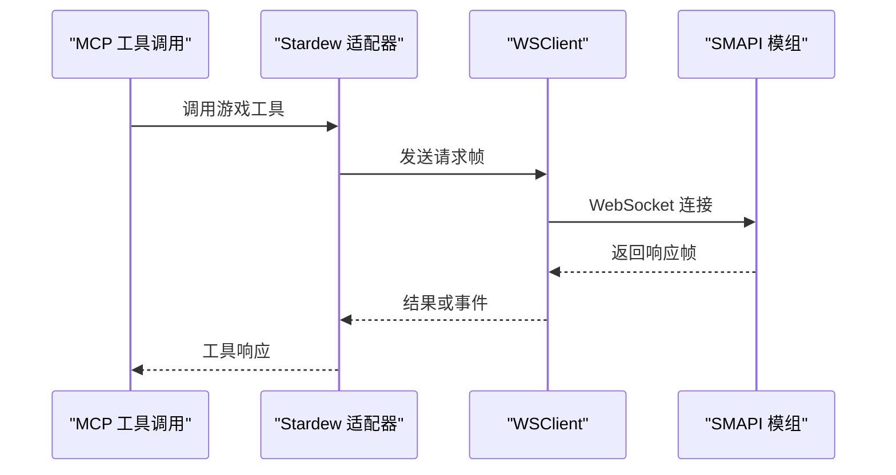

**图表来源**
- [ws_client.go:1-120](file://SmartNPC/smartnpc-mcp/adapters/stardew/bridge/ws_client.go#L1-L120)

**章节来源**
- [ws_client.go:1-120](file://SmartNPC/smartnpc-mcp/adapters/stardew/bridge/ws_client.go#L1-L120)

### Hermes 中继配置
Hermes 中继的配置由 `runtime-config.yaml` 驱动，并通过 `LoadConfigFile` 加载：

- 读取 profiles 数组。
- 展开环境变量，特别是 `SMARTNPC_HERMES_GATEWAY_HOST`，并支持 WSL 场景下的 `WSL_IP` 回退。
- 每个 profile 必须提供 `gateway_url`、`conversation`、`model`。
- 支持 `api_key_env`，从环境变量读取密钥。
- 支持 persona 和 critical policy 文件路径。
- 支持 `timeout_ms`。

环境变量包括：

| 变量 | 作用 | 默认行为 |
|---|---|---|
| `SMARTNPC_RELAY_DEBUG_PAYLOAD` | 开启完整请求/响应体调试日志 | 关闭 |
| `SMARTNPC_RELAY_PAYLOAD_LOG` | 将调试负载写入 JSON Lines 文件 | 不写文件 |
| `SMARTNPC_RELAY_STORE` | 是否启用 Hermes 服务端对话存储 | 默认开启 |
| `SMARTNPC_RELAY_TIMEOUT_MS` | POST 超时毫秒数 | 120000 |

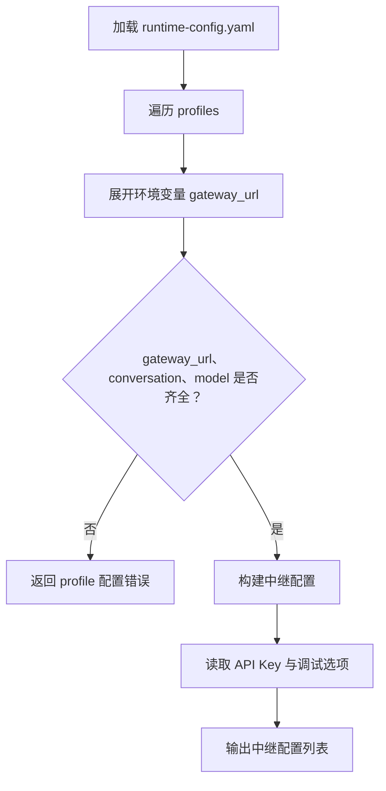

**图表来源**
- [hermes_config.go:60-120](file://SmartNPC/smartnpc-mcp/pkg/relay/hermes/config.go#L60-L120)

**章节来源**
- [hermes_config.go:1-191](file://SmartNPC/smartnpc-mcp/pkg/relay/hermes/config.go#L1-L191)

### 元工具与健康检查
服务暴露两类健康检查能力：

1. **MCP 工具级健康检查**：`ping` 工具由 `RegisterMeta` 注册，返回成功标志、回声消息和服务端时间戳。它不访问游戏状态，适合启动期或连接验证。
2. **HTTP 健康检查端点**：`/healthz` 返回 `{"ok":true}`，用于进程存活探针。

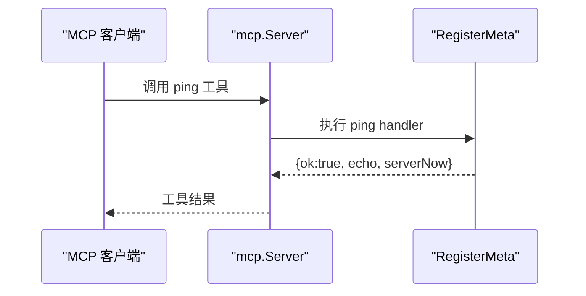

**图表来源**
- [meta.go:1-43](file://SmartNPC/smartnpc-mcp/pkg/agentbridge/meta.go#L1-L43)

**章节来源**
- [meta.go:1-43](file://SmartNPC/smartnpc-mcp/pkg/agentbridge/meta.go#L1-L43)
- [http.go:90-110](file://SmartNPC/smartnpc-mcp/pkg/transport/http.go#L90-L110)

## 依赖关系分析

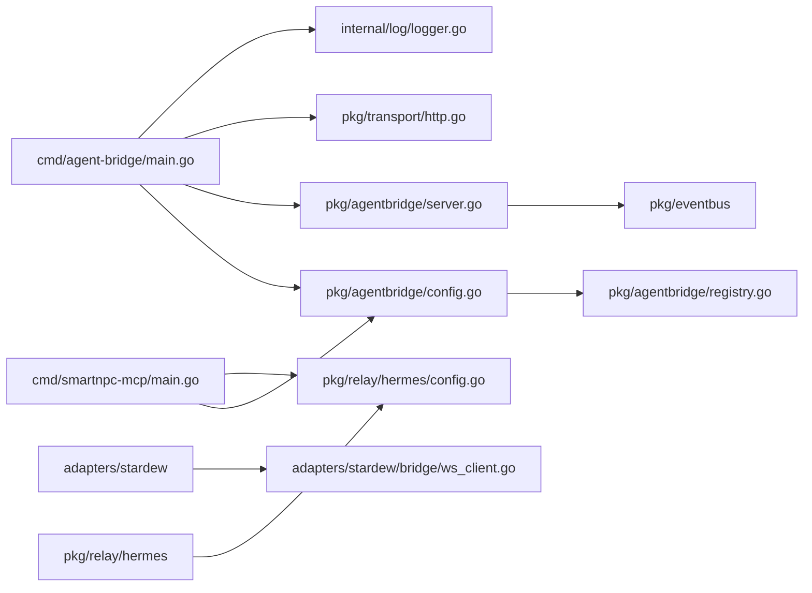

**图表来源**
- [main.go:10-25](file://SmartNPC/smartnpc-mcp/cmd/agent-bridge/main.go#L10-L25)
- [config.go:1-20](file://SmartNPC/smartnpc-mcp/pkg/agentbridge/config.go#L1-L20)
- [server.go:1-20](file://SmartNPC/smartnpc-mcp/pkg/agentbridge/server.go#L1-L20)
- [http.go:1-20](file://SmartNPC/smartnpc-mcp/pkg/transport/http.go#L1-L20)
- [ws_client.go:1-20](file://SmartNPC/smartnpc-mcp/adapters/stardew/bridge/ws_client.go#L1-L20)
- [hermes_config.go:1-20](file://SmartNPC/smartnpc-mcp/pkg/relay/hermes/config.go#L1-L20)
- [smartnpc_main.go:1-40](file://SmartNPC/smartnpc-mcp/cmd/smartnpc-mcp/main.go#L1-L40)

**章节来源**
- [main.go:10-25](file://SmartNPC/smartnpc-mcp/cmd/agent-bridge/main.go#L10-L25)
- [config.go:1-20](file://SmartNPC/smartnpc-mcp/pkg/agentbridge/config.go#L1-L20)
- [server.go:1-20](file://SmartNPC/smartnpc-mcp/pkg/agentbridge/server.go#L1-L20)
- [http.go:1-20](file://SmartNPC/smartnpc-mcp/pkg/transport/http.go#L1-L20)
- [ws_client.go:1-20](file://SmartNPC/smartnpc-mcp/adapters/stardew/bridge/ws_client.go#L1-L20)
- [hermes_config.go:1-20](file://SmartNPC/smartnpc-mcp/pkg/relay/hermes/config.go#L1-L20)
- [smartnpc_main.go:1-40](file://SmartNPC/smartnpc-mcp/cmd/smartnpc-mcp/main.go#L1-L40)

## 性能与可靠性特征

| 维度 | 实现特征 | 影响 |
|---|---|---|
| 日志开销 | 每条日志附加 source 信息 | 可观测性提升，轻微 CPU 开销 |
| 事件分发 | 多个 EventSource 并发运行，Backends 顺序转发 | 高吞吐，但慢 backend 会阻塞后续转发 |
| WebSocket 重连 | 自动重连与退避 | 提高 SMAPI 连接恢复能力 |
| HTTP 优雅关闭 | 基于 context 触发 `httpServer.Shutdown` | 减少停机期间请求丢失 |
| 超时控制 | 调用超时、连接超时、读头超时、关闭超时 | 防止长时间阻塞和僵尸连接 |
| 配置校验 | 分层校验：加载时基础校验，装配时 kind 校验 | 早期发现配置错误 |

**章节来源**
- [server.go:110-177](file://SmartNPC/smartnpc-mcp/pkg/agentbridge/server.go#L110-L177)
- [ws_client.go:120-200](file://SmartNPC/smartnpc-mcp/adapters/stardew/bridge/ws_client.go#L120-L200)
- [http.go:60-124](file://SmartNPC/smartnpc-mcp/pkg/transport/http.go#L60-L124)
- [logger.go:15-35](file://SmartNPC/smartnpc-mcp/internal/log/logger.go#L15-L35)

## 故障排查指南

### 常见启动问题

| 现象 | 可能原因 | 排查建议 |
|---|---|---|
| 启动失败并提示缺少 `--config` | 未提供 `bridge.yaml` 路径 | 确认命令行参数 |
| 配置加载失败 | 文件不存在、YAML 语法错误、必填字段缺失 | 检查 `bridge.yaml` 路径和内容 |
| 未知 adapter 或 relay kind | 构建时未注册该 kind，或拼写错误 | 确认已引入对应包并注册 |
| HTTP 模式无法连接 | 未设置 `transport.addr` 或跨主机 Origin 限制 | 设置端口并启用 `--http-allow-any-origin` |
| WebSocket 连接失败 | SMAPI 模组未启动或端口不一致 | 检查 `ws_url` 和 SMAPI 日志 |
| Hermes 中继无输出 | 未配置 `--hermes-config` 或 profiles 为空 | 检查 runtime-config 和 enabled profiles |
| 健康检查不通 | HTTP 未启动或未暴露 | 确认 `transport.kind=http` 且 `/healthz` 可达 |

### 环境变量排查
重点关注 Hermes 中继相关环境变量：

- `SMARTNPC_RELAY_DEBUG_PAYLOAD`：打开完整负载调试。
- `SMARTNPC_RELAY_PAYLOAD_LOG`：将调试负载写入文件。
- `SMARTNPC_RELAY_STORE`：关闭时可排查重复记忆问题。
- `SMARTNPC_RELAY_TIMEOUT_MS`：LLM 往返较慢时应适当增大。
- `SMARTNPC_HERMES_GATEWAY_HOST`：Gateway 主机名，WSL 下可用 `WSL_IP` 回退。

**章节来源**
- [config.go:55-100](file://SmartNPC/smartnpc-mcp/pkg/agentbridge/config.go#L55-L100)
- [hermes_config.go:80-191](file://SmartNPC/smartnpc-mcp/pkg/relay/hermes/config.go#L80-L191)
- [http.go:60-124](file://SmartNPC/smartnpc-mcp/pkg/transport/http.go#L60-L124)

## 结论
`agent-bridge` 提供了最小化、配置驱动的 MCP 桥接入口，而 `smartnpc-mcp` 在其基础上扩展了游戏适配、Hermes 中继、工作流和实验日志能力。两者的共同点是：

- 以 CLI 参数和环境变量作为外部输入。
- 以 YAML 配置描述适配器、中继和传输。
- 使用结构化日志输出到 stderr。
- 通过 `mcp.Server` 暴露 MCP 工具。
- 通过 HTTP 暴露 `/healthz`，通过 `ping` 工具暴露应用级存活能力。

生产部署时建议：

- 使用 `bridge.yaml` 管理适配器与中继。
- 使用 `runtime-config.yaml` 管理多 profile Hermes 中继。
- 对外暴露 HTTP 时使用 `--http-allow-any-origin=false` 和 `--mcp-api-key`。
- 通过 `/healthz` 做进程存活探测，通过 `ping` 做 MCP 连通性探测。
- 使用 `SMARTNPC_RELAY_*` 环境变量控制调试、存储和超时。