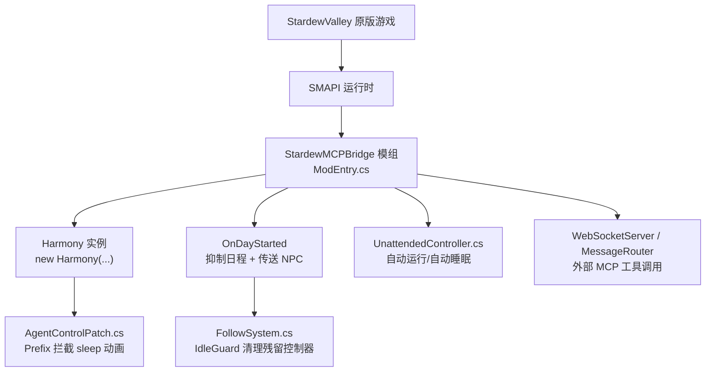
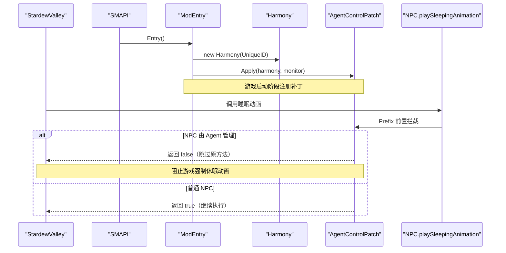
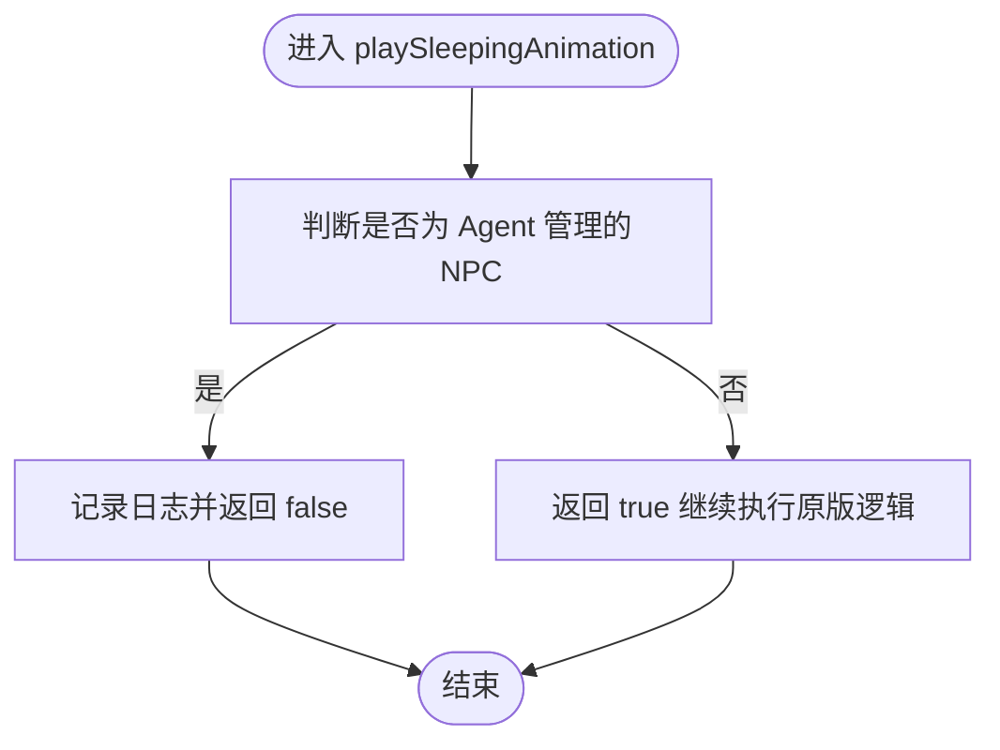
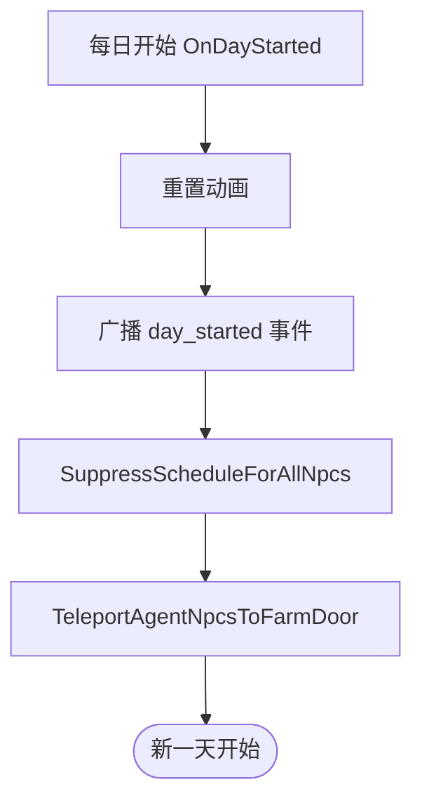
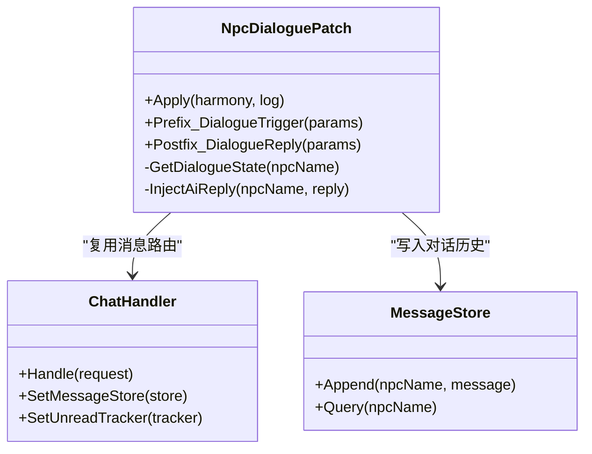
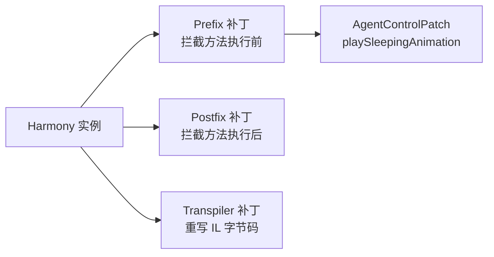
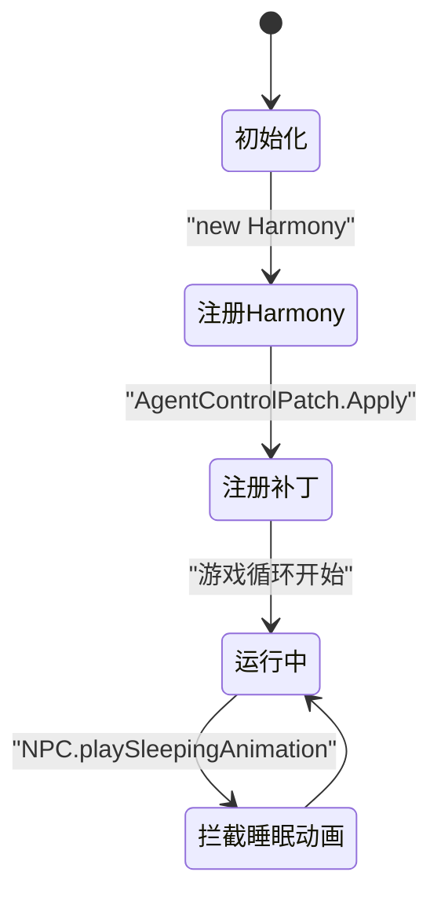
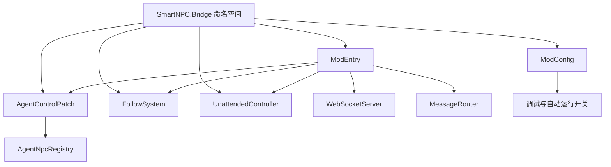

# Harmony Patches 游戏集成

<cite>
**本文引用的文件**   
- [AgentControlPatch.cs](file://SmartNPC/smapi-mod/Patches/AgentControlPatch.cs)
- [ModEntry.cs](file://SmartNPC/smapi-mod/ModEntry.cs)
- [ModConfig.cs](file://SmartNPC/smapi-mod/ModConfig.cs)
- [StardewMCPBridge.csproj](file://SmartNPC/smapi-mod/StardewMCPBridge.csproj)
- [UnattendedController.cs](file://SmartNPC/smapi-mod/Unattended/UnattendedController.cs)
- [FollowSystem.cs](file://SmartNPC/smapi-mod/Movement/FollowSystem.cs)
</cite>

## 目录
1. [引言](#引言)
2. [项目结构](#项目结构)
3. [核心组件](#核心组件)
4. [架构总览](#架构总览)
5. [详细组件分析](#详细组件分析)
6. [依赖关系分析](#依赖关系分析)
7. [性能与兼容性](#性能与兼容性)
8. [故障排查指南](#故障排查指南)
9. [结论](#结论)
10. [附录：如何编写新的 Harmony 补丁](#附录如何编写新的-harmony-补丁)

## 引言
本文件聚焦于 Stardew Valley 的 SMAPI 模组 SmartNPC 中，使用 Harmony 注入来接管 NPC 控制与对话相关行为的实现。当前仓库中已存在的 Harmony 补丁主要位于 `Patches` 目录，并集中在对“睡眠动画”和“日程控制”两个关键点的拦截上；对话系统补丁 `NpcDialoguePatch.cs` 在仓库中尚未出现，因此本节将基于现有代码说明其预期角色、设计约束，以及如何在未来扩展时遵循本项目既有的 Harmony 注解模式。

## 项目结构
SmartNPC 的 SMAPI 模组以 C# 工程组织，Harmony 补丁、入口类、配置、桥接服务、移动与行为系统等模块相互协作。与 Harmony 相关的重点路径如下：



**图示来源**
- [ModEntry.cs:89-90](file://SmartNPC/smapi-mod/ModEntry.cs#L89-L90)
- [AgentControlPatch.cs:21-30](file://SmartNPC/smapi-mod/Patches/AgentControlPatch.cs#L21-L30)
- [ModEntry.cs:433-476](file://SmartNPC/smapi-mod/ModEntry.cs#L433-L476)
- [FollowSystem.cs:1043-1060](file://SmartNPC/smapi-mod/Movement/FollowSystem.cs#L1043-L1060)
- [UnattendedController.cs:98-110](file://SmartNPC/smapi-mod/Unattended/UnattendedController.cs#L98-L110)

**章节来源**
- [ModEntry.cs:89-90](file://SmartNPC/smapi-mod/ModEntry.cs#L89-L90)
- [AgentControlPatch.cs:1-44](file://SmartNPC/smapi-mod/Patches/AgentControlPatch.cs#L1-L44)

## 核心组件
- **AgentControlPatch**：通过 Harmony Prefix 拦截 NPC 的原生睡眠动画，避免 Agent 管理的 NPC 被游戏强制进入休眠姿态。
- **ModEntry**：SMAPI 模组入口，负责创建 Harmony 实例、注册补丁、订阅游戏事件、启动 WebSocket 桥接服务，并在每日开始时抑制日程控制。
- **UnattendedController**：自动运行实验模式的控制器，参与游戏循环与时间控制，但不直接承担 Harmony 补丁职责。
- **FollowSystem**：Agent 驱动的 NPC 移动系统，包含 IdleGuard 逻辑，用于清理游戏意外注入的路径控制器。
- **ModConfig**：模组配置，包含调试开关、自动运行开关、WebSocket 监听地址等。
- **StardewMCPBridge.csproj**：C# 工程文件，启用 Harmony 支持，并将 SMAPI/SDV 程序集纳入构建。

**章节来源**
- [AgentControlPatch.cs:17-43](file://SmartNPC/smapi-mod/Patches/AgentControlPatch.cs#L17-L43)
- [ModEntry.cs:89-90](file://SmartNPC/smapi-mod/ModEntry.cs#L89-L90)
- [ModConfig.cs:1-144](file://SmartNPC/smapi-mod/ModConfig.cs#L1-L144)
- [StardewMCPBridge.csproj:1-56](file://SmartNPC/smapi-mod/StardewMCPBridge.csproj#L1-L56)
- [FollowSystem.cs:1043-1060](file://SmartNPC/smapi-mod/Movement/FollowSystem.cs#L1043-L1060)
- [UnattendedController.cs:98-110](file://SmartNPC/smapi-mod/Unattended/UnattendedController.cs#L98-L110)

## 架构总览
从游戏到模组的整体调用链可以理解为：SMAPI 加载模组 → 模组入口初始化 Harmony → 注册补丁 → 在游戏运行时拦截目标方法 → 根据 Agent 管理状态决定是否接管或放行。



**图示来源**
- [ModEntry.cs:89-90](file://SmartNPC/smapi-mod/ModEntry.cs#L89-L90)
- [AgentControlPatch.cs:21-41](file://SmartNPC/smapi-mod/Patches/AgentControlPatch.cs#L21-L41)

## 详细组件分析

### AgentControlPatch：NPC 控制与睡眠动画拦截
该补丁只针对一个具体方法：`NPC.playSleepingAnimation`。它采用 Harmony Prefix 注解风格，但这里没有使用 `[HarmonyPatch]` 属性类注解，而是通过 `harmony.Patch(...)` 动态注册前缀方法。这种方式适合集中式补丁管理，便于在模组入口统一控制补丁生命周期。

#### 控制权转移机制
- 当 NPC 尝试播放睡眠动画时，补丁先判断该 NPC 是否属于 Agent 管理的 NPC。
- 如果是，则记录日志并返回 `false`，从而完全跳过原方法。
- 如果不是，则返回 `true`，让原版游戏继续处理。



**图示来源**
- [AgentControlPatch.cs:35-41](file://SmartNPC/smapi-mod/Patches/AgentControlPatch.cs#L35-L41)

#### 输入拦截和行为接管
当前补丁并不拦截玩家输入，也不直接修改 NPC 的行为树；它只拦截“睡眠动画”这一视觉/状态表现。真正的“日程控制接管”发生在 `ModEntry.OnDayStarted` 中：设置 `ignoreScheduleToday = true`、清空 `Schedule`、取消残留控制器，并将 Agent 管理的 NPC 传送到农场门口。



**图示来源**
- [ModEntry.cs:433-476](file://SmartNPC/smapi-mod/ModEntry.cs#L433-L476)

#### 错误处理与边界情况
- 日志记录使用可空 `IMonitor?`，避免日志对象未初始化时崩溃。
- 对非 Agent 管理的 NPC 直接放行，保证原版行为不被误伤。
- 日志级别使用 `Trace`，适合调试输出，不会干扰常规运行日志。

**章节来源**
- [AgentControlPatch.cs:17-43](file://SmartNPC/smapi-mod/Patches/AgentControlPatch.cs#L17-L43)
- [ModEntry.cs:433-476](file://SmartNPC/smapi-mod/ModEntry.cs#L433-L476)

### NpcDialoguePatch：对话系统补丁现状与设计建议
仓库中不存在 `NpcDialoguePatch.cs`，因此无法直接分析其实现。但从项目上下文可以推断其可能承担的职责：

- **对话触发条件**：判断玩家是否主动与 NPC 对话、是否在特定场景下触发、是否满足好感度或剧情条件。
- **AI 回复注入**：在原版对话逻辑之前或之后注入来自 Hermes/Large Language Model 的回复。
- **对话状态管理**：维护当前对话会话、历史消息、NPC 情绪或记忆状态。

由于当前项目中已有 ChatHandler、MessageStore、UnreadTracker、UI 面板等组件，未来新增对话补丁时应优先复用这些基础设施，而不是重复实现消息存储或 UI 渲染。



**图示来源**
- [ModEntry.cs:89-90](file://SmartNPC/smapi-mod/ModEntry.cs#L89-L90)

**章节来源**
- [ModEntry.cs:89-90](file://SmartNPC/smapi-mod/ModEntry.cs#L89-L90)

### Harmony 注解使用模式
当前代码展示了两种 Harmony 使用方式：

1. **动态注册 Prefix**
   - 使用 `AccessTools.Method(typeof(NPC), nameof(NPC.playSleepingAnimation))` 定位目标方法。
   - 使用 `harmony.Patch(...)` 注册 `HarmonyMethod` 前缀。
   - 适合集中管理、按需注册、避免强耦合的类型引用。

2. **未来可扩展的模式**
   - 若需要 Postfix，可在同一 `Apply` 方法中追加 `postfix:` 参数。
   - 若需要 Transpiler，可在同一 `Apply` 方法中追加 `transpiler:` 参数。
   - 也可配合 `[HarmonyPatch]` 属性类注解，但当前项目选择集中式 `Apply` 更清晰。



**图示来源**
- [AgentControlPatch.cs:25-28](file://SmartNPC/smapi-mod/Patches/AgentControlPatch.cs#L25-L28)
- [StardewMCPBridge.csproj:18-22](file://SmartNPC/smapi-mod/StardewMCPBridge.csproj#L18-L22)

**章节来源**
- [AgentControlPatch.cs:21-30](file://SmartNPC/smapi-mod/Patches/AgentControlPatch.cs#L21-L30)
- [StardewMCPBridge.csproj:1-56](file://SmartNPC/smapi-mod/StardewMCPBridge.csproj#L1-L56)

### 补丁加载顺序、冲突处理与版本兼容性
- **加载顺序**：Harmony 实例在 `ModEntry.Entry` 中创建，随后立即调用 `AgentControlPatch.Apply`。这意味着所有 Harmony 补丁都在模组初始化阶段完成注册。
- **冲突处理**：当前只注册一个 Prefix，冲突面较小。若未来多个模组都拦截 `playSleepingAnimation`，应确保其他模组也尊重 `AgentNpcRegistry.IsManaged` 的判断，避免重复抑制。
- **版本兼容性**：补丁通过 `AccessTools.Method` 按类型和方法名解析目标方法，比硬编码方法签名更稳定。但如果 SDV 内部 API 发生重命名或移除，仍可能导致补丁失效。建议在模组启动失败时记录明确错误，并提供兼容层或降级行为。



**图示来源**
- [ModEntry.cs:89-90](file://SmartNPC/smapi-mod/ModEntry.cs#L89-L90)
- [AgentControlPatch.cs:21-30](file://SmartNPC/smapi-mod/Patches/AgentControlPatch.cs#L21-L30)

**章节来源**
- [ModEntry.cs:89-90](file://SmartNPC/smapi-mod/ModEntry.cs#L89-L90)
- [AgentControlPatch.cs:21-30](file://SmartNPC/smapi-mod/Patches/AgentControlPatch.cs#L21-L30)

## 依赖关系分析



**图示来源**
- [AgentControlPatch.cs:15-17](file://SmartNPC/smapi-mod/Patches/AgentControlPatch.cs#L15-L17)
- [ModEntry.cs:89-90](file://SmartNPC/smapi-mod/ModEntry.cs#L89-L90)
- [ModConfig.cs:1-144](file://SmartNPC/smapi-mod/ModConfig.cs#L1-L144)

**章节来源**
- [AgentControlPatch.cs:15-17](file://SmartNPC/smapi-mod/Patches/AgentControlPatch.cs#L15-L17)
- [ModEntry.cs:89-90](file://SmartNPC/smapi-mod/ModEntry.cs#L89-L90)
- [ModConfig.cs:1-144](file://SmartNPC/smapi-mod/ModConfig.cs#L1-L144)

## 性能与兼容性
- **性能影响**：
  - Prefix 拦截只在 NPC 尝试播放睡眠动画时触发，频率较低，开销很小。
  - 日志使用 `Trace` 级别，默认可能不输出，避免频繁 IO 影响帧率。
  - 日程抑制发生在每日开始时，不是每帧执行，对日常运行无显著影响。
- **兼容性考虑**：
  - 只对 `AgentNpcRegistry.IsManaged` 为真的 NPC 生效，普通 NPC 不受影响。
  - 通过 `ignoreScheduleToday` 和 `Schedule.Clear` 抑制日程，是 SMAPI/SDV 官方推荐方式，比强行改写游戏逻辑更安全。
  - FollowSystem 的 IdleGuard 会清理残留控制器，进一步降低多模组或游戏内部逻辑造成的冲突风险。

[本节为通用性能与兼容性讨论，不直接分析具体代码行]

## 故障排查指南
- **NPC 仍然播放睡眠动画**：
  - 检查 `AgentNpcRegistry.IsManaged` 是否正确识别目标 NPC。
  - 查看 Trace 日志中是否有 `[AgentControlPatch] suppressed playSleepingAnimation` 相关记录。
- **NPC 仍然按日程移动**：
  - 检查 `OnDayStarted` 是否成功执行。
  - 确认 `ignoreScheduleToday` 是否被设置为 `true`。
  - 确认 `Schedule` 是否被清空。
  - 检查 FollowSystem 的 IdleGuard 是否清除了残留控制器。
- **自动运行模式异常**：
  - 检查 `UnattendedController` 是否启用。
  - 确认 `pauseWhenOutOfFocus` 是否被正确调整。
  - 查看自动睡眠与日终审查等待逻辑是否符合配置。

**章节来源**
- [AgentControlPatch.cs:35-41](file://SmartNPC/smapi-mod/Patches/AgentControlPatch.cs#L35-L41)
- [ModEntry.cs:433-476](file://SmartNPC/smapi-mod/ModEntry.cs#L433-L476)
- [FollowSystem.cs:1043-1060](file://SmartNPC/smapi-mod/Movement/FollowSystem.cs#L1043-L1060)
- [UnattendedController.cs:98-110](file://SmartNPC/smapi-mod/Unattended/UnattendedController.cs#L98-L110)

## 结论
当前 SmartNPC 的 Harmony 集成以最小侵入方式实现对 NPC 控制的关键点修补：拦截睡眠动画、抑制日程控制、清理残留控制器。这种设计避免了大规模重写游戏逻辑，同时为后续扩展 AI 驱动的 NPC 行为留出空间。未来若引入 `NpcDialoguePatch`，应沿用现有的集中式 `Apply` 注册模式，并复用 ChatHandler、MessageStore、UnreadTracker 等基础设施，以保持代码一致性和可维护性。

[本节为总结性内容，不直接分析具体代码行]

## 附录：如何编写新的 Harmony 补丁
以下给出一个面向未来的示例模板，展示如何在 SmartNPC 中新增一个对话相关的 Harmony 补丁。该模板仅用于说明写法，不代表仓库中已实现的代码。

```csharp
// 示例：NpcDialoguePatch 参考模板
using HarmonyLib;
using StardewModdingAPI;
using StardewValley;

namespace SmartNPC.Bridge
{
    internal static class NpcDialoguePatch
    {
        private static IMonitor? _log;

        public static void Apply(Harmony harmony, IMonitor log)
        {
            _log = log;

            // 示例：拦截 NPC 对话触发方法的前置逻辑
            // harmony.Patch(
            //     original: AccessTools.Method(typeof(NPC), nameof(NPC.someDialogueMethod)),
            //     prefix: new HarmonyMethod(typeof(NpcDialoguePatch), nameof(Prefix_SomeDialogueMethod))
            // );

            // 示例：在对话回复后注入 AI 回复
            // harmony.Patch(
            //     original: AccessTools.Method(typeof(NPC), nameof(NPC.someReplyMethod)),
            //     postfix: new HarmonyMethod(typeof(NpcDialoguePatch), nameof(Postfix_SomeReplyMethod))
            // );

        }

        private static bool Prefix_SomeDialogueMethod(/* 参数 */)
        {
            // 判断对话触发条件
            // 如果由 Agent 接管，可提前返回 false 或修改参数
            return true;
        }

        private static void Postfix_SomeReplyMethod(/* 参数 */)
        {
            // 注入 AI 回复、更新对话状态
        }
    }
}
```

在实际集成时，应在 `ModEntry` 中增加类似以下初始化逻辑：

```csharp
var harmony = new Harmony(this.ModManifest.UniqueID);
AgentControlPatch.Apply(harmony, this.Monitor);
NpcDialoguePatch.Apply(harmony, this.Monitor);
```

**章节来源**
- [ModEntry.cs:89-90](file://SmartNPC/smapi-mod/ModEntry.cs#L89-L90)
- [AgentControlPatch.cs:21-30](file://SmartNPC/smapi-mod/Patches/AgentControlPatch.cs#L21-L30)