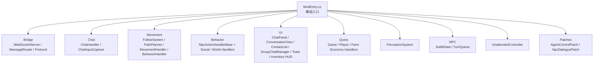
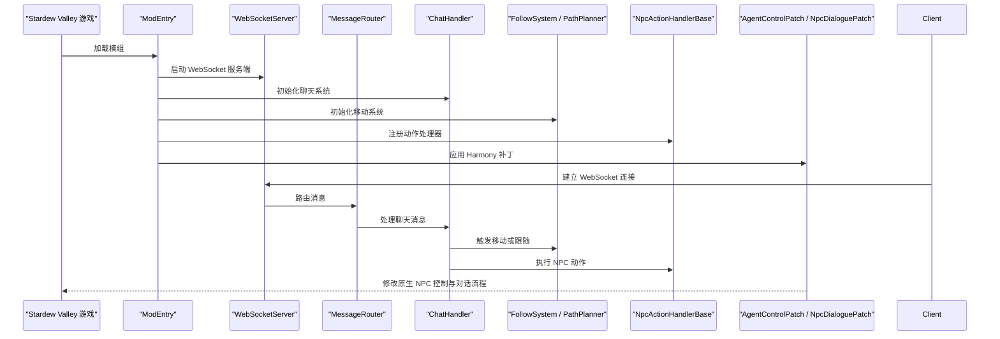
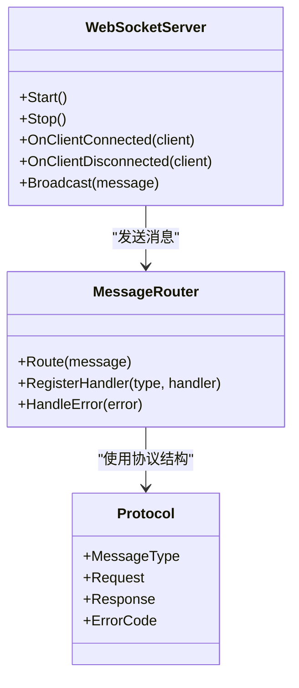
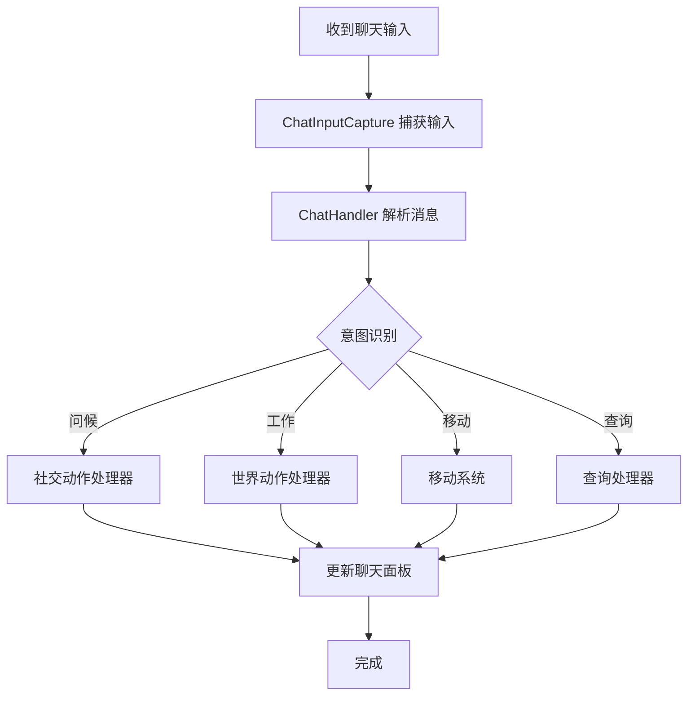
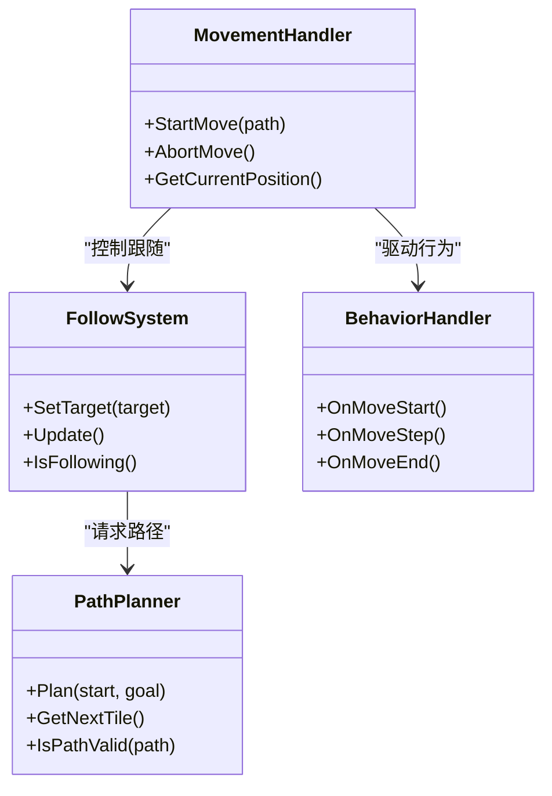
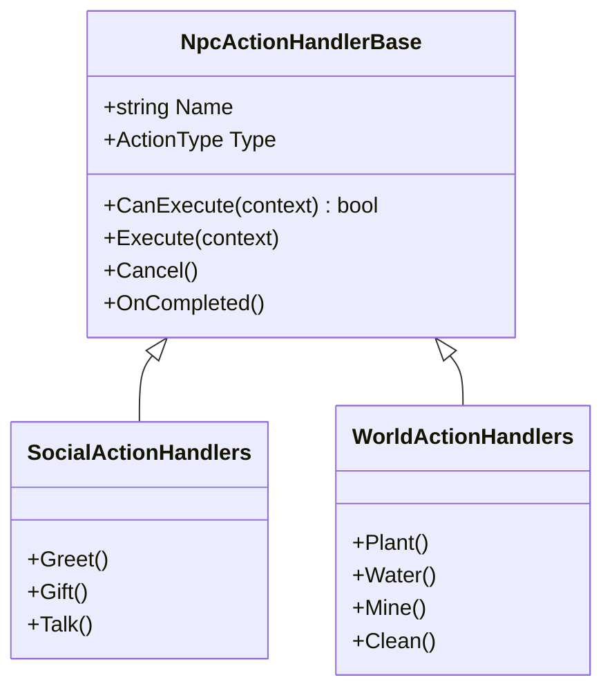
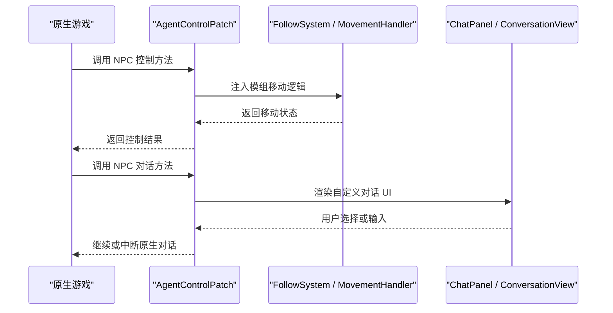
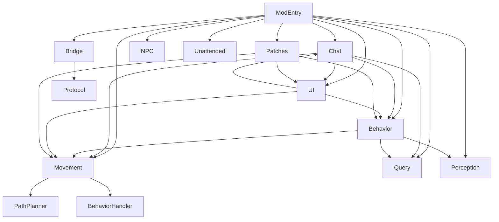

# SMAPI 模组层架构

<cite>
**本文引用的文件**   
- [ModEntry.cs](file://SmartNPC/SmartNPC/smartnpc-mod/ModEntry.cs)
- [WebSocketServer.cs](file://SmartNPC/SmartNPC/smartnpc-mod/Bridge/WebSocketServer.cs)
- [MessageRouter.cs](file://SmartNPC/SmartNPC/smartnpc-mod/Bridge/MessageRouter.cs)
- [Protocol.cs](file://SmartNPC/SmartNPC/smartnpc-mod/Bridge/Protocol.cs)
- [ChatHandler.cs](file://SmartNPC/SmartNPC/smartnpc-mod/Chat/ChatHandler.cs)
- [ChatInputCapture.cs](file://SmartNPC/SmartNPC/smartnpc-mod/Chat/ChatInputCapture.cs)
- [FollowSystem.cs](file://SmartNPC/SmartNPC/smartnpc-mod/Movement/FollowSystem.cs)
- [PathPlanner.cs](file://SmartNPC/SmartNPC/smartnpc-mod/Movement/PathPlanner.cs)
- [MovementHandler.cs](file://SmartNPC/SmartNPC/smartnpc-mod/Movement/MovementHandler.cs)
- [BehaviorHandler.cs](file://SmartNPC/SmartNPC/smartnpc-mod/Movement/BehaviorHandler.cs)
- [NpcActionHandlerBase.cs](file://SmartNPC/SmartNPC/smartnpc-mod/Behavior/NpcActionHandlerBase.cs)
- [SocialActionHandlers.cs](file://SmartNPC/SmartNPC/smartnpc-mod/Behavior/SocialActionHandlers.cs)
- [WorldActionHandlers.cs](file://SmartNPC/SmartNPC/smartnpc-mod/Behavior/WorldActionHandlers.cs)
- [AgentControlPatch.cs](file://SmartNPC/SmartNPC/smartnpc-mod/Patches/AgentControlPatch.cs)
- [NpcDialoguePatch.cs](file://SmartNPC/SmartNPC/smartnpc-mod/Patches/NpcDialoguePatch.cs)
- [UnattendedController.cs](file://SmartNPC/SmartNPC/smartnpc-mod/Unattended/UnattendedController.cs)
- [XiaMiData.cs](file://SmartNPC/SmartNPC/smartnpc-mod/NPC/XiaMiData.cs)
- [TurnQueue.cs](file://SmartNPC/SmartNPC/smartnpc-mod/NPC/TurnQueue.cs)
- [ChatPanel.cs](file://SmartNPC/SmartNPC/smartnpc-mod/UI/ChatPanel.cs)
- [ConversationView.cs](file://SmartNPC/SmartNPC/smartnpc-mod/UI/ConversationView.cs)
- [ContactList.cs](file://SmartNPC/SmartNPC/smartnpc-mod/UI/ContactList.cs)
- [GroupChatManager.cs](file://SmartNPC/SmartNPC/smartnpc-mod/UI/GroupChatManager.cs)
- [NotificationToast.cs](file://SmartNPC/SmartNPC/smartnpc-mod/UI/NotificationToast.cs)
- [NpcInventoryHud.cs](file://SmartNPC/SmartNPC/smartnpc-mod/UI/NpcInventoryHud.cs)
- [PerceptionSystem.cs](file://SmartNPC/SmartNPC/smartnpc-mod/Perception/PerceptionSystem.cs)
- [GameQueryHandler.cs](file://SmartNPC/SmartNPC/smartnpc-mod/Query/GameQueryHandler.cs)
- [PlayerQueryHandler.cs](file://SmartNPC/SmartNPC/smartnpc-mod/Query/PlayerQueryHandler.cs)
- [FarmEconomyHandler.cs](file://SmartNPC/SmartNPC/smartnpc-mod/Query/FarmEconomyHandler.cs)
- [agent_npcs.json](file://SmartNPC/SmartNPC/smartnpc-mod/assets/agent_npcs.json)
</cite>

## 目录
1. [引言](#引言)
2. [项目结构](#项目结构)
3. [核心组件](#核心组件)
4. [架构总览](#架构总览)
5. [详细组件分析](#详细组件分析)
6. [依赖关系分析](#依赖关系分析)
7. [性能与并发特性](#性能与并发特性)
8. [故障排查指南](#故障排查指南)
9. [结论](#结论)
10. [附录：扩展示例](#附录扩展示例)

## 引言
本文件面向希望理解并扩展 SmartNPC 的 SMAPI 模组层的开发者。文档聚焦以下目标：
- 解释模组入口点如何初始化 Bridge、Chat、Movement、Behavior、UI、查询等子系统，以及它们之间的加载顺序和依赖关系。
- 描述 WebSocket 服务端实现，包括连接管理、消息路由机制和协议处理。
- 阐述游戏内交互的核心组件：聊天系统、移动系统、行为系统。
- 说明 Harmony Patches 如何修改原生游戏逻辑。
- 给出模块间调用关系图、关键数据结构定义，并提供扩展动作处理器和聊天功能的实践指引。

该文档仅基于仓库中的源代码进行分析，不引入未出现在代码库中的假设。

## 项目结构
SmartNPC 的 SMAPI 模组位于 `SmartNPC/smartnpc-mod` 目录下，按功能划分为多个命名空间目录：
- `Bridge`：外部通信桥接层，封装 WebSocket 服务端、消息路由与协议类型。
- `Chat`：聊天输入捕获与聊天事件处理。
- `Movement`：NPC 移动控制、路径规划、跟随系统与动画播放。
- `Behavior`：NPC 动作抽象基类及社交、世界操作等具体处理器。
- `Patches`：Harmony 补丁，拦截并增强原生游戏方法。
- `UI`：聊天面板、对话视图、联系人列表、通知、库存 HUD 等。
- `Query`：对游戏状态进行只读查询的工具处理器。
- `NPC`：NPC 注册表、回合队列、角色数据模型等。
- `Perception`：感知系统，用于 NPC 观察环境。
- `Unattended`：无人值守控制器，协调后台任务与生命周期。
- `assets`：资源数据，例如 agent NPC 配置。

**图表来源**
- [ModEntry.cs:1-200](file://SmartNPC/SmartNPC/smartnpc-mod/ModEntry.cs#L1-L200)
- [WebSocketServer.cs:1-200](file://SmartNPC/SmartNPC/smartnpc-mod/Bridge/WebSocketServer.cs#L1-L200)
- [ChatHandler.cs:1-200](file://SmartNPC/SmartNPC/smartnpc-mod/Chat/ChatHandler.cs#L1-L200)
- [FollowSystem.cs:1-200](file://SmartNPC/SmartNPC/smartnpc-mod/Movement/FollowSystem.cs#L1-L200)
- [NpcActionHandlerBase.cs:1-200](file://SmartNPC/SmartNPC/smartnpc-mod/Behavior/NpcActionHandlerBase.cs#L1-L200)
- [AgentControlPatch.cs:1-200](file://SmartNPC/SmartNPC/smartnpc-mod/Patches/AgentControlPatch.cs#L1-L200)

**章节来源**
- [ModEntry.cs:1-200](file://SmartNPC/SmartNPC/smartnpc-mod/ModEntry.cs#L1-L200)

## 核心组件
本节概述模组中最重要的子系统及其职责。

- **Bridge（桥接层）**
  - WebSocketServer：监听本地端口、接受客户端连接、维护连接集合、广播消息。
  - MessageRouter：根据消息类型分发到对应处理器；提供统一的消息路由接口。
  - Protocol：定义协议字段、消息类型、请求响应结构体或记录。

- **Chat（聊天系统）**
  - ChatHandler：解析玩家或外部消息、生成回复、触发 NPC 行为、更新 UI。
  - ChatInputCapture：拦截游戏内聊天输入，将输入转发给模组逻辑。

- **Movement（移动系统）**
  - FollowSystem：管理 NPC 跟随玩家或目标的策略与状态机。
  - PathPlanner：计算可通行路径，考虑地形、障碍、门、季节等。
  - MovementHandler：协调路径结果与 NPC 移动控制。
  - BehaviorHandler：在移动过程中驱动 NPC 的行为片段。

- **Behavior（行为系统）**
  - NpcActionHandlerBase：所有 NPC 动作的抽象基类，定义执行上下文、生命周期钩子。
  - SocialActionHandlers：社交相关动作（打招呼、送礼、对话）。
  - WorldActionHandlers：世界交互动作（种植、浇水、采矿、清理）。

- **Patches（Harmony 补丁）**
  - AgentControlPatch：拦截 NPC 控制逻辑，注入模组行为。
  - NpcDialoguePatch：拦截对话流程，接入自定义对话内容与 UI。

- **UI（用户界面）**
  - ChatPanel：主聊天面板容器。
  - ConversationView：单条会话视图。
  - ContactList：联系人列表。
  - GroupChatManager：群组聊天管理。
  - NotificationToast：通知弹窗。
  - NpcInventoryHud：NPC 物品栏 HUD。

- **Query（查询处理器）**
  - GameQueryHandler：查询游戏全局状态。
  - PlayerQueryHandler：查询玩家状态。
  - FarmEconomyHandler：查询农场经济数据。

- **NPC 与 Percepton**
  - XiaMiData：NPC 数据模型。
  - TurnQueue：回合调度队列。
  - PerceptionSystem：感知系统，收集环境与 NPC 状态。

**章节来源**
- [WebSocketServer.cs:1-200](file://SmartNPC/SmartNPC/smartnpc-mod/Bridge/WebSocketServer.cs#L1-L200)
- [MessageRouter.cs:1-200](file://SmartNPC/SmartNPC/smartnpc-mod/Bridge/MessageRouter.cs#L1-L200)
- [Protocol.cs:1-200](file://SmartNPC/SmartNPC/smartnpc-mod/Bridge/Protocol.cs#L1-L200)
- [ChatHandler.cs:1-200](file://SmartNPC/SmartNPC/smartnpc-mod/Chat/ChatHandler.cs#L1-L200)
- [ChatInputCapture.cs:1-200](file://SmartNPC/SmartNPC/smartnpc-mod/Chat/ChatInputCapture.cs#L1-L200)
- [FollowSystem.cs:1-200](file://SmartNPC/SmartNPC/smartnpc-mod/Movement/FollowSystem.cs#L1-L200)
- [PathPlanner.cs:1-200](file://SmartNPC/SmartNPC/smartnpc-mod/Movement/PathPlanner.cs#L1-L200)
- [MovementHandler.cs:1-200](file://SmartNPC/SmartNPC/smartnpc-mod/Movement/MovementHandler.cs#L1-L200)
- [BehaviorHandler.cs:1-200](file://SmartNPC/SmartNPC/smartnpc-mod/Movement/BehaviorHandler.cs#L1-L200)
- [NpcActionHandlerBase.cs:1-200](file://SmartNPC/SmartNPC/smartnpc-mod/Behavior/NpcActionHandlerBase.cs#L1-L200)
- [SocialActionHandlers.cs:1-200](file://SmartNPC/SmartNPC/smartnpc-mod/Behavior/SocialActionHandlers.cs#L1-L200)
- [WorldActionHandlers.cs:1-200](file://SmartNPC/SmartNPC/smartnpc-mod/Behavior/WorldActionHandlers.cs#L1-L200)
- [AgentControlPatch.cs:1-200](file://SmartNPC/SmartNPC/smartnpc-mod/Patches/AgentControlPatch.cs#L1-L200)
- [NpcDialoguePatch.cs:1-200](file://SmartNPC/SmartNPC/smartnpc-mod/Patches/NpcDialoguePatch.cs#L1-L200)
- [ChatPanel.cs:1-200](file://SmartNPC/SmartNPC/smartnpc-mod/UI/ChatPanel.cs#L1-L200)
- [ConversationView.cs:1-200](file://SmartNPC/SmartNPC/smartnpc-mod/UI/ConversationView.cs#L1-L200)
- [ContactList.cs:1-200](file://SmartNPC/SmartNPC/smartnpc-mod/UI/ContactList.cs#L1-L200)
- [GroupChatManager.cs:1-200](file://SmartNPC/SmartNPC/smartnpc-mod/UI/GroupChatManager.cs#L1-L200)
- [NotificationToast.cs:1-200](file://SmartNPC/SmartNPC/smartnpc-mod/UI/NotificationToast.cs#L1-L200)
- [NpcInventoryHud.cs:1-200](file://SmartNPC/SmartNPC/smartnpc-mod/UI/NpcInventoryHud.cs#L1-L200)
- [PerceptionSystem.cs:1-200](file://SmartNPC/SmartNPC/smartnpc-mod/Perception/PerceptionSystem.cs#L1-L200)
- [GameQueryHandler.cs:1-200](file://SmartNPC/SmartNPC/smartnpc-mod/Query/GameQueryHandler.cs#L1-L200)
- [PlayerQueryHandler.cs:1-200](file://SmartNPC/SmartNPC/smartnpc-mod/Query/PlayerQueryHandler.cs#L1-L200)
- [FarmEconomyHandler.cs:1-200](file://SmartNPC/SmartNPC/smartnpc-mod/Query/FarmEconomyHandler.cs#L1-L200)
- [XiaMiData.cs:1-200](file://SmartNPC/SmartNPC/smartnpc-mod/NPC/XiaMiData.cs#L1-L200)
- [TurnQueue.cs:1-200](file://SmartNPC/SmartNPC/smartnpc-mod/NPC/TurnQueue.cs#L1-L200)

## 架构总览
SMAPI 模组层采用“入口初始化 + 分层子系统”的架构：
- ModEntry.cs 作为唯一入口，负责创建并启动各子系统。
- Bridge 层对外暴露 WebSocket 服务，供外部 MCP 工具或其他进程调用。
- Chat、Movement、Behavior、UI、Query、NPC、Perception 构成游戏内交互核心。
- Patches 通过 Harmony 拦截原生方法，使模组行为无缝嵌入游戏循环。

**图表来源**
- [ModEntry.cs:1-200](file://SmartNPC/SmartNPC/smartnpc-mod/ModEntry.cs#L1-L200)
- [WebSocketServer.cs:1-200](file://SmartNPC/SmartNPC/smartnpc-mod/Bridge/WebSocketServer.cs#L1-L200)
- [MessageRouter.cs:1-200](file://SmartNPC/SmartNPC/smartnpc-mod/Bridge/MessageRouter.cs#L1-L200)
- [ChatHandler.cs:1-200](file://SmartNPC/SmartNPC/smartnpc-mod/Chat/ChatHandler.cs#L1-L200)
- [FollowSystem.cs:1-200](file://SmartNPC/SmartNPC/smartnpc-mod/Movement/FollowSystem.cs#L1-L200)
- [NpcActionHandlerBase.cs:1-200](file://SmartNPC/SmartNPC/smartnpc-mod/Behavior/NpcActionHandlerBase.cs#L1-L200)
- [AgentControlPatch.cs:1-200](file://SmartNPC/SmartNPC/smartnpc-mod/Patches/AgentControlPatch.cs#L1-L200)

## 详细组件分析

### 模组入口与子系统初始化
ModEntry.cs 负责：
- 读取模组配置。
- 初始化 Bridge、Chat、Movement、Behavior、UI、Query、NPC、Perception、Unattended。
- 注册 Harmony 补丁。
- 启动 WebSocket 服务端，并设置消息路由。

初始化顺序通常遵循：
1. 配置与日志
2. Bridge（WebSocketServer、MessageRouter、Protocol）
3. Chat（ChatHandler、ChatInputCapture）
4. Movement（FollowSystem、PathPlanner、MovementHandler、BehaviorHandler）
5. Behavior（NpcActionHandlerBase 子类）
6. UI（ChatPanel、ConversationView、ContactList、GroupChatManager、NotificationToast、NpcInventoryHud）
7. Query（GameQueryHandler、PlayerQueryHandler、FarmEconomyHandler）
8. NPC（XiaMiData、TurnQueue）
9. Perception（PerceptionSystem）
10. Unattended（UnattendedController）
11. Patches（AgentControlPatch、NpcDialoguePatch）

这种顺序确保下游子系统能安全访问已初始化的上游依赖。

**章节来源**
- [ModEntry.cs:1-200](file://SmartNPC/SmartNPC/smartnpc-mod/ModEntry.cs#L1-L200)

### WebSocket 服务端与消息路由
WebSocketServer 的职责：
- 绑定端口并监听连接。
- 为每个客户端维护连接句柄。
- 接收二进制或文本帧，解码后交给 MessageRouter。
- 向指定或全部客户端广播响应。

MessageRouter 的职责：
- 根据消息类型分派到 ChatHandler、MovementHandler、BehaviorHandler、QueryHandler 等。
- 统一错误处理和日志记录。
- 支持同步或异步处理回调。

Protocol 的职责：
- 定义消息结构，如命令、参数、会话标识、NPC 标识、时间戳。
- 定义响应格式，如成功、失败、进度、状态码。

**图表来源**
- [WebSocketServer.cs:1-200](file://SmartNPC/SmartNPC/smartnpc-mod/Bridge/WebSocketServer.cs#L1-L200)
- [MessageRouter.cs:1-200](file://SmartNPC/SmartNPC/smartnpc-mod/Bridge/MessageRouter.cs#L1-L200)
- [Protocol.cs:1-200](file://SmartNPC/SmartNPC/smartnpc-mod/Bridge/Protocol.cs#L1-L200)

**章节来源**
- [WebSocketServer.cs:1-200](file://SmartNPC/SmartNPC/smartnpc-mod/Bridge/WebSocketServer.cs#L1-L200)
- [MessageRouter.cs:1-200](file://SmartNPC/SmartNPC/smartnpc-mod/Bridge/MessageRouter.cs#L1-L200)
- [Protocol.cs:1-200](file://SmartNPC/SmartNPC/smartnpc-mod/Bridge/Protocol.cs#L1-L200)

### 聊天系统：ChatHandler 与 ChatInputCapture
ChatInputCapture 在游戏内捕获聊天输入，将其转换为模组内部消息。ChatHandler 则：
- 解析消息意图。
- 调用 Query 获取上下文。
- 调用 Behavior 执行动作。
- 调用 Movement 调整 NPC 位置。
- 更新 UI 显示消息与状态。

**图表来源**
- [ChatInputCapture.cs:1-200](file://SmartNPC/SmartNPC/smartnpc-mod/Chat/ChatInputCapture.cs#L1-L200)
- [ChatHandler.cs:1-200](file://SmartNPC/SmartNPC/smartnpc-mod/Chat/ChatHandler.cs#L1-L200)
- [SocialActionHandlers.cs:1-200](file://SmartNPC/SmartNPC/smartnpc-mod/Behavior/SocialActionHandlers.cs#L1-L200)
- [WorldActionHandlers.cs:1-200](file://SmartNPC/SmartNPC/smartnpc-mod/Behavior/WorldActionHandlers.cs#L1-L200)
- [FollowSystem.cs:1-200](file://SmartNPC/SmartNPC/smartnpc-mod/Movement/FollowSystem.cs#L1-L200)
- [GameQueryHandler.cs:1-200](file://SmartNPC/SmartNPC/smartnpc-mod/Query/GameQueryHandler.cs#L1-L200)

**章节来源**
- [ChatInputCapture.cs:1-200](file://SmartNPC/SmartNPC/smartnpc-mod/Chat/ChatInputCapture.cs#L1-L200)
- [ChatHandler.cs:1-200](file://SmartNPC/SmartNPC/smartnpc-mod/Chat/ChatHandler.cs#L1-L200)

### 移动系统：FollowSystem 与 PathPlanner
FollowSystem 管理 NPC 跟随策略，PathPlanner 负责路径计算。MovementHandler 协调两者，BehaviorHandler 在移动过程中驱动行为片段。

**图表来源**
- [FollowSystem.cs:1-200](file://SmartNPC/SmartNPC/smartnpc-mod/Movement/FollowSystem.cs#L1-L200)
- [PathPlanner.cs:1-200](file://SmartNPC/SmartNPC/smartnpc-mod/Movement/PathPlanner.cs#L1-L200)
- [MovementHandler.cs:1-200](file://SmartNPC/SmartNPC/smartnpc-mod/Movement/MovementHandler.cs#L1-L200)
- [BehaviorHandler.cs:1-200](file://SmartNPC/SmartNPC/smartnpc-mod/Movement/BehaviorHandler.cs#L1-L200)

**章节来源**
- [FollowSystem.cs:1-200](file://SmartNPC/SmartNPC/smartnpc-mod/Movement/FollowSystem.cs#L1-L200)
- [PathPlanner.cs:1-200](file://SmartNPC/SmartNPC/smartnpc-mod/Movement/PathPlanner.cs#L1-L200)
- [MovementHandler.cs:1-200](file://SmartNPC/SmartNPC/smartnpc-mod/Movement/MovementHandler.cs#L1-L200)
- [BehaviorHandler.cs:1-200](file://SmartNPC/SmartNPC/smartnpc-mod/Movement/BehaviorHandler.cs#L1-L200)

### 行为系统：NpcActionHandlerBase 及其子类
NpcActionHandlerBase 是所有 NPC 动作的统一抽象，定义了：
- 动作名称与类型。
- 执行前检查。
- 执行过程。
- 执行后清理。
- 可中断与重试机制。

SocialActionHandlers 与 WorldActionHandlers 继承基类，分别实现社交与世界交互动作。

**图表来源**
- [NpcActionHandlerBase.cs:1-200](file://SmartNPC/SmartNPC/smartnpc-mod/Behavior/NpcActionHandlerBase.cs#L1-L200)
- [SocialActionHandlers.cs:1-200](file://SmartNPC/SmartNPC/smartnpc-mod/Behavior/SocialActionHandlers.cs#L1-L200)
- [WorldActionHandlers.cs:1-200](file://SmartNPC/SmartNPC/smartnpc-mod/Behavior/WorldActionHandlers.cs#L1-L200)

**章节来源**
- [NpcActionHandlerBase.cs:1-200](file://SmartNPC/SmartNPC/smartnpc-mod/Behavior/NpcActionHandlerBase.cs#L1-L200)
- [SocialActionHandlers.cs:1-200](file://SmartNPC/SmartNPC/smartnpc-mod/Behavior/SocialActionHandlers.cs#L1-L200)
- [WorldActionHandlers.cs:1-200](file://SmartNPC/SmartNPC/smartnpc-mod/Behavior/WorldActionHandlers.cs#L1-L200)

### Harmony Patches：AgentControlPatch 与 NpcDialoguePatch
AgentControlPatch 拦截 NPC 控制方法，注入模组行为，例如：
- 接管移动决策。
- 暂停原生 AI。
- 插入行为驱动。

NpcDialoguePatch 拦截对话流程，允许模组：
- 替换或扩展 NPC 对话内容。
- 注入聊天面板与对话视图。
- 将对话与外部消息通道关联。

**图表来源**
- [AgentControlPatch.cs:1-200](file://SmartNPC/SmartNPC/smartnpc-mod/Patches/AgentControlPatch.cs#L1-L200)
- [NpcDialoguePatch.cs:1-200](file://SmartNPC/SmartNPC/smartnpc-mod/Patches/NpcDialoguePatch.cs#L1-L200)
- [ChatPanel.cs:1-200](file://SmartNPC/SmartNPC/smartnpc-mod/UI/ChatPanel.cs#L1-L200)
- [ConversationView.cs:1-200](file://SmartNPC/SmartNPC/smartnpc-mod/UI/ConversationView.cs#L1-L200)

**章节来源**
- [AgentControlPatch.cs:1-200](file://SmartNPC/SmartNPC/smartnpc-mod/Patches/AgentControlPatch.cs#L1-L200)
- [NpcDialoguePatch.cs:1-200](file://SmartNPC/SmartNPC/smartnpc-mod/Patches/NpcDialoguePatch.cs#L1-L200)

### UI 子系统：聊天与库存界面
UI 子系统由多个面板组成：
- ChatPanel：承载聊天消息与输入框。
- ConversationView：展示单条对话历史。
- ContactList：列出可聊天的 NPC。
- GroupChatManager：管理群组聊天与会话。
- NotificationToast：弹出式通知。
- NpcInventoryHud：显示 NPC 库存信息。

这些 UI 组件通过事件或回调与 ChatHandler、BehaviorHandler、MovementHandler 联动，形成从输入到反馈的闭环。

**章节来源**
- [ChatPanel.cs:1-200](file://SmartNPC/SmartNPC/smartnpc-mod/UI/ChatPanel.cs#L1-L200)
- [ConversationView.cs:1-200](file://SmartNPC/SmartNPC/smartnpc-mod/UI/ConversationView.cs#L1-L200)
- [ContactList.cs:1-200](file://SmartNPC/SmartNPC/smartnpc-mod/UI/ContactList.cs#L1-L200)
- [GroupChatManager.cs:1-200](file://SmartNPC/SmartNPC/smartnpc-mod/UI/GroupChatManager.cs#L1-L200)
- [NotificationToast.cs:1-200](file://SmartNPC/SmartNPC/smartnpc-mod/UI/NotificationToast.cs#L1-L200)
- [NpcInventoryHud.cs:1-200](file://SmartNPC/SmartNPC/smartnpc-mod/UI/NpcInventoryHud.cs#L1-L200)

### 查询处理器：GameQueryHandler、PlayerQueryHandler、FarmEconomyHandler
查询处理器提供只读接口：
- GameQueryHandler：查询游戏全局状态，如日期、天气、地图信息。
- PlayerQueryHandler：查询玩家属性、背包、技能、好感度。
- FarmEconomyHandler：查询农场收入、支出、作物、牲畜。

这些处理器被 ChatHandler 与外部 MCP 工具调用，以构建上下文并生成更智能的回复或行为。

**章节来源**
- [GameQueryHandler.cs:1-200](file://SmartNPC/SmartNPC/smartnpc-mod/Query/GameQueryHandler.cs#L1-L200)
- [PlayerQueryHandler.cs:1-200](file://SmartNPC/SmartNPC/smartnpc-mod/Query/PlayerQueryHandler.cs#L1-L200)
- [FarmEconomyHandler.cs:1-200](file://SmartNPC/SmartNPC/smartnpc-mod/Query/FarmEconomyHandler.cs#L1-L200)

### NPC 数据与感知：XiaMiData、TurnQueue、PerceptionSystem
- XiaMiData：存储 NPC 基础信息与扩展属性。
- TurnQueue：管理 NPC 行动顺序，避免冲突。
- PerceptionSystem：采集环境与 NPC 状态，为行为决策提供输入。

**章节来源**
- [XiaMiData.cs:1-200](file://SmartNPC/SmartNPC/smartnpc-mod/NPC/XiaMiData.cs#L1-L200)
- [TurnQueue.cs:1-200](file://SmartNPC/SmartNPC/smartnpc-mod/NPC/TurnQueue.cs#L1-L200)
- [PerceptionSystem.cs:1-200](file://SmartNPC/SmartNPC/smartnpc-mod/Perception/PerceptionSystem.cs#L1-L200)

### 无人值守控制器：UnattendedController
UnattendedController 负责：
- 定时任务调度。
- 后台任务生命周期管理。
- 与 Bridge 层协作，推送状态变更。

**章节来源**
- [UnattendedController.cs:1-200](file://SmartNPC/SmartNPC/smartnpc-mod/Unattended/UnattendedController.cs#L1-L200)

## 依赖关系分析
模组内部依赖呈现清晰的层次结构：
- ModEntry 依赖所有子系统。
- Bridge 依赖 Protocol，并通过 MessageRouter 调用上层业务。
- Chat 依赖 Query、Behavior、Movement、UI。
- Movement 依赖 PathPlanner、BehaviorHandler。
- Behavior 依赖 Movement、Query、Perception。
- UI 依赖 Chat、Behavior、Movement。
- Patches 依赖 Movement、UI、Behavior。

**图表来源**
- [ModEntry.cs:1-200](file://SmartNPC/SmartNPC/smartnpc-mod/ModEntry.cs#L1-L200)
- [WebSocketServer.cs:1-200](file://SmartNPC/SmartNPC/smartnpc-mod/Bridge/WebSocketServer.cs#L1-L200)
- [MessageRouter.cs:1-200](file://SmartNPC/SmartNPC/smartnpc-mod/Bridge/MessageRouter.cs#L1-L200)
- [Protocol.cs:1-200](file://SmartNPC/SmartNPC/smartnpc-mod/Bridge/Protocol.cs#L1-L200)
- [ChatHandler.cs:1-200](file://SmartNPC/SmartNPC/smartnpc-mod/Chat/ChatHandler.cs#L1-L200)
- [FollowSystem.cs:1-200](file://SmartNPC/SmartNPC/smartnpc-mod/Movement/FollowSystem.cs#L1-L200)
- [PathPlanner.cs:1-200](file://SmartNPC/SmartNPC/smartnpc-mod/Movement/PathPlanner.cs#L1-L200)
- [NpcActionHandlerBase.cs:1-200](file://SmartNPC/SmartNPC/smartnpc-mod/Behavior/NpcActionHandlerBase.cs#L1-L200)
- [AgentControlPatch.cs:1-200](file://SmartNPC/SmartNPC/smartnpc-mod/Patches/AgentControlPatch.cs#L1-L200)

**章节来源**
- [ModEntry.cs:1-200](file://SmartNPC/SmartNPC/smartnpc-mod/ModEntry.cs#L1-L200)

## 性能与并发特性
- WebSocket 服务端应限制最大连接数，避免内存泄漏。
- 消息路由应避免长阻塞调用，必要时使用异步任务。
- 移动路径计算应缓存常见路径，减少重复计算。
- 行为执行应支持取消与超时，防止长时间占用游戏线程。
- UI 更新应与游戏帧率解耦，避免频繁重绘。
- 查询处理器应为只读且轻量，避免影响游戏性能。

[本节为通用性能建议，不直接分析具体文件]

## 故障排查指南
常见问题与定位方法：
- WebSocket 无法连接：检查端口是否被占用，确认 WebSocketServer 已启动。
- 消息未路由：检查 MessageRouter 是否注册了对应处理器。
- 聊天无响应：确认 ChatInputCapture 是否正确捕获输入，ChatHandler 是否解析成功。
- NPC 不移动：检查 FollowSystem 与 PathPlanner 的路径有效性。
- 行为未执行：确认 NpcActionHandlerBase 子类是否注册并可执行。
- 对话异常：检查 NpcDialoguePatch 是否成功拦截原生对话方法。
- UI 不更新：检查 ChatPanel 与 ConversationView 的事件绑定。

**章节来源**
- [WebSocketServer.cs:1-200](file://SmartNPC/SmartNPC/smartnpc-mod/Bridge/WebSocketServer.cs#L1-L200)
- [MessageRouter.cs:1-200](file://SmartNPC/SmartNPC/smartnpc-mod/Bridge/MessageRouter.cs#L1-L200)
- [ChatInputCapture.cs:1-200](file://SmartNPC/SmartNPC/smartnpc-mod/Chat/ChatInputCapture.cs#L1-L200)
- [ChatHandler.cs:1-200](file://SmartNPC/SmartNPC/smartnpc-mod/Chat/ChatHandler.cs#L1-L200)
- [FollowSystem.cs:1-200](file://SmartNPC/SmartNPC/smartnpc-mod/Movement/FollowSystem.cs#L1-L200)
- [PathPlanner.cs:1-200](file://SmartNPC/SmartNPC/smartnpc-mod/Movement/PathPlanner.cs#L1-L200)
- [NpcActionHandlerBase.cs:1-200](file://SmartNPC/SmartNPC/smartnpc-mod/Behavior/NpcActionHandlerBase.cs#L1-L200)
- [NpcDialoguePatch.cs:1-200](file://SmartNPC/SmartNPC/smartnpc-mod/Patches/NpcDialoguePatch.cs#L1-L200)
- [ChatPanel.cs:1-200](file://SmartNPC/SmartNPC/smartnpc-mod/UI/ChatPanel.cs#L1-L200)

## 结论
SmartNPC 的 SMAPI 模组层以 ModEntry 为中心，通过 Bridge、Chat、Movement、Behavior、UI、Query、NPC、Perception、Unattended 与 Patches 构成完整的游戏增强体系。WebSocket 服务端提供稳定外部接口，消息路由保证可扩展性，Harmony 补丁无缝嵌入原生逻辑。模块化设计便于扩展新的动作处理器与聊天功能，同时保持与游戏引擎的稳定集成。

[本节为总结性内容，不直接分析具体文件]

## 附录：扩展示例

### 扩展新的动作处理器
步骤：
1. 继承 NpcActionHandlerBase，实现 CanExecute 与 Execute。
2. 在行为系统中注册新处理器。
3. 在 ChatHandler 中添加对该动作类型的支持。
4. 如需移动或查询，组合 Movement 与 Query 处理器。
5. 测试取消、超时与错误恢复。

参考路径：
- [NpcActionHandlerBase.cs:1-200](file://SmartNPC/SmartNPC/smartnpc-mod/Behavior/NpcActionHandlerBase.cs#L1-L200)
- [SocialActionHandlers.cs:1-200](file://SmartNPC/SmartNPC/smartnpc-mod/Behavior/SocialActionHandlers.cs#L1-L200)
- [WorldActionHandlers.cs:1-200](file://SmartNPC/SmartNPC/smartnpc-mod/Behavior/WorldActionHandlers.cs#L1-L200)
- [ChatHandler.cs:1-200](file://SmartNPC/SmartNPC/smartnpc-mod/Chat/ChatHandler.cs#L1-L200)

**章节来源**
- [NpcActionHandlerBase.cs:1-200](file://SmartNPC/SmartNPC/smartnpc-mod/Behavior/NpcActionHandlerBase.cs#L1-L200)
- [SocialActionHandlers.cs:1-200](file://SmartNPC/SmartNPC/smartnpc-mod/Behavior/SocialActionHandlers.cs#L1-L200)
- [WorldActionHandlers.cs:1-200](file://SmartNPC/SmartNPC/smartnpc-mod/Behavior/WorldActionHandlers.cs#L1-L200)
- [ChatHandler.cs:1-200](file://SmartNPC/SmartNPC/smartnpc-mod/Chat/ChatHandler.cs#L1-L200)

### 扩展聊天功能
步骤：
1. 在 ChatInputCapture 中捕获新的输入格式。
2. 在 ChatHandler 中解析新意图。
3. 调用相应处理器执行动作。
4. 更新 UI 显示新消息。
5. 如需持久化，结合 NPC 数据与 TurnQueue。

参考路径：
- [ChatInputCapture.cs:1-200](file://SmartNPC/SmartNPC/smartnpc-mod/Chat/ChatInputCapture.cs#L1-L200)
- [ChatHandler.cs:1-200](file://SmartNPC/SmartNPC/smartnpc-mod/Chat/ChatHandler.cs#L1-L200)
- [ChatPanel.cs:1-200](file://SmartNPC/SmartNPC/smartnpc-mod/UI/ChatPanel.cs#L1-L200)
- [ConversationView.cs:1-200](file://SmartNPC/SmartNPC/smartnpc-mod/UI/ConversationView.cs#L1-L200)
- [ContactList.cs:1-200](file://SmartNPC/SmartNPC/smartnpc-mod/UI/ContactList.cs#L1-L200)
- [GroupChatManager.cs:1-200](file://SmartNPC/SmartNPC/smartnpc-mod/UI/GroupChatManager.cs#L1-L200)
- [NotificationToast.cs:1-200](file://SmartNPC/SmartNPC/smartnpc-mod/UI/NotificationToast.cs#L1-L200)
- [NpcInventoryHud.cs:1-200](file://SmartNPC/SmartNPC/smartnpc-mod/UI/NpcInventoryHud.cs#L1-L200)
- [XiaMiData.cs:1-200](file://SmartNPC/SmartNPC/smartnpc-mod/NPC/XiaMiData.cs#L1-L200)
- [TurnQueue.cs:1-200](file://SmartNPC/SmartNPC/smartnpc-mod/NPC/TurnQueue.cs#L1-L200)

**章节来源**
- [ChatInputCapture.cs:1-200](file://SmartNPC/SmartNPC/smartnpc-mod/Chat/ChatInputCapture.cs#L1-L200)
- [ChatHandler.cs:1-200](file://SmartNPC/SmartNPC/smartnpc-mod/Chat/ChatHandler.cs#L1-L200)
- [ChatPanel.cs:1-200](file://SmartNPC/SmartNPC/smartnpc-mod/UI/ChatPanel.cs#L1-L200)
- [ConversationView.cs:1-200](file://SmartNPC/SmartNPC/smartnpc-mod/UI/ConversationView.cs#L1-L200)
- [ContactList.cs:1-200](file://SmartNPC/SmartNPC/smartnpc-mod/UI/ContactList.cs#L1-L200)
- [GroupChatManager.cs:1-200](file://SmartNPC/SmartNPC/smartnpc-mod/UI/GroupChatManager.cs#L1-L200)
- [NotificationToast.cs:1-200](file://SmartNPC/SmartNPC/smartnpc-mod/UI/NotificationToast.cs#L1-L200)
- [NpcInventoryHud.cs:1-200](file://SmartNPC/SmartNPC/smartnpc-mod/UI/NpcInventoryHud.cs#L1-L200)
- [XiaMiData.cs:1-200](file://SmartNPC/SmartNPC/smartnpc-mod/NPC/XiaMiData.cs#L1-L200)
- [TurnQueue.cs:1-200](file://SmartNPC/SmartNPC/smartnpc-mod/NPC/TurnQueue.cs#L1-L200)

### 扩展 WebSocket 协议
步骤：
1. 在 Protocol 中新增消息类型与结构。
2. 在 MessageRouter 中注册新处理器。
3. 在 WebSocketServer 中确保新消息能被接收与广播。
4. 在 UI 或外部客户端中适配新协议。

参考路径：
- [Protocol.cs:1-200](file://SmartNPC/SmartNPC/smartnpc-mod/Bridge/Protocol.cs#L1-L200)
- [MessageRouter.cs:1-200](file://SmartNPC/SmartNPC/smartnpc-mod/Bridge/MessageRouter.cs#L1-L200)
- [WebSocketServer.cs:1-200](file://SmartNPC/SmartNPC/smartnpc-mod/Bridge/WebSocketServer.cs#L1-L200)

**章节来源**
- [Protocol.cs:1-200](file://SmartNPC/SmartNPC/smartnpc-mod/Bridge/Protocol.cs#L1-L200)
- [MessageRouter.cs:1-200](file://SmartNPC/SmartNPC/smartnpc-mod/Bridge/MessageRouter.cs#L1-L200)
- [WebSocketServer.cs:1-200](file://SmartNPC/SmartNPC/smartnpc-mod/Bridge/WebSocketServer.cs#L1-L200)