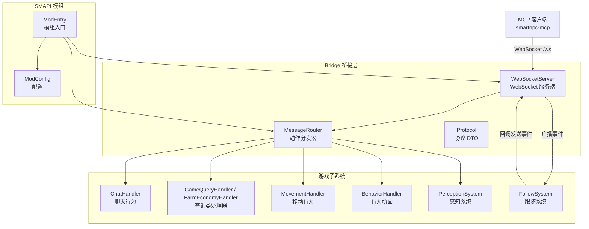
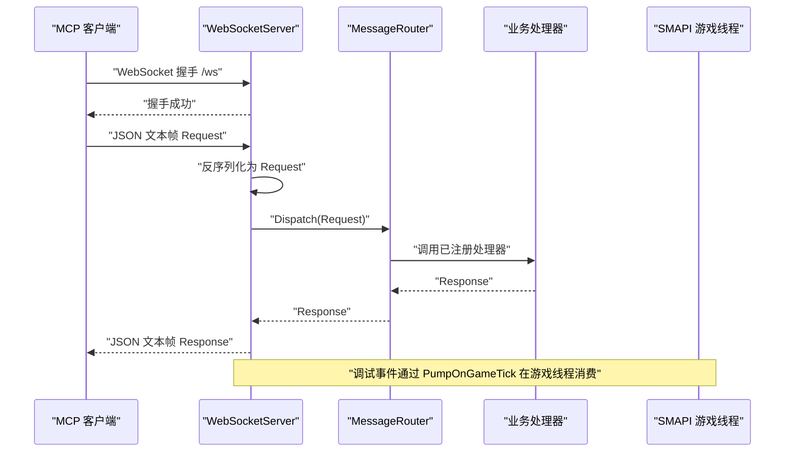
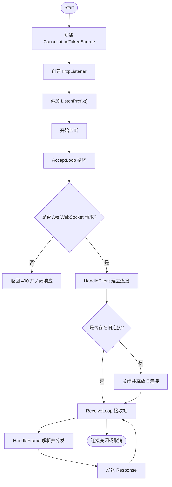
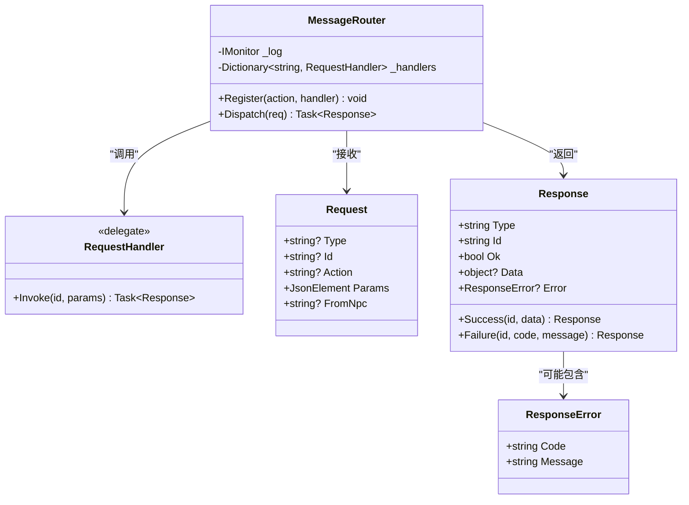
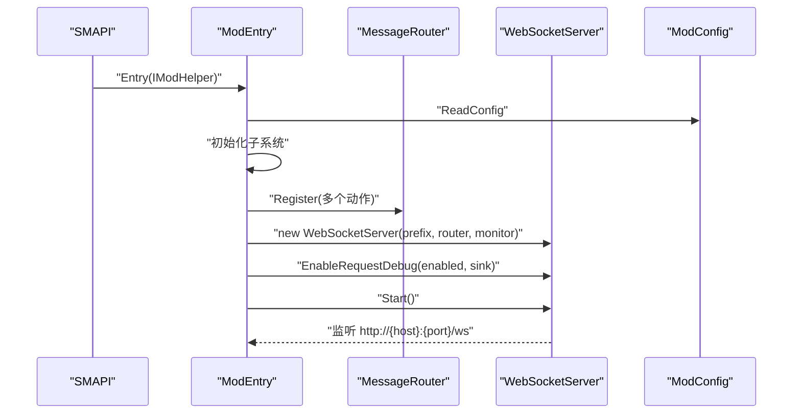
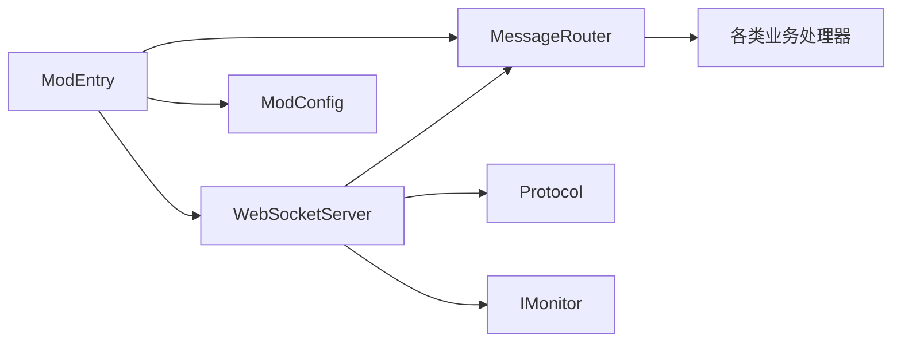
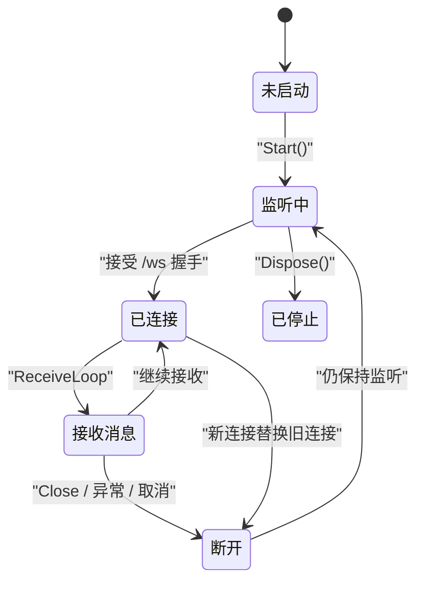
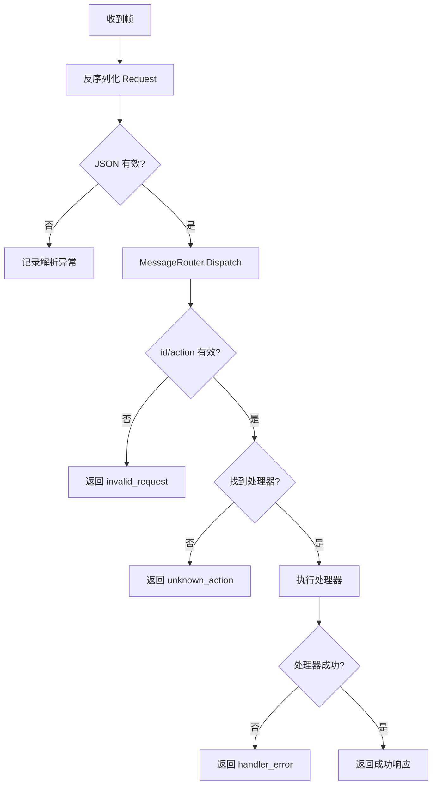
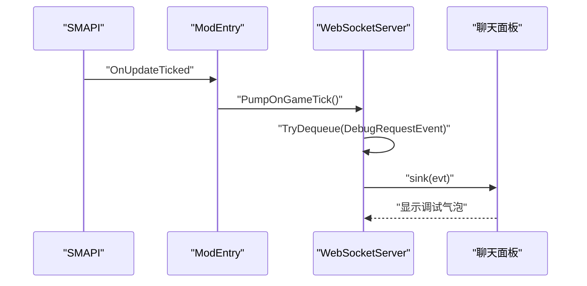

# WebSocket 服务端实现

<cite>
**本文引用的文件**   
- [WebSocketServer.cs](file://SmartNPC/smapi-mod/Bridge/WebSocketServer.cs)
- [MessageRouter.cs](file://SmartNPC/smapi-mod/Bridge/MessageRouter.cs)
- [Protocol.cs](file://SmartNPC/smapi-mod/Bridge/Protocol.cs)
- [ModEntry.cs](file://SmartNPC/smapi-mod/ModEntry.cs)
- [ModConfig.cs](file://SmartNPC/smapi-mod/ModConfig.cs)
</cite>

## 目录
1. [引言](#引言)
2. [项目结构定位](#项目结构定位)
3. [核心组件](#核心组件)
4. [架构总览](#架构总览)
5. [详细组件分析](#详细组件分析)
6. [依赖关系分析](#依赖关系分析)
7. [性能与线程模型](#性能与线程模型)
8. [心跳、连接生命周期与断线处理](#心跳连接生命周期与断线处理)
9. [错误处理机制](#错误处理机制)
10. [SMAPI 游戏循环集成](#smapi-游戏循环集成)
11. [使用示例：启动、监控与事件处理](#使用示例启动监控与事件处理)
12. [故障排查指南](#故障排查指南)
13. [结论](#结论)

## 引言
本技术文档聚焦于 Stardew Valley SMAPI 模组中的 WebSocket 服务端实现，核心代码位于 `SmartNPC/smapi-mod/Bridge/WebSocketServer.cs`。该服务作为 MCP（Model Context Protocol）客户端与服务端之间的桥接层，负责在本地 HTTP 监听端口上接受 WebSocket 握手、解析 JSON 请求、路由到业务处理器，并向当前唯一连接的客户端返回响应或推送事件。

文档从服务器启动、端口绑定、事件监听、连接管理、消息分发、与 SMAPI 游戏循环的集成、心跳与生命周期、错误处理、以及可观测性等方面展开，帮助读者在不直接阅读源码的情况下掌握整个实现思路。

## 项目结构定位
WebSocket 服务端是 SmartNPC SMAPI 模组的网络桥接模块，位于 `Bridge` 命名空间下，与其他子系统通过清晰的接口协作：

**图表来源**
- [WebSocketServer.cs:1-200](file://SmartNPC/smapi-mod/Bridge/WebSocketServer.cs#L1-L200)
- [MessageRouter.cs:1-53](file://SmartNPC/smapi-mod/Bridge/MessageRouter.cs#L1-L53)
- [Protocol.cs:1-67](file://SmartNPC/smapi-mod/Bridge/Protocol.cs#L1-L67)
- [ModEntry.cs:1-200](file://SmartNPC/smapi-mod/ModEntry.cs#L1-L200)

**章节来源**
- [WebSocketServer.cs:1-200](file://SmartNPC/smapi-mod/Bridge/WebSocketServer.cs#L1-L200)
- [MessageRouter.cs:1-53](file://SmartNPC/smapi-mod/Bridge/MessageRouter.cs#L1-L53)
- [Protocol.cs:1-67](file://SmartNPC/smapi-mod/Bridge/Protocol.cs#L1-L67)
- [ModEntry.cs:1-200](file://SmartNPC/smapi-mod/ModEntry.cs#L1-L200)
- [ModConfig.cs:1-144](file://SmartNPC/smapi-mod/ModConfig.cs#L1-L144)

## 核心组件
- **WebSocketServer**：基于 `HttpListener` 的轻量 WebSocket 服务端，负责监听 `/ws`、建立连接、接收帧、调用路由器、向当前连接发送响应和事件，并提供调试镜像能力。
- **MessageRouter**：维护“动作名称 → 处理器”的注册表，校验请求字段并执行对应处理器，统一记录耗时和异常。
- **Protocol**：定义入站请求、出站响应、错误对象和服务器主动推送事件的 JSON 数据结构，以及共享的 JSON 序列化选项。
- **ModEntry**：SMAPI 模组入口，负责装配各子系统、注册动作处理器、创建 WebSocketServer 并启动。
- **ModConfig**：提供监听主机、端口、调试开关等运行时配置，并生成 `http://{host}:{port}/` 前缀供 `HttpListener` 使用。

**章节来源**
- [WebSocketServer.cs:1-200](file://SmartNPC/smapi-mod/Bridge/WebSocketServer.cs#L1-L200)
- [MessageRouter.cs:1-53](file://SmartNPC/smapi-mod/Bridge/MessageRouter.cs#L1-L53)
- [Protocol.cs:1-67](file://SmartNPC/smapi-mod/Bridge/Protocol.cs#L1-L67)
- [ModEntry.cs:1-200](file://SmartNPC/smapi-mod/ModEntry.cs#L1-L200)
- [ModConfig.cs:1-144](file://SmartNPC/smapi-mod/ModConfig.cs#L1-L144)

## 架构总览
整体数据流分为三类：

1. **请求处理流程**：MCP 客户端发送 JSON 请求 → WebSocketServer 接收帧 → 反序列化为 `Request` → MessageRouter 分发到具体处理器 → 返回 `Response`。
2. **事件推送流程**：游戏内行为（如跟随系统、聊天、环境变化）触发事件 → WebSocketServer 将事件序列化为 `Event` 并推送到当前连接。
3. **调试镜像流程**：可选开启后，所有入站请求会被排队并在 SMAPI 游戏循环中消费，映射到聊天面板，便于观察 LLM 实际调用的工具名和参数。

**图表来源**
- [WebSocketServer.cs:1-200](file://SmartNPC/smapi-mod/Bridge/WebSocketServer.cs#L1-L200)
- [MessageRouter.cs:1-53](file://SmartNPC/smapi-mod/Bridge/MessageRouter.cs#L1-L53)
- [Protocol.cs:1-67](file://SmartNPC/smapi-mod/Bridge/Protocol.cs#L1-L67)

## 详细组件分析

### WebSocketServer：服务器启动、端口绑定与生命周期
WebSocketServer 是服务端的核心。其职责包括：

- **端口绑定**：通过 `HttpListener` 绑定由 `ModConfig.ListenPrefix()` 生成的前缀，默认监听 `http://127.0.0.1:18745/`。
- **路径限制**：只接受 URL 绝对路径为 `/ws` 的 WebSocket 升级请求。
- **单连接策略**：同时最多保留一个活跃 WebSocket 连接；新连接会替换旧连接。
- **异步接收循环**：使用 `ReceiveLoop` 逐帧读取 WebSocket 消息，合并分片消息，再交给 `HandleFrame`。
- **响应发送**：通过 `SendAsync` 将 `Response` 序列化后发回当前连接。
- **事件广播**：提供 `BroadcastEvent`，把服务器主动产生的事件发送给当前连接。
- **生命周期管理**：`Start` 启动监听和接受循环；`Dispose` 取消令牌、停止监听、释放当前连接。

**图表来源**
- [WebSocketServer.cs:1-200](file://SmartNPC/smapi-mod/Bridge/WebSocketServer.cs#L1-L200)
- [ModConfig.cs:1-144](file://SmartNPC/smapi-mod/ModConfig.cs#L1-L144)

**章节来源**
- [WebSocketServer.cs:1-200](file://SmartNPC/smapi-mod/Bridge/WebSocketServer.cs#L1-L200)
- [ModConfig.cs:1-144](file://SmartNPC/smapi-mod/ModConfig.cs#L1-L144)

### MessageRouter：动作分发与处理器调度
MessageRouter 是一个简单但关键的中间层：

- **注册机制**：通过 `Register(action, handler)` 注册动作名称与处理器委托。
- **请求校验**：要求 `id` 和 `action` 非空；未知动作会返回结构化错误。
- **异步执行**：处理器返回 `Task<Response>`，支持异步操作。
- **耗时统计**：记录每个动作处理的毫秒级耗时和结果状态。
- **异常保护**：处理器抛出的异常被捕获并包装为失败响应，避免中断消息循环。

**图表来源**
- [MessageRouter.cs:1-53](file://SmartNPC/smapi-mod/Bridge/MessageRouter.cs#L1-L53)
- [Protocol.cs:1-67](file://SmartNPC/smapi-mod/Bridge/Protocol.cs#L1-L67)

**章节来源**
- [MessageRouter.cs:1-53](file://SmartNPC/smapi-mod/Bridge/MessageRouter.cs#L1-L53)
- [Protocol.cs:1-67](file://SmartNPC/smapi-mod/Bridge/Protocol.cs#L1-L67)

### Protocol：协议数据对象
Protocol 定义了桥接层的通信契约：

- **Request**：入站请求，包含类型、ID、动作名、参数 JSON 元素，以及可选的 `from_npc`，用于调试镜像时识别调用方 NPC。
- **Response**：出站响应，包含类型、ID、成功标志、可选数据和可选错误。
- **ResponseError**：错误对象，包含错误码和错误信息。
- **Event**：服务器主动推送的事件，包含类型、事件名、数据和时间戳。
- **JsonOpts.Web**：全局 JSON 序列化选项，忽略空字段，适合网络传输。

这些结构使 WebSocket 消息具备明确的结构化语义，便于客户端解析和错误诊断。

**章节来源**
- [Protocol.cs:1-67](file://SmartNPC/smapi-mod/Bridge/Protocol.cs#L1-L67)

### ModEntry：组装与启动
ModEntry 是 SMAPI 模组的入口点，负责：

- 加载 `ModConfig`。
- 初始化聊天、查询、农场经济、感知、移动、跟随、行为等子系统。
- 向 `MessageRouter` 注册大量动作，例如 `chat_say`、`game_get_time`、`game_get_weather`、`farm_get_economy`、`npc_move_to`、`npc_emote` 等。
- 创建 `WebSocketServer`，并将 `FollowSystem` 的广播回调连接到服务器的 `BroadcastEvent`。
- 启用调试镜像，把入站请求映射到聊天面板。
- 启动 WebSocket 服务并输出就绪日志。

**图表来源**
- [ModEntry.cs:1-200](file://SmartNPC/smapi-mod/ModEntry.cs#L1-L200)
- [ModConfig.cs:1-144](file://SmartNPC/smapi-mod/ModConfig.cs#L1-L144)

**章节来源**
- [ModEntry.cs:1-200](file://SmartNPC/smapi-mod/ModEntry.cs#L1-L200)
- [ModConfig.cs:1-144](file://SmartNPC/smapi-mod/ModConfig.cs#L1-L144)

## 依赖关系分析
WebSocket 服务端与模组其他部分的依赖关系如下：

- **WebSocketServer 依赖**：
  - `HttpListener`：底层 TCP/HTTP 监听。
  - `WebSocket`：框架提供的 WebSocket 实现。
  - `MessageRouter`：动作分发。
  - `IMonitor`：SMAPI 日志接口。
  - `Protocol.Request`、`Protocol.Response`、`Protocol.Event`：协议 DTO。
- **MessageRouter 依赖**：
  - `IMonitor`：日志和计时统计。
  - 外部处理器：聊天、查询、移动、行为、感知等。
- **ModEntry 依赖**：
  - 所有子系统，并通过 `MessageRouter.Register` 暴露给 WebSocket 客户端。
  - `WebSocketServer`：作为网络出口。
- **ModConfig 依赖**：
  - 仅配置项，无运行时逻辑依赖，但决定监听地址和调试行为。

**图表来源**
- [WebSocketServer.cs:1-200](file://SmartNPC/smapi-mod/Bridge/WebSocketServer.cs#L1-L200)
- [MessageRouter.cs:1-53](file://SmartNPC/smapi-mod/Bridge/MessageRouter.cs#L1-L53)
- [Protocol.cs:1-67](file://SmartNPC/smapi-mod/Bridge/Protocol.cs#L1-L67)
- [ModEntry.cs:1-200](file://SmartNPC/smapi-mod/ModEntry.cs#L1-L200)
- [ModConfig.cs:1-144](file://SmartNPC/smapi-mod/ModConfig.cs#L1-L144)

**章节来源**
- [WebSocketServer.cs:1-200](file://SmartNPC/smapi-mod/Bridge/WebSocketServer.cs#L1-L200)
- [MessageRouter.cs:1-53](file://SmartNPC/smapi-mod/Bridge/MessageRouter.cs#L1-L53)
- [Protocol.cs:1-67](file://SmartNPC/smapi-mod/Bridge/Protocol.cs#L1-L67)
- [ModEntry.cs:1-200](file://SmartNPC/smapi-mod/ModEntry.cs#L1-L200)
- [ModConfig.cs:1-144](file://SmartNPC/smapi-mod/ModConfig.cs#L1-L144)

## 性能与线程模型
WebSocketServer 的性能设计以“轻服务端 + 游戏线程安全”为核心：

- **单连接模型**：注释明确指出“单连接适用于我们的用例”。这降低了连接池复杂度，也意味着不需要复杂的多客户端隔离。
- **异步 I/O**：`GetContextAsync`、`AcceptWebSocketAsync`、`ReceiveAsync` 都使用异步 API，避免阻塞主线程。
- **任务派发**：每次收到完整帧后，通过 `Task.Run` 派发到后台线程处理，防止阻塞 WebSocket 接收循环。
- **发送锁**：使用 `SemaphoreSlim(1,1)` 控制写锁，保证对当前 WebSocket 的写入互斥。
- **调试队列**：`ConcurrentQueue<DebugRequestEvent>` 是无界队列，但设计者认为“请求吞吐量是人机对话速率，不是批量流量”，因此未做背压限制。
- **游戏线程安全**：调试事件只在 `PumpOnGameTick` 中由 SMAPI 游戏线程消费，确保 UI 和 HUD 更新不会跨线程竞争。

优化建议：
- 如果未来需要多客户端，应引入连接池、连接 ID 映射、每连接独立写缓冲和超时策略。
- 调试队列应考虑最大长度，避免极端情况下内存增长。
- 对于长耗时处理器，应在处理器内部进一步拆分任务，避免长时间占用工作线程。

**章节来源**
- [WebSocketServer.cs:1-200](file://SmartNPC/smapi-mod/Bridge/WebSocketServer.cs#L1-L200)
- [ModEntry.cs:1-200](file://SmartNPC/smapi-mod/ModEntry.cs#L1-L200)

## 心跳、连接生命周期与断线处理

### 心跳机制
WebSocketServer 的注释提到“auto-ping every 30s（浏览器兼容的 ping/pong 由框架处理）”。但在当前代码片段中，并未看到显式的心跳定时器或手动 ping 实现。这意味着：

- 如果使用的是 .NET 内置 WebSocket 实现，且运行在支持自动 ping/pong 的环境中，则心跳可能由底层框架隐式处理。
- 如果运行环境不自动处理 ping/pong，则当前实现没有显式心跳检测逻辑。

因此，从源码角度，**不能断言存在 30 秒定时心跳**，只能确认注释表达了设计意图；实际心跳行为取决于运行时环境。

### 连接生命周期
连接生命周期如下：

1. **AcceptLoop** 等待新的 `HttpListenerContext`。
2. **HandleClient** 接受 WebSocket 并替换旧连接。
3. **ReceiveLoop** 持续读取消息，直到连接关闭、取消或异常。
4. **finally 块** 清理当前连接引用，释放资源。

**图表来源**
- [WebSocketServer.cs:1-200](file://SmartNPC/smapi-mod/Bridge/WebSocketServer.cs#L1-L200)

### 断线重连逻辑
当前 WebSocketServer 本身**不提供客户端侧的断线重连**。它只做服务端连接管理：

- 如果客户端断开，服务端会记录断开日志并释放连接。
- 如果新客户端连接，旧连接会被策略性关闭并替换。
- 重连应由 MCP 客户端自行实现，服务端不主动发起重连。

如果需要服务端侧的重连探测，应增加空闲超时、最后活动时间跟踪和主动关闭异常连接的能力。

**章节来源**
- [WebSocketServer.cs:1-200](file://SmartNPC/smapi-mod/Bridge/WebSocketServer.cs#L1-L200)

## 错误处理机制
WebSocketServer 和 MessageRouter 覆盖了多种错误场景：

- **非 WebSocket 或非 /ws 请求**：返回 400 并关闭响应。
- **WebSocket 握手失败**：捕获异常并记录警告日志。
- **接收异常**：`ReceiveLoop` 捕获异常后直接退出接收循环。
- **JSON 解析异常**：`HandleFrame` 中尝试反序列化 `Request`，失败时会进入错误分支。
- **无效请求**：缺少 `id` 或 `action` 时，MessageRouter 返回失败响应。
- **未知动作**：MessageRouter 返回 `unknown_action` 错误。
- **处理器异常**：MessageRouter 捕获处理器异常并返回 `handler_error`。
- **调试 sink 异常**：`PumpOnGameTick` 捕获调试事件处理异常，避免影响主循环。
- **资源释放**：`Dispose` 中对取消、监听停止、连接释放都做了 try-catch 保护。

**图表来源**
- [WebSocketServer.cs:1-200](file://SmartNPC/smapi-mod/Bridge/WebSocketServer.cs#L1-L200)
- [MessageRouter.cs:1-53](file://SmartNPC/smapi-mod/Bridge/MessageRouter.cs#L1-L53)

**章节来源**
- [WebSocketServer.cs:1-200](file://SmartNPC/smapi-mod/Bridge/WebSocketServer.cs#L1-L200)
- [MessageRouter.cs:1-53](file://SmartNPC/smapi-mod/Bridge/MessageRouter.cs#L1-L53)

## SMAPI 游戏循环集成
WebSocketServer 与 SMAPI 的集成主要体现在两个地方：

1. **ModEntry 订阅游戏事件**：包括 `GameLaunched`、`UpdateTicked`、`SaveLoaded`、`Saving`、`DayStarted`、`DayEnding`、`TimeChanged`、UI 渲染事件、输入事件等。
2. **调试事件泵**：`WebSocketServer.PumpOnGameTick` 应该由 `ModEntry.OnUpdateTicked` 调用，从而把 WebSocket 线程生产的调试事件转移到 SMAPI 游戏线程，再交给聊天面板。

**图表来源**
- [WebSocketServer.cs:1-200](file://SmartNPC/smapi-mod/Bridge/WebSocketServer.cs#L1-L200)
- [ModEntry.cs:1-200](file://SmartNPC/smapi-mod/ModEntry.cs#L1-L200)

**章节来源**
- [WebSocketServer.cs:1-200](file://SmartNPC/smapi-mod/Bridge/WebSocketServer.cs#L1-L200)
- [ModEntry.cs:1-200](file://SmartNPC/smapi-mod/ModEntry.cs#L1-L200)

## 使用示例：启动、监控与事件处理

### 如何启动服务
服务的启动由 ModEntry 完成，典型流程如下：

1. 加载 `ModConfig`。
2. 构建 `MessageRouter` 并注册动作。
3. 根据 `ListenPrefix()` 生成监听前缀。
4. 创建 `WebSocketServer`。
5. 启用调试镜像。
6. 调用 `Start()`。

参考路径：
- [ModEntry.cs:1-200](file://SmartNPC/smapi-mod/ModEntry.cs#L1-L200)
- [ModConfig.cs:1-144](file://SmartNPC/smapi-mod/ModConfig.cs#L1-L144)
- [WebSocketServer.cs:1-200](file://SmartNPC/smapi-mod/Bridge/WebSocketServer.cs#L1-L200)

### 如何监控连接状态
可以通过以下方式观察连接状态：

- 查看 SMAPI 日志中的 “ws client connected”、“ws client disconnected”。
- 在调试模式下，观察聊天面板中是否出现 `[mcp→mod] action=... id=...` 的调试气泡。
- 检查 MCP 客户端是否能正常收到 `Response` 或 `Event`。

参考路径：
- [WebSocketServer.cs:1-200](file://SmartNPC/smapi-mod/Bridge/WebSocketServer.cs#L1-L200)
- [ModEntry.cs:1-200](file://SmartNPC/smapi-mod/ModEntry.cs#L1-L200)

### 如何处理服务器事件
服务器主动推送事件使用 `Protocol.Event`，包含事件名和数据。当前实现中，`FollowSystem` 的广播回调被连接到 `WebSocketServer.BroadcastEvent`，可用于通知客户端 NPC 状态变化或其他游戏事件。

参考路径：
- [WebSocketServer.cs:1-200](file://SmartNPC/smapi-mod/Bridge/WebSocketServer.cs#L1-L200)
- [Protocol.cs:1-67](file://SmartNPC/smapi-mod/Bridge/Protocol.cs#L1-L67)
- [ModEntry.cs:1-200](file://SmartNPC/smapi-mod/ModEntry.cs#L1-L200)

## 故障排查指南

### 常见问题与定位方法
- **端口冲突**：修改 `ModConfig.Host` 和 `Port`，确保不与其它服务冲突。
- **无法连接**：确认 MCP 客户端连接的 URL 与 `ListenPrefix()` 一致，并确保防火墙允许本地或局域网访问。
- **请求未被处理**：检查 `MessageRouter` 是否已注册对应动作，查看日志中的 `unknown_action`。
- **处理器报错**：查看日志中的 `handler_error`，确认处理器内部是否抛出异常。
- **调试气泡不显示**：确认 `DebugLogIncomingRequests` 已启用，并检查 `PumpOnGameTick` 是否被调用。
- **连接被意外替换**：确认是否有多客户端连接，因为服务端只保留最新连接。

### 日志关键字
- “WebSocket listening on ...”
- “ws client connected”
- “ws client disconnected”
- “[timing] dispatch req=... action=... elapsed=...ms ok=...”
- “handler ... threw: ...”
- “[debug-req] EnableRequestDebug wired”
- “[debug-req] pump → action=... npc=...”

**章节来源**
- [WebSocketServer.cs:1-200](file://SmartNPC/smapi-mod/Bridge/WebSocketServer.cs#L1-L200)
- [MessageRouter.cs:1-53](file://SmartNPC/smapi-mod/Bridge/MessageRouter.cs#L1-L53)
- [ModConfig.cs:1-144](file://SmartNPC/smapi-mod/ModConfig.cs#L1-L144)

## 结论
WebSocketServer 是一个简洁、面向单一 MCP 客户端的本地 WebSocket 服务端实现。它以 `HttpListener` 为基础，配合 `MessageRouter` 的动作分发机制，将 MCP 客户端的请求转换为 SMAPI 模组内部的游戏行为。其优势在于结构简单、易于理解，并且与 SMAPI 游戏循环通过调试事件泵实现了安全的 UI 更新。

主要限制包括：
- 当前版本不支持多客户端并发。
- 注释提到 30 秒心跳，但源码未显式实现心跳定时器。
- 调试队列无界，需在高负载场景下评估内存风险。
- 协议暂无认证机制，不应暴露在不可信网络。

对于后续扩展，建议优先增加连接池、心跳检测、连接超时、身份校验、请求限流和多客户端事件路由能力，同时保持现有协议结构的稳定性。