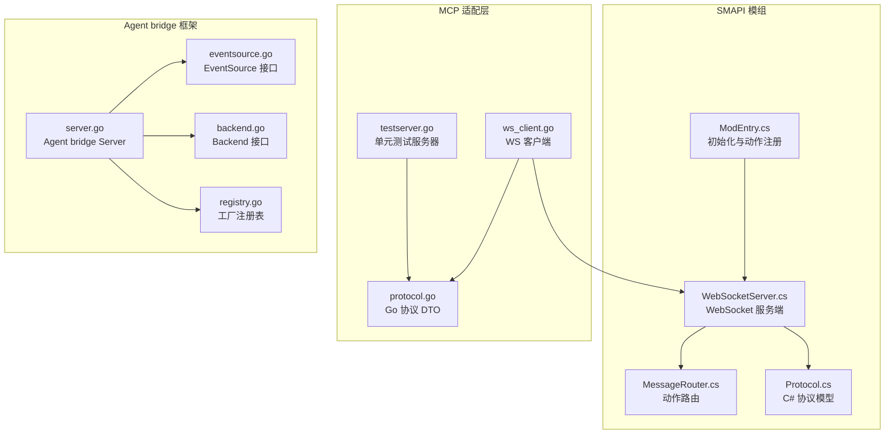
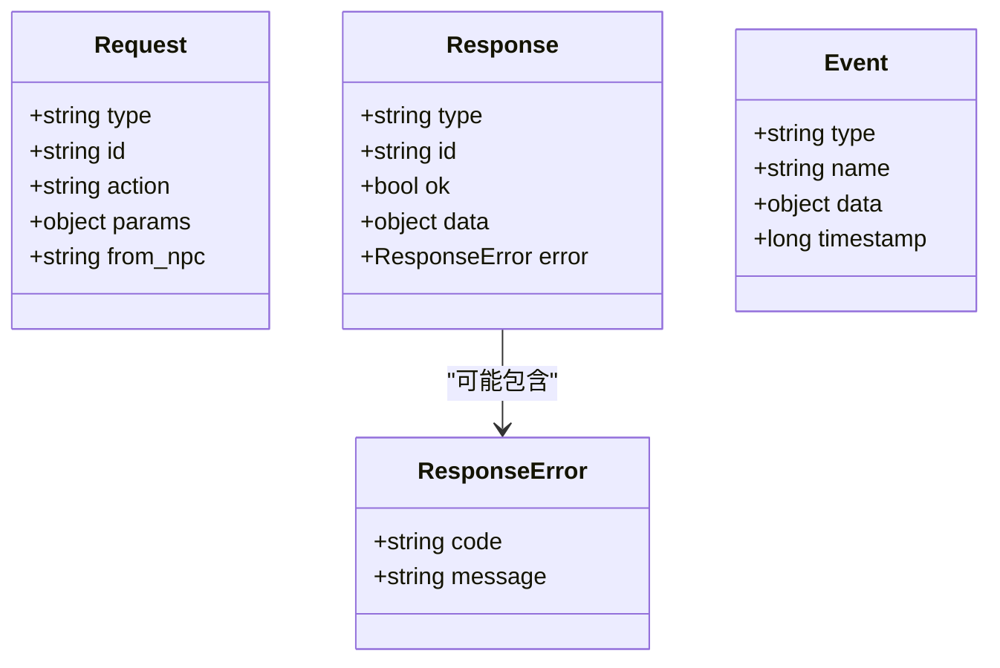
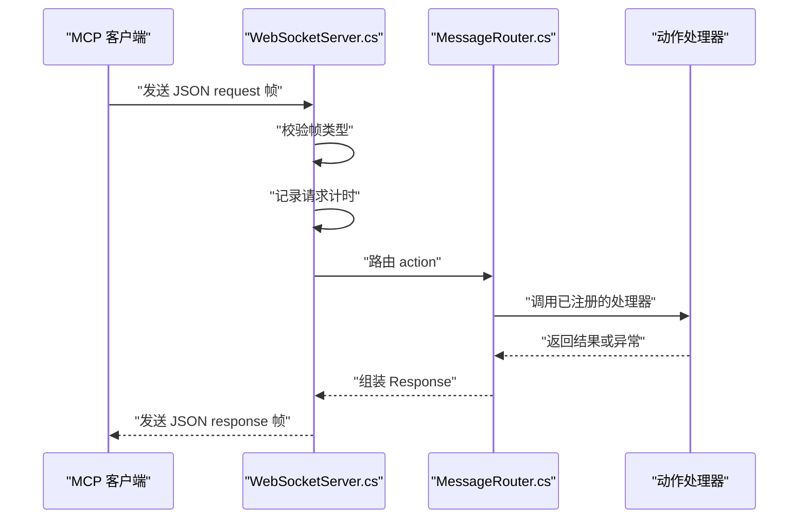
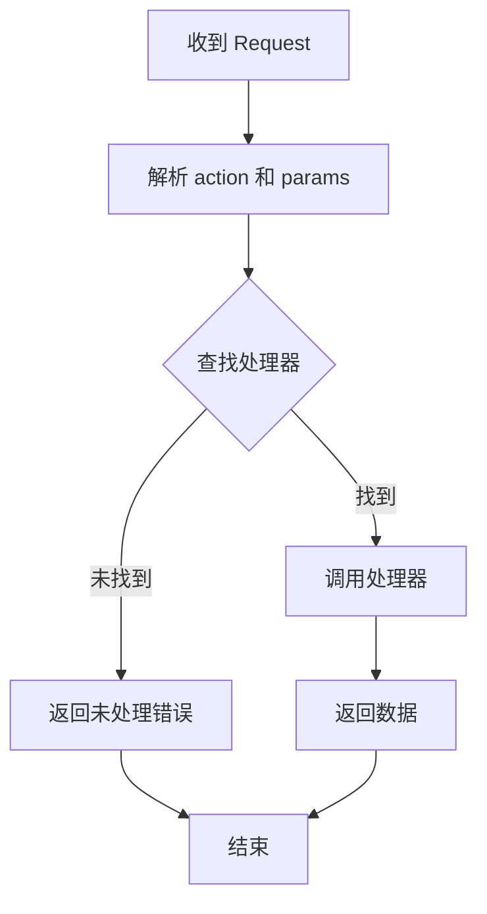
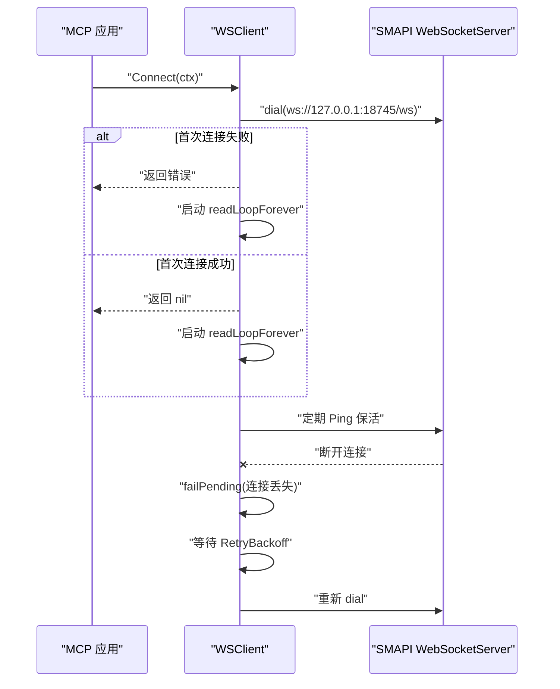
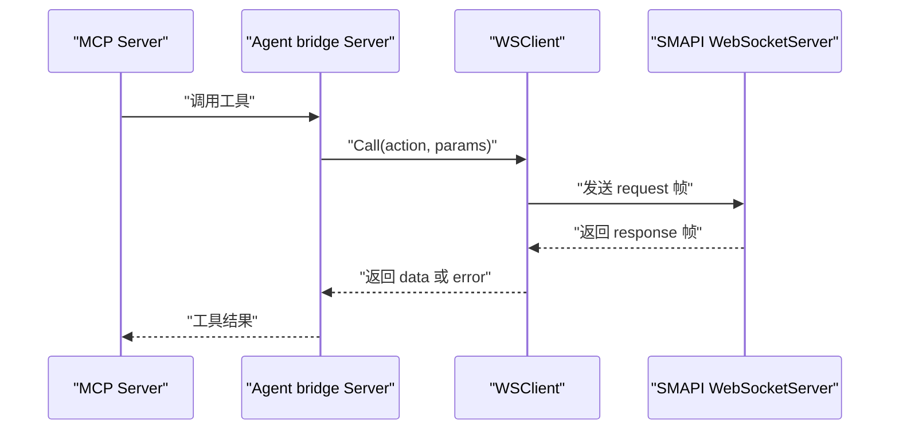
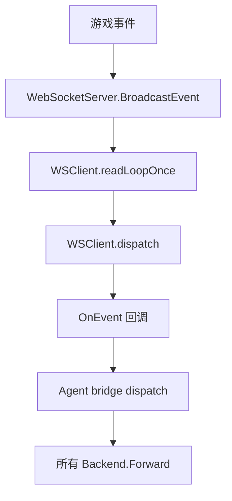
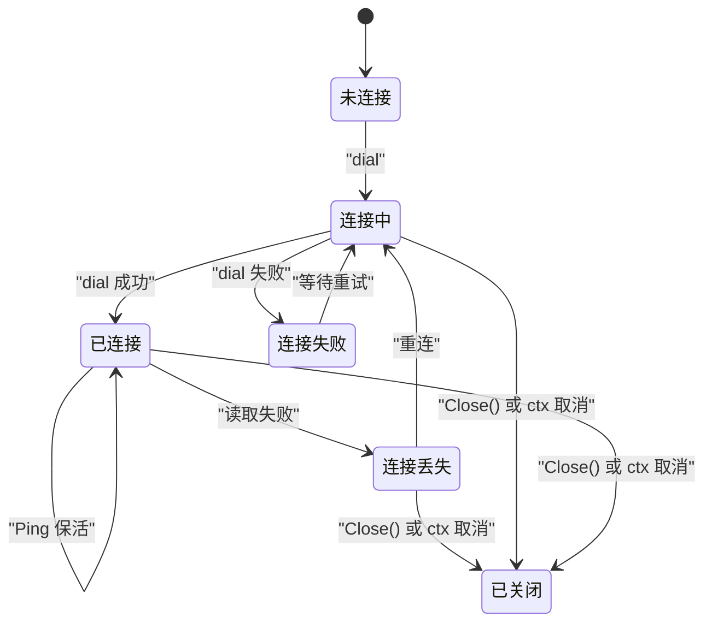
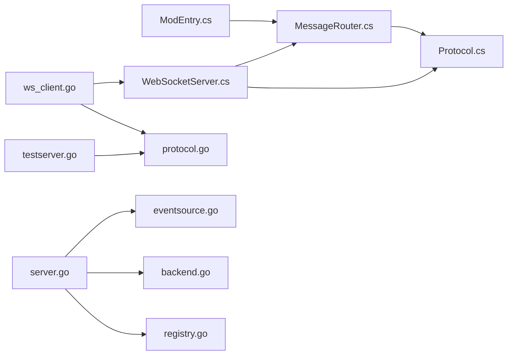

# WebSocket 通信层

<cite>
**本文引用的文件**   
- [WebSocketServer.cs](file://SmartNPC/smartnpc-mcp/Mods/StardewMCPBridge/Bridge/WebSocketServer.cs)
- [MessageRouter.cs](file://SmartNPC/smartnpc-mcp/Mods/StardewMCPBridge/Bridge/MessageRouter.cs)
- [Protocol.cs](file://SmartNPC/smartnpc-mcp/Mods/StardewMCPBridge/Bridge/Protocol.cs)
- [ws_client.go](file://SmartNPC/smartnpc-mcp/adapters/stardew/bridge/ws_client.go)
- [protocol.go](file://SmartNPC/smartnpc-mcp/adapters/stardew/bridge/protocol.go)
- [testserver.go](file://SmartNPC/smartnpc-mcp/adapters/stardew/bridge/testserver.go)
- [server.go](file://SmartNPC/smartnpc-mcp/pkg/agentbridge/server.go)
- [eventsource.go](file://SmartNPC/smartnpc-mcp/pkg/agentbridge/eventsource.go)
- [backend.go](file://SmartNPC/smartnpc-mcp/pkg/agentbridge/backend.go)
- [registry.go](file://SmartNPC/smartnpc-mcp/pkg/agentbridge/registry.go)
- [ModEntry.cs](file://SmartNPC/smartnpc-mcp/Mods/StardewMCPBridge/ModEntry.cs)
</cite>

## 目录
1. [简介](#简介)
2. [项目结构定位](#项目结构定位)
3. [核心组件总览](#核心组件总览)
4. [协议与数据模型](#协议与数据模型)
5. [服务端实现：WebSocketServer.cs](#服务端实现websocketserverscs)
6. [消息路由：MessageRouter.cs](#消息路由messageroutercs)
7. [客户端实现：ws_client.go](#客户端实现ws_clientgo)
8. [与 MCP 服务的通信模式](#与-mcp-服务的通信模式)
9. [连接状态监控、错误处理与重连](#连接状态监控错误处理与重连)
10. [扩展指南：注册新动作处理器与自定义消息类型](#扩展指南注册新动作处理器与自定义消息类型)
11. [依赖关系分析](#依赖关系分析)
12. [性能与可观测性](#性能与可观测性)
13. [故障排查](#故障排查)
14. [结论](#结论)

## 简介
本技术文档聚焦 SmartNPC 项目中连接 SMAPI 游戏模组与 MCP（Model Context Protocol）侧的 WebSocket 通信层。该通信层由两部分组成：

- C# 侧运行在 Stardew Valley 的 SMAPI 环境中，负责暴露 WebSocket 服务、解析请求、分发到具体动作处理器、并向上游推送事件。
- Go 侧运行在 MCP 工具调用方中，提供 WSClient、协议 DTO、测试服务器和 agent-bridge 框架，用于发起 RPC 调用、接收事件、管理连接生命周期并与上层 MCP server 集成。

重点覆盖以下目标：
- WebSocketServer.cs 的服务端启动、连接管理、心跳保活、调试请求注入和事件广播。
- MessageRouter.cs 的动作名解析、处理器注册表和异步分发机制。
- Protocol.cs 与 protocol.go 定义的 JSON 帧格式、动作名常量、事件名常量和序列化约定。
- 与 MCP 服务的请求-响应模式和事件推送模式。
- 连接池维护、心跳检测、断线重连、超时控制和错误传播。
- 如何注册新的动作处理器和处理自定义消息类型。

## 项目结构定位
WebSocket 通信相关代码分布在两个子系统中：

| 子系统 | 路径 | 职责 |
|---|---|---|
| SMAPI 模组桥接层 | `SmartNPC/smartnpc-mcp/Mods/StardewMCPBridge/Bridge/` | 提供 WebSocket 服务端、消息路由、协议定义，并在游戏线程上执行动作。 |
| MCP 适配器层 | `SmartNPC/smartnpc-mcp/adapters/stardew/bridge/` | 提供 WebSocket 客户端、协议 DTO、测试服务器，封装对 SMAPI mod 的调用。 |
| Agent bridge 框架 | `SmartNPC/smartnpc-mcp/pkg/agentbridge/` | 提供事件源抽象、后端转发、MCP server 装配入口。 |
| 模组入口 | `SmartNPC/smartnpc-mcp/Mods/StardewMCPBridge/ModEntry.cs` | 初始化路由器、注册内置动作、创建 WebSocketServer。 |

**图示来源**
- [ModEntry.cs:92-171](file://SmartNPC/smartnpc-mcp/Mods/StardewMCPBridge/ModEntry.cs#L92-L171)
- [WebSocketServer.cs:23-117](file://SmartNPC/smartnpc-mcp/Mods/StardewMCPBridge/Bridge/WebSocketServer.cs#L23-L117)
- [MessageRouter.cs:15-43](file://SmartNPC/smartnpc-mcp/Mods/StardewMCPBridge/Bridge/MessageRouter.cs#L15-L43)
- [Protocol.cs:20-60](file://SmartNPC/smartnpc-mcp/Mods/StardewMCPBridge/Bridge/Protocol.cs#L20-L60)
- [ws_client.go:1-120](file://SmartNPC/smartnpc-mcp/adapters/stardew/bridge/ws_client.go#L1-L120)
- [protocol.go:1-172](file://SmartNPC/smartnpc-mcp/adapters/stardew/bridge/protocol.go#L1-L172)
- [testserver.go:1-147](file://SmartNPC/smartnpc-mcp/adapters/stardew/bridge/testserver.go#L1-L147)
- [server.go:1-177](file://SmartNPC/smartnpc-mcp/pkg/agentbridge/server.go#L1-L177)
- [eventsource.go:1-40](file://SmartNPC/smartnpc-mcp/pkg/agentbridge/eventsource.go#L1-L40)
- [backend.go:1-36](file://SmartNPC/smartnpc-mcp/pkg/agentbridge/backend.go#L1-L36)
- [registry.go:1-119](file://SmartNPC/smartnpc-mcp/pkg/agentbridge/registry.go#L1-L119)

**章节来源**
- [ModEntry.cs:92-171](file://SmartNPC/smartnpc-mcp/Mods/StardewMCPBridge/ModEntry.cs#L92-L171)

## 核心组件总览
| 组件 | 语言 | 关键角色 | 主要行为 |
|---|---|---|---|
| WebSocketServer.cs | C# | 服务端监听器 | 启动 HttpListener WebSocket、接收帧、调用路由器、写回响应、广播事件、支持调试请求注入。 |
| MessageRouter.cs | C# | 动作分发器 | 维护 action → handler 映射，按 id 异步调度，记录耗时。 |
| Protocol.cs | C# | 服务端协议模型 | Request、Response、ResponseError、Event、JSON 选项。 |
| ws_client.go | Go | MCP 侧 WebSocket 客户端 | Connect、Call、CallAs、事件回调、重连循环、Ping 保活、pending 响应匹配。 |
| protocol.go | Go | 客户端协议 DTO | FrameType、ActionName、EventName、Request、Response、Event。 |
| testserver.go | Go | 测试用 WebSocket 服务器 | 提供 `/ws` 端点，模拟服务端行为，供单元测试使用。 |
| server.go | Go | Agent bridge 组合根 | Mount ToolGroup、AttachEventSource、AttachBackend、Run 驱动所有 source。 |
| eventsource.go | Go | 事件源抽象 | Sink 回调、EventSource 接口，统一事件生产方接入方式。 |
| backend.go | Go | 事件后端抽象 | Forward 将事件转发给下游系统。 |
| registry.go | Go | 工厂注册表 | RegisterAdapter / RegisterRelay，管理全局 adapter 和 relay 工厂。 |

**章节来源**
- [WebSocketServer.cs:23-117](file://SmartNPC/smartnpc-mcp/Mods/StardewMCPBridge/Bridge/WebSocketServer.cs#L23-L117)
- [MessageRouter.cs:15-43](file://SmartNPC/smartnpc-mcp/Mods/StardewMCPBridge/Bridge/MessageRouter.cs#L15-L43)
- [Protocol.cs:20-60](file://SmartNPC/smartnpc-mcp/Mods/StardewMCPBridge/Bridge/Protocol.cs#L20-L60)
- [ws_client.go:1-120](file://SmartNPC/smartnpc-mcp/adapters/stardew/bridge/ws_client.go#L1-L120)
- [protocol.go:1-172](file://SmartNPC/smartnpc-mcp/adapters/stardew/bridge/protocol.go#L1-L172)
- [testserver.go:1-147](file://SmartNPC/smartnpc-mcp/adapters/stardew/bridge/testserver.go#L1-L147)
- [server.go:1-177](file://SmartNPC/smartnpc-mcp/pkg/agentbridge/server.go#L1-L177)
- [eventsource.go:1-40](file://SmartNPC/smartnpc-mcp/pkg/agentbridge/eventsource.go#L1-L40)
- [backend.go:1-36](file://SmartNPC/smartnpc-mcp/pkg/agentbridge/backend.go#L1-L36)
- [registry.go:1-119](file://SmartNPC/smartnpc-mcp/pkg/agentbridge/registry.go#L1-L119)

## 协议与数据模型
WebSocket 通信采用基于 JSON 文本帧的轻量 RPC 协议，分为三种帧类型：

| 字段 | 含义 | 说明 |
|---|---|---|
| `type` | 帧类型 | 取值为 `request`、`response`、`event`。 |
| `id` | 请求标识 | 仅请求和响应携带，用于客户端关联请求与响应。 |
| `action` | 动作名 | 客户端发起的请求必须指定；服务端通过路由表找到处理器。 |
| `params` | 参数 | 任意 JSON 对象，由具体 action 决定结构。 |
| `from_npc` | 来源 NPC | 可选字段，表示 MCP 侧哪个 NPC profile 发起的请求。 |
| `ok` | 成功标志 | 响应专用，true 表示业务成功。 |
| `data` | 响应数据 | 成功时返回的原始 JSON 字节。 |
| `error` | 错误对象 | 失败时包含 `code` 和 `message`。 |
| `name` | 事件名 | 事件专用，如 `chat_message`、`npc_interact`。 |
| `timestamp` | 时间戳 | 事件专用，Unix 毫秒。 |

### 客户端协议常量
Go 侧 `protocol.go` 定义了完整的动作名和事件名常量，包括：

- **动作名**：聊天、游戏查询、农场经济、NPC 移动、NPC 交互、NPC 行为、NPC 物品栏、社交表演等。
- **事件名**：聊天消息、NPC 交互、日程触发、调试主动触发、玩家接近 NPC、日夜切换等。

这些常量是客户端与服务端之间的契约，新增动作或事件应优先更新对应常量，避免硬编码字符串。

### 服务端协议模型
C# 侧 `Protocol.cs` 定义了完全对应的 Request、Response、ResponseError、Event 结构体，并由 WebSocketServer 和 MessageRouter 使用。

**图示来源**
- [protocol.go:1-172](file://SmartNPC/smartnpc-mcp/adapters/stardew/bridge/protocol.go#L1-L172)
- [Protocol.cs:20-60](file://SmartNPC/smartnpc-mcp/Mods/StardewMCPBridge/Bridge/Protocol.cs#L20-L60)

**章节来源**
- [protocol.go:1-172](file://SmartNPC/smartnpc-mcp/adapters/stardew/bridge/protocol.go#L1-L172)
- [Protocol.cs:20-60](file://SmartNPC/smartnpc-mcp/Mods/StardewMCPBridge/Bridge/Protocol.cs#L20-L60)

## 服务端实现：WebSocketServer.cs
WebSocketServer.cs 是 SMAPI 模组的 WebSocket 入口。它不负责业务逻辑，而是承担网络层职责：

1. **构造函数**：接收路由前缀、MessageRouter 实例和日志监控。
2. **EnableRequestDebug**：启用调试请求注入，允许外部调试命令把虚拟请求注入到路由流程。
3. **PumpOnGameTick**：由 SMAPI 每帧调用，从队列取出结构化事件并广播。
4. **Start**：启动底层 WebSocket 监听。
5. **Dispose**：释放资源。

### 服务端请求处理流程

**图示来源**
- [WebSocketServer.cs:212-241](file://SmartNPC/smartnpc-mcp/Mods/StardewMCPBridge/Bridge/WebSocketServer.cs#L212-L241)
- [MessageRouter.cs:22-43](file://SmartNPC/smartnpc-mcp/Mods/StardewMCPBridge/Bridge/MessageRouter.cs#L22-L43)

### 连接管理与心跳
WebSocketServer.cs 本身由 SMAPI 托管连接生命周期；实际的心跳保活和重连逻辑主要由 Go 侧客户端实现。服务端侧的关键点是：

- 每个收到的 request 都会记录 action、id、耗时和是否成功。
- 支持调试请求注入，便于运维或测试场景下模拟上游调用。
- 提供 `BroadcastEvent` 方法，让游戏内部事件可以推送到所有已连接的 WebSocket 客户端。

### 调试请求注入
WebSocketServer.cs 支持通过 `EnableRequestDebug` 注册一个 sink，并把 `DebugRequestEvent` 暴露出来。ModEntry.cs 中的调试命令会利用该能力，把控制台或调度器的指令转换为标准 request 帧，从而复用现有动作路由。

**章节来源**
- [WebSocketServer.cs:23-117](file://SmartNPC/smartnpc-mcp/Mods/StardewMCPBridge/Bridge/WebSocketServer.cs#L23-L117)
- [WebSocketServer.cs:212-241](file://SmartNPC/smartnpc-mcp/Mods/StardewMCPBridge/Bridge/WebSocketServer.cs#L212-L241)
- [WebSocketServer.cs:296](file://SmartNPC/smartnpc-mcp/Mods/StardewMCPBridge/Bridge/WebSocketServer.cs#L296)

## 消息路由：MessageRouter.cs
MessageRouter.cs 是动作分发的核心。它维护一个 action name 到处理器函数的映射，并提供注册和分发能力。

### 处理器注册表
- 注册接口：`Register(string action, RequestHandler handler)`。
- 分发接口：根据 Request 中的 action 查找 handler，若未注册则返回错误。
- 异步执行：处理器通常在游戏线程或受控上下文中执行，避免直接阻塞 WebSocket I/O。

### 异步消息分发

**图示来源**
- [MessageRouter.cs:22-43](file://SmartNPC/smartnpc-mcp/Mods/StardewMCPBridge/Bridge/MessageRouter.cs#L22-L43)

### 与 ModEntry.cs 的集成
ModEntry.cs 在模组初始化阶段创建 MessageRouter，并注册大量内置动作，例如：

- `chat_say`
- `game_get_time`
- `game_get_weather`
- `farm_get_economy`
- `npc_get_nearby`
- `npc_move_to`
- `npc_emote`
- 各种 NPC 物品栏动作
- 动态注册的行为处理器

这种设计使得动作注册集中在入口，便于扩展和维护。

**章节来源**
- [MessageRouter.cs:15-43](file://SmartNPC/smartnpc-mcp/Mods/StardewMCPBridge/Bridge/MessageRouter.cs#L15-L43)
- [ModEntry.cs:92-171](file://SmartNPC/smartnpc-mcp/Mods/StardewMCPBridge/ModEntry.cs#L92-L171)

## 客户端实现：ws_client.go
ws_client.go 是 MCP 侧连接 SMAPI mod 的 WebSocket 客户端，职责包括：

- 默认连接地址：`ws://127.0.0.1:18745/ws`。
- 建立连接并启动读循环。
- 发送 Request 并通过 id 匹配 Response。
- 将 server 推送的 Event 交给 OnEvent 回调。
- 自动重连和 Ping 保活。
- 维护 MCP session 到 NPC profile 的映射。

### 关键数据结构
| 名称 | 类型 | 作用 |
|---|---|---|
| `WSClientOptions` | 配置对象 | URL、Logger、CallTimeout、DialTimeout、RetryBackoff、OnEvent、OnCall。 |
| `CallRecord` | 观察记录 | 单次 tool call 的实验日志记录，包含 action、npc、params、ok、data、error、elapsed_ms。 |
| `WSClient` | 客户端主体 | 持有连接、pending 响应通道、closed 标记、agent 注册表。 |
| `callCtxKey` | 上下文键 | 将 MCP session ID 传入 Call，以便自动填充 `from_npc`。 |

### 连接建立与重连

**图示来源**
- [ws_client.go:120-200](file://SmartNPC/smartnpc-mcp/adapters/stardew/bridge/ws_client.go#L120-L200)
- [ws_client.go:320-510](file://SmartNPC/smartnpc-mcp/adapters/stardew/bridge/ws_client.go#L320-L510)

### 请求-响应匹配
客户端为每个 Call 生成唯一 id，并将对应响应通道放入 pending map。服务端返回 response 后，客户端根据 id 找到通道并写入 Response。如果连接中断，pending 通道会被置空，调用方收到“连接丢失”错误。

### 事件分发
当收到 `type=event` 的帧时，客户端解析出 name 和 data，并调用 OnEvent 回调。由于回调运行在读循环中，长时间工作应交由 goroutine 处理。

**章节来源**
- [ws_client.go:1-120](file://SmartNPC/smartnpc-mcp/adapters/stardew/bridge/ws_client.go#L1-L120)
- [ws_client.go:201-319](file://SmartNPC/smartnpc-mcp/adapters/stardew/bridge/ws_client.go#L201-L319)
- [ws_client.go:320-510](file://SmartNPC/smartnpc-mcp/adapters/stardew/bridge/ws_client.go#L320-L510)

## 与 MCP 服务的通信模式
SmartNPC 的 MCP 侧通过 agent-bridge 框架组织 WebSocket 通信，形成两层职责：

1. **协议传输层**：ws_client.go 负责 WebSocket 帧收发。
2. **框架编排层**：server.go、eventsource.go、backend.go 负责事件源、后端和 MCP server 的组合。

### 请求-响应模式
这是 MCP 工具调用的主路径：

**图示来源**
- [server.go:1-177](file://SmartNPC/smartnpc-mcp/pkg/agentbridge/server.go#L1-L177)
- [ws_client.go:201-319](file://SmartNPC/smartnpc-mcp/adapters/stardew/bridge/ws_client.go#L201-L319)
- [WebSocketServer.cs:212-241](file://SmartNPC/smartnpc-mcp/Mods/StardewMCPBridge/Bridge/WebSocketServer.cs#L212-L241)

### 事件推送模式
事件由 SMAPI 游戏侧产生，经 WebSocketServer 广播，再由 WSClient 的 OnEvent 回调消费，最终进入 agent-bridge 的事件分发体系。

**图示来源**
- [WebSocketServer.cs:296](file://SmartNPC/smartnpc-mcp/Mods/StardewMCPBridge/Bridge/WebSocketServer.cs#L296)
- [ws_client.go:430-510](file://SmartNPC/smartnpc-mcp/adapters/stardew/bridge/ws_client.go#L430-L510)
- [server.go:120-177](file://SmartNPC/smartnpc-mcp/pkg/agentbridge/server.go#L120-L177)

**章节来源**
- [server.go:1-177](file://SmartNPC/smartnpc-mcp/pkg/agentbridge/server.go#L1-L177)
- [eventsource.go:1-40](file://SmartNPC/smartnpc-mcp/pkg/agentbridge/eventsource.go#L1-L40)
- [backend.go:1-36](file://SmartNPC/smartnpc-mcp/pkg/agentbridge/backend.go#L1-L36)

## 连接状态监控、错误处理与重连
### 连接状态
WSClient 提供 `Connected()` 方法，用于判断当前是否存在活跃连接。该方法为状态报告设计，存在轻微竞态：可能在返回 true 后立刻发生 EOF，因此只适合展示用途，不应作为强一致性检查。

### 错误分类
| 错误类型 | 触发位置 | 表现 |
|---|---|---|
| 连接未建立 | Call/doCall | 返回“ws client not connected”。 |
| 客户端关闭 | doCall | 返回“ws client closed”。 |
| 写帧失败 | doCall | 返回带 “ws write” 包装的错误。 |
| 调用超时 | doCall | 返回 context timeout 错误。 |
| 服务端返回失败 | doCall | 返回带 `mod error code: message` 的错误。 |
| 连接断开 | readLoopForever | 清空 pending 通道，触发重连。 |
| 未知帧类型 | dispatch | 记录警告日志并丢弃。 |
| 无效 JSON | dispatch | 记录警告日志并丢弃。 |

### 重连机制
readLoopForever 在每次 readLoopOnce 结束后检查连接状态：

1. 若客户端已关闭或 ctx 取消，退出循环。
2. 否则记录断线日志。
3. 等待 `RetryBackoff`。
4. 重新 dial。
5. 若 dial 失败，记录警告并继续下一次重试。

### 心跳检测
pingLoop 每 30 秒向连接发送 Ping，防止空闲连接被服务端超时断开。若 Ping 失败或连接被替换，循环退出，由 readLoopForever 接管重连逻辑。

**图示来源**
- [ws_client.go:320-510](file://SmartNPC/smartnpc-mcp/adapters/stardew/bridge/ws_client.go#L320-L510)

**章节来源**
- [ws_client.go:201-510](file://SmartNPC/smartnpc-mcp/adapters/stardew/bridge/ws_client.go#L201-L510)

## 扩展指南：注册新动作处理器与自定义消息类型
### 注册新的动作处理器
在 SMAPI 模组中，新增动作的标准方式是：

1. 在 `Protocol.cs` 或 `protocol.go` 中添加动作名常量。
2. 在 `MessageRouter.cs` 中确保 `Register` 能接受新动作。
3. 在 `ModEntry.cs` 中调用 `_router.Register("new_action", handler.Handle)`。
4. 在 MCP 侧的 `protocol.go` 中添加对应的 ActionName 常量。
5. 在 MCP 工具中通过 `WSClient.Call(ctx, "new_action", params)` 调用。

示例路径参考：
- [ModEntry.cs:101-116](file://SmartNPC/smartnpc-mcp/Mods/StardewMCPBridge/ModEntry.cs#L101-L116)
- [protocol.go:80-172](file://SmartNPC/smartnpc-mcp/adapters/stardew/bridge/protocol.go#L80-L172)

### 处理自定义消息类型
如果需要自定义事件：

1. 在 `protocol.go` 中添加事件名常量，例如 `EventCustomSignal = "custom_signal"`。
2. 在 SMAPI 侧通过 `WebSocketServer.BroadcastEvent("custom_signal", data)` 推送。
3. 在 MCP 侧设置 `WSClientOptions.OnEvent`，根据 name 分支处理 data。
4. 如需在 agent-bridge 框架中统一处理，可将 WSClient 包装成 EventSource，并通过 `Server.AttachEventSource` 注册。

示例路径参考：
- [protocol.go:10-79](file://SmartNPC/smartnpc-mcp/adapters/stardew/bridge/protocol.go#L10-L79)
- [ws_client.go:201-230](file://SmartNPC/smartnpc-mcp/adapters/stardew/bridge/ws_client.go#L201-L230)
- [server.go:80-120](file://SmartNPC/smartnpc-mcp/pkg/agentbridge/server.go#L80-L120)

### 单元测试辅助
testserver.go 提供了无需启动真实 SMAPI mod 的测试服务器，可用于：

- 验证 WSClient.Call 的成功路径。
- 验证 WSClient.Call 的服务端错误路径。
- 验证 WSClient.OnEvent 的事件分发。

示例路径参考：
- [testserver.go:1-147](file://SmartNPC/smartnpc-mcp/adapters/stardew/bridge/testserver.go#L1-L147)
- [ws_client_test.go:1-121](file://SmartNPC/smartnpc-mcp/adapters/stardew/bridge/ws_client_test.go#L1-L121)

**章节来源**
- [ModEntry.cs:101-116](file://SmartNPC/smartnpc-mcp/Mods/StardewMCPBridge/ModEntry.cs#L101-L116)
- [protocol.go:10-172](file://SmartNPC/smartnpc-mcp/adapters/stardew/bridge/protocol.go#L10-L172)
- [ws_client.go:201-230](file://SmartNPC/smartnpc-mcp/adapters/stardew/bridge/ws_client.go#L201-L230)
- [server.go:80-120](file://SmartNPC/smartnpc-mcp/pkg/agentbridge/server.go#L80-L120)
- [testserver.go:1-147](file://SmartNPC/smartnpc-mcp/adapters/stardew/bridge/testserver.go#L1-L147)

## 依赖关系分析
WebSocket 通信层依赖多个层次：

**图示来源**
- [ModEntry.cs:92-171](file://SmartNPC/smartnpc-mcp/Mods/StardewMCPBridge/ModEntry.cs#L92-L171)
- [WebSocketServer.cs:23-117](file://SmartNPC/smartnpc-mcp/Mods/StardewMCPBridge/Bridge/WebSocketServer.cs#L23-L117)
- [MessageRouter.cs:15-43](file://SmartNPC/smartnpc-mcp/Mods/StardewMCPBridge/Bridge/MessageRouter.cs#L15-L43)
- [Protocol.cs:20-60](file://SmartNPC/smartnpc-mcp/Mods/StardewMCPBridge/Bridge/Protocol.cs#L20-L60)
- [ws_client.go:1-120](file://SmartNPC/smartnpc-mcp/adapters/stardew/bridge/ws_client.go#L1-L120)
- [protocol.go:1-172](file://SmartNPC/smartnpc-mcp/adapters/stardew/bridge/protocol.go#L1-L172)
- [testserver.go:1-147](file://SmartNPC/smartnpc-mcp/adapters/stardew/bridge/testserver.go#L1-L147)
- [server.go:1-177](file://SmartNPC/smartnpc-mcp/pkg/agentbridge/server.go#L1-L177)
- [eventsource.go:1-40](file://SmartNPC/smartnpc-mcp/pkg/agentbridge/eventsource.go#L1-L40)
- [backend.go:1-36](file://SmartNPC/smartnpc-mcp/pkg/agentbridge/backend.go#L1-L36)
- [registry.go:1-119](file://SmartNPC/smartnpc-mcp/pkg/agentbridge/registry.go#L1-L119)

### 耦合与内聚
- WebSocketServer 与 MessageRouter 耦合度高，但职责清晰：前者负责网络，后者负责分发。
- WSClient 与 protocol.go 强耦合，因为两者共享同一 JSON 帧语义。
- agent-bridge 框架保持低耦合：它不关心事件 payload 内容，只负责 Source 到 Backend 的转发。
- ModEntry.cs 是动作注册中心，容易成为扩展点，但也需要注意注册顺序和命名规范。

**章节来源**
- [WebSocketServer.cs:23-117](file://SmartNPC/smartnpc-mcp/Mods/StardewMCPBridge/Bridge/WebSocketServer.cs#L23-L117)
- [MessageRouter.cs:15-43](file://SmartNPC/smartnpc-mcp/Mods/StardewMCPBridge/Bridge/MessageRouter.cs#L15-L43)
- [ws_client.go:1-120](file://SmartNPC/smartnpc-mcp/adapters/stardew/bridge/ws_client.go#L1-L120)
- [protocol.go:1-172](file://SmartNPC/smartnpc-mcp/adapters/stardew/bridge/protocol.go#L1-L172)
- [server.go:1-177](file://SmartNPC/smartnpc-mcp/pkg/agentbridge/server.go#L1-L177)
- [ModEntry.cs:92-171](file://SmartNPC/smartnpc-mcp/Mods/StardewMCPBridge/ModEntry.cs#L92-L171)

## 性能与可观测性
### 性能特征
- **请求-响应延迟**：WSClient.doCall 使用带超时的 select 等待响应，避免无限阻塞。
- **连接开销**：readLoopForever 使用固定间隔重试，避免频繁重连风暴。
- **I/O 分离**：WSClient 将事件回调放在读循环外处理，建议回调中做异步 offload。
- **C# 侧计时**：WebSocketServer 和 MessageRouter 均记录 action 耗时，便于定位慢动作。
- **实验日志**：WSClient 支持 OnCall 观察者，记录单次 tool call 的 elapsed_ms、ok、data 和 error。

### 可观测性建议
- 在 WSClientOptions.Logger 中输出连接状态变化。
- 在 OnEvent 回调中对事件 name 做计数统计。
- 在 MCP 工具层记录 action、npc、duration 和 error code。
- 在 SMAPI 侧开启调试请求日志，用于回放问题请求。

[本节为通用指导，不直接分析具体代码行]

## 故障排查
| 现象 | 可能原因 | 排查步骤 |
|---|---|---|
| MCP 工具调用无响应 | 连接未建立或已关闭 | 检查 WSClient.Connected()，确认 Connect 是否成功。 |
| 调用报 “ws client not connected” | 先 Close 后又调用 | 确认客户端生命周期，避免 Close 后继续使用。 |
| 调用报 “ws write” 错误 | 网络抖动或服务端关闭 | 查看 readLoopForever 是否触发重连。 |
| 调用报 “mod error” | 服务端处理器返回失败 | 检查 MessageRouter 对应的动作处理器。 |
| 事件未到达 | OnEvent 未设置或事件名不匹配 | 检查 WSClientOptions.OnEvent 和 protocol.go 中的事件常量。 |
| 连接频繁断开 | 心跳失效或服务端超时 | 检查 pingLoop 是否仍在运行，确认服务端空闲策略。 |
| 测试环境无法连接 | 端口或 URL 配置错误 | 使用 testserver.go 的 URL_WS() 进行本地验证。 |

**章节来源**
- [ws_client.go:201-510](file://SmartNPC/smartnpc-mcp/adapters/stardew/bridge/ws_client.go#L201-L510)
- [testserver.go:1-147](file://SmartNPC/smartnpc-mcp/adapters/stardew/bridge/testserver.go#L1-L147)
- [WebSocketServer.cs:212-241](file://SmartNPC/smartnpc-mcp/Mods/StardewMCPBridge/Bridge/WebSocketServer.cs#L212-L241)

## 结论
SmartNPC 的 WebSocket 通信层以清晰的职责划分实现了 SMAPI 游戏模组与 MCP 工具侧的双向通信：

- C# 侧 WebSocketServer.cs 负责网络接入、调试注入和事件广播。
- MessageRouter.cs 提供稳定的 action 分发机制。
- Protocol.cs 和 protocol.go 共同定义 JSON 帧契约，确保两端一致。
- Go 侧 ws_client.go 封装连接、心跳、重连、请求匹配和事件回调。
- agent-bridge 框架将事件源与后端解耦，使 WebSocket 事件能够进入更广泛的 MCP 生态。

对于扩展者而言，最安全的做法是：
- 始终使用 protocol.go 和 Protocol.cs 中的常量。
- 通过 ModEntry.cs 注册新动作。
- 使用 WSClient.Call 或 CallAs 发起请求。
- 通过 OnEvent 或 EventSource 接入事件流。
- 使用 testserver.go 验证端到端行为，再联调真实 SMAPI mod。

[本节为总结性内容，不直接分析具体代码行]