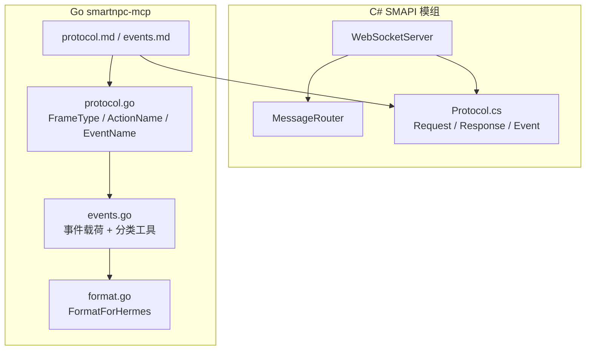
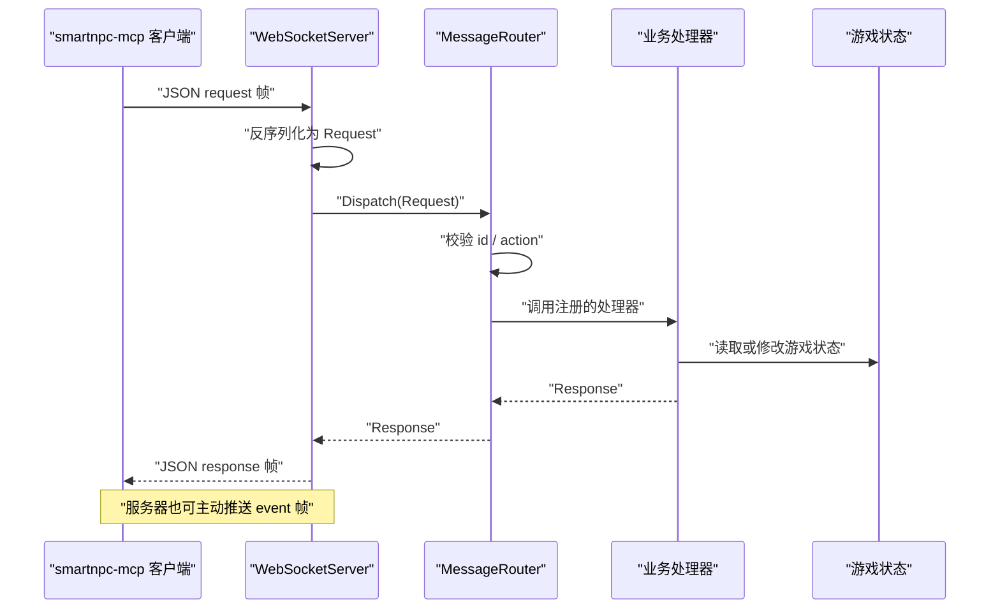
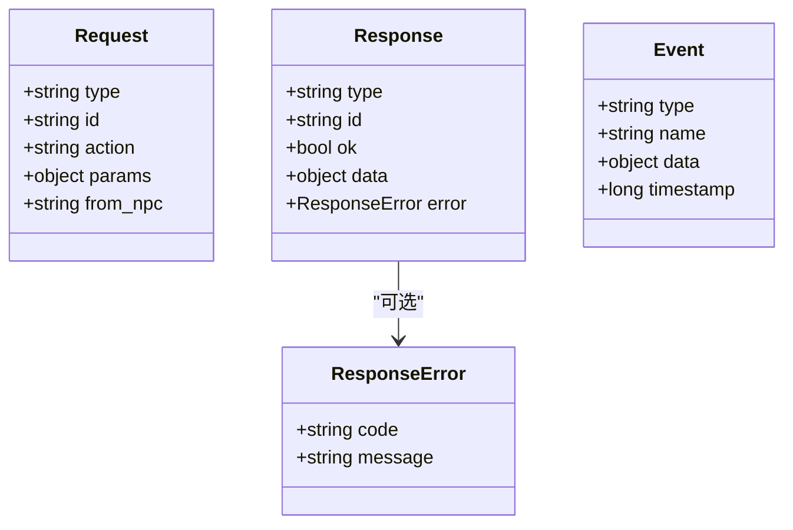
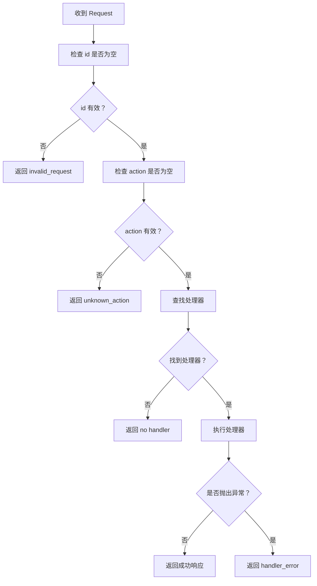
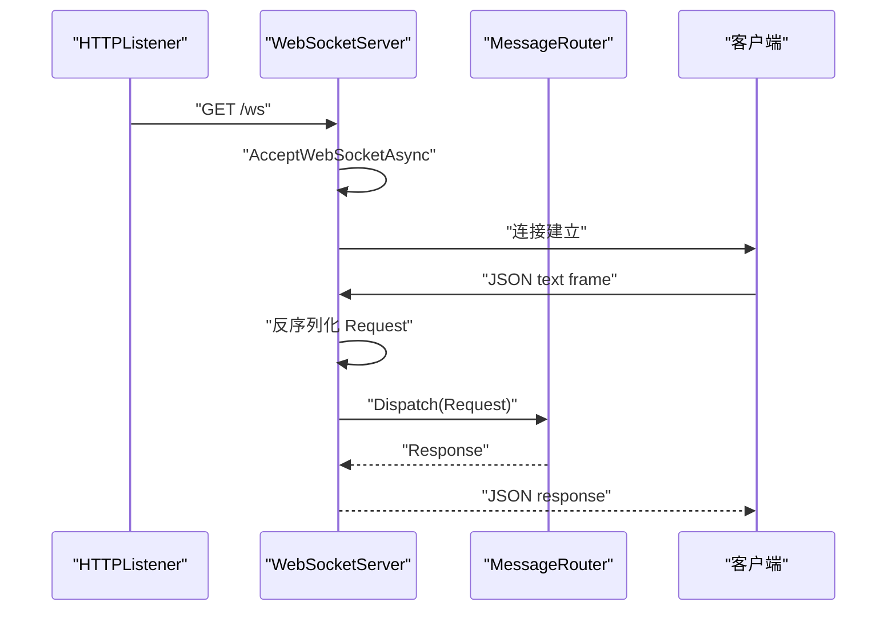
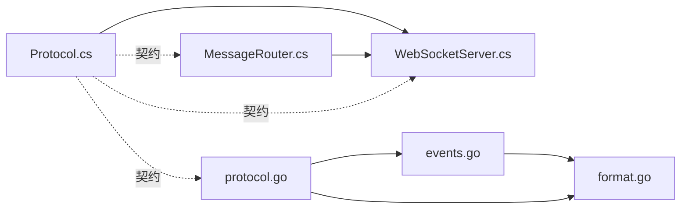
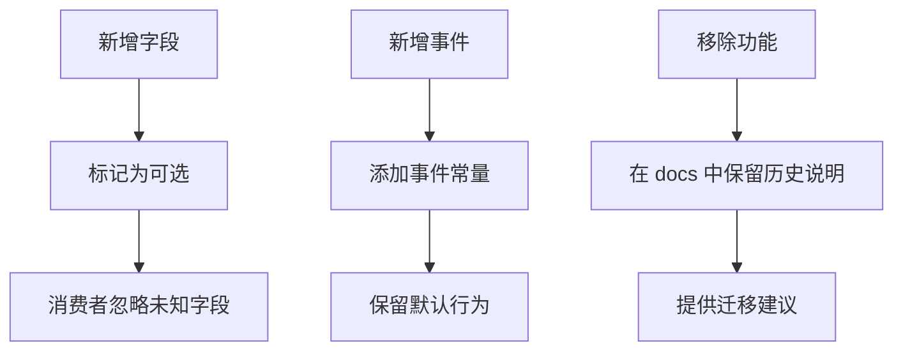
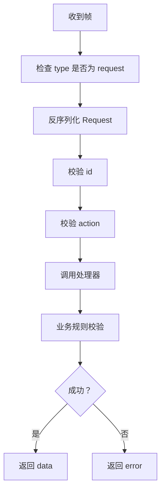
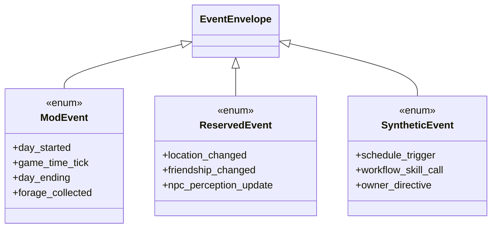
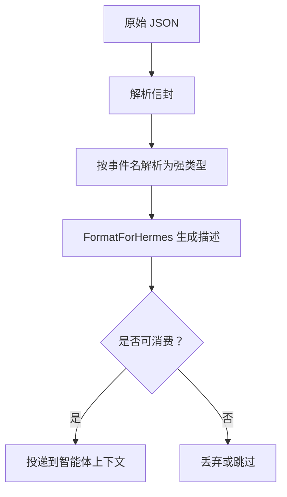

# 协议定义

<cite>
**本文引用的文件**
- [Protocol.cs](file://SmartNPC/smapi-mod/Bridge/Protocol.cs)
- [protocol.go](file://SmartNPC/smartnpc-mcp/adapters/stardew/bridge/protocol.go)
- [events.go](file://SmartNPC/smartnpc-mcp/adapters/stardew/events/events.go)
- [format.go](file://SmartNPC/smartnpc-mcp/adapters/stardew/events/format.go)
- [MessageRouter.cs](file://SmartNPC/smapi-mod/Bridge/MessageRouter.cs)
- [WebSocketServer.cs](file://SmartNPC/smapi-mod/Bridge/WebSocketServer.cs)
- [protocol.md](file://SmartNPC/docs/protocol.md)
- [events.md](file://SmartNPC/docs/events.md)
</cite>

## 目录
1. [引言](#引言)
2. [项目结构](#项目结构)
3. [核心组件](#核心组件)
4. [架构总览](#架构总览)
5. [详细组件分析](#详细组件分析)
6. [依赖关系分析](#依赖关系分析)
7. [性能与可靠性](#性能与可靠性)
8. [版本兼容与迁移策略](#版本兼容与迁移策略)
9. [消息验证规则](#消息验证规则)
10. [事件类型规范](#事件类型规范)
11. [数据模型规范](#数据模型规范)
12. [序列化机制](#序列化机制)
13. [扩展点设计](#扩展点设计)
14. [故障排查指南](#故障排查指南)
15. [结论](#结论)

## 引言
本技术文档聚焦 SmartNPC 项目中“SMAPI 模组”与“smartnpc-mcp 适配器”之间的通信协议。协议通过 WebSocket 传输 JSON 文本帧，将 MCP 客户端的请求、服务端响应和服务器主动推送的事件统一封装为三种信封：`request`、`response`、`event`。本文从代码实现出发，解释协议格式、字段语义、序列化方式、事件分类、请求路由、错误模型、兼容性策略和扩展点，并给出面向开发者的实践建议。

## 项目结构
协议相关代码分布在两个语言边界：

- C# SMAPI 模组端（服务端）：
  - `Bridge/Protocol.cs`：定义请求、响应、错误和事件的数据传输对象。
  - `Bridge/WebSocketServer.cs`：监听 WebSocket、接收帧、反序列化为请求、分发到处理器、发送响应或事件。
  - `Bridge/MessageRouter.cs`：维护 action → handler 映射，执行参数校验、调度业务逻辑并返回响应。

- Go smartnpc-mcp 适配器端（客户端）：
  - `adapters/stardew/bridge/protocol.go`：镜像 C# DTO，定义帧类型常量、动作常量、事件常量以及 Request/Response/Error/Event 结构体。
  - `adapters/stardew/events/events.go`：定义事件载荷的强类型结构、来源分类函数和通用收件人提取工具。
  - `adapters/stardew/events/format.go`：把原始事件数据转换为适合 Hermes 智能体阅读的人类可读描述。
  - `docs/protocol.md` 与 `docs/events.md`：协议与事件的官方说明文档。

**图表来源**
- [WebSocketServer.cs:1-200](file://SmartNPC/smapi-mod/Bridge/WebSocketServer.cs#L1-L200)
- [MessageRouter.cs:1-53](file://SmartNPC/smapi-mod/Bridge/MessageRouter.cs#L1-L53)
- [Protocol.cs:1-67](file://SmartNPC/smapi-mod/Bridge/Protocol.cs#L1-L67)
- [protocol.go:1-172](file://SmartNPC/smartnpc-mcp/adapters/stardew/bridge/protocol.go#L1-L172)
- [events.go:1-200](file://SmartNPC/smartnpc-mcp/adapters/stardew/events/events.go#L1-L200)
- [format.go:1-200](file://SmartNPC/smartnpc-mcp/adapters/stardew/events/format.go#L1-L200)
- [protocol.md:1-200](file://SmartNPC/docs/protocol.md#L1-L200)
- [events.md:1-200](file://SmartNPC/docs/events.md#L1-L200)

**章节来源**
- [Protocol.cs:1-67](file://SmartNPC/smapi-mod/Bridge/Protocol.cs#L1-L67)
- [protocol.go:1-172](file://SmartNPC/smartnpc-mcp/adapters/stardew/bridge/protocol.go#L1-L172)
- [events.go:1-200](file://SmartNPC/smartnpc-mcp/adapters/stardew/events/events.go#L1-L200)
- [format.go:1-200](file://SmartNPC/smartnpc-mcp/adapters/stardew/events/format.go#L1-L200)
- [MessageRouter.cs:1-53](file://SmartNPC/smapi-mod/Bridge/MessageRouter.cs#L1-L53)
- [WebSocketServer.cs:1-200](file://SmartNPC/smapi-mod/Bridge/WebSocketServer.cs#L1-L200)
- [protocol.md:1-200](file://SmartNPC/docs/protocol.md#L1-L200)
- [events.md:1-200](file://SmartNPC/docs/events.md#L1-L200)

## 核心组件
协议的核心由三类组件构成：

1. **传输层与服务端入口**
   - WebSocket 服务端监听 `/ws`，仅接受 JSON 文本帧。
   - 只支持单个活跃客户端；新连接会替换旧连接。
   - 入站帧反序列化为 `Request`，出站帧使用共享序列化选项。

2. **请求路由层**
   - `MessageRouter` 维护 `action → RequestHandler` 注册表。
   - 校验 `id` 与 `action`，查找处理器，调用处理器，记录耗时日志，捕获异常并返回失败响应。

3. **协议数据对象**
   - C# 与 Go 两端分别定义 DTO，但语义一致：`Request`、`Response`、`ResponseError`、`Event`。
   - Go 侧额外提供大量常量，包括帧类型、动作名称、事件名称。

**章节来源**
- [WebSocketServer.cs:1-200](file://SmartNPC/smapi-mod/Bridge/WebSocketServer.cs#L1-L200)
- [MessageRouter.cs:1-53](file://SmartNPC/smapi-mod/Bridge/MessageRouter.cs#L1-L53)
- [Protocol.cs:1-67](file://SmartNPC/smapi-mod/Bridge/Protocol.cs#L1-L67)
- [protocol.go:1-172](file://SmartNPC/smartnpc-mcp/adapters/stardew/bridge/protocol.go#L1-L172)

## 架构总览
下图展示一次典型请求的生命周期：MCP 客户端通过 WebSocket 发送请求，SMAPI 模组接收、解析、路由、执行业务逻辑，再返回响应；同时服务端可主动推送事件。

**图表来源**
- [WebSocketServer.cs:201-324](file://SmartNPC/smapi-mod/Bridge/WebSocketServer.cs#L201-L324)
- [MessageRouter.cs:1-53](file://SmartNPC/smapi-mod/Bridge/MessageRouter.cs#L1-L53)
- [Protocol.cs:1-67](file://SmartNPC/smapi-mod/Bridge/Protocol.cs#L1-L67)
- [protocol.go:1-172](file://SmartNPC/smartnpc-mcp/adapters/stardew/bridge/protocol.go#L1-L172)

## 详细组件分析

### 协议数据对象
协议定义了统一的信封结构，C# 与 Go 两端保持一致语义：

| 类型 | 关键字段 | 方向 | 说明 |
|---|---|---|---|
| `Request` | `type`、`id`、`action`、`params`、`from_npc` | 客户端 → 服务端 | RPC 请求，`from_npc` 用于调试镜像与 NPC 上下文路由 |
| `Response` | `type`、`id`、`ok`、`data`、`error` | 服务端 → 客户端 | 成功时携带 `data`，失败时携带 `error` |
| `ResponseError` | `code`、`message` | 服务端 → 客户端 | 机器可读的错误码与人读错误信息 |
| `Event` | `type`、`name`、`data`、`timestamp` | 服务端 → 客户端 | 服务器主动推送，无需应答 |

**图表来源**
- [Protocol.cs:1-67](file://SmartNPC/smapi-mod/Bridge/Protocol.cs#L1-L67)
- [protocol.go:1-172](file://SmartNPC/smartnpc-mcp/adapters/stardew/bridge/protocol.go#L1-L172)

**章节来源**
- [Protocol.cs:1-67](file://SmartNPC/smapi-mod/Bridge/Protocol.cs#L1-L67)
- [protocol.go:1-172](file://SmartNPC/smartnpc-mcp/adapters/stardew/bridge/protocol.go#L1-L172)

### 请求路由与处理流程
`MessageRouter` 是协议中所有客户端动作的统一入口。其关键行为如下：

1. 校验 `id` 是否为空。
2. 校验 `action` 是否为空。
3. 根据 `action` 查找已注册的处理器。
4. 调用处理器并记录耗时。
5. 捕获异常并返回失败响应。

**图表来源**
- [MessageRouter.cs:1-53](file://SmartNPC/smapi-mod/Bridge/MessageRouter.cs#L1-L53)

**章节来源**
- [MessageRouter.cs:1-53](file://SmartNPC/smapi-mod/Bridge/MessageRouter.cs#L1-L53)

### WebSocket 服务端行为
`WebSocketServer` 负责网络层与协议层的衔接：

- 监听 HTTP 前缀并在 `/ws` 路径接受 WebSocket 升级。
- 每次只保留一个活跃连接。
- 接收完整消息后异步分派到 `HandleFrame`。
- 反序列化失败时记录警告并丢弃帧。
- 对 `type != "request"` 的帧直接忽略。
- 成功后调用 `MessageRouter.Dispatch` 并将响应写回。
- 通过 `BroadcastEvent` 推送事件，时间戳使用 Unix 毫秒。

**图表来源**
- [WebSocketServer.cs:1-200](file://SmartNPC/smapi-mod/Bridge/WebSocketServer.cs#L1-L200)
- [WebSocketServer.cs:201-324](file://SmartNPC/smapi-mod/Bridge/WebSocketServer.cs#L201-L324)

**章节来源**
- [WebSocketServer.cs:1-200](file://SmartNPC/smapi-mod/Bridge/WebSocketServer.cs#L1-L200)
- [WebSocketServer.cs:201-324](file://SmartNPC/smapi-mod/Bridge/WebSocketServer.cs#L201-L324)

## 依赖关系分析
协议依赖关系呈现清晰的分层：

- Go 侧 `protocol.go` 与 C# 侧 `Protocol.cs` 保持数据结构对称。
- `events.go` 依赖 `bridge` 包中的事件常量。
- `format.go` 依赖 `bridge` 常量与事件载荷类型。
- `WebSocketServer` 依赖 `MessageRouter`。
- `MessageRouter` 依赖外部注册的处理器。
- 文档 `protocol.md` 与 `events.md` 作为人类可读契约，指导双方实现。

**图表来源**
- [Protocol.cs:1-67](file://SmartNPC/smapi-mod/Bridge/Protocol.cs#L1-L67)
- [protocol.go:1-172](file://SmartNPC/smartnpc-mcp/adapters/stardew/bridge/protocol.go#L1-L172)
- [events.go:1-200](file://SmartNPC/smartnpc-mcp/adapters/stardew/events/events.go#L1-L200)
- [format.go:1-200](file://SmartNPC/smartnpc-mcp/adapters/stardew/events/format.go#L1-L200)
- [MessageRouter.cs:1-53](file://SmartNPC/smapi-mod/Bridge/MessageRouter.cs#L1-L53)
- [WebSocketServer.cs:1-200](file://SmartNPC/smapi-mod/Bridge/WebSocketServer.cs#L1-L200)

**章节来源**
- [Protocol.cs:1-67](file://SmartNPC/smapi-mod/Bridge/Protocol.cs#L1-L67)
- [protocol.go:1-172](file://SmartNPC/smartnpc-mcp/adapters/stardew/bridge/protocol.go#L1-L172)
- [events.go:1-200](file://SmartNPC/smartnpc-mcp/adapters/stardew/events/events.go#L1-L200)
- [format.go:1-200](file://SmartNPC/smartnpc-mcp/adapters/stardew/events/format.go#L1-L200)
- [MessageRouter.cs:1-53](file://SmartNPC/smapi-mod/Bridge/MessageRouter.cs#L1-L53)
- [WebSocketServer.cs:1-200](file://SmartNPC/smapi-mod/Bridge/WebSocketServer.cs#L1-L200)

## 性能与可靠性
- WebSocket 服务端使用单连接模型，避免多连接竞争。
- 发送响应时使用信号量保护，避免并发写入导致乱序或崩溃。
- 请求分发过程记录耗时日志，便于定位慢处理器。
- 调试模式下入站请求会被队列化，并在游戏主线程泵出，避免直接操作 UI。
- 调试参数过长时截断，防止聊天面板被大负载撑爆。
- 反序列化失败、网络异常和处理器异常均有兜底处理，不会让服务进程崩溃。

**章节来源**
- [WebSocketServer.cs:1-200](file://SmartNPC/smapi-mod/Bridge/WebSocketServer.cs#L1-L200)
- [WebSocketServer.cs:201-324](file://SmartNPC/smapi-mod/Bridge/WebSocketServer.cs#L201-L324)
- [MessageRouter.cs:1-53](file://SmartNPC/smapi-mod/Bridge/MessageRouter.cs#L1-L53)

## 版本兼容与迁移策略
协议当前以文档化的 v1 形态存在，并通过以下机制维持兼容性：

1. **信封稳定**
   - `type`、`id`、`action`、`params`、`data`、`error`、`name`、`timestamp` 等核心字段长期稳定。
   - `params` 使用弱类型对象，允许新增字段而不破坏旧客户端。

2. **向后兼容原则**
   - 未知字段应被忽略。
   - 未识别事件在 `FormatForHermes` 中返回空描述，避免误唤醒智能体。
   - 事件分类函数将事件分为模组事件、预留事件和合成事件，方便消费者选择忽略策略。

3. **迁移路径**
   - 实验分支明确移除了部分动作和事件，并在文档中标注历史说明。
   - 新增动作与事件应先声明常量，再通过文档与双向 DTO 同步演进。
   - 若需要协议级版本协商，可在 `Request.from_npc` 或 `params` 中引入显式协议版本字段；当前实现未强制协商，而是依赖字段存在性与容错解码。

**图表来源**
- [protocol.go:1-172](file://SmartNPC/smartnpc-mcp/adapters/stardew/bridge/protocol.go#L1-L172)
- [events.go:201-290](file://SmartNPC/smartnpc-mcp/adapters/stardew/events/events.go#L201-L290)
- [format.go:201-290](file://SmartNPC/smartnpc-mcp/adapters/stardew/events/format.go#L201-L290)
- [protocol.md:1-200](file://SmartNPC/docs/protocol.md#L1-L200)
- [events.md:1-200](file://SmartNPC/docs/events.md#L1-L200)

**章节来源**
- [protocol.go:1-172](file://SmartNPC/smartnpc-mcp/adapters/stardew/bridge/protocol.go#L1-L172)
- [events.go:201-290](file://SmartNPC/smartnpc-mcp/adapters/stardew/events/events.go#L201-L290)
- [format.go:201-290](file://SmartNPC/smartnpc-mcp/adapters/stardew/events/format.go#L201-L290)
- [protocol.md:1-200](file://SmartNPC/docs/protocol.md#L1-L200)
- [events.md:1-200](file://SmartNPC/docs/events.md#L1-L200)

## 消息验证规则
协议在不同层级执行验证：

| 层级 | 验证项 | 规则 |
|---|---|---|
| 网络层 | WebSocket 帧 | 必须是 JSON 文本帧，否则记录警告并丢弃 |
| 信封层 | `type` | 仅处理 `type == "request"` 的帧 |
| 路由层 | `id` | 为空时返回 `invalid_request` |
| 路由层 | `action` | 为空或未注册时返回 `invalid_request` 或 `unknown_action` |
| 处理器层 | `params` | 由具体动作处理器校验必填字段和业务规则 |
| 错误层 | `error.code` | 使用稳定字符串码，例如 `mod_not_ready`、`invalid_params`、`handler_error` |

**图表来源**
- [WebSocketServer.cs:201-324](file://SmartNPC/smapi-mod/Bridge/WebSocketServer.cs#L201-L324)
- [MessageRouter.cs:1-53](file://SmartNPC/smapi-mod/Bridge/MessageRouter.cs#L1-L53)
- [protocol.md:1-200](file://SmartNPC/docs/protocol.md#L1-L200)

**章节来源**
- [WebSocketServer.cs:201-324](file://SmartNPC/smapi-mod/Bridge/WebSocketServer.cs#L201-L324)
- [MessageRouter.cs:1-53](file://SmartNPC/smapi-mod/Bridge/MessageRouter.cs#L1-L53)
- [protocol.md:1-200](file://SmartNPC/docs/protocol.md#L1-L200)

## 事件类型规范
事件分为三类：

1. **模组事件**
   - 由 SMAPI 模组产生，经 WebSocket 推送到客户端。
   - 示例包括日程触发、游戏时间刻度、日记结尾记账等。

2. **预留事件**
   - 已在协议中声明 schema，但尚未由模组实际发出。
   - 消费者应能安全忽略，不将其视为错误。

3. **合成事件**
   - 由 smartnpc-mcp 自身生成，例如调度触发、工作流技能调用、农场主指令等。
   - 使用同一事件信封，使下游消费者看到统一流。

**图表来源**
- [events.go:1-200](file://SmartNPC/smartnpc-mcp/adapters/stardew/events/events.go#L1-L200)
- [events.go:201-290](file://SmartNPC/smartnpc-mcp/adapters/stardew/events/events.go#L201-L290)
- [events.md:1-200](file://SmartNPC/docs/events.md#L1-L200)

**章节来源**
- [events.go:1-200](file://SmartNPC/smartnpc-mcp/adapters/stardew/events/events.go#L1-L200)
- [events.go:201-290](file://SmartNPC/smartnpc-mcp/adapters/stardew/events/events.go#L201-L290)
- [events.md:1-200](file://SmartNPC/docs/events.md#L1-L200)

## 数据模型规范
协议的数据模型遵循统一模式：

- 请求对象：
  - `type` 固定为 `"request"`。
  - `id` 唯一标识请求。
  - `action` 指定要调用的动作。
  - `params` 是动作相关的参数对象。
  - `from_npc` 可选，表示发起方 NPC。

- 响应对象：
  - `type` 固定为 `"response"`。
  - `id` 与请求对应。
  - `ok` 表示成功与否。
  - `data` 仅在成功时出现。
  - `error` 仅在失败时出现。

- 错误对象：
  - `code` 为机器可读错误码。
  - `message` 为人类可读错误信息。

- 事件对象：
  - `type` 固定为 `"event"`。
  - `name` 为事件名称。
  - `data` 为事件载荷。
  - `timestamp` 为 Unix 毫秒。

**章节来源**
- [Protocol.cs:1-67](file://SmartNPC/smapi-mod/Bridge/Protocol.cs#L1-L67)
- [protocol.go:1-172](file://SmartNPC/smartnpc-mcp/adapters/stardew/bridge/protocol.go#L1-L172)
- [protocol.md:1-200](file://SmartNPC/docs/protocol.md#L1-L200)

## 序列化机制
C# 与 Go 使用各自语言的 JSON 序列化库，但约定相同：

- C# 使用 `System.Text.Json`，共享 `JsonOpts.Web` 配置，忽略空字段。
- Go 使用标准库 `encoding/json`，并使用 `json.RawMessage` 承载未解析载荷，以便下游按需解码。
- 事件载荷在 Go 侧通常先按事件名解码成强类型结构，再转为人类可读描述。
- 未知事件在格式化阶段返回空字符串，避免误传无意义上下文给智能体。

**图表来源**
- [Protocol.cs:1-67](file://SmartNPC/smapi-mod/Bridge/Protocol.cs#L1-L67)
- [protocol.go:1-172](file://SmartNPC/smartnpc-mcp/adapters/stardew/bridge/protocol.go#L1-L172)
- [format.go:1-200](file://SmartNPC/smartnpc-mcp/adapters/stardew/events/format.go#L1-L200)
- [format.go:201-290](file://SmartNPC/smartnpc-mcp/adapters/stardew/events/format.go#L201-L290)

**章节来源**
- [Protocol.cs:1-67](file://SmartNPC/smapi-mod/Bridge/Protocol.cs#L1-L67)
- [protocol.go:1-172](file://SmartNPC/smartnpc-mcp/adapters/stardew/bridge/protocol.go#L1-L172)
- [format.go:1-200](file://SmartNPC/smartnpc-mcp/adapters/stardew/events/format.go#L1-L200)
- [format.go:201-290](file://SmartNPC/smartnpc-mcp/adapters/stardew/events/format.go#L201-L290)

## 扩展点设计
协议为扩展留出多个位置：

1. **动作扩展**
   - 在 Go 侧 `ActionName` 常量中添加新动作。
   - 在 C# 侧注册对应的 `RequestHandler`。
   - 在 `protocol.md` 中补充请求参数、响应数据和错误码。

2. **事件扩展**
   - 在 Go 侧 `EventName` 常量中添加事件名。
   - 在 `events.go` 中添加强类型载荷。
   - 在 `format.go` 中添加 `FormatForHermes` 分支。
   - 在 `events.md` 中记录事件含义、字段和来源。

3. **上下文扩展**
   - `from_npc` 已支持 NPC 上下文，可用于调试镜像、定向消息和权限控制。
   - `params` 允许新增字段，消费者忽略未知字段即可向前兼容。

4. **校验扩展**
   - 新增动作应在处理器内实现必填字段、数据类型和业务规则校验。
   - 错误码应保持稳定，新增错误码需纳入文档。

**章节来源**
- [protocol.go:1-172](file://SmartNPC/smartnpc-mcp/adapters/stardew/bridge/protocol.go#L1-L172)
- [events.go:1-200](file://SmartNPC/smartnpc-mcp/adapters/stardew/events/events.go#L1-L200)
- [format.go:1-200](file://SmartNPC/smartnpc-mcp/adapters/stardew/events/format.go#L1-L200)
- [protocol.md:1-200](file://SmartNPC/docs/protocol.md#L1-L200)
- [events.md:1-200](file://SmartNPC/docs/events.md#L1-L200)

## 故障排查指南
常见问题和定位方式：

| 现象 | 可能原因 | 排查建议 |
|---|---|---|
| 客户端收不到响应 | 帧不是 `request` 类型 | 检查 WebSocket 帧的 `type` 字段 |
| 响应总是失败且错误码为 `invalid_request` | `id` 为空 | 确保每个请求都有唯一 `id` |
| 响应错误码为 `unknown_action` | 客户端调用了未注册动作 | 检查 `action` 是否在服务端已注册 |
| 处理器抛出异常 | 业务逻辑未捕获错误 | 查看 `handler_error` 日志中的异常消息 |
| 调试镜像不显示 | 调试开关未开启或 sink 未注入 | 检查调试配置和 `EnableRequestDebug` 绑定 |
| 事件无法唤醒智能体 | 事件不在白名单或格式化结果为空 | 检查事件名称、白名单和 `FormatForHermes` 分支 |
| 连接频繁断开 | 新连接替换旧连接 | 确认只有一个 MCP 客户端连接 |

**章节来源**
- [WebSocketServer.cs:1-200](file://SmartNPC/smapi-mod/Bridge/WebSocketServer.cs#L1-L200)
- [WebSocketServer.cs:201-324](file://SmartNPC/smapi-mod/Bridge/WebSocketServer.cs#L201-L324)
- [MessageRouter.cs:1-53](file://SmartNPC/smapi-mod/Bridge/MessageRouter.cs#L1-L53)
- [format.go:201-290](file://SmartNPC/smartnpc-mcp/adapters/stardew/events/format.go#L201-L290)
- [events.md:1-200](file://SmartNPC/docs/events.md#L1-L200)

## 结论
SmartNPC 的通信协议以简洁的 JSON 信封为基础，通过 WebSocket 实现请求、响应和事件三类消息。C# 服务端负责网络接入、请求路由和响应输出；Go 客户端负责常量定义、事件建模和人类可读格式化。协议通过弱类型参数、忽略未知字段、事件分类和文档契约，实现了良好的可扩展性和向后兼容性。未来新增动作或事件时，应同步更新常量、DTO、处理器、格式化器和文档，并确保错误码、字段语义和兼容性规则保持一致。