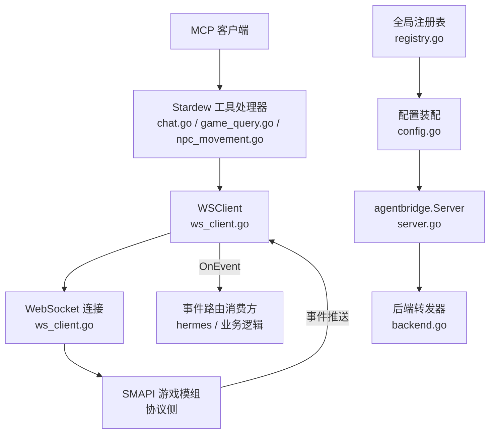
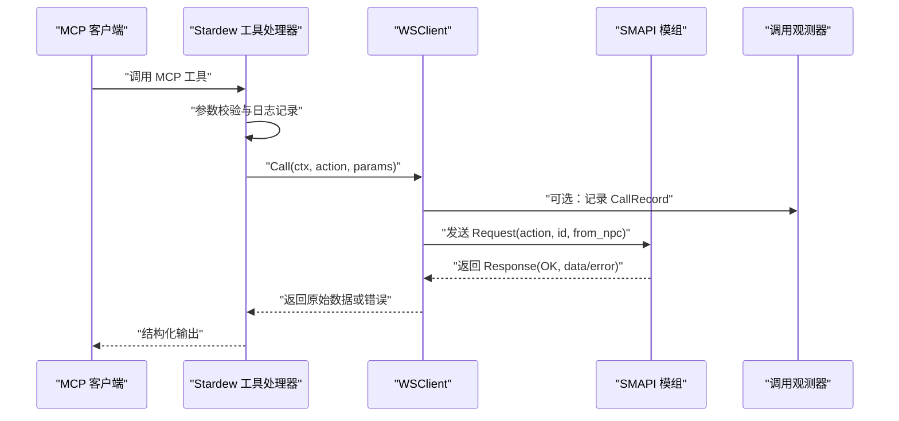
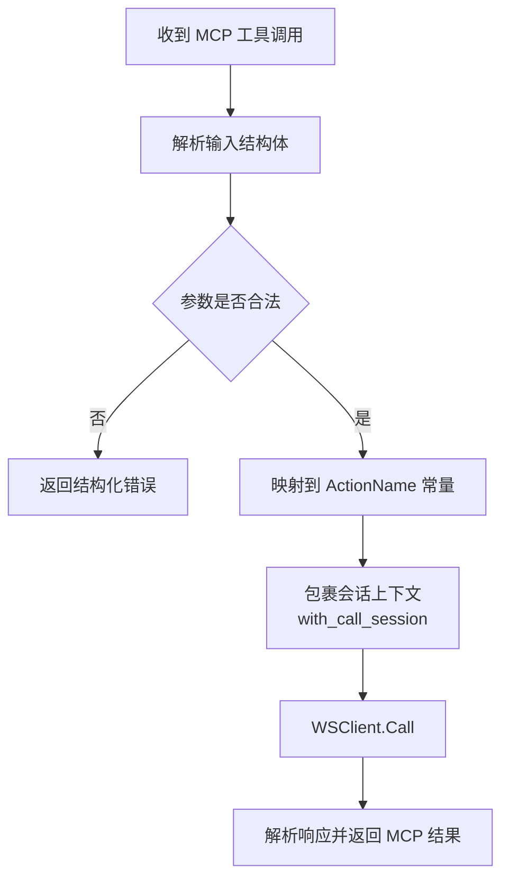
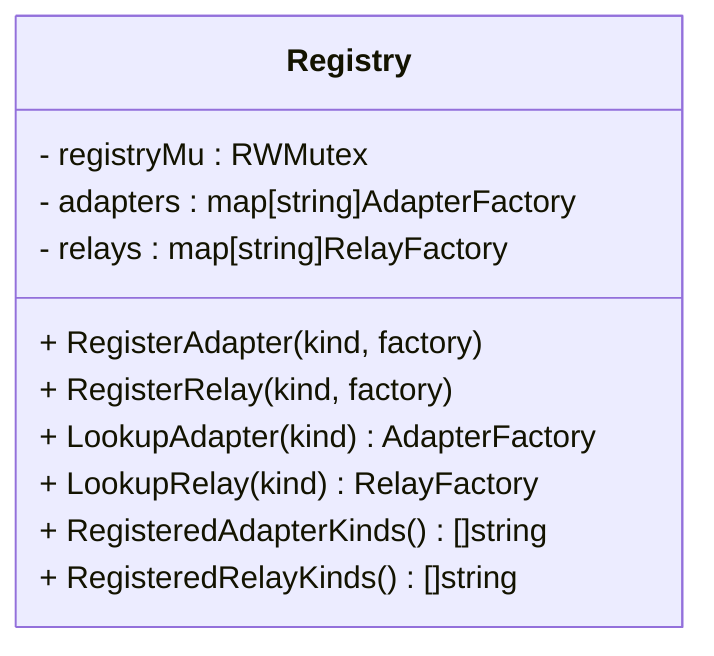
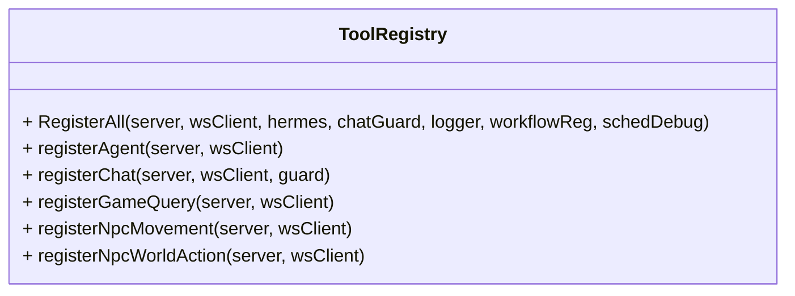
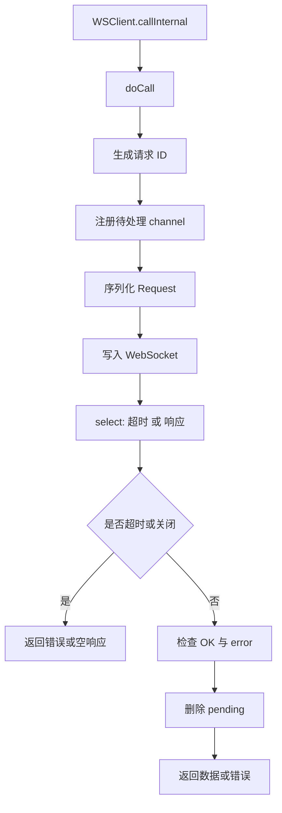
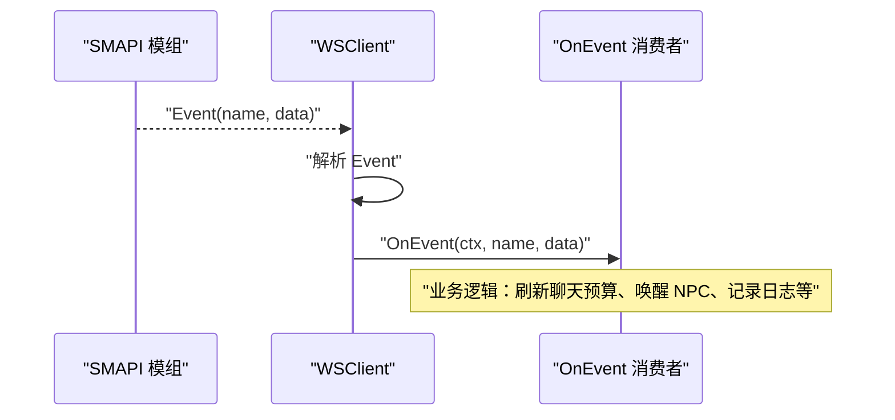
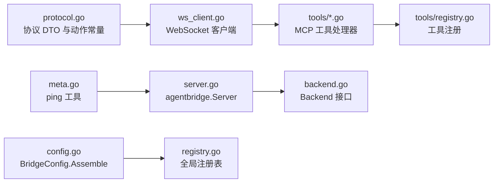

# 消息路由系统

<cite>
**本文引用的文件**   
- [ws_client.go](file://SmartNPC/smartnpc-mcp/adapters/stardew/bridge/ws_client.go)
- [protocol.go](file://SmartNPC/smartnpc-mcp/adapters/stardew/bridge/protocol.go)
- [server.go](file://SmartNPC/smartnpc-mcp/pkg/agentbridge/server.go)
- [backend.go](file://SmartNPC/smartnpc-mcp/pkg/agentbridge/backend.go)
- [registry.go](file://SmartNPC/smartnpc-mcp/pkg/agentbridge/registry.go)
- [config.go](file://SmartNPC/smartnpc-mcp/pkg/agentbridge/config.go)
- [eventsource.go](file://SmartNPC/smartnpc-mcp/pkg/agentbridge/eventsource.go)
- [meta.go](file://SmartNPC/smartnpc-mcp/pkg/agentbridge/meta.go)
- [agent.go](file://SmartNPC/smartnpc-mcp/adapters/stardew/tools/agent.go)
- [chat.go](file://SmartNPC/smartnpc-mcp/adapters/stardew/tools/chat.go)
- [game_query.go](file://SmartNPC/smartnpc-mcp/adapters/stardew/tools/game_query.go)
- [npc_movement.go](file://SmartNPC/smartnpc-mcp/adapters/stardew/tools/npc_movement.go)
- [npc_world_action.go](file://SmartNPC/smartnpc-mcp/adapters/stardew/tools/npc_world_action.go)
- [registry.go](file://SmartNPC/smartnpc-mcp/adapters/stardew/tools/registry.go)
</cite>

## 目录
1. [引言](#引言)
2. [项目结构](#项目结构)
3. [核心组件](#核心组件)
4. [架构总览](#架构总览)
5. [详细组件分析](#详细组件分析)
6. [依赖关系分析](#依赖关系分析)
7. [性能与优化](#性能与优化)
8. [故障排查指南](#故障排查指南)
9. [结论](#结论)

## 引言
本文件聚焦 SmartNPC 项目中“消息路由系统”的技术实现，重点解释以下方面：
- MCP 工具到游戏动作的解析与分发。
- WebSocket 客户端如何建立连接、发送请求、等待响应并处理事件。
- 处理器注册表的设计：动态注册、并发安全、可插拔适配器与中继。
- 异步消息分发机制：任务调度、超时控制、结果回调。
- 错误处理与降级策略：连接失败重试、默认行为、后端不可用时的容错。
- 路由性能优化：缓存、批处理、负载均衡等扩展建议。
- 具体实践示例：如何注册新的动作处理器、处理复杂消息路由以及使用自定义路由规则。

需要特别说明的是：当前仓库中的实际代码并不存在名为 `MessageRouter.cs` 的文件；C# SMAPI 模组侧仅提供协议定义和服务器端能力，真正的“消息路由”逻辑由 Go 端的 `WSClient`、`Server`、工具处理器和配置装配层共同完成。因此，本文将把“消息路由系统”理解为围绕 `WSClient` 与 `agentbridge.Server` 构建的请求-响应-事件分发体系。

## 项目结构
消息路由系统横跨两个主要层次：
- 适配层：Stardew Valley 特定工具，负责把 MCP 工具调用映射为具体的 `action` 名称，并通过 `WSClient.Call` 发送到 SMAPI 模组。
- 桥接与框架层：`WSClient` 管理 WebSocket 连接、请求挂起表、事件分发；`agentbridge.Server` 管理事件源、后端转发、MCP 工具挂载。

**图表来源**
- [ws_client.go:1-200](file://SmartNPC/smartnpc-mcp/adapters/stardew/bridge/ws_client.go#L1-L200)
- [ws_client.go:201-510](file://SmartNPC/smartnpc-mcp/adapters/stardew/bridge/ws_client.go#L201-L510)
- [protocol.go:1-172](file://SmartNPC/smartnpc-mcp/adapters/stardew/bridge/protocol.go#L1-L172)
- [server.go:1-177](file://SmartNPC/smartnpc-mcp/pkg/agentbridge/server.go#L1-L177)
- [backend.go:1-36](file://SmartNPC/smartnpc-mcp/pkg/agentbridge/backend.go#L1-L36)
- [config.go:1-154](file://SmartNPC/smartnpc-mcp/pkg/agentbridge/config.go#L1-L154)
- [registry.go:1-119](file://SmartNPC/smartnpc-mcp/pkg/agentbridge/registry.go#L1-L119)

**章节来源**
- [ws_client.go:1-510](file://SmartNPC/smartnpc-mcp/adapters/stardew/bridge/ws_client.go#L1-L510)
- [protocol.go:1-172](file://SmartNPC/smartnpc-mcp/adapters/stardew/bridge/protocol.go#L1-L172)
- [server.go:1-177](file://SmartNPC/smartnpc-mcp/pkg/agentbridge/server.go#L1-L177)
- [config.go:1-154](file://SmartNPC/smartnpc-mcp/pkg/agentbridge/config.go#L1-L154)
- [registry.go:1-119](file://SmartNPC/smartnpc-mcp/pkg/agentbridge/registry.go#L1-L119)

## 核心组件
消息路由系统的核心由以下几部分组成：

| 组件 | 职责 | 关键行为 |
|---|---|---|
| `WSClient` | WebSocket 客户端、请求-响应路由、事件分发入口 | 连接管理、请求 ID 关联、超时、重连、事件回调、代理会话绑定 |
| `Request` / `Response` / `Event` | 协议数据对象 | 统一封装 action、params、from_npc、error、event name |
| `ActionName` 常量集 | 动作名称规范 | 聊天、查询、移动、世界交互、社交、库存等动作枚举 |
| `ToolGroup` / 工具处理器 | MCP 工具到动作的映射 | 校验参数、记录日志、调用 `WSClient.Call`、解析返回数据 |
| `agent_register_self` | 将 MCP 会话绑定到 NPC | 写入 `WSClient` 内部 agent 注册表，供后续请求携带 `from_npc` |
| `agentbridge.Server` | 事件源与后端组合中心 | 启动事件源、串行转发事件、挂载 MCP 工具组 |
| `Backend` | 事件下游接收者 | 如 Hermes Gateway，需非阻塞转发 |
| `BridgeConfig` + `Assemble` | 从 YAML 装配运行时 | 查找工厂、创建适配器、创建中继、挂载元工具 |
| 全局注册表 | 适配器与中继工厂注册 | 并发安全的 `RegisterAdapter` / `RegisterRelay` |

**章节来源**
- [ws_client.go:1-200](file://SmartNPC/smartnpc-mcp/adapters/stardew/bridge/ws_client.go#L1-L200)
- [protocol.go:1-172](file://SmartNPC/smartnpc-mcp/adapters/stardew/bridge/protocol.go#L1-L172)
- [agent.go:1-95](file://SmartNPC/smartnpc-mcp/adapters/stardew/tools/agent.go#L1-L95)
- [server.go:1-177](file://SmartNPC/smartnpc-mcp/pkg/agentbridge/server.go#L1-L177)
- [backend.go:1-36](file://SmartNPC/smartnpc-mcp/pkg/agentbridge/backend.go#L1-L36)
- [config.go:1-154](file://SmartNPC/smartnpc-mcp/pkg/agentbridge/config.go#L1-L154)
- [registry.go:1-119](file://SmartNPC/smartnpc-mcp/pkg/agentbridge/registry.go#L1-L119)

## 架构总览
消息路由系统在运行时分为两条主线：
1. **请求路由线**：MCP 工具 → Stardew 工具处理器 → `WSClient.Call` → WebSocket → SMAPI 模组 → 响应回传 → 工具处理器解析 → 返回 MCP 结果。
2. **事件路由线**：SMAPI 模组推送事件 → `WSClient.dispatch` → `OnEvent` → 上层业务（例如 hermes relay、调度器、聊天预算重置）。

**图表来源**
- [npc_movement.go:1-200](file://SmartNPC/smartnpc-mcp/adapters/stardew/tools/npc_movement.go#L1-L200)
- [chat.go:1-200](file://SmartNPC/smartnpc-mcp/adapters/stardew/tools/chat.go#L1-L200)
- [game_query.go:1-89](file://SmartNPC/smartnpc-mcp/adapters/stardew/tools/game_query.go#L1-L89)
- [ws_client.go:201-420](file://SmartNPC/smartnpc-mcp/adapters/stardew/bridge/ws_client.go#L201-L420)

## 详细组件分析

### 动作名称解析与处理器查找
动作名称不是由 `MessageRouter.cs` 解析，而是通过以下方式确定：
- `protocol.go` 中集中定义所有合法的 `ActionName`，包括聊天、游戏状态查询、NPC 移动、世界交互、社交行为、库存操作等。
- 每个 Stardew 工具处理器在 `registerNpcMovement`、`registerChat`、`registerGameQuery`、`registerNpcWorldAction` 等方法中，将 MCP 工具名映射到一个 `ActionName` 常量。
- 工具处理器不直接实现游戏逻辑，而是调用 `WSClient.Call(callCtx(ctx, req), bridge.ActionXxx, in)`，把动作交给桥接层处理。

这种设计使“动作名解析”发生在工具处理器层，“处理器查找”发生在 MCP SDK 的工具注册表中，而不是一个单一的路由类。

**图表来源**
- [protocol.go:1-172](file://SmartNPC/smartnpc-mcp/adapters/stardew/bridge/protocol.go#L1-L172)
- [npc_movement.go:1-200](file://SmartNPC/smartnpc-mcp/adapters/stardew/tools/npc_movement.go#L1-L200)
- [chat.go:1-200](file://SmartNPC/smartnpc-mcp/adapters/stardew/tools/chat.go#L1-L200)
- [game_query.go:1-89](file://SmartNPC/smartnpc-mcp/adapters/stardew/tools/game_query.go#L1-L89)

**章节来源**
- [protocol.go:1-172](file://SmartNPC/smartnpc-mcp/adapters/stardew/bridge/protocol.go#L1-L172)
- [registry.go:1-82](file://SmartNPC/smartnpc-mcp/adapters/stardew/tools/registry.go#L1-L82)
- [npc_movement.go:1-200](file://SmartNPC/smartnpc-mcp/adapters/stardew/tools/npc_movement.go#L1-L200)
- [chat.go:1-200](file://SmartNPC/smartnpc-mcp/adapters/stardew/tools/chat.go#L1-L200)
- [game_query.go:1-89](file://SmartNPC/smartnpc-mcp/adapters/stardew/tools/game_query.go#L1-L89)

### 处理器注册表设计：动态注册、优先级管理与并发安全
#### 全局适配器与中继注册表
`agentbridge` 包提供全局注册表，用于动态发现适配器与中继：
- `RegisterAdapter` 和 `RegisterRelay` 使用读写锁保护全局 map。
- 重复注册会 panic，表明 kind 冲突是编程错误。
- `LookupAdapter` / `LookupRelay` 提供只读访问。
- `RegisteredAdapterKinds` / `RegisteredRelayKinds` 返回排序后的可用 kind 列表，用于错误提示。

**图表来源**
- [registry.go:1-119](file://SmartNPC/smartnpc-mcp/pkg/agentbridge/registry.go#L1-L119)

#### 工具处理器注册表
Stardew 工具通过 `mcp.AddTool` 注册到 MCP SDK 的服务端。`RegisterAll` 决定哪些工具被挂载：
- 如果 `WSClient` 为空，则跳过 mod 相关工具，保留纯进程内工具。
- `agent_register_self` 优先注册，确保 MCP 会话能第一时间绑定 NPC。
- 工具分组按领域划分：聊天、游戏查询、NPC 感知、移动、行为、世界交互、库存、社交。

**图表来源**
- [registry.go:1-82](file://SmartNPC/smartnpc-mcp/adapters/stardew/tools/registry.go#L1-L82)
- [agent.go:1-95](file://SmartNPC/smartnpc-mcp/adapters/stardew/tools/agent.go#L1-L95)
- [chat.go:1-200](file://SmartNPC/smartnpc-mcp/adapters/stardew/tools/chat.go#L1-L200)
- [game_query.go:1-89](file://SmartNPC/smartnpc-mcp/adapters/stardew/tools/game_query.go#L1-L89)
- [npc_movement.go:1-200](file://SmartNPC/smartnpc-mcp/adapters/stardew/tools/npc_movement.go#L1-L200)
- [npc_world_action.go:1-200](file://SmartNPC/smartnpc-mcp/adapters/stardew/tools/npc_world_action.go#L1-L200)

#### 优先级管理
当前代码没有显式的“处理器优先级队列”，但存在隐式优先级：
- `agent_register_self` 必须最先调用，否则其他工具无法正确携带 `from_npc`。
- `RegisterAll` 中 `registerAgent` 排在其他 mod 工具之前，保证工具列表顺序和初始化语义。
- 对于事件转发，`Server.dispatch` 按注册顺序串行调用各 Backend，这可用于控制下游处理顺序。

#### 并发安全
- 全局注册表使用 `sync.RWMutex`。
- `WSClient` 使用 `sync.Mutex` 保护连接、待处理请求 map、事件处理器和观察者函数。
- `ChatSayGuard` 使用互斥量保护 private/group 发言预算。
- Agent 会话到 NPC 的映射使用 `sync.RWMutex`，读取路径用 `RLock`。

**章节来源**
- [registry.go:1-119](file://SmartNPC/smartnpc-mcp/pkg/agentbridge/registry.go#L1-L119)
- [registry.go:1-82](file://SmartNPC/smartnpc-mcp/adapters/stardew/tools/registry.go#L1-L82)
- [agent.go:1-95](file://SmartNPC/smartnpc-mcp/adapters/stardew/tools/agent.go#L1-L95)
- [chat.go:1-200](file://SmartNPC/smartnpc-mcp/adapters/stardew/tools/chat.go#L1-L200)
- [server.go:1-177](file://SmartNPC/smartnpc-mcp/pkg/agentbridge/server.go#L1-L177)

### 异步消息分发机制：任务调度、超时控制与结果回调
#### 请求调用与超时
`WSClient.Call` 和 `CallAs` 最终进入 `callInternal` 和 `doCall`：
1. 生成唯一请求 ID。
2. 把带缓冲的 channel 放入 `pending` map。
3. 构造 `Request`，序列化为 JSON。
4. 使用 `context.WithTimeout` 设置每调用超时。
5. 写 WebSocket。
6. 等待响应或超时。
7. 清理 pending 项。

**图表来源**
- [ws_client.go:201-420](file://SmartNPC/smartnpc-mcp/adapters/stardew/bridge/ws_client.go#L201-L420)

#### 连接管理与重连
- `Connect` 先尝试拨号；即使首次拨号失败，也会启动后台重连循环。
- `readLoopForever` 不断读取帧；断开后清空连接、标记 pending 请求丢失、等待退避时间后重拨。
- `pingLoop` 每 30 秒发送 Ping，避免 C# HttpListener 空闲断开。
- `SetEventHandler` 允许替换事件处理器，适用于构造期自引用场景。

#### 结果回调与调用观测
- `OnCall` 观察器可在每次工具调用完成后记录 `CallRecord`，包含 action、npc、是否成功、耗时、参数摘要和错误信息。
- 该回调用于实验日志和工具调用追踪，不应阻塞。

#### 事件分发
- `dispatch` 根据帧类型区分 response 和 event。
- response 通过 ID 匹配 pending channel 并投递。
- event 调用 `OnEvent`，由上层业务决定如何处理。

**图表来源**
- [ws_client.go:420-510](file://SmartNPC/smartnpc-mcp/adapters/stardew/bridge/ws_client.go#L420-L510)

**章节来源**
- [ws_client.go:1-200](file://SmartNPC/smartnpc-mcp/adapters/stardew/bridge/ws_client.go#L1-L200)
- [ws_client.go:201-510](file://SmartNPC/smartnpc-mcp/adapters/stardew/bridge/ws_client.go#L201-L510)

### 错误处理与降级策略
#### 连接级错误
- 未连接时返回 “ws client not connected”。
- 已关闭时返回 “ws client closed”。
- 写失败时记录警告并包装错误。
- 连接断开时 pending 请求收到 nil 响应，被视作连接丢失。
- 重连失败会记录警告，但不终止整个进程。

#### 协议级错误
- 未知帧类型会被忽略并记录警告。
- 无效 JSON 会被忽略并记录警告。
- 无对应 pending 的 response 会被忽略。
- 服务端返回 `ok=false` 时，包装 server error code 和 message。

#### 超时与取消
- 每调用都有 `CallTimeout`，默认值非常大，接近禁用超时，适合长任务。
- 拨号和 Ping 也有独立超时。
- 所有 I/O 都基于 context，支持调用方取消。

#### 降级行为
- 当 `WSClient` 为 nil 时，`RegisterAll` 仅注册不依赖 mod 的工具，保持 inter-NPC 消息和调度工具可用。
- `Server.Run` 在没有事件源时仅等待 context 取消，不会崩溃。
- Backend 转发失败只记录警告，不影响其他 backend。
- `Meta.RegisterMeta` 提供的 `ping` 工具完全不触碰游戏状态，可用于健康检查。

**章节来源**
- [ws_client.go:201-510](file://SmartNPC/smartnpc-mcp/adapters/stardew/bridge/ws_client.go#L201-L510)
- [server.go:1-177](file://SmartNPC/smartnpc-mcp/pkg/agentbridge/server.go#L1-L177)
- [backend.go:1-36](file://SmartNPC/smartnpc-mcp/pkg/agentbridge/backend.go#L1-L36)
- [meta.go:1-43](file://SmartNPC/smartnpc-mcp/pkg/agentbridge/meta.go#L1-L43)
- [registry.go:1-82](file://SmartNPC/smartnpc-mcp/adapters/stardew/tools/registry.go#L1-L82)

### 路由性能优化：缓存、批量处理与负载均衡
当前实现偏向简洁可靠，没有内置高级路由优化，但仍可从现有结构中扩展：

| 优化方向 | 现状 | 可行扩展 |
|---|---|---|
| 动作名缓存 | 动作名以常量形式硬编码，不存在动态解析开销 | 如需动态路由，可对 action→handler 映射加 `RWMutex` 缓存 |
| 连接复用 | `WSClient` 单例维护一个连接 | 对高并发调用可使用分片连接池，按 NPC 或 action 路由 |
| 批量处理 | 无原生批量 API | 可聚合多个短时间内的 write 请求，降低 WebSocket 帧数 |
| 负载均衡 | 单连接向单个 SMAPI 实例 | 多实例部署时可引入一致性哈希或轮询选择后端 |
| 结果缓存 | 无结果缓存 | 对幂等查询如 `game_get_time`、`game_get_weather` 可按 key 加短 TTL 缓存 |
| 背压控制 | pending map 无容量上限 | 可增加最大挂起请求数，防止内存膨胀 |
| 事件批处理 | 事件逐条触发 `OnEvent` | 可合并短时间内同类型事件，减少下游抖动 |

这些优化属于设计建议，当前代码并未实现，但可通过 `WSClientOptions`、`Sink` 和 `Backend` 扩展点逐步接入。

[本节为通用性能建议，不直接分析具体文件]

### 代码示例：如何注册新的动作处理器
虽然不能直接粘贴代码，但可以给出精确的步骤和路径指引：

1. 在 `protocol.go` 中添加新的 `ActionName` 常量，例如新增一个动作。
2. 在合适的工具文件中新增输入输出结构体和注册函数，例如参考 `npc_movement.go` 中的 `registerNpcMovement`。
3. 在该注册函数中使用 `mcp.AddTool` 注册 MCP 工具名，并在 handler 中调用 `br.Call(callCtx(ctx, req), bridge.ActionXxx, in)`。
4. 在 `tools/registry.go` 的 `RegisterAll` 中调用新的注册函数。
5. 如果需要会话绑定，确保 handler 使用 `callCtx(ctx, req)`，让 `WSClient.Call` 自动填充 `from_npc`。

**章节来源**
- [protocol.go:1-172](file://SmartNPC/smartnpc-mcp/adapters/stardew/bridge/protocol.go#L1-L172)
- [npc_movement.go:1-200](file://SmartNPC/smartnpc-mcp/adapters/stardew/tools/npc_movement.go#L1-L200)
- [registry.go:1-82](file://SmartNPC/smartnpc-mcp/adapters/stardew/tools/registry.go#L1-L82)
- [agent.go:1-95](file://SmartNPC/smartnpc-mcp/adapters/stardew/tools/agent.go#L1-L95)

### 代码示例：处理复杂消息路由
复杂消息路由通常涉及多步骤：
1. 解析用户意图，例如从对话中提取 NPC、目标地点、动作类型。
2. 调用查询工具获取状态，例如 `game_get_time`、`npc_get_position`。
3. 根据状态决定动作，例如移动到某位置后再执行社交动作。
4. 调用 `chat_say` 输出最终回复，并遵守每唤醒一次只能发言一次的预算限制。
5. 通过事件系统接收后续状态更新，例如 NPC 到达玩家附近。

典型路径：
- 查询：`game_query.go` → `game_get_time` / `game_get_weather`。
- 移动：`npc_movement.go` → `npc_move_to` / `npc_get_position`。
- 社交：`npc_social_action.go`（参考 tools 目录命名约定）。
- 世界交互：`npc_world_action.go` → `npc_wander`、`npc_water_crops` 等。
- 聊天预算：`chat.go` → `ChatSayGuard` 与 `MaybeResetGuard`。

**章节来源**
- [game_query.go:1-89](file://SmartNPC/smartnpc-mcp/adapters/stardew/tools/game_query.go#L1-L89)
- [npc_movement.go:1-200](file://SmartNPC/smartnpc-mcp/adapters/stardew/tools/npc_movement.go#L1-L200)
- [npc_world_action.go:1-200](file://SmartNPC/smartnpc-mcp/adapters/stardew/tools/npc_world_action.go#L1-L200)
- [chat.go:1-200](file://SmartNPC/smartnpc-mcp/adapters/stardew/tools/chat.go#L1-L200)

### 代码示例：使用自定义路由规则
自定义路由规则可以放在 `Server.dispatch` 的上层消费方，例如：
- 在 `OnEvent` 中根据事件名称做分流。
- 使用 `events.RecipientNPC` 和事件数据结构判断是否应刷新 `ChatSayGuard`。
- 对 group chat 和普通 NPC 对话分别维护状态。
- 对慢速下游使用 goroutine 或队列，避免阻塞事件读取循环。

推荐模式：
- 轻量同步处理：直接处理事件。
- 重型异步处理：提交到 worker pool 或 channel。
- 失败隔离：每个下游单独 recover 和重试。

**章节来源**
- [ws_client.go:420-510](file://SmartNPC/smartnpc-mcp/adapters/stardew/bridge/ws_client.go#L420-L510)
- [chat.go:1-200](file://SmartNPC/smartnpc-mcp/adapters/stardew/tools/chat.go#L1-L200)
- [server.go:1-177](file://SmartNPC/smartnpc-mcp/pkg/agentbridge/server.go#L1-L177)

## 依赖关系分析
消息路由系统的关键依赖如下：

**图表来源**
- [protocol.go:1-172](file://SmartNPC/smartnpc-mcp/adapters/stardew/bridge/protocol.go#L1-L172)
- [ws_client.go:1-510](file://SmartNPC/smartnpc-mcp/adapters/stardew/bridge/ws_client.go#L1-L510)
- [registry.go:1-82](file://SmartNPC/smartnpc-mcp/adapters/stardew/tools/registry.go#L1-L82)
- [meta.go:1-43](file://SmartNPC/smartnpc-mcp/pkg/agentbridge/meta.go#L1-L43)
- [server.go:1-177](file://SmartNPC/smartnpc-mcp/pkg/agentbridge/server.go#L1-L177)
- [config.go:1-154](file://SmartNPC/smartnpc-mcp/pkg/agentbridge/config.go#L1-L154)
- [backend.go:1-36](file://SmartNPC/smartnpc-mcp/pkg/agentbridge/backend.go#L1-L36)

### 耦合与内聚
- `protocol.go` 与 `ws_client.go` 强耦合，因为客户端必须理解服务端帧格式。
- 工具处理器与 `WSClient` 解耦良好：只依赖 `Call` 和 `ActionName`。
- `agentbridge.Server` 与具体适配器解耦，只依赖 `EventSource` 和 `Backend` 接口。
- 全局注册表提供低耦合的动态装配能力。

### 潜在循环依赖
- 当前结构中没有明显循环导入：协议层位于最底层，工具层依赖协议层，框架层依赖工具层的注册函数。
- 若未来添加“工具处理器直接调用 Server 或 EventBus”，需注意避免反向依赖。

**章节来源**
- [protocol.go:1-172](file://SmartNPC/smartnpc-mcp/adapters/stardew/bridge/protocol.go#L1-L172)
- [ws_client.go:1-510](file://SmartNPC/smartnpc-mcp/adapters/stardew/bridge/ws_client.go#L1-L510)
- [server.go:1-177](file://SmartNPC/smartnpc-mcp/pkg/agentbridge/server.go#L1-L177)
- [registry.go:1-119](file://SmartNPC/smartnpc-mcp/pkg/agentbridge/registry.go#L1-L119)

## 性能与优化
当前系统的关键性能特征：
- 单次 WebSocket 调用是阻塞等待响应的，适合 MCP 工具的请求-响应语义。
- 默认调用超时非常大，适合长时间运行的游戏操作。
- 连接重连采用固定退避，未实现指数退避或抖动。
- 事件分发是同步串行转发给所有 Backend，慢后端会影响其他后端。
- pending 请求 map 没有容量限制，极端情况下可能增长。
- 工具处理器对每个 MCP 调用都会进行 JSON 序列化和反序列化。

推荐优化优先级：
1. 为高并发场景增加连接池和调用限流。
2. 为事件转发增加异步化与背压。
3. 为高频只读查询增加短 TTL 缓存。
4. 为 pending 请求增加最大数量保护。
5. 为重连策略引入指数退避和 jitter。
6. 为动作路由增加可插拔策略，支持按 NPC、地图、动作类型分流。

[本节为通用性能讨论，不直接分析具体文件]

## 故障排查指南
常见问题和定位方式：

| 现象 | 可能原因 | 排查建议 |
|---|---|---|
| MCP 工具调用一直等待 | 服务端未响应或超时 | 检查 `ws action timed out` 日志、`CallTimeout`、SMAPI 服务状态 |
| 返回连接丢失 | WebSocket 断开 | 检查 `ws connection lost during call`、重连日志、Ping 是否正常 |
| 响应丢失 | 服务端返回的 ID 不匹配或连接中断 | 检查 `ws response: no pending call`、请求 ID 生成逻辑 |
| 事件未触发 | OnEvent 未设置或事件名不匹配 | 检查 `SetEventHandler`、事件常量、上游事件推送 |
| 聊天多次发言未被阻止 | ChatSayGuard 未注入或预算未重置 | 检查 `NewChatSayGuard`、`MaybeResetGuard`、事件路由 |
| 工具未注册 | `RegisterAll` 未调用或 WSClient 为 nil | 检查组装流程、条件注册逻辑 |
| 后端转发失败 | Hermes 或其他 Backend 不可用 | 检查 `backend forward failed` 日志，确认 Backend 实现 |

**章节来源**
- [ws_client.go:201-510](file://SmartNPC/smartnpc-mcp/adapters/stardew/bridge/ws_client.go#L201-L510)
- [chat.go:1-200](file://SmartNPC/smartnpc-mcp/adapters/stardew/tools/chat.go#L1-L200)
- [server.go:1-177](file://SmartNPC/smartnpc-mcp/pkg/agentbridge/server.go#L1-L177)
- [backend.go:1-36](file://SmartNPC/smartnpc-mcp/pkg/agentbridge/backend.go#L1-L36)

## 结论
SmartNPC 的消息路由系统并非由单个 `MessageRouter.cs` 实现，而是由 Go 端的协议定义、WebSocket 客户端、MCP 工具处理器和 agentbridge 框架共同构成。其核心思想是：
- 用 `ActionName` 常量统一动作语义。
- 用工具处理器完成 MCP 工具到动作的映射。
- 用 `WSClient` 管理连接、请求关联、超时、重连和事件分发。
- 用 `agentbridge.Server` 组合事件源与后端，提供可扩展的事件路由基础设施。
- 用全局注册表和配置装配实现动态插件化。

这套设计在清晰性、可测试性和可插拔性之间取得了较好平衡。未来可以在不破坏现有契约的前提下，逐步引入连接池、批处理、缓存、负载均衡和更精细的错误恢复策略，以支撑更大规模的多 NPC、多实例部署。