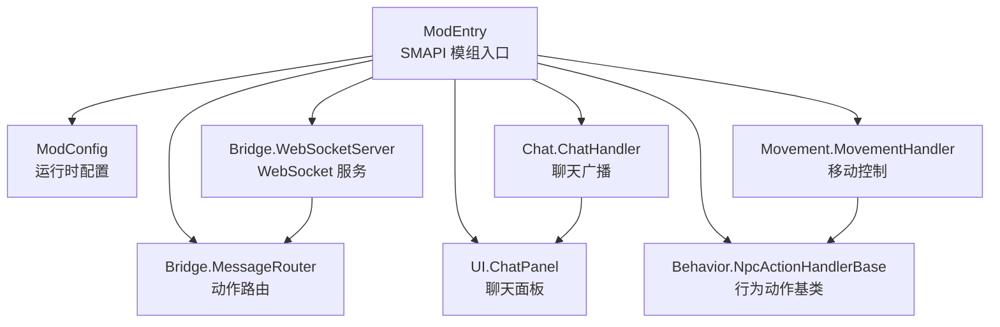
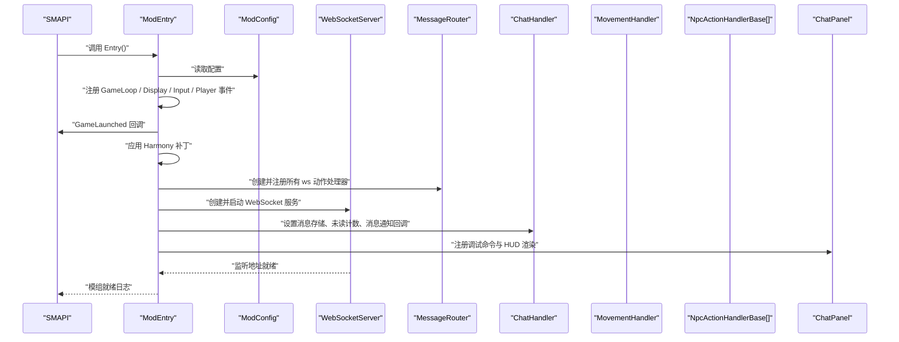
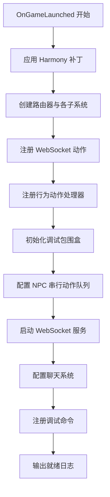
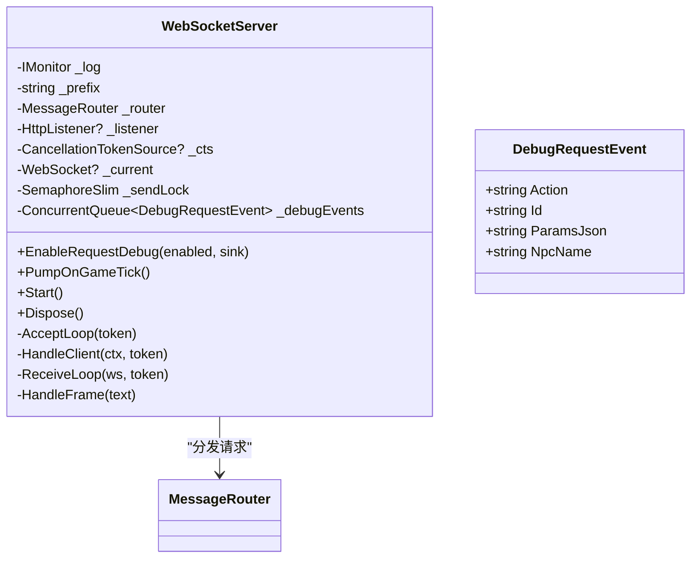
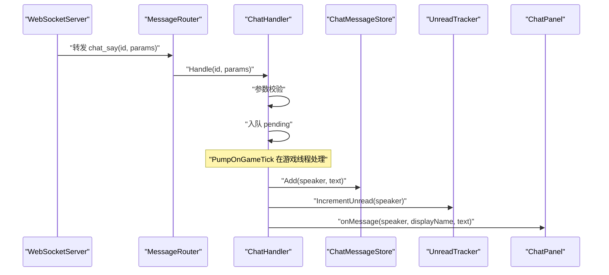
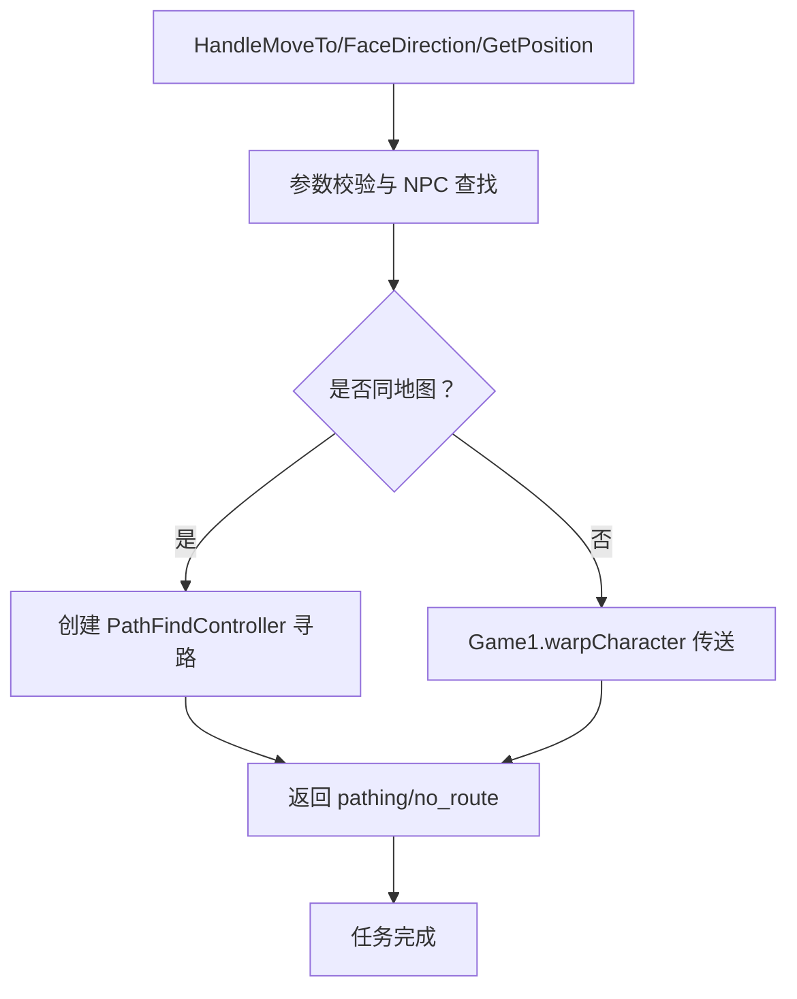
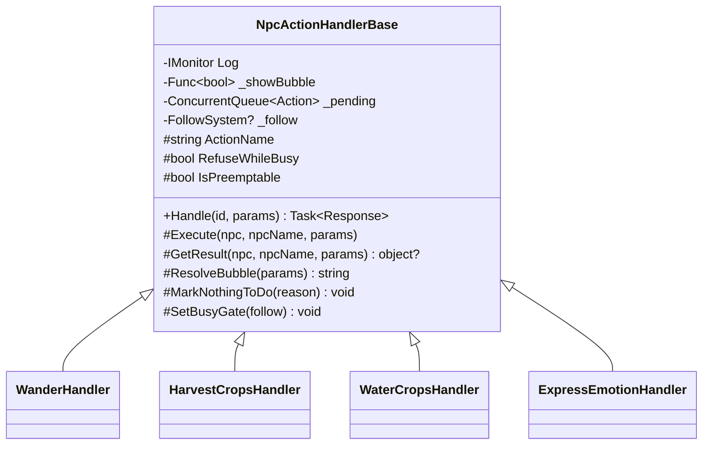
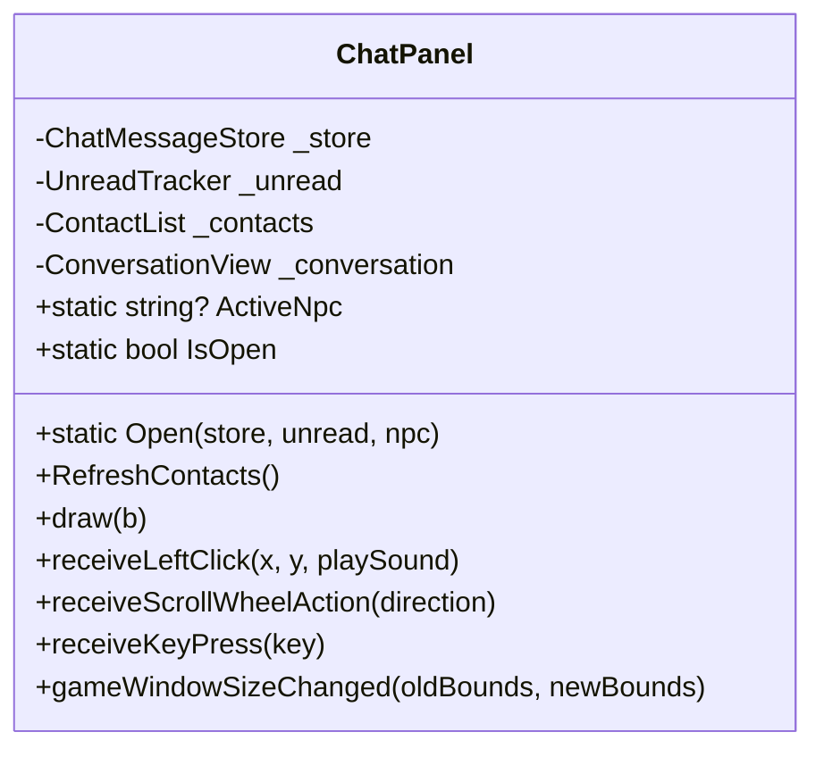
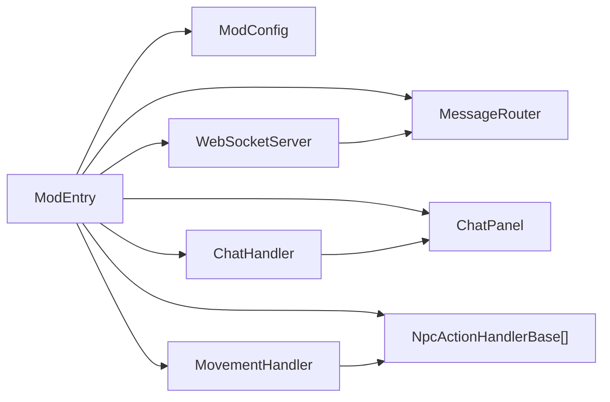

# 模组入口与初始化

<cite>
**本文引用的文件**
- [ModEntry.cs](file://SmartNPC/smapi-mod/ModEntry.cs)
- [ModConfig.cs](file://SmartNPC/smapi-mod/ModConfig.cs)
- [WebSocketServer.cs](file://SmartNPC/smapi-mod/Bridge/WebSocketServer.cs)
- [ChatHandler.cs](file://SmartNPC/smapi-mod/Chat/ChatHandler.cs)
- [MovementHandler.cs](file://SmartNPC/smapi-mod/Movement/MovementHandler.cs)
- [NpcActionHandlerBase.cs](file://SmartNPC/smapi-mod/Behavior/NpcActionHandlerBase.cs)
- [ChatPanel.cs](file://SmartNPC/smapi-mod/UI/ChatPanel.cs)
</cite>

## 目录
1. [引言](#引言)
2. [项目结构](#项目结构)
3. [核心组件](#核心组件)
4. [架构总览](#架构总览)
5. [详细组件分析](#详细组件分析)
6. [依赖关系分析](#依赖关系分析)
7. [性能考虑](#性能考虑)
8. [故障排查指南](#故障排查指南)
9. [结论](#结论)
10. [附录：如何添加新的子系统初始化逻辑](#附录如何添加新的子系统初始化逻辑)

## 引言
本文面向 SMAPI 模组开发者，聚焦 SmartNPC 的模组入口与初始化机制。重点解释 `ModEntry` 的生命周期事件、配置系统、各子系统的启动顺序与依赖关系，并给出错误处理、日志记录与调试输出方式，最后提供扩展新子系统的具体实践路径。

## 项目结构
SmartNPC 的 SMAPI 模组代码位于 `SmartNPC/smapi-mod` 下，入口类为 `ModEntry`，负责加载配置、注册 Harmony 补丁、创建 WebSocket 服务、注册消息路由、启动聊天系统、移动系统、行为系统以及 UI 面板等。

**图示来源**
- [ModEntry.cs:1-120](file://SmartNPC/smapi-mod/ModEntry.cs#L1-L120)
- [WebSocketServer.cs:1-60](file://SmartNPC/smapi-mod/Bridge/WebSocketServer.cs#L1-L60)
- [ChatHandler.cs:1-40](file://SmartNPC/smapi-mod/Chat/ChatHandler.cs#L1-L40)
- [MovementHandler.cs:1-40](file://SmartNPC/smapi-mod/Movement/MovementHandler.cs#L1-L40)
- [NpcActionHandlerBase.cs:1-40](file://SmartNPC/smapi-mod/Behavior/NpcActionHandlerBase.cs#L1-L40)
- [ChatPanel.cs:1-40](file://SmartNPC/smapi-mod/UI/ChatPanel.cs#L1-L40)

**章节来源**
- [ModEntry.cs:1-120](file://SmartNPC/smapi-mod/ModEntry.cs#L1-L120)

## 核心组件
- **ModEntry**：SMAPI 模组生命周期协调者，负责事件订阅、子系统构造、配置读取、调试命令注册和渲染钩子。
- **ModConfig**：通过 SMAPI 自动生成的 `config.json` 管理运行时选项，包括 WebSocket 监听地址与端口、调试开关、无人值守模式等。
- **Bridge（WebSocket 服务）**：基于 `HttpListener` 暴露 `/ws`，接收 JSON 请求，交由 `MessageRouter` 分发到具体处理器。
- **Chat（聊天系统）**：处理 `chat_say`，将 NPC 广播写入消息存储、未读计数器和通知提示。
- **Movement（移动系统）**：封装 `npc_move_to`、`npc_face_direction`、`npc_get_position`，统一在 SMAPI 游戏线程执行。
- **Behavior（行为系统）**：以 `NpcActionHandlerBase` 为基类，定义动作解析、气泡显示、队列调度与结果构建。
- **UI（用户界面）**：`ChatPanel` 提供 QQ 风格只读聊天面板，左侧联系人列表、右侧对话视图。

**章节来源**
- [ModEntry.cs:1-200](file://SmartNPC/smapi-mod/ModEntry.cs#L1-L200)
- [ModConfig.cs:1-144](file://SmartNPC/smapi-mod/ModConfig.cs#L1-L144)
- [WebSocketServer.cs:1-120](file://SmartNPC/smapi-mod/Bridge/WebSocketServer.cs#L1-L120)
- [ChatHandler.cs:1-96](file://SmartNPC/smapi-mod/Chat/ChatHandler.cs#L1-L96)
- [MovementHandler.cs:1-120](file://SmartNPC/smapi-mod/Movement/MovementHandler.cs#L1-L120)
- [NpcActionHandlerBase.cs:1-120](file://SmartNPC/smapi-mod/Behavior/NpcActionHandlerBase.cs#L1-L120)
- [ChatPanel.cs:1-120](file://SmartNPC/smapi-mod/UI/ChatPanel.cs#L1-L120)

## 架构总览
下图展示从 SMAPI 加载模组到子系统就绪的关键流程。

**图示来源**
- [ModEntry.cs:60-180](file://SmartNPC/smapi-mod/ModEntry.cs#L60-L180)
- [WebSocketServer.cs:80-120](file://SmartNPC/smapi-mod/Bridge/WebSocketServer.cs#L80-L120)

## 详细组件分析

### ModEntry：模组生命周期与事件处理
`ModEntry` 是 SMAPI 模组的唯一入口点，其生命周期主要围绕以下事件展开：

| 事件 | 作用 | 关键行为 |
|---|---|---|
| `Entry` | SMAPI 加载模组时调用 | 读取配置；创建 `XiaMiData`、通知提示、无人值守控制器；订阅 `GameLaunched`、`UpdateTicked`、`SaveLoaded`、`Saving`、`DayStarted`、`DayEnding`、`TimeChanged`、`RenderedHud`、`RenderedWorld`、输入事件、玩家传送事件等 |
| `OnGameLaunched` | 游戏环境就绪后集中初始化 | 应用 Harmony 补丁；创建路由器与各子系统实例；注册 WebSocket 动作、行为动作处理器；启动 WebSocket 服务；设置聊天系统与 UI 联动；注册调试命令 |
| `OnUpdateTicked` | 每帧更新驱动 | 泵出 WebSocket、聊天、感知、移动、行为、跟随动画；更新通知气泡；清理调试包围盒；串行动作队列排空 |
| `OnSaveLoaded` | 存档加载后恢复状态 | 重置动画；读取 `agent_npcs.json`；注册受控 NPC；恢复未读计数与 NPC 物品栏；抑制默认日程 |
| `OnSaving` | 存档保存前持久化 | 写入聊天历史、未读计数、NPC 物品栏快照 |
| `OnDayStarted` / `OnDayEnding` | 每日循环边界 | 广播日程事件；重新抑制日程并将 NPC 传送到农场门口 |
| `OnTimeChanged` | 时间变化事件 | 每 20 分钟广播一次 `game_time_tick`，供调度层使用 |
| `OnRenderedHud` / `OnRenderedWorld` | 渲染钩子 | 绘制通知气泡、HUD 图标与调试包围盒 |
| `OnButtonsChanged` / `OnButtonPressed` | 按键与鼠标输入 | 打开聊天面板、调试面板、拦截点击穿透 |

#### OnGameLaunched 初始化序列
1. 应用 `AgentControlPatch` Harmony 补丁。
2. 创建 `MessageRouter`、`ChatHandler`、查询处理器、感知系统、移动系统、跟随系统、行为系统。
3. 注册 WebSocket 动作：聊天、游戏查询、农场经济、感知、移动、行为。
4. 注册行为动作处理器数组（世界动作与社会动作）。
5. 初始化调试包围盒、NPC 串行动作队列。
6. 根据 `ListenPrefix()` 启动 `WebSocketServer`，绑定广播回调。
7. 可选启用入站请求调试镜像。
8. 配置聊天处理器消息存储、未读追踪、消息通知回调。
9. 注册调试控制台命令、NPC 物品栏 HUD。
10. 输出“模组就绪”日志。

**图示来源**
- [ModEntry.cs:80-180](file://SmartNPC/smapi-mod/ModEntry.cs#L80-L180)

**章节来源**
- [ModEntry.cs:60-200](file://SmartNPC/smapi-mod/ModEntry.cs#L60-L200)

### ModConfig：配置系统与运行时更新
`ModConfig` 由 SMAPI 自动加载并生成 `<Mods>/StardewMCPBridge/config.json`。字段稳定命名，避免破坏已有配置文件。

| 配置项 | 类型 | 默认值 | 说明 |
|---|---|---|---|
| `Host` | string | `"127.0.0.1"` | WebSocket 监听接口，环回地址安全，LAN 暴露需自行评估风险 |
| `Port` | int | `18745` | WebSocket 端口，需与外部 `smartnpc-mcp` 一致 |
| `ListenPrefix()` | method | 动态生成 | 返回 `http://{Host}:{Port}/` |
| `DebugLogIncomingRequests` | bool | `false` | 将每个入站 MCP 请求镜像到聊天面板 |
| `DebugShowBubble` | bool | `true` | 行为动作触发时在 NPC 头顶显示文本气泡 |
| `DebugShowBBoxOverlay` | bool | `false` | 在世界中绘制调试包围盒，区分扫描区域与行动区域 |
| `UnattendedMode` | bool | `false` | 无人值守实验模式总开关 |
| `AutoSleepHour` | int | `23` | 自动结束游戏日的小时 |
| `AutoSleepMinute` | int | `50` | 自动结束游戏日的分钟 |
| `AutoLoadSave` | bool | `false` | 标题画面自动加载最新存档 |
| `AutoLoadDelaySeconds` | int | `8` | 标题画面延迟等待秒数 |
| `AutoSleepWaitForDayReview` | bool | `true` | 等待 MCP 状态端点完成“日回顾”后再结束当天 |
| `McpStatusUrl` | string | `"http://127.0.0.1:3001/status"` | MCP 状态查询 URL |
| `AutoSleepReviewPollSeconds` | int | `2` | 轮询状态端点的间隔秒数 |
| `AutoSleepReviewDeadlineHour` | int | `25` | 强制结束前的截止小时 |
| `AutoSleepReviewDeadlineMinute` | int | `50` | 强制结束前的截止分钟 |

运行时更新机制：
- 大多数布尔调试字段每次调用时通过委托或属性直接读取，因此修改 `config.json` 并通过 SMAPI 热重载即可生效，无需重启 WebSocket 服务。
- `EnableRequestDebug` 会在连接时探测当前开关状态，并在日志中记录快照，便于排查“启动后编辑配置但未刷新”的情况。

**章节来源**
- [ModConfig.cs:1-144](file://SmartNPC/smapi-mod/ModConfig.cs#L1-L144)
- [WebSocketServer.cs:60-100](file://SmartNPC/smapi-mod/Bridge/WebSocketServer.cs#L60-L100)

### Bridge：WebSocket 服务
`WebSocketServer` 基于 `.NET` 内置 `HttpListener` 实现最小 WebSocket 服务器：
- 接受 `/ws` 升级请求。
- 最多支持一个客户端连接，新连接会替换旧连接。
- 接收 JSON 文本帧，反序列化为 `Request`，交给 `MessageRouter` 分发。
- 提供 `BroadcastEvent` 向当前连接广播事件。
- 每 30 秒自动 ping，保持浏览器兼容。
- 支持调试请求镜像：将入站请求排队，在 `PumpOnGameTick` 中于游戏线程消费并注入聊天面板。

**图示来源**
- [WebSocketServer.cs:1-120](file://SmartNPC/smapi-mod/Bridge/WebSocketServer.cs#L1-L120)

**章节来源**
- [WebSocketServer.cs:1-200](file://SmartNPC/smapi-mod/Bridge/WebSocketServer.cs#L1-L200)

### Chat：聊天系统
`ChatHandler` 专门处理 `chat_say`：
- 参数校验：要求 `speaker` 与 `text`。
- 若尚未加载存档，返回 `mod_not_ready`。
- 将消息入队，在 `PumpOnGameTick` 中于游戏线程处理。
- 写入 `ChatMessageStore`，更新 `UnreadTracker`，触发消息通知回调。
- 如果聊天面板已打开且选中对应 NPC，则不增加未读数。

**图示来源**
- [ChatHandler.cs:1-96](file://SmartNPC/smapi-mod/Chat/ChatHandler.cs#L1-L96)
- [ModEntry.cs:140-180](file://SmartNPC/smapi-mod/ModEntry.cs#L140-L180)

**章节来源**
- [ChatHandler.cs:1-96](file://SmartNPC/smapi-mod/Chat/ChatHandler.cs#L1-L96)
- [ModEntry.cs:120-200](file://SmartNPC/smapi-mod/ModEntry.cs#L120-L200)

### Movement：移动系统
`MovementHandler` 处理 NPC 移动相关动作：
- `npc_move_to`：在同地图使用 `PathFindController` 寻路；跨地图则瞬间传送。
- `npc_face_direction`：设置 NPC 朝向。
- `npc_get_position`：获取 NPC 位置。
- 所有操作都通过 `ConcurrentQueue<Action>` 投递到游戏线程，在 `PumpOnGameTick` 中执行，并用 `TaskCompletionSource` 返回结构化响应。

**图示来源**
- [MovementHandler.cs:40-160](file://SmartNPC/smapi-mod/Movement/MovementHandler.cs#L40-L160)

**章节来源**
- [MovementHandler.cs:1-200](file://SmartNPC/smapi-mod/Movement/MovementHandler.cs#L1-L200)

### Behavior：行为系统
行为系统以 `NpcActionHandlerBase` 为核心抽象：
- 每个行为动作继承该基类，覆盖 `Execute` 实现真实游戏逻辑。
- 支持三种执行模型：
  1. 简单动作：立即在下一帧执行，不改变 FollowSystem 模式。
  2. 可抢占模式：例如 `npc_wander`，可被更高优先级队列任务中断。
  3. 串行独占模式：长时间工作（收割、浇水、耕地、采集等）必须按 NPC 串行执行，新任务入队，空闲时自动排空。
- 基类负责：
  - 解析 `params.npc`。
  - 显示头部气泡。
  - 在游戏线程执行 `Execute`。
  - 构建默认响应或允许子类自定义结果。
  - 支持 `MarkNothingToDo` 让智能体知道区域无目标，从而重新规划。

**图示来源**
- [NpcActionHandlerBase.cs:1-120](file://SmartNPC/smapi-mod/Behavior/NpcActionHandlerBase.cs#L1-L120)
- [ModEntry.cs:100-160](file://SmartNPC/smapi-mod/ModEntry.cs#L100-L160)

**章节来源**
- [NpcActionHandlerBase.cs:1-200](file://SmartNPC/smapi-mod/Behavior/NpcActionHandlerBase.cs#L1-L200)
- [ModEntry.cs:80-180](file://SmartNPC/smapi-mod/ModEntry.cs#L80-L180)

### UI：用户界面
`ChatPanel` 是主聊天菜单：
- 左侧联系人列表，右侧对话视图。
- 只读显示 Agent 广播与调试请求镜像。
- 支持 Tab、F2、Esc 快捷键。
- 打开时标记当前对话为已读。
- 通过静态 `Open` 方法由 `ModEntry` 打开，并可预选择某个 NPC。

**图示来源**
- [ChatPanel.cs:1-178](file://SmartNPC/smapi-mod/UI/ChatPanel.cs#L1-L178)

**章节来源**
- [ChatPanel.cs:1-178](file://SmartNPC/smapi-mod/UI/ChatPanel.cs#L1-L178)
- [ModEntry.cs:200-360](file://SmartNPC/smapi-mod/ModEntry.cs#L200-L360)

## 依赖关系分析
`ModEntry` 是中心协调者，其他子系统直接或间接依赖它提供的配置、监控器、事件系统和全局游戏状态。

**图示来源**
- [ModEntry.cs:60-200](file://SmartNPC/smapi-mod/ModEntry.cs#L60-L200)
- [WebSocketServer.cs:1-120](file://SmartNPC/smapi-mod/Bridge/WebSocketServer.cs#L1-L120)
- [ChatHandler.cs:1-96](file://SmartNPC/smapi-mod/Chat/ChatHandler.cs#L1-L96)
- [MovementHandler.cs:1-120](file://SmartNPC/smapi-mod/Movement/MovementHandler.cs#L1-L120)
- [NpcActionHandlerBase.cs:1-120](file://SmartNPC/smapi-mod/Behavior/NpcActionHandlerBase.cs#L1-L120)
- [ChatPanel.cs:1-120](file://SmartNPC/smapi-mod/UI/ChatPanel.cs#L1-L120)

**章节来源**
- [ModEntry.cs:60-200](file://SmartNPC/smapi-mod/ModEntry.cs#L60-L200)

## 性能考虑
- 每帧泵出机制：WebSocket、聊天、感知、移动、行为、跟随系统都在 `OnUpdateTicked` 中调用 `PumpOnGameTick`，避免在 WebSocket 接收线程直接访问游戏对象。
- 时间事件节流：`game_time_tick` 每 20 分钟广播一次，降低调度层负载，同时保证调度条目不会晚超过 20 分钟。
- 串行动作队列：对长时间行为动作进行逐 NPC 串行执行，避免多个长任务竞争同一 NPC 的状态。
- 调试功能按需开启：调试气泡、调试包围盒、入站请求镜像默认关闭或可控，减少无关开销。
- 单连接限制：WebSocket 服务端仅保留最近一个连接，简化并发模型，适合本地实验场景。

[本节为通用性能建议，不直接分析具体文件]

## 故障排查指南
常见错误与定位方式：

| 现象 | 可能原因 | 排查步骤 |
|---|---|---|
| 模组启动失败 | Harmony 补丁或子系统构造抛出异常 | 查看 `OnGameLaunched` 中的异常捕获日志，确认 `Monitor.Log` 的 startup failed 信息 |
| WebSocket 无法连接 | 端口冲突或 Host 配置错误 | 检查 `ModConfig.Host` 与 `Port`，确认 `ListenPrefix()` 生成的地址 |
| 聊天消息不显示 | 聊天面板未打开或未选择对应 NPC | 打开 `ChatPanel`，确认 `ChatHandler.PumpOnGameTick` 已写入消息存储 |
| NPC 不移动 | 未加载存档或 NPC 名称错误 | 检查 `MovementHandler` 的参数校验与 `Context.IsWorldReady` |
| 行为动作重复或卡住 | 串行队列或 FollowSystem 模式冲突 | 查看行为动作的 `RefuseWhileBusy` 与 `IsPreemptable` 配置，检查 `NpcActionQueue.DrainReadyTasks` |
| 调试包围盒不显示 | 配置未开启或不在本地地图 | 检查 `DebugShowBBoxOverlay`，确认 NPC 在当前地图 |
| 存档数据丢失 | 保存失败或数据格式异常 | 查看 `OnSaving` 与 `OnSaveLoaded` 的异常日志，确认 `SaveKey_*` 键名一致 |

日志级别：
- `Info`：模组就绪、WebSocket 监听地址、日程事件摘要。
- `Warn`：存档数据恢复失败、调试请求丢弃、配置缺失。
- `Error`：启动失败、读取 NPC 配置失败。
- `Debug`：日程抑制、NPC 传送、WebSocket 连接断开。
- `Trace`：聊天消息详情、时间 tick 细节。

**章节来源**
- [ModEntry.cs:160-200](file://SmartNPC/smapi-mod/ModEntry.cs#L160-L200)
- [ModEntry.cs:200-360](file://SmartNPC/smapi-mod/ModEntry.cs#L200-L360)
- [WebSocketServer.cs:100-200](file://SmartNPC/smapi-mod/Bridge/WebSocketServer.cs#L100-L200)
- [ChatHandler.cs:40-96](file://SmartNPC/smapi-mod/Chat/ChatHandler.cs#L40-L96)

## 结论
SmartNPC 的 SMAPI 模组以 `ModEntry` 为中心，通过 SMAPI 事件驱动完成配置加载、Harmony 补丁、WebSocket 服务、聊天系统、移动系统、行为系统与 UI 的有序初始化。`ModConfig` 提供稳定的运行时配置接口，配合 SMAPI 热重载实现调试开关的动态切换。各子系统通过统一的每帧泵出机制与结构化响应模型，确保与 SMAPI 游戏线程的安全交互，并提供完善的日志与调试能力。

[本节为总结性内容，不直接分析具体文件]

## 附录：如何添加新的子系统初始化逻辑
假设要新增一个名为 `MySubsystem` 的子模块，可按以下步骤集成：

1. 在 `ModEntry.Entry` 中创建子系统实例，并保存到字段。
2. 在 `OnGameLaunched` 中完成子系统内部初始化，例如注册动作、启动后台任务、连接外部服务。
3. 如果需要每帧更新，在 `OnUpdateTicked` 中调用子系统的 `PumpOnGameTick`。
4. 如果需要渲染，在 `OnRenderedHud` 或 `OnRenderedWorld` 中绘制。
5. 如果需要存档读写，在 `OnSaveLoaded` 与 `OnSaving` 中恢复与持久化。
6. 如需调试，通过 `this.Monitor.Log` 输出 Info、Warn、Error、Debug、Trace 日志。
7. 如需要暴露 WebSocket 动作，使用 `_router.Register("my_action", handler.Handle)`。
8. 如需要配置项，在 `ModConfig` 中添加字段并保持字段名稳定。

示例路径参考：
- 创建子系统实例与事件订阅：[ModEntry.cs:60-120](file://SmartNPC/smapi-mod/ModEntry.cs#L60-L120)
- 子系统初始化与路由注册：[ModEntry.cs:80-180](file://SmartNPC/smapi-mod/ModEntry.cs#L80-L180)
- 每帧泵出更新：[ModEntry.cs:200-240](file://SmartNPC/smapi-mod/ModEntry.cs#L200-L240)
- 存档恢复与持久化：[ModEntry.cs:240-320](file://SmartNPC/smapi-mod/ModEntry.cs#L240-L320)
- 配置项定义：[ModConfig.cs:1-144](file://SmartNPC/smapi-mod/ModConfig.cs#L1-L144)

**章节来源**
- [ModEntry.cs:60-360](file://SmartNPC/smapi-mod/ModEntry.cs#L60-L360)
- [ModConfig.cs:1-144](file://SmartNPC/smapi-mod/ModConfig.cs#L1-L144)