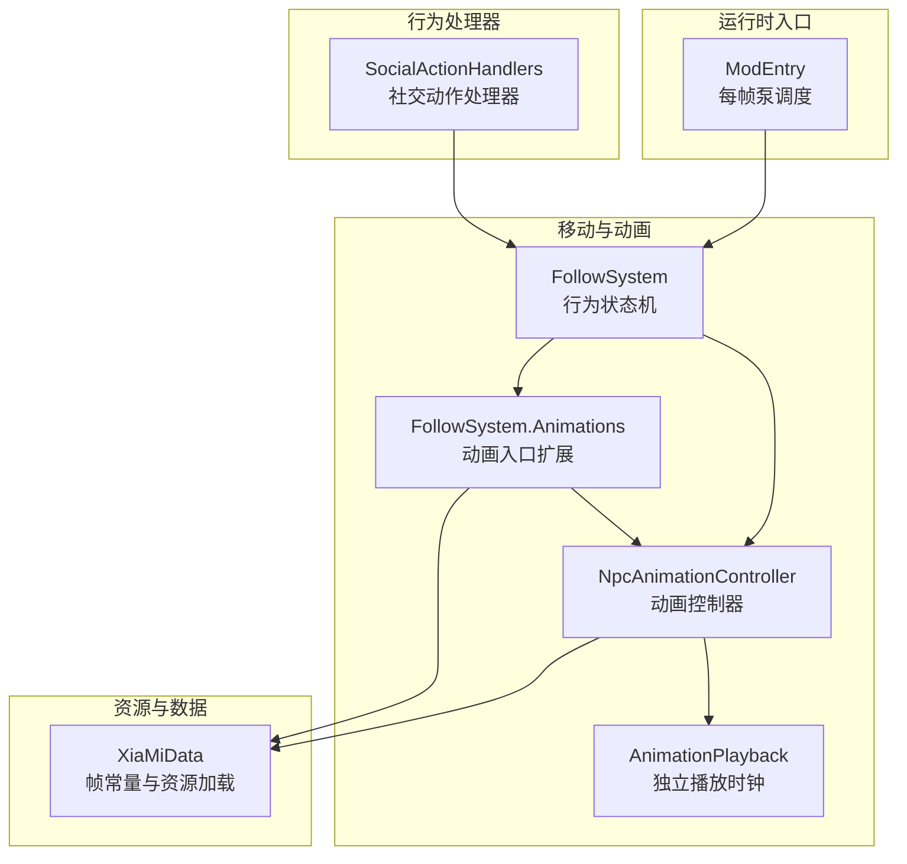
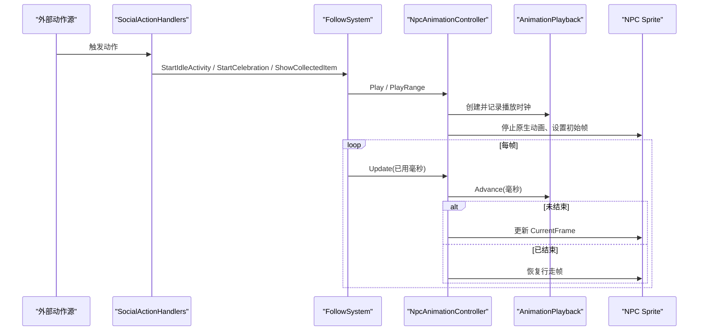
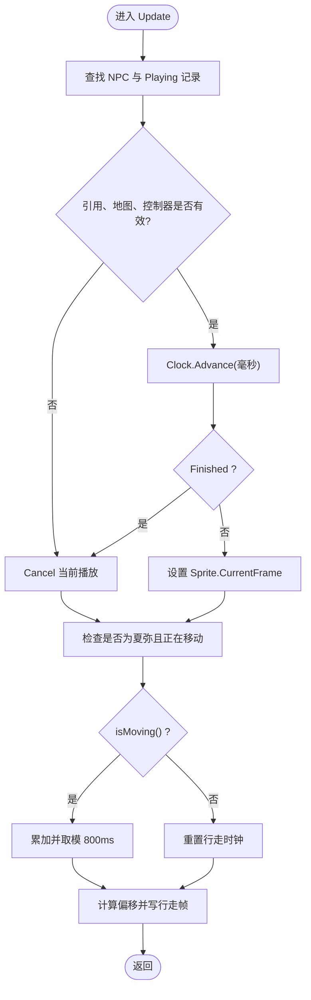
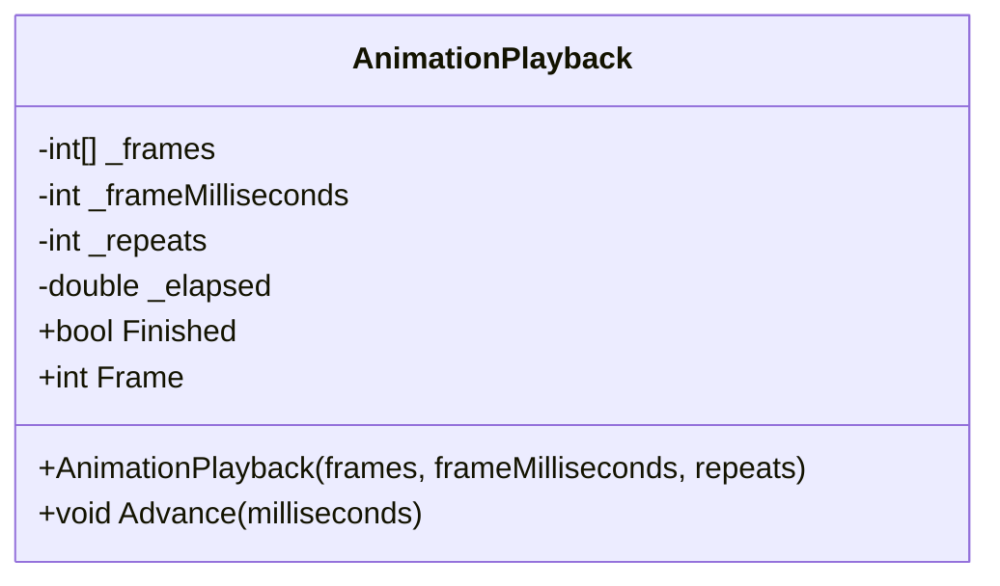
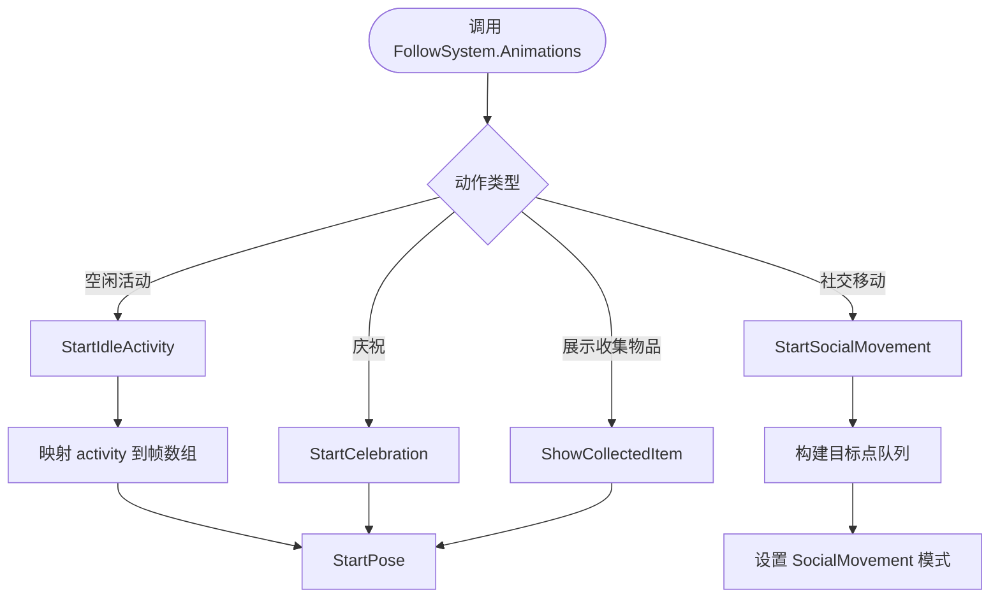
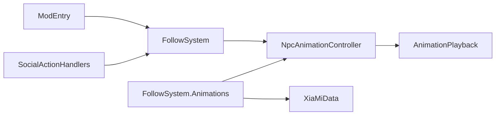

# 动画控制器

<cite>
**本文引用的文件 **
- [NpcAnimationController.cs](file://SmartNPC/smapi-mod/Movement/NpcAnimationController.cs)
- [AnimationPlayback.cs](file://SmartNPC/smapi-mod/Movement/AnimationPlayback.cs)
- [FollowSystem.Animations.cs](file://SmartNPC/smapi-mod/Movement/FollowSystem.Animations.cs)
- [FollowSystem.cs](file://SmartNPC/smapi-mod/Movement/FollowSystem.cs)
- [SocialActionHandlers.cs](file://SmartNPC/smapi-mod/Behavior/SocialActionHandlers.cs)
- [XiaMiData.cs](file://SmartNPC/smapi-mod/NPC/XiaMiData.cs)
- [xiami-animations.md](file://SmartNPC/docs/xiami-animations.md)
- [ModEntry.cs](file://SmartNPC/smapi-mod/ModEntry.cs)
</cite>

## 目录
1. [引言](#引言)
2. [项目结构](#项目结构)
3. [核心组件](#核心组件)
4. [架构总览](#架构总览)
5. [详细组件分析](#详细组件分析)
6. [依赖关系分析](#依赖关系分析)
7. [性能与内存优化](#性能与内存优化)
8. [故障排查指南](#故障排查指南)
9. [结论](#结论)
10. [附录：自定义动画序列示例](#附录自定义动画序列示例)

## 引言
本文围绕 SmartNPC 模组中的动画子系统，重点解析 `NpcAnimationController` 的动画状态管理、播放生命周期、队列调度、并发控制以及帧同步机制。该系统的目标是让自定义角色“夏弥”在游戏原生的行走逻辑之后，安全地覆盖其精灵帧，同时保持与游戏主循环、行为状态机、动作处理器的时序一致。

该系统不是通用的通用动画引擎，而是面向 SMAPI + Stardew Valley 的游戏线程动画覆盖层：它不直接实现复杂的跨动画混合或淡入淡出，但提供了精确的帧序列、循环、阻塞与非阻塞模式，以及与行走、采集、社交动作等上层行为的集成点。

## 项目结构
动画相关代码集中在 `SmartNPC/smapi-mod/Movement` 和 `SmartNPC/smapi-mod/Behavior` 中，并配合 NPC 数据与文档：

**图表来源**
- [FollowSystem.cs:264-266](file://SmartNPC/smapi-mod/Movement/FollowSystem.cs#L264-L266)
- [NpcAnimationController.cs:10-26](file://SmartNPC/smapi-mod/Movement/NpcAnimationController.cs#L10-L26)
- [AnimationPlayback.cs:1-15](file://SmartNPC/smapi-mod/Movement/AnimationPlayback.cs#L1-L15)
- [FollowSystem.Animations.cs:12-30](file://SmartNPC/smapi-mod/Movement/FollowSystem.Animations.cs#L12-L30)
- [SocialActionHandlers.cs:90-148](file://SmartNPC/smapi-mod/Behavior/SocialActionHandlers.cs#L90-L148)
- [XiaMiData.cs:10-48](file://SmartNPC/smapi-mod/NPC/XiaMiData.cs#L10-L48)
- [ModEntry.cs:210-230](file://SmartNPC/smapi-mod/ModEntry.cs#L210-L230)

**章节来源**
- [NpcAnimationController.cs:10-26](file://SmartNPC/smapi-mod/Movement/NpcAnimationController.cs#L10-L26)
- [FollowSystem.cs:264-266](file://SmartNPC/smapi-mod/Movement/FollowSystem.cs#L264-L266)
- [ModEntry.cs:210-230](file://SmartNPC/smapi-mod/ModEntry.cs#L210-L230)

## 核心组件
- `AnimationPlayback`：与游戏无关的动画播放时钟，负责帧索引、重复次数、完成标志和时间累积。
- `NpcAnimationController`：游戏线程上的动画控制器，维护每个 NPC 的播放状态、阻塞语义、行走帧回退逻辑。
- `FollowSystem.Animations`：对 `FollowSystem` 的动画能力扩展，提供面向业务的高层 API，如空闲动作、庆祝、采集展示、社交移动。
- `FollowSystem`：NPC 行为状态机，持有 `NpcAnimationController` 实例，并在每帧调用其更新方法。
- `SocialActionHandlers`：将 MCP/WS 层的动作请求映射为具体动画和移动调用。
- `XiaMiData`：定义夏弥精灵帧常量、资源加载、对话与日程数据。

**章节来源**
- [AnimationPlayback.cs:1-41](file://SmartNPC/smapi-mod/Movement/AnimationPlayback.cs#L1-L41)
- [NpcAnimationController.cs:10-109](file://SmartNPC/smapi-mod/Movement/NpcAnimationController.cs#L10-L109)
- [FollowSystem.Animations.cs:12-120](file://SmartNPC/smapi-mod/Movement/FollowSystem.Animations.cs#L12-L120)
- [FollowSystem.cs:264-266](file://SmartNPC/smapi-mod/Movement/FollowSystem.cs#L264-L266)
- [SocialActionHandlers.cs:90-151](file://SmartNPC/smapi-mod/Behavior/SocialActionHandlers.cs#L90-L151)
- [XiaMiData.cs:10-48](file://SmartNPC/smapi-mod/NPC/XiaMiData.cs#L10-L48)

## 架构总览
动画系统采用分层设计：

1. **业务层**：`SocialActionHandlers` 根据动作名称选择空闲活动、庆祝、社交移动等高层语义。
2. **行为协调层**：`FollowSystem` 统一管理 NPC 行为状态，并暴露 `Animations` 作为动画子系统的入口。
3. **动画执行层**：`NpcAnimationController` 负责实际修改 `NPC.Sprite.CurrentFrame`，并与原生行走逻辑协作。
4. **时间层**：`AnimationPlayback` 独立计算帧位置，避免被游戏帧率波动直接影响帧语义。
5. **资源层**：`XiaMiData` 提供帧常量、Sprite 资源和 NPC 注册逻辑。

**图表来源**
- [SocialActionHandlers.cs:90-148](file://SmartNPC/smapi-mod/Behavior/SocialActionHandlers.cs#L90-L148)
- [FollowSystem.Animations.cs:30-74](file://SmartNPC/smapi-mod/Movement/FollowSystem.Animations.cs#L30-L74)
- [NpcAnimationController.cs:36-109](file://SmartNPC/smapi-mod/Movement/NpcAnimationController.cs#L36-L109)
- [AnimationPlayback.cs:16-41](file://SmartNPC/smapi-mod/Movement/AnimationPlayback.cs#L16-L41)

## 详细组件分析

### NpcAnimationController：动画状态机与生命周期
`NpcAnimationController` 是动画子系统的核心。它内部使用一个名为 `Playing` 的结构化记录保存每个正在播放的 NPC 上下文：

| 字段 | 含义 |
|---|---|
| `Npc` | 当前被控制的 NPC 引用 |
| `Location` | 动画开始时所在的 `GameLocation`，用于检测传送或存档重载 |
| `Clock` | 对应的 `AnimationPlayback` 实例 |
| `PreviousIgnoreMovement` | 是否关闭了原生移动动画，用于恢复 |
| `PreviousFlip` | 原始水平翻转状态，用于恢复 |
| `Blocking` | 是否阻塞下一个动作 |
| `Action` | 当前动作名，便于日志追踪 |

关键设计点：

- **角色白名单**：仅当 NPC 名称等于“夏弥”时才应用自定义帧，其他村民不会收到这些覆盖。
- **播放入口**：`Play` 会创建 `AnimationPlayback`、取消同名旧播放、暂停 NPC、清空控制器、停止精灵动画、固定朝向、标记忽略移动动画、写入第一帧并加入播放表。
- **取消恢复**：`Cancel` 会恢复 `ignoreMovementAnimation` 与 `flip`，停止精灵动画，并写回行走帧偏移。
- **清理**：`Clear` 遍历所有播放项并逐个取消，同时清空行走时钟缓存。
- **更新流程**：`Update` 按 NPC 名字列表驱动；若 NPC 引用、地图或控制器发生变化，则强制取消；否则推进时钟并写回帧；结束后自动回退行走帧。
- **行走帧回退**：对于未被显式播放的动作，系统会根据朝向选择前、后、左三组基础帧，并按 800ms 周期循环模拟行走。

**图表来源**
- [NpcAnimationController.cs:60-109](file://SmartNPC/smapi-mod/Movement/NpcAnimationController.cs#L60-L109)

**章节来源**
- [NpcAnimationController.cs:10-109](file://SmartNPC/smapi-mod/Movement/NpcAnimationController.cs#L10-L109)

### AnimationPlayback：无游戏依赖的时间与帧计算
`AnimationPlayback` 是一个纯函数式播放时钟，不直接访问游戏对象：

- 构造参数包括帧数组、每帧毫秒数、重复次数。
- `Advance` 累积时间，并根据重复次数判断是否结束。
- 当重复次数为 0 时，表示无限循环，直到外部取消。
- 结束时，时间停留在最后一帧对应位置，保证所有者仍可读取最后一帧后再恢复默认姿态。
- 输入校验严格拒绝空帧、非正间隔和负重复次数；非法时间值也会抛出异常。

复杂度方面：
- 时间复杂度：每次 `Advance` 为 O(1)。
- 空间复杂度：存储一份帧数组副本，O(n)。

**图表来源**
- [AnimationPlayback.cs:1-41](file://SmartNPC/smapi-mod/Movement/AnimationPlayback.cs#L1-L41)

**章节来源**
- [AnimationPlayback.cs:1-41](file://SmartNPC/smapi-mod/Movement/AnimationPlayback.cs#L1-L41)

### FollowSystem.Animations：动画高层入口
`FollowSystem.Animations` 将业务语义转换为底层动画调用：

- `PumpAnimations`：在 SMAPI 世界就绪时，驱动 `Animations.Update`，并使用 `Game1.shouldTimePass()` 决定是否传入真实时间。
- `StartPose`：统一封装帧序列播放，并将行为模式设为 `Animating` 或 `Idle`。
- `StartIdleActivity`：将“种田、休息、环顾四周、手持南瓜、作物、花、鸡”等动作映射到帧范围。
- `StartCelebration`：生成庆祝或惊讶表情帧，并附加跳跃与表情气泡。
- `ShowCollectedItem`：根据物品类型选择持物帧，并播放 450ms 静态展示。
- `StartSocialMovement`：将社交后退或踱步转换为有限路径目标队列，并与 `TryStartPath` 结合。

**图表来源**
- [FollowSystem.Animations.cs:12-120](file://SmartNPC/smapi-mod/Movement/FollowSystem.Animations.cs#L12-L120)
- [XiaMiData.cs:10-48](file://SmartNPC/smapi-mod/NPC/XiaMiData.cs#L10-L48)

**章节来源**
- [FollowSystem.Animations.cs:12-120](file://SmartNPC/smapi-mod/Movement/FollowSystem.Animations.cs#L12-L120)

### SocialActionHandlers：动作到动画的映射
社交动作处理器将外部动作名映射为具体行为：

| 动作 | 行为 |
|---|---|
| `npc_shy_retreat` | 后退社交移动 |
| `npc_idle_activity` | 支持一次或循环的空闲活动 |
| `npc_dance_happy` | 庆祝动画 |
| `npc_react_surprise` | 惊讶动画 |
| `npc_pace_anxiously` | 有限时长的踱步移动 |

这些处理器通常要求 NPC 空闲，并通过 `SetBusyGate(follow)` 接入串行动作门控，从而与 `FollowSystem` 的状态机共享生命周期。

**章节来源**
- [SocialActionHandlers.cs:90-151](file://SmartNPC/smapi-mod/Behavior/SocialActionHandlers.cs#L90-L151)

### XiaMiData：帧常量与资源
`XiaMiData` 定义了夏弥精灵表的帧区间，例如：

- 前向行走帧
- 后向行走帧
- 左侧行走帧
- 锄地帧
- 浇水帧
- 手持南瓜、作物、花、鸡帧
- 待机、欢呼、爱心、惊讶、困倦表情帧

它还负责：
- 加载夏弥 Sprite 和头像
- 注入 NPC 性格、对话与日程
- 在存档加载时生成夏弥 NPC

**章节来源**
- [XiaMiData.cs:10-48](file://SmartNPC/smapi-mod/NPC/XiaMiData.cs#L10-L48)
- [XiaMiData.cs:50-159](file://SmartNPC/smapi-mod/NPC/XiaMiData.cs#L50-L159)

### ModEntry：每帧调度入口
`ModEntry` 在游戏每帧回调中依次执行行为泵、动画泵、任务队列排水等操作。动画泵位于工作队列释放之后，确保先让行为状态稳定，再更新动画帧。

**章节来源**
- [ModEntry.cs:210-230](file://SmartNPC/smapi-mod/ModEntry.cs#L210-L230)

## 依赖关系分析
动画子系统存在清晰的单向依赖：

- `ModEntry` 依赖 `FollowSystem`。
- `FollowSystem` 依赖 `NpcAnimationController`。
- `FollowSystem.Animations` 依赖 `NpcAnimationController` 和 `XiaMiData`。
- `SocialActionHandlers` 依赖 `FollowSystem`。
- `NpcAnimationController` 依赖 `AnimationPlayback` 和 `XiaMiData`。

**图表来源**
- [ModEntry.cs:210-230](file://SmartNPC/smapi-mod/ModEntry.cs#L210-L230)
- [FollowSystem.cs:264-266](file://SmartNPC/smapi-mod/Movement/FollowSystem.cs#L264-L266)
- [FollowSystem.Animations.cs:12-30](file://SmartNPC/smapi-mod/Movement/FollowSystem.Animations.cs#L12-L30)
- [SocialActionHandlers.cs:90-148](file://SmartNPC/smapi-mod/Behavior/SocialActionHandlers.cs#L90-L148)
- [NpcAnimationController.cs:10-26](file://SmartNPC/smapi-mod/Movement/NpcAnimationController.cs#L10-L26)

**章节来源**
- [FollowSystem.cs:264-266](file://SmartNPC/smapi-mod/Movement/FollowSystem.cs#L264-L266)
- [NpcAnimationController.cs:10-26](file://SmartNPC/smapi-mod/Movement/NpcAnimationController.cs#L10-L26)

## 性能与内存优化
基于现有实现，可总结以下性能特征和优化建议：

### 时间复杂度
- 每帧 `Update` 遍历受管 NPC 名字列表，复杂度为 O(k)，k 为受控 NPC 数量。
- 单个 NPC 的 `Advance` 为 O(1)。
- 行走帧计算为 O(1)。

### 内存占用
- 每个播放项保存 NPC 引用、地图引用、播放时钟和若干布尔字段，属于轻量级状态。
- `AnimationPlayback` 复制帧数组，适合短小帧序列；若未来引入超大帧集，应考虑复用帧缓冲或只存帧索引。

### 并发与线程安全
- 动画更新运行在游戏线程上。
- 行为处理器通过 `ConcurrentQueue<Action>` 将 WS 层调用迁移到游戏线程。
- 播放表使用普通字典，键为 NPC 名称，且仅在 `Update` 和显式 `Cancel/Clear` 中修改，符合单线程模型。

### 优化建议
1. **避免频繁分配帧数组**：对常用动作（如浇水、锄地）可预构建帧数组并缓存。
2. **减少字符串拼接日志**：大量调试日志可能产生 GC 压力，可在生产环境降低日志级别。
3. **限制受管 NPC 数量**：`Update` 遍历所有待更新名字，应只包含真正需要动画覆盖的 NPC。
4. **复用 `AnimationPlayback`**：若同一动作反复播放相同帧，可考虑短时重用，但需注意生命周期与状态清理。
5. **谨慎使用无限循环**：`repeats == 0` 会一直循环，必须确保外部有明确取消路径。

**章节来源**
- [NpcAnimationController.cs:36-109](file://SmartNPC/smapi-mod/Movement/NpcAnimationController.cs#L36-L109)
- [AnimationPlayback.cs:16-41](file://SmartNPC/smapi-mod/Movement/AnimationPlayback.cs#L16-L41)
- [BehaviorHandler.cs:1-40](file://SmartNPC/smapi-mod/Movement/BehaviorHandler.cs#L1-L40)

## 故障排查指南

### 常见问题
| 现象 | 可能原因 | 处理建议 |
|---|---|---|
| 夏弥没有播放自定义帧 | NPC 名称不是“夏弥”，或已被原生控制器接管 | 确认 `HasCustomSheet` 条件，检查是否传入了错误 NPC |
| 动画结束后 NPC 姿势卡住 | 场景切换、传送或存档重载导致 `Playing` 记录失效 | 检查 `Update` 中的引用、地图、控制器校验分支 |
| 行走动画异常 | 行走时钟未正确归零或偏移计算错误 | 检查 `isMoving()` 分支和 800ms 周期逻辑 |
| 循环动画无法停止 | 使用了 `repeats == 0` 但未调用 `Cancel` | 确保在行为结束或 NPC 空闲时取消 |
| 非夏弥 NPC 报错 | 调用了仅限夏弥的自定义姿态 API | 在调用前检查 `HasCustomSheet` |
| 重启后动画未更新 | SMAPI 热重载 DLL 不会更新已加载模块 | 完整重启游戏而非仅重新进入存档 |

### 诊断工具
- 控制台预览命令：支持在不改变世界状态的情况下预览浇水、锄地和全部帧。
- 测试任务：验证动画时钟、控制器、暂停、大时间增量、重复、环境替换、移动恢复、传送、路径中断、存档替换、方向映射和卸载。

**章节来源**
- [xiami-animations.md:1-30](file://SmartNPC/docs/xiami-animations.md#L1-L30)

## 结论
`NpcAnimationController` 提供了一个简洁可靠的夏弥动画覆盖层。它通过独立播放时钟、显式生命周期管理、行走帧回退和严格的 NPC 白名单，避免了与 Stardew Valley 原生动画的直接冲突。配合 `FollowSystem` 的行为状态机和 `SocialActionHandlers` 的动作映射，系统实现了从业务语义到精灵帧的清晰链路。

当前实现没有内置淡入淡出、多轨道混合或复杂插值器，因此更适合离散帧序列、短暂动作和轻量循环。若未来需要更复杂的动画过渡，应在 `AnimationPlayback` 之上增加时间曲线、混合权重和轨道优先级，而不是直接耦合游戏对象。

## 附录：自定义动画序列示例

### 创建自定义动画序列
推荐流程：

1. 在 `XiaMiData` 中新增帧常量。
2. 在 `FollowSystem.Animations` 中添加新的动作映射。
3. 在 `SocialActionHandlers` 中暴露新动作。
4. 通过 `StartPose` 或 `Play` 传入帧数组、帧间隔和重复次数。
5. 在行为结束时调用 `Cancel`，确保恢复行走帧。

参考路径：
- [XiaMiData.cs:10-48](file://SmartNPC/smapi-mod/NPC/XiaMiData.cs#L10-L48)
- [FollowSystem.Animations.cs:30-74](file://SmartNPC/smapi-mod/Movement/FollowSystem.Animations.cs#L30-L74)
- [NpcAnimationController.cs:36-58](file://SmartNPC/smapi-mod/Movement/NpcAnimationController.cs#L36-L58)

### 处理动画事件
当前系统以状态和生命周期为主，而不是传统事件总线。典型“事件”表现为：

- 动画开始：由 `Play` 写入日志并设置初始帧。
- 动画结束：由 `Cancel` 恢复 NPC 状态。
- 行为状态变化：由 `FollowSystem` 的模式字段体现。
- 社交动作触发：由 `SocialActionHandlers` 调用 `StartCelebration` 或 `StartSocialMovement`。

如果需要更强的回调机制，可在 `AnimationPlayback.Finished` 或 `NpcAnimationController.Cancel` 处扩展委托或事件，但应保持游戏线程调用约定。

### 实现动画回调机制
可选设计：

- 在 `AnimationPlayback` 中增加 `OnFinished` 回调。
- 在 `NpcAnimationController.Play` 中接受可选回调。
- 在 `Cancel` 或 `Update` 结束分支中调用回调。
- 注意回调中不能阻塞游戏线程，也不能直接修改其他 NPC 状态而不经过行为状态机。

参考路径：
- [AnimationPlayback.cs:16-41](file://SmartNPC/smapi-mod/Movement/AnimationPlayback.cs#L16-L41)
- [NpcAnimationController.cs:36-109](file://SmartNPC/smapi-mod/Movement/NpcAnimationController.cs#L36-L109)

### 动画同步要点
- 动画帧由 `Game1.currentGameTime.ElapsedGameTime.TotalMilliseconds` 驱动。
- 游戏暂停时，时间增量为 0，动画自然冻结。
- 场景切换、传送或控制器重建会触发取消，防止残帧。
- 行走帧与自定义动画互斥：自定义播放期间启用 `ignoreMovementAnimation`，结束后恢复。

参考路径：
- [FollowSystem.Animations.cs:12-20](file://SmartNPC/smapi-mod/Movement/FollowSystem.Animations.cs#L12-L20)
- [NpcAnimationController.cs:60-109](file://SmartNPC/smapi-mod/Movement/NpcAnimationController.cs#L60-L109)